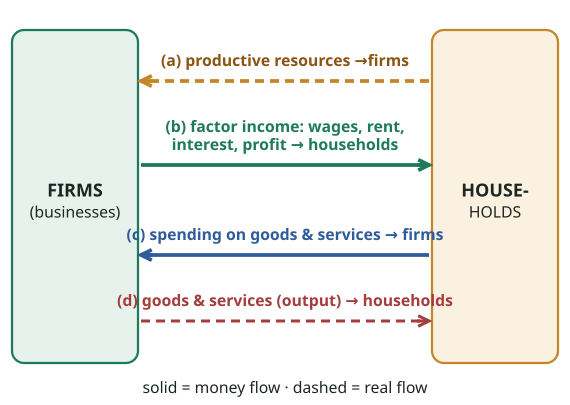
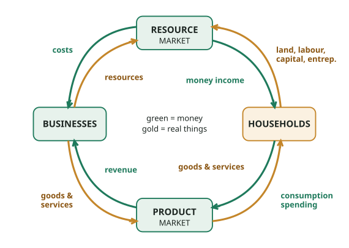

# FPEC 101 · Module 2 — Economic Systems & the Circular Flow
## মডিউল ২ — অর্থনৈতিক ব্যবস্থা ও আয়ের বৃত্তাকার প্রবাহ

_Lecture 2 · 20 slides · Midterm questions: Q4, Q5_

> Printable study note generated from the website. Each slide: slide text → Bangla translation → tutor explanation → example → exam tip.

---

## Big picture — what is this lecture about? · বড় ছবি — এই লেকচারে কী শিখব?

### English

**Concept:** Lecture 1 said every society must **choose** because resources are scarce. Lecture 2 asks: **who makes the choice?**

- In a **command (planned) economy**, the **government** decides.
- In a **market (free / capitalist / laissez-faire) economy**, **buyers and sellers** decide through prices.
- In a **mixed economy**, **both** decide: the market does most of it, the government steps in where the market fails.

Then the lecture shows **how money and goods move around** in an economy, the **circular flow of income** between households and businesses.

### What you will learn (5 jobs)
1. The **fundamental questions** every economy must answer: what, how, for whom (+ change and progress) (slide 4).
2. The **command system**: meaning, features, advantages, disadvantages (slides 5–8).
3. The **market system**: meaning, features (including the "invisible hand"), advantages, disadvantages (slides 9–11).
4. The **mixed system**: meaning, features, advantages, disadvantages (slides 12–15). Together these answer midterm **Q4**.
5. The **circular flow of income**: resource market and product market, real flows and money flows (slides 16–19). Midterm **Q5**.

### The 3-minute version
- Every economy must decide **what** to produce, **how** to produce it, and **for whom**; it must also **adapt to change** and **promote progress**.
- **Command:** government owns resources and plans everything. Good: equality, full employment, no exploitation by monopolies. Bad: bureaucracy, corruption, no profit incentive, little choice, planning mistakes.
- **Market:** private property, freedom of choice, competition, prices guide everything ("invisible hand"), small government. Good: freedom, efficiency, variety, flexibility. Bad: public goods neglected, inequality, monopolies, instability.
- **Mixed:** both private and public sectors. Good: necessities for all, competition plus protection. Bad: high taxes, bureaucracy, corruption, favouritism.
- **Circular flow:** households sell **resources** to businesses in the **resource market** and get **income** (wages, rent, interest, profit). They spend it on **goods and services** in the **product market**, which becomes **revenue** for businesses. Real things flow one way; money flows the opposite way.

**Exam tip:** **Q4** ("compare and contrast the economic systems") is a long answer: use a **comparison table**, then advantages and disadvantages. **Q5** needs the **circular flow diagram**: practise drawing it in 2 minutes.

### বাংলা

**ধারণা:** লেকচার ১ বলেছে, সম্পদ দুষ্প্রাপ্য বলে প্রতিটি সমাজকে **বেছে নিতে** হয়। লেকচার ২ জিজ্ঞেস করে: **বেছে নেয় কে?**

- **কমান্ড (পরিকল্পিত) অর্থনীতিতে** সিদ্ধান্ত নেয় **সরকার**।
- **বাজার (মুক্ত / পুঁজিবাদী / লেসে-ফেয়ার) অর্থনীতিতে** সিদ্ধান্ত নেয় **ক্রেতা ও বিক্রেতা**, দামের মাধ্যমে।
- **মিশ্র অর্থনীতিতে** সিদ্ধান্ত নেয় **দুই পক্ষই**: বেশিরভাগ বাজার করে, বাজার যেখানে ব্যর্থ সেখানে সরকার আসে।

তারপর লেকচারে দেখানো হয় অর্থনীতিতে **টাকা আর পণ্য কীভাবে ঘোরে** — পরিবার ও ব্যবসার মধ্যে **আয়ের বৃত্তাকার প্রবাহ**।

### তুমি কী শিখবে (৫টি কাজ)
1. প্রতিটি অর্থনীতিকে যে **মৌলিক প্রশ্নগুলোর** উত্তর দিতে হয়: কী, কীভাবে, কার জন্য (+ পরিবর্তন ও অগ্রগতি) (স্লাইড ৪)।
2. **কমান্ড ব্যবস্থা**: অর্থ, বৈশিষ্ট্য, সুবিধা, অসুবিধা (স্লাইড ৫–৮)।
3. **বাজার ব্যবস্থা**: অর্থ, বৈশিষ্ট্য ("অদৃশ্য হাত"সহ), সুবিধা, অসুবিধা (স্লাইড ৯–১১)।
4. **মিশ্র ব্যবস্থা**: অর্থ, বৈশিষ্ট্য, সুবিধা, অসুবিধা (স্লাইড ১২–১৫)। এগুলো মিলে মিডটার্ম **Q4**।
5. **আয়ের বৃত্তাকার প্রবাহ**: সম্পদ বাজার ও পণ্য বাজার, আসল প্রবাহ ও টাকার প্রবাহ (স্লাইড ১৬–১৯)। মিডটার্ম **Q5**।

### ৩ মিনিটের সারকথা
- প্রতিটি অর্থনীতিকে ঠিক করতে হয় **কী** উৎপাদন হবে, **কীভাবে** হবে, **কার জন্য** হবে; সাথে **পরিবর্তনের সাথে খাপ খাওয়ানো** ও **অগ্রগতি**।
- **কমান্ড:** সরকার সম্পদের মালিক, সব পরিকল্পনা করে। ভালো: সমতা, পূর্ণ কর্মসংস্থান, একচেটিয়া শোষণ নেই। খারাপ: আমলাতন্ত্র, দুর্নীতি, মুনাফার প্রেরণা নেই, পছন্দ কম, পরিকল্পনার ভুল।
- **বাজার:** ব্যক্তিগত সম্পত্তি, পছন্দের স্বাধীনতা, প্রতিযোগিতা, দামই সব চালায় ("অদৃশ্য হাত"), ছোট সরকার। ভালো: স্বাধীনতা, দক্ষতা, বৈচিত্র্য, নমনীয়তা। খারাপ: জনদ্রব্য অবহেলিত, বৈষম্য, একচেটিয়া, অস্থিরতা।
- **মিশ্র:** বেসরকারি ও সরকারি দুই খাতই। ভালো: সবার জন্য মৌলিক চাহিদা, প্রতিযোগিতা ও সুরক্ষা। খারাপ: উচ্চ কর, আমলাতন্ত্র, দুর্নীতি, স্বজনপ্রীতি।
- **বৃত্তাকার প্রবাহ:** পরিবার **সম্পদ বাজারে** ব্যবসাকে **সম্পদ** বিক্রি করে **আয়** পায় (মজুরি, খাজনা, সুদ, মুনাফা)। সেই আয় **পণ্য বাজারে** **পণ্য ও সেবায়** খরচ করে, যা ব্যবসার **রাজস্ব** হয়। আসল জিনিস এক দিকে ঘোরে; টাকা ঘোরে উল্টো দিকে।

**পরীক্ষার টিপস:** **Q4** ("অর্থনৈতিক ব্যবস্থাগুলোর তুলনা করো") বড় প্রশ্ন: **তুলনামূলক ছক**, তারপর সুবিধা-অসুবিধা লেখো। **Q5**-এ **বৃত্তাকার প্রবাহের চিত্র** লাগবে: ২ মিনিটে আঁকা অনুশীলন করো।

---

## Key words · মূল শব্দ

| Term | Meaning | বাংলা অর্থ | Example |
|---|---|---|---|
| Economy | An area (any size) where people make or produce goods and services | অর্থনীতি — যে এলাকায় মানুষ পণ্য ও সেবা উৎপাদন করে | A village, Bangladesh, the world. |
| Economic system | The way a society answers what, how and for whom to produce | অর্থনৈতিক ব্যবস্থা — কী, কীভাবে, কার জন্য উৎপাদন হবে তা ঠিক করার পদ্ধতি | Command, market, mixed. |
| Command / planned economy | Government owns resources and decides everything | কমান্ড / পরিকল্পিত অর্থনীতি — সরকার সম্পদের মালিক ও সব সিদ্ধান্ত নেয় | The former Soviet Union, North Korea. |
| Market / capitalist / laissez-faire economy | Private owners decide through prices; very little government | বাজার / পুঁজিবাদী / লেসে-ফেয়ার অর্থনীতি — দামের মাধ্যমে ব্যক্তিমালিক সিদ্ধান্ত নেয় | The USA comes closest. |
| Mixed economy | Private sector + public (government) sector together | মিশ্র অর্থনীতি — বেসরকারি ও সরকারি খাত একসাথে | Bangladesh, India, UK. |
| Laissez-faire | French: "let it be" — the government leaves the market alone | লেসে-ফেয়ার — ফরাসি "ছেড়ে দাও"; সরকার বাজারে হস্তক্ষেপ করে না | No price controls, no state companies. |
| Invisible hand | Adam Smith's idea: self-interest + competition, guided by prices, serves society | অদৃশ্য হাত — অ্যাডাম স্মিথের ধারণা: দাম দ্বারা চালিত স্বার্থ ও প্রতিযোগিতা সমাজের উপকার করে | A baker bakes for profit, and you get bread. |
| Public goods | Goods for everyone that the private sector does not supply | জনদ্রব্য — সবার জন্য, বেসরকারি খাত সাধারণত দেয় না | Street lights, national defence. |
| Merit goods | Goods good for people that would be under-consumed | মেরিট দ্রব্য — উপকারী কিন্তু কম ভোগ হয় এমন পণ্য | Education, vaccines. |
| Demerit goods | Harmful goods that would be over-consumed | ডিমেরিট দ্রব্য — ক্ষতিকর, বেশি ভোগ হয় এমন পণ্য | Cigarettes, drugs, alcohol. |
| Bureaucracy | Large system of government officials and committees | আমলাতন্ত্র — সরকারি কর্মকর্তা ও কমিটির বড় ব্যবস্থা | Needing 10 signatures for a trade licence. |
| Circular flow of income | Model of money and resources moving between households and businesses | আয়ের বৃত্তাকার প্রবাহ — পরিবার ও ব্যবসার মধ্যে টাকা ও সম্পদের চলাচল | Wage → shopping → company revenue → wage again. |
| Resource (factor) market | Where resources (land, labour, capital, enterprise) are bought and sold | সম্পদ (উপাদান) বাজার — যেখানে ভূমি, শ্রম, মূলধন, উদ্যোগ কেনাবেচা হয় | A job market, land rental. |
| Product market | Where goods and services are bought and sold | পণ্য বাজার — যেখানে পণ্য ও সেবা কেনাবেচা হয় | Shops, Daraz, bazaars. |

---

## Slides 1–3 · Title, topic and outline
### শিরোনাম, বিষয় ও রূপরেখা

> **Slide 1**
> PRINCIPLES OF ECONOMICSSalimah Musharrif
> FPEC 101 – LECTURE 2 Unit 1
>
> **Slide 2**
> The Market system & Circular Flow
>
> **Slide 3**
> Outline
> Fundamental questions
> Planned Economic System
> Free Market System
> Mixed Economic System
> Circular Flow of Income
>

**বাংলা অনুবাদ:**

> **স্লাইড ১:** প্রিন্সিপলস অব ইকোনমিক্স — সালিমাহ মুশাররিফ। FPEC 101 – লেকচার ২, ইউনিট ১।
> **স্লাইড ২:** বাজার ব্যবস্থা ও বৃত্তাকার প্রবাহ
> **স্লাইড ৩ — রূপরেখা:** মৌলিক প্রশ্নসমূহ · পরিকল্পিত অর্থনৈতিক ব্যবস্থা · মুক্ত বাজার ব্যবস্থা · মিশ্র অর্থনৈতিক ব্যবস্থা · আয়ের বৃত্তাকার প্রবাহ

**Tutor explains:** Lecture 2 has **two halves**. The first half (slides 4–15) compares **three economic systems**. The second half (slides 16–19) shows the **circular flow of income**. Syllabus reading: McConnell & Brue, pages 29–41.
Note that "Planned" = "Command" and "Free market" = "Market / Capitalist / Laissez-faire". The slides use these names interchangeably, and so can you.

**টিউটরের ব্যাখ্যা:** লেকচার ২-এর **দুটি ভাগ**। প্রথম ভাগে (স্লাইড ৪–১৫) **তিনটি অর্থনৈতিক ব্যবস্থার** তুলনা। দ্বিতীয় ভাগে (স্লাইড ১৬–১৯) **আয়ের বৃত্তাকার প্রবাহ**। সিলেবাসের পড়া: ম্যাককনেল ও ব্রু, পৃষ্ঠা ২৯–৪১।
খেয়াল করো: "Planned" = "Command", আর "Free market" = "Market / Capitalist / Laissez-faire"। স্লাইডে নামগুলো একটার বদলে আরেকটা ব্যবহার হয়েছে; তুমিও তা করতে পারো।

**Exam tip:** In Q4 write all the names once: "command (planned)", "market (free, capitalist, laissez-faire)" and "mixed".

**পরীক্ষার টিপস:** Q4-এ সব নাম একবার লিখে দাও: "command (planned)", "market (free, capitalist, laissez-faire)" ও "mixed"।

---

## Slide 4 · The fundamental questions
### মৌলিক প্রশ্নসমূহ

> The Fundamental Questions
> An economy is an area in which people make or produce goods and services. It may be of any size. The major problem in all the economies is what, how and for whom to produce in order to allocate scarce resources.
> What goods and services will be produced?
> How will the goods and services be produced?
> Who will get the goods and services?
> How will the system accommodate change?
> How will the system promote progress?
>

**বাংলা অনুবাদ:**

> মৌলিক প্রশ্নসমূহ
> অর্থনীতি হলো এমন একটি এলাকা যেখানে মানুষ পণ্য ও সেবা তৈরি বা উৎপাদন করে। এটি যেকোনো আকারের হতে পারে। সব অর্থনীতির প্রধান সমস্যা হলো দুষ্প্রাপ্য সম্পদ বণ্টনের জন্য কী, কীভাবে ও কার জন্য উৎপাদন করা হবে।
> কোন পণ্য ও সেবা উৎপাদন করা হবে?
> পণ্য ও সেবা কীভাবে উৎপাদন করা হবে?
> পণ্য ও সেবা কে পাবে?
> ব্যবস্থাটি পরিবর্তনের সাথে কীভাবে খাপ খাওয়াবে?
> ব্যবস্থাটি কীভাবে অগ্রগতিকে উৎসাহিত করবে?

**Tutor explains:** Because of scarcity (Lecture 1), **every** economy, whatever its size, must answer the same questions. Think of them as five jobs:
**What to produce?** Rice or jute? Hospitals or highways? Phones or fans?**How to produce?** With many workers and few machines (labour-intensive) or few workers and many machines (capital-intensive)? Which technology?**For whom to produce? (Who gets the goods?)** Who gets the output: the people with the most money, everyone equally, the people who need it most?**How will the system accommodate change?** Tastes, technology and resources change. How does the economy notice and react?**How will the system promote progress?** How does it encourage new ideas, investment and growth?
The **three economic systems** are simply **three different ways of answering these five questions**: the government answers (command), prices answer (market), or both answer (mixed).

**টিউটরের ব্যাখ্যা:** দুষ্প্রাপ্যতার কারণে (লেকচার ১) **প্রতিটি** অর্থনীতিকে, আকার যা-ই হোক, একই প্রশ্নের উত্তর দিতে হয়। এগুলোকে পাঁচটি কাজ ভাবো:
**কী উৎপাদন হবে?** ধান না পাট? হাসপাতাল না মহাসড়ক? ফোন না ফ্যান?**কীভাবে উৎপাদন হবে?** অনেক শ্রমিক ও অল্প যন্ত্র (শ্রমনির্ভর), নাকি অল্প শ্রমিক ও অনেক যন্ত্র (মূলধননির্ভর)? কোন প্রযুক্তি?**কার জন্য উৎপাদন হবে? (পণ্য কে পাবে?)** যাদের বেশি টাকা আছে, সবাই সমানভাবে, নাকি যাদের সবচেয়ে বেশি দরকার?**ব্যবস্থাটি পরিবর্তনের সাথে কীভাবে খাপ খাওয়াবে?** রুচি, প্রযুক্তি, সম্পদ বদলায়। অর্থনীতি কীভাবে টের পায় ও সাড়া দেয়?**ব্যবস্থাটি কীভাবে অগ্রগতি আনবে?** নতুন ধারণা, বিনিয়োগ ও প্রবৃদ্ধিকে কীভাবে উৎসাহিত করে?
**তিনটি অর্থনৈতিক ব্যবস্থা** আসলে এই পাঁচ প্রশ্নের উত্তর দেওয়ার **তিনটি আলাদা উপায়**: সরকার উত্তর দেয় (কমান্ড), দাম উত্তর দেয় (বাজার), বা দুটোই (মিশ্র)।

**Real-life example:** **A family is a tiny economy.** Your mother decides **what** to cook (fish curry or dal), **how** (gas stove or rice cooker), and **for whom** (the guest gets the biggest piece of fish!). When the price of fish rises, the family **adapts** (more dal). When the family buys a fridge, cooking becomes easier: **progress**.
**Bangladesh:** the market decides most of what is produced (garments, because the world buys them); the government decides some (the Padma Bridge, free primary textbooks).

**বাস্তব উদাহরণ:** **একটি পরিবার একটি ছোট অর্থনীতি।** তোমার মা ঠিক করেন **কী** রান্না হবে (মাছের তরকারি না ডাল), **কীভাবে** (গ্যাসের চুলা না রাইস কুকার), আর **কার জন্য** (মেহমান মাছের সবচেয়ে বড় টুকরো পান!)। মাছের দাম বাড়লে পরিবার **খাপ খাওয়ায়** (বেশি ডাল)। ফ্রিজ কিনলে রান্না সহজ হয়: **অগ্রগতি**।
**বাংলাদেশ:** কী উৎপাদন হবে তার বেশিরভাগ বাজার ঠিক করে (গার্মেন্টস, কারণ বিশ্ব কেনে); কিছু সরকার ঠিক করে (পদ্মা সেতু, বিনামূল্যে প্রাথমিকের বই)।

**Exam tip:** Begin Q4 with these questions: **"Every economy must decide what, how and for whom to produce. Economic systems differ in who answers these questions."**

**পরীক্ষার টিপস:** Q4 এই প্রশ্নগুলো দিয়ে শুরু করো: **"Every economy must decide what, how and for whom to produce. Economic systems differ in who answers these questions."**

---

## Slide 5 · Command economy: meaning
### কমান্ড অর্থনীতি: অর্থ

> Economic systems- Command
> Under this type of economy, the government decides the fundamental questions.
> Ownership and control of economic resources is by the government.
> Government provides jobs, houses, transport and all other necessities to the people.
> There is no private ownership
> Profit is redistributed in the economy
>

**বাংলা অনুবাদ:**

> অর্থনৈতিক ব্যবস্থা — কমান্ড
> এই ধরনের অর্থনীতিতে সরকার মৌলিক প্রশ্নগুলোর সিদ্ধান্ত নেয়।
> অর্থনৈতিক সম্পদের মালিকানা ও নিয়ন্ত্রণ সরকারের।
> সরকার মানুষকে চাকরি, বাড়ি, যাতায়াত ও অন্যান্য সব প্রয়োজনীয় জিনিস দেয়।
> কোনো ব্যক্তিগত মালিকানা নেই।
> মুনাফা অর্থনীতিতে পুনর্বণ্টন করা হয়।

**Tutor explains:** In a **command (centrally planned) economy**, the **government is the boss of the economy**:
It answers **what, how and for whom** through **plans** made by committees (often 5-year plans).It **owns and controls** the resources: land, factories, mines, banks.It **provides** jobs, houses, transport and other necessities.There is **no private ownership** of resources (you may own your clothes, but not a factory).Any **profit** made by state enterprises goes to the state and is **redistributed** to the people (through services, wages, subsidies), not kept by private owners.

**টিউটরের ব্যাখ্যা:** **কমান্ড (কেন্দ্রীয়ভাবে পরিকল্পিত) অর্থনীতিতে** **সরকারই অর্থনীতির মালিক-কর্তা**:
কমিটির **পরিকল্পনা** (প্রায়ই পঞ্চবার্ষিক) দিয়ে **কী, কীভাবে, কার জন্য**-এর উত্তর দেয়।সম্পদের **মালিক ও নিয়ন্ত্রক**: জমি, কারখানা, খনি, ব্যাংক।চাকরি, বাড়ি, যাতায়াত ও অন্য প্রয়োজনীয় জিনিস **সরবরাহ করে**।সম্পদের **কোনো ব্যক্তিগত মালিকানা নেই** (নিজের কাপড়ের মালিক হতে পারো, কারখানার নয়)।রাষ্ট্রীয় প্রতিষ্ঠানের **মুনাফা** রাষ্ট্রের কাছে যায় এবং মানুষের মধ্যে **পুনর্বণ্টন** হয় (সেবা, মজুরি, ভর্তুকির মাধ্যমে); ব্যক্তিমালিক রাখে না।

**Real-life example:** The **Soviet Union (1922–1991)** decided in Moscow how many tractors, shoes and loaves of bread each factory should make. **North Korea** and, to a large extent, **Cuba** are examples today. In Bangladesh, you can see a small "command" corner in **state-owned enterprises** such as Bangladesh Railway, where the government decides fares and routes.

**বাস্তব উদাহরণ:** **সোভিয়েত ইউনিয়ন (১৯২২–১৯৯১)** মস্কো থেকে ঠিক করত প্রতিটি কারখানা কত ট্রাক্টর, জুতা আর রুটি বানাবে। আজকের উদাহরণ **উত্তর কোরিয়া** এবং অনেকাংশে **কিউবা**। বাংলাদেশে এর ছোট একটা "কমান্ড" অংশ দেখা যায় **রাষ্ট্রায়ত্ত প্রতিষ্ঠানে**, যেমন বাংলাদেশ রেলওয়ে, যেখানে সরকার ভাড়া ও রুট ঠিক করে।

**Exam tip:** Definition line: **"A command economy is one in which the government owns and controls economic resources and decides what, how and for whom to produce."**

**পরীক্ষার টিপস:** সংজ্ঞার লাইন: **"A command economy is one in which the government owns and controls economic resources and decides what, how and for whom to produce."**

---

## Slide 6 · Command economy: features
### কমান্ড অর্থনীতি: বৈশিষ্ট্য

> Economic systems- Command
> Features
> Public ownership of all resources
> Public wealth is greater than private wealth
> There is a high degree of government control
> There is equal distribution of wealth
> There is a large bureaucracy, that is, planning committees etc
> There’s a lack of consumer goods and luxuries as the focus is on the provision of public and merit goods
> There is greater economic stability as the government controls and so there are no shortages and surpluses, booms and slumps etc
>

**বাংলা অনুবাদ:**

> অর্থনৈতিক ব্যবস্থা — কমান্ড
> **বৈশিষ্ট্যসমূহ**
> সব সম্পদের সরকারি (জনগণের) মালিকানা
> সরকারি সম্পদ ব্যক্তিগত সম্পদের চেয়ে বেশি
> সরকারি নিয়ন্ত্রণের মাত্রা অনেক বেশি
> সম্পদের সমান বণ্টন
> বিশাল আমলাতন্ত্র, অর্থাৎ পরিকল্পনা কমিটি ইত্যাদি
> ভোগ্যপণ্য ও বিলাসদ্রব্যের অভাব থাকে, কারণ মনোযোগ থাকে জনদ্রব্য ও মেরিট দ্রব্য সরবরাহে
> অর্থনৈতিক স্থিতিশীলতা বেশি, কারণ সরকার নিয়ন্ত্রণ করে; তাই ঘাটতি-উদ্বৃত্ত, তেজি-মন্দা ইত্যাদি থাকে না

**Tutor explains:** Seven features. A trick to remember them: **"P-P-H-E-B-L-S"**:
**Public ownership** of all resources.**Public wealth > private wealth**: the state is richer than any person.**High degree of government control** over prices, wages, production.**Equal distribution of wealth**: incomes are kept close together.**Big bureaucracy**: planning committees, ministries, officials.**Lack of consumer goods and luxuries**: the plan focuses on **public goods** (defence, roads) and **merit goods** (education, health), not on fancy items.**Stability**: the state sets prices and output, so in theory there are **no shortages or surpluses, booms or slumps** (the ups and downs of a market economy).
**Tutor's note:** the slide states the theory. In practice, command economies often had **hidden** shortages, such as long queues for bread in the Soviet Union, even if official prices did not move.

**টিউটরের ব্যাখ্যা:** সাতটি বৈশিষ্ট্য। মনে রাখার কৌশল: **"P-P-H-E-B-L-S"**:
সব সম্পদের **সরকারি মালিকানা**।**সরকারি সম্পদ > ব্যক্তিগত সম্পদ**: রাষ্ট্র যেকোনো ব্যক্তির চেয়ে ধনী।দাম, মজুরি, উৎপাদনে **সরকারি নিয়ন্ত্রণ অনেক বেশি**।**সম্পদের সমান বণ্টন**: আয়ের ব্যবধান কম রাখা হয়।**বিশাল আমলাতন্ত্র**: পরিকল্পনা কমিটি, মন্ত্রণালয়, কর্মকর্তা।**ভোগ্যপণ্য ও বিলাসদ্রব্যের অভাব**: পরিকল্পনার মনোযোগ **জনদ্রব্যে** (প্রতিরক্ষা, রাস্তা) ও **মেরিট দ্রব্যে** (শিক্ষা, স্বাস্থ্য), শৌখিন জিনিসে নয়।**স্থিতিশীলতা**: রাষ্ট্র দাম ও উৎপাদন ঠিক করে, তাই তত্ত্বে **ঘাটতি বা উদ্বৃত্ত, তেজি বা মন্দা** (বাজার অর্থনীতির ওঠানামা) থাকে না।
**টিউটরের নোট:** স্লাইডে তত্ত্বটা বলা হয়েছে। বাস্তবে কমান্ড অর্থনীতিতে প্রায়ই **লুকানো** ঘাটতি থাকত — যেমন সোভিয়েত ইউনিয়নে রুটির জন্য লম্বা লাইন — যদিও সরকারি দাম বদলাত না।

**Exam tip:** List at least 5 features in Q4 using the slide's exact words ("public ownership", "high degree of government control", "large bureaucracy").

**পরীক্ষার টিপস:** Q4-এ স্লাইডের হুবহু শব্দে অন্তত ৫টি বৈশিষ্ট্য লেখো ("public ownership", "high degree of government control", "large bureaucracy")।

---

## Slide 7 · Command economy: advantages
### কমান্ড অর্থনীতি: সুবিধা

> Economic systems- Command
> Advantages
> Equitable distribution of wealth and equality for all
> Full employment
> Proper utilization of resources
> Diseconomies or external costs are lower as the government takes care not to pollute etc even if profit is low
> Consumers are protected from monopolies
>

**বাংলা অনুবাদ:**

> অর্থনৈতিক ব্যবস্থা — কমান্ড
> **সুবিধাসমূহ**
> সম্পদের ন্যায্য বণ্টন ও সবার জন্য সমতা
> পূর্ণ কর্মসংস্থান
> সম্পদের সঠিক ব্যবহার
> বাহ্যিক ব্যয় বা অসুবিধা (diseconomies / external costs) কম, কারণ মুনাফা কম হলেও সরকার দূষণ না করার দিকে খেয়াল রাখে
> ভোক্তারা একচেটিয়া কারবার থেকে সুরক্ষিত থাকে

**Tutor explains:** Why might a country choose central planning? Five advantages:
**Equitable distribution and equality:** no super-rich and no extreme poor; everyone gets the basics.**Full employment:** the state gives everyone a job.**Proper use of resources:** in theory, the plan sends resources to what society needs most, not to what earns the most profit.**Lower external costs (diseconomies):** an **external cost** is harm to people outside a deal, such as pollution. A private firm may pollute to save money; the state can choose not to pollute **even if profit is low**. (External costs return in Lecture 15.)**No monopoly exploitation:** a private monopoly could charge very high prices; when the state owns the industry, consumers are protected from that.

**টিউটরের ব্যাখ্যা:** একটি দেশ কেন কেন্দ্রীয় পরিকল্পনা বেছে নিতে পারে? পাঁচটি সুবিধা:
**ন্যায্য বণ্টন ও সমতা:** অতি ধনী বা চরম দরিদ্র নেই; সবাই মৌলিক জিনিস পায়।**পূর্ণ কর্মসংস্থান:** রাষ্ট্র সবাইকে চাকরি দেয়।**সম্পদের সঠিক ব্যবহার:** তত্ত্বে, পরিকল্পনা সম্পদকে সমাজের সবচেয়ে প্রয়োজনীয় কাজে পাঠায়, সবচেয়ে লাভজনক কাজে নয়।**বাহ্যিক ব্যয় কম:** **বাহ্যিক ব্যয়** হলো লেনদেনের বাইরের মানুষের ক্ষতি, যেমন দূষণ। বেসরকারি ফার্ম টাকা বাঁচাতে দূষণ করতে পারে; রাষ্ট্র **মুনাফা কম হলেও** দূষণ না করার সিদ্ধান্ত নিতে পারে। (লেকচার ১৫-এ বাহ্যিক ব্যয় আবার আসবে।)**একচেটিয়া শোষণ নেই:** বেসরকারি একচেটিয়া কারবার খুব বেশি দাম নিতে পারে; শিল্পটা রাষ্ট্রের হলে ভোক্তা তা থেকে সুরক্ষিত।

**Real-life example:** Imagine electricity in Bangladesh were owned by one private company with no rules: it could charge Tk 50 per unit. Because the government (through BPDB and its regulators) controls electricity prices, households are protected. That is the "protection from monopolies" advantage.

**বাস্তব উদাহরণ:** ধরো বাংলাদেশের বিদ্যুৎ একটা বেসরকারি কোম্পানির হাতে, কোনো নিয়ম নেই: ইউনিটপ্রতি ৫০ টাকা নিতে পারত। সরকার (বিপিডিবি ও নিয়ন্ত্রক সংস্থার মাধ্যমে) বিদ্যুতের দাম নিয়ন্ত্রণ করে বলে পরিবারগুলো সুরক্ষিত। এটাই "একচেটিয়া থেকে সুরক্ষা" সুবিধা।

---

## Slide 8 · Command economy: disadvantages
### কমান্ড অর্থনীতি: অসুবিধা

> Economic systems- Command
> Disadvantages
> Sooner or later trade must take place
> A large bureaucracy means more corruption
> There is no profit incentive
> The system is unfair as even if a person has the ability to get a higher income, he is unable to do so
> Lesser variety of products
> Lesser individual freedom
> The government may misallocate resources as it may miscalculate the amounts of products needed to be produced
> The opportunity cost of planners is high, meaning that the time which the bureaucracy spends in planning may be used by them to produce something
>

**বাংলা অনুবাদ:**

> অর্থনৈতিক ব্যবস্থা — কমান্ড
> **অসুবিধাসমূহ**
> আগে বা পরে বাণিজ্য করতেই হয়
> বিশাল আমলাতন্ত্র মানে বেশি দুর্নীতি
> মুনাফার কোনো প্রেরণা নেই
> ব্যবস্থাটি অন্যায্য, কারণ কারো বেশি আয়ের যোগ্যতা থাকলেও সে তা করতে পারে না
> পণ্যের বৈচিত্র্য কম
> ব্যক্তিস্বাধীনতা কম
> সরকার সম্পদের ভুল বণ্টন করতে পারে, কারণ কোন পণ্য কত দরকার তা ভুল হিসাব করতে পারে
> পরিকল্পনাকারীদের সুযোগ ব্যয় বেশি, অর্থাৎ আমলারা পরিকল্পনায় যে সময় ব্যয় করে, সেই সময়ে তারা কিছু উৎপাদন করতে পারত

**Tutor explains:** Eight problems, explained simply:
**Trade must happen sooner or later:** no country can make everything itself; even a planned economy has to trade with others, and the plan cannot fully control that.**More corruption:** a huge bureaucracy controls everything, so officials can ask for bribes.**No profit incentive:** if you cannot keep the profit, why work harder or invent something new? Effort and innovation fall.**Unfair to the able:** a talented, hard-working person earns about the same as a lazy one.**Less variety:** one or two brands of everything.**Less individual freedom:** the state decides your job, your house, sometimes where you live.**Misallocation:** planners must **guess** how many shoes, how much rice, in what sizes and colours. They often guess wrong, so there are piles of unwanted goods and shortages of wanted ones.**High opportunity cost of planners:** thousands of clever people spend their time filling in plans. Their next best alternative, actually producing goods, is lost (Lecture 1's opportunity cost idea again!).

**টিউটরের ব্যাখ্যা:** আটটি সমস্যা, সহজ ভাষায়:
**আগে বা পরে বাণিজ্য করতেই হয়:** কোনো দেশ সব কিছু নিজে বানাতে পারে না; পরিকল্পিত অর্থনীতিকেও অন্য দেশের সাথে বাণিজ্য করতে হয়, আর পরিকল্পনা তা পুরো নিয়ন্ত্রণ করতে পারে না।**বেশি দুর্নীতি:** বিশাল আমলাতন্ত্র সব নিয়ন্ত্রণ করে, তাই কর্মকর্তারা ঘুষ চাইতে পারে।**মুনাফার প্রেরণা নেই:** মুনাফা নিজের কাছে রাখতে না পারলে কেন বেশি খাটবে বা নতুন কিছু আবিষ্কার করবে? পরিশ্রম ও উদ্ভাবন কমে।**যোগ্যদের প্রতি অন্যায়:** মেধাবী, পরিশ্রমী মানুষ আর অলস মানুষ প্রায় সমান আয় করে।**বৈচিত্র্য কম:** সব জিনিসের এক-দুটো ব্র্যান্ড।**ব্যক্তিস্বাধীনতা কম:** রাষ্ট্র ঠিক করে তোমার চাকরি, বাড়ি, কখনো কোথায় থাকবে।**ভুল বণ্টন:** পরিকল্পনাকারীদের **অনুমান** করতে হয় কত জুতা, কত চাল, কোন মাপ-রং। প্রায়ই ভুল হয়, তাই অপ্রয়োজনীয় জিনিসের স্তূপ আর প্রয়োজনীয় জিনিসের ঘাটতি।**পরিকল্পনাকারীদের সুযোগ ব্যয় বেশি:** হাজারো মেধাবী মানুষ পরিকল্পনা লিখে সময় কাটায়। তাদের পরবর্তী সেরা বিকল্প — আসলে পণ্য উৎপাদন — হারিয়ে যায় (লেকচার ১-এর সুযোগ ব্যয়ের ধারণা আবার!)।

**Real-life example:** In the Soviet Union, a nail factory was once judged by the **weight** of nails produced, so it made a few huge, useless nails. When judged by the **number** of nails, it made millions of tiny ones. This famous story shows **misallocation** and the lack of price signals.

**বাস্তব উদাহরণ:** সোভিয়েত ইউনিয়নে একবার একটি পেরেক কারখানার কাজ মাপা হতো উৎপাদিত পেরেকের **ওজন** দিয়ে, তাই তারা অল্প কয়েকটা বিশাল, অকেজো পেরেক বানাত। যখন **সংখ্যা** দিয়ে মাপা হলো, তখন লক্ষ লক্ষ ছোট্ট পেরেক বানাল। এই বিখ্যাত গল্প **ভুল বণ্টন** ও দামের সংকেতের অভাব দেখায়।

**Exam tip:** In a compare-and-contrast answer, pair each system's advantages with its disadvantages. Examiners like balance.

**পরীক্ষার টিপস:** তুলনা-বৈসাদৃশ্যের উত্তরে প্রতিটি ব্যবস্থার সুবিধার পাশে অসুবিধা লেখো। পরীক্ষকেরা ভারসাম্য পছন্দ করেন।

---

## Quick check · দ্রুত যাচাই

1. In a command economy, the fundamental questions are answered by…  
   কমান্ড অর্থনীতিতে মৌলিক প্রশ্নের উত্তর দেয়…

   - A) Consumers through prices · দামের মাধ্যমে ভোক্তা
   - B) The government · সরকার
   - C) Private firms · বেসরকারি ফার্ম
   - D) Foreign countries · বিদেশি রাষ্ট্র

   **Answer: B** — Slide 5: under this type of economy, the government decides the fundamental questions.  
   স্লাইড ৫: এই ধরনের অর্থনীতিতে সরকার মৌলিক প্রশ্নগুলোর সিদ্ধান্ত নেয়।

2. "There is no profit incentive" is a disadvantage of the command system because…  
   "মুনাফার প্রেরণা নেই" কমান্ড ব্যবস্থার অসুবিধা কারণ…

   - A) Prices are too high · দাম খুব বেশি
   - B) People have less reason to work harder or innovate · মানুষের বেশি খাটার বা উদ্ভাবনের কারণ কম থাকে
   - C) There are too many monopolies · একচেটিয়া খুব বেশি
   - D) Taxes are low · কর কম

   **Answer: B** — If you cannot keep the reward, effort and new ideas fall.  
   পুরস্কার রাখতে না পারলে পরিশ্রম ও নতুন ধারণা কমে যায়।

3. "How will the goods be produced?" asks about…  
   "পণ্য কীভাবে উৎপাদন হবে?" প্রশ্নটি জিজ্ঞেস করে…

   - A) Which goods · কোন পণ্য
   - B) The method and technology · পদ্ধতি ও প্রযুক্তি
   - C) Who receives the goods · কে পণ্য পাবে
   - D) The price · দাম

   **Answer: B** — HOW = which combination of resources and technology to use (labour-intensive or capital-intensive).  
   কীভাবে = কোন সম্পদ ও প্রযুক্তির সমন্বয় ব্যবহার হবে (শ্রমনির্ভর না মূলধননির্ভর)।

---

## Slide 9 · Market economy: meaning and features
### বাজার অর্থনীতি: অর্থ ও বৈশিষ্ট্য

> Economic systems-Market /Capitalistic/Laissez faire
> A market economy depends on producers and consumers to make decisions about what, how and for whom to produce. There is no thought of a free economy in the world in its truest sense, but U.S.A comes the closest to it.
> Ownership and control of the economic resources
> All resources are privately owned by the people and the firms. Products that are in demand are produced. People own private property, business, cars etc
> Features
> Private Property
> Freedom of enterprise and choice, job, business, spending etc
> Competition
> Very limited role of government
> Reliance on price system – Invisible hand
>

**বাংলা অনুবাদ:**

> অর্থনৈতিক ব্যবস্থা — বাজার / পুঁজিবাদী / লেসে-ফেয়ার
> বাজার অর্থনীতি কী, কীভাবে ও কার জন্য উৎপাদন হবে সে সিদ্ধান্তের জন্য উৎপাদক ও ভোক্তার ওপর নির্ভর করে। প্রকৃত অর্থে মুক্ত অর্থনীতির কোনো ধারণা পৃথিবীতে নেই, তবে যুক্তরাষ্ট্র এর সবচেয়ে কাছাকাছি।
> **অর্থনৈতিক সম্পদের মালিকানা ও নিয়ন্ত্রণ:** সব সম্পদ মানুষ ও ফার্মের ব্যক্তিগত মালিকানায়। যে পণ্যের চাহিদা আছে তা উৎপাদিত হয়। মানুষ ব্যক্তিগত সম্পত্তি, ব্যবসা, গাড়ি ইত্যাদির মালিক।
> **বৈশিষ্ট্য:** ব্যক্তিগত সম্পত্তি · উদ্যোগ ও পছন্দের স্বাধীনতা (চাকরি, ব্যবসা, খরচ ইত্যাদি) · প্রতিযোগিতা · সরকারের খুব সীমিত ভূমিকা · দামের ব্যবস্থার ওপর নির্ভরতা — অদৃশ্য হাত

**Tutor explains:** In a **market economy**, nobody is "in charge". Millions of **producers and consumers** make their own decisions, and **prices** coordinate them.
**What?** Whatever people are willing to **buy** at a price that gives producers a **profit**: "products that are in demand are produced".**How?** The **cheapest** method, because firms want profit.**For whom?** For those who can **pay** (who have income from selling their resources).
**Five features:** 1. **Private property:** people and firms own land, factories, shops, cars. 2. **Freedom of enterprise and choice:** start any business, take any job, spend your money as you like. 3. **Competition:** many sellers compete for buyers, which keeps quality up and prices down. 4. **Very limited role of government:** mainly to protect property and enforce contracts ("laissez-faire" = "let it be"). 5. **Reliance on the price system: the "invisible hand".** Adam Smith (1776) said that when each person follows their own self-interest in a competitive market, prices guide them **as if by an invisible hand** to do what society wants.
The slide also says **no pure free economy exists**; the **USA comes closest**.

**টিউটরের ব্যাখ্যা:** **বাজার অর্থনীতিতে** কেউ "দায়িত্বে" নেই। লক্ষ লক্ষ **উৎপাদক ও ভোক্তা** নিজেদের সিদ্ধান্ত নেয়, আর **দাম** তাদের সমন্বয় করে।
**কী?** মানুষ যে দামে **কিনতে** রাজি এবং যাতে উৎপাদকের **মুনাফা** হয়: "যে পণ্যের চাহিদা আছে তা উৎপাদিত হয়"।**কীভাবে?** **সবচেয়ে সস্তা** পদ্ধতিতে, কারণ ফার্ম মুনাফা চায়।**কার জন্য?** যারা **দাম দিতে** পারে (সম্পদ বিক্রি করে যাদের আয় আছে)।
**পাঁচটি বৈশিষ্ট্য:** 1. **ব্যক্তিগত সম্পত্তি:** মানুষ ও ফার্ম জমি, কারখানা, দোকান, গাড়ির মালিক। 2. **উদ্যোগ ও পছন্দের স্বাধীনতা:** যেকোনো ব্যবসা শুরু করো, যেকোনো চাকরি নাও, টাকা যেভাবে খুশি খরচ করো। 3. **প্রতিযোগিতা:** অনেক বিক্রেতা ক্রেতার জন্য প্রতিযোগিতা করে, ফলে মান বাড়ে ও দাম কম থাকে। 4. **সরকারের খুব সীমিত ভূমিকা:** মূলত সম্পত্তি রক্ষা ও চুক্তি কার্যকর করা ("লেসে-ফেয়ার" = "ছেড়ে দাও")। 5. **দামের ব্যবস্থার ওপর নির্ভরতা: "অদৃশ্য হাত"।** অ্যাডাম স্মিথ (১৭৭৬) বলেছিলেন, প্রতিযোগিতামূলক বাজারে প্রত্যেকে নিজের স্বার্থ অনুসরণ করলে দাম তাদের এমনভাবে চালায় **যেন একটি অদৃশ্য হাত** তাদের সমাজের চাওয়া কাজটি করাচ্ছে।
স্লাইডে আরও আছে: **বিশুদ্ধ মুক্ত অর্থনীতি কোথাও নেই**; **যুক্তরাষ্ট্র সবচেয়ে কাছাকাছি**।

**Real-life example:** **The invisible hand on Eid:** before Eid-ul-Adha, demand for cattle rises, so prices rise. Farmers in Kushtia and Sirajganj, only thinking about their own profit, raise and bring more cattle to Dhaka. Nobody ordered them to. Prices guided them to supply what Dhaka wanted. That is the invisible hand.

**বাস্তব উদাহরণ:** **ঈদে অদৃশ্য হাত:** ঈদুল আজহার আগে গরুর চাহিদা বাড়ে, তাই দাম বাড়ে। কুষ্টিয়া ও সিরাজগঞ্জের খামারিরা শুধু নিজেদের মুনাফার কথা ভেবে বেশি গরু পালন করে ঢাকায় আনেন। কেউ তাদের আদেশ দেয়নি। দামই তাদের ঢাকার চাওয়া জিনিস জোগাতে চালিত করেছে। এটাই অদৃশ্য হাত।

**Exam tip:** Mention **Adam Smith** and the **invisible hand** in Q4. It shows depth and earns marks.

**পরীক্ষার টিপস:** Q4-এ **অ্যাডাম স্মিথ** ও **অদৃশ্য হাত** উল্লেখ করো। এতে গভীরতা দেখায় ও নম্বর বাড়ে।

---

## Slide 10 · Market economy: advantages
### বাজার অর্থনীতি: সুবিধা

> Economic systems-Market /Capitalistic
> Advantages
> Freedom of choice
> Lesser corruption as no one has absolute power
> Profit motive ensures efficient production
> Competition results in greater variety of products and specialization
> Competition also keeps prices in check
> Flexible to changes
> There is no need for a large bureaucracy
>

**বাংলা অনুবাদ:**

> অর্থনৈতিক ব্যবস্থা — বাজার / পুঁজিবাদী
> **সুবিধাসমূহ**
> পছন্দের স্বাধীনতা
> কারো হাতে নিরঙ্কুশ ক্ষমতা নেই বলে দুর্নীতি কম
> মুনাফার প্রেরণা দক্ষ উৎপাদন নিশ্চিত করে
> প্রতিযোগিতার ফলে পণ্যের বৈচিত্র্য ও বিশেষায়ন বাড়ে
> প্রতিযোগিতা দামকেও নিয়ন্ত্রণে রাখে
> পরিবর্তনের সাথে নমনীয়
> বড় আমলাতন্ত্রের প্রয়োজন নেই

**Tutor explains:** Notice that many advantages of the market are the **mirror image** of the command system's disadvantages:
Market advantage…mirrors this command disadvantage
Freedom of choiceLess individual freedom
Less corruption (no one has absolute power)Large bureaucracy, more corruption
Profit motive → efficient productionNo profit incentive
Greater variety and specialisationLesser variety of products
Flexible to changes (prices react fast)Planners miscalculate, slow to react
No need for a large bureaucracyHigh opportunity cost of planners
Plus: **competition keeps prices in check**. If one shop charges too much, you go to the next one, so every shop must keep prices reasonable.

**টিউটরের ব্যাখ্যা:** খেয়াল করো, বাজারের অনেক সুবিধা কমান্ড ব্যবস্থার অসুবিধার **উল্টো প্রতিচ্ছবি**:
বাজারের সুবিধা…কমান্ডের এই অসুবিধার উল্টো
পছন্দের স্বাধীনতাব্যক্তিস্বাধীনতা কম
দুর্নীতি কম (কারো নিরঙ্কুশ ক্ষমতা নেই)বিশাল আমলাতন্ত্র, বেশি দুর্নীতি
মুনাফার প্রেরণা → দক্ষ উৎপাদনমুনাফার প্রেরণা নেই
বেশি বৈচিত্র্য ও বিশেষায়নপণ্যের বৈচিত্র্য কম
পরিবর্তনে নমনীয় (দাম দ্রুত সাড়া দেয়)পরিকল্পনাকারীর ভুল হিসাব, ধীর সাড়া
বড় আমলাতন্ত্রের প্রয়োজন নেইপরিকল্পনাকারীদের সুযোগ ব্যয় বেশি
আরও: **প্রতিযোগিতা দাম নিয়ন্ত্রণে রাখে**। একটা দোকান বেশি দাম নিলে তুমি পাশের দোকানে যাও, তাই সব দোকানকে দাম যুক্তিসঙ্গত রাখতে হয়।

**Real-life example:** **Mobile phone market in Bangladesh:** Samsung, Xiaomi, Realme, Walton and others compete. Result: hundreds of models (variety), prices that keep falling for the same features (prices in check), and new features every year (efficiency and innovation driven by profit).

**বাস্তব উদাহরণ:** **বাংলাদেশের মোবাইল ফোনের বাজার:** স্যামসাং, শাওমি, রিয়েলমি, ওয়ালটনসহ অনেকে প্রতিযোগিতা করে। ফলাফল: শত শত মডেল (বৈচিত্র্য), একই ফিচারে দাম কমতেই থাকে (দাম নিয়ন্ত্রণে), প্রতি বছর নতুন ফিচার (মুনাফা-চালিত দক্ষতা ও উদ্ভাবন)।

---

## Slide 11 · Market economy: disadvantages
### বাজার অর্থনীতি: অসুবিধা

> Economic systems-Market /Capitalistic
> Disadvantages
> Provision of public or social goods will be neglected and emphasis will be on luxuries
> May lead to greater unemployment as skilled laborers will be mostly employed
> Class differences are greater
> Greater chance of monopolies and so consumer exploitation
> Price instability due to constant changes in demand
> Misallocation of resources as some resources needed for production of necessities may be used to produce luxuries
> Small firms may not be able to survive competition
>

**বাংলা অনুবাদ:**

> অর্থনৈতিক ব্যবস্থা — বাজার / পুঁজিবাদী
> **অসুবিধাসমূহ**
> জনদ্রব্য বা সামাজিক দ্রব্যের সরবরাহ অবহেলিত হবে এবং জোর থাকবে বিলাসদ্রব্যে
> বেকারত্ব বাড়তে পারে, কারণ মূলত দক্ষ শ্রমিকরাই চাকরি পাবে
> শ্রেণিবৈষম্য বেশি
> একচেটিয়া কারবারের সম্ভাবনা বেশি, ফলে ভোক্তা শোষণ
> চাহিদার অবিরাম পরিবর্তনের কারণে দামের অস্থিরতা
> সম্পদের ভুল বণ্টন, কারণ প্রয়োজনীয় পণ্যের জন্য দরকারি কিছু সম্পদ বিলাসদ্রব্যে ব্যবহার হতে পারে
> ছোট ফার্মগুলো প্রতিযোগিতায় টিকতে নাও পারে

**Tutor explains:** Seven weaknesses of leaving everything to the market:
**Public/social goods neglected, luxuries favoured:** nobody can make a profit from street lights or a flood embankment (everyone uses them without paying), so private firms do not supply them. Meanwhile, rich buyers pull resources into luxury flats and cars.**More unemployment for the unskilled:** firms hire skilled workers; unskilled people may be left out.**Greater class differences:** the rich get richer through owning property; inequality grows (Lecture 14).**Monopolies and consumer exploitation:** a winner may beat all rivals and then raise prices (Lectures 9 and 12).**Price instability:** demand changes constantly, so prices jump up and down; there are booms and slumps.**Misallocation:** resources go to what is profitable, not what is needed (more perfume, not enough medicine for the poor).**Small firms may not survive** against giants.
These failures are exactly **why governments intervene**, which leads to the **mixed economy** (next slide) and to **market failure** (Lecture 15).

**টিউটরের ব্যাখ্যা:** সব কিছু বাজারের হাতে ছেড়ে দেওয়ার সাতটি দুর্বলতা:
**জনদ্রব্য/সামাজিক দ্রব্য অবহেলিত, বিলাসদ্রব্য প্রাধান্য পায়:** রাস্তার বাতি বা বন্যার বাঁধ থেকে কেউ মুনাফা করতে পারে না (সবাই টাকা না দিয়েই ব্যবহার করে), তাই বেসরকারি ফার্ম এগুলো দেয় না। অন্যদিকে ধনী ক্রেতারা সম্পদ টেনে নেয় বিলাসবহুল ফ্ল্যাট ও গাড়িতে।**অদক্ষদের বেকারত্ব বেশি:** ফার্ম দক্ষ শ্রমিক নেয়; অদক্ষরা বাদ পড়তে পারে।**শ্রেণিবৈষম্য বেশি:** সম্পত্তির মালিকানার মাধ্যমে ধনী আরও ধনী হয়; বৈষম্য বাড়ে (লেকচার ১৪)।**একচেটিয়া ও ভোক্তা শোষণ:** কোনো বিজয়ী সব প্রতিদ্বন্দ্বীকে হারিয়ে পরে দাম বাড়াতে পারে (লেকচার ৯ ও ১২)।**দামের অস্থিরতা:** চাহিদা অবিরাম বদলায়, তাই দাম ওঠানামা করে; তেজি ও মন্দা আসে।**ভুল বণ্টন:** সম্পদ যায় লাভজনক কাজে, প্রয়োজনীয় কাজে নয় (বেশি পারফিউম, গরিবের জন্য যথেষ্ট ওষুধ নয়)।**ছোট ফার্ম টিকতে নাও পারে** বড়দের সাথে।
এই ব্যর্থতাগুলোই **সরকার কেন হস্তক্ষেপ করে** তার কারণ — যা নিয়ে যায় **মিশ্র অর্থনীতিতে** (পরের স্লাইড) ও **বাজার ব্যর্থতায়** (লেকচার ১৫)।

**Real-life example:** **Price instability:** onion prices in Bangladesh jumped from about Tk 30 to over Tk 200 per kg in late 2019 when India stopped exports. In a pure market nothing would cushion that shock; in reality the government sold onions cheaply through TCB trucks (a mixed-economy response).

**বাস্তব উদাহরণ:** **দামের অস্থিরতা:** ২০১৯ সালের শেষে ভারত রপ্তানি বন্ধ করলে বাংলাদেশে পেঁয়াজের দাম কেজিপ্রতি প্রায় ৩০ টাকা থেকে ২০০ টাকার ওপরে উঠে যায়। বিশুদ্ধ বাজারে এই ধাক্কা সামলানোর কিছু থাকত না; বাস্তবে সরকার টিসিবির ট্রাকে সস্তায় পেঁয়াজ বিক্রি করেছে (মিশ্র অর্থনীতির সাড়া)।

**Exam tip:** Link forward in your answer: "Because of these market failures, most countries today have mixed economies." That sentence bridges to the mixed system.

**পরীক্ষার টিপস:** উত্তরে সামনের সাথে যোগ করো: "Because of these market failures, most countries today have mixed economies." এই বাক্যটি মিশ্র ব্যবস্থায় যাওয়ার সেতু।

---

## Quick check · দ্রুত যাচাই

1. The "invisible hand" refers to…  
   "অদৃশ্য হাত" বলতে বোঝায়…

   - A) Hidden government control · লুকানো সরকারি নিয়ন্ত্রণ
   - B) Prices and competition guiding self-interest to benefit society · দাম ও প্রতিযোগিতা স্বার্থকে সমাজের কল্যাণে চালায়
   - C) Corruption in bureaucracy · আমলাতন্ত্রে দুর্নীতি
   - D) Foreign aid · বৈদেশিক সাহায্য

   **Answer: B** — Adam Smith: in a market economy, the price system guides people's self-interest to serve society.  
   অ্যাডাম স্মিথ: বাজার অর্থনীতিতে দামের ব্যবস্থা মানুষের স্বার্থকে সমাজের সেবায় চালিত করে।

2. Which is a DISADVANTAGE of the market system?  
   কোনটি বাজার ব্যবস্থার অসুবিধা?

   - A) Freedom of choice · পছন্দের স্বাধীনতা
   - B) Variety of products · পণ্যের বৈচিত্র্য
   - C) Public goods are neglected · জনদ্রব্য অবহেলিত
   - D) No big bureaucracy · বড় আমলাতন্ত্র নেই

   **Answer: C** — Private firms cannot profit from public goods like street lights, so they are under-provided.  
   রাস্তার বাতির মতো জনদ্রব্য থেকে বেসরকারি ফার্ম মুনাফা করতে পারে না, তাই কম সরবরাহ হয়।

3. Which country, according to the slide, comes closest to a free market?  
   স্লাইড অনুযায়ী কোন দেশ মুক্ত বাজারের সবচেয়ে কাছাকাছি?

   - A) North Korea · উত্তর কোরিয়া
   - B) USA · যুক্তরাষ্ট্র
   - C) Cuba · কিউবা
   - D) Bangladesh · বাংলাদেশ

   **Answer: B** — Slide 9: there is no truly free economy, but the USA comes the closest.  
   স্লাইড ৯: প্রকৃত মুক্ত অর্থনীতি নেই, তবে যুক্তরাষ্ট্র সবচেয়ে কাছাকাছি।

---

## Slide 12 · Mixed economy: meaning and ownership
### মিশ্র অর্থনীতি: অর্থ ও মালিকানা

> Economic systems- Mixed
> The mixed economic system combines government planning with the use of free market. Hence, the allocation and ownership of resources is in the hands of both the public and the private sector.
> Ownership and control of the economic resources
> In the mixed economy people and firms can earn resources and property in their name. Similarly, along with this, the government also owns certain resources to produces those goods and services which will not be provided by the private sector, but are necessary for the people. It is an Open economy with some control applied by the government
>

**বাংলা অনুবাদ:**

> অর্থনৈতিক ব্যবস্থা — মিশ্র
> মিশ্র অর্থনৈতিক ব্যবস্থা সরকারি পরিকল্পনার সাথে মুক্ত বাজারের ব্যবহারকে মিলিয়ে দেয়। তাই সম্পদের বণ্টন ও মালিকানা সরকারি ও বেসরকারি দুই খাতের হাতেই।
> **অর্থনৈতিক সম্পদের মালিকানা ও নিয়ন্ত্রণ:** মিশ্র অর্থনীতিতে মানুষ ও ফার্ম নিজেদের নামে সম্পদ ও সম্পত্তি অর্জন করতে পারে। একই সাথে সরকারও কিছু সম্পদের মালিক, যা দিয়ে সে এমন পণ্য ও সেবা উৎপাদন করে যা বেসরকারি খাত দেবে না অথচ মানুষের জন্য প্রয়োজনীয়। এটি একটি উন্মুক্ত অর্থনীতি, যেখানে সরকার কিছু নিয়ন্ত্রণ প্রয়োগ করে।

**Tutor explains:** A **mixed economy** = **market + government**. It tries to keep the strengths of both and avoid their weaknesses.
**Private sector:** people and firms own property and businesses and make most decisions through prices (like the market system).**Public sector:** the government **also** owns some resources and produces what the private sector **will not provide but people need**: public goods (roads, defence), merit goods (schools, hospitals), sometimes utilities (railways, power).It is an **open economy** (it trades freely with other countries) with **some control** by the government: rules, taxes, price controls in emergencies.
Almost **every real country today is mixed**. The difference is only the **mix**: the USA is closer to the market end, China (today) uses a lot of planning, and Bangladesh is somewhere in the middle.

**টিউটরের ব্যাখ্যা:** **মিশ্র অর্থনীতি** = **বাজার + সরকার**। এটি দুটোর শক্তি রাখতে ও দুর্বলতা এড়াতে চায়।
**বেসরকারি খাত:** মানুষ ও ফার্ম সম্পত্তি ও ব্যবসার মালিক, বেশিরভাগ সিদ্ধান্ত দামের মাধ্যমে নেয় (বাজার ব্যবস্থার মতো)।**সরকারি খাত:** সরকারও কিছু সম্পদের মালিক এবং এমন জিনিস উৎপাদন করে যা বেসরকারি খাত **দেবে না কিন্তু মানুষের দরকার**: জনদ্রব্য (রাস্তা, প্রতিরক্ষা), মেরিট দ্রব্য (স্কুল, হাসপাতাল), কখনো সেবাখাত (রেল, বিদ্যুৎ)।এটি **উন্মুক্ত অর্থনীতি** (অন্য দেশের সাথে মুক্তভাবে বাণিজ্য করে), সাথে সরকারের **কিছু নিয়ন্ত্রণ**: নিয়ম, কর, জরুরি অবস্থায় দামের নিয়ন্ত্রণ।
আজ প্রায় **সব বাস্তব দেশই মিশ্র**। পার্থক্য শুধু **মিশ্রণের অনুপাতে**: যুক্তরাষ্ট্র বাজারের দিকে বেশি, চীন (আজ) অনেক পরিকল্পনা ব্যবহার করে, আর বাংলাদেশ মাঝামাঝি।

**Real-life example:** **Bangladesh is a mixed economy.** Private: garment factories, Square, BRAC Bank, bKash, your local grocery. Public: Bangladesh Railway, government hospitals and schools, Biman, power plants, the Padma Bridge. Government control: VAT, import duties, Bangladesh Bank's rules, TCB selling essentials at fair prices.

**বাস্তব উদাহরণ:** **বাংলাদেশ একটি মিশ্র অর্থনীতি।** বেসরকারি: গার্মেন্টস কারখানা, স্কয়ার, ব্র্যাক ব্যাংক, বিকাশ, তোমার পাড়ার মুদি দোকান। সরকারি: বাংলাদেশ রেলওয়ে, সরকারি হাসপাতাল ও স্কুল, বিমান, বিদ্যুৎকেন্দ্র, পদ্মা সেতু। সরকারি নিয়ন্ত্রণ: ভ্যাট, আমদানি শুল্ক, বাংলাদেশ ব্যাংকের নিয়ম, টিসিবির ন্যায্যমূল্যে নিত্যপণ্য বিক্রি।

**Exam tip:** Always give **Bangladesh** as your example of a mixed economy, with one private and one public example.

**পরীক্ষার টিপস:** মিশ্র অর্থনীতির উদাহরণ হিসেবে সবসময় **বাংলাদেশ** লেখো, একটি বেসরকারি ও একটি সরকারি উদাহরণসহ।

---

## Slide 13 · Mixed economy: features
### মিশ্র অর্থনীতি: বৈশিষ্ট্য

> Economic systems- Mixed
> Features
> Comparatively less unemployment
> Public goods are provided easily
> Consumer choice exists while the government protects against too many fluctuations
> Ban on demerit goods
> Environmental responsibilities are undertaken
> Government encourages competition to prevent monopolies
>

**বাংলা অনুবাদ:**

> অর্থনৈতিক ব্যবস্থা — মিশ্র
> **বৈশিষ্ট্যসমূহ**
> তুলনামূলকভাবে কম বেকারত্ব
> জনদ্রব্য সহজে সরবরাহ করা হয়
> ভোক্তার পছন্দ থাকে, আর সরকার অতিরিক্ত ওঠানামা থেকে সুরক্ষা দেয়
> ডিমেরিট দ্রব্যের ওপর নিষেধাজ্ঞা
> পরিবেশগত দায়িত্ব পালন করা হয়
> একচেটিয়া ঠেকাতে সরকার প্রতিযোগিতাকে উৎসাহিত করে

**Tutor explains:** Each feature shows the **government fixing a weakness of the pure market**:
**Less unemployment:** the public sector also employs people, and the state runs job programmes.**Public goods provided:** the government builds roads, lights, defence.**Consumer choice + protection from fluctuations:** you still choose what to buy, but the state smooths big price swings (buffer stocks, subsidies).**Ban on demerit goods:** harmful goods (drugs, some alcohol, very harmful products) are banned or heavily taxed.**Environmental responsibilities:** pollution rules, protected forests.**Competition encouraged, monopolies prevented:** competition laws (Lecture 12).

**টিউটরের ব্যাখ্যা:** প্রতিটি বৈশিষ্ট্য দেখায় **সরকার বিশুদ্ধ বাজারের একটি দুর্বলতা ঠিক করছে**:
**বেকারত্ব কম:** সরকারি খাতও মানুষকে চাকরি দেয়, রাষ্ট্র কর্মসংস্থান কর্মসূচি চালায়।**জনদ্রব্য সরবরাহ:** সরকার রাস্তা, বাতি, প্রতিরক্ষার ব্যবস্থা করে।**ভোক্তার পছন্দ + ওঠানামা থেকে সুরক্ষা:** তুমি এখনো যা খুশি কেনো, কিন্তু রাষ্ট্র দামের বড় ওঠানামা মসৃণ করে (মজুদ, ভর্তুকি)।**ডিমেরিট দ্রব্যে নিষেধাজ্ঞা:** ক্ষতিকর পণ্য (মাদক, কিছু অ্যালকোহল, খুব ক্ষতিকর জিনিস) নিষিদ্ধ বা উচ্চ করযুক্ত।**পরিবেশগত দায়িত্ব:** দূষণের নিয়ম, সংরক্ষিত বন।**প্রতিযোগিতায় উৎসাহ, একচেটিয়া প্রতিরোধ:** প্রতিযোগিতা আইন (লেকচার ১২)।

**Real-life example:** **Bangladesh examples:** the ban on polythene shopping bags (2002) is an environmental rule; very high taxes on cigarettes discourage a demerit good; the **Bangladesh Competition Commission** works against cartels; Open Market Sale (OMS) of rice protects poor buyers from price spikes.

**বাস্তব উদাহরণ:** **বাংলাদেশের উদাহরণ:** পলিথিন ব্যাগ নিষিদ্ধ (২০০২) — পরিবেশগত নিয়ম; সিগারেটে খুব উচ্চ কর ডিমেরিট দ্রব্যকে নিরুৎসাহিত করে; **বাংলাদেশ প্রতিযোগিতা কমিশন** সিন্ডিকেট/কার্টেলের বিরুদ্ধে কাজ করে; চালের খোলা বাজারে বিক্রি (ওএমএস) গরিব ক্রেতাকে দামের লাফ থেকে বাঁচায়।

---

## Slide 14 · Mixed economy: advantages
### মিশ্র অর্থনীতি: সুবিধা

> Economic systems- Mixed
> Advantages
> Basic Necessities are provided for all
> Ban on demerit goods
> Competition keeps prices in check
> Profit acts as a motivator and so resources are efficiently utilized
> Rights of the consumers and workers are protected
> Benefits of international trade can be gained, for example greater production, exports, imports and varieties of goods
> The government can earn revenue from taxes
> There is lesser unemployment of resources as both sectors are involved
> The government will ensure that the private sector take into account the costs they cause to society by imposing certain laws
> Redistribution of income is done by taxing the rich and providing services or money to the poor
>

**বাংলা অনুবাদ:**

> অর্থনৈতিক ব্যবস্থা — মিশ্র
> **সুবিধাসমূহ**
> সবার জন্য মৌলিক চাহিদা পূরণ করা হয়
> ডিমেরিট দ্রব্যে নিষেধাজ্ঞা
> প্রতিযোগিতা দাম নিয়ন্ত্রণে রাখে
> মুনাফা প্রেরণা হিসেবে কাজ করে, তাই সম্পদের দক্ষ ব্যবহার হয়
> ভোক্তা ও শ্রমিকের অধিকার সুরক্ষিত
> আন্তর্জাতিক বাণিজ্যের সুফল পাওয়া যায়, যেমন বেশি উৎপাদন, রপ্তানি, আমদানি ও পণ্যের বৈচিত্র্য
> সরকার কর থেকে রাজস্ব আয় করতে পারে
> দুই খাতই জড়িত বলে সম্পদের বেকারত্ব কম
> সরকার কিছু আইন আরোপ করে নিশ্চিত করে যে বেসরকারি খাত সমাজের ওপর তাদের সৃষ্ট ব্যয় বিবেচনা করবে
> ধনীদের ওপর কর আরোপ করে গরিবদের সেবা বা টাকা দিয়ে আয়ের পুনর্বণ্টন করা হয়

**Tutor explains:** Ten advantages. Group them in three baskets so they are easy to remember:
**Basket 1 — Good things from the MARKET side:** - Competition keeps prices in check. - Profit motivates efficient use of resources. - Benefits of international trade: more production, exports, imports, variety.
**Basket 2 — Good things from the GOVERNMENT side:** - Basic necessities for all. - Ban on demerit goods. - Rights of consumers and workers protected (labour laws, consumer rights). - The government earns tax revenue. - Firms are made to account for the **costs they cause to society** (pollution laws). - **Redistribution of income:** tax the rich, give services or money to the poor.
**Basket 3 — From BOTH together:** - Less unemployment of resources, because both sectors use them.

**টিউটরের ব্যাখ্যা:** দশটি সুবিধা। সহজে মনে রাখতে তিনটি ঝুড়িতে ভাগ করো:
**ঝুড়ি ১ — বাজারের দিক থেকে ভালো:** - প্রতিযোগিতা দাম নিয়ন্ত্রণে রাখে। - মুনাফা সম্পদের দক্ষ ব্যবহারে প্রেরণা দেয়। - আন্তর্জাতিক বাণিজ্যের সুফল: বেশি উৎপাদন, রপ্তানি, আমদানি, বৈচিত্র্য।
**ঝুড়ি ২ — সরকারের দিক থেকে ভালো:** - সবার জন্য মৌলিক চাহিদা। - ডিমেরিট দ্রব্যে নিষেধাজ্ঞা। - ভোক্তা ও শ্রমিকের অধিকার সুরক্ষা (শ্রম আইন, ভোক্তা অধিকার)। - সরকার কর থেকে রাজস্ব পায়। - ফার্মকে **সমাজের ওপর তাদের সৃষ্ট ব্যয়** হিসাবে নিতে বাধ্য করা হয় (দূষণ আইন)। - **আয়ের পুনর্বণ্টন:** ধনীদের ওপর কর, গরিবদের সেবা বা টাকা।
**ঝুড়ি ৩ — দুটো মিলে:** - সম্পদের বেকারত্ব কম, কারণ দুই খাতই সম্পদ ব্যবহার করে।

**Real-life example:** **Redistribution in Bangladesh:** income tax and VAT collected from businesses and better-off people help fund the old-age allowance, widow allowance, free textbooks and stipends for girls. **Workers' rights:** the Bangladesh Labour Act sets working hours and the minimum wage board sets garment wages.

**বাস্তব উদাহরণ:** **বাংলাদেশে পুনর্বণ্টন:** ব্যবসা ও সচ্ছল মানুষের কাছ থেকে নেওয়া আয়কর ও ভ্যাট দিয়ে বয়স্ক ভাতা, বিধবা ভাতা, বিনামূল্যে পাঠ্যবই ও মেয়েদের উপবৃত্তি চলে। **শ্রমিকের অধিকার:** বাংলাদেশ শ্রম আইন কাজের সময় ঠিক করে, আর ন্যূনতম মজুরি বোর্ড গার্মেন্টসের মজুরি ঠিক করে।

---

## Slide 15 · Mixed economy: disadvantages
### মিশ্র অর্থনীতি: অসুবিধা

> Economic systems- Mixed
> Disadvantages
> The government needs to tax people and firms, which may sometimes be high and discourage them from working
> Mixed economy systems tend to encourage more state monopolies, higher and higher tax to GDP ratio and dominant public finances, making the Govt. the overwhelmingly large economic player as compared to corporate or individual entities.
> Mixed economy system has a natural tendency to move further and further away from reliance on competitive market mechanism to greater and greater bureaucratic controls and interventions. This encourages corruption of the bureaucrats
> Since welfare of society is important in a mixed economy it leads to lower than optimum use of the resources because government mobilize the resources towards the production of those goods and services which are beneficial for the society as a whole rather than producing those goods and services which in economic terms are more beneficial for an economy.
> Under mixed economy private enterprises have to face lot of difficulty because of various government loopholes like favoritism and bureaucratic nature which is prevalent in mixed economy.
>

**বাংলা অনুবাদ:**

> অর্থনৈতিক ব্যবস্থা — মিশ্র
> **অসুবিধাসমূহ**
> সরকারকে মানুষ ও ফার্মের ওপর কর আরোপ করতে হয়, যা কখনো বেশি হয়ে কাজের আগ্রহ কমিয়ে দিতে পারে।
> মিশ্র অর্থনীতি রাষ্ট্রীয় একচেটিয়া কারবার, ক্রমশ বেশি কর-জিডিপি অনুপাত ও প্রভাবশালী সরকারি অর্থব্যবস্থাকে উৎসাহিত করে, ফলে কর্পোরেট বা ব্যক্তির তুলনায় সরকার অতি বড় অর্থনৈতিক খেলোয়াড় হয়ে ওঠে।
> মিশ্র অর্থনীতির স্বাভাবিক প্রবণতা হলো প্রতিযোগিতামূলক বাজার ব্যবস্থা থেকে ক্রমশ সরে গিয়ে ক্রমশ বেশি আমলাতান্ত্রিক নিয়ন্ত্রণ ও হস্তক্ষেপের দিকে যাওয়া। এটি আমলাদের দুর্নীতিকে উৎসাহিত করে।
> মিশ্র অর্থনীতিতে সমাজকল্যাণ গুরুত্বপূর্ণ বলে সম্পদের সর্বোত্তম চেয়ে কম ব্যবহার হয়, কারণ সরকার অর্থনৈতিকভাবে বেশি লাভজনক পণ্য ও সেবার বদলে পুরো সমাজের জন্য উপকারী পণ্য ও সেবার দিকে সম্পদ সরিয়ে নেয়।
> মিশ্র অর্থনীতিতে প্রচলিত স্বজনপ্রীতি ও আমলাতান্ত্রিক প্রকৃতির মতো নানা সরকারি ফাঁকফোকরের কারণে বেসরকারি উদ্যোগকে অনেক সমস্যার মুখোমুখি হতে হয়।

**Tutor explains:** Five disadvantages, in short words:
**High taxes discourage work:** to pay for public services, taxes rise; if they are too high, people and firms lose the incentive to work and invest.**The government becomes too big:** more **state monopolies**, a rising **tax-to-GDP ratio** (taxes as a share of national income), and public finance dominating, so the state becomes much bigger than private firms or individuals.**Creeping bureaucracy and corruption:** over time, a mixed economy tends to add more and more rules and interventions, moving away from the competitive market. More rules = more chances for bribes.**Lower than optimum use of resources:** because the state focuses on **social welfare**, it directs resources to things good for society, which may not be the most economically productive use.**Private firms face difficulties:** loopholes, **favouritism** (connected firms get licences and contracts) and slow bureaucratic processes.

**টিউটরের ব্যাখ্যা:** পাঁচটি অসুবিধা, সংক্ষেপে:
**উচ্চ কর কাজের আগ্রহ কমায়:** সরকারি সেবার খরচ মেটাতে কর বাড়ে; খুব বেশি হলে মানুষ ও ফার্ম কাজ ও বিনিয়োগের আগ্রহ হারায়।**সরকার অতি বড় হয়ে যায়:** বেশি **রাষ্ট্রীয় একচেটিয়া**, বাড়তে থাকা **কর-জিডিপি অনুপাত** (জাতীয় আয়ের অংশ হিসেবে কর), সরকারি অর্থব্যবস্থার আধিপত্য; ফলে রাষ্ট্র বেসরকারি ফার্ম বা ব্যক্তির চেয়ে অনেক বড় হয়ে যায়।**ধীরে ধীরে বাড়তে থাকা আমলাতন্ত্র ও দুর্নীতি:** সময়ের সাথে মিশ্র অর্থনীতিতে নিয়ম ও হস্তক্ষেপ বাড়তে থাকে, প্রতিযোগিতামূলক বাজার থেকে দূরে সরে যায়। বেশি নিয়ম = ঘুষের বেশি সুযোগ।**সম্পদের সর্বোত্তমের চেয়ে কম ব্যবহার:** রাষ্ট্র **সমাজকল্যাণে** মনোযোগ দেয় বলে সম্পদ সমাজের জন্য ভালো কাজে পাঠায়, যা অর্থনৈতিকভাবে সবচেয়ে উৎপাদনশীল ব্যবহার নাও হতে পারে।**বেসরকারি ফার্মের সমস্যা:** ফাঁকফোকর, **স্বজনপ্রীতি** (সম্পর্কিত ফার্ম লাইসেন্স ও কাজ পায়), ধীর আমলাতান্ত্রিক প্রক্রিয়া।

**Real-life example:** A young entrepreneur in Dhaka wants to open a small factory. She needs a trade licence, environmental clearance, fire licence, BIN/VAT registration, utility connections… Each step takes weeks, and sometimes "speed money" is asked. Meanwhile a firm with political connections gets everything fast. That is disadvantages 3 and 5 in real life.

**বাস্তব উদাহরণ:** ঢাকার এক তরুণ উদ্যোক্তা ছোট একটি কারখানা খুলতে চান। দরকার ট্রেড লাইসেন্স, পরিবেশ ছাড়পত্র, ফায়ার লাইসেন্স, BIN/ভ্যাট নিবন্ধন, ইউটিলিটি সংযোগ… প্রতিটি ধাপে সপ্তাহ লাগে, কখনো "স্পিড মানি" চাওয়া হয়। অথচ রাজনৈতিক সম্পর্কওয়ালা ফার্ম সব দ্রুত পায়। বাস্তবে এটাই অসুবিধা ৩ ও ৫।

**Exam tip:** In Q4, finish with a judgement: **"No pure command or market economy exists today; most countries, including Bangladesh, are mixed, and differ only in the degree of government involvement."**

**পরীক্ষার টিপস:** Q4 একটি মূল্যায়ন দিয়ে শেষ করো: **"No pure command or market economy exists today; most countries, including Bangladesh, are mixed, and differ only in the degree of government involvement."**

---

## Quick check · দ্রুত যাচাই

1. In a mixed economy, ownership of resources is…  
   মিশ্র অর্থনীতিতে সম্পদের মালিকানা…

   - A) Only private · শুধু বেসরকারি
   - B) Only government · শুধু সরকারি
   - C) Both private and public · বেসরকারি ও সরকারি দুটোই
   - D) Foreign · বিদেশি

   **Answer: C** — Slide 12: allocation and ownership of resources is in the hands of both the public and the private sector.  
   স্লাইড ১২: সম্পদের বণ্টন ও মালিকানা সরকারি ও বেসরকারি দুই খাতের হাতে।

2. Taxing the rich to provide services to the poor is called…  
   ধনীদের ওপর কর দিয়ে গরিবদের সেবা দেওয়াকে বলে…

   - A) Redistribution of income · আয়ের পুনর্বণ্টন
   - B) Laissez-faire · লেসে-ফেয়ার
   - C) Opportunity cost · সুযোগ ব্যয়
   - D) Monopoly · একচেটিয়া

   **Answer: A** — Slide 14 lists redistribution of income as an advantage of the mixed system.  
   স্লাইড ১৪-এ আয়ের পুনর্বণ্টন মিশ্র ব্যবস্থার সুবিধা হিসেবে আছে।

---

## Slide 16 · The circular flow of income: the simple picture
### আয়ের বৃত্তাকার প্রবাহ: সহজ চিত্র

_The slide 16 picture: money flows (solid) go one way, real flows (dashed: resources and goods) go the opposite way._  
_স্লাইড ১৬-এর ছবি: টাকার প্রবাহ (সলিড) এক দিকে, আসল প্রবাহ (ড্যাশ: সম্পদ ও পণ্য) উল্টো দিকে ঘোরে।_

> The Circular Flow Of Income
> [Diagram: FIRMS and HOUSEHOLDS joined by four flows — (a) productive resources from households to firms, (b) factor income paid by firms to households, (c) expenditure on goods and services from households to firms, (d) goods and services (output) from firms to households. Outer loop labelled "Money flow", inner loop "Real flow".]
>

**বাংলা অনুবাদ:**

> আয়ের বৃত্তাকার প্রবাহ
> [চিত্র: ফার্ম ও পরিবার চারটি প্রবাহে যুক্ত — (ক) পরিবার থেকে ফার্মে উৎপাদনশীল সম্পদ, (খ) ফার্ম থেকে পরিবারে উপাদান আয়, (গ) পরিবার থেকে ফার্মে পণ্য ও সেবার জন্য খরচ, (ঘ) ফার্ম থেকে পরিবারে পণ্য ও সেবা (উৎপাদন)। বাইরের চক্র "টাকার প্রবাহ", ভেতরের চক্র "আসল প্রবাহ"।]

**Tutor explains:** The **circular flow of income** is a simple model of a whole economy with only **two actors**:
**Households (families):** they **own** all the resources (land, labour, capital, enterprise) and they **buy** goods and services.**Firms (businesses):** they **use** the resources to make goods and services, and **sell** them.
There are **two kinds of flows**, going in **opposite directions**:
**Real flows** (things): (a) households give **productive resources** to firms → (d) firms give **goods and services** back to households.**Money flows**: (b) firms pay **factor income** (wages, rent, interest, profit) to households → (c) households spend that money on goods and services, which goes back to firms as **expenditure (revenue)**.
Why "circular"? Because **one person's spending is another person's income**. The money keeps going round and round: wages → shopping → firm revenue → wages again.

**টিউটরের ব্যাখ্যা:** **আয়ের বৃত্তাকার প্রবাহ** হলো মাত্র **দুই পক্ষের** একটি পুরো অর্থনীতির সহজ মডেল:
**পরিবার:** সব সম্পদের (ভূমি, শ্রম, মূলধন, উদ্যোগ) **মালিক** এবং পণ্য ও সেবা **কেনে**।**ফার্ম (ব্যবসা):** সম্পদ **ব্যবহার করে** পণ্য ও সেবা বানায় এবং **বিক্রি করে**।
**দুই ধরনের প্রবাহ** আছে, যারা **উল্টো দিকে** ঘোরে:
**আসল প্রবাহ** (জিনিস): (ক) পরিবার ফার্মকে **উৎপাদনশীল সম্পদ** দেয় → (ঘ) ফার্ম পরিবারকে **পণ্য ও সেবা** ফেরত দেয়।**টাকার প্রবাহ**: (খ) ফার্ম পরিবারকে **উপাদান আয়** দেয় (মজুরি, খাজনা, সুদ, মুনাফা) → (গ) পরিবার সেই টাকা পণ্য ও সেবায় খরচ করে, যা ফার্মের কাছে **খরচ (রাজস্ব)** হিসেবে ফেরে।
"বৃত্তাকার" কেন? কারণ **একজনের খরচ আরেকজনের আয়**। টাকা ঘুরতেই থাকে: মজুরি → কেনাকাটা → ফার্মের রাজস্ব → আবার মজুরি।

**Real-life example:** Karim works in a Gazipur garment factory (labour → firm) and gets Tk 13,000 wage (income → household). He spends it on rice, a mobile recharge and rent (spending → firms). The rice mill, Grameenphone and the landlord now have revenue, and they pay **their** workers and owners. Round and round.

**বাস্তব উদাহরণ:** করিম গাজীপুরের একটি গার্মেন্টসে কাজ করেন (শ্রম → ফার্ম), মজুরি পান ১৩,০০০ টাকা (আয় → পরিবার)। তিনি তা চাল, মোবাইল রিচার্জ ও ভাড়ায় খরচ করেন (খরচ → ফার্ম)। চালকল, গ্রামীণফোন ও বাড়িওয়ালার এখন রাজস্ব আছে, তারা **তাদের** কর্মী ও মালিকদের টাকা দেয়। এভাবে ঘুরতেই থাকে।

**Exam tip:** Draw this first in Q5. Label **both** boxes and **all four** arrows, and say which are money flows and which are real flows.

**পরীক্ষার টিপস:** Q5-এ প্রথমে এটা আঁকো। **দুটি** বাক্স ও **চারটি** তীর লেবেল করো, আর বলো কোনগুলো টাকার প্রবাহ, কোনগুলো আসল প্রবাহ।

---

## Slide 17 · Circular flow with two markets (McConnell & Brue Fig 2.2)
### দুই বাজারসহ বৃত্তাকার প্রবাহ (ম্যাককনেল ও ব্রু চিত্র ২.২)

_The slide 17 picture (McConnell & Brue, Fig 2.2): two markets. Households sell resources in the resource market and buy products in the product market; businesses do the opposite._  
_স্লাইড ১৭-এর ছবি (ম্যাককনেল ও ব্রু, চিত্র ২.২): দুটি বাজার। পরিবার সম্পদ বাজারে সম্পদ বিক্রি করে ও পণ্য বাজারে পণ্য কেনে; ব্যবসা করে ঠিক উল্টোটা।_

> The Circular Flow Of Income
> [Diagram: RESOURCE MARKET at the top, PRODUCT MARKET at the bottom, BUSINESSES on the left (buy resources, sell products), HOUSEHOLDS on the right (sell resources, buy products). Flows: costs → money income; resources → land, labour, capital, entrepreneurial ability; goods and services; revenue ← consumption expenditures.]
> Fig 2.2, Page 39 Economics by Mc. Connell & Brue 17th edition
>

**বাংলা অনুবাদ:**

> আয়ের বৃত্তাকার প্রবাহ
> [চিত্র: ওপরে সম্পদ বাজার, নিচে পণ্য বাজার, বাঁয়ে ব্যবসা (সম্পদ কেনে, পণ্য বেচে), ডানে পরিবার (সম্পদ বেচে, পণ্য কেনে)। প্রবাহ: ব্যয় → টাকার আয়; সম্পদ → ভূমি, শ্রম, মূলধন, উদ্যোক্তার সামর্থ্য; পণ্য ও সেবা; রাজস্ব ← ভোগ ব্যয়।]
> চিত্র ২.২, পৃষ্ঠা ৩৯, ম্যাককনেল ও ব্রু-র ইকোনমিক্স, ১৭তম সংস্করণ

**Tutor explains:** This is the **textbook version**. It adds **two markets** between households and businesses:
**Resource market (top):** where **resources are bought and sold**. Households **sell** land, labour, capital and entrepreneurial ability; businesses **buy** them.**Product market (bottom):** where **goods and services are bought and sold**. Businesses **sell**; households **buy**.
Follow the money **anticlockwise** (in the textbook's layout): businesses pay **costs** in the resource market → this becomes households' **money income** → households pay **consumption expenditures** in the product market → this becomes businesses' **revenue** → which pays costs again.
Follow the real things **clockwise**: resources go from households, through the resource market, to businesses → businesses make goods and services, which go through the product market to households.
Notice each actor plays **two roles**: households are **sellers** in the resource market and **buyers** in the product market; businesses are **buyers** in the resource market and **sellers** in the product market.

**টিউটরের ব্যাখ্যা:** এটি **পাঠ্যবইয়ের সংস্করণ**। এতে পরিবার ও ব্যবসার মাঝে **দুটি বাজার** যোগ হয়েছে:
**সম্পদ বাজার (ওপরে):** যেখানে **সম্পদ কেনাবেচা হয়**। পরিবার ভূমি, শ্রম, মূলধন ও উদ্যোক্তার সামর্থ্য **বিক্রি করে**; ব্যবসা **কেনে**।**পণ্য বাজার (নিচে):** যেখানে **পণ্য ও সেবা কেনাবেচা হয়**। ব্যবসা **বিক্রি করে**; পরিবার **কেনে**।
টাকা অনুসরণ করো **ঘড়ির কাঁটার উল্টো দিকে** (পাঠ্যবইয়ের বিন্যাসে): ব্যবসা সম্পদ বাজারে **ব্যয়** দেয় → এটা পরিবারের **টাকার আয়** হয় → পরিবার পণ্য বাজারে **ভোগ ব্যয়** করে → এটা ব্যবসার **রাজস্ব** হয় → যা দিয়ে আবার ব্যয় মেটানো হয়।
আসল জিনিস অনুসরণ করো **ঘড়ির কাঁটার দিকে**: সম্পদ পরিবার থেকে সম্পদ বাজার হয়ে ব্যবসায় যায় → ব্যবসা পণ্য ও সেবা বানায়, যা পণ্য বাজার হয়ে পরিবারে যায়।
খেয়াল করো, প্রত্যেকে **দুটি ভূমিকা** পালন করে: পরিবার সম্পদ বাজারে **বিক্রেতা**, পণ্য বাজারে **ক্রেতা**; ব্যবসা সম্পদ বাজারে **ক্রেতা**, পণ্য বাজারে **বিক্রেতা**।

**Tutor's note (not on the slide):** The slide is a picture copied from the textbook (17th edition, p. 39). Your syllabus lists the 20th edition; the same diagram is in chapter 2 there.

**টিউটরের নোট:** স্লাইডটি পাঠ্যবই (১৭তম সংস্করণ, পৃ. ৩৯) থেকে কপি করা ছবি। তোমার সিলেবাসে ২০তম সংস্করণ; সেখানেও অধ্যায় ২-এ একই চিত্র আছে।

**Exam tip:** For full marks in Q5, draw **this** version (with the two markets) and write the four labels: **resources, money income, goods & services, consumption expenditure / revenue.**

**পরীক্ষার টিপস:** Q5-এ পূর্ণ নম্বরের জন্য **এই** সংস্করণটা (দুই বাজারসহ) আঁকো, আর চারটি লেবেল লেখো: **resources, money income, goods & services, consumption expenditure / revenue.**

---

## Slide 18 · Circular flow: the resource market
### বৃত্তাকার প্রবাহ: সম্পদ বাজার

> The Circular Flow Of Income
> Resource Market
> Resources or the services of resource suppliers are bought and sold.
> Households own all economic resources either directly pr indirectly
> Workers, entrepreneurs directly, through ownership of business corporations indirectly.
> Businesses pay for these resources as costs to businesses but flows of income in the form of wage, rent, interest, and profit income to the households.
> Productive resources flow from households to businesses, and money flows from businesses to households.
>

**বাংলা অনুবাদ:**

> আয়ের বৃত্তাকার প্রবাহ
> **সম্পদ বাজার**
> সম্পদ বা সম্পদ সরবরাহকারীদের সেবা কেনাবেচা হয়।
> পরিবারগুলো প্রত্যক্ষ বা পরোক্ষভাবে সব অর্থনৈতিক সম্পদের মালিক।
> শ্রমিক ও উদ্যোক্তা প্রত্যক্ষভাবে; ব্যবসায়িক কর্পোরেশনের মালিকানার মাধ্যমে পরোক্ষভাবে।
> ব্যবসাগুলো এই সম্পদের জন্য যে টাকা দেয় তা ব্যবসার কাছে ব্যয়, কিন্তু পরিবারের কাছে মজুরি, খাজনা, সুদ ও মুনাফা আকারে আয়ের প্রবাহ।
> উৎপাদনশীল সম্পদ পরিবার থেকে ব্যবসায় যায়, আর টাকা ব্যবসা থেকে পরিবারে যায়।

**Tutor explains:** Five points about the **resource market**:
**What is traded:** resources, or the **services** of resource suppliers (you do not sell yourself, you sell your **labour hours**).**Households own all resources**, either **directly** (a worker owns their labour; an entrepreneur owns their skills) or **indirectly** (by owning **shares** in companies: if you own Square Pharma shares, you indirectly own a bit of its factories).**One payment, two names:** what a business pays is a **cost** for the business but an **income** for the household: **wages** (labour), **rent** (land), **interest** (capital), **profit** (entrepreneurship). Lecture 1's pairs again!**Direction:** productive resources flow **households → businesses**; money flows **businesses → households**.

**টিউটরের ব্যাখ্যা:** **সম্পদ বাজার** নিয়ে পাঁচটি কথা:
**কী কেনাবেচা হয়:** সম্পদ, বা সম্পদ সরবরাহকারীর **সেবা** (তুমি নিজেকে বিক্রি করো না, বিক্রি করো তোমার **শ্রমের ঘণ্টা**)।**সব সম্পদের মালিক পরিবার**, **প্রত্যক্ষভাবে** (শ্রমিক তার শ্রমের মালিক; উদ্যোক্তা তার দক্ষতার মালিক) বা **পরোক্ষভাবে** (কোম্পানির **শেয়ার** কিনে: স্কয়ার ফার্মার শেয়ার থাকলে তুমি পরোক্ষভাবে এর কারখানার একটু অংশের মালিক)।**এক লেনদেন, দুই নাম:** ব্যবসা যা দেয় তা ব্যবসার কাছে **ব্যয়**, কিন্তু পরিবারের কাছে **আয়**: **মজুরি** (শ্রম), **খাজনা** (ভূমি), **সুদ** (মূলধন), **মুনাফা** (উদ্যোগ)। আবার লেকচার ১-এর জোড়াগুলো!**দিক:** উৎপাদনশীল সম্পদ যায় **পরিবার → ব্যবসা**; টাকা যায় **ব্যবসা → পরিবার**।

**Real-life example:** A Pathao rider sells his **labour** (and the use of his motorbike: **capital**) to Pathao: resource market. Pathao pays him per trip: a **cost** for Pathao, **income** for the rider's household.

**বাস্তব উদাহরণ:** পাঠাওয়ের একজন রাইডার পাঠাওকে তার **শ্রম** (আর মোটরসাইকেলের ব্যবহার: **মূলধন**) বিক্রি করেন: সম্পদ বাজার। পাঠাও প্রতি ট্রিপে টাকা দেয়: পাঠাওয়ের কাছে **ব্যয়**, রাইডারের পরিবারের কাছে **আয়**।

---

## Slide 19 · Circular flow: the product market
### বৃত্তাকার প্রবাহ: পণ্য বাজার

> The Circular Flow Of Income
> Product Market
> Place where goods and services produced by businesses are bought and sold.
> Businesses combine resources to produce and sell these goods and services.
> Households use the income earned to purchase goods and services.
> The monetary flow of consumer spending on goods and services yields sales revenues for businesses.
>

**বাংলা অনুবাদ:**

> আয়ের বৃত্তাকার প্রবাহ
> **পণ্য বাজার**
> যেখানে ব্যবসার উৎপাদিত পণ্য ও সেবা কেনাবেচা হয়।
> ব্যবসাগুলো সম্পদ একত্র করে এই পণ্য ও সেবা উৎপাদন ও বিক্রি করে।
> পরিবারগুলো অর্জিত আয় দিয়ে পণ্য ও সেবা কেনে।
> পণ্য ও সেবায় ভোক্তার খরচের টাকার প্রবাহ ব্যবসার বিক্রয় রাজস্ব তৈরি করে।

**Tutor explains:** The **product market** is the other half of the circle:
It is where **goods and services produced by businesses are bought and sold**: shops, bazaars, online stores, restaurants.**Businesses combine resources** (land + labour + capital + enterprise) to produce and sell output.**Households use the income** they earned in the resource market to buy that output.The money households spend (**consumer spending**) becomes **sales revenue** for businesses, and businesses use that revenue to pay for resources again. The circle closes.
So the whole model in one line: **resources → income → spending → revenue → resources…**

**টিউটরের ব্যাখ্যা:** **পণ্য বাজার** বৃত্তের অন্য অর্ধেক:
এখানে **ব্যবসার উৎপাদিত পণ্য ও সেবা কেনাবেচা হয়**: দোকান, বাজার, অনলাইন স্টোর, রেস্তোরাঁ।**ব্যবসা সম্পদ একত্র করে** (ভূমি + শ্রম + মূলধন + উদ্যোগ) উৎপাদন ও বিক্রি করে।সম্পদ বাজারে অর্জিত **আয় দিয়ে পরিবার** সেই উৎপাদন কেনে।পরিবারের খরচ (**ভোক্তা ব্যয়**) ব্যবসার **বিক্রয় রাজস্ব** হয়, আর সেই রাজস্ব দিয়ে ব্যবসা আবার সম্পদের দাম দেয়। বৃত্ত পূর্ণ হয়।
তাই পুরো মডেল এক লাইনে: **সম্পদ → আয় → খরচ → রাজস্ব → সম্পদ…**

**Real-life example:** The same Pathao rider uses his income to buy groceries on Chaldal and eat at a restaurant: product market. Chaldal and the restaurant now have **revenue**, which pays their delivery staff and cooks (resource market). The circle continues.

**বাস্তব উদাহরণ:** সেই পাঠাও রাইডার তার আয় দিয়ে চালডালে বাজার করেন ও রেস্তোরাঁয় খান: পণ্য বাজার। চালডাল আর রেস্তোরাঁর এখন **রাজস্ব** আছে, যা দিয়ে তারা ডেলিভারি কর্মী ও বাবুর্চিদের বেতন দেয় (সম্পদ বাজার)। বৃত্ত চলতে থাকে।

**Tutor's note (not on the slide):** This simple model has no government, no banks and no foreign trade. Later (in macroeconomics) you add taxes, saving and imports as **leakages**, and government spending, investment and exports as **injections**.

**টিউটরের নোট:** এই সহজ মডেলে সরকার, ব্যাংক বা বৈদেশিক বাণিজ্য নেই। পরে (ম্যাক্রো অর্থনীতিতে) কর, সঞ্চয় ও আমদানি **নিঃসরণ (leakage)** হিসেবে, আর সরকারি ব্যয়, বিনিয়োগ ও রপ্তানি **সংযোজন (injection)** হিসেবে যোগ হবে।

---

## Slide 20 · Summary of Lecture 2
### লেকচার ২-এর সারসংক্ষেপ

> Summary
> Fundamental questions
> Planned Economic System
> Free Market System
> Mixed Economic System
> Circular Flow of Income
>

**বাংলা অনুবাদ:**

> সারসংক্ষেপ
> মৌলিক প্রশ্নসমূহ · পরিকল্পিত অর্থনৈতিক ব্যবস্থা · মুক্ত বাজার ব্যবস্থা · মিশ্র অর্থনৈতিক ব্যবস্থা · আয়ের বৃত্তাকার প্রবাহ

**Tutor explains:** Self-test before moving on. Can you… - name the **5 fundamental questions**? - give **3 features, 3 advantages, 3 disadvantages** of each of the three systems? - explain the **invisible hand**? - draw the **circular flow** with the resource market and product market, and label the money and real flows?
If yes, you are ready for **Q4** and **Q5**.

**টিউটরের ব্যাখ্যা:** এগোনোর আগে নিজেকে যাচাই করো। তুমি কি পারো… - **৫টি মৌলিক প্রশ্ন** বলতে? - তিনটি ব্যবস্থার প্রতিটির **৩টি বৈশিষ্ট্য, ৩টি সুবিধা, ৩টি অসুবিধা** বলতে? - **অদৃশ্য হাত** ব্যাখ্যা করতে? - সম্পদ বাজার ও পণ্য বাজারসহ **বৃত্তাকার প্রবাহ** এঁকে টাকা ও আসল প্রবাহ লেবেল করতে?
পারলে তুমি **Q4** ও **Q5**-এর জন্য প্রস্তুত।

---

## Put it together — tables, graphs and numbers · সব একসাথে — ছক, গ্রাফ ও হিসাব

_The slide 17 picture (McConnell & Brue, Fig 2.2): two markets. Households sell resources in the resource market and buy products in the product market; businesses do the opposite._  
_স্লাইড ১৭-এর ছবি (ম্যাককনেল ও ব্রু, চিত্র ২.২): দুটি বাজার। পরিবার সম্পদ বাজারে সম্পদ বিক্রি করে ও পণ্য বাজারে পণ্য কেনে; ব্যবসা করে ঠিক উল্টোটা।_

### English

### 1. The three systems side by side (Q4)
Command (planned)Market (capitalist, laissez-faire)Mixed
Who answers what/how/for whom?Government (planners)Producers & consumers via pricesMostly market, government where needed
Ownership of resourcesPublic (state); no private ownershipPrivateBoth private and public
Role of governmentVery high controlVery limitedModerate: rules, taxes, public goods
CoordinationCentral plan, bureaucracyPrice system, invisible hand, competitionPrices + plans/regulation
MotiveSocial goals, equalityProfitProfit + social welfare
Main advantagesEquality, full employment, no monopoly exploitation, fewer external costsFreedom, efficiency, variety, flexible, prices kept in check, less corruptionNecessities for all, competition, rights protected, redistribution, tax revenue
Main disadvantagesCorruption, no incentive, little variety/freedom, misallocation, cost of plannersPublic goods neglected, inequality, monopolies, price instability, unemployment of unskilledHigh taxes, big government, bureaucracy, favouritism, below-optimum use
ExampleFormer USSR, North KoreaUSA (closest)Bangladesh, India, UK

**Similarities (the "compare" part):** all three must answer the same fundamental questions; all use land, labour, capital and enterprise; all face scarcity and opportunity cost; and in reality all are mixtures to some degree.

### 2. The circular flow in one table (Q5)
MarketSellersBuyersReal flowMoney flow
Resource marketHouseholdsBusinessesLand, labour, capital, enterprise → businessesWages, rent, interest, profit → households (cost to firms = income to households)
Product marketBusinessesHouseholdsGoods & services → householdsConsumption spending → businesses (= sales revenue)

### বাংলা

### ১. তিন ব্যবস্থা পাশাপাশি (Q4)
কমান্ড (পরিকল্পিত)বাজার (পুঁজিবাদী, লেসে-ফেয়ার)মিশ্র
কী/কীভাবে/কার জন্য — কে ঠিক করে?সরকার (পরিকল্পনাকারী)দামের মাধ্যমে উৎপাদক ও ভোক্তাবেশিরভাগ বাজার, দরকারে সরকার
সম্পদের মালিকানাসরকারি (রাষ্ট্র); ব্যক্তিগত মালিকানা নেইব্যক্তিগতবেসরকারি ও সরকারি দুটোই
সরকারের ভূমিকাখুব বেশি নিয়ন্ত্রণখুব সীমিতমাঝারি: নিয়ম, কর, জনদ্রব্য
সমন্বয়কেন্দ্রীয় পরিকল্পনা, আমলাতন্ত্রদামের ব্যবস্থা, অদৃশ্য হাত, প্রতিযোগিতাদাম + পরিকল্পনা/নিয়ন্ত্রণ
উদ্দেশ্যসামাজিক লক্ষ্য, সমতামুনাফামুনাফা + সমাজকল্যাণ
প্রধান সুবিধাসমতা, পূর্ণ কর্মসংস্থান, একচেটিয়া শোষণ নেই, বাহ্যিক ব্যয় কমস্বাধীনতা, দক্ষতা, বৈচিত্র্য, নমনীয়, দাম নিয়ন্ত্রণে, দুর্নীতি কমসবার মৌলিক চাহিদা, প্রতিযোগিতা, অধিকার সুরক্ষা, পুনর্বণ্টন, কর রাজস্ব
প্রধান অসুবিধাদুর্নীতি, প্রেরণা নেই, বৈচিত্র্য/স্বাধীনতা কম, ভুল বণ্টন, পরিকল্পনাকারীর ব্যয়জনদ্রব্য অবহেলিত, বৈষম্য, একচেটিয়া, দামের অস্থিরতা, অদক্ষদের বেকারত্বউচ্চ কর, বড় সরকার, আমলাতন্ত্র, স্বজনপ্রীতি, সর্বোত্তমের চেয়ে কম ব্যবহার
উদাহরণসাবেক সোভিয়েত ইউনিয়ন, উত্তর কোরিয়াযুক্তরাষ্ট্র (সবচেয়ে কাছে)বাংলাদেশ, ভারত, যুক্তরাজ্য

**মিল ("compare" অংশ):** তিনটিকেই একই মৌলিক প্রশ্নের উত্তর দিতে হয়; সবাই ভূমি, শ্রম, মূলধন ও উদ্যোগ ব্যবহার করে; সবাই দুষ্প্রাপ্যতা ও সুযোগ ব্যয়ের মুখোমুখি; আর বাস্তবে সবাই কিছুটা মিশ্র।

### ২. এক ছকে বৃত্তাকার প্রবাহ (Q5)
বাজারবিক্রেতাক্রেতাআসল প্রবাহটাকার প্রবাহ
সম্পদ বাজারপরিবারব্যবসাভূমি, শ্রম, মূলধন, উদ্যোগ → ব্যবসামজুরি, খাজনা, সুদ, মুনাফা → পরিবার (ফার্মের ব্যয় = পরিবারের আয়)
পণ্য বাজারব্যবসাপরিবারপণ্য ও সেবা → পরিবারভোগ ব্যয় → ব্যবসা (= বিক্রয় রাজস্ব)

---

## Midterm connection — model answers · মিডটার্ম সংযোগ — মডেল উত্তর

### English

Full cards: Q4 · Q5 in the site's Midterm Q&A.

### Q4 — Compare and contrast the various economic systems
**Introduction:** Every economy must decide **what, how and for whom** to produce, how to **adapt to change** and how to **promote progress**. Economic systems differ in **who** makes these decisions and **who owns** resources.

**1. Command (planned) economy:** the government decides the fundamental questions; resources are publicly owned; no private ownership; profit is redistributed. _Features:_ high government control, equal distribution of wealth, large bureaucracy, few luxuries, stability. _Advantages:_ equality, full employment, proper use of resources, lower external costs, protection from monopolies. _Disadvantages:_ corruption, no profit incentive, unfair to the able, little variety and freedom, misallocation, high opportunity cost of planners. _Example:_ former USSR, North Korea.

**2. Market (capitalist, laissez-faire) economy:** producers and consumers decide through prices; resources privately owned. _Features:_ private property, freedom of enterprise and choice, competition, very limited government, reliance on the price system (Adam Smith's **invisible hand**). _Advantages:_ freedom, less corruption, efficiency through profit, variety and specialisation, competition keeps prices in check, flexibility, no big bureaucracy. _Disadvantages:_ public goods neglected, unemployment of the unskilled, class differences, monopolies, price instability, misallocation to luxuries, small firms fail. _Example:_ USA (closest).

**3. Mixed economy:** combines government planning with the free market; both public and private ownership. _Features:_ less unemployment, public goods provided, consumer choice with protection, ban on demerit goods, environmental responsibility, competition encouraged. _Advantages:_ necessities for all, rights protected, international trade, tax revenue, redistribution of income. _Disadvantages:_ high taxes, state monopolies and big government, bureaucracy and corruption, below-optimum use of resources, favouritism. _Example:_ Bangladesh.

**Comparison:** (draw the table from "Put it together"). **Conclusion:** no pure command or market economy exists; most countries are mixed and differ in the degree of government involvement.

### Q5 — Describe the circular flow of income
The circular flow model shows how **resources, goods and money** move between **households** and **businesses** through two markets. _(Draw the diagram.)_
- **Resource market:** households own all resources (directly or through owning businesses) and **sell** land, labour, capital and entrepreneurial ability to businesses. Businesses pay for them; these payments are **costs** to businesses but **income** to households: **wages, rent, interest and profit**. Resources flow from households to businesses; money flows from businesses to households.
- **Product market:** businesses combine resources to produce goods and services and **sell** them. Households use their income to **buy** them. Consumer spending becomes **sales revenue** for businesses.
- **Two opposite flows:** the **real flow** (resources → businesses, goods → households) moves one way; the **money flow** (income → households, spending → businesses) moves the other way. Because one group's spending is another's income, the flow is **circular** and continuous.

### বাংলা

পূর্ণ কার্ড: সাইটের মিডটার্ম প্রশ্নোত্তরে Q4 · Q5।

### Q4 — বিভিন্ন অর্থনৈতিক ব্যবস্থার তুলনা ও বৈসাদৃশ্য
**ভূমিকা:** প্রতিটি অর্থনীতিকে ঠিক করতে হয় **কী, কীভাবে, কার জন্য** উৎপাদন হবে, কীভাবে **পরিবর্তনে খাপ খাওয়াবে** ও **অগ্রগতি আনবে**। অর্থনৈতিক ব্যবস্থাগুলোর পার্থক্য হলো **কে** সিদ্ধান্ত নেয় এবং সম্পদের **মালিক কে**।

**১. কমান্ড (পরিকল্পিত) অর্থনীতি:** সরকার মৌলিক প্রশ্নের সিদ্ধান্ত নেয়; সম্পদ সরকারি মালিকানায়; ব্যক্তিগত মালিকানা নেই; মুনাফা পুনর্বণ্টিত। _বৈশিষ্ট্য:_ উচ্চ সরকারি নিয়ন্ত্রণ, সম্পদের সমান বণ্টন, বিশাল আমলাতন্ত্র, বিলাসদ্রব্য কম, স্থিতিশীলতা। _সুবিধা:_ সমতা, পূর্ণ কর্মসংস্থান, সম্পদের সঠিক ব্যবহার, বাহ্যিক ব্যয় কম, একচেটিয়া থেকে সুরক্ষা। _অসুবিধা:_ দুর্নীতি, মুনাফার প্রেরণা নেই, যোগ্যদের প্রতি অন্যায়, বৈচিত্র্য ও স্বাধীনতা কম, ভুল বণ্টন, পরিকল্পনাকারীর উচ্চ সুযোগ ব্যয়। _উদাহরণ:_ সাবেক সোভিয়েত ইউনিয়ন, উত্তর কোরিয়া।

**২. বাজার (পুঁজিবাদী, লেসে-ফেয়ার) অর্থনীতি:** দামের মাধ্যমে উৎপাদক ও ভোক্তা সিদ্ধান্ত নেয়; সম্পদ ব্যক্তিমালিকানায়। _বৈশিষ্ট্য:_ ব্যক্তিগত সম্পত্তি, উদ্যোগ ও পছন্দের স্বাধীনতা, প্রতিযোগিতা, সরকারের খুব সীমিত ভূমিকা, দামের ব্যবস্থার ওপর নির্ভরতা (অ্যাডাম স্মিথের **অদৃশ্য হাত**)। _সুবিধা:_ স্বাধীনতা, কম দুর্নীতি, মুনাফার মাধ্যমে দক্ষতা, বৈচিত্র্য ও বিশেষায়ন, প্রতিযোগিতায় দাম নিয়ন্ত্রণে, নমনীয়তা, বড় আমলাতন্ত্র নেই। _অসুবিধা:_ জনদ্রব্য অবহেলিত, অদক্ষদের বেকারত্ব, শ্রেণিবৈষম্য, একচেটিয়া, দামের অস্থিরতা, বিলাসে ভুল বণ্টন, ছোট ফার্মের পতন। _উদাহরণ:_ যুক্তরাষ্ট্র (সবচেয়ে কাছাকাছি)।

**৩. মিশ্র অর্থনীতি:** সরকারি পরিকল্পনা ও মুক্ত বাজারের মিলন; সরকারি ও বেসরকারি দুই মালিকানা। _বৈশিষ্ট্য:_ কম বেকারত্ব, জনদ্রব্য সরবরাহ, সুরক্ষাসহ ভোক্তার পছন্দ, ডিমেরিট দ্রব্যে নিষেধাজ্ঞা, পরিবেশগত দায়িত্ব, প্রতিযোগিতায় উৎসাহ। _সুবিধা:_ সবার মৌলিক চাহিদা, অধিকার সুরক্ষা, আন্তর্জাতিক বাণিজ্য, কর রাজস্ব, আয়ের পুনর্বণ্টন। _অসুবিধা:_ উচ্চ কর, রাষ্ট্রীয় একচেটিয়া ও বড় সরকার, আমলাতন্ত্র ও দুর্নীতি, সম্পদের সর্বোত্তমের চেয়ে কম ব্যবহার, স্বজনপ্রীতি। _উদাহরণ:_ বাংলাদেশ।

**তুলনা:** ("সব একসাথে"-র ছকটি আঁকো)। **উপসংহার:** বিশুদ্ধ কমান্ড বা বাজার অর্থনীতি নেই; বেশিরভাগ দেশ মিশ্র, পার্থক্য শুধু সরকারের সম্পৃক্ততার মাত্রায়।

### Q5 — আয়ের বৃত্তাকার প্রবাহ বর্ণনা করো
বৃত্তাকার প্রবাহ মডেল দেখায় দুটি বাজারের মাধ্যমে **পরিবার** ও **ব্যবসার** মধ্যে **সম্পদ, পণ্য ও টাকা** কীভাবে চলাচল করে। _(চিত্র আঁকো।)_
- **সম্পদ বাজার:** পরিবার সব সম্পদের মালিক (প্রত্যক্ষ বা ব্যবসার মালিকানার মাধ্যমে) এবং ব্যবসাকে ভূমি, শ্রম, মূলধন ও উদ্যোক্তার সামর্থ্য **বিক্রি করে**। ব্যবসা দাম দেয়; এই টাকা ব্যবসার কাছে **ব্যয়**, পরিবারের কাছে **আয়**: **মজুরি, খাজনা, সুদ ও মুনাফা**। সম্পদ যায় পরিবার থেকে ব্যবসায়; টাকা যায় ব্যবসা থেকে পরিবারে।
- **পণ্য বাজার:** ব্যবসা সম্পদ মিলিয়ে পণ্য ও সেবা বানিয়ে **বিক্রি করে**। পরিবার আয় দিয়ে **কেনে**। ভোক্তার খরচ ব্যবসার **বিক্রয় রাজস্ব** হয়।
- **দুটি বিপরীত প্রবাহ:** **আসল প্রবাহ** (সম্পদ → ব্যবসা, পণ্য → পরিবার) এক দিকে; **টাকার প্রবাহ** (আয় → পরিবার, খরচ → ব্যবসা) অন্য দিকে। একজনের খরচ আরেকজনের আয় বলে প্রবাহটি **বৃত্তাকার** ও অবিরাম।

---

## Module quiz — 5 questions · মডিউল কুইজ — ৫টি প্রশ্ন

1. Which is a feature of a COMMAND economy?  
   কোনটি কমান্ড অর্থনীতির বৈশিষ্ট্য?

   - A) Reliance on the invisible hand · অদৃশ্য হাতের ওপর নির্ভরতা
   - B) Public ownership of all resources · সব সম্পদের সরকারি মালিকানা
   - C) Freedom of enterprise · উদ্যোগের স্বাধীনতা
   - D) Very limited role of government · সরকারের খুব সীমিত ভূমিকা

   **Answer: B** — Public ownership and high government control are command features; the others describe the market system.  
   সরকারি মালিকানা ও উচ্চ সরকারি নিয়ন্ত্রণ কমান্ডের বৈশিষ্ট্য; বাকিগুলো বাজার ব্যবস্থার।

2. Bangladesh, with private garment factories and state-run railways, is best described as…  
   বেসরকারি গার্মেন্টস ও সরকারি রেলওয়েসহ বাংলাদেশকে সবচেয়ে ভালোভাবে বলা যায়…

   - A) A pure market economy · বিশুদ্ধ বাজার অর্থনীতি
   - B) A command economy · কমান্ড অর্থনীতি
   - C) A mixed economy · মিশ্র অর্থনীতি
   - D) A traditional economy · ঐতিহ্যগত অর্থনীতি

   **Answer: C** — Both the private and public sectors own resources and make decisions, so it is mixed.  
   বেসরকারি ও সরকারি দুই খাতই সম্পদের মালিক ও সিদ্ধান্ত নেয়, তাই মিশ্র।

3. In the resource market, households are…  
   সম্পদ বাজারে পরিবার হলো…

   - A) Buyers of resources · সম্পদের ক্রেতা
   - B) Sellers of resources · সম্পদের বিক্রেতা
   - C) Sellers of products · পণ্যের বিক্রেতা
   - D) Not present · উপস্থিত নয়

   **Answer: B** — Households own resources and sell them (or their services) to businesses in the resource market.  
   পরিবার সম্পদের মালিক এবং সম্পদ বাজারে ব্যবসার কাছে তা (বা তার সেবা) বিক্রি করে।

4. A wage paid by a factory is a ___ for the factory and an ___ for the worker's household.  
   কারখানার দেওয়া মজুরি কারখানার জন্য ___ এবং শ্রমিকের পরিবারের জন্য ___।

   - A) revenue; expense · রাজস্ব; খরচ
   - B) cost; income · ব্যয়; আয়
   - C) income; cost · আয়; ব্যয়
   - D) profit; tax · মুনাফা; কর

   **Answer: B** — Slide 18: businesses pay for resources as costs, but these are flows of income (wages, rent, interest, profit) to households.  
   স্লাইড ১৮: ব্যবসা সম্পদের দাম দেয় ব্যয় হিসেবে, কিন্তু তা পরিবারের কাছে আয়ের প্রবাহ (মজুরি, খাজনা, সুদ, মুনাফা)।

5. Which is a DISADVANTAGE of a mixed economy (slide 15)?  
   কোনটি মিশ্র অর্থনীতির অসুবিধা (স্লাইড ১৫)?

   - A) Basic necessities for all · সবার মৌলিক চাহিদা
   - B) Taxes may be high and discourage work · কর বেশি হয়ে কাজে নিরুৎসাহ
   - C) Redistribution of income · আয়ের পুনর্বণ্টন
   - D) Ban on demerit goods · ডিমেরিট দ্রব্যে নিষেধাজ্ঞা

   **Answer: B** — High taxes, big government, bureaucracy and favouritism are the mixed economy's disadvantages; the others are advantages.  
   উচ্চ কর, বড় সরকার, আমলাতন্ত্র ও স্বজনপ্রীতি মিশ্র অর্থনীতির অসুবিধা; বাকিগুলো সুবিধা।

---

## Lecture summary — revise in 3 minutes · লেকচারের সারসংক্ষেপ — ৩ মিনিটে রিভিশন

### English

- **Fundamental questions:** what, how, for whom; how to accommodate change; how to promote progress.
- **Command:** government decides and owns; equality, full employment, monopoly protection; but corruption, no incentive, little variety/freedom, misallocation, costly planners.
- **Market:** private property, freedom, competition, limited government, **invisible hand**; efficient, flexible, varied; but public goods neglected, inequality, monopolies, unstable prices.
- **Mixed:** public + private; necessities for all, competition, rights, redistribution; but high taxes, big government, bureaucracy, favouritism. Most countries (Bangladesh) are mixed.
- **Circular flow:** resource market (households sell resources, earn wages/rent/interest/profit) + product market (households buy goods, firms earn revenue). Real flows and money flows go in opposite directions.

**Next:** Lecture 3 opens up the **price system** itself: demand, supply and how they meet.

### বাংলা

- **মৌলিক প্রশ্ন:** কী, কীভাবে, কার জন্য; পরিবর্তনে খাপ খাওয়ানো; অগ্রগতি আনা।
- **কমান্ড:** সরকার সিদ্ধান্ত নেয় ও মালিক; সমতা, পূর্ণ কর্মসংস্থান, একচেটিয়া থেকে সুরক্ষা; কিন্তু দুর্নীতি, প্রেরণা নেই, বৈচিত্র্য/স্বাধীনতা কম, ভুল বণ্টন, ব্যয়বহুল পরিকল্পনাকারী।
- **বাজার:** ব্যক্তিগত সম্পত্তি, স্বাধীনতা, প্রতিযোগিতা, সীমিত সরকার, **অদৃশ্য হাত**; দক্ষ, নমনীয়, বৈচিত্র্যময়; কিন্তু জনদ্রব্য অবহেলিত, বৈষম্য, একচেটিয়া, অস্থির দাম।
- **মিশ্র:** সরকারি + বেসরকারি; সবার মৌলিক চাহিদা, প্রতিযোগিতা, অধিকার, পুনর্বণ্টন; কিন্তু উচ্চ কর, বড় সরকার, আমলাতন্ত্র, স্বজনপ্রীতি। বেশিরভাগ দেশ (বাংলাদেশ) মিশ্র।
- **বৃত্তাকার প্রবাহ:** সম্পদ বাজার (পরিবার সম্পদ বেচে মজুরি/খাজনা/সুদ/মুনাফা পায়) + পণ্য বাজার (পরিবার পণ্য কেনে, ফার্ম রাজস্ব পায়)। আসল প্রবাহ ও টাকার প্রবাহ উল্টো দিকে।

**পরবর্তী:** লেকচার ৩ খুলে দেখায় **দামের ব্যবস্থা** নিজেই: চাহিদা, যোগান এবং তারা কোথায় মেলে।
