# FPEC 101 · Module 3 — Demand, Supply & Market Equilibrium
## মডিউল ৩ — চাহিদা, যোগান ও বাজার ভারসাম্য

_Lecture 3 · 38 slides · Midterm questions: Q6, Q7_

> Printable study note generated from the website. Each slide: slide text → Bangla translation → tutor explanation → example → exam tip.

---

## Big picture — what is this lecture about? · বড় ছবি — এই লেকচারে কী শিখব?

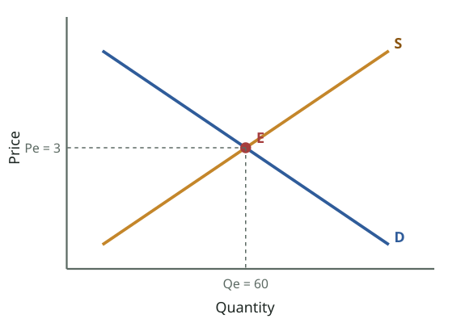

_Equilibrium (slide 25): demand = supply at point E. The market-clearing price is 3 and quantity is 60. No shortage, no surplus, no tendency to change._  
_ভারসাম্য (স্লাইড ২৫): E বিন্দুতে চাহিদা = যোগান। বাজার-পরিষ্কারক দাম ৩, পরিমাণ ৬০। ঘাটতি নেই, উদ্বৃত্ত নেই, বদলের প্রবণতা নেই।_

### English

**Concept:** In Lecture 2 you met the "invisible hand": in a market economy, **prices** decide what is produced. Lecture 3 opens the hand and shows how it works. Two forces set every price:

- **Demand** = what **buyers** want and can pay for.
- **Supply** = what **sellers** are willing and able to sell.

Where the two meet, the market settles at an **equilibrium price**. If the government forces the price away from equilibrium (a **price ceiling** or **price floor**), you get **shortages** or **surpluses**.

### What you will learn (6 jobs)
1. The **market** and the **price mechanism** (slide 4).
2. **Demand**: definition, the **law of demand** and **why** the curve slopes down (slides 5–10).
3. **Quantity demanded vs demand**: **movement along** vs **shift** of the curve, and the **factors of demand** (slides 11–15).
4. **Supply**: the **law of supply**, movement vs shift, **determinants of supply** (slides 16–22). Together with 2–3: midterm **Q6**.
5. **Functions of the price mechanism** and **equilibrium vs disequilibrium** (slides 23–26).
6. **Government intervention**: price ceilings (shortage) and price floors (surplus), and **why equilibrium changes** (slides 27–37). Midterm **Q7**.

### The 3-minute version
- **Law of demand:** price ↑ → quantity demanded ↓ (inverse). Reasons: diminishing marginal utility, income effect, substitution effect.
- **Law of supply:** price ↑ → quantity supplied ↑ (direct), because a higher price means more profit.
- **Own price changes → movement along the curve** (change in **quantity** demanded/supplied). **Anything else changes → the whole curve shifts** (change in demand/supply).
- **Equilibrium:** Qd = Qs at the market-clearing price. Above it → surplus (price falls); below it → shortage (price rises).
- **Price ceiling** (maximum, below equilibrium) → shortage, rationing, black markets, misallocation. **Price floor** (minimum, above equilibrium) → surplus, government buys the extra, consumers and taxpayers pay more.
- **Demand ↑ → P ↑, Q ↑. Demand ↓ → P ↓, Q ↓. Supply ↑ → P ↓, Q ↑. Supply ↓ → P ↑, Q ↓.**

**Exam tip:** Q6 and Q7 are **diagram questions**. You need 6 graphs: demand curve, supply curve, movement vs shift (for both), equilibrium with surplus/shortage, price ceiling and price floor.

### বাংলা

**ধারণা:** লেকচার ২-এ তুমি "অদৃশ্য হাত" দেখেছ: বাজার অর্থনীতিতে **দাম** ঠিক করে কী উৎপাদন হবে। লেকচার ৩ হাতটা খুলে দেখায় এটা কীভাবে কাজ করে। দুটি শক্তি প্রতিটি দাম ঠিক করে:

- **চাহিদা** = **ক্রেতারা** কী চায় এবং কী কিনতে পারে।
- **যোগান** = **বিক্রেতারা** কী বিক্রি করতে ইচ্ছুক ও সক্ষম।

যেখানে দুটো মেলে, বাজার সেখানে একটি **ভারসাম্য দামে** থিতু হয়। সরকার যদি জোর করে দাম ভারসাম্য থেকে সরায় (**সর্বোচ্চ দাম** বা **সর্বনিম্ন দাম**), তখন **ঘাটতি** বা **উদ্বৃত্ত** হয়।

### তুমি কী শিখবে (৬টি কাজ)
1. **বাজার** ও **দামের প্রক্রিয়া** (স্লাইড ৪)।
2. **চাহিদা**: সংজ্ঞা, **চাহিদার নিয়ম** এবং রেখা **কেন** নিচে নামে (স্লাইড ৫–১০)।
3. **চাহিদার পরিমাণ বনাম চাহিদা**: রেখা **বরাবর চলাচল** বনাম রেখার **সরণ**, এবং **চাহিদার নির্ধারক** (স্লাইড ১১–১৫)।
4. **যোগান**: **যোগানের নিয়ম**, চলাচল বনাম সরণ, **যোগানের নির্ধারক** (স্লাইড ১৬–২২)। ২–৩ মিলে: মিডটার্ম **Q6**।
5. **দামের প্রক্রিয়ার কাজ** এবং **ভারসাম্য বনাম ভারসাম্যহীনতা** (স্লাইড ২৩–২৬)।
6. **সরকারি হস্তক্ষেপ**: সর্বোচ্চ দাম (ঘাটতি) ও সর্বনিম্ন দাম (উদ্বৃত্ত), এবং **ভারসাম্য কেন বদলায়** (স্লাইড ২৭–৩৭)। মিডটার্ম **Q7**।

### ৩ মিনিটের সারকথা
- **চাহিদার নিয়ম:** দাম ↑ → চাহিদার পরিমাণ ↓ (বিপরীত)। কারণ: ক্রমহ্রাসমান প্রান্তিক উপযোগ, আয় প্রভাব, প্রতিস্থাপন প্রভাব।
- **যোগানের নিয়ম:** দাম ↑ → যোগানের পরিমাণ ↑ (সরাসরি), কারণ বেশি দাম মানে বেশি মুনাফা।
- **নিজের দাম বদলালে → রেখা বরাবর চলাচল** (চাহিদা/যোগানের **পরিমাণের** পরিবর্তন)। **অন্য কিছু বদলালে → পুরো রেখা সরে** (চাহিদা/যোগানের পরিবর্তন)।
- **ভারসাম্য:** বাজার-পরিষ্কারক দামে Qd = Qs। এর ওপরে → উদ্বৃত্ত (দাম কমে); নিচে → ঘাটতি (দাম বাড়ে)।
- **সর্বোচ্চ দাম** (ভারসাম্যের নিচে) → ঘাটতি, রেশনিং, কালোবাজার, ভুল বণ্টন। **সর্বনিম্ন দাম** (ভারসাম্যের ওপরে) → উদ্বৃত্ত, সরকার বাড়তিটা কেনে, ভোক্তা ও করদাতা বেশি দেয়।
- **চাহিদা ↑ → P ↑, Q ↑। চাহিদা ↓ → P ↓, Q ↓। যোগান ↑ → P ↓, Q ↑। যোগান ↓ → P ↑, Q ↓।**

**পরীক্ষার টিপস:** Q6 ও Q7 **চিত্রনির্ভর প্রশ্ন**। ৬টি গ্রাফ লাগবে: চাহিদা রেখা, যোগান রেখা, চলাচল বনাম সরণ (দুটোর জন্য), উদ্বৃত্ত/ঘাটতিসহ ভারসাম্য, সর্বোচ্চ দাম ও সর্বনিম্ন দাম।

---

## Key words · মূল শব্দ

| Term | Meaning | বাংলা অর্থ | Example |
|---|---|---|---|
| Market | Any arrangement where buyers and sellers meet to trade | বাজার — যেকোনো ব্যবস্থা যেখানে ক্রেতা-বিক্রেতা লেনদেনের জন্য মিলিত হয় | Karwan Bazar, Daraz, a Facebook page shop. |
| Price mechanism | Prices set by demand and supply that guide what is produced | দামের প্রক্রিয়া — চাহিদা-যোগান দিয়ে দাম ঠিক হওয়া, যা উৎপাদন চালায় | High hilsa price signals fishers to catch more. |
| Demand | Quantity buyers are willing AND able to buy at a price over a period | চাহিদা — নির্দিষ্ট দামে নির্দিষ্ট সময়ে ক্রেতা যে পরিমাণ কিনতে ইচ্ছুক ও সক্ষম | 20 kg rice per month at Tk 60. |
| Quantity demanded (Qd) | The amount demanded at ONE particular price | চাহিদার পরিমাণ — একটি নির্দিষ্ট দামে চাহিদা | At Tk 60, Qd = 20 kg. |
| Ceteris paribus | "Other things being equal" — change one factor at a time | অন্যান্য সব অপরিবর্তিত থাকলে — একবারে একটি উপাদান বদলানো | Price changes, income stays the same. |
| Marginal utility | Extra satisfaction from one more unit | প্রান্তিক উপযোগ — আরেকটি একক থেকে বাড়তি তৃপ্তি | The 3rd samosa is less enjoyable than the 1st. |
| Income effect | Lower price → your money buys more → you buy more | আয় প্রভাব — দাম কমলে টাকার ক্রয়ক্ষমতা বাড়ে → বেশি কেনা | Cheaper rice leaves money for more rice. |
| Substitution effect | Lower price → the good is a better deal than rivals → switch to it | প্রতিস্থাপন প্রভাব — দাম কমলে পণ্যটি বিকল্পের চেয়ে সস্তা → এটায় চলে আসা | Chicken cheaper → buy chicken instead of beef. |
| Supply | Quantity producers are willing and able to sell at a price over a period | যোগান — নির্দিষ্ট দামে নির্দিষ্ট সময়ে উৎপাদক যা বিক্রি করতে ইচ্ছুক ও সক্ষম | A farmer offers 500 kg potatoes at Tk 30. |
| Movement along a curve | Change in quantity demanded/supplied caused by the good's own price | রেখা বরাবর চলাচল — নিজের দামের পরিবর্তনে পরিমাণের পরিবর্তন | Price falls, you buy more. |
| Shift of a curve | Change in demand/supply caused by any non-price factor | রেখার সরণ — দাম ছাড়া অন্য উপাদানে চাহিদা/যোগানের পরিবর্তন | Eid → more demand for clothes at every price. |
| Equilibrium | Qd = Qs; market-clearing price; no tendency to change | ভারসাম্য — Qd = Qs; বাজার-পরিষ্কারক দাম; বদলের প্রবণতা নেই | Rice settles at Tk 60. |
| Surplus / excess supply | Qs > Qd (price too high) | উদ্বৃত্ত / অতিরিক্ত যোগান — Qs > Qd (দাম বেশি) | Unsold mangoes at the end of the day. |
| Shortage / excess demand (deficit) | Qd > Qs (price too low) | ঘাটতি / অতিরিক্ত চাহিদা — Qd > Qs (দাম কম) | Queues for TCB soybean oil. |
| Price ceiling | Legal MAXIMUM price, set below equilibrium | সর্বোচ্চ দামসীমা — আইনগত সর্বোচ্চ দাম, ভারসাম্যের নিচে | Rent control. |
| Price floor | Legal MINIMUM price, set above equilibrium | সর্বনিম্ন দামসীমা — আইনগত সর্বনিম্ন দাম, ভারসাম্যের ওপরে | Government paddy procurement price; minimum wage. |

---

## Slides 1–3 · Title, topic and outline
### শিরোনাম, বিষয় ও রূপরেখা

> **Slide 1**
> PRINCIPLES OF ECONOMICSSalimah Musharrif
> FPEC 101 – LECTURE 3 Unit 1
>
> **Slide 2**
> Demand and Supply Analysis
>
> **Slide 3**
> Outline
> Demand
> Supply
> Shifts
> Equilibrium
>

**বাংলা অনুবাদ:**

> **স্লাইড ১:** প্রিন্সিপলস অব ইকোনমিক্স — সালিমাহ মুশাররিফ। FPEC 101 – লেকচার ৩, ইউনিট ১।
> **স্লাইড ২:** চাহিদা ও যোগান বিশ্লেষণ
> **স্লাইড ৩ — রূপরেখা:** চাহিদা · যোগান · সরণ · ভারসাম্য

**Tutor explains:** Lecture 3 is the **most important lecture of Unit 1**. Almost everything later (elasticity, market structures, wages, market failure) uses demand and supply diagrams. Syllabus reading: McConnell & Brue pages 45–55 and 57–61.
The outline has four words: **Demand → Supply → Shifts → Equilibrium**. The last part of the lecture (slides 27–32) adds **market failure and government intervention** (price ceilings and floors).

**টিউটরের ব্যাখ্যা:** লেকচার ৩ **ইউনিট ১-এর সবচেয়ে গুরুত্বপূর্ণ লেকচার**। পরের প্রায় সব কিছু (স্থিতিস্থাপকতা, বাজার কাঠামো, মজুরি, বাজার ব্যর্থতা) চাহিদা-যোগানের চিত্র ব্যবহার করে। সিলেবাসের পড়া: ম্যাককনেল ও ব্রু পৃষ্ঠা ৪৫–৫৫ ও ৫৭–৬১।
রূপরেখায় চারটি শব্দ: **চাহিদা → যোগান → সরণ → ভারসাম্য**। লেকচারের শেষ অংশে (স্লাইড ২৭–৩২) যোগ হয়েছে **বাজার ব্যর্থতা ও সরকারি হস্তক্ষেপ** (সর্বোচ্চ ও সর্বনিম্ন দাম)।

**Exam tip:** Take this module slowly. If you master it, Lectures 4–15 become much easier.

**পরীক্ষার টিপস:** এই মডিউল ধীরে পড়ো। এটা আয়ত্ত করলে লেকচার ৪–১৫ অনেক সহজ হয়ে যাবে।

---

## Slide 4 · The market and the price mechanism
### বাজার ও দামের প্রক্রিয়া

> Market
> The price mechanism refers to the determination of price through the market forces of demand and supply. Prices act as signals for producers to show them what to produce and how to use their scarce resources. Resources are diverted to the production of those goods which are in demand as they will earn a greater profit.
> A market in the true economic sense is any effective arrangement where buyers and sellers come in contact with one another for the purpose of making transactions.
>

**বাংলা অনুবাদ:**

> বাজার
> **দামের প্রক্রিয়া (price mechanism)** বলতে বোঝায় চাহিদা ও যোগানের বাজার শক্তির মাধ্যমে দাম নির্ধারণ। দাম উৎপাদকদের জন্য সংকেত হিসেবে কাজ করে — কী উৎপাদন করতে হবে এবং দুষ্প্রাপ্য সম্পদ কীভাবে ব্যবহার করতে হবে তা দেখায়। যে পণ্যের চাহিদা আছে, সম্পদ সেদিকে সরে যায়, কারণ সেখানে বেশি মুনাফা হবে।
> প্রকৃত অর্থনৈতিক অর্থে **বাজার** হলো যেকোনো কার্যকর ব্যবস্থা যেখানে লেনদেনের উদ্দেশ্যে ক্রেতা ও বিক্রেতা একে অপরের সংস্পর্শে আসে।

**Tutor explains:** Two definitions:
1. **Market:** not only a physical place. It is **any effective arrangement** where **buyers and sellers come into contact** to trade. A bazaar, a phone call, a website, a Facebook group: all are markets. 2. **Price mechanism:** prices are **determined by demand and supply**, and then prices **guide** the economy: - Prices are **signals** to producers: "make more of this" or "make less of that". - Resources move to goods **in demand**, because those goods earn **more profit**.
This is the "invisible hand" from Lecture 2 in action.

**টিউটরের ব্যাখ্যা:** দুটি সংজ্ঞা:
1. **বাজার:** শুধু একটি জায়গা নয়। এটি **যেকোনো কার্যকর ব্যবস্থা** যেখানে লেনদেনের জন্য **ক্রেতা ও বিক্রেতা সংস্পর্শে আসে**। হাট, ফোনকল, ওয়েবসাইট, ফেসবুক গ্রুপ — সবই বাজার। 2. **দামের প্রক্রিয়া:** দাম **চাহিদা ও যোগান দিয়ে নির্ধারিত** হয়, তারপর দামই অর্থনীতিকে **পথ দেখায়**: - দাম উৎপাদকের জন্য **সংকেত**: "এটা বেশি বানাও" বা "ওটা কম বানাও"। - সম্পদ সরে যায় **চাহিদাসম্পন্ন** পণ্যের দিকে, কারণ সেখানে **বেশি মুনাফা**।
এটাই লেকচার ২-এর "অদৃশ্য হাত" কাজে।

**Real-life example:** When dragon fruit became popular in Dhaka, its price was high. That high price was a **signal**: farmers in Natore and Jhenaidah switched land from other crops to dragon fruit because it earned more profit. Over a few years, supply grew and the price came down.

**বাস্তব উদাহরণ:** ঢাকায় ড্রাগন ফল জনপ্রিয় হলে এর দাম বেশি ছিল। সেই বেশি দাম ছিল একটা **সংকেত**: নাটোর ও ঝিনাইদহের কৃষকেরা অন্য ফসল থেকে জমি ড্রাগন ফলে সরালেন, কারণ মুনাফা বেশি। কয়েক বছরে যোগান বেড়ে দাম কমে এল।

**Exam tip:** If asked "What is a market?" never write only "a place". Write: **"any effective arrangement where buyers and sellers come in contact for the purpose of making transactions."**

**পরীক্ষার টিপস:** "বাজার কী?" প্রশ্নে শুধু "একটি জায়গা" লিখবে না। লেখো: **"any effective arrangement where buyers and sellers come in contact for the purpose of making transactions."**

---

## Slide 5 · Definition of demand
### চাহিদার সংজ্ঞা

> Demand
> Demand is the quantity of a product that consumers are
> • Willing to buy
> • Able to buy
> • At a price
> • Over a period of time
>

**বাংলা অনুবাদ:**

> চাহিদা
> চাহিদা হলো একটি পণ্যের সেই পরিমাণ যা ভোক্তারা
> • কিনতে **ইচ্ছুক**
> • কিনতে **সক্ষম**
> • একটি **নির্দিষ্ট দামে**
> • একটি **নির্দিষ্ট সময়ে**

**Tutor explains:** Demand in economics has **four conditions**, and all four must be there:
**Willing** to buy: you actually want it.**Able** to buy: you have the money. Wanting a Ferrari without money is **not** demand; it is only a wish.**At a price:** demand is always linked to a specific price.**Over a period of time:** per day, per week, per month. "I demand 10 kg of rice" means nothing; "10 kg per month at Tk 60" is demand.
Economists call desire backed by ability to pay **effective demand**.

**টিউটরের ব্যাখ্যা:** অর্থনীতিতে চাহিদার **চারটি শর্ত**, চারটিই থাকতে হবে:
কিনতে **ইচ্ছুক**: তুমি সত্যিই চাও।কিনতে **সক্ষম**: তোমার টাকা আছে। টাকা ছাড়া ফেরারি চাওয়া চাহিদা **নয়**, শুধু ইচ্ছা।**নির্দিষ্ট দামে:** চাহিদা সবসময় একটি নির্দিষ্ট দামের সাথে যুক্ত।**নির্দিষ্ট সময়ে:** দিনে, সপ্তাহে, মাসে। "আমার ১০ কেজি চালের চাহিদা" অর্থহীন; "৬০ টাকা দরে মাসে ১০ কেজি" হলো চাহিদা।
ক্রয়ক্ষমতা-সমর্থিত ইচ্ছাকে অর্থনীতিবিদরা বলেন **কার্যকর চাহিদা (effective demand)**।

**Real-life example:** A student wants an iPhone 16 (willing) but has only Tk 15,000 (not able). In economics, her demand for the iPhone is **zero**. Her demand for a Tk 15,000 Android phone is real.

**বাস্তব উদাহরণ:** একজন ছাত্রী আইফোন ১৬ চায় (ইচ্ছুক), কিন্তু তার আছে মাত্র ১৫,০০০ টাকা (সক্ষম নয়)। অর্থনীতিতে আইফোনের জন্য তার চাহিদা **শূন্য**। ১৫,০০০ টাকার অ্যান্ড্রয়েড ফোনের চাহিদা বাস্তব।

**Exam tip:** Q6 definition: **"Demand is the quantity of a product that consumers are willing and able to buy at a given price over a period of time."**

**পরীক্ষার টিপস:** Q6-এর সংজ্ঞা: **"Demand is the quantity of a product that consumers are willing and able to buy at a given price over a period of time."**

---

## Slide 6 · The law of demand (simple form)
### চাহিদার নিয়ম (সহজ রূপ)

> The Law of Demand – inverse relation between price and Qd.
> When goods are cheap, people buy more
> When Price falls , quantity demanded increases
> When goods are expensive, People buy less
> When Price rises , quantity demanded falls
>

**বাংলা অনুবাদ:**

> চাহিদার নিয়ম — দাম ও চাহিদার পরিমাণের (Qd) মধ্যে বিপরীত সম্পর্ক।
> জিনিস সস্তা হলে মানুষ বেশি কেনে
> দাম কমলে চাহিদার পরিমাণ বাড়ে
> জিনিস দামি হলে মানুষ কম কেনে
> দাম বাড়লে চাহিদার পরিমাণ কমে

**Tutor explains:** The law of demand in one picture: **price and quantity demanded move in OPPOSITE directions.**
Price ↓ → Qd ↑Price ↑ → Qd ↓
This is called an **inverse** (or **negative**) relationship. That is why the demand curve **slopes downward** from left to right.

**টিউটরের ব্যাখ্যা:** এক ছবিতে চাহিদার নিয়ম: **দাম আর চাহিদার পরিমাণ উল্টো দিকে চলে।**
দাম ↓ → Qd ↑দাম ↑ → Qd ↓
একে বলে **বিপরীত** (বা **ঋণাত্মক**) সম্পর্ক। তাই চাহিদা রেখা বাঁ থেকে ডানে **নিচের দিকে নামে**।

**Real-life example:** Daraz "11.11 sale": prices drop 40%, and people buy far more than on a normal day. When the sale ends and prices go back up, people buy less.

**বাস্তব উদাহরণ:** দারাজের "১১.১১ সেল": দাম ৪০% কমে, মানুষ সাধারণ দিনের চেয়ে অনেক বেশি কেনে। সেল শেষে দাম আগের জায়গায় ফিরলে মানুষ কম কেনে।

---

## Slide 7 · Law of demand: definition and three reasons
### চাহিদার নিয়ম: সংজ্ঞা ও তিনটি কারণ

> Law of Demand
> “The Law of demand states that price and quantity demanded have a negative or inverse relationship. As price increases, quantity demanded decreases and vice Versa.” Ceteris paribus.
> Consumption is subject to diminishing marginal utility. And because successive units of a particular product yield less and less marginal utility, consumers will buy additional units only if the price of those units is progressively reduced.
> The income effect indicates that a lower price increases the purchasing power of a buyer’s money income, enabling the buyer to purchase more of the product than before. A higher price has the opposite effect.
> The substitution effect suggests that at a lower price buyers have the incentive to substitute what is now a less expensive product for similar products that are now relatively more expensive. The product whose price has fallen is now “a better deal” relative to the other products.
>

**বাংলা অনুবাদ:**

> চাহিদার নিয়ম
> "চাহিদার নিয়ম বলে যে দাম ও চাহিদার পরিমাণের মধ্যে ঋণাত্মক বা বিপরীত সম্পর্ক রয়েছে। দাম বাড়লে চাহিদার পরিমাণ কমে, আর উল্টোটাও সত্য।" অন্যান্য সব অপরিবর্তিত থাকলে (ceteris paribus)।
> **ক্রমহ্রাসমান প্রান্তিক উপযোগ:** ভোগ ক্রমহ্রাসমান প্রান্তিক উপযোগের অধীন। একটি নির্দিষ্ট পণ্যের পরপর এককগুলো ক্রমশ কম প্রান্তিক উপযোগ দেয় বলে ভোক্তা বাড়তি একক তখনই কিনবে যখন সেগুলোর দাম ক্রমশ কমানো হবে।
> **আয় প্রভাব:** দাম কমলে ক্রেতার টাকার আয়ের ক্রয়ক্ষমতা বাড়ে, ফলে আগের চেয়ে বেশি পণ্য কিনতে পারে। দাম বাড়লে উল্টো প্রভাব।
> **প্রতিস্থাপন প্রভাব:** দাম কমলে ক্রেতারা এখন সস্তা হওয়া পণ্যটিকে অন্য অনুরূপ পণ্যের (যেগুলো এখন তুলনামূলকভাবে দামি) বদলে নিতে উৎসাহিত হয়। দাম কমা পণ্যটি অন্যগুলোর তুলনায় এখন "ভালো সওদা"।

**Tutor explains:** The formal law: **price and quantity demanded have a negative (inverse) relationship, ceteris paribus** ("other things being equal": income, tastes and other prices do not change).
**Why does the demand curve slope down? Three reasons:**
**Diminishing marginal utility (DMU):** each extra unit gives you **less extra satisfaction** than the one before. So you will only buy more units if they are **cheaper**.**Income effect:** when the price falls, your fixed income can buy **more**, as if you got a little richer. So you buy more.**Substitution effect:** when the price of this good falls, it becomes a **better deal** than similar goods, so you **switch** to it from substitutes.

**টিউটরের ব্যাখ্যা:** আনুষ্ঠানিক নিয়ম: **দাম ও চাহিদার পরিমাণের মধ্যে ঋণাত্মক (বিপরীত) সম্পর্ক, ceteris paribus** ("অন্যান্য সব অপরিবর্তিত": আয়, রুচি ও অন্য দাম বদলায় না)।
**চাহিদা রেখা কেন নিচে নামে? তিনটি কারণ:**
**ক্রমহ্রাসমান প্রান্তিক উপযোগ:** প্রতিটি বাড়তি একক আগেরটার চেয়ে **কম বাড়তি তৃপ্তি** দেয়। তাই **সস্তা** হলেই শুধু তুমি বেশি একক কিনবে।**আয় প্রভাব:** দাম কমলে তোমার নির্দিষ্ট আয়ে **বেশি** কেনা যায়, যেন তুমি একটু ধনী হলে। তাই বেশি কেনো।**প্রতিস্থাপন প্রভাব:** এই পণ্যের দাম কমলে এটা অনুরূপ পণ্যের চেয়ে **ভালো সওদা** হয়, তাই বিকল্প থেকে এটায় **চলে আসো**।

**Real-life example:** **DMU:** on a hot day, the first glass of lemonade is wonderful (worth Tk 50 to you), the second is nice (Tk 30), the third you barely want (Tk 10). The seller can sell you a third glass only by lowering the price. **Income effect:** you have Tk 600 for eggs. At Tk 15 per egg you buy 40; at Tk 12 you can buy 50. **Substitution effect:** broiler chicken falls to Tk 160/kg while beef stays at Tk 750/kg, so many families switch from beef to chicken.

**বাস্তব উদাহরণ:** **ক্রমহ্রাসমান প্রান্তিক উপযোগ:** গরমের দিনে প্রথম গ্লাস লেবুর শরবত দারুণ (তোমার কাছে ৫০ টাকার মূল্য), দ্বিতীয়টা ভালো (৩০ টাকা), তৃতীয়টা প্রায় চাও না (১০ টাকা)। বিক্রেতা দাম কমালেই কেবল তোমাকে তৃতীয় গ্লাস বিক্রি করতে পারবে। **আয় প্রভাব:** ডিমের জন্য তোমার ৬০০ টাকা আছে। ১৫ টাকা করে ৪০টা কেনো; ১২ টাকা হলে ৫০টা কেনা যায়। **প্রতিস্থাপন প্রভাব:** ব্রয়লার মুরগি কেজি ১৬০ টাকায় নামল, গরুর মাংস ৭৫০ টাকাই রইল — অনেক পরিবার গরুর মাংস থেকে মুরগিতে চলে যায়।

**Exam tip:** In Q6, after stating the law, add **"This is because of diminishing marginal utility, the income effect and the substitution effect"** and explain each in one line.

**পরীক্ষার টিপস:** Q6-এ নিয়ম লেখার পর যোগ করো **"This is because of diminishing marginal utility, the income effect and the substitution effect"** এবং প্রতিটি এক লাইনে ব্যাখ্যা করো।

---

## Slide 8 · The demand schedule
### চাহিদা সূচি

> Demand schedule
> Price of computers | Quantity demanded per week
> 2000 | 1000
> 1800 | 2000
> 1600 | 3000
> 1400 | 4000
> 1200 | 5000
> The Demand Schedule shows quantities demanded at given price.
>

**বাংলা অনুবাদ:**

> চাহিদা সূচি
> কম্পিউটারের দাম ($) → সপ্তাহে চাহিদার পরিমাণ:
> ২০০০ → ১০০০ · ১৮০০ → ২০০০ · ১৬০০ → ৩০০০ · ১৪০০ → ৪০০০ · ১২০০ → ৫০০০
> চাহিদা সূচি দেখায় নির্দিষ্ট দামে কত পরিমাণ চাওয়া হয়।

**Tutor explains:** A **demand schedule** is a **table** showing the quantity demanded at different prices.
Read the table: every time the price of computers falls by **$200**, the quantity demanded per week rises by **1,000**. Price down, quantity up: the law of demand in numbers.
The next slide turns this table into a **graph**.

**টিউটরের ব্যাখ্যা:** **চাহিদা সূচি** হলো একটি **ছক**, যা বিভিন্ন দামে চাহিদার পরিমাণ দেখায়।
ছকটা পড়ো: কম্পিউটারের দাম প্রতিবার **২০০ ডলার** কমলে সাপ্তাহিক চাহিদার পরিমাণ **১,০০০** বাড়ে। দাম নিচে, পরিমাণ ওপরে — সংখ্যায় চাহিদার নিয়ম।
পরের স্লাইডে এই ছকটাকে **গ্রাফে** রূপ দেওয়া হয়েছে।

**Exam tip:** If the exam gives you a schedule, plot it: price on the vertical axis, quantity on the horizontal axis, join the points, label the line D.

**পরীক্ষার টিপস:** পরীক্ষায় সূচি দিলে আঁকো: খাড়া অক্ষে দাম, আনুভূমিক অক্ষে পরিমাণ, বিন্দুগুলো যোগ করো, রেখার নাম দাও D।

---

## Slide 9 · The demand curve
### চাহিদা রেখা

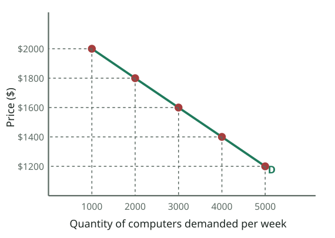

_The demand schedule (slide 8) plotted as a demand curve: each row of the table is one point. Higher price → lower quantity demanded._  
_চাহিদা সূচি (স্লাইড ৮) চাহিদা রেখায় আঁকা: ছকের প্রতিটি সারি একটি বিন্দু। দাম বেশি → চাহিদার পরিমাণ কম।_

> The Demand Curve
> [Diagram: the computer schedule plotted — Price ($) from 1200 to 2000 on the vertical axis, Quantity 1000 to 5000 on the horizontal axis; a downward-sloping line labelled D]
> The demand curve shows the quantity demanded at any given price.
>

**বাংলা অনুবাদ:**

> চাহিদা রেখা
> [চিত্র: কম্পিউটারের সূচি আঁকা — খাড়া অক্ষে দাম ১২০০ থেকে ২০০০ ডলার, আনুভূমিক অক্ষে পরিমাণ ১০০০ থেকে ৫০০০; নিচের দিকে নামা রেখা D]
> চাহিদা রেখা দেখায় যেকোনো নির্দিষ্ট দামে চাহিদার পরিমাণ কত।

**Tutor explains:** The **demand curve** is the demand schedule drawn as a graph:
**Vertical axis (P):** price.**Horizontal axis (Q):** quantity demanded.Each row of the table is one **point**; join them and you get the curve **D**.
It **slopes downward** (from top-left to bottom-right) because of the law of demand. Whatever price you pick on the vertical axis, go across to the curve and down: you read off the **quantity demanded** at that price.

**টিউটরের ব্যাখ্যা:** **চাহিদা রেখা** হলো চাহিদা সূচির গ্রাফ রূপ:
**খাড়া অক্ষ (P):** দাম।**আনুভূমিক অক্ষ (Q):** চাহিদার পরিমাণ।ছকের প্রতিটি সারি একটি **বিন্দু**; যোগ করলে পাও রেখা **D**।
চাহিদার নিয়মের কারণে এটা **নিচের দিকে নামে** (ওপর-বাঁ থেকে নিচ-ডানে)। খাড়া অক্ষে যেকোনো দাম বেছে নাও, আড়াআড়ি রেখা পর্যন্ত গিয়ে নিচে নামো: ওই দামে **চাহিদার পরিমাণ** পেয়ে যাবে।

**Common mistake:** Economists always put **price on the vertical axis** and **quantity on the horizontal axis**. Swapping them is a common mistake that loses marks.

**সাধারণ ভুল:** অর্থনীতিবিদরা সবসময় **দাম খাড়া অক্ষে** আর **পরিমাণ আনুভূমিক অক্ষে** রাখেন। উল্টে দেওয়া একটা সাধারণ ভুল, এতে নম্বর কাটে।

---

## Slide 10 · Movement along the demand curve
### চাহিদা রেখা বরাবর চলাচল

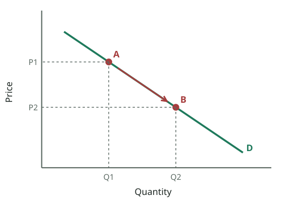

_Movement ALONG the demand curve: only the good's own price changes (P1 → P2), so quantity demanded changes (Q1 → Q2). The curve itself stays put._  
_চাহিদা রেখা **বরাবর** চলাচল: শুধু পণ্যের নিজের দাম বদলায় (P1 → P2), তাই চাহিদার পরিমাণ বদলায় (Q1 → Q2)। রেখা নিজে সরে না।_

> [Diagram: a downward-sloping demand curve D; Price 0–60 on the vertical axis, Quantity 0–5 on the horizontal axis; points moving along D]
> As the price changes, the quantity demanded will change. Movement along the curve.
>

**বাংলা অনুবাদ:**

> [চিত্র: নিচে নামা চাহিদা রেখা D; খাড়া অক্ষে দাম ০–৬০, আনুভূমিক অক্ষে পরিমাণ ০–৫; D বরাবর সরে যাওয়া বিন্দু]
> দাম বদলালে চাহিদার পরিমাণ বদলাবে। রেখা বরাবর চলাচল।

**Tutor explains:** When **only the price of the good itself** changes, you **slide along the same curve** from one point to another (A → B). This is called a **change in quantity demanded** or a **movement along the curve**.
Price falls (P1 → P2) → move **down** the curve → quantity demanded **rises** (Q1 → Q2). This is an **extension** of demand.Price rises → move **up** the curve → quantity demanded **falls**. This is a **contraction** of demand.
The curve itself **does not move**.

**টিউটরের ব্যাখ্যা:** যখন **শুধু পণ্যটির নিজের দাম** বদলায়, তুমি **একই রেখা বরাবর** এক বিন্দু থেকে আরেক বিন্দুতে **সরো** (A → B)। একে বলে **চাহিদার পরিমাণের পরিবর্তন** বা **রেখা বরাবর চলাচল**।
দাম কমে (P1 → P2) → রেখা ধরে **নিচে** নামো → চাহিদার পরিমাণ **বাড়ে** (Q1 → Q2)। একে বলে চাহিদার **সম্প্রসারণ (extension)**।দাম বাড়ে → রেখা ধরে **ওপরে** ওঠো → চাহিদার পরিমাণ **কমে**। একে বলে চাহিদার **সংকোচন (contraction)**।
রেখা নিজে **সরে না**।

**Exam tip:** Use the words **extension** and **contraction** for movements; use **increase** and **decrease** only for shifts. Examiners notice this.

**পরীক্ষার টিপস:** চলাচলের জন্য **extension** ও **contraction** শব্দ লেখো; **increase** ও **decrease** শুধু সরণের জন্য। পরীক্ষকেরা এটা খেয়াল করেন।

---

## Quick check · দ্রুত যাচাই

1. Which of these is part of the definition of demand?  
   কোনটি চাহিদার সংজ্ঞার অংশ?

   - A) Only willing to buy · শুধু কিনতে ইচ্ছুক
   - B) Willing AND able to buy at a price over a period · নির্দিষ্ট দামে নির্দিষ্ট সময়ে কিনতে ইচ্ছুক ও সক্ষম
   - C) The amount produced · উৎপাদিত পরিমাণ
   - D) The amount in stock · মজুদের পরিমাণ

   **Answer: B** — Demand needs willingness, ability, a price and a time period.  
   চাহিদার জন্য লাগে ইচ্ছা, সামর্থ্য, দাম ও সময়।

2. Cheaper chicken makes people buy chicken instead of beef. This is the…  
   মুরগি সস্তা হওয়ায় মানুষ গরুর বদলে মুরগি কেনে। এটা…

   - A) Income effect · আয় প্রভাব
   - B) Substitution effect · প্রতিস্থাপন প্রভাব
   - C) Supply effect · যোগান প্রভাব
   - D) Ceteris paribus · অন্যান্য অপরিবর্তিত

   **Answer: B** — Switching to the good that has become relatively cheaper is the substitution effect.  
   তুলনামূলক সস্তা হওয়া পণ্যে চলে আসা হলো প্রতিস্থাপন প্রভাব।

3. The price of rice falls and you buy more rice. On the graph this is…  
   চালের দাম কমল, তুমি বেশি চাল কিনলে। গ্রাফে এটা…

   - A) A shift of the demand curve to the right · চাহিদা রেখা ডানে সরা
   - B) A movement along the demand curve · চাহিদা রেখা বরাবর চলাচল
   - C) A shift of supply · যোগানের সরণ
   - D) No change · কোনো পরিবর্তন নয়

   **Answer: B** — A change in the good's own price causes a movement along the curve (change in quantity demanded).  
   পণ্যের নিজের দামের পরিবর্তনে রেখা বরাবর চলাচল হয় (চাহিদার পরিমাণের পরিবর্তন)।

---

## Slide 11 · Individual demand, market demand and ceteris paribus
### ব্যক্তিগত চাহিদা, বাজার চাহিদা ও ceteris paribus

> Individual Demand and Market Demand
> Individual demand is the demand of just one consumer and is referred to as quantity demanded while the total demand for a product from all its consumers is known as market demand.
> An important assumption that we make when discussing the factors that affect the demand is the ceteris paribus assumption. Under this assumption, we only discuss a change in one factor at a time.
>

**বাংলা অনুবাদ:**

> ব্যক্তিগত চাহিদা ও বাজার চাহিদা
> **ব্যক্তিগত চাহিদা** হলো মাত্র একজন ভোক্তার চাহিদা এবং একে চাহিদার পরিমাণ বলা হয়; আর একটি পণ্যের সব ভোক্তার মোট চাহিদাকে বলা হয় **বাজার চাহিদা**।
> চাহিদাকে প্রভাবিতকারী উপাদান আলোচনার সময় আমরা একটি গুরুত্বপূর্ণ অনুমান করি, তা হলো **ceteris paribus** অনুমান। এই অনুমানে আমরা একবারে শুধু একটি উপাদানের পরিবর্তন নিয়ে আলোচনা করি।

**Tutor explains:** **Individual demand:** the demand of **one** consumer.**Market demand:** the **total** demand of **all** consumers of the product. You get it by **adding up** the individual quantities at each price (next slide).
**Ceteris paribus** is Latin for **"other things being equal"**. Many things affect demand at once (price, income, tastes, other prices…). To see the effect of **one** factor, we **hold all the others constant** and change only that one. Without this, we could not tell which factor caused the change.

**টিউটরের ব্যাখ্যা:** **ব্যক্তিগত চাহিদা:** **একজন** ভোক্তার চাহিদা।**বাজার চাহিদা:** পণ্যটির **সব** ভোক্তার **মোট** চাহিদা। প্রতিটি দামে ব্যক্তিগত পরিমাণগুলো **যোগ করে** পাওয়া যায় (পরের স্লাইড)।
**Ceteris paribus** লাতিন শব্দ, মানে **"অন্যান্য সব কিছু অপরিবর্তিত থাকলে"**। চাহিদাকে একসাথে অনেক কিছু প্রভাবিত করে (দাম, আয়, রুচি, অন্য দাম…)। **একটি** উপাদানের প্রভাব দেখতে আমরা **বাকি সব স্থির রাখি** আর শুধু ওইটা বদলাই। না হলে বোঝা যেত না কোন উপাদান পরিবর্তন ঘটাল।

**Real-life example:** A science experiment: to test whether fertiliser helps plants, you keep water, sunlight and soil the same for both pots and change only the fertiliser. Ceteris paribus is the economist's version of a fair test.

**বাস্তব উদাহরণ:** বিজ্ঞানের পরীক্ষা: সার গাছের উপকার করে কি না দেখতে দুই টবেই পানি, আলো, মাটি একই রাখো, শুধু সার বদলাও। Ceteris paribus হলো অর্থনীতিবিদের ন্যায্য পরীক্ষা।

---

## Slide 12 · Market demand table; quantity demanded vs demand
### বাজার চাহিদার ছক; চাহিদার পরিমাণ বনাম চাহিদা

> Individual Demand and Market Demand
> [Table 3.2, McConnell & Brue p. 47 — Market demand for corn, three buyers. Price per bushel / Joe + Jen + Jay = Total quantity demanded per week: $5: 10 + 12 + 8 = 30 · $4: 20 + 23 + 17 = 60 · $3: 35 + 39 + 26 = 100 · $2: 55 + 60 + 39 = 154 · $1: 80 + 87 + 54 = 221]
> Difference between quantity demanded and demand
> A change in price brings about a change in quantity demanded and is a movement along the curve. A change in any other factor besides price will shift the curve so that more or less is demanded at the same price level. A change in price never brings about a movement or shift of the curve.
>

**বাংলা অনুবাদ:**

> ব্যক্তিগত চাহিদা ও বাজার চাহিদা
> [ছক ৩.২, ম্যাককনেল ও ব্রু পৃ. ৪৭ — তিন ক্রেতার ভুট্টার বাজার চাহিদা। প্রতি বুশেলের দাম / জো + জেন + জে = সপ্তাহে মোট চাহিদা: $৫: ১০+১২+৮ = ৩০ · $৪: ২০+২৩+১৭ = ৬০ · $৩: ৩৫+৩৯+২৬ = ১০০ · $২: ৫৫+৬০+৩৯ = ১৫৪ · $১: ৮০+৮৭+৫৪ = ২২১]
> **চাহিদার পরিমাণ ও চাহিদার পার্থক্য**
> দামের পরিবর্তন চাহিদার পরিমাণে পরিবর্তন আনে এবং তা রেখা বরাবর চলাচল। দাম ছাড়া অন্য যেকোনো উপাদানের পরিবর্তন রেখাকে সরিয়ে দেয়, ফলে একই দামে বেশি বা কম চাওয়া হয়। দামের পরিবর্তন কখনো রেখার সরণ ঘটায় না।

**Tutor explains:** **Part 1 — market demand = horizontal sum.** At each price, add the quantities of all buyers. At $3: Joe 35 + Jen 39 + Jay 26 = **100** bushels. Do it for every price and you get the market demand schedule (30, 60, 100, 154, 221). Notice the market total still obeys the law of demand.
**Part 2 — the most important distinction in Lecture 3:**
Change in QUANTITY DEMANDEDChange in DEMAND
Caused byThe good's **own price****Any other factor** (income, tastes, other prices…)
On the graph**Movement along** the same curve**Shift** of the whole curve
WordsExtension / contractionIncrease / decrease
The slide's last sentence is a trap-checker: **"A change in price never brings about a … shift of the curve."** (The slide says "movement or shift", but its meaning is: price never **shifts** the demand curve; it only moves you along it.)

**টিউটরের ব্যাখ্যা:** **অংশ ১ — বাজার চাহিদা = আনুভূমিক যোগফল।** প্রতিটি দামে সব ক্রেতার পরিমাণ যোগ করো। $৩-এ: জো ৩৫ + জেন ৩৯ + জে ২৬ = **১০০** বুশেল। প্রতিটি দামে করলে বাজার চাহিদা সূচি পাবে (৩০, ৬০, ১০০, ১৫৪, ২২১)। খেয়াল করো, বাজারের মোট পরিমাণও চাহিদার নিয়ম মানে।
**অংশ ২ — লেকচার ৩-এর সবচেয়ে গুরুত্বপূর্ণ পার্থক্য:**
চাহিদার **পরিমাণের** পরিবর্তন**চাহিদার** পরিবর্তন
কারণপণ্যের **নিজের দাম****অন্য যেকোনো উপাদান** (আয়, রুচি, অন্য দাম…)
গ্রাফেএকই রেখা **বরাবর চলাচল**পুরো রেখার **সরণ**
শব্দসম্প্রসারণ / সংকোচনবৃদ্ধি / হ্রাস
স্লাইডের শেষ বাক্যটা ফাঁদ ধরার জন্য: **"দামের পরিবর্তন কখনো রেখার সরণ ঘটায় না।"** (স্লাইডে "movement or shift" লেখা, কিন্তু অর্থ হলো: দাম কখনো চাহিদা রেখাকে **সরায় না**; শুধু রেখা বরাবর সরায়।)

**Tutor's note (not on the slide):** The table is a picture on the slide (McConnell & Brue, Table 3.2); its numbers are typed out here so you can read them.

**টিউটরের নোট:** ছকটি স্লাইডে একটি ছবি (ম্যাককনেল ও ব্রু, ছক ৩.২); পড়ার সুবিধার জন্য সংখ্যাগুলো এখানে লিখে দেওয়া হলো।

**Exam tip:** This difference is the second half of **Q6**. Draw two small graphs side by side: one movement (arrow along D) and one shift (D to D1).

**পরীক্ষার টিপস:** এই পার্থক্যটাই **Q6**-এর দ্বিতীয় অর্ধেক। পাশাপাশি দুটি ছোট গ্রাফ আঁকো: একটি চলাচল (D বরাবর তীর), একটি সরণ (D থেকে D1)।

---

## Slide 13 · Shift in the demand curve
### চাহিদা রেখার সরণ

> Demand - Shift
> Shift in the demand curve
> A change in any factor besides price will bring about a parallel shift, or movement of the entire demand curve. This means that more or less is demanded at each and every price level than they did before.
> Factors affecting demand, conditions of demand, determinants of demand
>

**বাংলা অনুবাদ:**

> চাহিদা — সরণ
> **চাহিদা রেখার সরণ**
> দাম **ছাড়া** অন্য যেকোনো উপাদানের পরিবর্তন পুরো চাহিদা রেখার একটি সমান্তরাল সরণ বা চলাচল ঘটায়। এর মানে, প্রতিটি দামে আগের চেয়ে বেশি বা কম চাওয়া হয়।
> চাহিদাকে প্রভাবিতকারী উপাদান, চাহিদার শর্তাবলি, চাহিদার নির্ধারক

**Tutor explains:** A **shift** happens when something **other than the good's own price** changes. Then the **whole curve moves**:
**Rightward shift = increase in demand:** at **every** price, people want **more** than before.**Leftward shift = decrease in demand:** at **every** price, people want **less**.
The slide gives three names for the things that cause shifts: **factors affecting demand**, **conditions of demand**, or **determinants of demand**. They all mean the same list (slide 15).

**টিউটরের ব্যাখ্যা:** **সরণ** হয় যখন **পণ্যের নিজের দাম ছাড়া** অন্য কিছু বদলায়। তখন **পুরো রেখা সরে যায়**:
**ডানে সরণ = চাহিদা বৃদ্ধি:** **প্রতিটি** দামে মানুষ আগের চেয়ে **বেশি** চায়।**বাঁয়ে সরণ = চাহিদা হ্রাস:** **প্রতিটি** দামে মানুষ **কম** চায়।
যে জিনিসগুলো সরণ ঘটায় স্লাইডে তাদের তিনটি নাম: **চাহিদাকে প্রভাবিতকারী উপাদান**, **চাহিদার শর্তাবলি**, বা **চাহিদার নির্ধারক**। সবগুলোর মানে একই তালিকা (স্লাইড ১৫)।

**Real-life example:** During Ramadan, the demand for dates, chickpeas and Rooh Afza increases: **at the same prices** as before, families buy much more. The demand curve for dates shifts **right**. Nothing happened to the price first; the **season** (tastes/customs) changed.

**বাস্তব উদাহরণ:** রমজানে খেজুর, ছোলা আর রুহ আফজার চাহিদা বাড়ে: আগের **একই দামে** পরিবারগুলো অনেক বেশি কেনে। খেজুরের চাহিদা রেখা **ডানে** সরে। আগে দামে কিছু হয়নি; **মৌসুম** (রুচি/রীতি) বদলেছে।

---

## Slide 14 · Shift of demand: D → D1 and D → D2
### চাহিদার সরণ: D → D1 ও D → D2

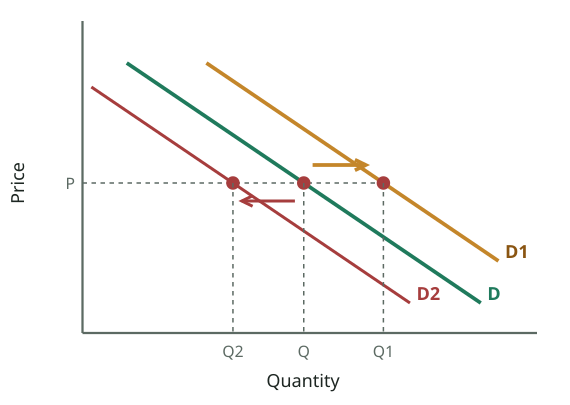

_SHIFT of demand: something other than price changes. D → D1 (right) = increase: more bought at the same price. D → D2 (left) = decrease._  
_চাহিদার **সরণ**: দাম ছাড়া অন্য কিছু বদলায়। D → D1 (ডানে) = বৃদ্ধি: একই দামে বেশি কেনা হয়। D → D2 (বাঁয়ে) = হ্রাস।_

> [Diagram: three parallel demand curves D, D1 (to the right) and D2 (to the left); Price 0–60, Quantity 0–7; arrows show the shift right and left]
> At the same price, a different quantity is demanded.
>

**বাংলা অনুবাদ:**

> [চিত্র: তিনটি সমান্তরাল চাহিদা রেখা D, D1 (ডানে) ও D2 (বাঁয়ে); দাম ০–৬০, পরিমাণ ০–৭; তীর ডানে ও বাঁয়ে সরণ দেখায়]
> একই দামে ভিন্ন পরিমাণ চাওয়া হয়।

**Tutor explains:** How to read the graph: pick **one price**, say P. On the original curve **D** people buy **Q**.
After an **increase** in demand the curve is **D1** (to the right): at the **same price P** they buy **Q1** (more).After a **decrease** the curve is **D2** (to the left): at the same P they buy only **Q2** (less).
The slide's key sentence: **"At the same price, a different quantity is demanded."** That is the definition of a shift.

**টিউটরের ব্যাখ্যা:** গ্রাফ পড়ার নিয়ম: **একটি দাম** বেছে নাও, ধরো P। মূল রেখা **D**-তে মানুষ কেনে **Q**।
চাহিদা **বাড়লে** রেখা হয় **D1** (ডানে): **একই দাম P**-তে কেনে **Q1** (বেশি)।চাহিদা **কমলে** রেখা হয় **D2** (বাঁয়ে): একই P-তে কেনে শুধু **Q2** (কম)।
স্লাইডের মূল বাক্য: **"একই দামে ভিন্ন পরিমাণ চাওয়া হয়।"** এটাই সরণের সংজ্ঞা।

**Common mistake:** "Up" is not "increase"! An increase in demand is a shift to the **right** (which also looks higher). Always describe shifts as **right/left**.

**সাধারণ ভুল:** "ওপরে" মানে "বৃদ্ধি" নয়! চাহিদা বৃদ্ধি হলো **ডানে** সরণ (যা উঁচুও দেখায়)। সরণকে সবসময় **ডান/বাঁ** দিয়ে বর্ণনা করো।

---

## Slide 15 · Factors (determinants) of demand
### চাহিদার নির্ধারক (উপাদান)

> [Mind map: "Factors of Demand" in the centre, linked to — Income · Population · Prices of Related Goods · Taste & Fashion · Expectation of future price changes · Govt policies · Economic situation · Advertising · Other factors]
>

**বাংলা অনুবাদ:**

> [মাইন্ড ম্যাপ: মাঝে "চাহিদার উপাদান", যুক্ত — আয় · জনসংখ্যা · সম্পর্কিত পণ্যের দাম · রুচি ও ফ্যাশন · ভবিষ্যৎ দাম পরিবর্তনের প্রত্যাশা · সরকারি নীতি · অর্থনৈতিক অবস্থা · বিজ্ঞাপন · অন্যান্য উপাদান]

**Tutor explains:** Each factor below **shifts** the demand curve. For each, learn which way:
1. **Income:** for most goods (**normal goods**), income ↑ → demand ↑ (right). For **inferior goods** (cheap substitutes like coarse rice or bus travel), income ↑ → demand ↓. 2. **Population:** more buyers → demand ↑. 3. **Prices of related goods:** - **Substitutes** (used instead of each other: tea/coffee, Grameenphone/Robi): price of one ↑ → demand for the other ↑. - **Complements** (used together: car/petrol, phone/SIM): price of one ↑ → demand for the other ↓. 4. **Taste and fashion:** a good becomes fashionable → demand ↑. 5. **Expectations of future price changes:** you expect prices to rise next week → you buy more **now** → demand ↑ today. 6. **Government policies:** taxes on buyers, subsidies, bans, laws (e.g. compulsory helmets → demand for helmets ↑). 7. **Economic situation:** boom → people spend more; recession → demand ↓. 8. **Advertising:** successful ads → demand ↑. 9. **Other factors:** weather, seasons, festivals, credit availability.

**টিউটরের ব্যাখ্যা:** নিচের প্রতিটি উপাদান চাহিদা রেখাকে **সরায়**। প্রতিটির দিক শেখো:
1. **আয়:** বেশিরভাগ পণ্যে (**স্বাভাবিক পণ্য**) আয় ↑ → চাহিদা ↑ (ডানে)। **নিকৃষ্ট পণ্যে** (মোটা চাল বা বাসভ্রমণের মতো সস্তা বিকল্প) আয় ↑ → চাহিদা ↓। 2. **জনসংখ্যা:** বেশি ক্রেতা → চাহিদা ↑। 3. **সম্পর্কিত পণ্যের দাম:** - **বিকল্প** (একটার বদলে আরেকটা: চা/কফি, গ্রামীণফোন/রবি): একটার দাম ↑ → অন্যটার চাহিদা ↑। - **পরিপূরক** (একসাথে ব্যবহৃত: গাড়ি/পেট্রল, ফোন/সিম): একটার দাম ↑ → অন্যটার চাহিদা ↓। 4. **রুচি ও ফ্যাশন:** পণ্য ফ্যাশনেবল হলে → চাহিদা ↑। 5. **ভবিষ্যৎ দাম পরিবর্তনের প্রত্যাশা:** আগামী সপ্তাহে দাম বাড়বে ভাবলে **এখনই** বেশি কেনো → আজ চাহিদা ↑। 6. **সরকারি নীতি:** ক্রেতার ওপর কর, ভর্তুকি, নিষেধাজ্ঞা, আইন (যেমন হেলমেট বাধ্যতামূলক → হেলমেটের চাহিদা ↑)। 7. **অর্থনৈতিক অবস্থা:** তেজি → মানুষ বেশি খরচ করে; মন্দা → চাহিদা ↓। 8. **বিজ্ঞাপন:** সফল বিজ্ঞাপন → চাহিদা ↑। 9. **অন্যান্য:** আবহাওয়া, ঋতু, উৎসব, ঋণের সুযোগ।

**Real-life example:** **Expectations in Bangladesh:** when news spreads that the price of soybean oil will rise next month, families rush to buy 5-litre bottles today. Demand jumps **now**, and that itself pushes the price up. **Complements:** when CNG gas prices rose, demand for CNG-converted cars fell.

**বাস্তব উদাহরণ:** **বাংলাদেশে প্রত্যাশা:** আগামী মাসে সয়াবিন তেলের দাম বাড়বে — এই খবর ছড়ালে পরিবারগুলো আজই ৫ লিটারের বোতল কিনতে ছোটে। চাহিদা **এখনই** লাফ দেয়, আর তাতেই দাম বাড়ে। **পরিপূরক:** সিএনজি গ্যাসের দাম বাড়লে সিএনজি-রূপান্তরিত গাড়ির চাহিদা কমেছে।

**Tutor's note (not on the slide):** Normal/inferior goods and substitutes/complements are not written on the slide, but you need them to explain "income" and "prices of related goods". They return in Lecture 5 (income and cross elasticity).

**টিউটরের নোট:** স্বাভাবিক/নিকৃষ্ট পণ্য এবং বিকল্প/পরিপূরক স্লাইডে লেখা নেই, কিন্তু "আয়" ও "সম্পর্কিত পণ্যের দাম" ব্যাখ্যা করতে এগুলো লাগে। লেকচার ৫-এ (আয় ও আড়াআড়ি স্থিতিস্থাপকতা) আবার আসবে।

**Exam tip:** In Q6, list at least **6 factors** with a one-line example each, and say that each one **shifts** the curve.

**পরীক্ষার টিপস:** Q6-এ অন্তত **৬টি উপাদান** লেখো, প্রতিটির এক লাইনের উদাহরণসহ, এবং বলো প্রতিটি রেখাকে **সরায়**।

---

## Quick check · দ্রুত যাচাই

1. Market demand is found by…  
   বাজার চাহিদা পাওয়া যায়…

   - A) Taking the demand of the richest buyer · সবচেয়ে ধনী ক্রেতার চাহিদা নিয়ে
   - B) Adding all individual quantities at each price · প্রতিটি দামে সব ব্যক্তিগত পরিমাণ যোগ করে
   - C) Averaging prices · দামের গড় করে
   - D) Subtracting supply · যোগান বিয়োগ করে

   **Answer: B** — At $3: 35 + 39 + 26 = 100. Market demand is the horizontal sum of individual demands.  
   $৩-এ: ৩৫ + ৩৯ + ২৬ = ১০০। বাজার চাহিদা ব্যক্তিগত চাহিদার আনুভূমিক যোগফল।

2. The price of petrol rises. What happens to the demand curve for cars?  
   পেট্রলের দাম বাড়ল। গাড়ির চাহিদা রেখার কী হবে?

   - A) Shifts right · ডানে সরে
   - B) Shifts left · বাঁয়ে সরে
   - C) Movement along it · বরাবর চলাচল
   - D) No effect · প্রভাব নেই

   **Answer: B** — Cars and petrol are complements; dearer petrol means less demand for cars at every car price.  
   গাড়ি ও পেট্রল পরিপূরক; পেট্রল দামি হলে প্রতিটি দামে গাড়ির চাহিদা কমে।

3. Which does NOT shift the demand curve for mangoes?  
   কোনটি আমের চাহিদা রেখাকে সরায় না?

   - A) A rise in incomes · আয় বৃদ্ধি
   - B) An advertising campaign for mangoes · আমের বিজ্ঞাপন
   - C) A fall in the price of mangoes · আমের দাম কমা
   - D) Expectation of a future price rise · ভবিষ্যতে দাম বাড়ার প্রত্যাশা

   **Answer: C** — The good's own price causes a movement along the curve, never a shift.  
   পণ্যের নিজের দাম রেখা বরাবর চলাচল ঘটায়, কখনো সরণ নয়।

---

## Slide 16 · Supply and the law of supply
### যোগান ও যোগানের নিয়ম

> LAW OF SUPPLY
> “This is the producers willingness and ability to sell a product at a given price over a given period of time .” It refers to the amount producers are willing to create and sell at a given price level. Existing stocks are not considered supply unless they are put up for sale.
> A firm interested in profit will only make and sell a product if it can do so at a price over and above what it cost the firm to make. Hence, the higher the price, the more the firm is willing to supply because it expects more profits.
> The Law of supply states that price and quantity supplied have a positive or direct relation. As price increases quantity supplied increases and vice Versa.”
>

**বাংলা অনুবাদ:**

> যোগানের নিয়ম
> "এটি হলো নির্দিষ্ট সময়ে নির্দিষ্ট দামে একটি পণ্য বিক্রির জন্য উৎপাদকের ইচ্ছা ও সামর্থ্য।" এটি বোঝায় একটি নির্দিষ্ট দামে উৎপাদক যে পরিমাণ তৈরি ও বিক্রি করতে ইচ্ছুক। বিদ্যমান মজুদ বিক্রির জন্য উপস্থাপন না করা পর্যন্ত যোগান হিসেবে ধরা হয় না।
> মুনাফায় আগ্রহী একটি ফার্ম শুধু তখনই পণ্য বানিয়ে বিক্রি করবে যখন উৎপাদন খরচের চেয়ে বেশি দামে বিক্রি করতে পারবে। তাই দাম যত বেশি, মুনাফার প্রত্যাশায় ফার্ম তত বেশি যোগান দিতে ইচ্ছুক।
> "যোগানের নিয়ম বলে যে দাম ও যোগানের পরিমাণের মধ্যে ধনাত্মক বা সরাসরি সম্পর্ক রয়েছে। দাম বাড়লে যোগানের পরিমাণ বাড়ে, আর উল্টোটাও সত্য।"

**Tutor explains:** **Supply** = the producer's **willingness and ability to sell** a product at a given price over a given period.
Note the special point: **stocks are not supply unless they are offered for sale.** Rice sitting in a farmer's store that he refuses to sell is not supply.
**Why does supply rise with price?** A profit-seeking firm sells only if the **price is above its cost**. A higher price → more profit per unit → firms want to sell more, and even higher-cost producers can now cover their costs and join in.
**Law of supply:** price and quantity supplied have a **positive (direct)** relationship: price ↑ → Qs ↑, price ↓ → Qs ↓.

**টিউটরের ব্যাখ্যা:** **যোগান** = নির্দিষ্ট সময়ে নির্দিষ্ট দামে একটি পণ্য **বিক্রির জন্য উৎপাদকের ইচ্ছা ও সামর্থ্য**।
বিশেষ পয়েন্ট খেয়াল করো: **মজুদ বিক্রির জন্য না তোলা পর্যন্ত যোগান নয়।** কৃষকের গোলায় থাকা যে চাল তিনি বিক্রি করতে চান না, তা যোগান নয়।
**দাম বাড়লে যোগান বাড়ে কেন?** মুনাফা-সন্ধানী ফার্ম তখনই বিক্রি করে যখন **দাম তার খরচের চেয়ে বেশি**। বেশি দাম → এককপ্রতি বেশি মুনাফা → ফার্ম বেশি বিক্রি করতে চায়, আর বেশি খরচের উৎপাদকরাও এখন খরচ তুলতে পেরে যোগ দেয়।
**যোগানের নিয়ম:** দাম ও যোগানের পরিমাণের মধ্যে **ধনাত্মক (সরাসরি)** সম্পর্ক: দাম ↑ → Qs ↑, দাম ↓ → Qs ↓।

**Real-life example:** When the price of potatoes in Munshiganj cold storages rises from Tk 25 to Tk 45 per kg, owners release **more** potatoes from storage to the market. At Tk 25 they kept them in storage (stock, not supply).

**বাস্তব উদাহরণ:** মুন্সিগঞ্জের হিমাগারে আলুর দাম কেজিপ্রতি ২৫ থেকে ৪৫ টাকায় উঠলে মালিকেরা হিমাগার থেকে **বেশি** আলু বাজারে ছাড়েন। ২৫ টাকায় তারা আলু হিমাগারেই রেখেছিলেন (মজুদ, যোগান নয়)।

**Exam tip:** Q6 needs both laws. Supply version: **"The law of supply states that price and quantity supplied have a positive or direct relationship, ceteris paribus."**

**পরীক্ষার টিপস:** Q6-এ দুটো নিয়মই লাগবে। যোগানের সংস্করণ: **"The law of supply states that price and quantity supplied have a positive or direct relationship, ceteris paribus."**

---

## Slide 17 · The supply curve slopes upward
### যোগান রেখা ওপরের দিকে ওঠে

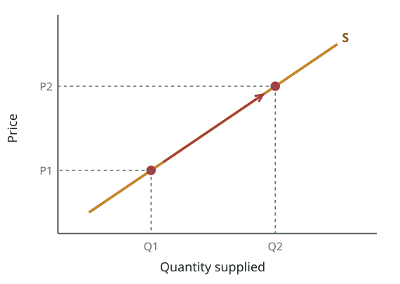

_Law of supply: the supply curve slopes UP. A higher price (P1 → P2) brings a larger quantity supplied (Q1 → Q2): a movement along S._  
_যোগানের নিয়ম: যোগান রেখা **ওপরের দিকে** ওঠে। দাম বাড়লে (P1 → P2) যোগানের পরিমাণ বাড়ে (Q1 → Q2): S বরাবর চলাচল।_

> LAW OF SUPPLY
> Price increases, quantity Supplied increases
> Price decreases, quantity Supplied decreases
> [Diagram: an upward-sloping line S with Price ($) on the vertical axis and quantity on the horizontal axis]
>

**বাংলা অনুবাদ:**

> যোগানের নিয়ম
> দাম বাড়ে, যোগানের পরিমাণ বাড়ে
> দাম কমে, যোগানের পরিমাণ কমে
> [চিত্র: ওপরের দিকে ওঠা রেখা S; খাড়া অক্ষে দাম ($), আনুভূমিক অক্ষে পরিমাণ]

**Tutor explains:** Because price and quantity supplied move in the **same direction**, the **supply curve slopes upward** from bottom-left to top-right. Compare with demand:
Demand curve: **downward** (inverse relationship).Supply curve: **upward** (direct relationship).
When these two lines are drawn on the same graph, they **cross**. That crossing point is equilibrium (slide 24).

**টিউটরের ব্যাখ্যা:** দাম ও যোগানের পরিমাণ **একই দিকে** চলে বলে **যোগান রেখা** নিচ-বাঁ থেকে ওপর-ডানে **ওঠে**। চাহিদার সাথে তুলনা:
চাহিদা রেখা: **নিচের দিকে** (বিপরীত সম্পর্ক)।যোগান রেখা: **ওপরের দিকে** (সরাসরি সম্পর্ক)।
দুটি রেখা একই গ্রাফে আঁকলে তারা **ছেদ করে**। সেই ছেদবিন্দুই ভারসাম্য (স্লাইড ২৪)।

---

## Slide 18 · Individual and market supply; quantity supplied vs supply
### ব্যক্তিগত ও বাজার যোগান; যোগানের পরিমাণ বনাম যোগান

> SUPPLY
> Individual Supply - the supply of one Firm/ Producer
> Market Supply is the total Supply of the Market
> Difference between quantity Supplied and Supply
> Just as we discussed for demand, it is important to remember that a change in quantity supplied is brought about by a change in price and is a movement along the curve. Any other factor changing besides a change in price brings about a shift of the curve. A change in price never brings about a movement or shift of the curve
>

**বাংলা অনুবাদ:**

> যোগান
> **ব্যক্তিগত যোগান** — একটি ফার্ম/উৎপাদকের যোগান
> **বাজার যোগান** হলো বাজারের মোট যোগান
> **যোগানের পরিমাণ ও যোগানের পার্থক্য**
> চাহিদার ক্ষেত্রে যেমন আলোচনা করেছি, মনে রাখা জরুরি যে যোগানের পরিমাণের পরিবর্তন আসে দামের পরিবর্তন থেকে এবং তা রেখা বরাবর চলাচল। দাম ছাড়া অন্য যেকোনো উপাদানের পরিবর্তন রেখার সরণ ঘটায়। দামের পরিবর্তন কখনো রেখার সরণ ঘটায় না।

**Tutor explains:** Exactly the same logic as demand:
**Individual supply:** one firm. **Market supply:** add up all firms' quantities at each price.**Change in quantity supplied:** caused by the good's **own price** → **movement along** the supply curve.**Change in supply:** caused by **any other factor** (costs, technology, taxes…) → **shift** of the whole supply curve.
Learn it once, use it twice.

**টিউটরের ব্যাখ্যা:** চাহিদার মতো হুবহু একই যুক্তি:
**ব্যক্তিগত যোগান:** একটি ফার্ম। **বাজার যোগান:** প্রতিটি দামে সব ফার্মের পরিমাণ যোগ।**যোগানের পরিমাণের পরিবর্তন:** পণ্যের **নিজের দাম** থেকে → যোগান রেখা **বরাবর চলাচল**।**যোগানের পরিবর্তন:** **অন্য যেকোনো উপাদান** থেকে (খরচ, প্রযুক্তি, কর…) → পুরো যোগান রেখার **সরণ**।
একবার শেখো, দুবার ব্যবহার করো।

---

## Slide 19 · The supply curve with numbers
### সংখ্যাসহ যোগান রেখা

> SUPPLY
> The Supply curve shows the quantity supplied at any given price.
> [Diagram: upward-sloping line S; Price 40, 80, 120, 160, 200 on the vertical axis; Quantity 10–70 on the horizontal axis]
>

**বাংলা অনুবাদ:**

> যোগান
> যোগান রেখা দেখায় যেকোনো নির্দিষ্ট দামে যোগানের পরিমাণ।
> [চিত্র: ওপরে ওঠা রেখা S; খাড়া অক্ষে দাম ৪০, ৮০, ১২০, ১৬০, ২০০; আনুভূমিক অক্ষে পরিমাণ ১০–৭০]

**Tutor explains:** Same reading method as the demand curve: pick a price on the vertical axis (say 120), go across to **S**, then down to the quantity axis: that is the **quantity supplied** at that price. In the slide's picture, each higher price (40 → 80 → 120 → 160 → 200) matches a larger quantity.
(The slide's horizontal axis has a typo, "500" where it should be "50".)

**টিউটরের ব্যাখ্যা:** চাহিদা রেখার মতো একই পড়ার পদ্ধতি: খাড়া অক্ষে একটি দাম বেছে নাও (ধরো ১২০), আড়াআড়ি **S** পর্যন্ত যাও, তারপর পরিমাণের অক্ষে নামো: সেটাই ওই দামে **যোগানের পরিমাণ**। স্লাইডের ছবিতে প্রতিটি বেশি দাম (৪০ → ৮০ → ১২০ → ১৬০ → ২০০) বেশি পরিমাণের সাথে মেলে।
(স্লাইডের আনুভূমিক অক্ষে একটি টাইপো আছে: "50"-এর জায়গায় "500"।)

---

## Slide 20 · Movement along the supply curve
### যোগান রেখা বরাবর চলাচল

_Law of supply: the supply curve slopes UP. A higher price (P1 → P2) brings a larger quantity supplied (Q1 → Q2): a movement along S._  
_যোগানের নিয়ম: যোগান রেখা **ওপরের দিকে** ওঠে। দাম বাড়লে (P1 → P2) যোগানের পরিমাণ বাড়ে (Q1 → Q2): S বরাবর চলাচল।_

> Movement along Supply Curve
> [Diagram: supply curve S; point A at price $15 and quantity 1,250; point B at price $30 and quantity 1,500]
> As the price changes, the quantity supplied will also change.
>

**বাংলা অনুবাদ:**

> যোগান রেখা বরাবর চলাচল
> [চিত্র: যোগান রেখা S; বিন্দু A — দাম $১৫, পরিমাণ ১,২৫০; বিন্দু B — দাম $৩০, পরিমাণ ১,৫০০]
> দাম বদলালে যোগানের পরিমাণও বদলাবে।

**Tutor explains:** On the slide: at **$15** firms supply **1,250** units (point **A**). When the price rises to **$30**, they supply **1,500** (point **B**). They move **up along the same curve S**: that is a **change in quantity supplied** (an extension of supply). If the price falls back, they move down (a contraction).

**টিউটরের ব্যাখ্যা:** স্লাইডে: **$১৫**-এ ফার্মগুলো **১,২৫০** একক যোগান দেয় (বিন্দু **A**)। দাম **$৩০**-এ উঠলে তারা দেয় **১,৫০০** (বিন্দু **B**)। তারা **একই রেখা S ধরে ওপরে** ওঠে: এটা **যোগানের পরিমাণের পরিবর্তন** (যোগানের সম্প্রসারণ)। দাম আবার কমলে নিচে নামে (সংকোচন)।

---

## Slide 21 · Shift of the supply curve
### যোগান রেখার সরণ

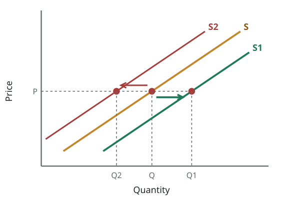

_SHIFT of supply: S → S1 (right) = increase in supply (more offered at the same price); S → S2 (left) = decrease._  
_যোগানের **সরণ**: S → S1 (ডানে) = যোগান বৃদ্ধি (একই দামে বেশি বিক্রির প্রস্তাব); S → S2 (বাঁয়ে) = হ্রাস।_

> Shift of Supply Curve
> [Diagram: supply curves S, S1 and S2; at the same price $15 the quantity supplied is 1,250 on S and 1,500 on the shifted curve]
> At the same price, a different quantity is supplied.
>

**বাংলা অনুবাদ:**

> যোগান রেখার সরণ
> [চিত্র: যোগান রেখা S, S1 ও S2; একই দাম $১৫-এ S-এ যোগান ১,২৫০ আর সরে যাওয়া রেখায় ১,৫০০]
> একই দামে ভিন্ন পরিমাণ যোগান দেওয়া হয়।

**Tutor explains:** Now the price stays at **$15**, but firms supply **1,500** instead of 1,250. Something other than price changed, so the **whole supply curve shifted right** (S → S1): an **increase in supply**. A shift to the left (S → S2) is a **decrease in supply**: less offered at every price.
Same rule as demand: **"At the same price, a different quantity is supplied" = shift.**

**টিউটরের ব্যাখ্যা:** এবার দাম **$১৫**-ই আছে, কিন্তু ফার্মগুলো ১,২৫০-এর বদলে **১,৫০০** যোগান দিচ্ছে। দাম ছাড়া অন্য কিছু বদলেছে, তাই **পুরো যোগান রেখা ডানে সরেছে** (S → S1): **যোগান বৃদ্ধি**। বাঁয়ে সরণ (S → S2) হলো **যোগান হ্রাস**: প্রতিটি দামে কম বিক্রির প্রস্তাব।
চাহিদার মতোই নিয়ম: **"একই দামে ভিন্ন পরিমাণ যোগান" = সরণ।**

**Common mistake:** A rightward shift of supply looks **lower** on the graph. Do not call it a "fall" in supply; it is an **increase** (more offered at each price).

**সাধারণ ভুল:** যোগানের ডানে সরণ গ্রাফে **নিচে** দেখায়। একে যোগানের "পতন" বলবে না; এটা **বৃদ্ধি** (প্রতিটি দামে বেশি বিক্রির প্রস্তাব)।

---

## Slide 22 · Determinants of supply
### যোগানের নির্ধারক

> [Mind map: "Determinants" in the centre, linked to — Taxes · Subsidies · Number of sellers · Producer expectation of price · Taste & Fashion · Cost of Production · Technology · Prices of other goods]
>

**বাংলা অনুবাদ:**

> [মাইন্ড ম্যাপ: মাঝে "নির্ধারক", যুক্ত — কর · ভর্তুকি · বিক্রেতার সংখ্যা · উৎপাদকের দামের প্রত্যাশা · রুচি ও ফ্যাশন · উৎপাদন খরচ · প্রযুক্তি · অন্যান্য পণ্যের দাম]

**Tutor explains:** Each factor **shifts** the supply curve. The direction:
**Cost of production** (wages, raw materials, fuel, electricity): cost ↑ → supply ↓ (left).**Technology:** better technology → cheaper production → supply ↑ (right).**Taxes** on producers (e.g. VAT, excise): tax ↑ → supply ↓.**Subsidies** (government pays part of the cost): subsidy ↑ → supply ↑.**Number of sellers:** more firms in the market → supply ↑.**Producer expectations of price:** if producers expect a higher price later, they may hold stock now → supply ↓ today.**Prices of other goods** (that the same resources can make): if wheat becomes more profitable, farmers switch land from rice → supply of rice ↓.**Taste & fashion** (as the slide lists): producers move resources towards what is fashionable, so supply of out-of-fashion goods falls.
(Weather and natural disasters also matter a lot for farm supply.)

**টিউটরের ব্যাখ্যা:** প্রতিটি উপাদান যোগান রেখাকে **সরায়**। দিক:
**উৎপাদন খরচ** (মজুরি, কাঁচামাল, জ্বালানি, বিদ্যুৎ): খরচ ↑ → যোগান ↓ (বাঁয়ে)।**প্রযুক্তি:** উন্নত প্রযুক্তি → সস্তা উৎপাদন → যোগান ↑ (ডানে)।উৎপাদকের ওপর **কর** (যেমন ভ্যাট, আবগারি): কর ↑ → যোগান ↓।**ভর্তুকি** (খরচের অংশ সরকার দেয়): ভর্তুকি ↑ → যোগান ↑।**বিক্রেতার সংখ্যা:** বাজারে বেশি ফার্ম → যোগান ↑।**উৎপাদকের দামের প্রত্যাশা:** পরে দাম বাড়বে ভাবলে উৎপাদক এখন মজুদ রেখে দিতে পারে → আজ যোগান ↓।**অন্যান্য পণ্যের দাম** (একই সম্পদ দিয়ে যা বানানো যায়): গম বেশি লাভজনক হলে কৃষক ধানের জমি গমে সরায় → ধানের যোগান ↓।**রুচি ও ফ্যাশন** (স্লাইডের তালিকা অনুযায়ী): উৎপাদক ফ্যাশনের দিকে সম্পদ সরায়, তাই অচল পণ্যের যোগান কমে।
(খামারের যোগানে আবহাওয়া ও প্রাকৃতিক দুর্যোগও খুব গুরুত্বপূর্ণ।)

**Real-life example:** **Cost:** when diesel prices rose in 2022, irrigation became costlier for boro rice, so the supply of rice fell (curve left). **Subsidy:** the government subsidises fertiliser; cheaper fertiliser → farmers produce more → supply of rice rises (curve right). **Technology:** BRRI's new high-yield rice varieties shift rice supply to the right.

**বাস্তব উদাহরণ:** **খরচ:** ২০২২ সালে ডিজেলের দাম বাড়ায় বোরো ধানের সেচ খরচ বাড়ল, ফলে চালের যোগান কমল (রেখা বাঁয়ে)। **ভর্তুকি:** সরকার সারে ভর্তুকি দেয়; সস্তা সার → কৃষক বেশি ফলায় → চালের যোগান বাড়ে (রেখা ডানে)। **প্রযুক্তি:** ব্রির নতুন উচ্চফলনশীল ধানের জাত চালের যোগান ডানে সরায়।

**Exam tip:** In Q6 list at least 6 determinants of supply, each with its direction (→ supply ↑ or ↓).

**পরীক্ষার টিপস:** Q6-এ যোগানের অন্তত ৬টি নির্ধারক লেখো, প্রত্যেকটির দিকসহ (→ যোগান ↑ বা ↓)।

---

## Quick check · দ্রুত যাচাই

1. The law of supply says price and quantity supplied are…  
   যোগানের নিয়ম বলে দাম ও যোগানের পরিমাণ…

   - A) Inversely related · বিপরীত সম্পর্কিত
   - B) Directly (positively) related · সরাসরি (ধনাত্মক) সম্পর্কিত
   - C) Unrelated · সম্পর্কহীন
   - D) Always equal · সবসময় সমান

   **Answer: B** — Higher price → more profit → firms supply more. A direct relationship; the curve slopes up.  
   বেশি দাম → বেশি মুনাফা → ফার্ম বেশি যোগান দেয়। সরাসরি সম্পর্ক; রেখা ওপরে ওঠে।

2. A new machine halves the cost of making shoes. The supply curve of shoes…  
   নতুন যন্ত্রে জুতা বানানোর খরচ অর্ধেক হলো। জুতার যোগান রেখা…

   - A) Shifts right · ডানে সরে
   - B) Shifts left · বাঁয়ে সরে
   - C) Moves along · বরাবর চলাচল
   - D) Does not change · বদলায় না

   **Answer: A** — Better technology lowers costs, so more is supplied at every price: an increase in supply.  
   উন্নত প্রযুক্তি খরচ কমায়, তাই প্রতিটি দামে বেশি যোগান: যোগান বৃদ্ধি।

3. Rice in a farmer's store that he will not sell is…  
   কৃষকের গোলায় থাকা যে চাল তিনি বিক্রি করবেন না, তা…

   - A) Part of supply · যোগানের অংশ
   - B) Not supply (only stock) · যোগান নয় (শুধু মজুদ)
   - C) Part of demand · চাহিদার অংশ
   - D) A subsidy · ভর্তুকি

   **Answer: B** — Slide 16: existing stocks are not considered supply unless they are put up for sale.  
   স্লাইড ১৬: বিদ্যমান মজুদ বিক্রির জন্য না তোলা পর্যন্ত যোগান নয়।

---

## Slide 23 · Functions of the price mechanism
### দামের প্রক্রিয়ার কাজ

> Functions of Price Mechanism
> Allocate: The market mechanism allocates scarce resources.
> Ration : price serve to ration scarce resources when demand outstrips supply.
> Signal : Market prices adjust to demonstrate where resources are required, and when they are not.
> Incentive : When the price of a product rises, the quantity supplied increases, this is due to the incentive function.
>

**বাংলা অনুবাদ:**

> দামের প্রক্রিয়ার কাজসমূহ
> **বণ্টন (Allocate):** বাজার প্রক্রিয়া দুষ্প্রাপ্য সম্পদ বণ্টন করে।
> **রেশন (Ration):** চাহিদা যোগানকে ছাড়িয়ে গেলে দাম দুষ্প্রাপ্য সম্পদকে রেশন করে (ভাগ করে দেয়)।
> **সংকেত (Signal):** বাজার দাম সমন্বিত হয়ে দেখায় কোথায় সম্পদ দরকার এবং কোথায় দরকার নেই।
> **প্রণোদনা (Incentive):** কোনো পণ্যের দাম বাড়লে যোগানের পরিমাণ বাড়ে — এটা প্রণোদনা কাজের ফল।

**Tutor explains:** Prices do **four jobs** in a market economy. Remember **"A-R-S-I"**:
**Allocate:** prices decide where scarce resources go (what, how, for whom).**Ration:** when demand is bigger than supply, a **higher price** reduces the quantity demanded until it matches what is available. The good goes to those who value it most (and can pay).**Signal:** a rising price tells producers "more is needed here"; a falling price says "too much here".**Incentive:** a higher price **rewards** producers with more profit, which motivates them to supply more.

**টিউটরের ব্যাখ্যা:** বাজার অর্থনীতিতে দাম **চারটি কাজ** করে। মনে রাখো **"A-R-S-I"**:
**বণ্টন (Allocate):** দাম ঠিক করে দুষ্প্রাপ্য সম্পদ কোথায় যাবে (কী, কীভাবে, কার জন্য)।**রেশন (Ration):** চাহিদা যোগানের চেয়ে বেশি হলে **বেশি দাম** চাহিদার পরিমাণ কমিয়ে প্রাপ্য পরিমাণের সমান করে। পণ্যটা যায় যারা সবচেয়ে বেশি মূল্য দেয় (ও দিতে পারে) তাদের কাছে।**সংকেত (Signal):** বাড়তি দাম উৎপাদককে বলে "এখানে আরও দরকার"; কমতি দাম বলে "এখানে বেশি হয়ে গেছে"।**প্রণোদনা (Incentive):** বেশি দাম উৎপাদককে বেশি মুনাফায় **পুরস্কৃত** করে, যা তাকে বেশি যোগানে উৎসাহিত করে।

**Real-life example:** **Eid bus tickets:** demand far exceeds seats, so prices rise (ration: only those who value it most travel by bus; others take a train or go later). The high price is also a **signal** and **incentive**: bus companies add extra trips.

**বাস্তব উদাহরণ:** **ঈদের বাসের টিকিট:** চাহিদা আসনের চেয়ে অনেক বেশি, তাই দাম বাড়ে (রেশন: যারা সবচেয়ে বেশি মূল্য দেয় তারাই বাসে যায়; অন্যরা ট্রেনে বা পরে যায়)। বেশি দাম একটা **সংকেত** ও **প্রণোদনাও**: বাস কোম্পানিগুলো বাড়তি ট্রিপ চালায়।

**Exam tip:** A short-note question ("functions of the price mechanism") can be answered fully with these four words plus one example each.

**পরীক্ষার টিপস:** সংক্ষিপ্ত টীকা ("functions of the price mechanism") এই চারটি শব্দ আর প্রতিটির একটি উদাহরণ দিয়ে পূর্ণ উত্তর দেওয়া যায়।

---

## Slide 24 · Equilibrium and disequilibrium
### ভারসাম্য ও ভারসাম্যহীনতা

> EQUILIBRIUM
> Demand = Supply  Equilibrium
> Demand ≠ Supply  Disequilibrium
> • Surplus = Supply > Demand
> • Deficit = Demand > Supply
> The point of intersection shows the equilibrium point ‘E’. At this point D=S=Qd=Qs=Q
> It is also known as the market clearing price. At any other point the market will be in disequilibrium. This is the point where the market forces will come to rest and there is no tendency to change.
>

**বাংলা অনুবাদ:**

> ভারসাম্য
> চাহিদা = যোগান → ভারসাম্য
> চাহিদা ≠ যোগান → ভারসাম্যহীনতা
> • উদ্বৃত্ত = যোগান > চাহিদা
> • ঘাটতি = চাহিদা > যোগান
> ছেদবিন্দু ভারসাম্য বিন্দু 'E' দেখায়। এই বিন্দুতে D = S = Qd = Qs = Q
> একে বাজার-পরিষ্কারক দামও (market clearing price) বলা হয়। অন্য যেকোনো বিন্দুতে বাজার ভারসাম্যহীন থাকবে। এই বিন্দুতে বাজার শক্তিগুলো স্থির হয় এবং বদলের কোনো প্রবণতা থাকে না।

**Tutor explains:** **Equilibrium** ("balance") is where **quantity demanded = quantity supplied**. On the graph it is the point **E** where the D and S curves **cross**.
The price there is the **equilibrium price** or **market-clearing price**: everything brought to market is sold, and every buyer willing to pay that price gets the good. The market "clears".At E there is **no tendency to change**: buyers and sellers are both satisfied, so the forces of demand and supply are **at rest**.
**Disequilibrium** = D ≠ S: - **Surplus** (excess supply): supply > demand. - **Deficit / shortage** (excess demand): demand > supply.

**টিউটরের ব্যাখ্যা:** **ভারসাম্য** হলো যেখানে **চাহিদার পরিমাণ = যোগানের পরিমাণ**। গ্রাফে এটা **E** বিন্দু, যেখানে D ও S রেখা **ছেদ করে**।
সেখানকার দাম **ভারসাম্য দাম** বা **বাজার-পরিষ্কারক দাম**: বাজারে আনা সব বিক্রি হয়, আর ওই দাম দিতে ইচ্ছুক প্রত্যেক ক্রেতা পণ্য পায়। বাজার "পরিষ্কার" হয়।E-তে **বদলের কোনো প্রবণতা নেই**: ক্রেতা-বিক্রেতা দুজনেই সন্তুষ্ট, তাই চাহিদা-যোগানের শক্তি **স্থির**।
**ভারসাম্যহীনতা** = D ≠ S: - **উদ্বৃত্ত** (অতিরিক্ত যোগান): যোগান > চাহিদা। - **ঘাটতি** (অতিরিক্ত চাহিদা): চাহিদা > যোগান।

**Exam tip:** Q7 starts here. Use the slide's own phrase: **"market clearing price … where market forces come to rest and there is no tendency to change."**

**পরীক্ষার টিপস:** Q7 এখান থেকে শুরু। স্লাইডের নিজের কথাটা লেখো: **"market clearing price … where market forces come to rest and there is no tendency to change."**

---

## Slide 25 · The equilibrium diagram
### ভারসাম্যের চিত্র

_Equilibrium (slide 25): demand = supply at point E. The market-clearing price is 3 and quantity is 60. No shortage, no surplus, no tendency to change._  
_ভারসাম্য (স্লাইড ২৫): E বিন্দুতে চাহিদা = যোগান। বাজার-পরিষ্কারক দাম ৩, পরিমাণ ৬০। ঘাটতি নেই, উদ্বৃত্ত নেই, বদলের প্রবণতা নেই।_

> EQUILIBRIUM
> [Diagram: downward-sloping D and upward-sloping S crossing at E; Price 1–5 on the vertical axis, Quantity 0–100 on the horizontal axis; E at P = 3, Q = 60]
> Demand = Supply (Equilibrium Point)
>

**বাংলা অনুবাদ:**

> ভারসাম্য
> [চিত্র: নিচে নামা D ও ওপরে ওঠা S, E-তে ছেদ করেছে; খাড়া অক্ষে দাম ১–৫, আনুভূমিক অক্ষে পরিমাণ ০–১০০; E-তে P = ৩, Q = ৬০]
> চাহিদা = যোগান (ভারসাম্য বিন্দু)

**Tutor explains:** Read the slide's graph: D and S cross at **E**, where **price = 3** and **quantity = 60**. At a price of 3, buyers want 60 and sellers offer 60. Nobody is left wanting and nothing is left unsold.
How to draw it in the exam (4 steps): (1) axes with labels **Price** and **Quantity**; (2) downward D; (3) upward S; (4) mark **E**, draw dashed lines to the axes and label **Pe** and **Qe**.

**টিউটরের ব্যাখ্যা:** স্লাইডের গ্রাফ পড়ো: D ও S ছেদ করেছে **E**-তে, যেখানে **দাম = ৩** ও **পরিমাণ = ৬০**। দাম ৩ হলে ক্রেতা চায় ৬০, বিক্রেতা দেয় ৬০। কেউ অতৃপ্ত থাকে না, কিছুই অবিক্রীত থাকে না।
পরীক্ষায় আঁকার ৪ ধাপ: (১) **Price** ও **Quantity** লেবেলসহ অক্ষ; (২) নিচে নামা D; (৩) ওপরে ওঠা S; (৪) **E** চিহ্নিত করো, অক্ষ পর্যন্ত ড্যাশ লাইন টেনে **Pe** ও **Qe** লেখো।

---

## Slide 26 · Disequilibrium: surplus and shortage
### ভারসাম্যহীনতা: উদ্বৃত্ত ও ঘাটতি

_Disequilibrium (slide 26): above E, quantity supplied > quantity demanded → surplus pushes price DOWN. Below E, demand > supply → shortage pushes price UP._  
_ভারসাম্যহীনতা (স্লাইড ২৬): E-র ওপরে যোগান > চাহিদা → উদ্বৃত্ত দামকে **নামায়**। E-র নিচে চাহিদা > যোগান → ঘাটতি দামকে **ওঠায়**।_

> DISEQUILIBRIUM
> [Diagram: D and S crossing at E; above the equilibrium price a gap marked "Excess Supply" with arrows pushing price down; below it a gap marked "Excess Demand" with arrows pushing price up]
>

**বাংলা অনুবাদ:**

> ভারসাম্যহীনতা
> [চিত্র: D ও S ছেদ করেছে E-তে; ভারসাম্য দামের ওপরে "অতিরিক্ত যোগান" লেখা ফাঁক, তীর দাম নিচে ঠেলছে; নিচে "অতিরিক্ত চাহিদা" লেখা ফাঁক, তীর দাম ওপরে ঠেলছে]

**Tutor explains:** What happens if the price is **not** at equilibrium? The market **corrects itself**:
**Price too high (above E):** sellers offer more than buyers want → **excess supply (surplus)**. Unsold goods pile up, so sellers **cut prices**. As price falls, Qd rises and Qs falls until they meet at E.**Price too low (below E):** buyers want more than sellers offer → **excess demand (shortage)**. Queues form, buyers **bid up** the price. As price rises, Qs rises and Qd falls until they meet at E.
So in a free market, disequilibrium is **temporary**: the arrows always point back to E. This self-correction is the invisible hand at work.

**টিউটরের ব্যাখ্যা:** দাম ভারসাম্যে **না** থাকলে কী হয়? বাজার **নিজেই ঠিক হয়**:
**দাম বেশি (E-র ওপরে):** বিক্রেতা ক্রেতার চাওয়ার চেয়ে বেশি দেয় → **অতিরিক্ত যোগান (উদ্বৃত্ত)**। অবিক্রীত পণ্য জমে, তাই বিক্রেতা **দাম কমায়**। দাম কমলে Qd বাড়ে, Qs কমে, যতক্ষণ না E-তে মেলে।**দাম কম (E-র নিচে):** ক্রেতা বিক্রেতার দেওয়ার চেয়ে বেশি চায় → **অতিরিক্ত চাহিদা (ঘাটতি)**। লাইন লাগে, ক্রেতারা দাম **বাড়িয়ে দেয়**। দাম বাড়লে Qs বাড়ে, Qd কমে, যতক্ষণ না E-তে মেলে।
তাই মুক্ত বাজারে ভারসাম্যহীনতা **সাময়িক**: তীরগুলো সবসময় E-র দিকে ফেরায়। এই আত্মসংশোধনই অদৃশ্য হাতের কাজ।

**Real-life example:** **Surplus:** at 9 pm, a fish seller in Mirpur still has 10 kg of unsold fish at Tk 400/kg. He drops it to Tk 300 and it sells out. **Shortage:** a new cricket match ticket is priced at Tk 200, but 50,000 fans want 25,000 seats. Touts resell tickets for Tk 1,000: the "real" price rises toward equilibrium.

**বাস্তব উদাহরণ:** **উদ্বৃত্ত:** রাত ৯টায় মিরপুরের এক মাছবিক্রেতার কাছে ৪০০ টাকা কেজির ১০ কেজি মাছ অবিক্রীত। তিনি ৩০০ টাকায় নামালেন, সব বিক্রি হয়ে গেল। **ঘাটতি:** ক্রিকেট ম্যাচের টিকিটের দাম ২০০ টাকা, কিন্তু ২৫,০০০ আসনের জন্য ৫০,০০০ দর্শক। দালালরা ১,০০০ টাকায় বিক্রি করে: "আসল" দাম ভারসাম্যের দিকে ওঠে।

**Exam tip:** Q7 asks for disequilibrium **"causing need for government intervention"**. Bridge: "Usually the market corrects disequilibrium itself. Problems arise when the government **fixes** the price away from equilibrium, or when the equilibrium price is socially unacceptable (too high for the poor, too low for farmers)."

**পরীক্ষার টিপস:** Q7 জিজ্ঞেস করে ভারসাম্যহীনতা **"যা সরকারি হস্তক্ষেপের প্রয়োজন তৈরি করে"**। সংযোগ: "সাধারণত বাজার নিজেই ভারসাম্যহীনতা ঠিক করে। সমস্যা হয় যখন সরকার ভারসাম্য থেকে দূরে দাম **বেঁধে দেয়**, বা ভারসাম্য দাম সামাজিকভাবে গ্রহণযোগ্য নয় (গরিবের জন্য খুব বেশি, কৃষকের জন্য খুব কম)।"

---

## Quick check · দ্রুত যাচাই

1. At the equilibrium price…  
   ভারসাম্য দামে…

   - A) Qd > Qs · Qd > Qs
   - B) Qs > Qd · Qs > Qd
   - C) Qd = Qs and the market clears · Qd = Qs এবং বাজার পরিষ্কার
   - D) The government sets the price · সরকার দাম ঠিক করে

   **Answer: C** — Equilibrium: D = S = Qd = Qs; the market-clearing price where there is no tendency to change.  
   ভারসাম্য: D = S = Qd = Qs; বাজার-পরিষ্কারক দাম, যেখানে বদলের প্রবণতা নেই।

2. If the price is above equilibrium there will be…  
   দাম ভারসাম্যের ওপরে থাকলে হবে…

   - A) A shortage that pushes price up · ঘাটতি, যা দাম বাড়ায়
   - B) A surplus that pushes price down · উদ্বৃত্ত, যা দাম কমায়
   - C) No change · কোনো পরিবর্তন নেই
   - D) A shift of demand · চাহিদার সরণ

   **Answer: B** — Above E, Qs > Qd (excess supply); sellers cut prices back toward E.  
   E-র ওপরে Qs > Qd (অতিরিক্ত যোগান); বিক্রেতারা দাম কমিয়ে E-র দিকে ফেরায়।

3. "When demand outstrips supply, prices rise and fewer people buy." This is the ___ function of prices.  
   "চাহিদা যোগানকে ছাড়ালে দাম বাড়ে, কম মানুষ কেনে।" এটি দামের ___ কাজ।

   - A) Rationing · রেশন
   - B) Signalling · সংকেত
   - C) Allocating · বণ্টন
   - D) Incentive · প্রণোদনা

   **Answer: A** — Slide 23: prices ration scarce resources when demand outstrips supply.  
   স্লাইড ২৩: চাহিদা যোগানকে ছাড়ালে দাম দুষ্প্রাপ্য সম্পদ রেশন করে।

---

## Slide 27 · Section title: market failure and government intervention
### অংশের শিরোনাম: বাজার ব্যর্থতা ও সরকারি হস্তক্ষেপ

> MARKET FAILURE AND GOVERNMENT INTERVENTION
>

**বাংলা অনুবাদ:**

> বাজার ব্যর্থতা ও সরকারি হস্তক্ষেপ

**Tutor explains:** A new section begins. Sometimes society thinks the market price is **unfair**: too high for poor consumers (rent, rice, fuel) or too low for producers (farmers, workers). Then the government **intervenes** by **fixing prices by law**:
a **price ceiling** (maximum price), slides 28–29;a **price floor** (minimum price), slides 30–32.
The big lesson of this section: **government-fixed prices create persistent shortages or surpluses** and side effects.

**টিউটরের ব্যাখ্যা:** নতুন অংশ শুরু। কখনো সমাজ মনে করে বাজারদর **অন্যায্য**: গরিব ভোক্তার জন্য খুব বেশি (ভাড়া, চাল, জ্বালানি) বা উৎপাদকের জন্য খুব কম (কৃষক, শ্রমিক)। তখন সরকার **আইন করে দাম বেঁধে** **হস্তক্ষেপ** করে:
**সর্বোচ্চ দামসীমা (price ceiling)**, স্লাইড ২৮–২৯;**সর্বনিম্ন দামসীমা (price floor)**, স্লাইড ৩০–৩২।
এই অংশের বড় শিক্ষা: **সরকার-নির্ধারিত দাম স্থায়ী ঘাটতি বা উদ্বৃত্ত** আর পার্শ্বপ্রতিক্রিয়া তৈরি করে।

---

## Slide 28 · Price ceiling → excess demand (shortage)
### সর্বোচ্চ দামসীমা → অতিরিক্ত চাহিদা (ঘাটতি)

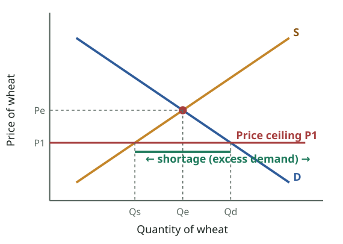

_Price ceiling (maximum price) set BELOW equilibrium: buyers want Qd but sellers offer only Qs → a persistent shortage, queues, rationing, black markets._  
_দামের সর্বোচ্চ সীমা (price ceiling) ভারসাম্যের **নিচে**: ক্রেতা চায় Qd, বিক্রেতা দেয় শুধু Qs → স্থায়ী ঘাটতি, লাইন, রেশনিং, কালোবাজার।_

> DISEQUILIBRIUM – EXCESS DEMAND
> A price ceiling sets the maximum legal price a seller may charge for a product or service. A price at or below the ceiling is legal; a price above it is not.
> When the ceiling price is below the equilibrium price, a persistent product shortage results.
> [Diagram: "Disequilibrium – Excess Demand" for wheat. If the current market price was P1 (below Pe), there would be an excess demand of Q1–Q4; this will put upward pressure on price]
>

**বাংলা অনুবাদ:**

> ভারসাম্যহীনতা — অতিরিক্ত চাহিদা
> **সর্বোচ্চ দামসীমা (price ceiling)** একটি পণ্য বা সেবার জন্য বিক্রেতা আইনগতভাবে সর্বোচ্চ যে দাম নিতে পারে তা ঠিক করে দেয়। সীমার সমান বা নিচের দাম বৈধ; ওপরের দাম অবৈধ।
> সর্বোচ্চ দাম ভারসাম্য দামের নিচে হলে স্থায়ী পণ্য ঘাটতি তৈরি হয়।
> [চিত্র: গমের "ভারসাম্যহীনতা — অতিরিক্ত চাহিদা"। বাজারদর P1 (Pe-র নিচে) হলে Q1–Q4 পরিমাণ অতিরিক্ত চাহিদা হবে; এটি দামের ওপর ঊর্ধ্বমুখী চাপ দেবে]

**Tutor explains:** A **price ceiling** = a legal **maximum** price. Sellers may charge the ceiling or less, never more.
A ceiling only matters if it is set **below** the equilibrium price (otherwise the market price is already lower and nothing changes). At the low ceiling price:
buyers want **more** (Qd rises, move down D);sellers offer **less** (Qs falls, move down S);the gap Qd − Qs is a **shortage (excess demand)**.
In a free market, the shortage would push the price up to E. But the law **forbids** the price from rising, so the shortage is **persistent**: it does not go away.

**টিউটরের ব্যাখ্যা:** **সর্বোচ্চ দামসীমা** = আইনগত **সর্বোচ্চ** দাম। বিক্রেতা সীমার সমান বা কম নিতে পারে, বেশি কখনো নয়।
সীমাটা কেবল তখনই কাজে লাগে যখন তা ভারসাম্য দামের **নিচে** বসানো হয় (নইলে বাজারদর আগেই কম, কিছুই বদলায় না)। কম সীমার দামে:
ক্রেতা **বেশি** চায় (Qd বাড়ে, D ধরে নিচে);বিক্রেতা **কম** দেয় (Qs কমে, S ধরে নিচে);ফাঁক Qd − Qs হলো **ঘাটতি (অতিরিক্ত চাহিদা)**।
মুক্ত বাজারে ঘাটতি দামকে E পর্যন্ত তুলত। কিন্তু আইন দাম বাড়তে **দেয় না**, তাই ঘাটতি **স্থায়ী**: দূর হয় না।

**Real-life example:** During the 2022 soybean oil crisis, the government fixed a maximum price per litre that was below what importers could profitably sell at. Shops "ran out" of bottled oil and customers queued for TCB trucks: a persistent shortage caused by a ceiling below equilibrium.

**বাস্তব উদাহরণ:** ২০২২ সালের সয়াবিন তেল সংকটে সরকার লিটারপ্রতি একটি সর্বোচ্চ দাম ঠিক করে, যা আমদানিকারকদের লাভজনক বিক্রির দামের নিচে ছিল। দোকানে বোতলজাত তেল "শেষ" হয়ে গেল, ক্রেতারা টিসিবির ট্রাকে লাইনে দাঁড়ালেন: ভারসাম্যের নিচে সর্বোচ্চ দামের কারণে স্থায়ী ঘাটতি।

**Exam tip:** Draw this graph in Q7: horizontal ceiling line **below** E, mark Qs and Qd, and label the gap "shortage".

**পরীক্ষার টিপস:** Q7-এ এই গ্রাফটা আঁকো: E-র **নিচে** আনুভূমিক সীমারেখা, Qs ও Qd চিহ্নিত করো, ফাঁকটার নাম লেখো "shortage"।

---

## Slide 29 · Consequences of a price ceiling
### সর্বোচ্চ দামসীমার পরিণতি

> DISEQUILIBRIUM- ED / SHORTAGE
> Price ceilings are imposed by government on specific products, mostly necessities, to enable consumers to afford. Examples are rent controls and usury laws, which specify maximum “prices” in the forms of rent and interest that can be charged to borrowers.
> Rationing ProblemIssuing ration coupons authorizing bearers to purchase a fixed amount of product monthly. These are then equitably distributed so that the wealthy family of four and the poor family of four both receive the same number of coupons.
> Black Markets Ration coupons may give rise to black marketing as many buyers are willing to pay more than the ceiling price and that is more profitable for the suppliers. A sizable enforcement bureaucracy would be required to ensure price controls.Counterfeiting of ration coupons will be a problem.Since government sets price, it might face political pressure to set an even lower price.Example ceiling on rent. It may result in demand to increase but inadequate supply.
> Resource MisallocationIn brief, controls distort market signals and thus resources are misallocated. Too few resources are allocated and too many alternative uses, eventually being the primary cause of such shortages.
>

**বাংলা অনুবাদ:**

> ভারসাম্যহীনতা — অতিরিক্ত চাহিদা / ঘাটতি
> সরকার নির্দিষ্ট কিছু পণ্যে, বেশিরভাগ নিত্যপ্রয়োজনীয় জিনিসে, সর্বোচ্চ দাম আরোপ করে যাতে ভোক্তারা কিনতে পারে। উদাহরণ: ভাড়া নিয়ন্ত্রণ এবং সুদবিরোধী (usury) আইন, যা ঋণগ্রহীতার কাছ থেকে নেওয়া যায় এমন ভাড়া ও সুদের সর্বোচ্চ "দাম" নির্দিষ্ট করে।
> **রেশনিং সমস্যা:** রেশন কুপন দেওয়া, যা দিয়ে বহনকারী প্রতি মাসে নির্দিষ্ট পরিমাণ পণ্য কিনতে পারে। কুপনগুলো ন্যায্যভাবে বণ্টন করা হয়, যাতে চার সদস্যের ধনী পরিবার আর চার সদস্যের গরিব পরিবার একই সংখ্যক কুপন পায়।
> **কালোবাজার:** রেশন কুপন কালোবাজারি জন্ম দিতে পারে, কারণ অনেক ক্রেতা সর্বোচ্চ দামের চেয়ে বেশি দিতে রাজি, আর তা বিক্রেতার জন্য বেশি লাভজনক। দাম নিয়ন্ত্রণ নিশ্চিত করতে বড় তদারকি আমলাতন্ত্র লাগবে। রেশন কুপন জাল করা একটা সমস্যা হবে। সরকার দাম ঠিক করে বলে আরও কম দাম রাখার রাজনৈতিক চাপ আসতে পারে। উদাহরণ: ভাড়ার সর্বোচ্চ সীমা — চাহিদা বাড়তে পারে কিন্তু যোগান অপর্যাপ্ত থাকে।
> **সম্পদের ভুল বণ্টন:** সংক্ষেপে, নিয়ন্ত্রণ বাজার সংকেত বিকৃত করে, ফলে সম্পদ ভুলভাবে বণ্টিত হয়। খুব কম সম্পদ এখানে আসে আর খুব বেশি বিকল্প ব্যবহারে যায়, যা শেষ পর্যন্ত এ ধরনের ঘাটতির প্রধান কারণ।

**Tutor explains:** **Why ceilings are used:** to keep **necessities** affordable. Examples: **rent controls** (maximum rent) and **usury laws** (maximum interest rate on loans).
**Problems they create:**
**Rationing problem:** the price no longer decides who gets the scarce good, so something else must: queues, "first come first served", favouritism, or **ration coupons** (each family gets the same number of coupons, rich or poor).**Black markets:** many buyers will pay **more** than the ceiling, and sellers earn more by selling illegally, so goods (and coupons) leak to the black market. Enforcing the law needs a **big bureaucracy**; **fake coupons** appear; and politicians may face pressure to set an even **lower** price.**Rent ceiling example:** low controlled rent → more people want flats, but landlords build fewer and stop maintaining them → too few flats.**Resource misallocation:** the low price gives a false signal ("this good is not valuable"), so **too few resources** go into producing it and too many go elsewhere. That is the root cause of the shortage.

**টিউটরের ব্যাখ্যা:** **সর্বোচ্চ দাম কেন দেওয়া হয়:** **নিত্যপ্রয়োজনীয় জিনিস** সাশ্রয়ী রাখতে। উদাহরণ: **ভাড়া নিয়ন্ত্রণ** (সর্বোচ্চ ভাড়া) ও **সুদবিরোধী (usury) আইন** (ঋণের সর্বোচ্চ সুদের হার)।
**যে সমস্যাগুলো তৈরি হয়:**
**রেশনিং সমস্যা:** দাম আর ঠিক করে না কে দুষ্প্রাপ্য পণ্যটা পাবে, তাই অন্য কিছুকে ঠিক করতে হয়: লাইন, "আগে এলে আগে পাবে", স্বজনপ্রীতি, বা **রেশন কুপন** (ধনী-গরিব প্রতিটি পরিবার সমান কুপন)।**কালোবাজার:** অনেক ক্রেতা সীমার চেয়ে **বেশি** দিতে রাজি, আর বিক্রেতা অবৈধভাবে বেচে বেশি পায়, তাই পণ্য (ও কুপন) কালোবাজারে চলে যায়। আইন কার্যকর করতে **বড় আমলাতন্ত্র** লাগে; **জাল কুপন** দেখা দেয়; আর রাজনীতিবিদদের ওপর দাম আরও **কম** রাখার চাপ আসে।**ভাড়ার সর্বোচ্চ সীমার উদাহরণ:** নিয়ন্ত্রিত কম ভাড়া → বেশি মানুষ ফ্ল্যাট চায়, কিন্তু বাড়িওয়ালা কম বানায় ও রক্ষণাবেক্ষণ বন্ধ করে → ফ্ল্যাট খুব কম।**সম্পদের ভুল বণ্টন:** কম দাম ভুল সংকেত দেয় ("এই পণ্য মূল্যবান নয়"), তাই এর উৎপাদনে **খুব কম সম্পদ** আসে, বেশি যায় অন্যখানে। এটাই ঘাটতির মূল কারণ।

**Real-life example:** **Bangladesh:** the Family Card / TCB system is a kind of ration: low-income families get fixed amounts of rice, lentils and oil at below-market prices. Reports of cards being sold or used by better-off people are the "black market and favouritism" problem the slide describes.

**বাস্তব উদাহরণ:** **বাংলাদেশ:** ফ্যামিলি কার্ড / টিসিবি ব্যবস্থা এক ধরনের রেশন: নিম্ন আয়ের পরিবারগুলো বাজারদরের নিচে নির্দিষ্ট পরিমাণ চাল, ডাল ও তেল পায়। কার্ড বিক্রি হওয়া বা সচ্ছলদের হাতে যাওয়ার খবরগুলোই স্লাইডে বর্ণিত "কালোবাজার ও স্বজনপ্রীতি" সমস্যা।

**Tutor's note (not on the slide):** "Usury laws" are laws that cap the interest rate lenders may charge. (In Islamic economics, which is your degree programme, riba/interest itself is prohibited; the slide uses usury laws only as an example of a legal maximum price.)

**টিউটরের নোট:** "Usury laws" হলো ঋণদাতা সর্বোচ্চ কত সুদ নিতে পারবে তা সীমিত করার আইন। (তোমার ডিগ্রি প্রোগ্রাম ইসলামী অর্থনীতিতে রিবা/সুদ নিজেই নিষিদ্ধ; স্লাইডে usury law শুধু আইনগত সর্বোচ্চ দামের উদাহরণ হিসেবে এসেছে।)

**Exam tip:** For Q7, list the four consequences of a ceiling: **rationing problem, black markets, enforcement costs/corruption, resource misallocation.**

**পরীক্ষার টিপস:** Q7-এ সর্বোচ্চ দামের চারটি পরিণতি লেখো: **rationing problem, black markets, enforcement costs/corruption, resource misallocation.**

---

## Slide 30 · Price floor → excess supply (surplus)
### সর্বনিম্ন দামসীমা → অতিরিক্ত যোগান (উদ্বৃত্ত)

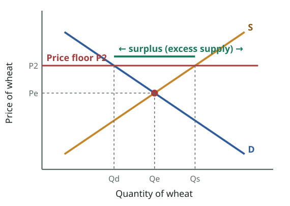

_Price floor (minimum price) set ABOVE equilibrium: sellers offer Qs but buyers take only Qd → a persistent surplus the government must buy, store or destroy._  
_দামের সর্বনিম্ন সীমা (price floor) ভারসাম্যের **ওপরে**: বিক্রেতা দেয় Qs, ক্রেতা নেয় শুধু Qd → স্থায়ী উদ্বৃত্ত, যা সরকারকে কিনতে, মজুদ বা নষ্ট করতে হয়।_

> DISEQUILIBRIUM- EXCESS SUPPLY
> A price floor is a minimum price fixed by the government. A price at or above the price floor is legal; a price below it is not. Usually for agricultural products. When the price floor is above the equilibrium price, a persistent product surplus results.
> [Diagram: "Disequilibrium – Excess Supply" for wheat. If the current market price was P2 (above Pe), there would be an excess supply of Q2–Q3; this will put downward pressure on price]
>

**বাংলা অনুবাদ:**

> ভারসাম্যহীনতা — অতিরিক্ত যোগান
> **সর্বনিম্ন দামসীমা (price floor)** হলো সরকার-নির্ধারিত সর্বনিম্ন দাম। সীমার সমান বা ওপরের দাম বৈধ; নিচের দাম অবৈধ। সাধারণত কৃষিপণ্যের জন্য। সর্বনিম্ন দাম ভারসাম্য দামের ওপরে হলে স্থায়ী পণ্য উদ্বৃত্ত তৈরি হয়।
> [চিত্র: গমের "ভারসাম্যহীনতা — অতিরিক্ত যোগান"। বাজারদর P2 (Pe-র ওপরে) হলে Q2–Q3 পরিমাণ অতিরিক্ত যোগান হবে; এটি দামের ওপর নিম্নমুখী চাপ দেবে]

**Tutor explains:** A **price floor** = a legal **minimum** price, usually for **farm products** (and, in the labour market, the **minimum wage**).
It only matters if it is set **above** equilibrium. At the high floor price:
sellers offer **more** (Qs rises);buyers take **less** (Qd falls);the gap Qs − Qd is a **surplus (excess supply)**.
Normally the surplus would push the price down to E, but the law forbids lower prices, so the surplus is **persistent**.

**টিউটরের ব্যাখ্যা:** **সর্বনিম্ন দামসীমা** = আইনগত **সর্বনিম্ন** দাম, সাধারণত **কৃষিপণ্যে** (আর শ্রমবাজারে **ন্যূনতম মজুরি**)।
এটা কেবল ভারসাম্যের **ওপরে** বসালে কাজে লাগে। উঁচু সর্বনিম্ন দামে:
বিক্রেতা **বেশি** দেয় (Qs বাড়ে);ক্রেতা **কম** নেয় (Qd কমে);ফাঁক Qs − Qd হলো **উদ্বৃত্ত (অতিরিক্ত যোগান)**।
সাধারণত উদ্বৃত্ত দামকে E পর্যন্ত নামাত, কিন্তু আইন কম দাম নিষেধ করে, তাই উদ্বৃত্ত **স্থায়ী**।

**Real-life example:** **Bangladesh:** every boro season, the government announces a **procurement price** for paddy and rice (e.g. above the local market price) to protect farmers. At that higher price, farmers want to sell more than the government warehouses can buy, which shows the surplus logic.

**বাস্তব উদাহরণ:** **বাংলাদেশ:** প্রতি বোরো মৌসুমে কৃষকদের সুরক্ষায় সরকার ধান-চালের **সংগ্রহমূল্য** ঘোষণা করে (যেমন স্থানীয় বাজারদরের ওপরে)। ওই বেশি দামে কৃষক সরকারি গুদামের কেনার সামর্থ্যের চেয়ে বেশি বিক্রি করতে চান — এটাই উদ্বৃত্তের যুক্তি।

**Exam tip:** Draw the floor graph next to the ceiling graph in Q7: floor line **above** E → surplus; ceiling line **below** E → shortage.

**পরীক্ষার টিপস:** Q7-এ সর্বোচ্চ দামের গ্রাফের পাশে সর্বনিম্ন দামের গ্রাফ আঁকো: সর্বনিম্ন রেখা E-র **ওপরে** → উদ্বৃত্ত; সর্বোচ্চ রেখা E-র **নিচে** → ঘাটতি।

---

## Slide 31 · Why price floors are used, and how the surplus is handled
### সর্বনিম্ন দাম কেন, এবং উদ্বৃত্ত কীভাবে সামলানো হয়

> DISEQUILIBRIUM – ES/ SURPLUS
> Price floors above equilibrium prices are usually invoked when society feels that the free functioning of the market system has not provided a sufficient income for certain groups of resource suppliers or producers. Supported prices for agricultural products and current minimum wages are two examples of price (or wage) floors
> The government may cope with the surplus resulting from a price floor in two waysSupply restrictionIt can restrict supply or increase demand through alternative uses for the product, thus reducing the surplus.Purchase excess stockGovernment must purchase the surplus output at the adjusted price and store or otherwise dispose of it
>

**বাংলা অনুবাদ:**

> ভারসাম্যহীনতা — অতিরিক্ত যোগান / উদ্বৃত্ত
> ভারসাম্যের ওপরে সর্বনিম্ন দাম সাধারণত তখনই আরোপ করা হয় যখন সমাজ মনে করে বাজার ব্যবস্থার মুক্ত কার্যক্রম কিছু সম্পদ সরবরাহকারী বা উৎপাদক গোষ্ঠীকে যথেষ্ট আয় দেয়নি। কৃষিপণ্যের সমর্থিত দাম এবং বর্তমান ন্যূনতম মজুরি — এই দুটি সর্বনিম্ন দাম (বা মজুরি) সীমার উদাহরণ।
> সর্বনিম্ন দাম থেকে সৃষ্ট উদ্বৃত্ত সরকার দুইভাবে সামলাতে পারে: **যোগান সীমিত করা** — যোগান কমাতে পারে বা পণ্যটির বিকল্প ব্যবহারের মাধ্যমে চাহিদা বাড়াতে পারে, ফলে উদ্বৃত্ত কমে। **অতিরিক্ত মজুদ কেনা** — সরকারকে সমন্বিত দামে উদ্বৃত্ত উৎপাদন কিনে মজুদ করতে বা অন্যভাবে নিষ্পত্তি করতে হয়।

**Tutor explains:** **Why floors are used:** when society feels the free market gives **too little income** to some group of producers or resource suppliers. Two examples from the slide:
**Price supports for farm products** (to protect farmers' incomes).**Minimum wages** (a floor on the price of labour, to protect workers). You will meet this again in Lecture 13 (Q17).
**How the government deals with the surplus — two ways:**
**Supply restriction / demand boost:** limit how much farmers may produce (quotas, paying them to leave land idle), or **raise demand** by finding new uses (e.g. turning surplus grain into animal feed or exporting it).**Purchase the excess stock:** the government **buys** the surplus at the floor price and **stores** it, gives it away, or destroys it.

**টিউটরের ব্যাখ্যা:** **সর্বনিম্ন দাম কেন দেওয়া হয়:** যখন সমাজ মনে করে মুক্ত বাজার কোনো উৎপাদক বা সম্পদ সরবরাহকারী গোষ্ঠীকে **খুব কম আয়** দিচ্ছে। স্লাইডের দুটি উদাহরণ:
**কৃষিপণ্যের সমর্থিত দাম** (কৃষকের আয় রক্ষায়)।**ন্যূনতম মজুরি** (শ্রমের দামের সর্বনিম্ন সীমা, শ্রমিক রক্ষায়)। লেকচার ১৩-তে (Q17) আবার আসবে।
**সরকার উদ্বৃত্ত সামলায় দুইভাবে:**
**যোগান সীমিত / চাহিদা বাড়ানো:** কৃষক কত উৎপাদন করবে তা সীমিত করা (কোটা, জমি খালি রাখতে টাকা দেওয়া), বা নতুন ব্যবহার খুঁজে **চাহিদা বাড়ানো** (যেমন উদ্বৃত্ত শস্য পশুখাদ্যে রূপান্তর বা রপ্তানি)।**অতিরিক্ত মজুদ কেনা:** সরকার সর্বনিম্ন দামে উদ্বৃত্ত **কিনে** নেয় এবং **মজুদ** করে, বিলিয়ে দেয়, বা নষ্ট করে।

**Real-life example:** **Bangladesh:** the Directorate of Food buys paddy and rice from farmers at the announced price and stores it in government warehouses and silos. Later it releases the stock through OMS, food-for-work and relief programmes: the "purchase excess stock" method.

**বাস্তব উদাহরণ:** **বাংলাদেশ:** খাদ্য অধিদপ্তর ঘোষিত দামে কৃষকের কাছ থেকে ধান-চাল কিনে সরকারি গুদাম ও সাইলোতে রাখে। পরে ওএমএস, কাজের বিনিময়ে খাদ্য ও ত্রাণ কর্মসূচিতে সেই মজুদ ছাড়ে: "অতিরিক্ত মজুদ কেনা" পদ্ধতি।

---

## Slide 32 · Further consequences of a price floor
### সর্বনিম্ন দামের আরও পরিণতি

> DISEQUILIBRIUM – ES/ SURPLUS
> Additional Consequences Price floors also disrupt the rationing ability of prices as well as resource allocation. Without price floor producer would face losses and force high-cost wheat producers to plant other crops or abandon farming altogether. So society devotes too many of its scarce resources to wheat production and too few to producing other, more valuable, goods and services. It fails to achieve allocative efficiency.
> Consumers of wheat-based products pay higher prices because of the price floor.
> Taxpayers pay higher taxes to finance the government’s purchase of the surplus.
> Price floor causes potential environmental damage through use of less suitable resources.
> The higher price encourages imports but since such imports would increase the quantity of wheat supplied and thus undermine the price floor, the government needs to erect tariffs (taxes on imports) to keep the foreign wheat out. Such tariffs usually prompt other countries to retaliate.
> Government controlled prices cause shortages or surpluses, distort resource allocation, and produce negative side effects.
>

**বাংলা অনুবাদ:**

> ভারসাম্যহীনতা — অতিরিক্ত যোগান / উদ্বৃত্ত
> **অতিরিক্ত পরিণতি:** সর্বনিম্ন দাম দামের রেশনিং ক্ষমতা ও সম্পদ বণ্টনকে ব্যাহত করে। সর্বনিম্ন দাম না থাকলে উৎপাদক লোকসানের মুখে পড়ত এবং বেশি খরচের গম উৎপাদকরা অন্য ফসল চাষ করতে বা চাষ পুরোপুরি ছেড়ে দিতে বাধ্য হতো। ফলে সমাজ তার দুষ্প্রাপ্য সম্পদের খুব বেশি অংশ গম উৎপাদনে এবং খুব কম অংশ অন্য, বেশি মূল্যবান পণ্য ও সেবায় দেয়। এটি বণ্টন দক্ষতা (allocative efficiency) অর্জনে ব্যর্থ হয়।
> সর্বনিম্ন দামের কারণে গমজাত পণ্যের ভোক্তারা বেশি দাম দেয়।
> উদ্বৃত্ত কেনার সরকারি খরচ জোগাতে করদাতারা বেশি কর দেয়।
> কম উপযুক্ত সম্পদ ব্যবহারের মাধ্যমে সর্বনিম্ন দাম সম্ভাব্য পরিবেশগত ক্ষতি করে।
> বেশি দাম আমদানিকে উৎসাহিত করে, কিন্তু আমদানি গমের যোগান বাড়িয়ে সর্বনিম্ন দামকে দুর্বল করবে, তাই বিদেশি গম ঠেকাতে সরকারকে শুল্ক (আমদানির ওপর কর) বসাতে হয়। এ ধরনের শুল্ক সাধারণত অন্য দেশগুলোকে পাল্টা ব্যবস্থা নিতে প্ররোচিত করে।
> সরকার-নিয়ন্ত্রিত দাম ঘাটতি বা উদ্বৃত্ত তৈরি করে, সম্পদ বণ্টন বিকৃত করে এবং নেতিবাচক পার্শ্বপ্রতিক্রিয়া সৃষ্টি করে।

**Tutor explains:** The slide lists **six side-effects** of a price floor (using wheat as the example):
**Misallocation / no allocative efficiency:** without the floor, high-cost wheat farmers would lose money and switch to other crops. With the floor they keep growing wheat, so **too many resources** go into wheat and **too few** into more valuable goods.**Consumers pay more** for bread, flour and other wheat products.**Taxpayers pay more**, because the government uses tax money to buy the surplus.**Environmental damage:** farmers push wheat onto unsuitable land and use more fertiliser.**Imports and trade wars:** the high price attracts cheap foreign wheat, which would break the floor, so the government adds **tariffs**; other countries **retaliate** with their own tariffs.**The big conclusion:** **government-controlled prices cause shortages or surpluses, distort resource allocation, and produce negative side effects.**

**টিউটরের ব্যাখ্যা:** স্লাইডে সর্বনিম্ন দামের **ছয়টি পার্শ্বপ্রতিক্রিয়া** (গমের উদাহরণে):
**ভুল বণ্টন / বণ্টন দক্ষতা নেই:** সর্বনিম্ন দাম না থাকলে বেশি খরচের গমচাষি লোকসান করে অন্য ফসলে যেত। সর্বনিম্ন দাম থাকায় তারা গমই চাষ করে, তাই গমে **খুব বেশি সম্পদ** আর বেশি মূল্যবান পণ্যে **খুব কম**।**ভোক্তা বেশি দাম দেয়** রুটি, আটা ও অন্যান্য গমজাত পণ্যে।**করদাতা বেশি দেয়**, কারণ সরকার করের টাকায় উদ্বৃত্ত কেনে।**পরিবেশের ক্ষতি:** কৃষক অনুপযুক্ত জমিতেও গম চাষ করে, বেশি সার দেয়।**আমদানি ও বাণিজ্যযুদ্ধ:** বেশি দাম সস্তা বিদেশি গম টানে, যা সর্বনিম্ন দাম ভেঙে দেবে, তাই সরকার **শুল্ক** বসায়; অন্য দেশ **পাল্টা** শুল্ক বসায়।**বড় উপসংহার:** **সরকার-নিয়ন্ত্রিত দাম ঘাটতি বা উদ্বৃত্ত তৈরি করে, সম্পদ বণ্টন বিকৃত করে এবং নেতিবাচক পার্শ্বপ্রতিক্রিয়া ঘটায়।**

**Exam tip:** End Q7 with the slide's final sentence as your conclusion. It sums up the whole answer.

**পরীক্ষার টিপস:** Q7 শেষ করো স্লাইডের শেষ বাক্যটা উপসংহার হিসেবে লিখে। এটা পুরো উত্তরের সারকথা।

---

## Quick check · দ্রুত যাচাই

1. A price ceiling is effective only when it is set…  
   সর্বোচ্চ দামসীমা কেবল তখনই কার্যকর যখন তা বসানো হয়…

   - A) Above equilibrium · ভারসাম্যের ওপরে
   - B) Below equilibrium · ভারসাম্যের নিচে
   - C) At equilibrium · ভারসাম্যে
   - D) On supply only · শুধু যোগানে

   **Answer: B** — A maximum price above equilibrium changes nothing; below equilibrium it causes a shortage.  
   ভারসাম্যের ওপরে সর্বোচ্চ দাম কিছুই বদলায় না; নিচে হলে ঘাটতি তৈরি করে।

2. Which is an example of a price floor?  
   কোনটি সর্বনিম্ন দামসীমার উদাহরণ?

   - A) Rent control · ভাড়া নিয়ন্ত্রণ
   - B) Usury law · সুদবিরোধী আইন
   - C) Minimum wage · ন্যূনতম মজুরি
   - D) Ration coupons · রেশন কুপন

   **Answer: C** — Minimum wage and farm price supports are floors; rent control and usury laws are ceilings.  
   ন্যূনতম মজুরি ও কৃষিপণ্যের সমর্থিত দাম সর্বনিম্ন সীমা; ভাড়া নিয়ন্ত্রণ ও সুদ আইন সর্বোচ্চ সীমা।

3. Black markets are most likely with…  
   কালোবাজার সবচেয়ে বেশি দেখা যায়…

   - A) A price ceiling below equilibrium · ভারসাম্যের নিচে সর্বোচ্চ দামে
   - B) A price floor above equilibrium · ভারসাম্যের ওপরে সর্বনিম্ন দামে
   - C) Equilibrium · ভারসাম্যে
   - D) A fall in demand · চাহিদা কমলে

   **Answer: A** — With a ceiling, buyers will pay more than the legal price, so goods leak to an illegal market.  
   সর্বোচ্চ দামে ক্রেতা আইনগত দামের চেয়ে বেশি দিতে রাজি, তাই পণ্য অবৈধ বাজারে যায়।

---

## Slide 33 · Why does equilibrium change?
### ভারসাম্য কেন বদলায়?

> Why the Equilibrium Changes?
> • Change in Demand
> • Change in Supply
> • Change in Demand & Supply
>

**বাংলা অনুবাদ:**

> ভারসাম্য কেন বদলায়?
> • চাহিদার পরিবর্তন
> • যোগানের পরিবর্তন
> • চাহিদা ও যোগান দুটোরই পরিবর্তন

**Tutor explains:** Equilibrium is not permanent. It moves whenever **demand shifts**, **supply shifts**, or **both shift**. The next four slides show each single shift. The method is always the same three steps:
Decide **which curve** shifts (does the change affect buyers → D, or sellers → S?).Decide **which way** (right = increase, left = decrease).Find the **new crossing point E1** and read the new **price P1** and **quantity Q1**.

**টিউটরের ব্যাখ্যা:** ভারসাম্য স্থায়ী নয়। যখনই **চাহিদা সরে**, **যোগান সরে**, বা **দুটোই সরে**, তখনই এটা বদলায়। পরের চারটি স্লাইডে প্রতিটি একক সরণ দেখানো হয়েছে। পদ্ধতি সবসময় একই তিন ধাপ:
ঠিক করো **কোন রেখা** সরে (পরিবর্তনটা ক্রেতাকে প্রভাবিত করে → D, নাকি বিক্রেতাকে → S?)।ঠিক করো **কোন দিকে** (ডানে = বৃদ্ধি, বাঁয়ে = হ্রাস)।**নতুন ছেদবিন্দু E1** খুঁজে নতুন **দাম P1** ও **পরিমাণ Q1** পড়ো।

**Tutor's note (not on the slide):** When **both** curves shift, one of P or Q is certain and the other depends on which shift is bigger. Example: demand ↑ and supply ↑ → Q definitely rises, but P may rise, fall or stay the same.

**টিউটরের নোট:** **দুটো** রেখাই সরলে P বা Q-র একটা নিশ্চিত, অন্যটা নির্ভর করে কোন সরণ বড় তার ওপর। উদাহরণ: চাহিদা ↑ ও যোগান ↑ → Q নিশ্চিতভাবে বাড়ে, কিন্তু P বাড়তে, কমতে বা একই থাকতে পারে।

---

## Slides 34–35 · Shifts in demand: increase and decrease
### চাহিদার সরণ: বৃদ্ধি ও হ্রাস

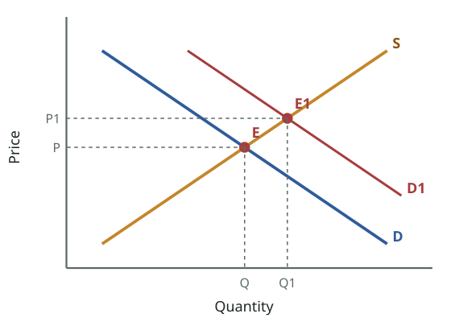

_Demand increases (D → D1): at the old price P there is excess demand, so price rises to P1 and quantity rises to Q1. Both P and Q go UP._  
_চাহিদা বাড়ে (D → D1): পুরোনো দাম P-তে অতিরিক্ত চাহিদা, তাই দাম P1-এ ও পরিমাণ Q1-এ ওঠে। P ও Q দুটোই **বাড়ে**।_

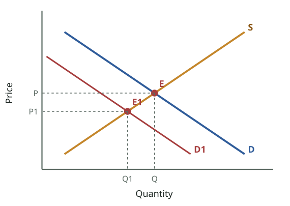

_Demand decreases (D → D1): at P there is excess supply, so price falls to P1 and quantity falls to Q1. Both P and Q go DOWN._  
_চাহিদা কমে (D → D1): P-তে অতিরিক্ত যোগান, তাই দাম P1-এ ও পরিমাণ Q1-এ নামে। P ও Q দুটোই **কমে**।_

> **Slide 34**
> SHIFT IN DEMAND - INCREASE
> [Diagram: demand shifts right from D to D1; at the old price P there is EXCESS DEMAND; the new equilibrium E1 has a higher price P1 and higher quantity Q1 (D↑ → P↑ & Q↑)]
>
> **Slide 35**
> SHIFT IN DEMAND - DECREASE
> [Diagram: demand shifts left from D to D1; at the old price P there is excess supply (ES); the new equilibrium E1 has a lower price P1 and lower quantity Q1]
>

**বাংলা অনুবাদ:**

> **স্লাইড ৩৪ — চাহিদার সরণ: বৃদ্ধি।** [চিত্র: চাহিদা D থেকে D1-এ ডানে সরে; পুরোনো দাম P-তে অতিরিক্ত চাহিদা; নতুন ভারসাম্য E1-এ দাম P1 বেশি ও পরিমাণ Q1 বেশি (D↑ → P↑ ও Q↑)]
> **স্লাইড ৩৫ — চাহিদার সরণ: হ্রাস।** [চিত্র: চাহিদা D থেকে D1-এ বাঁয়ে সরে; পুরোনো দাম P-তে অতিরিক্ত যোগান (ES); নতুন ভারসাম্য E1-এ দাম P1 কম ও পরিমাণ Q1 কম]

**Tutor explains:** **Demand increases (slide 34):** D shifts right to D1. At the **old** price P, buyers now want more than sellers offer → **excess demand**. The price is bid up; as it rises, sellers supply more (movement up S). New equilibrium **E1**: **price ↑ (P1) and quantity ↑ (Q1)**.
**Demand decreases (slide 35):** D shifts left. At the old price there is **excess supply (ES)** → sellers cut prices → new equilibrium E1: **price ↓ and quantity ↓**.
Rule: **with a demand shift, P and Q move in the SAME direction.**

**টিউটরের ব্যাখ্যা:** **চাহিদা বাড়ে (স্লাইড ৩৪):** D ডানে D1-এ সরে। **পুরোনো** দাম P-তে ক্রেতা এখন বিক্রেতার দেওয়ার চেয়ে বেশি চায় → **অতিরিক্ত চাহিদা**। দাম বাড়ে; দাম বাড়তে থাকলে বিক্রেতা বেশি যোগান দেয় (S ধরে ওপরে)। নতুন ভারসাম্য **E1**: **দাম ↑ (P1) ও পরিমাণ ↑ (Q1)**।
**চাহিদা কমে (স্লাইড ৩৫):** D বাঁয়ে সরে। পুরোনো দামে **অতিরিক্ত যোগান (ES)** → বিক্রেতা দাম কমায় → নতুন ভারসাম্য E1: **দাম ↓ ও পরিমাণ ↓**।
নিয়ম: **চাহিদার সরণে P ও Q একই দিকে চলে।**

**Real-life example:** **Increase:** before Eid-ul-Adha, demand for cattle rises → cattle prices and the number sold both rise. **Decrease:** after a news report about formalin in mangoes, demand for mangoes falls → mango prices and sales both fall.

**বাস্তব উদাহরণ:** **বৃদ্ধি:** ঈদুল আজহার আগে গরুর চাহিদা বাড়ে → গরুর দাম ও বিক্রির সংখ্যা দুটোই বাড়ে। **হ্রাস:** আমে ফরমালিনের খবর বেরোলে আমের চাহিদা কমে → আমের দাম ও বিক্রি দুটোই কমে।

---

## Slides 36–37 · Shifts in supply: increase and decrease
### যোগানের সরণ: বৃদ্ধি ও হ্রাস

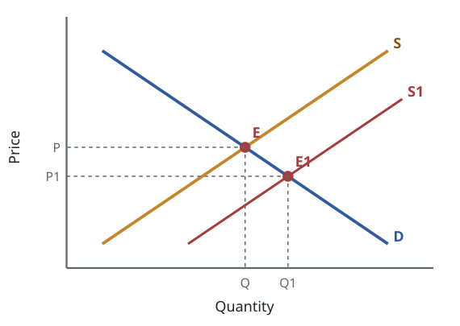

_Supply increases (S → S1): at P there is excess supply, so price FALLS to P1 and quantity RISES to Q1._  
_যোগান বাড়ে (S → S1): P-তে অতিরিক্ত যোগান, তাই দাম P1-এ **নামে** আর পরিমাণ Q1-এ **বাড়ে**।_

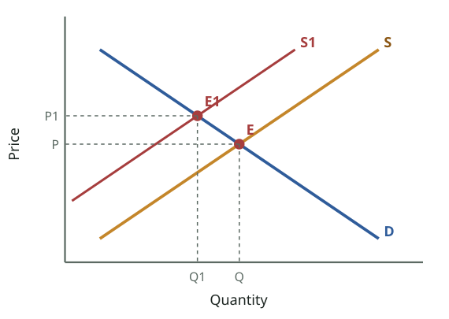

_Supply decreases (S → S1): at P there is excess demand, so price RISES to P1 and quantity FALLS to Q1._  
_যোগান কমে (S → S1): P-তে অতিরিক্ত চাহিদা, তাই দাম P1-এ **ওঠে** আর পরিমাণ Q1-এ **নামে**।_

> **Slide 36**
> SHIFT IN SUPPLY - INCREASE
> [Diagram: supply shifts right from S to S1; at the old price P there is excess supply (ES); new equilibrium E1 at a lower price P1 and higher quantity Q1]
>
> **Slide 37**
> SHIFT IN SUPPLY - DECREASE
> [Diagram: supply shifts left from S to S1; at the old price P there is excess demand (ED); new equilibrium E1 at a higher price P1 and lower quantity Q1]
>

**বাংলা অনুবাদ:**

> **স্লাইড ৩৬ — যোগানের সরণ: বৃদ্ধি।** [চিত্র: যোগান S থেকে S1-এ ডানে সরে; পুরোনো দাম P-তে অতিরিক্ত যোগান (ES); নতুন ভারসাম্য E1-এ দাম P1 কম ও পরিমাণ Q1 বেশি]
> **স্লাইড ৩৭ — যোগানের সরণ: হ্রাস।** [চিত্র: যোগান S থেকে S1-এ বাঁয়ে সরে; পুরোনো দাম P-তে অতিরিক্ত চাহিদা (ED); নতুন ভারসাম্য E1-এ দাম P1 বেশি ও পরিমাণ Q1 কম]

**Tutor explains:** **Supply increases (slide 36):** S shifts right to S1. At the old price there is **excess supply** → price falls → buyers buy more. New E1: **price ↓, quantity ↑**.
**Supply decreases (slide 37):** S shifts left. At the old price there is **excess demand (ED)** → price rises → buyers buy less. New E1: **price ↑, quantity ↓**.
Rule: **with a supply shift, P and Q move in OPPOSITE directions.**
ChangePriceQuantity
Demand ↑↑↑Demand ↓↓↓
Supply ↑↓↑Supply ↓↑↓

**টিউটরের ব্যাখ্যা:** **যোগান বাড়ে (স্লাইড ৩৬):** S ডানে S1-এ সরে। পুরোনো দামে **অতিরিক্ত যোগান** → দাম কমে → ক্রেতা বেশি কেনে। নতুন E1: **দাম ↓, পরিমাণ ↑**।
**যোগান কমে (স্লাইড ৩৭):** S বাঁয়ে সরে। পুরোনো দামে **অতিরিক্ত চাহিদা (ED)** → দাম বাড়ে → ক্রেতা কম কেনে। নতুন E1: **দাম ↑, পরিমাণ ↓**।
নিয়ম: **যোগানের সরণে P ও Q উল্টো দিকে চলে।**
পরিবর্তনদামপরিমাণ
চাহিদা ↑↑↑চাহিদা ↓↓↓
যোগান ↑↓↑যোগান ↓↑↓

**Real-life example:** **Supply ↑:** a bumper potato harvest in Bogura and Munshiganj → potato prices crash, people eat more potatoes. **Supply ↓:** floods destroy vegetable fields → fewer vegetables, much higher prices (green chilli once went above Tk 300/kg after heavy rains).

**বাস্তব উদাহরণ:** **যোগান ↑:** বগুড়া ও মুন্সিগঞ্জে আলুর বাম্পার ফলন → আলুর দাম পড়ে যায়, মানুষ বেশি আলু খায়। **যোগান ↓:** বন্যায় সবজির খেত নষ্ট → সবজি কম, দাম অনেক বেশি (ভারী বৃষ্টির পর একবার কাঁচা মরিচ কেজি ৩০০ টাকার ওপরে উঠেছিল)।

**Exam tip:** Memorise the 4-row table. A short "what happens to P and Q if…" question is easy marks if you draw the matching graph.

**পরীক্ষার টিপস:** ৪ সারির ছকটা মুখস্থ করো। "এমন হলে P ও Q-র কী হবে…" ধরনের ছোট প্রশ্নে মিলিয়ে গ্রাফ আঁকলে সহজে নম্বর।

---

## Slide 38 · Outline / summary of Lecture 3
### লেকচার ৩-এর রূপরেখা / সারসংক্ষেপ

> Outline
> Demand
> Supply
> Shifts
> Equilibrium
> Disequlibrium
>

**বাংলা অনুবাদ:**

> রূপরেখা
> চাহিদা · যোগান · সরণ · ভারসাম্য · ভারসাম্যহীনতা

**Tutor explains:** The closing outline adds one word to the opening one: **Disequilibrium**. Check you can explain each:
**Demand:** willing + able + price + period; law of demand; three reasons; factors that shift it.**Supply:** law of supply; determinants that shift it.**Shifts:** movement (own price) vs shift (other factors).**Equilibrium:** Qd = Qs, market-clearing price; four functions of price.**Disequilibrium:** surplus/shortage; ceilings and floors and their consequences.

**টিউটরের ব্যাখ্যা:** শেষের রূপরেখায় শুরুরটার সাথে একটি শব্দ যোগ হয়েছে: **ভারসাম্যহীনতা**। প্রতিটি ব্যাখ্যা করতে পারো কি না দেখো:
**চাহিদা:** ইচ্ছা + সামর্থ্য + দাম + সময়; চাহিদার নিয়ম; তিনটি কারণ; যে উপাদানগুলো সরায়।**যোগান:** যোগানের নিয়ম; যে নির্ধারকগুলো সরায়।**সরণ:** চলাচল (নিজের দাম) বনাম সরণ (অন্য উপাদান)।**ভারসাম্য:** Qd = Qs, বাজার-পরিষ্কারক দাম; দামের চারটি কাজ।**ভারসাম্যহীনতা:** উদ্বৃত্ত/ঘাটতি; সর্বোচ্চ ও সর্বনিম্ন দাম এবং তাদের পরিণতি।

---

## Put it together — tables, graphs and numbers · সব একসাথে — ছক, গ্রাফ ও হিসাব

_SHIFT of demand: something other than price changes. D → D1 (right) = increase: more bought at the same price. D → D2 (left) = decrease._  
_চাহিদার **সরণ**: দাম ছাড়া অন্য কিছু বদলায়। D → D1 (ডানে) = বৃদ্ধি: একই দামে বেশি কেনা হয়। D → D2 (বাঁয়ে) = হ্রাস।_

_Disequilibrium (slide 26): above E, quantity supplied > quantity demanded → surplus pushes price DOWN. Below E, demand > supply → shortage pushes price UP._  
_ভারসাম্যহীনতা (স্লাইড ২৬): E-র ওপরে যোগান > চাহিদা → উদ্বৃত্ত দামকে **নামায়**। E-র নিচে চাহিদা > যোগান → ঘাটতি দামকে **ওঠায়**।_

### English

### 1. Movement vs shift (Q6)
Movement along the curveShift of the curve
Caused byChange in the good's **own price**Change in **any other factor**
Name (demand)Change in **quantity demanded**: extension / contractionChange in **demand**: increase / decrease
Name (supply)Change in **quantity supplied**Change in **supply**
GraphSlide from point A to B on the same curveWhole curve moves right (increase) or left (decrease)
TestDifferent price → different quantity**Same price → different quantity**

### 2. Demand vs supply
DemandSupply
WhoBuyers (willing & able to buy)Sellers (willing & able to sell)
LawInverse: P ↑ → Qd ↓Direct: P ↑ → Qs ↑
CurveSlopes downSlopes up
WhyDMU, income effect, substitution effectHigher price → more profit; higher-cost firms can join
ShiftersIncome, population, prices of substitutes/complements, tastes, expectations, government, economic situation, advertisingCosts, technology, taxes, subsidies, number of sellers, expectations, prices of other goods, taste & fashion

### 3. Ceiling vs floor (Q7)
Price ceilingPrice floor
MeaningLegal **maximum** priceLegal **minimum** price
Effective whenSet **below** equilibriumSet **above** equilibrium
ResultPersistent **shortage** (excess demand)Persistent **surplus** (excess supply)
PurposeHelp consumers afford necessitiesProtect producers' / workers' incomes
ExamplesRent control, usury laws, fuel price capsFarm price supports, minimum wage
Side effectsRationing, queues, black markets, enforcement bureaucracy, fake coupons, misallocationGovernment must restrict supply or buy surplus; consumers and taxpayers pay more; misallocation; environment; tariffs and retaliation

### 4. Shifts and the new equilibrium
ChangeAt the old priceNew priceNew quantity
Demand ↑Excess demand↑↑
Demand ↓Excess supply↓↓
Supply ↑Excess supply↓↑
Supply ↓Excess demand↑↓

### বাংলা

### ১. চলাচল বনাম সরণ (Q6)
রেখা বরাবর চলাচলরেখার সরণ
কারণপণ্যের **নিজের দামের** পরিবর্তন**অন্য যেকোনো উপাদানের** পরিবর্তন
নাম (চাহিদা)**চাহিদার পরিমাণের** পরিবর্তন: সম্প্রসারণ / সংকোচন**চাহিদার** পরিবর্তন: বৃদ্ধি / হ্রাস
নাম (যোগান)**যোগানের পরিমাণের** পরিবর্তন**যোগানের** পরিবর্তন
গ্রাফএকই রেখায় A থেকে B-তে সরাপুরো রেখা ডানে (বৃদ্ধি) বা বাঁয়ে (হ্রাস) সরে
পরীক্ষাভিন্ন দাম → ভিন্ন পরিমাণ**একই দাম → ভিন্ন পরিমাণ**

### ২. চাহিদা বনাম যোগান
চাহিদাযোগান
কেক্রেতা (কিনতে ইচ্ছুক ও সক্ষম)বিক্রেতা (বেচতে ইচ্ছুক ও সক্ষম)
নিয়মবিপরীত: P ↑ → Qd ↓সরাসরি: P ↑ → Qs ↑
রেখানিচে নামেওপরে ওঠে
কেনক্রমহ্রাসমান প্রান্তিক উপযোগ, আয় প্রভাব, প্রতিস্থাপন প্রভাববেশি দাম → বেশি মুনাফা; বেশি খরচের ফার্মও আসতে পারে
সরণের কারণআয়, জনসংখ্যা, বিকল্প/পরিপূরকের দাম, রুচি, প্রত্যাশা, সরকার, অর্থনৈতিক অবস্থা, বিজ্ঞাপনখরচ, প্রযুক্তি, কর, ভর্তুকি, বিক্রেতার সংখ্যা, প্রত্যাশা, অন্য পণ্যের দাম, রুচি ও ফ্যাশন

### ৩. সর্বোচ্চ বনাম সর্বনিম্ন দাম (Q7)
সর্বোচ্চ দামসীমাসর্বনিম্ন দামসীমা
অর্থআইনগত **সর্বোচ্চ** দামআইনগত **সর্বনিম্ন** দাম
কার্যকর কখনভারসাম্যের **নিচে**ভারসাম্যের **ওপরে**
ফলস্থায়ী **ঘাটতি** (অতিরিক্ত চাহিদা)স্থায়ী **উদ্বৃত্ত** (অতিরিক্ত যোগান)
উদ্দেশ্যভোক্তাকে নিত্যপণ্য সাশ্রয়ী করাউৎপাদক / শ্রমিকের আয় রক্ষা
উদাহরণভাড়া নিয়ন্ত্রণ, সুদ আইন, জ্বালানির দামের সীমাকৃষিপণ্যের সমর্থিত দাম, ন্যূনতম মজুরি
পার্শ্বপ্রতিক্রিয়ারেশনিং, লাইন, কালোবাজার, তদারকি আমলাতন্ত্র, জাল কুপন, ভুল বণ্টনসরকারকে যোগান সীমিত বা উদ্বৃত্ত কিনতে হয়; ভোক্তা ও করদাতা বেশি দেয়; ভুল বণ্টন; পরিবেশ; শুল্ক ও পাল্টা শুল্ক

### ৪. সরণ ও নতুন ভারসাম্য
পরিবর্তনপুরোনো দামেনতুন দামনতুন পরিমাণ
চাহিদা ↑অতিরিক্ত চাহিদা↑↑
চাহিদা ↓অতিরিক্ত যোগান↓↓
যোগান ↑অতিরিক্ত যোগান↓↑
যোগান ↓অতিরিক্ত চাহিদা↑↓

---

## Midterm connection — model answers · মিডটার্ম সংযোগ — মডেল উত্তর

### English

Full cards: Q6 · Q7.

### Q6 — Explain the laws of demand and supply. Distinguish between movements along the curve and shifts of the curves.
**Demand** is the quantity of a product consumers are **willing and able** to buy at a given price over a period of time. **Law of demand:** price and quantity demanded have a **negative (inverse)** relationship, ceteris paribus; as price rises, quantity demanded falls and vice versa. Reasons: **diminishing marginal utility** (extra units give less satisfaction, so people buy more only at lower prices), the **income effect** (a lower price raises purchasing power) and the **substitution effect** (the cheaper good becomes a better deal than substitutes). _(Draw a downward-sloping D with a demand schedule.)_

**Supply** is producers' willingness and ability to sell a product at a given price over a period. **Law of supply:** price and quantity supplied have a **positive (direct)** relationship, because a higher price means more profit. _(Draw an upward-sloping S.)_

**Movement vs shift:** a change in the good's **own price** causes a change in **quantity demanded/supplied**, a **movement along** the same curve (extension/contraction). A change in **any other factor** causes a change in **demand/supply**, a **shift** of the entire curve: at the same price a different quantity is demanded/supplied. _(Draw D with arrow along it; D → D1, D2.)_ **Factors shifting demand:** income, population, prices of related goods (substitutes, complements), tastes and fashion, expectations, government policies, economic situation, advertising. **Determinants shifting supply:** cost of production, technology, taxes, subsidies, number of sellers, producers' expectations, prices of other goods. A change in price never shifts the curve.

### Q7 — Distinguish between equilibrium and disequilibrium in a market, causing need for government intervention.
**Equilibrium** is where **demand = supply (Qd = Qs)**, at the intersection E of the D and S curves. The price there is the **market-clearing price**: market forces are at rest and there is no tendency to change. _(Draw the equilibrium diagram.)_ **Disequilibrium** is when D ≠ S: **surplus** (supply > demand) at prices above equilibrium, pushing price down; **shortage/deficit** (demand > supply) at prices below equilibrium, pushing price up. In a free market these are temporary.

**Need for government intervention:** when the market price is felt to be unfair, the government fixes prices:
- **Price ceiling** (legal maximum) **below** equilibrium to keep necessities affordable (rent control, usury laws) → **persistent shortage**, rationing problems (coupons), **black markets**, large enforcement bureaucracy, counterfeit coupons, political pressure, **misallocation** of resources. _(Draw.)_
- **Price floor** (legal minimum) **above** equilibrium to support producers' incomes (farm price supports, minimum wage) → **persistent surplus**; the government must **restrict supply/raise demand** or **buy and store the surplus**; consumers pay higher prices, taxpayers pay more, resources are misallocated (no allocative efficiency), environmental damage, tariffs and retaliation. _(Draw.)_

**Conclusion:** government-controlled prices cause shortages or surpluses, distort resource allocation and produce negative side effects.

### বাংলা

পূর্ণ কার্ড: Q6 · Q7।

### Q6 — চাহিদা ও যোগানের নিয়ম ব্যাখ্যা করো। রেখা বরাবর চলাচল ও রেখার সরণের পার্থক্য করো।
**চাহিদা** হলো নির্দিষ্ট সময়ে নির্দিষ্ট দামে ভোক্তারা যে পরিমাণ পণ্য কিনতে **ইচ্ছুক ও সক্ষম**। **চাহিদার নিয়ম:** অন্যান্য অপরিবর্তিত থাকলে দাম ও চাহিদার পরিমাণের **ঋণাত্মক (বিপরীত)** সম্পর্ক; দাম বাড়লে চাহিদার পরিমাণ কমে, আর উল্টোটা। কারণ: **ক্রমহ্রাসমান প্রান্তিক উপযোগ** (বাড়তি একক কম তৃপ্তি দেয়, তাই কম দামেই বেশি কেনা), **আয় প্রভাব** (কম দাম ক্রয়ক্ষমতা বাড়ায়) ও **প্রতিস্থাপন প্রভাব** (সস্তা পণ্যটি বিকল্পের চেয়ে ভালো সওদা)। _(চাহিদা সূচিসহ নিচে নামা D আঁকো।)_

**যোগান** হলো নির্দিষ্ট সময়ে নির্দিষ্ট দামে উৎপাদকের পণ্য বিক্রির ইচ্ছা ও সামর্থ্য। **যোগানের নিয়ম:** দাম ও যোগানের পরিমাণের **ধনাত্মক (সরাসরি)** সম্পর্ক, কারণ বেশি দাম মানে বেশি মুনাফা। _(ওপরে ওঠা S আঁকো।)_

**চলাচল বনাম সরণ:** পণ্যের **নিজের দামের** পরিবর্তনে হয় **চাহিদা/যোগানের পরিমাণের** পরিবর্তন, একই রেখা **বরাবর চলাচল** (সম্প্রসারণ/সংকোচন)। **অন্য যেকোনো উপাদানের** পরিবর্তনে হয় **চাহিদা/যোগানের** পরিবর্তন, পুরো রেখার **সরণ**: একই দামে ভিন্ন পরিমাণ। _(D বরাবর তীর; D → D1, D2 আঁকো।)_ **চাহিদা সরানোর উপাদান:** আয়, জনসংখ্যা, সম্পর্কিত পণ্যের দাম (বিকল্প, পরিপূরক), রুচি ও ফ্যাশন, প্রত্যাশা, সরকারি নীতি, অর্থনৈতিক অবস্থা, বিজ্ঞাপন। **যোগান সরানোর নির্ধারক:** উৎপাদন খরচ, প্রযুক্তি, কর, ভর্তুকি, বিক্রেতার সংখ্যা, উৎপাদকের প্রত্যাশা, অন্য পণ্যের দাম। দামের পরিবর্তন কখনো রেখা সরায় না।

### Q7 — বাজারে ভারসাম্য ও ভারসাম্যহীনতার পার্থক্য, যা সরকারি হস্তক্ষেপের প্রয়োজন সৃষ্টি করে।
**ভারসাম্য** হলো যেখানে **চাহিদা = যোগান (Qd = Qs)**, D ও S রেখার ছেদবিন্দু E-তে। সেখানকার দাম **বাজার-পরিষ্কারক দাম**: বাজার শক্তি স্থির, বদলের প্রবণতা নেই। _(ভারসাম্যের চিত্র আঁকো।)_ **ভারসাম্যহীনতা** হলো D ≠ S: ভারসাম্যের ওপরের দামে **উদ্বৃত্ত** (যোগান > চাহিদা), যা দাম নামায়; নিচের দামে **ঘাটতি** (চাহিদা > যোগান), যা দাম ওঠায়। মুক্ত বাজারে এগুলো সাময়িক।

**সরকারি হস্তক্ষেপের প্রয়োজন:** বাজারদর অন্যায্য মনে হলে সরকার দাম বেঁধে দেয়:
- **সর্বোচ্চ দামসীমা** (আইনগত সর্বোচ্চ) ভারসাম্যের **নিচে**, নিত্যপণ্য সাশ্রয়ী রাখতে (ভাড়া নিয়ন্ত্রণ, সুদ আইন) → **স্থায়ী ঘাটতি**, রেশনিং সমস্যা (কুপন), **কালোবাজার**, বড় তদারকি আমলাতন্ত্র, জাল কুপন, রাজনৈতিক চাপ, সম্পদের **ভুল বণ্টন**। _(আঁকো।)_
- **সর্বনিম্ন দামসীমা** (আইনগত সর্বনিম্ন) ভারসাম্যের **ওপরে**, উৎপাদকের আয় রক্ষায় (কৃষিপণ্যের সমর্থিত দাম, ন্যূনতম মজুরি) → **স্থায়ী উদ্বৃত্ত**; সরকারকে **যোগান সীমিত/চাহিদা বাড়াতে** বা **উদ্বৃত্ত কিনে মজুদ করতে** হয়; ভোক্তা বেশি দাম দেয়, করদাতা বেশি দেয়, সম্পদের ভুল বণ্টন (বণ্টন দক্ষতা নেই), পরিবেশের ক্ষতি, শুল্ক ও পাল্টা শুল্ক। _(আঁকো।)_

**উপসংহার:** সরকার-নিয়ন্ত্রিত দাম ঘাটতি বা উদ্বৃত্ত তৈরি করে, সম্পদ বণ্টন বিকৃত করে এবং নেতিবাচক পার্শ্বপ্রতিক্রিয়া ঘটায়।

---

## Module quiz — 5 questions · মডিউল কুইজ — ৫টি প্রশ্ন

1. Consumers expect the price of sugar to rise next month. Today's demand curve for sugar…  
   ভোক্তারা আশা করছে আগামী মাসে চিনির দাম বাড়বে। আজকের চিনির চাহিদা রেখা…

   - A) Shifts right · ডানে সরে
   - B) Shifts left · বাঁয়ে সরে
   - C) Moves along · বরাবর চলাচল
   - D) Does not change · বদলায় না

   **Answer: A** — Expectation of a future price rise makes people buy more now at every price: demand increases.  
   ভবিষ্যতে দাম বাড়ার প্রত্যাশায় মানুষ এখন প্রতিটি দামে বেশি কেনে: চাহিদা বৃদ্ধি।

2. A tax on producers of cigarettes will…  
   সিগারেট উৎপাদকের ওপর কর আরোপ করলে…

   - A) Shift supply right, lower price · যোগান ডানে, দাম কমে
   - B) Shift supply left, raise price, lower quantity · যোগান বাঁয়ে, দাম বাড়ে, পরিমাণ কমে
   - C) Shift demand right · চাহিদা ডানে সরে
   - D) Create a surplus · উদ্বৃত্ত তৈরি করে

   **Answer: B** — A tax raises costs: supply decreases (left), so P rises and Q falls.  
   কর খরচ বাড়ায়: যোগান কমে (বাঁয়ে), তাই P বাড়ে ও Q কমে।

3. A government sets the maximum rent below the equilibrium rent. The result is…  
   সরকার ভারসাম্য ভাড়ার নিচে সর্বোচ্চ ভাড়া ঠিক করল। ফলাফল…

   - A) A surplus of flats · ফ্ল্যাটের উদ্বৃত্ত
   - B) A shortage of flats · ফ্ল্যাটের ঘাটতি
   - C) Equilibrium · ভারসাম্য
   - D) Higher rents · বেশি ভাড়া

   **Answer: B** — A ceiling below equilibrium: more people want flats, landlords offer fewer → persistent shortage.  
   ভারসাম্যের নিচে সর্বোচ্চ সীমা: বেশি মানুষ ফ্ল্যাট চায়, বাড়িওয়ালা কম দেয় → স্থায়ী ঘাটতি।

4. Which is NOT a reason for the downward-sloping demand curve?  
   কোনটি চাহিদা রেখা নিচে নামার কারণ নয়?

   - A) Diminishing marginal utility · ক্রমহ্রাসমান প্রান্তিক উপযোগ
   - B) Income effect · আয় প্রভাব
   - C) Substitution effect · প্রতিস্থাপন প্রভাব
   - D) Higher profit for sellers · বিক্রেতার বেশি মুনাফা

   **Answer: D** — Profit explains the upward-sloping SUPPLY curve, not demand.  
   মুনাফা ওপরে ওঠা যোগান রেখা ব্যাখ্যা করে, চাহিদা নয়।

5. Supply of onions falls because of floods. Equilibrium price and quantity…  
   বন্যায় পেঁয়াজের যোগান কমল। ভারসাম্য দাম ও পরিমাণ…

   - A) P ↑, Q ↑ · দাম ↑, পরিমাণ ↑
   - B) P ↑, Q ↓ · দাম ↑, পরিমাণ ↓
   - C) P ↓, Q ↓ · দাম ↓, পরিমাণ ↓
   - D) P ↓, Q ↑ · দাম ↓, পরিমাণ ↑

   **Answer: B** — Supply decrease → excess demand at the old price → price rises, quantity falls (opposite directions).  
   যোগান হ্রাস → পুরোনো দামে অতিরিক্ত চাহিদা → দাম বাড়ে, পরিমাণ কমে (উল্টো দিকে)।

---

## Lecture summary — revise in 3 minutes · লেকচারের সারসংক্ষেপ — ৩ মিনিটে রিভিশন

### English

- **Market** = any arrangement where buyers and sellers meet. **Price mechanism**: prices set by D and S signal where resources should go.
- **Demand** = willing + able + at a price + over a period. **Law of demand**: inverse (DMU, income effect, substitution effect). Market demand = sum of individual demands.
- **Supply** = willingness and ability to sell; stocks not for sale are not supply. **Law of supply**: direct (profit).
- **Own price → movement along** (quantity demanded/supplied). **Other factors → shift** (demand/supply). Same price, different quantity = shift.
- Demand shifters: income, population, related goods' prices, tastes, expectations, government, economy, advertising. Supply shifters: costs, technology, taxes, subsidies, number of sellers, expectations, other goods' prices, fashion.
- **Functions of price**: allocate, ration, signal, incentive.
- **Equilibrium**: Qd = Qs, market-clearing, no tendency to change. **Surplus** above, **shortage** below.
- **Ceiling below Pe → shortage** (rationing, black markets, misallocation). **Floor above Pe → surplus** (government buys/restricts; consumers and taxpayers pay; tariffs).
- **D↑: P↑Q↑ · D↓: P↓Q↓ · S↑: P↓Q↑ · S↓: P↑Q↓.**

**Next:** Lecture 4 asks **how much** quantity responds to a price change: **elasticity**.

### বাংলা

- **বাজার** = যেকোনো ব্যবস্থা যেখানে ক্রেতা-বিক্রেতা মেলে। **দামের প্রক্রিয়া**: D ও S দিয়ে ঠিক হওয়া দাম সংকেত দেয় সম্পদ কোথায় যাবে।
- **চাহিদা** = ইচ্ছা + সামর্থ্য + দাম + সময়। **চাহিদার নিয়ম**: বিপরীত (ক্রমহ্রাসমান প্রান্তিক উপযোগ, আয় প্রভাব, প্রতিস্থাপন প্রভাব)। বাজার চাহিদা = ব্যক্তিগত চাহিদার যোগফল।
- **যোগান** = বিক্রির ইচ্ছা ও সামর্থ্য; বিক্রির জন্য না তোলা মজুদ যোগান নয়। **যোগানের নিয়ম**: সরাসরি (মুনাফা)।
- **নিজের দাম → বরাবর চলাচল** (চাহিদা/যোগানের পরিমাণ)। **অন্য উপাদান → সরণ** (চাহিদা/যোগান)। একই দামে ভিন্ন পরিমাণ = সরণ।
- চাহিদা সরায়: আয়, জনসংখ্যা, সম্পর্কিত পণ্যের দাম, রুচি, প্রত্যাশা, সরকার, অর্থনীতি, বিজ্ঞাপন। যোগান সরায়: খরচ, প্রযুক্তি, কর, ভর্তুকি, বিক্রেতার সংখ্যা, প্রত্যাশা, অন্য পণ্যের দাম, ফ্যাশন।
- **দামের কাজ**: বণ্টন, রেশন, সংকেত, প্রণোদনা।
- **ভারসাম্য**: Qd = Qs, বাজার-পরিষ্কারক, বদলের প্রবণতা নেই। ওপরে **উদ্বৃত্ত**, নিচে **ঘাটতি**।
- **Pe-র নিচে সর্বোচ্চ দাম → ঘাটতি** (রেশনিং, কালোবাজার, ভুল বণ্টন)। **Pe-র ওপরে সর্বনিম্ন দাম → উদ্বৃত্ত** (সরকার কেনে/সীমিত করে; ভোক্তা ও করদাতা দেয়; শুল্ক)।
- **D↑: P↑Q↑ · D↓: P↓Q↓ · S↑: P↓Q↑ · S↓: P↑Q↓।**

**পরবর্তী:** লেকচার ৪ জিজ্ঞেস করে দাম বদলালে পরিমাণ **কতটা** সাড়া দেয়: **স্থিতিস্থাপকতা**।
