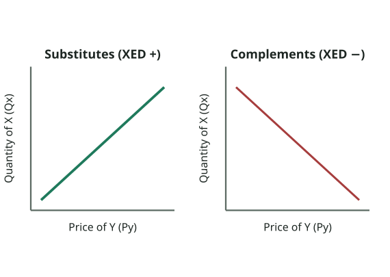
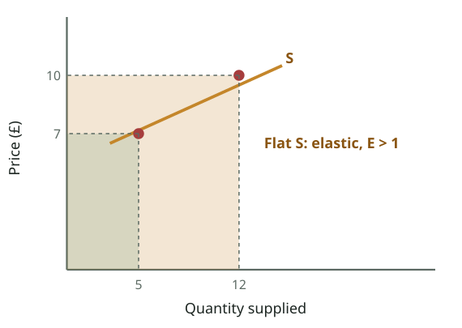
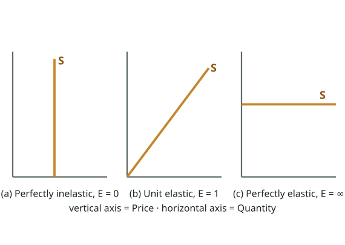
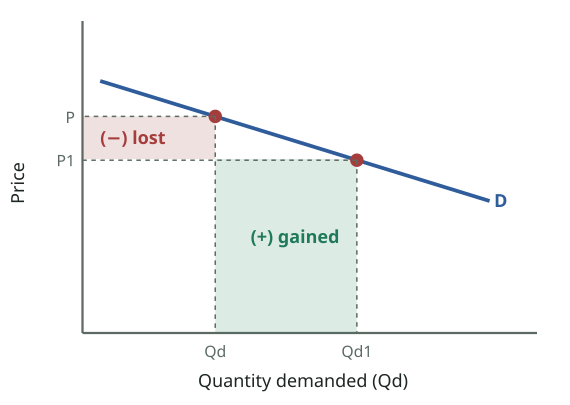
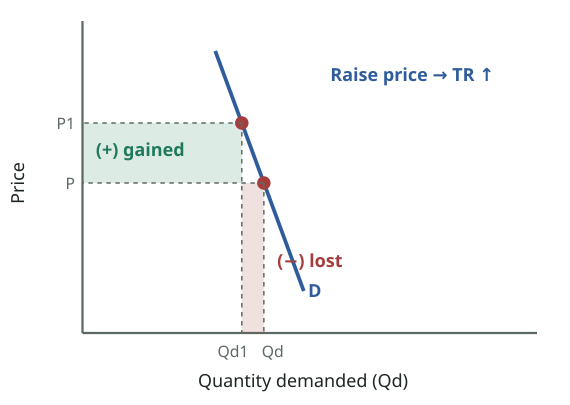
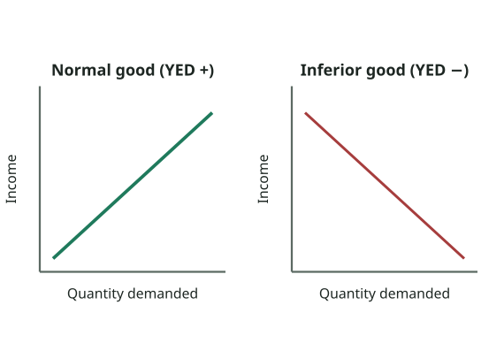

# FPEC 101 · Module 5 — PED & Total Revenue, Elasticity of Supply, Income & Cross Elasticity
## মডিউল ৫ — PED ও মোট আয়, যোগানের স্থিতিস্থাপকতা, আয় ও আড়াআড়ি স্থিতিস্থাপকতা

_Lecture 5 · 26 slides · Midterm questions: Q9, Q10, Q8_

> Printable study note generated from the website. Each slide: slide text → Bangla translation → tutor explanation → example → exam tip.

---

## Big picture — what is this lecture about? · বড় ছবি — এই লেকচারে কী শিখব?

_Cross elasticity (slide 22): for substitutes, a higher price of Y raises the quantity demanded of X (upward line); for complements it lowers it (downward line)._  
_আড়াআড়ি স্থিতিস্থাপকতা (স্লাইড ২২): বিকল্প পণ্যে Y-এর দাম বাড়লে X-এর চাহিদার পরিমাণ বাড়ে (ঊর্ধ্বমুখী রেখা); পরিপূরকে কমে (নিম্নমুখী রেখা)।_

### English

**Concept:** Lecture 4 measured how **buyers** react to price (PED). Lecture 5 completes the elasticity family:

1. **PES** — how **sellers** react to price.
2. **PED and total revenue** — the practical reason firms care about PED.
3. **Cross elasticity (XED)** — how demand for one good reacts to the **price of another** good.
4. **Income elasticity (YED)** — how demand reacts to a change in **income**.

All four use the same idea: **% change in quantity ÷ % change in the thing that caused it.**

### What you will learn (5 jobs)
1. **PES**: definition, formula (always positive), calculation, the five cases, determinants, importance (slides 4–12). Midterm **Q9**.
2. **PED and total revenue (TR = P × Q)**: when a price cut raises revenue and when it lowers it (slides 13–15).
3. **Usefulness of PED for producers**: revenue, price volatility, tax incidence, price discrimination (slide 16). Completes **Q8**.
4. **Cross elasticity**: substitutes (+), complements (−), independent goods (0) (slides 17–22).
5. **Income elasticity**: normal goods (+), inferior goods (−), and why it matters (slides 23–25). Together: midterm **Q10**.

### The 3-minute version
- **PES = %ΔQs ÷ %ΔP**, always **positive**. Elastic if > 1 (flat S), inelastic if < 1 (steep S). Determinants: spare capacity, stocks, time, agricultural products.
- **TR = P × Q.** Elastic demand → **cut** price to raise TR. Inelastic demand → **raise** price to raise TR. Unit elastic → TR unchanged by price.
- **XED = %ΔQd of X ÷ %ΔP of Y.** Positive → substitutes (butter/margarine). Negative → complements (phone/SIM). Zero → independent (walnuts/plums).
- **YED = %ΔQd ÷ %ΔIncome.** Positive → normal good. Negative → inferior good. Food has low YED; luxuries high.

**Exam tip:** Q9 has the same five headings as Q8 (definition, types, determinants, calculation, importance). Q10 is two definitions + formulas + signs + examples + two diagrams.

### বাংলা

**ধারণা:** লেকচার ৪ মেপেছে দামের প্রতি **ক্রেতারা** কীভাবে সাড়া দেয় (PED)। লেকচার ৫ স্থিতিস্থাপকতার পরিবার পূর্ণ করে:

1. **PES** — দামের প্রতি **বিক্রেতারা** কীভাবে সাড়া দেয়।
2. **PED ও মোট আয়** — ফার্ম কেন PED নিয়ে ভাবে তার বাস্তব কারণ।
3. **আড়াআড়ি স্থিতিস্থাপকতা (XED)** — **অন্য পণ্যের দামের** প্রতি একটি পণ্যের চাহিদার সাড়া।
4. **আয় স্থিতিস্থাপকতা (YED)** — **আয়ের** পরিবর্তনে চাহিদার সাড়া।

চারটিতেই একই ধারণা: **পরিমাণের % পরিবর্তন ÷ যে কারণে পরিবর্তন তার % পরিবর্তন।**

### তুমি কী শিখবে (৫টি কাজ)
1. **PES**: সংজ্ঞা, সূত্র (সবসময় ধনাত্মক), হিসাব, পাঁচটি ক্ষেত্র, নির্ধারক, গুরুত্ব (স্লাইড ৪–১২)। মিডটার্ম **Q9**।
2. **PED ও মোট আয় (TR = P × Q)**: কখন দাম কমালে আয় বাড়ে আর কখন কমে (স্লাইড ১৩–১৫)।
3. **উৎপাদকের জন্য PED-এর উপযোগিতা**: আয়, দামের অস্থিরতা, করের ভার, দাম-বৈষম্য (স্লাইড ১৬)। **Q8** পূর্ণ করে।
4. **আড়াআড়ি স্থিতিস্থাপকতা**: বিকল্প (+), পরিপূরক (−), স্বাধীন পণ্য (০) (স্লাইড ১৭–২২)।
5. **আয় স্থিতিস্থাপকতা**: স্বাভাবিক পণ্য (+), নিকৃষ্ট পণ্য (−), আর কেন গুরুত্বপূর্ণ (স্লাইড ২৩–২৫)। দুটি মিলে মিডটার্ম **Q10**।

### ৩ মিনিটের সারকথা
- **PES = %ΔQs ÷ %ΔP**, সবসময় **ধনাত্মক**। > ১ হলে স্থিতিস্থাপক (চ্যাপ্টা S), < ১ হলে অস্থিতিস্থাপক (খাড়া S)। নির্ধারক: অব্যবহৃত সক্ষমতা, মজুদ, সময়, কৃষিপণ্য।
- **TR = P × Q।** স্থিতিস্থাপক চাহিদা → TR বাড়াতে দাম **কমাও**। অস্থিতিস্থাপক চাহিদা → দাম **বাড়াও**। একক স্থিতিস্থাপক → দাম বদলালে TR একই।
- **XED = X-এর %ΔQd ÷ Y-এর %ΔP।** ধনাত্মক → বিকল্প (মাখন/মার্জারিন)। ঋণাত্মক → পরিপূরক (ফোন/সিম)। শূন্য → স্বাধীন (আখরোট/বরই)।
- **YED = %ΔQd ÷ %Δআয়।** ধনাত্মক → স্বাভাবিক পণ্য। ঋণাত্মক → নিকৃষ্ট পণ্য। খাদ্যের YED কম; বিলাসের বেশি।

**পরীক্ষার টিপস:** Q9-এর পাঁচটি শিরোনাম Q8-এর মতোই (সংজ্ঞা, প্রকার, নির্ধারক, হিসাব, গুরুত্ব)। Q10 মানে দুটি সংজ্ঞা + সূত্র + চিহ্ন + উদাহরণ + দুটি চিত্র।

---

## Key words · মূল শব্দ

| Term | Meaning | বাংলা অর্থ | Example |
|---|---|---|---|
| PES | Price elasticity of supply = %ΔQs ÷ %ΔP; always positive | যোগানের দাম স্থিতিস্থাপকতা; সবসময় ধনাত্মক | Price +10%, Qs +5% → PES 0.5. |
| Spare (unused) capacity | Idle machines/workers a firm can quickly use | অব্যবহৃত সক্ষমতা — যে যন্ত্র/শ্রমিক দ্রুত কাজে লাগানো যায় | A factory running one shift can add a second. |
| Total revenue (TR) | Price × quantity sold = consumer expenditure | মোট আয় — দাম × বিক্রির পরিমাণ = ভোক্তার ব্যয় | Tk 50 × 100 cups = Tk 5,000. |
| Price volatility | Big, sudden price swings | দামের অস্থিরতা — বড়, হঠাৎ ওঠানামা | Onion prices jumping after a flood. |
| Indirect tax | Tax on goods (VAT, excise) that sellers collect | পরোক্ষ কর — পণ্যের ওপর কর (ভ্যাট, আবগারি) | 15% VAT on a restaurant bill. |
| Price discrimination / yield management | Charging different prices to different groups for the same product | দাম-বৈষম্য / ইল্ড ম্যানেজমেন্ট — একই পণ্যে বিভিন্ন গোষ্ঠীকে ভিন্ন দাম | Cheaper off-peak train tickets; airline fares. |
| XED (cross elasticity) | %ΔQd of X ÷ %ΔP of Y | আড়াআড়ি স্থিতিস্থাপকতা — Y-এর দামের প্রতি X-এর চাহিদার সাড়া | Butter price ↑ → margarine demand ↑. |
| Substitutes | Goods used instead of each other; XED positive | বিকল্প পণ্য — একটার বদলে আরেকটা; XED ধনাত্মক | Tea and coffee; Pathao and Uber. |
| Complements | Goods used together; XED negative | পরিপূরক পণ্য — একসাথে ব্যবহৃত; XED ঋণাত্মক | Phone and SIM; car and petrol. |
| Independent goods | Unrelated goods; XED zero | স্বাধীন পণ্য — সম্পর্কহীন; XED শূন্য | Walnuts and plums; pens and onions. |
| YED (income elasticity) | %ΔQd ÷ %ΔIncome | আয় স্থিতিস্থাপকতা — আয়ের পরিবর্তনে চাহিদার সাড়া | Income +10%, restaurant meals +20% → YED 2. |
| Normal good | Demand rises when income rises; YED positive | স্বাভাবিক পণ্য — আয় বাড়লে চাহিদা বাড়ে; YED ধনাত্মক | Fish, clothes, smartphones. |
| Inferior good | Demand falls when income rises; YED negative | নিকৃষ্ট পণ্য — আয় বাড়লে চাহিদা কমে; YED ঋণাত্মক | Coarse rice, local bus instead of a car. |

---

## Slides 1–3 · Title, topic and outline
### শিরোনাম, বিষয় ও রূপরেখা

> **Slide 1**
> PRINCIPLES OF ECONOMICSSalimah Musharrif
> FPEC 101 – LECTURE 5 Unit 1
>
> **Slide 2**
> Elasticity
>
> **Slide 3**
> Outline
> Elasticity of Supply
> Income Elasticity
> Cross Elasticity
>

**বাংলা অনুবাদ:**

> **স্লাইড ১:** প্রিন্সিপলস অব ইকোনমিক্স — সালিমাহ মুশাররিফ। FPEC 101 – লেকচার ৫, ইউনিট ১।
> **স্লাইড ২:** স্থিতিস্থাপকতা
> **স্লাইড ৩ — রূপরেখা:** যোগানের স্থিতিস্থাপকতা · আয় স্থিতিস্থাপকতা · আড়াআড়ি স্থিতিস্থাপকতা

**Tutor explains:** Three kinds of elasticity in this lecture: **of supply**, **income** and **cross**. In the middle (slides 13–16) the lecture also links **PED to total revenue**. This is the last lecture of **Unit 1**. Syllabus reading: McConnell & Brue pp. 342–345 and 348–351.

**টিউটরের ব্যাখ্যা:** এই লেকচারে তিন ধরনের স্থিতিস্থাপকতা: **যোগানের**, **আয়** ও **আড়াআড়ি**। মাঝখানে (স্লাইড ১৩–১৬) **PED-কে মোট আয়ের** সাথে যুক্ত করা হয়েছে। এটি **ইউনিট ১-এর** শেষ লেকচার। সিলেবাসের পড়া: ম্যাককনেল ও ব্রু পৃ. ৩৪২–৩৪৫ ও ৩৪৮–৩৫১।

---

## Slide 4 · PES: "by how much does supply increase?"
### PES: "যোগান কতটা বাড়ে?"

> PRICE ELASTICITY OF SUPPLY
> When price ↑, what happens to Supply?
> Supply Increases
> BUT!
> How much does Supply Increase?
> Eg:
> If price rises by 10%
> The supply will increase
> • By more than 10%? Or
> • By less than 10%?
>

**বাংলা অনুবাদ:**

> যোগানের দাম স্থিতিস্থাপকতা
> দাম ↑ হলে যোগানের কী হয়?
> যোগান বাড়ে
> কিন্তু!
> যোগান কতটা বাড়ে?
> উদাহরণ:
> দাম ১০% বাড়লে
> যোগান বাড়বে —
> • ১০%-এর বেশি? অথবা
> • ১০%-এর কম?

**Tutor explains:** Same question as Lecture 4, now for **sellers**. The law of supply says: price ↑ → quantity supplied ↑. But **by how much**? If the price of rice rises 10%, can farmers supply 20% more (elastic), or only 2% more (inelastic)? That is what **PES** measures.

**টিউটরের ব্যাখ্যা:** লেকচার ৪-এর একই প্রশ্ন, এবার **বিক্রেতার** জন্য। যোগানের নিয়ম বলে: দাম ↑ → যোগানের পরিমাণ ↑। কিন্তু **কতটা**? চালের দাম ১০% বাড়লে কৃষক কি ২০% বেশি দিতে পারবে (স্থিতিস্থাপক), নাকি মাত্র ২% (অস্থিতিস্থাপক)? এটাই **PES** মাপে।

---

## Slide 5 · Definition of PES; elastic vs inelastic supply
### PES-এর সংজ্ঞা; স্থিতিস্থাপক বনাম অস্থিতিস্থাপক যোগান

> Price Elasticity of Supply
> “A responsive change in supply with a change in the price is called Price Elasticity of Supply (PES)”
> If a small change in price, produce a bigger change in supply  Supply is elastic.
> If a large change in price, produce a small change in supply  Supply is inelastic.
>

**বাংলা অনুবাদ:**

> যোগানের দাম স্থিতিস্থাপকতা
> "দামের পরিবর্তনে যোগানের সাড়াদানমূলক পরিবর্তনকে যোগানের দাম স্থিতিস্থাপকতা (PES) বলে"
> দামের ছোট পরিবর্তন যোগানে বড় পরিবর্তন আনলে → যোগান **স্থিতিস্থাপক**।
> দামের বড় পরিবর্তন যোগানে ছোট পরিবর্তন আনলে → যোগান **অস্থিতিস্থাপক**।

**Tutor explains:** **PES = the responsiveness of quantity supplied to a change in price.**
**Elastic supply:** a small price rise → a big increase in quantity supplied. Producers can **easily and quickly** make more.**Inelastic supply:** even a big price rise → only a small increase. Producers **cannot** quickly make more (land, time or machines are limited).

**টিউটরের ব্যাখ্যা:** **PES = দামের পরিবর্তনে যোগানের পরিমাণের সাড়া।**
**স্থিতিস্থাপক যোগান:** দামের সামান্য বৃদ্ধি → যোগানের পরিমাণে বড় বৃদ্ধি। উৎপাদক **সহজে ও দ্রুত** বেশি বানাতে পারে।**অস্থিতিস্থাপক যোগান:** দাম অনেক বাড়লেও → যোগান সামান্য বাড়ে। উৎপাদক দ্রুত বেশি বানাতে **পারে না** (জমি, সময় বা যন্ত্র সীমিত)।

**Real-life example:** **Elastic:** T-shirt printing in Dhaka. If demand for a team jersey jumps before a cricket final, printers can add a night shift and supply many more within days. **Inelastic:** flats in Gulshan. Even if rents rise 30%, new buildings take 2–3 years and land is fixed.

**বাস্তব উদাহরণ:** **স্থিতিস্থাপক:** ঢাকায় টি-শার্ট প্রিন্টিং। ক্রিকেট ফাইনালের আগে দলের জার্সির চাহিদা লাফ দিলে ছাপাখানা রাতের শিফট যোগ করে কয়েক দিনেই অনেক বেশি যোগান দিতে পারে। **অস্থিতিস্থাপক:** গুলশানের ফ্ল্যাট। ভাড়া ৩০% বাড়লেও নতুন ভবনে ২–৩ বছর লাগে, আর জমি নির্দিষ্ট।

**Exam tip:** Q9 first line: **"Price elasticity of supply (PES) is the responsiveness of quantity supplied to a change in the price of the product."**

**পরীক্ষার টিপস:** Q9-এর প্রথম লাইন: **"Price elasticity of supply (PES) is the responsiveness of quantity supplied to a change in the price of the product."**

---

## Slide 6 · The PES formula
### PES সূত্র

> PES - Formula
> PES = % change in quantity Supplied ÷ % change in price
> PES = %△Q ÷ %△P
> PES is always Positive
>

**বাংলা অনুবাদ:**

> PES — সূত্র
> PES = যোগানের পরিমাণের % পরিবর্তন ÷ দামের % পরিবর্তন
> PES = %△Q ÷ %△P
> PES সবসময় ধনাত্মক

**Tutor explains:** **PES = %ΔQs ÷ %ΔP**, with % change = (new − old) ÷ old.
**Why always positive?** Because of the law of supply: price and quantity supplied move in the **same** direction (both + or both −), and a + divided by a + (or − by −) is positive. Compare PED, which comes out negative.

**টিউটরের ব্যাখ্যা:** **PES = %ΔQs ÷ %ΔP**, যেখানে % পরিবর্তন = (নতুন − পুরোনো) ÷ পুরোনো।
**সবসময় ধনাত্মক কেন?** যোগানের নিয়মের কারণে: দাম ও যোগানের পরিমাণ **একই** দিকে চলে (দুটোই + বা দুটোই −), আর + ÷ + (বা − ÷ −) ধনাত্মক। PED-এর সাথে তুলনা করো, যা ঋণাত্মক আসে।

---

## Slide 7 · PES calculation and interpretation
### PES-এর হিসাব ও ব্যাখ্যা

> PES Formula, Calculation, Interpretation
> P: 3 → 5   |   Qs: 10 → 12
> (Q2 − Q1)/Q1 ÷ (P2 − P1)/P1
> = (12 − 10)/10 ÷ (5 − 3)/3 = 2/10 ÷ 2/3 = 0.2 ÷ 0.67 = 0.3 < 1 Relatively inelastic
> 0.3 x 100 = 33%
>

**বাংলা অনুবাদ:**

> PES সূত্র, হিসাব, ব্যাখ্যা
> দাম: ৩ → ৫   |   যোগানের পরিমাণ: ১০ → ১২
> (Q2 − Q1)/Q1 ÷ (P2 − P1)/P1
> = (১২ − ১০)/১০ ÷ (৫ − ৩)/৩ = ২/১০ ÷ ২/৩ = ০.২ ÷ ০.৬৭ = ০.৩ < ১ তুলনামূলক অস্থিতিস্থাপক
> ০.৩ × ১০০ = ৩৩%

**Tutor explains:** Step by step:
%ΔQs = (12 − 10)/10 = **0.2** (+20%).%ΔP = (5 − 3)/3 = **0.67** (+67%).PES = 0.2 ÷ 0.67 = **0.3** (positive, as expected).0.3 < 1 → **relatively inelastic supply**: a 67% price rise brought only a 20% rise in quantity supplied.
(The slide writes "0.3 × 100 = 33%". 0.2 ÷ 0.667 is exactly 0.30, so the percentage is **30%**; the "33%" is a small slip on the slide. The interpretation, inelastic, is the same either way.)

**টিউটরের ব্যাখ্যা:** ধাপে ধাপে:
%ΔQs = (১২ − ১০)/১০ = **০.২** (+২০%)।%ΔP = (৫ − ৩)/৩ = **০.৬৭** (+৬৭%)।PES = ০.২ ÷ ০.৬৭ = **০.৩** (প্রত্যাশামতো ধনাত্মক)।০.৩ < ১ → **তুলনামূলক অস্থিতিস্থাপক যোগান**: ৬৭% দাম বাড়ায় যোগান বেড়েছে মাত্র ২০%।
(স্লাইডে লেখা "০.৩ × ১০০ = ৩৩%"। ০.২ ÷ ০.৬৬৭ ঠিক ০.৩০, তাই শতকরা **৩০%**; "৩৩%" স্লাইডের ছোট ভুল। ব্যাখ্যা — অস্থিতিস্থাপক — দুই ক্ষেত্রেই একই।)

**Real-life example:** **Try one:** the price of eggs rises from Tk 10 to Tk 12; poultry farms increase weekly supply from 1,000 to 1,500 eggs. %ΔQs = 500/1000 = 0.5; %ΔP = 2/10 = 0.2; PES = 0.5 ÷ 0.2 = **2.5** > 1 → **elastic** (farms had spare hens and feed).

**বাস্তব উদাহরণ:** **একটা চেষ্টা করো:** ডিমের দাম ১০ থেকে ১২ টাকা হলো; পোলট্রি খামার সাপ্তাহিক যোগান ১,০০০ থেকে ১,৫০০ ডিমে বাড়াল। %ΔQs = ৫০০/১০০০ = ০.৫; %ΔP = ২/১০ = ০.২; PES = ০.৫ ÷ ০.২ = **২.৫** > ১ → **স্থিতিস্থাপক** (খামারে বাড়তি মুরগি ও খাবার ছিল)।

**Exam tip:** This exact calculation is the "calculation" part of Q9. Write all four steps and the interpretation sentence.

**পরীক্ষার টিপস:** Q9-এর "হিসাব" অংশ ঠিক এটাই। চারটি ধাপ ও ব্যাখ্যার বাক্য লেখো।

---

## Slide 8 · Elastic supply (E > 1)
### স্থিতিস্থাপক যোগান (E > 1)

_Elastic supply (slide 8): price rises £7 → £10 (+43%), quantity supplied jumps 5 → 12 (+140%). Flat supply curve._  
_স্থিতিস্থাপক যোগান (স্লাইড ৮): দাম £৭ → £১০ (+৪৩%), যোগানের পরিমাণ ৫ → ১২ (+১৪০%)। চ্যাপ্টা যোগান রেখা।_

> Elastic Supply
> [Diagram: a flat supply curve S; Price (£) rises from 7 to 10, Quantity Supplied rises from 5 to 12]
> This means that a change in price brings about a more than proportionate change in quantity supplied. E>1
>

**বাংলা অনুবাদ:**

> স্থিতিস্থাপক যোগান
> [চিত্র: চ্যাপ্টা যোগান রেখা S; দাম (£) ৭ থেকে ১০, যোগানের পরিমাণ ৫ থেকে ১২]
> এর মানে দামের পরিবর্তন যোগানের পরিমাণে অনুপাতের চেয়ে বেশি পরিবর্তন আনে। E > ১

**Tutor explains:** Price rises from **£7 to £10** (+43%); quantity supplied rises from **5 to 12** (+140%). PES = 140 ÷ 43 ≈ **3.3** > 1. The supply curve is drawn **flat**: producers respond strongly.

**টিউটরের ব্যাখ্যা:** দাম **£৭ থেকে £১০** (+৪৩%); যোগানের পরিমাণ **৫ থেকে ১২** (+১৪০%)। PES = ১৪০ ÷ ৪৩ ≈ **৩.৩** > ১। যোগান রেখা **চ্যাপ্টা** করে আঁকা: উৎপাদক জোরালো সাড়া দেয়।

---

## Slide 9 · Inelastic supply (E < 1)
### অস্থিতিস্থাপক যোগান (E < 1)

_Inelastic supply (slide 9): price doubles £5 → £10 (+100%), quantity supplied rises only 5 → 7 (+40%). Steep supply curve._  
_অস্থিতিস্থাপক যোগান (স্লাইড ৯): দাম দ্বিগুণ £৫ → £১০ (+১০০%), যোগানের পরিমাণ মাত্র ৫ → ৭ (+৪০%)। খাড়া যোগান রেখা।_

> Inelastic Supply
> [Diagram: a steep supply curve S; Price (£) rises from 5 to 10, Quantity Supplied rises only from 5 to 7]
> This means that a change in price brings about a less than proportionate change in quantity supplied. E<1
>

**বাংলা অনুবাদ:**

> অস্থিতিস্থাপক যোগান
> [চিত্র: খাড়া যোগান রেখা S; দাম (£) ৫ থেকে ১০, যোগানের পরিমাণ মাত্র ৫ থেকে ৭]
> এর মানে দামের পরিবর্তন যোগানের পরিমাণে অনুপাতের চেয়ে কম পরিবর্তন আনে। E < ১

**Tutor explains:** Price **doubles** from £5 to £10 (+100%) but quantity supplied rises only from 5 to 7 (+40%). PES = 40 ÷ 100 = **0.4** < 1. The supply curve is **steep**: producers cannot respond much.

**টিউটরের ব্যাখ্যা:** দাম **দ্বিগুণ**, £৫ থেকে £১০ (+১০০%), কিন্তু যোগানের পরিমাণ মাত্র ৫ থেকে ৭ (+৪০%)। PES = ৪০ ÷ ১০০ = **০.৪** < ১। যোগান রেখা **খাড়া**: উৎপাদক বেশি সাড়া দিতে পারে না।

---

## Slide 10 · The three special cases of PES
### PES-এর তিনটি বিশেষ ক্ষেত্র

_Slide 10: vertical S (E = 0, supply does not change), straight S through the origin (E = 1), horizontal S (E = ∞)._  
_স্লাইড ১০: খাড়া S (E = ০, যোগান বদলায় না), মূলবিন্দু দিয়ে যাওয়া সরল S (E = ১), আনুভূমিক S (E = ∞)।_

> Elasticity of Supply
> [Three diagrams: (a) Perfectly inelastic supply — vertical S, elasticity of supply = 0; (b) Unit elastic supply — straight line from the origin, elasticity of supply = 1; (c) Perfectly elastic supply — horizontal S, elasticity of supply = ∞]
> (a) Supply does not change with change in price
> (b) Change in Supply is same as change in price
> (c) Supply changes infinitely with a change in price
> _Speaker note:_ The unit elastic demand curve is a good one to use to emphasize that elasticity and slope are not equal. Have the students calculate the elasticity of supply on two linear demand curves that passes through the origin, one with a slope of 0.5 and the other with a slope of 2. They’ll get the message.
>

**বাংলা অনুবাদ:**

> যোগানের স্থিতিস্থাপকতা
> [তিনটি চিত্র: (ক) পূর্ণ অস্থিতিস্থাপক যোগান — খাড়া S, স্থিতিস্থাপকতা = ০; (খ) একক স্থিতিস্থাপক যোগান — মূলবিন্দু থেকে সরল রেখা, স্থিতিস্থাপকতা = ১; (গ) পূর্ণ স্থিতিস্থাপক যোগান — আনুভূমিক S, স্থিতিস্থাপকতা = ∞]
> (ক) দামের পরিবর্তনে যোগান বদলায় না
> (খ) যোগানের পরিবর্তন দামের পরিবর্তনের সমান
> (গ) দামের পরিবর্তনে যোগান অসীমভাবে বদলায়

**Tutor explains:** Together with slides 8–9, these give the **five types of PES** (Q9):
**E = 0, perfectly inelastic:** vertical S. Quantity is fixed whatever the price: seats in a stadium on match day, original paintings, land in a city centre.**E = 1, unit elastic:** any **straight line through the origin**. Quantity changes by the same % as price.**E = ∞, perfectly elastic:** horizontal S. At the going price, producers will supply any amount; below it, nothing.**E > 1** elastic (flat) and **E < 1** inelastic (steep), slides 8–9.
The speaker note repeats Lecture 4's lesson: **slope is not elasticity**. Every straight supply line through the origin has PES = 1, whether it is steep or flat.

**টিউটরের ব্যাখ্যা:** স্লাইড ৮–৯ মিলিয়ে এগুলো **PES-এর পাঁচটি প্রকার** (Q9):
**E = ০, পূর্ণ অস্থিতিস্থাপক:** খাড়া S। দাম যা-ই হোক পরিমাণ স্থির: খেলার দিন স্টেডিয়ামের আসন, মূল চিত্রকর্ম, শহরের কেন্দ্রে জমি।**E = ১, একক স্থিতিস্থাপক:** **মূলবিন্দু দিয়ে যাওয়া যেকোনো সরলরেখা**। পরিমাণ দামের সমান % বদলায়।**E = ∞, পূর্ণ স্থিতিস্থাপক:** আনুভূমিক S। চলতি দামে উৎপাদক যত খুশি যোগান দেবে; তার নিচে কিছুই না।**E > ১** স্থিতিস্থাপক (চ্যাপ্টা) ও **E < ১** অস্থিতিস্থাপক (খাড়া), স্লাইড ৮–৯।
স্পিকার নোট লেকচার ৪-এর শিক্ষাটা আবার বলে: **ঢাল মানে স্থিতিস্থাপকতা নয়**। মূলবিন্দু দিয়ে যাওয়া প্রতিটি সরল যোগান রেখার PES = ১, খাড়া হোক বা চ্যাপ্টা।

**Tutor's note (not on the slide):** The slide text lists the three captions in the order a, c, b; here they are matched to the right graph.

**টিউটরের নোট:** স্লাইডের লেখায় তিনটি ক্যাপশন ক, গ, খ ক্রমে আছে; এখানে সঠিক গ্রাফের সাথে মিলিয়ে দেওয়া হয়েছে।

---

## Quick check · দ্রুত যাচাই

1. Price rises 20% and quantity supplied rises 30%. PES is…  
   দাম ২০% ও যোগানের পরিমাণ ৩০% বাড়ল। PES…

   - A) 0.67, inelastic · ০.৬৭, অস্থিতিস্থাপক
   - B) 1.5, elastic · ১.৫, স্থিতিস্থাপক
   - C) −1.5 · −১.৫
   - D) 6 · ৬

   **Answer: B** — PES = 30 ÷ 20 = 1.5 > 1: elastic. PES is always positive.  
   PES = ৩০ ÷ ২০ = ১.৫ > ১: স্থিতিস্থাপক। PES সবসময় ধনাত্মক।

2. Seats in a stadium on match day have supply that is…  
   খেলার দিন স্টেডিয়ামের আসনের যোগান…

   - A) Perfectly elastic · পূর্ণ স্থিতিস্থাপক
   - B) Unit elastic · একক
   - C) Perfectly inelastic · পূর্ণ অস্থিতিস্থাপক
   - D) Elastic · স্থিতিস্থাপক

   **Answer: C** — The number of seats cannot change whatever the price: vertical supply, E = 0.  
   দাম যা-ই হোক আসনের সংখ্যা বদলায় না: খাড়া যোগান, E = ০।

---

## Slide 11 · Determinants of PES
### PES-এর নির্ধারক

> Determinants of Elasticity of Supply
> Industries operating below full capacityIf there are unemployed resources and factors of production can be quickly engaged to increase Supply if quantity demand increases, then supply is elastic and vice Versa.
> If stocks held are largeIf large stocks are held or stored, supply is elastic. However when stocks have been used up it becomes inelastic.
> Time factorThe supply of some products maybe inelastic in the short run such as the mining industry. It may become elastic in the long run. Supply is price inelastic in the short run because it can only be increased by increasing the variable factors.Supply of most goods will be inelastic at any one moment (immediately)
> Agricultural productsIn the short run supply for agricultural products is inelastic. It may be elastic in the long run by which time the plants may have grown. Similarly supply maybe in elastic in an off-season for a plant.Some plants however take a very long time to grow such as rubber, coffee Etcetera so even in the long run the supply maybe in elastic
>

**বাংলা অনুবাদ:**

> যোগানের স্থিতিস্থাপকতার নির্ধারক
> **পূর্ণ সক্ষমতার নিচে চলা শিল্প:** অব্যবহৃত সম্পদ থাকলে এবং চাহিদার পরিমাণ বাড়লে উৎপাদনের উপাদানগুলো দ্রুত কাজে লাগিয়ে যোগান বাড়ানো গেলে যোগান স্থিতিস্থাপক, আর উল্টোটাও সত্য।
> **মজুদ বেশি থাকলে:** বড় মজুদ রাখা বা সংরক্ষণ করা থাকলে যোগান স্থিতিস্থাপক। তবে মজুদ শেষ হয়ে গেলে অস্থিতিস্থাপক হয়ে যায়।
> **সময়:** কিছু পণ্যের যোগান স্বল্পমেয়াদে অস্থিতিস্থাপক, যেমন খনিশিল্প। দীর্ঘমেয়াদে স্থিতিস্থাপক হতে পারে। স্বল্পমেয়াদে যোগান অস্থিতিস্থাপক, কারণ শুধু পরিবর্তনশীল উপাদান বাড়িয়ে যোগান বাড়ানো যায়। যেকোনো এক মুহূর্তে (তাৎক্ষণিকভাবে) বেশিরভাগ পণ্যের যোগান অস্থিতিস্থাপক।
> **কৃষিপণ্য:** স্বল্পমেয়াদে কৃষিপণ্যের যোগান অস্থিতিস্থাপক। দীর্ঘমেয়াদে, গাছ বড় হওয়ার পর, স্থিতিস্থাপক হতে পারে। একইভাবে মৌসুম না হলে যোগান অস্থিতিস্থাপক হতে পারে। তবে কিছু গাছ বড় হতে অনেক সময় নেয়, যেমন রাবার, কফি ইত্যাদি, তাই দীর্ঘমেয়াদেও যোগান অস্থিতিস্থাপক থাকতে পারে।

**Tutor explains:** Four determinants (these are the "determinants" part of Q9):
1. **Spare capacity:** if the industry is working **below full capacity** (idle machines, unemployed workers), it can raise output fast → **elastic**. If already at full capacity → **inelastic**. 2. **Stocks:** **large stocks** in warehouses can be released when price rises → **elastic**. Once stocks run out → **inelastic**. 3. **Time:** - **Immediately** (at a moment): almost all supply is inelastic. - **Short run:** only **variable** factors (workers, raw materials) can be increased, not factories, so supply is fairly inelastic (e.g. mining). - **Long run:** firms can build new factories, new firms can enter → **elastic**. 4. **Agricultural products:** in the short run, crops cannot be grown faster → **inelastic**; in the long run (next season) → more elastic. Off-season → inelastic. Crops with **long growing times** (rubber, coffee, tea) stay inelastic even in the long run.

**টিউটরের ব্যাখ্যা:** চারটি নির্ধারক (Q9-এর "নির্ধারক" অংশ):
1. **অব্যবহৃত সক্ষমতা:** শিল্প **পূর্ণ সক্ষমতার নিচে** চললে (অলস যন্ত্র, বেকার শ্রমিক) দ্রুত উৎপাদন বাড়ানো যায় → **স্থিতিস্থাপক**। ইতিমধ্যে পূর্ণ সক্ষমতায় → **অস্থিতিস্থাপক**। 2. **মজুদ:** গুদামে **বড় মজুদ** থাকলে দাম বাড়লে ছাড়া যায় → **স্থিতিস্থাপক**। মজুদ ফুরালে → **অস্থিতিস্থাপক**। 3. **সময়:** - **তাৎক্ষণিক** (এক মুহূর্তে): প্রায় সব যোগানই অস্থিতিস্থাপক। - **স্বল্পমেয়াদ:** শুধু **পরিবর্তনশীল** উপাদান (শ্রমিক, কাঁচামাল) বাড়ানো যায়, কারখানা নয়, তাই যোগান মোটামুটি অস্থিতিস্থাপক (যেমন খনি)। - **দীর্ঘমেয়াদ:** ফার্ম নতুন কারখানা বানাতে পারে, নতুন ফার্ম ঢুকতে পারে → **স্থিতিস্থাপক**। 4. **কৃষিপণ্য:** স্বল্পমেয়াদে ফসল দ্রুত ফলানো যায় না → **অস্থিতিস্থাপক**; দীর্ঘমেয়াদে (পরের মৌসুমে) → বেশি স্থিতিস্থাপক। মৌসুম না হলে → অস্থিতিস্থাপক। **দীর্ঘ সময়ে বেড়ে ওঠা** ফসল (রাবার, কফি, চা) দীর্ঘমেয়াদেও অস্থিতিস্থাপক থাকে।

**Real-life example:** **Stocks:** Munshiganj cold storages hold potatoes for months, so potato supply can respond to price rises during the off-season. **Agriculture/time:** mango supply in Rajshahi is inelastic: whatever the price in December, there are no fresh mangoes until the season. A tea garden in Sylhet takes years to plant and mature.

**বাস্তব উদাহরণ:** **মজুদ:** মুন্সিগঞ্জের হিমাগার মাসের পর মাস আলু রাখে, তাই অমৌসুমেও দাম বাড়লে আলুর যোগান সাড়া দিতে পারে। **কৃষি/সময়:** রাজশাহীর আমের যোগান অস্থিতিস্থাপক: ডিসেম্বরে দাম যা-ই হোক, মৌসুমের আগে টাটকা আম নেই। সিলেটের চা বাগান লাগাতে ও পরিণত হতে বছরের পর বছর লাগে।

**Exam tip:** Remember the four with **"C-S-T-A"**: Capacity, Stocks, Time, Agriculture.

**পরীক্ষার টিপস:** চারটি মনে রাখো **"C-S-T-A"** দিয়ে: সক্ষমতা (Capacity), মজুদ (Stocks), সময় (Time), কৃষি (Agriculture)।

---

## Slide 12 · Importance of PES
### PES-এর গুরুত্ব

> Importance of Elasticity of Supply
> If the Demand increases, a firm will know if it can meet the increased demand with/without changing prices
> • If Supply is Elastic  Demand is met without increasing price.
> • If Supply is Inelastic  Demand is met only with a sharp increase in price.
>

**বাংলা অনুবাদ:**

> যোগানের স্থিতিস্থাপকতার গুরুত্ব
> চাহিদা বাড়লে ফার্ম জানবে দাম না বদলে/বদলে বাড়তি চাহিদা মেটাতে পারবে কি না
> • যোগান **স্থিতিস্থাপক** হলে → দাম না বাড়িয়েই চাহিদা মেটানো যায়।
> • যোগান **অস্থিতিস্থাপক** হলে → শুধু দাম অনেক বাড়িয়ে চাহিদা মেটানো যায়।

**Tutor explains:** When **demand increases**, PES tells a firm (and the government) what will happen:
**Elastic supply:** output can expand quickly, so the extra demand is met **without a big price rise**.**Inelastic supply:** output cannot expand much, so the extra demand pushes the **price up sharply**.
**Tutor's note, more importance (for extra marks):** firms with elastic supply can grab sudden opportunities; governments know that a demand boost for an inelastic good (housing, food in a crisis) will cause **inflation** rather than more output, so they may build **buffer stocks** to make supply more elastic.

**টিউটরের ব্যাখ্যা:** **চাহিদা বাড়লে** PES ফার্মকে (ও সরকারকে) জানায় কী হবে:
**স্থিতিস্থাপক যোগান:** উৎপাদন দ্রুত বাড়ানো যায়, তাই বাড়তি চাহিদা **দাম তেমন না বাড়িয়েই** মেটে।**অস্থিতিস্থাপক যোগান:** উৎপাদন তেমন বাড়ানো যায় না, তাই বাড়তি চাহিদা **দামকে অনেক ওপরে** ঠেলে দেয়।
**টিউটরের নোট, আরও গুরুত্ব (বাড়তি নম্বরের জন্য):** স্থিতিস্থাপক যোগানের ফার্ম হঠাৎ আসা সুযোগ লুফে নিতে পারে; সরকার জানে অস্থিতিস্থাপক পণ্যের (আবাসন, সংকটে খাদ্য) চাহিদা বাড়লে উৎপাদন না বেড়ে **মূল্যস্ফীতি** হবে, তাই যোগান বেশি স্থিতিস্থাপক করতে **মজুদ (buffer stock)** গড়ে।

**Real-life example:** Before Eid, demand for clothes rises. Garment shops with stock and tailors with spare capacity (elastic supply) keep prices reasonable. Demand for bus seats home also rises, but buses are limited (inelastic supply), so ticket prices shoot up.

**বাস্তব উদাহরণ:** ঈদের আগে কাপড়ের চাহিদা বাড়ে। মজুদওয়ালা দোকান আর বাড়তি সক্ষমতার দর্জি (স্থিতিস্থাপক যোগান) দাম যুক্তিসঙ্গত রাখে। বাড়ি যাওয়ার বাসের আসনের চাহিদাও বাড়ে, কিন্তু বাস সীমিত (অস্থিতিস্থাপক যোগান), তাই টিকিটের দাম লাফিয়ে ওঠে।

**Exam tip:** Q9 asks for importance "for producer": write the slide's two bullets, then one line about planning stocks and capacity.

**পরীক্ষার টিপস:** Q9 চায় "উৎপাদকের জন্য" গুরুত্ব: স্লাইডের দুটি বুলেট লেখো, তারপর মজুদ ও সক্ষমতা পরিকল্পনা নিয়ে এক লাইন।

---

## Slide 13 · Elasticity of demand and total revenue
### চাহিদার স্থিতিস্থাপকতা ও মোট আয়

> ELASTICITY OF DEMAND & TOTAL REVENUE
> TOTAL REVENUE = PRICE X QUANTITY
> Total Revenue = Consumer expenditure
> Perfectly Inelastic demand Simply increase price to increase Total Revenue
> Perfectly Elastic demand If price is increased, Profit will decrease and if price is increased, the consumer will shift to another product, so to increase Total revenue, the producer should simply increase supply
> Unitary Elasticity Since a change in price brings about a proportionate change in quantity, Total Revenue can be simply increased by increasing advertising.
>

**বাংলা অনুবাদ:**

> চাহিদার স্থিতিস্থাপকতা ও মোট আয়
> **মোট আয় = দাম × পরিমাণ**
> মোট আয় = ভোক্তার ব্যয়
> **পূর্ণ অস্থিতিস্থাপক চাহিদা:** মোট আয় বাড়াতে শুধু দাম বাড়াও।
> **পূর্ণ স্থিতিস্থাপক চাহিদা:** দাম বাড়ালে মুনাফা কমবে, আর ভোক্তা অন্য পণ্যে চলে যাবে, তাই মোট আয় বাড়াতে উৎপাদকের উচিত শুধু যোগান বাড়ানো।
> **একক স্থিতিস্থাপকতা:** দামের পরিবর্তন পরিমাণে আনুপাতিক পরিবর্তন আনে বলে, শুধু বিজ্ঞাপন বাড়িয়ে মোট আয় বাড়ানো যায়।

**Tutor explains:** **Total revenue (TR) = price × quantity sold.** From the buyer's side, the same amount is **consumer expenditure**.
How should a firm change its price to raise TR? It depends on PED:
**Perfectly inelastic (E = 0):** quantity never changes, so **just raise the price**; TR rises.**Perfectly elastic (E = ∞):** raise the price and buyers leave for other sellers (TR falls to zero). The firm cannot change the price, so to raise TR it must **sell more at the same price** (increase supply).**Unit elastic (E = 1):** any price change is cancelled by an equal % change in quantity, so **TR stays the same**. Price changes are useless; raise TR by **advertising** (shifting demand right).Elastic and inelastic: next two slides.

**টিউটরের ব্যাখ্যা:** **মোট আয় (TR) = দাম × বিক্রির পরিমাণ।** ক্রেতার দিক থেকে একই অঙ্ক হলো **ভোক্তার ব্যয়**।
TR বাড়াতে ফার্ম কীভাবে দাম বদলাবে? PED-এর ওপর নির্ভর করে:
**পূর্ণ অস্থিতিস্থাপক (E = ০):** পরিমাণ কখনো বদলায় না, তাই **শুধু দাম বাড়াও**; TR বাড়ে।**পূর্ণ স্থিতিস্থাপক (E = ∞):** দাম বাড়ালে ক্রেতারা অন্য বিক্রেতার কাছে চলে যায় (TR শূন্য)। ফার্ম দাম বদলাতে পারে না, তাই TR বাড়াতে **একই দামে বেশি বিক্রি** করতে হবে (যোগান বাড়াও)।**একক স্থিতিস্থাপক (E = ১):** দামের যেকোনো পরিবর্তন পরিমাণের সমান % পরিবর্তনে বাতিল হয়, তাই **TR একই থাকে**। দাম বদলানো অর্থহীন; **বিজ্ঞাপন** দিয়ে (চাহিদা ডানে সরিয়ে) TR বাড়াও।স্থিতিস্থাপক ও অস্থিতিস্থাপক: পরের দুই স্লাইড।

---

## Slide 14 · Total revenue with elastic demand
### স্থিতিস্থাপক চাহিদায় মোট আয়

_Elastic demand (slide 14): cutting price P → P1 loses the small red area (−) but gains the big green area (+). Total revenue RISES, so to increase TR, decrease price._  
_স্থিতিস্থাপক চাহিদা (স্লাইড ১৪): দাম P → P1 কমালে ছোট লাল অংশ (−) হারায় কিন্তু বড় সবুজ অংশ (+) পায়। মোট আয় **বাড়ে** — তাই TR বাড়াতে দাম কমাও।_

> ELASTICITY OF DEMAND & TOTAL REVENUE – ELASTIC DEMAND
> [Diagram: a flat demand curve D; price falls from P to P1, quantity rises from Qd to Qd1; the revenue lost (−) is a small rectangle, the revenue gained (+) is a large rectangle]
> To increase Total Revenue, decrease Price.
>

**বাংলা অনুবাদ:**

> চাহিদার স্থিতিস্থাপকতা ও মোট আয় — স্থিতিস্থাপক চাহিদা
> [চিত্র: চ্যাপ্টা চাহিদা রেখা D; দাম P থেকে P1-এ নামে, পরিমাণ Qd থেকে Qd1-এ ওঠে; হারানো আয় (−) ছোট আয়তক্ষেত্র, পাওয়া আয় (+) বড় আয়তক্ষেত্র]
> মোট আয় বাড়াতে দাম কমাও।

**Tutor explains:** Read the two rectangles:
**(−) area:** the firm now gets a **lower price** on the units it was already selling. Revenue lost.**(+) area:** the firm sells **many extra units** at the new price. Revenue gained.
With **elastic** demand, quantity rises by a **bigger %** than price falls, so the **(+) area is bigger than the (−) area**: **TR rises when price falls** (and falls when price rises).
**Rule: elastic demand → price and TR move in OPPOSITE directions.**

**টিউটরের ব্যাখ্যা:** দুটি আয়তক্ষেত্র পড়ো:
**(−) অংশ:** ফার্ম আগে যে এককগুলো বিক্রি করত সেগুলোতে এখন **কম দাম** পায়। আয় হারানো।**(+) অংশ:** নতুন দামে ফার্ম **অনেক বাড়তি একক** বিক্রি করে। আয় পাওয়া।
**স্থিতিস্থাপক** চাহিদায় দাম যত % কমে, পরিমাণ তার চেয়ে **বেশি %** বাড়ে, তাই **(+) অংশ (−) অংশের চেয়ে বড়**: **দাম কমলে TR বাড়ে** (আর দাম বাড়লে কমে)।
**নিয়ম: স্থিতিস্থাপক চাহিদা → দাম ও TR উল্টো দিকে চলে।**

**Real-life example:** A coffee shop in Dhanmondi sells 100 lattes a day at Tk 250 (TR = Tk 25,000). It cuts the price to Tk 200 and sells 150 (TR = Tk 30,000). Demand was elastic, so the price cut raised TR.

**বাস্তব উদাহরণ:** ধানমন্ডির একটি কফিশপ ২৫০ টাকায় দিনে ১০০টি লাতে বেচে (TR = ২৫,০০০ টাকা)। দাম ২০০ টাকা করলে বেচে ১৫০টি (TR = ৩০,০০০ টাকা)। চাহিদা স্থিতিস্থাপক ছিল, তাই দাম কমানোয় TR বেড়েছে।

---

## Slide 15 · Total revenue with inelastic demand
### অস্থিতিস্থাপক চাহিদায় মোট আয়

_Inelastic demand (slide 15): raising price P → P1 gains the big green area (+) and loses only the thin red strip (−). Total revenue RISES when price rises._  
_অস্থিতিস্থাপক চাহিদা (স্লাইড ১৫): দাম P → P1 বাড়ালে বড় সবুজ অংশ (+) পায়, হারায় শুধু সরু লাল ফালি (−)। দাম বাড়ালে মোট আয় **বাড়ে**।_

> ELASTICITY OF DEMAND & TOTAL REVENUE – INELASTIC DEMAND
> [Diagram: a steep demand curve D; price rises from P to P1 (+ΔP), quantity falls only a little from Qd to Qd1 (−ΔQ)]
> Increase Price to increase TR
>

**বাংলা অনুবাদ:**

> চাহিদার স্থিতিস্থাপকতা ও মোট আয় — অস্থিতিস্থাপক চাহিদা
> [চিত্র: খাড়া চাহিদা রেখা D; দাম P থেকে P1-এ বাড়ে (+ΔP), পরিমাণ সামান্য কমে Qd থেকে Qd1-এ (−ΔQ)]
> মোট আয় বাড়াতে দাম বাড়াও

**Tutor explains:** Now the curve is **steep**. Raise the price from P to P1:
**(+) area:** extra revenue from the higher price on almost all the units: **big**.**(−) area:** revenue lost from the few units no longer bought: **thin**.
So **TR rises when price rises**. **Rule: inelastic demand → price and TR move in the SAME direction.**
PEDPrice ↑Price ↓To raise TR
Elastic (>1)TR ↓TR ↑Cut price
Inelastic (<1)TR ↑TR ↓Raise price
Unit (=1)TR sameTR sameAdvertise
Perfectly inelastic (0)TR ↑TR ↓Raise price
Perfectly elastic (∞)TR → 0—Sell more at the market price

**টিউটরের ব্যাখ্যা:** এবার রেখা **খাড়া**। দাম P থেকে P1-এ বাড়াও:
**(+) অংশ:** প্রায় সব এককে বেশি দাম থেকে বাড়তি আয়: **বড়**।**(−) অংশ:** যে অল্প কয়েকটা একক আর কেনা হয় না তা থেকে হারানো আয়: **সরু**।
তাই **দাম বাড়লে TR বাড়ে**। **নিয়ম: অস্থিতিস্থাপক চাহিদা → দাম ও TR একই দিকে চলে।**
PEDদাম ↑দাম ↓TR বাড়াতে
স্থিতিস্থাপক (>১)TR ↓TR ↑দাম কমাও
অস্থিতিস্থাপক (<১)TR ↑TR ↓দাম বাড়াও
একক (=১)TR একইTR একইবিজ্ঞাপন দাও
পূর্ণ অস্থিতিস্থাপক (০)TR ↑TR ↓দাম বাড়াও
পূর্ণ স্থিতিস্থাপক (∞)TR → ০—বাজারদরে বেশি বিক্রি করো

**Real-life example:** **Why a bumper harvest can hurt farmers:** food demand is inelastic. A bumper rice crop (supply ↑) pushes the price down a lot, while people buy only a little more rice, so farmers' total revenue can **fall**. That is why the government buys paddy at a support price (Lecture 3's price floor).

**বাস্তব উদাহরণ:** **বাম্পার ফলন কেন কৃষকের ক্ষতি করতে পারে:** খাদ্যের চাহিদা অস্থিতিস্থাপক। বাম্পার ধান (যোগান ↑) দাম অনেক নামিয়ে দেয়, অথচ মানুষ মাত্র একটু বেশি চাল কেনে, তাই কৃষকের মোট আয় **কমে** যেতে পারে। এজন্যই সরকার সমর্থিত দামে ধান কেনে (লেকচার ৩-এর সর্বনিম্ন দাম)।

**Exam tip:** This "total revenue test" table is the strongest part of the "importance" section of Q8. Copy it into your answer.

**পরীক্ষার টিপস:** এই "মোট আয় পরীক্ষা"-র ছকটাই Q8-এর "গুরুত্ব" অংশের সবচেয়ে শক্ত অংশ। উত্তরে এটা লেখো।

---

## Slide 16 · Usefulness of PED for producers
### উৎপাদকের জন্য PED-এর উপযোগিতা

> THE USEFULNESS OF PRICE ELASTICITY FOR PRODUCERS
> Firms can use price elasticity of demand (PED) estimates to predict:
> The effect of a change in price on the total revenue & expenditure on a product.The likely price volatility in a market following unexpected changes in supply – this is important for commodity producers who may suffer big price movements from time to time.
> The effect of a change in a government indirect tax on price and quantity demanded and also whether the business is able to pass on some or all of the tax onto the consumer.
> Information on the price elasticity of demand can be used by a business as part of a policy of price discrimination (also known as yield management). This is where a monopoly supplier decides to charge different prices for the same product to different segments of the market e.g. peak and off peak rail travel or yield management by many of our domestic and international airlines.
>

**বাংলা অনুবাদ:**

> উৎপাদকের জন্য দাম স্থিতিস্থাপকতার উপযোগিতা
> ফার্মগুলো PED-এর অনুমান ব্যবহার করে পূর্বাভাস দিতে পারে:
> পণ্যের দাম পরিবর্তনের ফলে মোট আয় ও ব্যয়ের ওপর প্রভাব। যোগানে অপ্রত্যাশিত পরিবর্তনের পর বাজারে সম্ভাব্য দামের অস্থিরতা — যা পণ্য (কমোডিটি) উৎপাদকদের জন্য জরুরি, কারণ তারা মাঝে মাঝে দামের বড় ওঠানামায় ক্ষতিগ্রস্ত হয়।
> সরকারের পরোক্ষ করের পরিবর্তনের দাম ও চাহিদার পরিমাণের ওপর প্রভাব, এবং ব্যবসাটি করের কিছু বা পুরোটা ভোক্তার ঘাড়ে চাপাতে পারবে কি না।
> PED-এর তথ্য একটি ব্যবসা দাম-বৈষম্য নীতির (ইল্ড ম্যানেজমেন্ট নামেও পরিচিত) অংশ হিসেবে ব্যবহার করতে পারে। এখানে একচেটিয়া সরবরাহকারী একই পণ্যের জন্য বাজারের ভিন্ন ভিন্ন অংশে ভিন্ন দাম নেয়, যেমন ব্যস্ত ও অব্যস্ত সময়ের রেলভ্রমণ, বা দেশি-বিদেশি এয়ারলাইনের ইল্ড ম্যানেজমেন্ট।

**Tutor explains:** Four uses of PED for a business:
**Revenue and spending:** predict how a price change affects **total revenue** (slides 14–15).**Price volatility:** if demand (and supply) are **inelastic**, a sudden supply shock (flood, war) causes **huge price swings**. Commodity producers (rice, oil, jute) need to know this risk.**Tax incidence:** when the government changes an **indirect tax** (VAT, excise), PED tells the firm how much the price and quantity will change, and **whether it can pass the tax on** to consumers (yes, if demand is inelastic).**Price discrimination (yield management):** a seller with market power charges **different prices to different groups** for the same product, a **higher** price to groups with **inelastic** demand and a **lower** price to groups with **elastic** demand. Examples: peak vs off-peak train fares, airline tickets booked early vs late. (More in Lecture 10.)

**টিউটরের ব্যাখ্যা:** ব্যবসার জন্য PED-এর চারটি ব্যবহার:
**আয় ও ব্যয়:** দাম বদলালে **মোট আয়ে** কী প্রভাব পড়বে তার পূর্বাভাস (স্লাইড ১৪–১৫)।**দামের অস্থিরতা:** চাহিদা (ও যোগান) **অস্থিতিস্থাপক** হলে হঠাৎ যোগান-ধাক্কায় (বন্যা, যুদ্ধ) **দাম বিপুল ওঠানামা** করে। কমোডিটি উৎপাদকদের (চাল, তেল, পাট) এই ঝুঁকি জানা দরকার।**করের ভার:** সরকার **পরোক্ষ কর** (ভ্যাট, আবগারি) বদলালে PED ফার্মকে জানায় দাম ও পরিমাণ কতটা বদলাবে, এবং **করটা ভোক্তার ঘাড়ে চাপানো যাবে কি না** (চাহিদা অস্থিতিস্থাপক হলে যাবে)।**দাম-বৈষম্য (ইল্ড ম্যানেজমেন্ট):** বাজারক্ষমতাসম্পন্ন বিক্রেতা একই পণ্যে **বিভিন্ন গোষ্ঠীকে ভিন্ন দাম** নেয় — **অস্থিতিস্থাপক** চাহিদার গোষ্ঠীকে **বেশি**, **স্থিতিস্থাপক** চাহিদার গোষ্ঠীকে **কম**। উদাহরণ: ব্যস্ত ও অব্যস্ত সময়ের ট্রেনভাড়া, আগে বনাম শেষ মুহূর্তে কাটা বিমান টিকিট। (লেকচার ১০-এ বিস্তারিত।)

**Real-life example:** **Biman / US-Bangla:** a Dhaka–Cox's Bazar ticket booked a month early is cheap (holiday-makers, elastic demand); booked the same day it is expensive (business travellers, inelastic demand). That is yield management.

**বাস্তব উদাহরণ:** **বিমান / ইউএস-বাংলা:** ঢাকা–কক্সবাজার টিকিট এক মাস আগে কাটলে সস্তা (ছুটির যাত্রী, স্থিতিস্থাপক চাহিদা); সেদিনই কাটলে দামি (ব্যবসায়ী যাত্রী, অস্থিতিস্থাপক চাহিদা)। এটাই ইল্ড ম্যানেজমেন্ট।

---

## Quick check · দ্রুত যাচাই

1. Demand for a product is elastic. If the firm raises its price, total revenue will…  
   একটি পণ্যের চাহিদা স্থিতিস্থাপক। ফার্ম দাম বাড়ালে মোট আয়…

   - A) Rise · বাড়বে
   - B) Fall · কমবে
   - C) Stay the same · একই থাকবে
   - D) Become infinite · অসীম হবে

   **Answer: B** — Elastic: quantity falls by a bigger % than price rises, so TR falls. Price and TR move in opposite directions.  
   স্থিতিস্থাপক: দাম যত % বাড়ে পরিমাণ তার চেয়ে বেশি % কমে, তাই TR কমে। দাম ও TR উল্টো দিকে।

2. With unit elastic demand, the best way to raise TR is…  
   একক স্থিতিস্থাপক চাহিদায় TR বাড়ানোর সেরা উপায়…

   - A) Raise price · দাম বাড়ানো
   - B) Cut price · দাম কমানো
   - C) Advertise · বিজ্ঞাপন
   - D) Nothing works · কিছুই কাজ করে না

   **Answer: C** — Slide 13: price changes leave TR unchanged, so increase demand through advertising.  
   স্লাইড ১৩: দাম বদলালে TR একই থাকে, তাই বিজ্ঞাপন দিয়ে চাহিদা বাড়াও।

3. Charging cheaper off-peak train fares and dearer peak fares is called…  
   অব্যস্ত সময়ে সস্তা আর ব্যস্ত সময়ে দামি ট্রেনভাড়া নেওয়াকে বলে…

   - A) Price ceiling · সর্বোচ্চ দাম
   - B) Price discrimination / yield management · দাম-বৈষম্য / ইল্ড ম্যানেজমেন্ট
   - C) Cross elasticity · আড়াআড়ি স্থিতিস্থাপকতা
   - D) Perfect competition · পূর্ণ প্রতিযোগিতা

   **Answer: B** — Different prices for the same service to groups with different PED.  
   ভিন্ন PED-এর গোষ্ঠীকে একই সেবার জন্য ভিন্ন দাম।

---

## Slide 17 · Other measures: cross and income elasticity
### অন্যান্য পরিমাপ: আড়াআড়ি ও আয় স্থিতিস্থাপকতা

> OTHER MEASURES OF ELASTICITY OF DEMAND
> CROSS ELASTICITY OF DEMAND
> INCOME ELASTCITY OF DEMAND
>

**বাংলা অনুবাদ:**

> চাহিদার স্থিতিস্থাপকতার অন্যান্য পরিমাপ
> চাহিদার আড়াআড়ি স্থিতিস্থাপকতা
> চাহিদার আয় স্থিতিস্থাপকতা

**Tutor explains:** PED looked at the good's **own price**. But Lecture 3 told us two other things shift demand: the **prices of related goods** and **income**. Each gets its own elasticity:
**Cross elasticity of demand (XED):** response to the **price of another good**.**Income elasticity of demand (YED):** response to a change in **income**.
These two make up **midterm Q10**.

**টিউটরের ব্যাখ্যা:** PED দেখেছে পণ্যের **নিজের দাম**। কিন্তু লেকচার ৩ বলেছে আরও দুটি জিনিস চাহিদা সরায়: **সম্পর্কিত পণ্যের দাম** ও **আয়**। প্রত্যেকটির নিজস্ব স্থিতিস্থাপকতা:
**চাহিদার আড়াআড়ি স্থিতিস্থাপকতা (XED):** **অন্য পণ্যের দামের** প্রতি সাড়া।**চাহিদার আয় স্থিতিস্থাপকতা (YED):** **আয়ের** পরিবর্তনে সাড়া।
এই দুটি মিলে **মিডটার্ম Q10**।

---

## Slide 18 · Cross elasticity: definition and formula
### আড়াআড়ি স্থিতিস্থাপকতা: সংজ্ঞা ও সূত্র

> Cross Elasticity of Demand
> This measures how responsive is Qd to changes in price of other goods, i.e. if the price of good Y rises, how will it affect the Qd of good X. It is useful in finding out whether the goods are substitutes or complements.
> XED = % Change in quantity demanded of good X ÷ % Change in price of good Y
>

**বাংলা অনুবাদ:**

> চাহিদার আড়াআড়ি স্থিতিস্থাপকতা
> এটি মাপে অন্য পণ্যের দামের পরিবর্তনে চাহিদার পরিমাণ কতটা সাড়া দেয়, অর্থাৎ Y পণ্যের দাম বাড়লে X পণ্যের চাহিদার পরিমাণে কী প্রভাব পড়বে। পণ্যগুলো বিকল্প না পরিপূরক তা জানতে এটা কাজে লাগে।
> XED = X পণ্যের চাহিদার পরিমাণের % পরিবর্তন ÷ Y পণ্যের দামের % পরিবর্তন

**Tutor explains:** **Cross elasticity (XED) = %ΔQd of good X ÷ %ΔP of good Y.**
It answers: "If the price of **Y** changes, what happens to the demand for **X**?" Its main use: the **sign** tells you how the two goods are related:
**+** → substitutes (slide 19)**−** → complements (slide 20)**0** → independent goods (slide 21)

**টিউটরের ব্যাখ্যা:** **আড়াআড়ি স্থিতিস্থাপকতা (XED) = X পণ্যের %ΔQd ÷ Y পণ্যের %ΔP।**
এটা উত্তর দেয়: "**Y**-এর দাম বদলালে **X**-এর চাহিদার কী হয়?" প্রধান ব্যবহার: **চিহ্ন** বলে দেয় দুটি পণ্যের সম্পর্ক কী:
**+** → বিকল্প (স্লাইড ১৯)**−** → পরিপূরক (স্লাইড ২০)**০** → স্বাধীন পণ্য (স্লাইড ২১)

**Real-life example:** Price of Robi data rises 10%, and Grameenphone data sales rise 6%. XED = +6 ÷ +10 = **+0.6** → substitutes.

**বাস্তব উদাহরণ:** রবির ডেটার দাম ১০% বাড়ল, গ্রামীণফোনের ডেটা বিক্রি ৬% বাড়ল। XED = +৬ ÷ +১০ = **+০.৬** → বিকল্প।

**Tutor's note (not on the slide):** The slide shows the formula as a picture; it is typed out above.

**টিউটরের নোট:** স্লাইডে সূত্রটি ছবি হিসেবে আছে; ওপরে লিখে দেওয়া হয়েছে।

**Exam tip:** For Q10, write XED's formula with **"good X"** and **"good Y"** clearly. Mixing them up is the most common mistake.

**পরীক্ষার টিপস:** Q10-এ XED-এর সূত্রে **"good X"** ও **"good Y"** পরিষ্কার লেখো। দুটো গুলিয়ে ফেলাই সবচেয়ে সাধারণ ভুল।

---

## Slide 19 · Cross elasticity: substitutes (positive)
### আড়াআড়ি স্থিতিস্থাপকতা: বিকল্প (ধনাত্মক)

> CROSS ELASTICITY OF DEMAND - SUBSTITUTES.
> Two goods that are substitutes have a positive cross elasticity of demand: as the price of good Y rises, the demand for good X rises
> Example, price of Butter increases, demand of Margarine increases
> The cross elasticity of substitute is positive and the higher the positive value, the closer the substitutes.
>

**বাংলা অনুবাদ:**

> চাহিদার আড়াআড়ি স্থিতিস্থাপকতা — বিকল্প
> বিকল্প দুটি পণ্যের আড়াআড়ি স্থিতিস্থাপকতা ধনাত্মক: Y পণ্যের দাম বাড়লে X পণ্যের চাহিদা বাড়ে।
> উদাহরণ: মাখনের দাম বাড়লে মার্জারিনের চাহিদা বাড়ে।
> বিকল্পের আড়াআড়ি স্থিতিস্থাপকতা ধনাত্মক, আর ধনাত্মক মান যত বেশি, বিকল্পগুলো তত কাছাকাছি।

**Tutor explains:** **Substitutes** can be used **instead of each other**. When Y gets dearer, people switch to X, so **demand for X rises**: price of Y ↑ and Qd of X ↑ → both changes have the same sign → **XED is positive**.
The **bigger** the positive number, the **closer** the substitutes. Two brands of bottled water might have XED = +3 (very close), while tea and coffee might be +0.5 (weaker substitutes).

**টিউটরের ব্যাখ্যা:** **বিকল্প** পণ্য **একটার বদলে আরেকটা** ব্যবহার করা যায়। Y দামি হলে মানুষ X-এ চলে যায়, তাই **X-এর চাহিদা বাড়ে**: Y-এর দাম ↑ ও X-এর Qd ↑ → দুটোর একই চিহ্ন → **XED ধনাত্মক**।
ধনাত্মক সংখ্যা যত **বড়**, বিকল্পগুলো তত **কাছাকাছি**। দুই ব্র্যান্ডের বোতলজাত পানির XED হতে পারে +৩ (খুব কাছাকাছি), আর চা-কফির +০.৫ (দুর্বল বিকল্প)।

**Real-life example:** **Bangladesh:** beef price rises before Eid → demand for chicken and mutton rises. Pathao fares rise → demand for Uber and Obhai rides rises. Soybean oil price rises → demand for palm oil rises.

**বাস্তব উদাহরণ:** **বাংলাদেশ:** ঈদের আগে গরুর মাংসের দাম বাড়ে → মুরগি ও খাসির চাহিদা বাড়ে। পাঠাওয়ের ভাড়া বাড়ে → উবার ও ওভাইয়ের চাহিদা বাড়ে। সয়াবিন তেলের দাম বাড়ে → পাম তেলের চাহিদা বাড়ে।

---

## Slide 20 · Cross elasticity: complements (negative)
### আড়াআড়ি স্থিতিস্থাপকতা: পরিপূরক (ঋণাত্মক)

> CROSS ELASTICITY OF DEMAND – COMPLEMENTS
> Two goods that complement each other show a negative cross elasticity of demand: as the price of good Y rises, the demand for good X falls
> Example the Price of Cell Phone increases, the Demand of Sims decreases.
> The cross elasticity of complements is negative and the lower the negative value, the closer the complements.
>

**বাংলা অনুবাদ:**

> চাহিদার আড়াআড়ি স্থিতিস্থাপকতা — পরিপূরক
> পরস্পরের পরিপূরক দুটি পণ্যের আড়াআড়ি স্থিতিস্থাপকতা ঋণাত্মক: Y পণ্যের দাম বাড়লে X পণ্যের চাহিদা কমে।
> উদাহরণ: সেলফোনের দাম বাড়লে সিমের চাহিদা কমে।
> পরিপূরকের আড়াআড়ি স্থিতিস্থাপকতা ঋণাত্মক, আর ঋণাত্মক মান যত কম (অর্থাৎ যত বড় ঋণাত্মক), পরিপূরকগুলো তত ঘনিষ্ঠ।

**Tutor explains:** **Complements** are **used together**. If Y gets dearer, people buy less Y **and therefore less X** too: price of Y ↑ and Qd of X ↓ → opposite signs → **XED is negative**.
"The lower the negative value, the closer the complements" means **the more negative** (e.g. −2 is "lower" than −0.3), the **stronger** the link. Printers and ink cartridges might be −2; bread and butter maybe −0.4.

**টিউটরের ব্যাখ্যা:** **পরিপূরক** পণ্য **একসাথে ব্যবহৃত** হয়। Y দামি হলে মানুষ কম Y কেনে, **তাই X-ও কম** কেনে: Y-এর দাম ↑ ও X-এর Qd ↓ → উল্টো চিহ্ন → **XED ঋণাত্মক**।
"ঋণাত্মক মান যত কম, পরিপূরক তত ঘনিষ্ঠ" মানে মান যত **বেশি ঋণাত্মক** (যেমন −২, −০.৩-এর চেয়ে "কম"), সম্পর্ক তত **শক্ত**। প্রিন্টার ও কালির কার্তুজ হতে পারে −২; রুটি ও মাখন হয়তো −০.৪।

**Real-life example:** **Slide example:** cell phone price ↑ → fewer new phones → fewer new SIM cards. **Bangladesh:** petrol and octane price ↑ → demand for private cars and motorbikes ↓; LPG price ↑ → demand for gas stoves ↓.

**বাস্তব উদাহরণ:** **স্লাইডের উদাহরণ:** সেলফোনের দাম ↑ → কম নতুন ফোন → কম নতুন সিম। **বাংলাদেশ:** পেট্রল ও অকটেনের দাম ↑ → প্রাইভেট গাড়ি ও মোটরসাইকেলের চাহিদা ↓; এলপিজির দাম ↑ → গ্যাসের চুলার চাহিদা ↓।

---

## Slide 21 · Cross elasticity: independent goods (zero)
### আড়াআড়ি স্থিতিস্থাপকতা: স্বাধীন পণ্য (শূন্য)

> CROSS ELASTICITY OF DEMAND – INDEPENDENT GOODS
> A zero or near-zero cross elasticity
> The two products being considered are unrelated or independent goods.
> An example is walnuts and plums
>

**বাংলা অনুবাদ:**

> চাহিদার আড়াআড়ি স্থিতিস্থাপকতা — স্বাধীন পণ্য
> শূন্য বা প্রায় শূন্য আড়াআড়ি স্থিতিস্থাপকতা
> বিবেচ্য দুটি পণ্য সম্পর্কহীন বা স্বাধীন।
> উদাহরণ: আখরোট ও বরই (প্লাম)।

**Tutor explains:** If the price of Y has **no effect** on the demand for X, XED is **zero (or close to zero)**. The goods are **unrelated (independent)**. The slide's example: **walnuts and plums**. Others: textbooks and onions, umbrellas and toothpaste.

**টিউটরের ব্যাখ্যা:** Y-এর দাম X-এর চাহিদায় **কোনো প্রভাব না ফেললে** XED **শূন্য (বা প্রায় শূন্য)**। পণ্যগুলো **সম্পর্কহীন (স্বাধীন)**। স্লাইডের উদাহরণ: **আখরোট ও বরই**। আরও: পাঠ্যবই ও পেঁয়াজ, ছাতা ও টুথপেস্ট।

---

## Slide 22 · Cross elasticity diagrams
### আড়াআড়ি স্থিতিস্থাপকতার চিত্র

_Cross elasticity (slide 22): for substitutes, a higher price of Y raises the quantity demanded of X (upward line); for complements it lowers it (downward line)._  
_আড়াআড়ি স্থিতিস্থাপকতা (স্লাইড ২২): বিকল্প পণ্যে Y-এর দাম বাড়লে X-এর চাহিদার পরিমাণ বাড়ে (ঊর্ধ্বমুখী রেখা); পরিপূরকে কমে (নিম্নমুখী রেখা)।_

> Cross Elasticity
> [Two diagrams with Py on the horizontal axis and Qx on the vertical axis: Substitutes — an upward-sloping line; Complements — a downward-sloping line]
>

**বাংলা অনুবাদ:**

> আড়াআড়ি স্থিতিস্থাপকতা
> [দুটি চিত্র, আনুভূমিক অক্ষে Py ও খাড়া অক্ষে Qx: বিকল্প — ঊর্ধ্বমুখী রেখা; পরিপূরক — নিম্নমুখী রেখা]

**Tutor explains:** These graphs plot **the price of Y** (horizontal) against **the quantity of X demanded** (vertical):
**Substitutes:** line slopes **upward** (Py ↑ → Qx ↑): positive XED.**Complements:** line slopes **downward** (Py ↑ → Qx ↓): negative XED.(Independent goods would be a **flat** line: Qx does not change with Py.)
Draw both in Q10.

**টিউটরের ব্যাখ্যা:** এই গ্রাফে **Y-এর দাম** (আনুভূমিক) বনাম **X-এর চাহিদার পরিমাণ** (খাড়া):
**বিকল্প:** রেখা **ঊর্ধ্বমুখী** (Py ↑ → Qx ↑): ধনাত্মক XED।**পরিপূরক:** রেখা **নিম্নমুখী** (Py ↑ → Qx ↓): ঋণাত্মক XED।(স্বাধীন পণ্যে রেখা **সমতল**: Py বদলালেও Qx বদলায় না।)
Q10-এ দুটোই আঁকো।

**Common mistake:** These are NOT demand curves. The horizontal axis is the price of a **different** good (Y).

**সাধারণ ভুল:** এগুলো চাহিদা রেখা **নয়**। আনুভূমিক অক্ষে **অন্য** পণ্যের (Y) দাম।

---

## Quick check · দ্রুত যাচাই

1. XED between two goods is −1.8. The goods are…  
   দুটি পণ্যের XED −১.৮। পণ্যগুলো…

   - A) Close substitutes · ঘনিষ্ঠ বিকল্প
   - B) Strong complements · শক্ত পরিপূরক
   - C) Independent · স্বাধীন
   - D) Inferior goods · নিকৃষ্ট পণ্য

   **Answer: B** — Negative XED = complements; a large negative value = a close relationship.  
   ঋণাত্মক XED = পরিপূরক; বড় ঋণাত্মক মান = ঘনিষ্ঠ সম্পর্ক।

2. The price of tea rises and demand for coffee rises. XED is…  
   চায়ের দাম বাড়ল, কফির চাহিদা বাড়ল। XED…

   - A) Positive: substitutes · ধনাত্মক: বিকল্প
   - B) Negative: complements · ঋণাত্মক: পরিপূরক
   - C) Zero · শূন্য
   - D) Infinite · অসীম

   **Answer: A** — Both changes are positive, so XED > 0: substitutes.  
   দুটি পরিবর্তনই ধনাত্মক, তাই XED > ০: বিকল্প।

---

## Slide 23 · Income elasticity of demand: formula
### চাহিদার আয় স্থিতিস্থাপকতা: সূত্র

> Income Elasticity of Demand
> Income is an important determinant of consumer demand, and YED shows precisely the extent to which changes in income lead to changes in demand. YED can be calculated using the following equation:
> YED = % Change in quantity demanded ÷ % Change in income
>

**বাংলা অনুবাদ:**

> চাহিদার আয় স্থিতিস্থাপকতা
> আয় ভোক্তার চাহিদার একটি গুরুত্বপূর্ণ নির্ধারক, আর YED সঠিকভাবে দেখায় আয়ের পরিবর্তন চাহিদায় কতটা পরিবর্তন আনে। YED নিচের সমীকরণ দিয়ে হিসাব করা যায়:
> YED = চাহিদার পরিমাণের % পরিবর্তন ÷ আয়ের % পরিবর্তন

**Tutor explains:** **Income elasticity of demand (YED) = %ΔQd ÷ %ΔIncome.**
Income was the first "factor of demand" in Lecture 3. YED puts a **number** on it: how much does demand change when people's incomes change?

**টিউটরের ব্যাখ্যা:** **চাহিদার আয় স্থিতিস্থাপকতা (YED) = %ΔQd ÷ %Δআয়।**
লেকচার ৩-এ আয় ছিল প্রথম "চাহিদার উপাদান"। YED এর একটা **সংখ্যা** দেয়: মানুষের আয় বদলালে চাহিদা কতটা বদলায়?

**Real-life example:** Your family's income rises from Tk 50,000 to Tk 60,000 a month (+20%). You eat at restaurants 5 times a month instead of 3 (+67%). YED = 67 ÷ 20 ≈ **+3.3** → a normal good with high YED (a luxury).

**বাস্তব উদাহরণ:** তোমার পরিবারের মাসিক আয় ৫০,০০০ থেকে ৬০,০০০ টাকা হলো (+২০%)। তোমরা মাসে ৩ বারের বদলে ৫ বার রেস্তোরাঁয় খাও (+৬৭%)। YED = ৬৭ ÷ ২০ ≈ **+৩.৩** → উচ্চ YED-এর স্বাভাবিক পণ্য (বিলাস)।

**Tutor's note (not on the slide):** The formula is a picture on the slide; it is typed out above.

**টিউটরের নোট:** সূত্রটি স্লাইডে ছবি; ওপরে লিখে দেওয়া হয়েছে।

---

## Slide 24 · Normal and inferior goods; why YED matters
### স্বাভাবিক ও নিকৃষ্ট পণ্য; YED কেন জরুরি

> Income Elasticity of Demand
> Normal goods: As income increases, so does Qd, so Income Elasticity of Demand is positive
> Inferior goods: As income increases, Qd decreases, so Income Elasticity of Demand is negative
> Helps producers decide whether to increase production or not
> Industries producing products for which demand is income-elastic have expanded their outputs.
> Industries producing products for which income elasticity is low or negative have tended to grow less rapidly or to decline
> Income elasticity of demand for food is relatively low, while for luxuries is high.
>

**বাংলা অনুবাদ:**

> চাহিদার আয় স্থিতিস্থাপকতা
> **স্বাভাবিক পণ্য:** আয় বাড়লে Qd-ও বাড়ে, তাই আয় স্থিতিস্থাপকতা ধনাত্মক।
> **নিকৃষ্ট পণ্য:** আয় বাড়লে Qd কমে, তাই আয় স্থিতিস্থাপকতা ঋণাত্মক।
> উৎপাদন বাড়াবে কি না সে সিদ্ধান্তে উৎপাদককে সাহায্য করে।
> যে পণ্যের চাহিদা আয়-স্থিতিস্থাপক, সেই শিল্পগুলো তাদের উৎপাদন সম্প্রসারণ করেছে।
> যে পণ্যের আয় স্থিতিস্থাপকতা কম বা ঋণাত্মক, সেই শিল্পগুলো ধীরে বেড়েছে বা সংকুচিত হয়েছে।
> খাদ্যের আয় স্থিতিস্থাপকতা তুলনামূলক কম, আর বিলাসদ্রব্যের বেশি।

**Tutor explains:** **Two kinds of goods by YED:**
**Normal good:** income ↑ → demand ↑ → **YED positive**. Most goods.**Inferior good:** income ↑ → demand ↓ → **YED negative**. These are cheap goods people **leave** when they can afford better ones.
**Why YED matters (importance):** - It helps producers **decide whether to expand production** as the economy grows. - Industries with **high YED** (cars, travel, electronics, restaurants) **expand** fast when incomes rise. - Industries with **low or negative YED** grow **slowly or decline**. - **Food** has a relatively **low** YED (you do not eat 3 times more if your income triples); **luxuries** have a **high** YED.
**Tutor's note — a finer split (useful for extra marks):** YED > 1 = **luxury**; 0 < YED < 1 = **necessity**; YED < 0 = **inferior**.

**টিউটরের ব্যাখ্যা:** **YED অনুযায়ী দুই ধরনের পণ্য:**
**স্বাভাবিক পণ্য:** আয় ↑ → চাহিদা ↑ → **YED ধনাত্মক**। বেশিরভাগ পণ্য।**নিকৃষ্ট পণ্য:** আয় ↑ → চাহিদা ↓ → **YED ঋণাত্মক**। এগুলো সস্তা পণ্য, ভালোটা কেনার সামর্থ্য হলে মানুষ **ছেড়ে দেয়**।
**YED কেন জরুরি (গুরুত্ব):** - অর্থনীতি বাড়লে উৎপাদক **উৎপাদন বাড়াবে কি না** তা ঠিক করতে সাহায্য করে। - **উচ্চ YED**-এর শিল্প (গাড়ি, ভ্রমণ, ইলেকট্রনিক্স, রেস্তোরাঁ) আয় বাড়লে দ্রুত **বাড়ে**। - **কম বা ঋণাত্মক YED**-এর শিল্প **ধীরে বাড়ে বা কমে**। - **খাদ্যের** YED তুলনামূলক **কম** (আয় তিনগুণ হলে তিনগুণ খাও না); **বিলাসদ্রব্যের** YED **বেশি**।
**টিউটরের নোট — আরও সূক্ষ্ম ভাগ (বাড়তি নম্বরের জন্য):** YED > ১ = **বিলাস**; ০ < YED < ১ = **প্রয়োজনীয়**; YED < ০ = **নিকৃষ্ট**।

**Real-life example:** **Bangladesh as incomes rise:** demand for coarse rice and local buses falls (inferior), demand for fine rice, ride-sharing, smartphones, air travel and shopping malls rises fast (high YED). That is why the number of restaurants and malls in Dhaka has exploded.

**বাস্তব উদাহরণ:** **আয় বাড়ার সাথে বাংলাদেশ:** মোটা চাল ও লোকাল বাসের চাহিদা কমে (নিকৃষ্ট), চিকন চাল, রাইড শেয়ারিং, স্মার্টফোন, বিমানভ্রমণ ও শপিং মলের চাহিদা দ্রুত বাড়ে (উচ্চ YED)। তাই ঢাকায় রেস্তোরাঁ ও মলের সংখ্যা বিস্ফোরিত হয়েছে।

**Exam tip:** In Q10, after the YED definition, write: **"Normal goods have positive YED; inferior goods have negative YED. Food has low YED, luxuries high YED."** plus one example of each.

**পরীক্ষার টিপস:** Q10-এ YED-এর সংজ্ঞার পর লেখো: **"Normal goods have positive YED; inferior goods have negative YED. Food has low YED, luxuries high YED."** প্রতিটির একটি করে উদাহরণসহ।

---

## Slide 25 · Income elasticity diagrams
### আয় স্থিতিস্থাপকতার চিত্র

_Income elasticity (slide 25): for a normal good, quantity demanded rises with income; for an inferior good it falls as income rises. (The slide puts income on the vertical axis; the direction of the relationship is what matters.)_  
_আয় স্থিতিস্থাপকতা (স্লাইড ২৫): স্বাভাবিক পণ্যে আয় বাড়লে চাহিদার পরিমাণ বাড়ে; নিকৃষ্ট পণ্যে আয় বাড়লে কমে। (স্লাইডে আয় খাড়া অক্ষে; সম্পর্কের দিকটাই আসল।)_

> Income Elasticity
> [Two diagrams with Income on the vertical axis and Quantity on the horizontal axis: Normal — an upward-sloping line; Inferior — a downward-sloping line]
>

**বাংলা অনুবাদ:**

> আয় স্থিতিস্থাপকতা
> [দুটি চিত্র, খাড়া অক্ষে আয় ও আনুভূমিক অক্ষে পরিমাণ: স্বাভাবিক — ঊর্ধ্বমুখী রেখা; নিকৃষ্ট — নিম্নমুখী রেখা]

**Tutor explains:** These are sometimes called **Engel curves**: they show how quantity demanded changes as **income** changes.
**Normal:** upward slope: more income, more quantity.**Inferior:** downward slope: more income, less quantity.
Draw both in Q10, next to the two XED graphs.

**টিউটরের ব্যাখ্যা:** এগুলোকে কখনো **এঙ্গেল রেখা** বলে: **আয়** বদলালে চাহিদার পরিমাণ কীভাবে বদলায় তা দেখায়।
**স্বাভাবিক:** ঊর্ধ্বমুখী: বেশি আয়, বেশি পরিমাণ।**নিকৃষ্ট:** নিম্নমুখী: বেশি আয়, কম পরিমাণ।
Q10-এ XED-এর দুটি গ্রাফের পাশে এ দুটোও আঁকো।

---

## Slide 26 · Summary of Lecture 5
### লেকচার ৫-এর সারসংক্ষেপ

> SUMMARY
> Elasticity of Supply
> • Definition
> • Formula
> • Interpretation
> • Importance
> • Determinants
> • Diagrams
> Cross Elasticity
> • Substitutes
> • Complements
> • Independent goods
> Income Elasticity
>

**বাংলা অনুবাদ:**

> সারসংক্ষেপ
> যোগানের স্থিতিস্থাপকতা — সংজ্ঞা · সূত্র · ব্যাখ্যা · গুরুত্ব · নির্ধারক · চিত্র
> আড়াআড়ি স্থিতিস্থাপকতা — বিকল্প · পরিপূরক · স্বাধীন পণ্য
> আয় স্থিতিস্থাপকতা

**Tutor explains:** The summary is your answer plan: - **Q9 (PES):** definition, formula, interpretation, importance, determinants, diagrams. - **Q10 (cross and income):** XED for substitutes, complements, independent goods; YED for normal and inferior goods.
And remember the total revenue test from the middle of the lecture: it belongs to Q8.

**টিউটরের ব্যাখ্যা:** সারসংক্ষেপটাই তোমার উত্তরের পরিকল্পনা: - **Q9 (PES):** সংজ্ঞা, সূত্র, ব্যাখ্যা, গুরুত্ব, নির্ধারক, চিত্র। - **Q10 (আড়াআড়ি ও আয়):** বিকল্প, পরিপূরক, স্বাধীন পণ্যের XED; স্বাভাবিক ও নিকৃষ্ট পণ্যের YED।
আর লেকচারের মাঝের মোট আয় পরীক্ষাটা মনে রেখো: এটা Q8-এর অংশ।

---

## Put it together — tables, graphs and numbers · সব একসাথে — ছক, গ্রাফ ও হিসাব

_Elastic demand (slide 14): cutting price P → P1 loses the small red area (−) but gains the big green area (+). Total revenue RISES, so to increase TR, decrease price._  
_স্থিতিস্থাপক চাহিদা (স্লাইড ১৪): দাম P → P1 কমালে ছোট লাল অংশ (−) হারায় কিন্তু বড় সবুজ অংশ (+) পায়। মোট আয় **বাড়ে** — তাই TR বাড়াতে দাম কমাও।_

_Income elasticity (slide 25): for a normal good, quantity demanded rises with income; for an inferior good it falls as income rises. (The slide puts income on the vertical axis; the direction of the relationship is what matters.)_  
_আয় স্থিতিস্থাপকতা (স্লাইড ২৫): স্বাভাবিক পণ্যে আয় বাড়লে চাহিদার পরিমাণ বাড়ে; নিকৃষ্ট পণ্যে আয় বাড়লে কমে। (স্লাইডে আয় খাড়া অক্ষে; সম্পর্কের দিকটাই আসল।)_

### English

### 1. The four elasticities
FormulaSignKey reading
PED%ΔQd ÷ %ΔP (own price)Negative (report |E|)>1 elastic, <1 inelastic
PES%ΔQs ÷ %ΔPAlways positive>1 elastic, <1 inelastic
XED%ΔQd of X ÷ %ΔP of Y+ / − / 0+ substitutes, − complements, 0 independent
YED%ΔQd ÷ %ΔIncome+ / −+ normal (>1 luxury, 0–1 necessity), − inferior

### 2. PES at a glance (Q9)
HeadingContent
DefinitionResponsiveness of quantity supplied to a change in price
Formula%ΔQs ÷ %ΔP; always positive
CalculationP 3→5, Qs 10→12: 0.2 ÷ 0.67 = 0.3 < 1 → inelastic
Types>1 elastic (flat) · <1 inelastic (steep) · =1 unit (straight line from origin) · 0 perfectly inelastic (vertical) · ∞ perfectly elastic (horizontal)
DeterminantsSpare capacity · stocks · time (momentary, short run, long run) · agricultural products (season, growing time)
Importance for producerElastic → meet higher demand without raising price; inelastic → only with a sharp price rise; plan stocks and capacity

### 3. Total revenue test
DemandPrice ↑ → TRPrice ↓ → TRStrategy
Elastic↓↑Cut price
Inelastic↑↓Raise price / pass on tax
UnitsamesameAdvertise
Perfectly inelastic↑↓Raise price
Perfectly elasticfalls to 0—Increase quantity sold at market price

### বাংলা

### ১. চারটি স্থিতিস্থাপকতা
সূত্রচিহ্নমূল ব্যাখ্যা
PED%ΔQd ÷ %ΔP (নিজের দাম)ঋণাত্মক (|E| লেখো)>১ স্থিতিস্থাপক, <১ অস্থিতিস্থাপক
PES%ΔQs ÷ %ΔPসবসময় ধনাত্মক>১ স্থিতিস্থাপক, <১ অস্থিতিস্থাপক
XEDX-এর %ΔQd ÷ Y-এর %ΔP+ / − / ০+ বিকল্প, − পরিপূরক, ০ স্বাধীন
YED%ΔQd ÷ %Δআয়+ / −+ স্বাভাবিক (>১ বিলাস, ০–১ প্রয়োজনীয়), − নিকৃষ্ট

### ২. এক নজরে PES (Q9)
শিরোনামবিষয়বস্তু
সংজ্ঞাদামের পরিবর্তনে যোগানের পরিমাণের সাড়া
সূত্র%ΔQs ÷ %ΔP; সবসময় ধনাত্মক
হিসাবP ৩→৫, Qs ১০→১২: ০.২ ÷ ০.৬৭ = ০.৩ < ১ → অস্থিতিস্থাপক
প্রকার>১ স্থিতিস্থাপক (চ্যাপ্টা) · <১ অস্থিতিস্থাপক (খাড়া) · =১ একক (মূলবিন্দু থেকে সরলরেখা) · ০ পূর্ণ অস্থিতিস্থাপক (খাড়া রেখা) · ∞ পূর্ণ স্থিতিস্থাপক (আনুভূমিক)
নির্ধারকঅব্যবহৃত সক্ষমতা · মজুদ · সময় (তাৎক্ষণিক, স্বল্প, দীর্ঘমেয়াদ) · কৃষিপণ্য (মৌসুম, বেড়ে ওঠার সময়)
উৎপাদকের জন্য গুরুত্বস্থিতিস্থাপক → দাম না বাড়িয়ে বাড়তি চাহিদা মেটে; অস্থিতিস্থাপক → শুধু দাম অনেক বাড়িয়ে; মজুদ ও সক্ষমতার পরিকল্পনা

### ৩. মোট আয় পরীক্ষা
চাহিদাদাম ↑ → TRদাম ↓ → TRকৌশল
স্থিতিস্থাপক↓↑দাম কমাও
অস্থিতিস্থাপক↑↓দাম বাড়াও / কর চাপাও
এককএকইএকইবিজ্ঞাপন
পূর্ণ অস্থিতিস্থাপক↑↓দাম বাড়াও
পূর্ণ স্থিতিস্থাপকশূন্যে নামে—বাজারদরে বিক্রির পরিমাণ বাড়াও

---

## Midterm connection — model answers · মিডটার্ম সংযোগ — মডেল উত্তর

### English

Full cards: Q9 · Q10 · Q8.

### Q9 — What is price elasticity of supply, its types, determinants, calculation and importance for producer?
**Definition:** PES is the responsiveness of quantity supplied to a change in price. A small price change producing a bigger change in supply → elastic; a large price change producing a small change → inelastic.
**Formula:** PES = %ΔQs ÷ %ΔP = [(Q2 − Q1)/Q1] ÷ [(P2 − P1)/P1]; **always positive** (law of supply).
**Calculation:** P 3 → 5, Qs 10 → 12: 0.2 ÷ 0.67 = 0.3  1 elastic (more than proportionate; flat S) · E < 1 inelastic (less than proportionate; steep S) · E = 1 unit (S through the origin) · E = 0 perfectly inelastic (vertical; supply does not change) · E = ∞ perfectly elastic (horizontal). _(Draw.)_
**Determinants:** (1) industries working **below full capacity** can quickly raise output → elastic; (2) **large stocks** → elastic (inelastic once used up); (3) **time**: inelastic immediately and in the short run (only variable factors can change, e.g. mining), elastic in the long run; (4) **agricultural products**: inelastic in the short run and off-season, more elastic in the long run, but crops with long growing periods (rubber, coffee) stay inelastic.
**Importance for producer:** if demand increases, a firm knows whether it can meet it without raising price (elastic supply) or only with a sharp price rise (inelastic supply); it guides decisions on stocks, capacity and pricing.

### Q10 — Elaborate the concepts of Income and Cross Elasticity
**Cross elasticity of demand (XED)** measures how responsive the quantity demanded of good X is to a change in the price of good Y: XED = %ΔQd of X ÷ %ΔP of Y. It shows whether goods are related: **substitutes** have **positive** XED (butter price ↑ → margarine demand ↑; the higher the value, the closer the substitutes); **complements** have **negative** XED (cell phone price ↑ → SIM demand ↓; the more negative, the closer the complements); **independent goods** have **zero** XED (walnuts and plums). _(Draw Py against Qx: upward for substitutes, downward for complements.)_
**Income elasticity of demand (YED)** shows how much demand changes when income changes: YED = %ΔQd ÷ %ΔIncome. **Normal goods**: income ↑ → Qd ↑, YED positive; **inferior goods**: income ↑ → Qd ↓, YED negative. Food has relatively low YED, luxuries high. _(Draw income against quantity: upward for normal, downward for inferior.)_ **Importance:** it helps producers decide whether to increase production; industries with income-elastic products expand as incomes grow, while those with low or negative YED grow slowly or decline.

### Q8 — add to "importance"
**Total revenue (TR = P × Q):** elastic demand → cut price to raise TR; inelastic → raise price to raise TR; unit elastic → TR unchanged, so advertise; perfectly inelastic → raise price; perfectly elastic → increase supply at the market price. PED also predicts **price volatility** after supply shocks, the effect of **indirect taxes** and whether they can be passed on, and allows **price discrimination** (peak/off-peak fares, airline yield management).

### বাংলা

পূর্ণ কার্ড: Q9 · Q10 · Q8।

### Q9 — যোগানের দাম স্থিতিস্থাপকতা কী, এর প্রকার, নির্ধারক, হিসাব ও উৎপাদকের জন্য গুরুত্ব?
**সংজ্ঞা:** PES হলো দামের পরিবর্তনে যোগানের পরিমাণের সাড়া। দামের ছোট পরিবর্তনে যোগানে বড় পরিবর্তন → স্থিতিস্থাপক; বড় পরিবর্তনে ছোট পরিবর্তন → অস্থিতিস্থাপক।
**সূত্র:** PES = %ΔQs ÷ %ΔP = [(Q2 − Q1)/Q1] ÷ [(P2 − P1)/P1]; **সবসময় ধনাত্মক** (যোগানের নিয়ম)।
**হিসাব:** P ৩ → ৫, Qs ১০ → ১২: ০.২ ÷ ০.৬৭ = ০.৩  ১ স্থিতিস্থাপক (অনুপাতের চেয়ে বেশি; চ্যাপ্টা S) · E < ১ অস্থিতিস্থাপক (অনুপাতের চেয়ে কম; খাড়া S) · E = ১ একক (মূলবিন্দু দিয়ে S) · E = ০ পূর্ণ অস্থিতিস্থাপক (খাড়া; যোগান বদলায় না) · E = ∞ পূর্ণ স্থিতিস্থাপক (আনুভূমিক)। _(আঁকো।)_
**নির্ধারক:** (১) **পূর্ণ সক্ষমতার নিচে** চলা শিল্প দ্রুত উৎপাদন বাড়াতে পারে → স্থিতিস্থাপক; (২) **বড় মজুদ** → স্থিতিস্থাপক (ফুরালে অস্থিতিস্থাপক); (৩) **সময়**: তাৎক্ষণিক ও স্বল্পমেয়াদে অস্থিতিস্থাপক (শুধু পরিবর্তনশীল উপাদান বদলানো যায়, যেমন খনি), দীর্ঘমেয়াদে স্থিতিস্থাপক; (৪) **কৃষিপণ্য**: স্বল্পমেয়াদে ও অমৌসুমে অস্থিতিস্থাপক, দীর্ঘমেয়াদে বেশি স্থিতিস্থাপক, তবে দীর্ঘ সময়ে বেড়ে ওঠা ফসল (রাবার, কফি) অস্থিতিস্থাপকই থাকে।
**উৎপাদকের জন্য গুরুত্ব:** চাহিদা বাড়লে ফার্ম জানে দাম না বাড়িয়ে (স্থিতিস্থাপক যোগান) নাকি শুধু অনেক দাম বাড়িয়ে (অস্থিতিস্থাপক যোগান) তা মেটাতে পারবে; মজুদ, সক্ষমতা ও দাম নির্ধারণের সিদ্ধান্তে পথ দেখায়।

### Q10 — আয় ও আড়াআড়ি স্থিতিস্থাপকতার ধারণা বিস্তারিত ব্যাখ্যা করো
**চাহিদার আড়াআড়ি স্থিতিস্থাপকতা (XED)** মাপে Y পণ্যের দাম বদলালে X পণ্যের চাহিদার পরিমাণ কতটা সাড়া দেয়: XED = X-এর %ΔQd ÷ Y-এর %ΔP। এটা দেখায় পণ্যগুলো সম্পর্কিত কি না: **বিকল্পের** XED **ধনাত্মক** (মাখনের দাম ↑ → মার্জারিনের চাহিদা ↑; মান যত বেশি, বিকল্প তত কাছাকাছি); **পরিপূরকের** XED **ঋণাত্মক** (সেলফোনের দাম ↑ → সিমের চাহিদা ↓; যত বেশি ঋণাত্মক, তত ঘনিষ্ঠ); **স্বাধীন পণ্যের** XED **শূন্য** (আখরোট ও বরই)। _(Py বনাম Qx আঁকো: বিকল্পে ঊর্ধ্বমুখী, পরিপূরকে নিম্নমুখী।)_
**চাহিদার আয় স্থিতিস্থাপকতা (YED)** দেখায় আয় বদলালে চাহিদা কতটা বদলায়: YED = %ΔQd ÷ %Δআয়। **স্বাভাবিক পণ্য**: আয় ↑ → Qd ↑, YED ধনাত্মক; **নিকৃষ্ট পণ্য**: আয় ↑ → Qd ↓, YED ঋণাত্মক। খাদ্যের YED তুলনামূলক কম, বিলাসের বেশি। _(আয় বনাম পরিমাণ আঁকো: স্বাভাবিকে ঊর্ধ্বমুখী, নিকৃষ্টে নিম্নমুখী।)_ **গুরুত্ব:** উৎপাদন বাড়াবে কি না তা ঠিক করতে উৎপাদককে সাহায্য করে; আয়-স্থিতিস্থাপক পণ্যের শিল্প আয় বাড়লে সম্প্রসারিত হয়, কম বা ঋণাত্মক YED-এর শিল্প ধীরে বাড়ে বা সংকুচিত হয়।

### Q8 — "গুরুত্ব" অংশে যোগ করো
**মোট আয় (TR = P × Q):** স্থিতিস্থাপক চাহিদা → TR বাড়াতে দাম কমাও; অস্থিতিস্থাপক → দাম বাড়াও; একক → TR একই, তাই বিজ্ঞাপন; পূর্ণ অস্থিতিস্থাপক → দাম বাড়াও; পূর্ণ স্থিতিস্থাপক → বাজারদরে যোগান বাড়াও। PED যোগান-ধাক্কার পর **দামের অস্থিরতা**, **পরোক্ষ করের** প্রভাব ও তা ভোক্তার ঘাড়ে চাপানো যাবে কি না তা বোঝায়, আর **দাম-বৈষম্য** সম্ভব করে (ব্যস্ত/অব্যস্ত সময়ের ভাড়া, এয়ারলাইনের ইল্ড ম্যানেজমেন্ট)।

---

## Module quiz — 5 questions · মডিউল কুইজ — ৫টি প্রশ্ন

1. PES is always positive because…  
   PES সবসময় ধনাত্মক কারণ…

   - A) Supply curves are vertical · যোগান রেখা খাড়া
   - B) Price and quantity supplied move in the same direction · দাম ও যোগানের পরিমাণ একই দিকে চলে
   - C) Demand is elastic · চাহিদা স্থিতিস্থাপক
   - D) Taxes are positive · কর ধনাত্মক

   **Answer: B** — The law of supply: a direct relationship, so both % changes have the same sign.  
   যোগানের নিয়ম: সরাসরি সম্পর্ক, তাই দুটি % পরিবর্তনের চিহ্ন একই।

2. Which makes supply MORE elastic?  
   কোনটি যোগানকে বেশি স্থিতিস্থাপক করে?

   - A) Factories at full capacity · পূর্ণ সক্ষমতায় কারখানা
   - B) No stocks · কোনো মজুদ নেই
   - C) A long time period · দীর্ঘ সময়
   - D) Crops that take 5 years to grow · ৫ বছরে বেড়ে ওঠা ফসল

   **Answer: C** — In the long run firms can expand capacity and new firms can enter.  
   দীর্ঘমেয়াদে ফার্ম সক্ষমতা বাড়াতে পারে, নতুন ফার্ম ঢুকতে পারে।

3. Demand for cigarettes is inelastic. The government raises the tax. Most of the tax is paid by…  
   সিগারেটের চাহিদা অস্থিতিস্থাপক। সরকার কর বাড়াল। করের বেশিরভাগ দেয়…

   - A) Consumers · ভোক্তা
   - B) Producers · উৎপাদক
   - C) Nobody · কেউ না
   - D) Farmers · কৃষক

   **Answer: A** — With inelastic demand firms can pass the tax on as a higher price and buyers keep buying.  
   অস্থিতিস্থাপক চাহিদায় ফার্ম কর বেশি দাম হিসেবে চাপাতে পারে, ক্রেতারা কিনতেই থাকে।

4. Incomes rise 10% and demand for coarse rice falls 4%. YED and type?  
   আয় ১০% বাড়ল, মোটা চালের চাহিদা ৪% কমল। YED ও ধরন?

   - A) +0.4, normal · +০.৪, স্বাভাবিক
   - B) −0.4, inferior · −০.৪, নিকৃষ্ট
   - C) −2.5, complement · −২.৫, পরিপূরক
   - D) +2.5, luxury · +২.৫, বিলাস

   **Answer: B** — YED = −4 ÷ 10 = −0.4. Negative YED = inferior good.  
   YED = −৪ ÷ ১০ = −০.৪। ঋণাত্মক YED = নিকৃষ্ট পণ্য।

5. XED between cars and petrol is likely to be…  
   গাড়ি ও পেট্রলের XED সম্ভবত…

   - A) Positive · ধনাত্মক
   - B) Negative · ঋণাত্মক
   - C) Zero · শূন্য
   - D) Exactly 1 · ঠিক ১

   **Answer: B** — Cars and petrol are complements: dearer petrol → fewer cars demanded.  
   গাড়ি ও পেট্রল পরিপূরক: পেট্রল দামি → কম গাড়ির চাহিদা।

---

## Lecture summary — revise in 3 minutes · লেকচারের সারসংক্ষেপ — ৩ মিনিটে রিভিশন

### English

- **PES** = %ΔQs ÷ %ΔP, always positive. Example: P 3→5, Qs 10→12 → 0.3 (inelastic).
- **PES types:** >1 elastic (flat), <1 inelastic (steep), =1 (line through origin), 0 (vertical), ∞ (horizontal).
- **PES determinants:** spare capacity, stocks, time, agricultural products. **Importance:** elastic supply meets rising demand without big price rises.
- **TR = P × Q.** Elastic → cut price; inelastic → raise price; unit → advertise; perfectly elastic → sell more at the market price.
- **Uses of PED:** revenue forecasts, price volatility, tax incidence, price discrimination (peak/off-peak, airlines).
- **XED** = %ΔQd of X ÷ %ΔP of Y: + substitutes, − complements, 0 independent.
- **YED** = %ΔQd ÷ %ΔIncome: + normal (food low, luxuries high), − inferior; guides which industries expand.

**Next:** Unit 2 begins. Lecture 6 moves from markets to **firms**: economic costs and short-run production.

### বাংলা

- **PES** = %ΔQs ÷ %ΔP, সবসময় ধনাত্মক। উদাহরণ: P ৩→৫, Qs ১০→১২ → ০.৩ (অস্থিতিস্থাপক)।
- **PES-এর প্রকার:** >১ স্থিতিস্থাপক (চ্যাপ্টা), <১ অস্থিতিস্থাপক (খাড়া), =১ (মূলবিন্দু দিয়ে রেখা), ০ (খাড়া রেখা), ∞ (আনুভূমিক)।
- **PES-এর নির্ধারক:** অব্যবহৃত সক্ষমতা, মজুদ, সময়, কৃষিপণ্য। **গুরুত্ব:** স্থিতিস্থাপক যোগান দাম তেমন না বাড়িয়েই বাড়তি চাহিদা মেটায়।
- **TR = P × Q।** স্থিতিস্থাপক → দাম কমাও; অস্থিতিস্থাপক → দাম বাড়াও; একক → বিজ্ঞাপন; পূর্ণ স্থিতিস্থাপক → বাজারদরে বেশি বেচো।
- **PED-এর ব্যবহার:** আয়ের পূর্বাভাস, দামের অস্থিরতা, করের ভার, দাম-বৈষম্য (ব্যস্ত/অব্যস্ত সময়, এয়ারলাইন)।
- **XED** = X-এর %ΔQd ÷ Y-এর %ΔP: + বিকল্প, − পরিপূরক, ০ স্বাধীন।
- **YED** = %ΔQd ÷ %Δআয়: + স্বাভাবিক (খাদ্যে কম, বিলাসে বেশি), − নিকৃষ্ট; কোন শিল্প বাড়বে তা দেখায়।

**পরবর্তী:** ইউনিট ২ শুরু। লেকচার ৬ বাজার থেকে **ফার্মে** যায়: অর্থনৈতিক ব্যয় ও স্বল্পমেয়াদি উৎপাদন।
