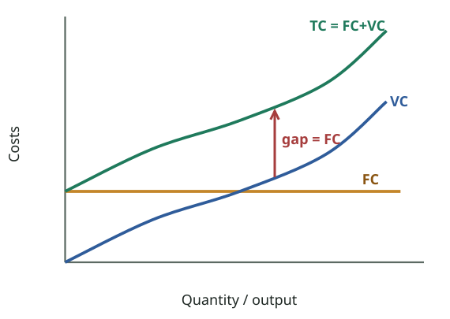
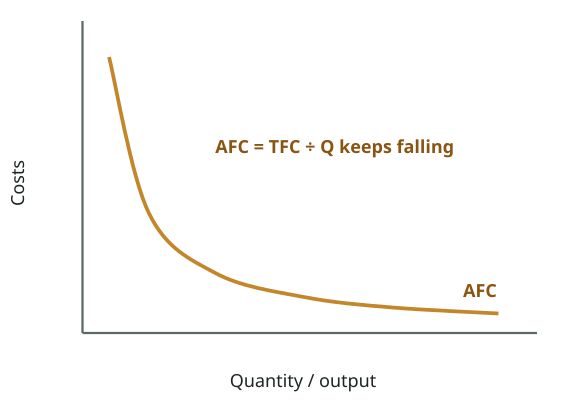
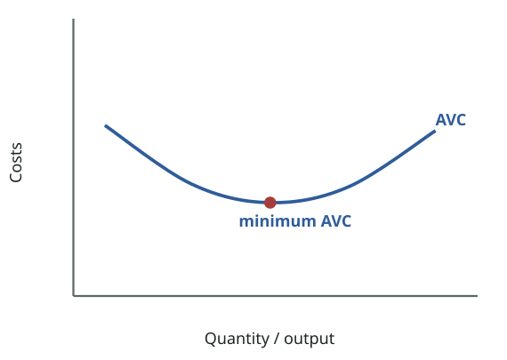
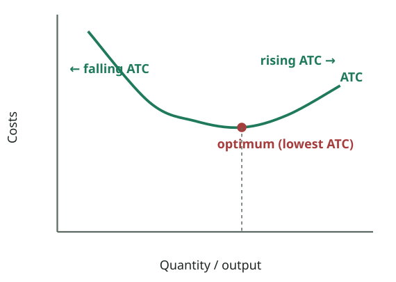
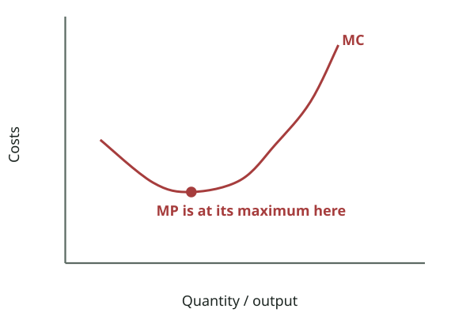

# FPEC 101 · Module 6 — Economic Costs & Short-Run Production
## মডিউল ৬ — অর্থনৈতিক ব্যয় ও স্বল্পমেয়াদি উৎপাদন

_Lecture 6 · 35 slides · Midterm questions: Q11, Q12_

> Printable study note generated from the website. Each slide: slide text → Bangla translation → tutor explanation → example → exam tip.

---

## Big picture — what is this lecture about? · বড় ছবি — এই লেকচারে কী শিখব?

_All four together (McConnell & Brue p. 386): ATC = AFC + AVC, so the gap between ATC and AVC is AFC and it shrinks as output grows. MC cuts AVC and ATC at their MINIMUM points._  
_চারটি একসাথে (ম্যাককনেল ও ব্রু পৃ. ৩৮৬): ATC = AFC + AVC, তাই ATC ও AVC-র মাঝের ফাঁক হলো AFC, যা উৎপাদন বাড়লে ছোট হয়। MC, AVC ও ATC-কে তাদের **সর্বনিম্ন** বিন্দুতে কাটে।_

### English

**Concept:** Unit 2 moves from **markets** to **firms**. Before we can understand how a firm decides its price and output (Lectures 8–11), we need to understand its **costs**. Lecture 6 answers three questions:

1. **What counts as a cost?** Economists count more than accountants do: not only cash paid out (**explicit**) but also what the owner gives up by using their own money, building and time (**implicit**). That gives two kinds of profit: **accounting** and **economic**.
2. **How does output change when a firm adds workers to a fixed factory?** The **law of diminishing returns**, measured with **TP, MP and AP**.
3. **What do the short-run cost curves look like and why?** FC, VC, TC; AFC, AVC, ATC; and MC.

### What you will learn (5 jobs)
1. **Explicit vs implicit costs**, **accounting vs economic profit**, **normal profit** (slides 4–8). Midterm **Q11**.
2. **Short run vs long run** (slides 9–10).
3. **TP, MP, AP** and the **law of diminishing returns**, with the textbook table and graphs (slides 11–20).
4. **Fixed, variable and total costs** (slides 21–25).
5. **Average costs (AFC, AVC, ATC) and marginal cost**, their shapes and links (slides 26–34). Items 2–5 = midterm **Q12**.

### The 3-minute version
- **Explicit cost** = cash paid to others. **Implicit cost** = opportunity cost of the owner's own resources.
- **Accounting profit = revenue − explicit costs.** **Economic profit = revenue − (explicit + implicit costs).** **Normal profit** = the implicit payment the entrepreneur needs to stay; it is a cost.
- **Short run:** at least one factor (the plant) is fixed. **Long run:** all factors are variable; firms can enter and exit.
- **MP = ΔTP ÷ ΔL; AP = TP ÷ L.** Law of diminishing returns: adding more of a variable input to a fixed input, MP eventually falls.
- **TC = FC + VC.** AFC = FC/Q (always falls); AVC and ATC are U-shaped; **MC = ΔTC ÷ ΔQ** falls then rises (the mirror of MP); MC cuts AVC and ATC at their minimum points.

**Exam tip:** Q11 is a numbers question (the $120,000 example). Q12 is a diagram question: TP/MP/AP and the cost curves.

### বাংলা

**ধারণা:** ইউনিট ২ **বাজার** থেকে **ফার্মে** যায়। ফার্ম কীভাবে দাম ও উৎপাদন ঠিক করে (লেকচার ৮–১১) বোঝার আগে তার **ব্যয়** বুঝতে হবে। লেকচার ৬ তিনটি প্রশ্নের উত্তর দেয়:

1. **ব্যয় কী কী?** অর্থনীতিবিদ হিসাবরক্ষকের চেয়ে বেশি গোনেন: শুধু নগদ খরচ (**প্রকাশ্য / explicit**) নয়, মালিক নিজের টাকা, ভবন ও সময় ব্যবহার করে যা ছেড়ে দেন তাও (**অপ্রকাশ্য / implicit**)। ফলে দুই ধরনের মুনাফা: **হিসাবগত** ও **অর্থনৈতিক**।
2. **নির্দিষ্ট কারখানায় শ্রমিক যোগ করলে উৎপাদন কীভাবে বদলায়?** **ক্রমহ্রাসমান প্রতিদানের নিয়ম**, যা **TP, MP ও AP** দিয়ে মাপা হয়।
3. **স্বল্পমেয়াদি ব্যয় রেখাগুলো দেখতে কেমন ও কেন?** FC, VC, TC; AFC, AVC, ATC; এবং MC।

### তুমি কী শিখবে (৫টি কাজ)
1. **প্রকাশ্য বনাম অপ্রকাশ্য ব্যয়**, **হিসাবগত বনাম অর্থনৈতিক মুনাফা**, **স্বাভাবিক মুনাফা** (স্লাইড ৪–৮)। মিডটার্ম **Q11**।
2. **স্বল্পমেয়াদ বনাম দীর্ঘমেয়াদ** (স্লাইড ৯–১০)।
3. **TP, MP, AP** ও **ক্রমহ্রাসমান প্রতিদানের নিয়ম**, পাঠ্যবইয়ের ছক ও গ্রাফসহ (স্লাইড ১১–২০)।
4. **স্থির, পরিবর্তনশীল ও মোট ব্যয়** (স্লাইড ২১–২৫)।
5. **গড় ব্যয় (AFC, AVC, ATC) ও প্রান্তিক ব্যয়**, তাদের আকৃতি ও সম্পর্ক (স্লাইড ২৬–৩৪)। ২–৫ = মিডটার্ম **Q12**।

### ৩ মিনিটের সারকথা
- **প্রকাশ্য ব্যয়** = অন্যকে দেওয়া নগদ টাকা। **অপ্রকাশ্য ব্যয়** = মালিকের নিজস্ব সম্পদের সুযোগ ব্যয়।
- **হিসাবগত মুনাফা = আয় − প্রকাশ্য ব্যয়।** **অর্থনৈতিক মুনাফা = আয় − (প্রকাশ্য + অপ্রকাশ্য ব্যয়)।** **স্বাভাবিক মুনাফা** = উদ্যোক্তাকে ব্যবসায় ধরে রাখতে যে অপ্রকাশ্য পারিশ্রমিক লাগে; এটি একটি ব্যয়।
- **স্বল্পমেয়াদ:** অন্তত একটি উপাদান (কারখানা) স্থির। **দীর্ঘমেয়াদ:** সব উপাদান পরিবর্তনশীল; ফার্ম ঢুকতে ও বেরোতে পারে।
- **MP = ΔTP ÷ ΔL; AP = TP ÷ L।** ক্রমহ্রাসমান প্রতিদানের নিয়ম: স্থির উপাদানে পরিবর্তনশীল উপাদান যোগ করতে থাকলে একসময় MP কমে।
- **TC = FC + VC।** AFC = FC/Q (সবসময় কমে); AVC ও ATC ইংরেজি U আকৃতির; **MC = ΔTC ÷ ΔQ** প্রথমে কমে পরে বাড়ে (MP-র আয়না); MC, AVC ও ATC-কে তাদের সর্বনিম্ন বিন্দুতে কাটে।

**পরীক্ষার টিপস:** Q11 সংখ্যার প্রশ্ন ($১,২০,০০০-এর উদাহরণ)। Q12 চিত্রের প্রশ্ন: TP/MP/AP ও ব্যয় রেখা।

---

## Key words · মূল শব্দ

| Term | Meaning | বাংলা অর্থ | Example |
|---|---|---|---|
| Explicit cost | Money actually paid to others for resources | প্রকাশ্য ব্যয় — সম্পদের জন্য অন্যকে নগদ টাকা দেওয়া | Wages, raw materials, electricity bill. |
| Implicit cost | Opportunity cost of using the owner's own resources | অপ্রকাশ্য ব্যয় — মালিকের নিজস্ব সম্পদ ব্যবহারের সুযোগ ব্যয় | Rent you could earn from your own shop. |
| Accounting profit | Revenue − explicit costs | হিসাবগত মুনাফা — আয় − প্রকাশ্য ব্যয় | $120,000 − $63,000 = $57,000. |
| Economic (pure) profit | Revenue − explicit − implicit costs | অর্থনৈতিক (বিশুদ্ধ) মুনাফা — আয় − প্রকাশ্য − অপ্রকাশ্য ব্যয় | $57,000 − $33,000 = $24,000. |
| Normal profit | The minimum return that keeps the entrepreneur in the business; an implicit cost | স্বাভাবিক মুনাফা — উদ্যোক্তাকে ব্যবসায় রাখার ন্যূনতম প্রতিদান; একটি অপ্রকাশ্য ব্যয় | $5,000 he could earn elsewhere as an entrepreneur. |
| Short run | Period with at least one fixed factor (the plant) | স্বল্পমেয়াদ — অন্তত একটি উপাদান (কারখানা) স্থির | A bakery can hire more bakers but not build a new oven room. |
| Long run | Period when all factors can change; firms enter/exit | দীর্ঘমেয়াদ — সব উপাদান বদলানো যায়; ফার্ম ঢোকে/বেরোয় | Building a second factory. |
| Total product (TP) | Total output produced | মোট উৎপাদন | 75 shirts a day. |
| Marginal product (MP) | Extra output from one more worker: ΔTP ÷ ΔL | প্রান্তিক উৎপাদন — আরেকজন শ্রমিকের বাড়তি উৎপাদন | 4th worker adds 15 shirts. |
| Average product (AP) | Output per worker: TP ÷ L (labour productivity) | গড় উৎপাদন — শ্রমিকপ্রতি উৎপাদন | 60 shirts ÷ 4 workers = 15. |
| Law of diminishing returns | Adding a variable input to a fixed input, MP eventually falls | ক্রমহ্রাসমান প্রতিদানের নিয়ম — স্থির উপাদানে পরিবর্তনশীল উপাদান বাড়ালে একসময় MP কমে | Too many cooks in one small kitchen. |
| Fixed cost (FC) | Cost that does not change with output (overheads) | স্থির ব্যয় — উৎপাদনের সাথে বদলায় না (ওভারহেড) | Shop rent, insurance, manager salary. |
| Variable cost (VC) | Cost that changes with output (prime/direct cost) | পরিবর্তনশীল ব্যয় — উৎপাদনের সাথে বদলায় (প্রাইম/প্রত্যক্ষ) | Flour, sugar, gas, hourly wages. |
| AFC / AVC / ATC | FC ÷ Q / VC ÷ Q / TC ÷ Q | গড় স্থির / গড় পরিবর্তনশীল / গড় মোট ব্যয় | Cost per cake. |
| Marginal cost (MC) | Extra cost of one more unit: ΔTC ÷ ΔQ | প্রান্তিক ব্যয় — আরেকটি এককের বাড়তি ব্যয় | The 101st cake costs Tk 80 extra. |

---

## Slides 1–3 · Title, Unit 2 and outline
### শিরোনাম, ইউনিট ২ ও রূপরেখা

> **Slide 1**
> PRINCIPLES OF ECONOMICSSalimah Musharrif
> FPEC 101 – LECTURE 6 Unit 2
>
> **Slide 2**
> PRINCIPLES OF ECONOMICSProduction Costs and Market Structures
> FPEC 101 – LECTURE 6 Unit 2
>
> **Slide 3**
> Lecture OutlineEconomic, Short and Long Run costs
> Economic Costs
> Short Run and Long run Costs
>

**বাংলা অনুবাদ:**

> **স্লাইড ১:** প্রিন্সিপলস অব ইকোনমিক্স — সালিমাহ মুশাররিফ। FPEC 101 – লেকচার ৬, ইউনিট ২।
> **স্লাইড ২:** প্রিন্সিপলস অব ইকোনমিক্স — উৎপাদন ব্যয় ও বাজার কাঠামো। FPEC 101 – লেকচার ৬, ইউনিট ২।
> **স্লাইড ৩ — লেকচারের রূপরেখা:** অর্থনৈতিক, স্বল্প ও দীর্ঘমেয়াদি ব্যয় · অর্থনৈতিক ব্যয় · স্বল্প ও দীর্ঘমেয়াদি ব্যয়

**Tutor explains:** **Unit 2: Production Costs and Market Structures** starts here (Lectures 6–15). The plan of the unit: **costs** (Lectures 6–7) → **market structures** (perfect competition, monopoly, monopolistic competition, oligopoly: Lectures 8–11) → **government** (competition policy, labour markets, inequality, market failure: Lectures 12–15). Syllabus reading for Lecture 6: McConnell & Brue p. 349 and pp. 379–387.

**টিউটরের ব্যাখ্যা:** এখান থেকে **ইউনিট ২: উৎপাদন ব্যয় ও বাজার কাঠামো** শুরু (লেকচার ৬–১৫)। ইউনিটের পরিকল্পনা: **ব্যয়** (লেকচার ৬–৭) → **বাজার কাঠামো** (পূর্ণ প্রতিযোগিতা, একচেটিয়া, একচেটিয়া প্রতিযোগিতা, অলিগোপলি: লেকচার ৮–১১) → **সরকার** (প্রতিযোগিতা নীতি, শ্রমবাজার, বৈষম্য, বাজার ব্যর্থতা: লেকচার ১২–১৫)। লেকচার ৬-এর পড়া: ম্যাককনেল ও ব্রু পৃ. ৩৪৯ ও ৩৭৯–৩৮৭।

---

## Slide 4 · Economic costs: explicit and implicit
### অর্থনৈতিক ব্যয়: প্রকাশ্য ও অপ্রকাশ্য

> Economic Costs
> Explicit costs - monetary payments or cash expenditures made for labor, materials, fuel, transportation services, payments for use of resources owned by others.
> Implicit costs are the opportunity costs of using self-owned, self-employed resources, money payments that self-employed resources could have earned in their best alternative use
>

**বাংলা অনুবাদ:**

> অর্থনৈতিক ব্যয়
> **প্রকাশ্য ব্যয় (Explicit costs)** — শ্রম, উপকরণ, জ্বালানি, পরিবহন সেবা এবং অন্যের মালিকানাধীন সম্পদ ব্যবহারের জন্য দেওয়া আর্থিক পরিশোধ বা নগদ খরচ।
> **অপ্রকাশ্য ব্যয় (Implicit costs)** হলো নিজের মালিকানাধীন, নিজে নিয়োজিত সম্পদ ব্যবহারের সুযোগ ব্যয় — নিজে নিয়োজিত সম্পদগুলো তাদের সেরা বিকল্প ব্যবহারে যে টাকা আয় করতে পারত।

**Tutor explains:** To an economist, the **cost** of anything is its **opportunity cost** (Lecture 1). So a firm's **economic costs** have two parts:
**Explicit costs:** **cash actually paid** to outsiders: wages to workers, payments for materials, fuel, transport, rent paid to a landlord. You can see them in the accounts.**Implicit costs:** the firm uses resources **the owner already owns** (own savings, own building, own time and skills). No cash is paid, but there is still a cost: the income those resources **could have earned in their best alternative use**.
**Economic cost = explicit + implicit costs.**

**টিউটরের ব্যাখ্যা:** অর্থনীতিবিদের কাছে যেকোনো কিছুর **ব্যয়** হলো তার **সুযোগ ব্যয়** (লেকচার ১)। তাই ফার্মের **অর্থনৈতিক ব্যয়ের** দুটি অংশ:
**প্রকাশ্য ব্যয়:** বাইরের লোককে **আসলে দেওয়া নগদ টাকা**: শ্রমিকের মজুরি, উপকরণ, জ্বালানি, পরিবহন, বাড়িওয়ালাকে ভাড়া। হিসাবের খাতায় দেখা যায়।**অপ্রকাশ্য ব্যয়:** ফার্ম **মালিকের নিজের** সম্পদ (নিজের সঞ্চয়, নিজের ভবন, নিজের সময় ও দক্ষতা) ব্যবহার করে। নগদ দেওয়া হয় না, তবু ব্যয় আছে: ওই সম্পদ **তার সেরা বিকল্প ব্যবহারে যা আয় করতে পারত**।
**অর্থনৈতিক ব্যয় = প্রকাশ্য + অপ্রকাশ্য ব্যয়।**

**Real-life example:** Rina opens a tailoring shop in **her own** ground-floor room in Mirpur. She pays a helper Tk 10,000 a month and buys cloth (explicit costs). She could have rented the room out for Tk 8,000 and worked in a garment office for Tk 20,000. Those **Tk 28,000** are her implicit costs: real, even though she never writes a cheque for them.

**বাস্তব উদাহরণ:** রিনা মিরপুরে **নিজের** নিচতলার ঘরে দর্জির দোকান খুললেন। তিনি সহকারীকে মাসে ১০,০০০ টাকা দেন আর কাপড় কেনেন (প্রকাশ্য ব্যয়)। ঘরটা ৮,০০০ টাকায় ভাড়া দিতে পারতেন আর গার্মেন্টস অফিসে ২০,০০০ টাকায় চাকরি করতে পারতেন। ওই **২৮,০০০ টাকা** তার অপ্রকাশ্য ব্যয়: কখনো চেক না লিখলেও বাস্তব।

**Exam tip:** Q11 starts with these two definitions. Use the phrase "opportunity cost of self-owned, self-employed resources" for implicit cost.

**পরীক্ষার টিপস:** Q11 এই দুটি সংজ্ঞা দিয়ে শুরু। অপ্রকাশ্য ব্যয়ের জন্য "opportunity cost of self-owned, self-employed resources" কথাটা লেখো।

---

## Slide 5 · Worked example: the data
### হাতে-কলমে উদাহরণ: তথ্য

> Economic Costs
> Consider the following data:
> A person earns $22,000.He decides to set up his own business.
> He invests $20,000 of his savings The savings earned $1,000 annually
> The person uses their own building for which they could earn $5,000
> Staff is hired at the cost of $18,000
> The person would earn $5,000 as an entrepreneur in any other venture
>

**বাংলা অনুবাদ:**

> অর্থনৈতিক ব্যয়
> নিচের তথ্য বিবেচনা করো:
> একজন ব্যক্তি $২২,০০০ আয় করেন। তিনি নিজের ব্যবসা শুরু করার সিদ্ধান্ত নেন।
> তিনি নিজের সঞ্চয় থেকে $২০,০০০ বিনিয়োগ করেন। সঞ্চয়ে বছরে $১,০০০ আয় হতো।
> তিনি নিজের ভবন ব্যবহার করেন, যা থেকে $৫,০০০ আয় করতে পারতেন।
> $১৮,০০০ খরচে কর্মী নিয়োগ করা হয়।
> অন্য যেকোনো উদ্যোগে উদ্যোক্তা হিসেবে তিনি $৫,০০০ আয় করতেন।

**Tutor explains:** Sort every line of data into **explicit** (cash paid out) or **implicit** (income given up):
DataTypeWhy
Leaves a $22,000 jobImplicit (foregone wages)Salary given up
Own savings $20,000 that earned $1,000Implicit (foregone interest $1,000)Return given up on own money
Own building could earn $5,000Implicit (foregone rent)Rent given up
Staff hired for $18,000ExplicitCash paid to workers
Could earn $5,000 as entrepreneur elsewhereImplicit (normal profit)Entrepreneurial income given up
Note that the $20,000 itself is **not** a cost: only the **$1,000 income it could have earned** is.

**টিউটরের ব্যাখ্যা:** তথ্যের প্রতিটি লাইনকে **প্রকাশ্য** (নগদ খরচ) বা **অপ্রকাশ্য** (ছেড়ে দেওয়া আয়)-এ ভাগ করো:
তথ্যধরনকেন
$২২,০০০-এর চাকরি ছাড়েনঅপ্রকাশ্য (ছেড়ে দেওয়া মজুরি)বেতন ছাড়া হয়েছে
নিজের $২০,০০০ সঞ্চয়, যাতে $১,০০০ আয় হতোঅপ্রকাশ্য (ছেড়ে দেওয়া সুদ $১,০০০)নিজের টাকার প্রতিদান ছাড়া
নিজের ভবন থেকে $৫,০০০ আয় হতোঅপ্রকাশ্য (ছেড়ে দেওয়া ভাড়া)ভাড়া ছাড়া
$১৮,০০০-এ কর্মী নিয়োগপ্রকাশ্যকর্মীদের নগদ দেওয়া
অন্যত্র উদ্যোক্তা হিসেবে $৫,০০০ আয় হতোঅপ্রকাশ্য (স্বাভাবিক মুনাফা)উদ্যোক্তার আয় ছাড়া
খেয়াল করো, $২০,০০০ নিজে ব্যয় **নয়**: শুধু **এটা থেকে যে $১,০০০ আয় হতে পারত** সেটাই ব্যয়।

**Tutor's note (not on the slide):** The slide's data say "interest" on savings. In Islamic finance your savings would earn a profit share (e.g. in a mudarabah deposit) rather than interest; the economics is the same: it is the foregone return on your own capital.

**টিউটরের নোট:** স্লাইডে সঞ্চয়ের ওপর "সুদ (interest)" লেখা। ইসলামী অর্থায়নে সঞ্চয়ে সুদের বদলে মুনাফার অংশ আসত (যেমন মুদারাবা আমানতে); অর্থনৈতিক যুক্তি একই: নিজের মূলধনের ছেড়ে দেওয়া প্রতিদান।

---

## Slide 6 · Accounting profit
### হিসাবগত মুনাফা

> Total sales revenue $120,000
> Cost of material $40,000 · Labor salary $18,000 · Utilities $5,000
> Total (explicit) costs $63,000
> Accounting profit $57,000
> Accounting Profit = Sales Revenue – Explicit costs
>

**বাংলা অনুবাদ:**

> মোট বিক্রয় আয় $১,২০,০০০
> উপকরণের খরচ $৪০,০০০ · শ্রমিকের বেতন $১৮,০০০ · ইউটিলিটি $৫,০০০
> মোট (প্রকাশ্য) ব্যয় $৬৩,০০০
> হিসাবগত মুনাফা $৫৭,০০০
> হিসাবগত মুনাফা = বিক্রয় আয় − প্রকাশ্য ব্যয়

**Tutor explains:** An **accountant** subtracts only the **explicit** (cash) costs:
Explicit costs = 40,000 (materials) + 18,000 (staff) + 5,000 (utilities) = **$63,000**.**Accounting profit = 120,000 − 63,000 = $57,000.**
This is the profit that appears in the business's books and on which tax is usually calculated. It looks great, but it ignores everything the owner gave up.

**টিউটরের ব্যাখ্যা:** একজন **হিসাবরক্ষক** শুধু **প্রকাশ্য** (নগদ) ব্যয় বাদ দেন:
প্রকাশ্য ব্যয় = ৪০,০০০ (উপকরণ) + ১৮,০০০ (কর্মী) + ৫,০০০ (ইউটিলিটি) = **$৬৩,০০০**।**হিসাবগত মুনাফা = ১,২০,০০০ − ৬৩,০০০ = $৫৭,০০০।**
এই মুনাফাই ব্যবসার খাতায় দেখা যায়, সাধারণত এর ওপরই কর হিসাব হয়। দেখতে দারুণ, কিন্তু মালিক যা ছেড়েছেন তার কিছুই এতে ধরা হয়নি।

---

## Slide 7 · Economic profit
### অর্থনৈতিক মুনাফা

> Accounting profit $57,000
> Foregone interest $1,000 · Foregone rent $5,000 · Foregone wages $22,000 · Foregone Entrepreneurial income $5,000
> Total (implicit) costs $33,000
> Economic profit $24,000
> Economic Profit = Sales Revenue – Economic Costs
> Economic Profit = Sales revenue – Implicit Costs + Explicit Costs
>

**বাংলা অনুবাদ:**

> হিসাবগত মুনাফা $৫৭,০০০
> ছেড়ে দেওয়া সুদ $১,০০০ · ছেড়ে দেওয়া ভাড়া $৫,০০০ · ছেড়ে দেওয়া মজুরি $২২,০০০ · ছেড়ে দেওয়া উদ্যোক্তা-আয় $৫,০০০
> মোট (অপ্রকাশ্য) ব্যয় $৩৩,০০০
> অর্থনৈতিক মুনাফা $২৪,০০০
> অর্থনৈতিক মুনাফা = বিক্রয় আয় − অর্থনৈতিক ব্যয়
> অর্থনৈতিক মুনাফা = বিক্রয় আয় − (অপ্রকাশ্য ব্যয় + প্রকাশ্য ব্যয়)

**Tutor explains:** An **economist** also subtracts the **implicit** costs:
Implicit costs = 1,000 (interest) + 5,000 (rent) + 22,000 (wages) + 5,000 (entrepreneurial income) = **$33,000**.**Economic profit = accounting profit − implicit costs = 57,000 − 33,000 = $24,000.**Same thing another way: 120,000 − (63,000 + 33,000) = 120,000 − 96,000 = **$24,000**.
Meaning: after paying **everyone**, including the owner for his money, building, time and business skill at their best alternative value, the business still makes **$24,000 extra**. So it really was a good decision to start it.
(The slide's last line, written carefully, is: **Economic profit = Sales revenue − (Implicit costs + Explicit costs).**)

**টিউটরের ব্যাখ্যা:** একজন **অর্থনীতিবিদ** **অপ্রকাশ্য** ব্যয়ও বাদ দেন:
অপ্রকাশ্য ব্যয় = ১,০০০ (সুদ) + ৫,০০০ (ভাড়া) + ২২,০০০ (মজুরি) + ৫,০০০ (উদ্যোক্তা-আয়) = **$৩৩,০০০**।**অর্থনৈতিক মুনাফা = হিসাবগত মুনাফা − অপ্রকাশ্য ব্যয় = ৫৭,০০০ − ৩৩,০০০ = $২৪,০০০।**অন্যভাবে: ১,২০,০০০ − (৬৩,০০০ + ৩৩,০০০) = ১,২০,০০০ − ৯৬,০০০ = **$২৪,০০০**।
মানে: **সবাইকে** — মালিককেও তার টাকা, ভবন, সময় ও ব্যবসায়িক দক্ষতার সেরা বিকল্প মূল্যে — দেওয়ার পরও ব্যবসাটি **$২৪,০০০ বাড়তি** আয় করে। তাই ব্যবসা শুরু করা আসলেই ভালো সিদ্ধান্ত ছিল।
(স্লাইডের শেষ লাইনটা সঠিকভাবে লিখলে: **অর্থনৈতিক মুনাফা = বিক্রয় আয় − (অপ্রকাশ্য ব্যয় + প্রকাশ্য ব্যয়)।**)

**Common mistake:** The slide writes "Sales revenue – Implicit Costs + Explicit Costs". Read it with brackets: subtract **both** kinds of cost. Do not add the explicit costs back!

**সাধারণ ভুল:** স্লাইডে লেখা "Sales revenue – Implicit Costs + Explicit Costs"। বন্ধনীসহ পড়ো: **দুই** ধরনের ব্যয়ই বিয়োগ করো। প্রকাশ্য ব্যয় আবার যোগ করবে না!

**Exam tip:** In Q11, set out the two calculations as two small tables (accounting profit, then economic profit). Examiners love a clear layout.

**পরীক্ষার টিপস:** Q11-এ দুটি হিসাব দুটি ছোট ছকে সাজাও (আগে হিসাবগত মুনাফা, তারপর অর্থনৈতিক মুনাফা)। পরীক্ষকেরা পরিষ্কার বিন্যাস পছন্দ করেন।

---

## Slide 8 · Normal profit vs economic profit
### স্বাভাবিক মুনাফা বনাম অর্থনৈতিক মুনাফা

> Normal profit and Economic profit
> The $5000 implicit cost of the entrepreneurial talent is a normal profit.
> Just like the forgone rent and wages, the payment that could be received for performing the functions of an entrepreneur is indeed an implicit cost. These are the payments necessary to retain a factor of production in the current endeavor. So a normal profit is a cost of doing business.
> Economic profit or Pure profit thus is total revenue less economic costs (explicit and implicit costs, the latter including a normal profit to the entrepreneur).
> Economic profit = total revenue - economic cost
>

**বাংলা অনুবাদ:**

> স্বাভাবিক মুনাফা ও অর্থনৈতিক মুনাফা
> উদ্যোক্তার মেধার $৫,০০০ অপ্রকাশ্য ব্যয়টাই **স্বাভাবিক মুনাফা (normal profit)**।
> ছেড়ে দেওয়া ভাড়া ও মজুরির মতোই, উদ্যোক্তার কাজ করে যে পারিশ্রমিক পাওয়া যেত তা আসলে একটি অপ্রকাশ্য ব্যয়। একটি উৎপাদনের উপাদানকে বর্তমান উদ্যোগে ধরে রাখতে এই পরিশোধগুলো প্রয়োজন। তাই স্বাভাবিক মুনাফা ব্যবসা পরিচালনার একটি ব্যয়।
> তাই **অর্থনৈতিক মুনাফা বা বিশুদ্ধ মুনাফা** হলো মোট আয় থেকে অর্থনৈতিক ব্যয় (প্রকাশ্য ও অপ্রকাশ্য ব্যয়, যার মধ্যে উদ্যোক্তার স্বাভাবিক মুনাফাও আছে) বাদ দিয়ে যা থাকে।
> অর্থনৈতিক মুনাফা = মোট আয় − অর্থনৈতিক ব্যয়

**Tutor explains:** **Normal profit** = the minimum payment an entrepreneur needs to **stay** in this business rather than leave for the next best one. In the example it is the **$5,000** he could earn as an entrepreneur elsewhere.
Key idea: **normal profit is a COST**, just like foregone rent or wages. If the firm earns less than this, the entrepreneur will leave.
So: - **Economic profit = 0** means the firm covers **all** costs **including normal profit**: the owner is doing exactly as well as in his next best option. (This "zero economic profit" is very important in perfect competition, Lecture 8.) - **Economic profit > 0** (here $24,000) = **pure profit**, a reward above the next best alternative. - **Economic profit < 0** = an **economic loss**: the owner would be better off elsewhere, even if accounting profit is positive.

**টিউটরের ব্যাখ্যা:** **স্বাভাবিক মুনাফা** = উদ্যোক্তাকে পরবর্তী সেরা ব্যবসায় না গিয়ে **এই ব্যবসায় থাকতে** যে ন্যূনতম পারিশ্রমিক লাগে। উদাহরণে এটা **$৫,০০০** — অন্যত্র উদ্যোক্তা হিসেবে যা আয় করতে পারতেন।
মূল কথা: **স্বাভাবিক মুনাফা একটি ব্যয়**, ছেড়ে দেওয়া ভাড়া বা মজুরির মতোই। ফার্ম এর চেয়ে কম আয় করলে উদ্যোক্তা চলে যাবেন।
তাই: - **অর্থনৈতিক মুনাফা = ০** মানে ফার্ম **স্বাভাবিক মুনাফাসহ সব** ব্যয় মেটায়: মালিক ঠিক তার পরবর্তী সেরা বিকল্পের সমান ভালো আছেন। (এই "শূন্য অর্থনৈতিক মুনাফা" পূর্ণ প্রতিযোগিতায় খুব জরুরি, লেকচার ৮।) - **অর্থনৈতিক মুনাফা > ০** (এখানে $২৪,০০০) = **বিশুদ্ধ মুনাফা**, পরবর্তী সেরা বিকল্পের চেয়ে বাড়তি পুরস্কার। - **অর্থনৈতিক মুনাফা < ০** = **অর্থনৈতিক লোকসান**: হিসাবগত মুনাফা ধনাত্মক হলেও মালিক অন্যত্র ভালো থাকতেন।

**Real-life example:** A restaurant owner shows an accounting profit of Tk 3 lakh a year. But she could earn Tk 4 lakh as a chef in a hotel (implicit cost). Her **economic profit is −Tk 1 lakh**: in economic terms she is losing money by running her own restaurant.

**বাস্তব উদাহরণ:** এক রেস্তোরাঁ মালিক বছরে ৩ লাখ টাকা হিসাবগত মুনাফা দেখান। কিন্তু তিনি হোটেলে শেফ হিসেবে ৪ লাখ টাকা আয় করতে পারতেন (অপ্রকাশ্য ব্যয়)। তার **অর্থনৈতিক মুনাফা −১ লাখ টাকা**: অর্থনৈতিকভাবে নিজের রেস্তোরাঁ চালিয়ে তিনি লোকসানে আছেন।

**Exam tip:** Q11's last paragraph: define normal profit as **"a cost of doing business"** and state economic profit = TR − economic costs (explicit + implicit, including normal profit).

**পরীক্ষার টিপস:** Q11-এর শেষ অনুচ্ছেদ: স্বাভাবিক মুনাফাকে **"a cost of doing business"** হিসেবে সংজ্ঞায়িত করো আর লেখো অর্থনৈতিক মুনাফা = TR − অর্থনৈতিক ব্যয় (প্রকাশ্য + অপ্রকাশ্য, স্বাভাবিক মুনাফাসহ)।

---

## Quick check · দ্রুত যাচাই

1. Which is an IMPLICIT cost?  
   কোনটি অপ্রকাশ্য ব্যয়?

   - A) Wages paid to staff · কর্মীদের দেওয়া মজুরি
   - B) Electricity bill · বিদ্যুৎ বিল
   - C) Rent the owner could earn on her own building · নিজের ভবন থেকে মালিক যে ভাড়া পেতেন
   - D) Cost of raw materials · কাঁচামালের খরচ

   **Answer: C** — Implicit costs are the opportunity costs of self-owned resources; no cash is paid.  
   অপ্রকাশ্য ব্যয় হলো নিজস্ব সম্পদের সুযোগ ব্যয়; নগদ দেওয়া হয় না।

2. Revenue 100, explicit costs 60, implicit costs 30. Economic profit is…  
   আয় ১০০, প্রকাশ্য ব্যয় ৬০, অপ্রকাশ্য ব্যয় ৩০। অর্থনৈতিক মুনাফা…

   - A) 40 · ৪০
   - B) 10 · ১০
   - C) 70 · ৭০
   - D) −10 · −১০

   **Answer: B** — Accounting profit = 100 − 60 = 40; economic profit = 40 − 30 = 10.  
   হিসাবগত মুনাফা = ১০০ − ৬০ = ৪০; অর্থনৈতিক মুনাফা = ৪০ − ৩০ = ১০।

3. Normal profit is best described as…  
   স্বাভাবিক মুনাফাকে সবচেয়ে ভালোভাবে বলা যায়…

   - A) Profit above all costs · সব ব্যয়ের ওপরে মুনাফা
   - B) A cost: the minimum return to keep the entrepreneur · একটি ব্যয়: উদ্যোক্তাকে ধরে রাখার ন্যূনতম প্রতিদান
   - C) Accounting profit · হিসাবগত মুনাফা
   - D) A tax · একটি কর

   **Answer: B** — Slide 8: normal profit is a cost of doing business.  
   স্লাইড ৮: স্বাভাবিক মুনাফা ব্যবসা পরিচালনার একটি ব্যয়।

---

## Slide 9 · The short run (fixed plant)
### স্বল্পমেয়াদ (স্থির কারখানা)

> Short Run
> Fixed Plant . It is a period where there is at least one fixed factor which may be the plant (firm) or production unit. Production can be changed only by variable factors. The short run is a period too brief for a firm to alter its plant capacity, yet long enough to permit a change in the degree to which the fixed plant is used. The firm’s plant capacity is fixed in the short run. However, the firm can vary its output by applying larger or smaller amounts of labor, materials, and other resources to that plant. It can use its existing plant capacity more or less intensively in the short run.
> Thus too short to change plant capacity but long enough to use fixed plant more or less intensively. In the short run, our farmer’s plant (land and farm machinery) is fixed. But he does have time in the short run to cultivate tomatoes more intensively by applying more labor and more fertilizer and pesticides to the crop.
>

**বাংলা অনুবাদ:**

> স্বল্পমেয়াদ
> **স্থির কারখানা।** এমন একটি সময়কাল যেখানে অন্তত একটি স্থির উপাদান থাকে, যা হতে পারে কারখানা (ফার্ম) বা উৎপাদন ইউনিট। শুধু পরিবর্তনশীল উপাদান দিয়ে উৎপাদন বদলানো যায়। স্বল্পমেয়াদ এত সংক্ষিপ্ত যে ফার্ম তার কারখানার সক্ষমতা বদলাতে পারে না, কিন্তু যথেষ্ট দীর্ঘ যাতে স্থির কারখানাটি কতটা ব্যবহার হবে তা বদলানো যায়। স্বল্পমেয়াদে ফার্মের কারখানার সক্ষমতা স্থির। তবে ফার্ম ওই কারখানায় বেশি বা কম শ্রম, উপকরণ ও অন্যান্য সম্পদ প্রয়োগ করে উৎপাদন বদলাতে পারে। বিদ্যমান সক্ষমতা কম-বেশি নিবিড়ভাবে ব্যবহার করতে পারে।
> তাই কারখানার সক্ষমতা বদলানোর জন্য খুব কম, কিন্তু স্থির কারখানাকে কম-বেশি নিবিড়ভাবে ব্যবহারের জন্য যথেষ্ট সময়। স্বল্পমেয়াদে আমাদের কৃষকের কারখানা (জমি ও কৃষিযন্ত্র) স্থির। কিন্তু বেশি শ্রম, সার ও কীটনাশক দিয়ে টমেটো আরও নিবিড়ভাবে চাষ করার সময় তার আছে।

**Tutor explains:** The **short run** is not a fixed number of months. It is defined by what can change:
**At least one factor is fixed**, usually the **plant** (factory building, big machines, land).Output can change **only by changing variable factors**: more or fewer workers, materials, fuel, overtime.In one phrase: **too short to change plant capacity, but long enough to use the fixed plant more or less intensively.**
**Slide's example:** a tomato farmer cannot buy more land this season (fixed), but can use more labour, fertiliser and pesticide on the land he has (variable).

**টিউটরের ব্যাখ্যা:** **স্বল্পমেয়াদ** নির্দিষ্ট কয়েক মাস নয়। কী বদলানো যায় তা দিয়ে সংজ্ঞায়িত:
**অন্তত একটি উপাদান স্থির**, সাধারণত **কারখানা** (ভবন, বড় যন্ত্র, জমি)।উৎপাদন বদলানো যায় **শুধু পরিবর্তনশীল উপাদান বদলে**: বেশি/কম শ্রমিক, উপকরণ, জ্বালানি, ওভারটাইম।এক কথায়: **কারখানার সক্ষমতা বদলানোর জন্য খুব কম, কিন্তু স্থির কারখানাকে কম-বেশি নিবিড়ভাবে ব্যবহারের জন্য যথেষ্ট সময়।**
**স্লাইডের উদাহরণ:** একজন টমেটোচাষি এই মৌসুমে আর জমি কিনতে পারবেন না (স্থির), কিন্তু নিজের জমিতে বেশি শ্রম, সার ও কীটনাশক দিতে পারবেন (পরিবর্তনশীল)।

**Real-life example:** A garment factory in Ashulia gets a big order for Eid. In the short run it cannot build a new floor, but it can run overtime, add a night shift and buy more fabric.

**বাস্তব উদাহরণ:** আশুলিয়ার একটি গার্মেন্টস ঈদের বড় অর্ডার পেল। স্বল্পমেয়াদে নতুন ফ্লোর বানাতে পারবে না, কিন্তু ওভারটাইম চালাতে, রাতের শিফট যোগ করতে ও বেশি কাপড় কিনতে পারবে।

---

## Slide 10 · The long run (variable plant)
### দীর্ঘমেয়াদ (পরিবর্তনশীল কারখানা)

> Long Run
> This is that period of time when the production process is being started or extended and every cost becomes a variable cost. Production can be increased by increasing any factor of production
> Time period long enough for firms to adjust their plant sizes and for new firms to enter (or existing firms to leave) the industry. In the “tomato industry,” for example, our farmer has time to acquire additional land and buy more machinery and equipment.
> Variable Plant .From the viewpoint of an existing firm, the long run is a period long enough for it to adjust the quantities of all the resources that it employs, including plant capacity. From the industry’s viewpoint, the long run also includes enough time for existing firms to dissolve and leave the industry or for new firms to be created and enter the industry.
>

**বাংলা অনুবাদ:**

> দীর্ঘমেয়াদ
> এটি সেই সময় যখন উৎপাদন প্রক্রিয়া শুরু বা সম্প্রসারিত হচ্ছে এবং প্রতিটি ব্যয় পরিবর্তনশীল ব্যয় হয়ে যায়। যেকোনো উৎপাদনের উপাদান বাড়িয়ে উৎপাদন বাড়ানো যায়।
> ফার্মগুলোর কারখানার আকার সমন্বয় এবং নতুন ফার্মের শিল্পে প্রবেশ (বা বিদ্যমান ফার্মের প্রস্থান) করার জন্য যথেষ্ট দীর্ঘ সময়। "টমেটো শিল্পে" যেমন, আমাদের কৃষকের বাড়তি জমি এবং আরও যন্ত্রপাতি কেনার সময় আছে।
> **পরিবর্তনশীল কারখানা।** বিদ্যমান ফার্মের দৃষ্টিতে দীর্ঘমেয়াদ এত দীর্ঘ যে সে কারখানার সক্ষমতাসহ তার ব্যবহৃত সব সম্পদের পরিমাণ সমন্বয় করতে পারে। শিল্পের দৃষ্টিতে দীর্ঘমেয়াদে বিদ্যমান ফার্মের বিলুপ্ত হয়ে শিল্প ছেড়ে যাওয়ার বা নতুন ফার্ম তৈরি হয়ে ঢোকার মতো যথেষ্ট সময়ও থাকে।

**Tutor explains:** The **long run** is long enough for **everything** to change:
**All costs become variable**: the firm can build a bigger plant, buy new machines, move location.**Industry view:** new firms can **enter**, existing firms can **exit**. (Entry and exit are central to market structures in Lectures 8–11.)**Slide's example:** the tomato farmer now has time to buy more land and machinery.
Short runLong run
Plant sizeFixedVariable
Inputs that can changeOnly variable ones (labour, materials)All
Fixed costs?YesNo: all costs variable
Entry/exit of firmsNoYes
Key lawDiminishing returnsEconomies/diseconomies of scale (Lecture 7)

**টিউটরের ব্যাখ্যা:** **দীর্ঘমেয়াদ** এত দীর্ঘ যে **সব কিছু** বদলানো যায়:
**সব ব্যয় পরিবর্তনশীল**: ফার্ম বড় কারখানা বানাতে, নতুন যন্ত্র কিনতে, জায়গা বদলাতে পারে।**শিল্পের দৃষ্টিতে:** নতুন ফার্ম **ঢুকতে** পারে, পুরোনো ফার্ম **বেরোতে** পারে। (প্রবেশ-প্রস্থান লেকচার ৮–১১-এর বাজার কাঠামোর কেন্দ্রে।)**স্লাইডের উদাহরণ:** টমেটোচাষির এখন বাড়তি জমি ও যন্ত্র কেনার সময় আছে।
স্বল্পমেয়াদদীর্ঘমেয়াদ
কারখানার আকারস্থিরপরিবর্তনশীল
যে উপকরণ বদলানো যায়শুধু পরিবর্তনশীল (শ্রম, উপকরণ)সব
স্থির ব্যয়?আছেনেই: সব ব্যয় পরিবর্তনশীল
ফার্মের প্রবেশ/প্রস্থাননাহ্যাঁ
মূল নিয়মক্রমহ্রাসমান প্রতিদানবৃহদায়তনের সুবিধা/অসুবিধা (লেকচার ৭)

**Exam tip:** Q12 asks you to "understand the short run": write the definitions of both periods and this comparison table.

**পরীক্ষার টিপস:** Q12 চায় "স্বল্পমেয়াদ বোঝো": দুই সময়কালের সংজ্ঞা ও এই তুলনামূলক ছক লেখো।

---

## Slide 11 · Short-run production relationships
### স্বল্পমেয়াদি উৎপাদন সম্পর্ক

> Short Run Production Relationships
> Cost of output depends on cost of input
> Cost of input depends on the supply and demand for it
> In the short run, we consider relationship between input and output, specifically labor on fixed plant.
>

**বাংলা অনুবাদ:**

> স্বল্পমেয়াদি উৎপাদন সম্পর্ক
> উৎপাদনের ব্যয় উপকরণের ব্যয়ের ওপর নির্ভর করে
> উপকরণের ব্যয় তার চাহিদা ও যোগানের ওপর নির্ভর করে
> স্বল্পমেয়াদে আমরা উপকরণ ও উৎপাদনের সম্পর্ক বিবেচনা করি, বিশেষ করে স্থির কারখানায় শ্রমের সম্পর্ক।

**Tutor explains:** Why study production before costs? Because **cost of output depends on cost of inputs** and on **how much output each input produces**. If a worker costs Tk 500 a day and produces 50 units, labour cost per unit is Tk 10; if diminishing returns mean the next worker adds only 10 units, the extra cost per unit is Tk 50.
So we first look at the **input–output relationship**: what happens to output when we add **labour** to a **fixed plant**.

**টিউটরের ব্যাখ্যা:** ব্যয়ের আগে উৎপাদন কেন পড়ি? কারণ **উৎপাদনের ব্যয় উপকরণের ব্যয়** এবং **প্রতিটি উপকরণ কত উৎপাদন করে** তার ওপর নির্ভর করে। একজন শ্রমিকের দৈনিক খরচ ৫০০ টাকা, তিনি ৫০ একক বানালে এককপ্রতি শ্রম ব্যয় ১০ টাকা; ক্রমহ্রাসমান প্রতিদানে পরের শ্রমিক মাত্র ১০ একক যোগ করলে এককপ্রতি বাড়তি ব্যয় ৫০ টাকা।
তাই আগে **উপকরণ–উৎপাদনের সম্পর্ক** দেখি: **স্থির কারখানায়** **শ্রম** যোগ করলে উৎপাদনের কী হয়।

---

## Slide 12 · TP, MP and AP
### TP, MP ও AP

> Total Product (TP) = total quantity produced
> Marginal Product (MP) = change in total product
> change in labor input
> Average Product (AP) = total product
> units of labor
> Labor productivity or unit of output per input
> In the short run, a firm can increase output for a certain time by adding units of labor to its fixed plant. We need to understand by how much will output rise when it adds the labor.
> Total product refers to the total output that can be produced in a given period of time.
> Average product is the total production divided by the number of workers, while
> Marginal product refers to the additional amount of output produced.
> Short-Run Production Relationships
>

**বাংলা অনুবাদ:**

> **মোট উৎপাদন (TP)** = মোট উৎপাদিত পরিমাণ
> **প্রান্তিক উৎপাদন (MP)** = মোট উৎপাদনের পরিবর্তন ÷ শ্রম উপকরণের পরিবর্তন
> **গড় উৎপাদন (AP)** = মোট উৎপাদন ÷ শ্রমের একক — শ্রম উৎপাদনশীলতা বা উপকরণপ্রতি উৎপাদন
> স্বল্পমেয়াদে একটি ফার্ম তার স্থির কারখানায় শ্রমের একক যোগ করে কিছু সময়ের জন্য উৎপাদন বাড়াতে পারে। শ্রম যোগ করলে উৎপাদন কতটা বাড়বে তা আমাদের বুঝতে হবে।
> মোট উৎপাদন বলতে একটি নির্দিষ্ট সময়ে উৎপাদনযোগ্য মোট পরিমাণ বোঝায়।
> গড় উৎপাদন হলো মোট উৎপাদনকে শ্রমিক সংখ্যা দিয়ে ভাগ, আর
> প্রান্তিক উৎপাদন বোঝায় বাড়তি যে পরিমাণ উৎপাদন হয়।

**Tutor explains:** Three measures of output:
**Total product (TP):** the **total** output in a period. _"The bakery made 75 loaves today."_**Marginal product (MP) = ΔTP ÷ ΔL:** the **extra** output from **one more** worker. _"Hiring the 4th baker raised output from 45 to 60, so MP = 15."_**Average product (AP) = TP ÷ L:** output **per worker** = **labour productivity**. _"60 loaves ÷ 4 bakers = 15 per baker."_
Think of a cricket team's batting: **TP** = team total, **MP** = runs added by the next batsman, **AP** = average runs per batsman so far.

**টিউটরের ব্যাখ্যা:** উৎপাদনের তিনটি পরিমাপ:
**মোট উৎপাদন (TP):** একটি সময়ে **মোট** উৎপাদন। _"বেকারি আজ ৭৫টি রুটি বানাল।"_**প্রান্তিক উৎপাদন (MP) = ΔTP ÷ ΔL:** **আরেকজন** শ্রমিকের **বাড়তি** উৎপাদন। _"৪র্থ বেকার নেওয়ায় উৎপাদন ৪৫ থেকে ৬০, তাই MP = ১৫।"_**গড় উৎপাদন (AP) = TP ÷ L:** **শ্রমিকপ্রতি** উৎপাদন = **শ্রম উৎপাদনশীলতা**। _"৬০টি রুটি ÷ ৪ জন বেকার = বেকারপ্রতি ১৫।"_
ক্রিকেট দলের ব্যাটিং ভাবো: **TP** = দলের মোট রান, **MP** = পরের ব্যাটসম্যানের যোগ করা রান, **AP** = এখন পর্যন্ত ব্যাটসম্যানপ্রতি গড় রান।

---

## Slide 13 · The law of diminishing returns
### ক্রমহ্রাসমান প্রতিদানের নিয়ম

> Law of Diminishing Returns
> Assuming technology is fixed and techniques of production do not change.
> As successive units of a variable resource (say, labor) are added to a fixed resource (say, capital or land), beyond some point the extra, or marginal, product that can be attributed to each additional unit of the variable resource will decline.
> Output will eventually rise by smaller and smaller amounts as more workers are hired.
>

**বাংলা অনুবাদ:**

> ক্রমহ্রাসমান প্রতিদানের নিয়ম
> ধরে নেওয়া হয় প্রযুক্তি স্থির এবং উৎপাদনের কৌশল বদলায় না।
> একটি স্থির সম্পদের (ধরো মূলধন বা জমি) সাথে পরিবর্তনশীল সম্পদের (ধরো শ্রম) পরপর একক যোগ করতে থাকলে, একটি পর্যায়ের পর পরিবর্তনশীল সম্পদের প্রতিটি বাড়তি এককের কারণে যে বাড়তি বা প্রান্তিক উৎপাদন হয় তা কমতে থাকবে।
> বেশি শ্রমিক নিয়োগ করতে থাকলে উৎপাদন একসময় ক্রমশ কম পরিমাণে বাড়বে।

**Tutor explains:** **The law of diminishing returns** (assume technology is fixed):
> When more and more units of a **variable** resource (labour) are added to a **fixed** resource (capital or land), **beyond some point** the **marginal product** of each extra unit **declines**.
Notice three things: 1. It is a **short-run** law (there must be a fixed factor). 2. It says MP falls **"beyond some point"**: at first MP may rise. 3. TP can still **rise**, but by **smaller and smaller** amounts.

**টিউটরের ব্যাখ্যা:** **ক্রমহ্রাসমান প্রতিদানের নিয়ম** (প্রযুক্তি স্থির ধরে):
> একটি **স্থির** সম্পদের (মূলধন বা জমি) সাথে **পরিবর্তনশীল** সম্পদের (শ্রম) একক যোগ করতে থাকলে, **একটি পর্যায়ের পর** প্রতিটি বাড়তি এককের **প্রান্তিক উৎপাদন** **কমতে থাকে**।
তিনটি জিনিস খেয়াল করো: 1. এটা **স্বল্পমেয়াদি** নিয়ম (একটি স্থির উপাদান থাকতেই হবে)। 2. বলে MP কমে **"একটি পর্যায়ের পর"**: শুরুতে MP বাড়তে পারে। 3. TP তখনো **বাড়তে** পারে, কিন্তু **ক্রমশ কম** পরিমাণে।

**Real-life example:** **One small tea stall at a bus stand** with one stove and one counter (fixed). One worker makes 40 cups an hour. A second worker helps (one makes tea, one serves): 100 cups. A third worker washes cups: 130 cups. A fourth worker? They bump into each other at the single stove: 140 cups. A fifth worker just stands in the way: 135 cups. MP: 40, 60, 30, 10, −5.

**বাস্তব উদাহরণ:** **বাসস্ট্যান্ডের একটি ছোট চায়ের দোকান**, একটি চুলা ও একটি কাউন্টার (স্থির)। একজন কর্মী ঘণ্টায় ৪০ কাপ বানান। দ্বিতীয়জন সাহায্য করেন (একজন চা বানান, একজন পরিবেশন করেন): ১০০ কাপ। তৃতীয়জন কাপ ধোন: ১৩০ কাপ। চতুর্থজন? এক চুলার সামনে ধাক্কাধাক্কি: ১৪০ কাপ। পঞ্চমজন শুধু পথ আটকান: ১৩৫ কাপ। MP: ৪০, ৬০, ৩০, ১০, −৫।

**Exam tip:** Write the law in the textbook's words in Q12; it is a definition mark.

**পরীক্ষার টিপস:** Q12-এ নিয়মটা পাঠ্যবইয়ের ভাষায় লেখো; এটা সংজ্ঞার নম্বর।

---

## Slide 14 · Why diminishing returns happen
### ক্রমহ্রাসমান প্রতিদান কেন ঘটে

> Law of Diminishing Returns
> Marginal output increases with increase in number of workers, reaches a maximum and then declines.
> Assumed all units of labor are equally productive and have same quality.
> Marginal product ultimately diminishes because more workers are being used relative to the amount of plant and equipment available.
>

**বাংলা অনুবাদ:**

> ক্রমহ্রাসমান প্রতিদানের নিয়ম
> শ্রমিকের সংখ্যা বাড়ার সাথে প্রান্তিক উৎপাদন বাড়ে, সর্বোচ্চে পৌঁছায়, তারপর কমে।
> ধরে নেওয়া হয়েছে শ্রমের সব একক সমান উৎপাদনশীল ও একই মানের।
> প্রান্তিক উৎপাদন শেষ পর্যন্ত কমে, কারণ উপলব্ধ কারখানা ও যন্ত্রপাতির তুলনায় বেশি শ্রমিক ব্যবহৃত হচ্ছে।

**Tutor explains:** The pattern of MP: **rises → reaches a maximum → declines** (and can become negative).
Important assumption: **all workers are equally good**. So MP does **not** fall because later workers are lazier or less skilled. It falls because **each worker has less and less of the fixed plant and equipment to work with**.
First few workers: they can **specialise** (one cuts, one sews, one packs), so MP **rises**.Later workers: machines and space are shared by too many people, so each new worker adds **less**.

**টিউটরের ব্যাখ্যা:** MP-র ধারা: **বাড়ে → সর্বোচ্চে পৌঁছায় → কমে** (এবং ঋণাত্মক হতে পারে)।
গুরুত্বপূর্ণ অনুমান: **সব শ্রমিক সমান দক্ষ**। তাই পরের শ্রমিকরা অলস বা কম দক্ষ বলে MP কমে **না**। কমে কারণ **প্রত্যেক শ্রমিকের ভাগে স্থির কারখানা ও যন্ত্রপাতি ক্রমশ কম পড়ে**।
প্রথম কয়েকজন: তারা **বিশেষায়িত** হতে পারে (একজন কাটে, একজন সেলাই করে, একজন প্যাক করে), তাই MP **বাড়ে**।পরের শ্রমিকেরা: যন্ত্র ও জায়গা অনেকের মধ্যে ভাগ হয়, তাই প্রতিটি নতুন শ্রমিক **কম** যোগ করে।

**Common mistake:** Do not explain diminishing returns by saying "the new workers are less skilled". The slide assumes all workers are the same; the cause is the **fixed factor**.

**সাধারণ ভুল:** "নতুন শ্রমিকরা কম দক্ষ" বলে ক্রমহ্রাসমান প্রতিদান ব্যাখ্যা করবে না। স্লাইড ধরে নেয় সব শ্রমিক এক রকম; কারণ হলো **স্থির উপাদান**।

---

## Slides 15–17 · The TP–MP–AP table (McConnell & Brue Table 20.1)
### TP–MP–AP ছক (ম্যাককনেল ও ব্রু ছক ২০.১)

> **Slide 15**
> Law of Diminishing Returns (Table 20.1, McConnell & Brue)
> Units of labour 0–8 with TP: 0, 10, 25, 45, 60, 70, 75, 75, 70
> MP = change in total product ÷ change in labour input
>
> **Slide 16**
> MP column filled in: 10, 15, 20, 15, 10, 5, 0, −5
> Labels: increasing marginal returns · diminishing marginal returns · negative marginal returns
>
> **Slide 17**
> AP column filled in: 10.00, 12.50, 15.00, 15.00, 14.00, 12.50, 10.71, 8.75
> AP = total product ÷ total labour input
>

**বাংলা অনুবাদ:**

> **স্লাইড ১৫:** ক্রমহ্রাসমান প্রতিদানের নিয়ম (ছক ২০.১, ম্যাককনেল ও ব্রু)। শ্রমের একক ০–৮, TP: ০, ১০, ২৫, ৪৫, ৬০, ৭০, ৭৫, ৭৫, ৭০। MP = মোট উৎপাদনের পরিবর্তন ÷ শ্রম উপকরণের পরিবর্তন।
> **স্লাইড ১৬:** MP কলাম পূরণ: ১০, ১৫, ২০, ১৫, ১০, ৫, ০, −৫। লেবেল: ক্রমবর্ধমান প্রান্তিক প্রতিদান · ক্রমহ্রাসমান প্রান্তিক প্রতিদান · ঋণাত্মক প্রান্তিক প্রতিদান।
> **স্লাইড ১৭:** AP কলাম পূরণ: ১০.০০, ১২.৫০, ১৫.০০, ১৫.০০, ১৪.০০, ১২.৫০, ১০.৭১, ৮.৭৫। AP = মোট উৎপাদন ÷ মোট শ্রম উপকরণ।

**Tutor explains:** The three slides fill in the same table step by step. Here it is complete:
LabourTPMP = ΔTPAP = TP ÷ LStage
00——
1101010.00Increasing marginal returns
2251512.50
3452015.00
4601515.00Diminishing marginal returns
5701014.00
675512.50
775010.71
870−58.75Negative marginal returns
**How each number is found:** MP of the 3rd worker = 45 − 25 = **20**. AP with 3 workers = 45 ÷ 3 = **15**. AP with 7 workers = 75 ÷ 7 = **10.71**.
**Three stages:** MP rising (workers 1–3) → MP falling but positive (4–7) → MP negative (8).

**টিউটরের ব্যাখ্যা:** তিনটি স্লাইড একই ছক ধাপে ধাপে পূরণ করে। এখানে সম্পূর্ণ ছক:
শ্রমTPMP = ΔTPAP = TP ÷ Lপর্যায়
০০——
১১০১০১০.০০ক্রমবর্ধমান প্রান্তিক প্রতিদান
২২৫১৫১২.৫০
৩৪৫২০১৫.০০
৪৬০১৫১৫.০০ক্রমহ্রাসমান প্রান্তিক প্রতিদান
৫৭০১০১৪.০০
৬৭৫৫১২.৫০
৭৭৫০১০.৭১
৮৭০−৫৮.৭৫ঋণাত্মক প্রান্তিক প্রতিদান
**প্রতিটি সংখ্যা কীভাবে:** ৩য় শ্রমিকের MP = ৪৫ − ২৫ = **২০**। ৩ জন শ্রমিকে AP = ৪৫ ÷ ৩ = **১৫**। ৭ জনে AP = ৭৫ ÷ ৭ = **১০.৭১**।
**তিনটি পর্যায়:** MP বাড়ছে (শ্রমিক ১–৩) → MP কমছে কিন্তু ধনাত্মক (৪–৭) → MP ঋণাত্মক (৮)।

**Exam tip:** The exam may give you only the TP column. Practise filling MP and AP yourself, then label the three stages.

**পরীক্ষার টিপস:** পরীক্ষায় শুধু TP কলাম দিতে পারে। নিজে MP ও AP পূরণ অনুশীলন করো, তারপর তিনটি পর্যায় লেবেল করো।

---

## Slide 18 · The TP, MP and AP graphs
### TP, MP ও AP-র গ্রাফ

_Total product (McConnell & Brue Table 20.1): TP rises fast (workers 1–3), then more slowly (4–6), is maximum at 75 when MP = 0, then falls (worker 8)._  
_মোট উৎপাদন (ম্যাককনেল ও ব্রু ছক ২০.১): TP দ্রুত বাড়ে (শ্রমিক ১–৩), তারপর ধীরে (৪–৬), MP = ০ হলে সর্বোচ্চ ৭৫, তারপর কমে (শ্রমিক ৮)।_

_MP rises, peaks at the 3rd worker, then falls (diminishing returns) and becomes negative. AP rises while MP > AP and falls while MP < AP; MP cuts AP at AP's maximum._  
_MP বাড়ে, তৃতীয় শ্রমিকে সর্বোচ্চ, তারপর কমে (ক্রমহ্রাসমান প্রতিদান) ও ঋণাত্মক হয়। MP > AP থাকলে AP বাড়ে, MP < AP হলে কমে; AP-র সর্বোচ্চ বিন্দুতে MP, AP-কে কাটে।_

> [Figure 20.2, McConnell & Brue: top panel Total Product (TP) against quantity of labour; bottom panel MP and AP; zones marked increasing marginal returns · diminishing marginal returns · negative marginal returns]
> MP rising, TP increases at an increasing rate.
> MP + but falling, TP increases at decreasing rate
> MP = 0, TP is max
> MP negative, TP falls.
> AP increasing, MP>AP
> AP decreasing, MP<AP
> MP = AP where AP is maximum.
>

**বাংলা অনুবাদ:**

> [চিত্র ২০.২, ম্যাককনেল ও ব্রু: ওপরের প্যানেলে শ্রমের পরিমাণের বিপরীতে মোট উৎপাদন (TP); নিচের প্যানেলে MP ও AP; অংশগুলো চিহ্নিত — ক্রমবর্ধমান · ক্রমহ্রাসমান · ঋণাত্মক প্রান্তিক প্রতিদান]
> MP বাড়লে TP ক্রমবর্ধমান হারে বাড়ে।
> MP ধনাত্মক কিন্তু কমছে, TP ক্রমহ্রাসমান হারে বাড়ে।
> MP = ০ হলে TP সর্বোচ্চ।
> MP ঋণাত্মক হলে TP কমে।
> AP বাড়লে MP > AP।
> AP কমলে MP < AP।
> যেখানে AP সর্বোচ্চ সেখানে MP = AP।

**Tutor explains:** The two graphs show the table as pictures. Learn the **links between TP and MP**:
**MP rising → TP rises at an increasing rate** (the TP curve gets steeper).**MP positive but falling → TP rises at a decreasing rate** (TP curve flattens).**MP = 0 → TP is at its maximum** (the top of the TP hill: 75).**MP negative → TP falls.**
And the **links between MP and AP**:
When **MP > AP**, AP is **rising**.When **MP < AP**, AP is **falling**.**MP = AP where AP is at its maximum** (MP cuts AP at AP's peak).

**টিউটরের ব্যাখ্যা:** দুটি গ্রাফ ছকটাকে ছবিতে দেখায়। **TP ও MP-র সম্পর্ক** শেখো:
**MP বাড়ছে → TP ক্রমবর্ধমান হারে বাড়ে** (TP রেখা খাড়া হতে থাকে)।**MP ধনাত্মক কিন্তু কমছে → TP ক্রমহ্রাসমান হারে বাড়ে** (TP রেখা চ্যাপ্টা হয়)।**MP = ০ → TP সর্বোচ্চ** (TP পাহাড়ের চূড়া: ৭৫)।**MP ঋণাত্মক → TP কমে।**
আর **MP ও AP-র সম্পর্ক**:
**MP > AP** হলে AP **বাড়ে**।**MP < AP** হলে AP **কমে**।**AP সর্বোচ্চ যেখানে, সেখানে MP = AP** (MP, AP-কে তার চূড়ায় কাটে)।

**Exam tip:** In Q12, draw TP on top and MP/AP below with the same horizontal axis, and mark the three zones. That diagram alone earns most of the marks for the production part.

**পরীক্ষার টিপস:** Q12-এ একই আনুভূমিক অক্ষে ওপরে TP আর নিচে MP/AP আঁকো, তিনটি অংশ চিহ্নিত করো। উৎপাদন অংশের বেশিরভাগ নম্বর এই চিত্রেই।

---

## Slide 19 · Marginal and average values
### প্রান্তিক ও গড় মান

> Marginal and Average Values
> [Graph of MP and AP against quantity of labour: on the left, MP > AP and AP rising; on the right, MP < AP and AP falling]
>

**বাংলা অনুবাদ:**

> প্রান্তিক ও গড় মান
> [শ্রমের পরিমাণের বিপরীতে MP ও AP-র গ্রাফ: বাঁ দিকে MP > AP এবং AP বাড়ছে; ডান দিকে MP < AP এবং AP কমছে]

**Tutor explains:** Why does MP pull AP up or down? Use your **exam marks**:
Your average so far is **60**. Your next test (the "marginal" mark) is **80** → it is **above** your average → your average **rises**.If the next test is **40** → **below** the average → your average **falls**.If the next test is exactly **60** → the average stays the same: this is where the average is at its **turning point** (its maximum here).
Same with workers: a new worker who adds **more than the average** raises the average; one who adds **less** lowers it.

**টিউটরের ব্যাখ্যা:** MP কেন AP-কে ওপরে বা নিচে টানে? তোমার **পরীক্ষার নম্বর** দিয়ে ভাবো:
এ পর্যন্ত তোমার গড় **৬০**। পরের পরীক্ষায় ("প্রান্তিক" নম্বর) পেলে **৮০** → গড়ের **ওপরে** → গড় **বাড়ে**।পরেরটায় **৪০** পেলে → গড়ের **নিচে** → গড় **কমে**।ঠিক **৬০** পেলে → গড় একই থাকে: এখানেই গড়ের **মোড় ঘোরার বিন্দু** (এখানে সর্বোচ্চ)।
শ্রমিকের ক্ষেত্রেও একই: যে নতুন শ্রমিক **গড়ের চেয়ে বেশি** যোগ করে, সে গড় বাড়ায়; **কম** যোগ করলে গড় কমায়।

---

## Slide 20 · The seven relationships
### সাতটি সম্পর্ক

> Relationships
> MP rising , TP increases at an increasing rate.
> MP + but falling, TP increases at decreasing rate
> MP = 0, TP is max
> MP negative, TP falls.
> If AP increasing, MP>AP
> When AP decreasing, MP<AP
> MP = AP where AP is maximum.
>

**বাংলা অনুবাদ:**

> সম্পর্কসমূহ
> MP বাড়লে TP ক্রমবর্ধমান হারে বাড়ে।
> MP ধনাত্মক কিন্তু কমছে, TP ক্রমহ্রাসমান হারে বাড়ে।
> MP = ০ হলে TP সর্বোচ্চ।
> MP ঋণাত্মক হলে TP কমে।
> AP বাড়লে MP > AP।
> AP কমলে MP < AP।
> AP সর্বোচ্চ যেখানে সেখানে MP = AP।

**Tutor explains:** This slide repeats the seven rules as a checklist. Test yourself with the table:
Workers 1→3: MP 10, 15, 20 (rising) → TP 10, 25, 45 grows faster and faster. ✔ Rule 1Workers 4→7: MP 15, 10, 5, 0 → TP 60, 70, 75, 75 grows more slowly. ✔ Rule 2Worker 7: MP = 0 → TP = 75, its maximum. ✔ Rule 3Worker 8: MP = −5 → TP falls to 70. ✔ Rule 4Workers 1–3: MP (10, 15, 20) ≥ AP (10, 12.5, 15) → AP rising. ✔ Rule 5Workers 5–8: MP < AP → AP falling. ✔ Rule 6Between workers 3 and 4, AP is at its peak of 15 and MP crosses it. ✔ Rule 7

**টিউটরের ব্যাখ্যা:** এই স্লাইড সাতটি নিয়ম চেকলিস্ট হিসেবে আবার বলে। ছক দিয়ে নিজেকে যাচাই করো:
শ্রমিক ১→৩: MP ১০, ১৫, ২০ (বাড়ছে) → TP ১০, ২৫, ৪৫ ক্রমশ দ্রুত বাড়ে। ✔ নিয়ম ১শ্রমিক ৪→৭: MP ১৫, ১০, ৫, ০ → TP ৬০, ৭০, ৭৫, ৭৫ ধীরে বাড়ে। ✔ নিয়ম ২শ্রমিক ৭: MP = ০ → TP = ৭৫, সর্বোচ্চ। ✔ নিয়ম ৩শ্রমিক ৮: MP = −৫ → TP কমে ৭০। ✔ নিয়ম ৪শ্রমিক ১–৩: MP (১০, ১৫, ২০) ≥ AP (১০, ১২.৫, ১৫) → AP বাড়ছে। ✔ নিয়ম ৫শ্রমিক ৫–৮: MP < AP → AP কমছে। ✔ নিয়ম ৬শ্রমিক ৩ ও ৪-এর মাঝে AP তার চূড়া ১৫-এ, আর MP তাকে কাটে। ✔ নিয়ম ৭

---

## Quick check · দ্রুত যাচাই

1. TP rises from 60 to 70 when the 5th worker is hired. MP of the 5th worker is…  
   ৫ম শ্রমিক নেওয়ায় TP ৬০ থেকে ৭০ হলো। ৫ম শ্রমিকের MP…

   - A) 14 · ১৪
   - B) 10 · ১০
   - C) 70 · ৭০
   - D) 12 · ১২

   **Answer: B** — MP = ΔTP ÷ ΔL = (70 − 60) ÷ 1 = 10. (AP = 70 ÷ 5 = 14.)  
   MP = ΔTP ÷ ΔL = (৭০ − ৬০) ÷ ১ = ১০। (AP = ৭০ ÷ ৫ = ১৪।)

2. Total product is at its maximum when…  
   মোট উৎপাদন সর্বোচ্চ যখন…

   - A) MP is at its maximum · MP সর্বোচ্চ
   - B) MP = AP · MP = AP
   - C) MP = 0 · MP = ০
   - D) AP = 0 · AP = ০

   **Answer: C** — Once the next worker adds nothing (MP = 0), TP has stopped rising: it is at its peak.  
   পরের শ্রমিক কিছু যোগ না করলে (MP = ০) TP বাড়া থামে: চূড়ায় পৌঁছায়।

3. Diminishing returns happen in the short run mainly because…  
   স্বল্পমেয়াদে ক্রমহ্রাসমান প্রতিদান মূলত ঘটে কারণ…

   - A) Later workers are lazy · পরের শ্রমিকরা অলস
   - B) More workers share a fixed amount of plant and equipment · বেশি শ্রমিক নির্দিষ্ট কারখানা ও যন্ত্র ভাগ করে
   - C) Prices fall · দাম কমে
   - D) Technology improves · প্রযুক্তি উন্নত হয়

   **Answer: B** — All workers are assumed equal; MP falls because each has less fixed capital to work with.  
   সব শ্রমিক সমান ধরা হয়; MP কমে কারণ প্রত্যেকের ভাগে স্থির মূলধন কম পড়ে।

---

## Slide 21 · Fixed cost
### স্থির ব্যয়

> Short Run Costs- Fixed, Variable and Total Cost
> Fixed Cost
> A feature of the short run only, fixed costs are the indirect costs of production or overhead costs as they do not vary with output, but remained unchanged /fixed. These costs exist as the firm exists, even when the output level is zero. This is the interest on capital, rent on land, premium on insurance, depreciation cost on capital or salaries to the management.
> [Diagram: a horizontal FC line against quantity/output]
>

**বাংলা অনুবাদ:**

> স্বল্পমেয়াদি ব্যয় — স্থির, পরিবর্তনশীল ও মোট ব্যয়
> **স্থির ব্যয়**
> শুধু স্বল্পমেয়াদের বৈশিষ্ট্য। স্থির ব্যয় হলো উৎপাদনের পরোক্ষ ব্যয় বা ওভারহেড ব্যয়, কারণ উৎপাদনের সাথে এগুলো বদলায় না, অপরিবর্তিত/স্থির থাকে। ফার্ম থাকলেই এই ব্যয় থাকে, উৎপাদন শূন্য হলেও। যেমন মূলধনের ওপর সুদ, জমির খাজনা, বিমার প্রিমিয়াম, মূলধনের অবচয় ব্যয় বা ব্যবস্থাপনার বেতন।
> [চিত্র: পরিমাণ/উৎপাদনের বিপরীতে আনুভূমিক FC রেখা]

**Tutor explains:** **Fixed costs (FC)** = costs that **do not change with output**.
They exist **only in the short run** (in the long run everything is variable).They are also called **indirect costs** or **overheads**.They must be paid **even when output is zero**: as long as the firm exists, the bills keep coming.Examples from the slide: **interest on capital, rent on land, insurance premiums, depreciation of machines, salaries of management.**Graph: a **horizontal straight line**.

**টিউটরের ব্যাখ্যা:** **স্থির ব্যয় (FC)** = যে ব্যয় **উৎপাদনের সাথে বদলায় না**।
এগুলো **শুধু স্বল্পমেয়াদে** থাকে (দীর্ঘমেয়াদে সব পরিবর্তনশীল)।এদের **পরোক্ষ ব্যয়** বা **ওভারহেড**ও বলে।**উৎপাদন শূন্য হলেও** দিতে হয়: ফার্ম থাকলেই বিল আসতে থাকে।স্লাইডের উদাহরণ: **মূলধনের সুদ, জমির খাজনা, বিমার প্রিমিয়াম, যন্ত্রের অবচয়, ব্যবস্থাপনার বেতন।**গ্রাফ: **আনুভূমিক সরলরেখা**।

**Real-life example:** A pharmacy in Uttara pays Tk 40,000 shop rent and Tk 30,000 to its manager every month, whether it sells 10 boxes of medicine or 10,000. Those are fixed costs. Even during Eid holidays, when the shop is closed, the rent is due.

**বাস্তব উদাহরণ:** উত্তরার একটি ফার্মেসি প্রতি মাসে দোকানভাড়া ৪০,০০০ টাকা ও ম্যানেজারকে ৩০,০০০ টাকা দেয় — ১০ বাক্স ওষুধ বেচুক বা ১০,০০০। এগুলো স্থির ব্যয়। ঈদের ছুটিতে দোকান বন্ধ থাকলেও ভাড়া দিতে হয়।

---

## Slides 22–23 · Variable cost
### পরিবর্তনশীল ব্যয়

_FC is flat (it does not change with output). VC starts at zero and rises. TC = FC + VC, so TC has the same shape as VC but starts at the level of FC; the vertical gap between TC and VC is always FC._  
_FC সমতল (উৎপাদনের সাথে বদলায় না)। VC শূন্য থেকে শুরু হয়ে বাড়ে। TC = FC + VC, তাই TC-র আকৃতি VC-র মতোই কিন্তু FC-র স্তর থেকে শুরু; TC ও VC-র মধ্যকার খাড়া দূরত্ব সবসময় FC।_

> **Slide 22**
> Variable cost
> Also known as the prime or direct cost of production as it changes directly with output. This is the cost of the variable factors. It includes wages of workers directly involved in the production of goods or services, cost of raw materials, cost of fuel, transportation etc. It starts from zero and keeps increasing as output increases. Thus the variable cost curve starts from the origin.
> As production begins, variable cost will for a time increase by a decreasing amount, it then rises by increasing amounts for succeeding units of output
> The reason lies in the shape of the marginal-product curve. Marginal product first increases, so smaller and smaller increases in the amounts of variable resources are needed to produce successive units of output. Hence the variable cost of successive units of output decreases.
> With diminishing returns setting in, marginal product begins to decline, larger and larger additional amounts of variable resources are needed to produce successive units of output. Total variable cost therefore increases by increasing amounts.
>
> **Slide 23**
> [Diagram: a VC line starting from the origin and rising with quantity/output]
>

**বাংলা অনুবাদ:**

> **স্লাইড ২২ — পরিবর্তনশীল ব্যয়:** উৎপাদনের প্রাইম বা প্রত্যক্ষ ব্যয় নামেও পরিচিত, কারণ এটি উৎপাদনের সাথে সরাসরি বদলায়। এটি পরিবর্তনশীল উপাদানের ব্যয়। এতে আছে পণ্য বা সেবা উৎপাদনে সরাসরি জড়িত শ্রমিকের মজুরি, কাঁচামালের ব্যয়, জ্বালানি, পরিবহন ইত্যাদি। এটি শূন্য থেকে শুরু হয় এবং উৎপাদন বাড়ার সাথে বাড়তে থাকে। তাই পরিবর্তনশীল ব্যয় রেখা মূলবিন্দু থেকে শুরু হয়।
> উৎপাদন শুরু হলে কিছু সময় পরিবর্তনশীল ব্যয় ক্রমহ্রাসমান পরিমাণে বাড়ে, তারপর পরের এককগুলোর জন্য ক্রমবর্ধমান পরিমাণে বাড়ে।
> কারণ প্রান্তিক উৎপাদন রেখার আকৃতি। প্রান্তিক উৎপাদন প্রথমে বাড়ে, তাই পরপর এককগুলো উৎপাদনে পরিবর্তনশীল সম্পদ ক্রমশ কম পরিমাণে বাড়াতে হয়। ফলে পরপর এককগুলোর পরিবর্তনশীল ব্যয় কমে।
> ক্রমহ্রাসমান প্রতিদান শুরু হলে প্রান্তিক উৎপাদন কমতে থাকে, পরপর এককগুলো উৎপাদনে পরিবর্তনশীল সম্পদ ক্রমশ বেশি পরিমাণে লাগে। তাই মোট পরিবর্তনশীল ব্যয় ক্রমবর্ধমান পরিমাণে বাড়ে।
> **স্লাইড ২৩:** [চিত্র: মূলবিন্দু থেকে শুরু হয়ে উৎপাদনের সাথে বাড়তে থাকা VC রেখা]

**Tutor explains:** **Variable costs (VC)** = costs that **change with output**. Other names: **prime** or **direct** costs.
Examples: wages of production workers, raw materials, fuel, transport, packaging.At zero output, VC = **0**, so the VC curve **starts at the origin**.
**The shape of VC (the clever part):** VC rises, but not at a steady rate: 1. **At first VC rises by smaller and smaller amounts.** Why? MP is **rising** (workers specialise), so each extra unit of output needs **less** extra labour. 2. **Then VC rises by bigger and bigger amounts.** Why? **Diminishing returns** set in, MP falls, so each extra unit needs **more** extra labour.
So the **cost curves are the mirror image of the product curves**: rising MP → cheap extra output; falling MP → expensive extra output.

**টিউটরের ব্যাখ্যা:** **পরিবর্তনশীল ব্যয় (VC)** = যে ব্যয় **উৎপাদনের সাথে বদলায়**। অন্য নাম: **প্রাইম** বা **প্রত্যক্ষ** ব্যয়।
উদাহরণ: উৎপাদন শ্রমিকের মজুরি, কাঁচামাল, জ্বালানি, পরিবহন, প্যাকেজিং।শূন্য উৎপাদনে VC = **০**, তাই VC রেখা **মূলবিন্দু থেকে শুরু** হয়।
**VC-র আকৃতি (আসল বুদ্ধির অংশ):** VC বাড়ে, কিন্তু সমান হারে নয়: 1. **প্রথমে VC ক্রমশ কম পরিমাণে বাড়ে।** কেন? MP **বাড়ছে** (শ্রমিকরা বিশেষায়িত হয়), তাই প্রতিটি বাড়তি উৎপাদনে **কম** বাড়তি শ্রম লাগে। 2. **তারপর VC ক্রমশ বেশি পরিমাণে বাড়ে।** কেন? **ক্রমহ্রাসমান প্রতিদান** শুরু হয়, MP কমে, তাই প্রতিটি বাড়তি এককে **বেশি** বাড়তি শ্রম লাগে।
তাই **ব্যয় রেখাগুলো উৎপাদন রেখার আয়নার প্রতিচ্ছবি**: MP বাড়লে বাড়তি উৎপাদন সস্তা; MP কমলে বাড়তি উৎপাদন দামি।

**Real-life example:** The pharmacy's variable costs: the medicines it buys to resell, plastic bags, the delivery boy paid per delivery. Zero sales → zero variable cost.

**বাস্তব উদাহরণ:** ফার্মেসির পরিবর্তনশীল ব্যয়: পুনরায় বিক্রির জন্য কেনা ওষুধ, প্লাস্টিক ব্যাগ, ডেলিভারিপ্রতি টাকা পাওয়া ডেলিভারি বয়। বিক্রি শূন্য → পরিবর্তনশীল ব্যয় শূন্য।

---

## Slides 24–25 · Total cost
### মোট ব্যয়

_FC is flat (it does not change with output). VC starts at zero and rises. TC = FC + VC, so TC has the same shape as VC but starts at the level of FC; the vertical gap between TC and VC is always FC._  
_FC সমতল (উৎপাদনের সাথে বদলায় না)। VC শূন্য থেকে শুরু হয়ে বাড়ে। TC = FC + VC, তাই TC-র আকৃতি VC-র মতোই কিন্তু FC-র স্তর থেকে শুরু; TC ও VC-র মধ্যকার খাড়া দূরত্ব সবসময় FC।_

> **Slide 24**
> Total cost
> The sum of fixed costs and variable costs.
> Formula for Total Costs = Fixed Costs + Variable Cost
> Total Cost exists with the Fixed Cost and increases with the Variable Cost in the short run. It is also known as the Total Monetary Cost Of Production
> output is 0, Total Costs = Fixed Costs
>
> **Slide 25**
> [Diagram: FC horizontal; VC from the origin; TC parallel to VC but starting at the level of FC]
>

**বাংলা অনুবাদ:**

> **স্লাইড ২৪ — মোট ব্যয়:** স্থির ব্যয় ও পরিবর্তনশীল ব্যয়ের যোগফল।
> মোট ব্যয়ের সূত্র = স্থির ব্যয় + পরিবর্তনশীল ব্যয়
> স্বল্পমেয়াদে মোট ব্যয় স্থির ব্যয় দিয়ে শুরু হয় এবং পরিবর্তনশীল ব্যয়ের সাথে বাড়ে। একে উৎপাদনের মোট আর্থিক ব্যয়ও বলা হয়।
> উৎপাদন ০ হলে মোট ব্যয় = স্থির ব্যয়
> **স্লাইড ২৫:** [চিত্র: FC আনুভূমিক; VC মূলবিন্দু থেকে; TC, VC-র সমান্তরাল কিন্তু FC-র স্তর থেকে শুরু]

**Tutor explains:** **Total cost (TC) = FC + VC.** Also called the **total monetary cost of production**.
How to draw the three together: - **FC:** horizontal line. - **VC:** starts at the origin, rises. - **TC:** starts at the level of FC (because at zero output, **TC = FC**), then rises **exactly like VC**: TC is VC **shifted up by FC**. - The **vertical gap between TC and VC is always FC**.

**টিউটরের ব্যাখ্যা:** **মোট ব্যয় (TC) = FC + VC।** একে **উৎপাদনের মোট আর্থিক ব্যয়ও** বলে।
তিনটি একসাথে আঁকার নিয়ম: - **FC:** আনুভূমিক রেখা। - **VC:** মূলবিন্দু থেকে শুরু হয়ে ওঠে। - **TC:** FC-র স্তর থেকে শুরু (কারণ শূন্য উৎপাদনে **TC = FC**), তারপর **হুবহু VC-র মতো** ওঠে: TC হলো **FC পরিমাণ ওপরে সরানো** VC। - **TC ও VC-র মাঝের খাড়া ফাঁক সবসময় FC**।

**Real-life example:** A bakery: FC = Tk 10,000 a day (rent, oven loan). Making 0 cakes: TC = 10,000. Making 100 cakes with VC = 8,000: TC = 18,000. Making 200 cakes with VC = 15,000: TC = 25,000.

**বাস্তব উদাহরণ:** একটি বেকারি: FC = দিনে ১০,০০০ টাকা (ভাড়া, ওভেনের কিস্তি)। ০টি কেক: TC = ১০,০০০। ১০০টি কেক, VC = ৮,০০০: TC = ১৮,০০০। ২০০টি কেক, VC = ১৫,০০০: TC = ২৫,০০০।

**Exam tip:** Draw FC, VC and TC on one graph in Q12 and label the gap between TC and VC as "FC".

**পরীক্ষার টিপস:** Q12-এ FC, VC ও TC একই গ্রাফে আঁকো, আর TC ও VC-র মাঝের ফাঁকে লেখো "FC"।

---

## Slide 26 · Average cost formulas
### গড় ব্যয়ের সূত্র

> Short Run Costs- Average Costs
> A. Average Fixed Costs = Total Fixed Costs ÷ Total Output
> B. Average Variable Costs = Total Variable Costs ÷ Total Output
> C. Average Total Costs = Total Costs ÷ Total Output = TFC/Q + TVC/Q = AFC + AVC
>

**বাংলা অনুবাদ:**

> স্বল্পমেয়াদি ব্যয় — গড় ব্যয়
> ক. গড় স্থির ব্যয় (AFC) = মোট স্থির ব্যয় ÷ মোট উৎপাদন
> খ. গড় পরিবর্তনশীল ব্যয় (AVC) = মোট পরিবর্তনশীল ব্যয় ÷ মোট উৎপাদন
> গ. গড় মোট ব্যয় (ATC) = মোট ব্যয় ÷ মোট উৎপাদন = TFC/Q + TVC/Q = AFC + AVC

**Tutor explains:** "Average" always means **per unit of output**: divide by Q.
**AFC = TFC ÷ Q** (fixed cost per unit)**AVC = TVC ÷ Q** (variable cost per unit)**ATC = TC ÷ Q = AFC + AVC** (total cost per unit, also called **unit cost** or **average cost**)
**Example:** TFC = 100, TVC = 300, Q = 4 → AFC = 25, AVC = 75, ATC = 400 ÷ 4 = **100** = 25 + 75. ✔

**টিউটরের ব্যাখ্যা:** "গড়" মানে সবসময় **উৎপাদনের এককপ্রতি**: Q দিয়ে ভাগ করো।
**AFC = TFC ÷ Q** (এককপ্রতি স্থির ব্যয়)**AVC = TVC ÷ Q** (এককপ্রতি পরিবর্তনশীল ব্যয়)**ATC = TC ÷ Q = AFC + AVC** (এককপ্রতি মোট ব্যয়, **একক ব্যয়** বা **গড় ব্যয়**ও বলে)
**উদাহরণ:** TFC = ১০০, TVC = ৩০০, Q = ৪ → AFC = ২৫, AVC = ৭৫, ATC = ৪০০ ÷ ৪ = **১০০** = ২৫ + ৭৫। ✔

---

## Slide 27 · Average fixed cost (AFC)
### গড় স্থির ব্যয় (AFC)

_AFC = TFC ÷ Q falls continuously as output rises: the same overhead is spread over more units. It is the only short-run cost that always falls._  
_AFC = TFC ÷ Q উৎপাদন বাড়লে অবিরাম কমে: একই স্থির খরচ বেশি এককে ভাগ হয়। স্বল্পমেয়াদে এটাই একমাত্র ব্যয় যা সবসময় কমে।_

> Short Run Costs- Average Costs
> Average fixed cost is known as spreading the overhead cost. it is important to remember that it is the only cost in the short run which keeps falling or diminishing as output increases.
> [Diagram: AFC curve falling continuously as output rises]
>

**বাংলা অনুবাদ:**

> স্বল্পমেয়াদি ব্যয় — গড় ব্যয়
> গড় স্থির ব্যয়কে বলা হয় ওভারহেড ব্যয় ছড়িয়ে দেওয়া। মনে রাখা জরুরি যে স্বল্পমেয়াদে এটিই একমাত্র ব্যয় যা উৎপাদন বাড়ার সাথে কমতেই থাকে।
> [চিত্র: উৎপাদন বাড়ার সাথে অবিরাম কমতে থাকা AFC রেখা]

**Tutor explains:** **AFC = "spreading the overhead".** The fixed cost stays the same, but it is shared by more and more units, so the share per unit **keeps falling**.
FC = Tk 10,000: 10 units → AFC 1,000; 100 units → 100; 1,000 units → 10.AFC never reaches zero, but gets closer and closer: the curve falls continuously (a **rectangular hyperbola**).
**Exam fact:** AFC is the **only** short-run cost that **always falls** as output rises.

**টিউটরের ব্যাখ্যা:** **AFC = "ওভারহেড ছড়িয়ে দেওয়া"।** স্থির ব্যয় একই থাকে, কিন্তু ক্রমশ বেশি এককে ভাগ হয়, তাই এককপ্রতি ভাগ **কমতেই থাকে**।
FC = ১০,০০০ টাকা: ১০ একক → AFC ১,০০০; ১০০ একক → ১০০; ১,০০০ একক → ১০।AFC কখনো শূন্য হয় না, কিন্তু ক্রমশ কাছে যায়: রেখা অবিরাম কমে (একটি **আয়তাকার পরাবৃত্ত**)।
**পরীক্ষার তথ্য:** স্বল্পমেয়াদে AFC-ই **একমাত্র** ব্যয় যা উৎপাদন বাড়লে **সবসময় কমে**।

**Real-life example:** This is why a coaching centre wants full classrooms: the room rent (fixed) is the same for 10 or 40 students, so more students → lower rent per student.

**বাস্তব উদাহরণ:** এজন্যই কোচিং সেন্টার পূর্ণ ক্লাসরুম চায়: ১০ জন হোক বা ৪০ জন, কক্ষভাড়া (স্থির) একই, তাই বেশি ছাত্র → ছাত্রপ্রতি কম ভাড়া।

---

## Slides 28–29 · Average variable cost (AVC)
### গড় পরিবর্তনশীল ব্যয় (AVC)

_AVC is U-shaped: it falls while marginal product is rising (increasing returns), reaches a minimum, then rises when diminishing returns set in._  
_AVC ইংরেজি U আকৃতির: প্রান্তিক উৎপাদন বাড়ার সময় কমে (ক্রমবর্ধমান প্রতিদান), সর্বনিম্নে পৌঁছায়, তারপর ক্রমহ্রাসমান প্রতিদান শুরু হলে বাড়ে।_

> **Slide 28**
> Short Run Costs- Average Costs
> Average Variable Costs
> [Diagram: a U-shaped AVC curve]
>
> **Slide 29**
> Average Variable Costs
> The shape of this curve is the same as the ATC curve. It initially decreases as output increases at an increasing rate, reaches a minimum, and then starts rising when the output increases at a decreasing rate.
> Since total variable cost reflects the law of diminishing returns, so does AVC. Marginal returns increase initially, fewer additional variable resources are needed to produce output and variable cost per unit declines.
> AVC hits a minimum and then rises as diminishing returns require more and more variable resources to produce each additional unit of output.
> At very low levels of output production is relatively inefficient and costly because the firm’s fixed plant is understaffed and so average variable cost is relatively high. As output expands, however, greater specialization and better use of the firm’s capital equipment yield more efficiency, and variable cost per unit of output declines. As still more variable resources are added, a point is reached where diminishing returns are incurred. The firm’s capital equipment is now staffed more intensively, and therefore each added input unit does not increase output by as much as preceding inputs.
>

**বাংলা অনুবাদ:**

> **স্লাইড ২৮:** স্বল্পমেয়াদি ব্যয় — গড় পরিবর্তনশীল ব্যয়। [চিত্র: ইংরেজি U আকৃতির AVC রেখা]
> **স্লাইড ২৯ — গড় পরিবর্তনশীল ব্যয়:** এই রেখার আকৃতি ATC রেখার মতো। উৎপাদন ক্রমবর্ধমান হারে বাড়ার সময় প্রথমে কমে, সর্বনিম্নে পৌঁছায়, তারপর উৎপাদন ক্রমহ্রাসমান হারে বাড়লে বাড়তে শুরু করে।
> মোট পরিবর্তনশীল ব্যয় ক্রমহ্রাসমান প্রতিদানের নিয়ম প্রতিফলিত করে বলে AVC-ও তা করে। শুরুতে প্রান্তিক প্রতিদান বাড়ে, উৎপাদনে কম বাড়তি পরিবর্তনশীল সম্পদ লাগে এবং এককপ্রতি পরিবর্তনশীল ব্যয় কমে।
> AVC সর্বনিম্নে পৌঁছে তারপর বাড়ে, কারণ ক্রমহ্রাসমান প্রতিদানে প্রতিটি বাড়তি একক উৎপাদনে ক্রমশ বেশি পরিবর্তনশীল সম্পদ লাগে।
> খুব কম উৎপাদনে উৎপাদন তুলনামূলক অদক্ষ ও ব্যয়বহুল, কারণ ফার্মের স্থির কারখানায় লোকবল কম, তাই গড় পরিবর্তনশীল ব্যয় তুলনামূলক বেশি। উৎপাদন বাড়লে বেশি বিশেষায়ন ও মূলধনী যন্ত্রের ভালো ব্যবহারে দক্ষতা বাড়ে এবং এককপ্রতি পরিবর্তনশীল ব্যয় কমে। আরও পরিবর্তনশীল সম্পদ যোগ করলে একটি পর্যায়ে ক্রমহ্রাসমান প্রতিদান শুরু হয়। মূলধনী যন্ত্রে এখন বেশি লোক, তাই প্রতিটি বাড়তি উপকরণ আগেরগুলোর মতো উৎপাদন বাড়ায় না।

**Tutor explains:** **AVC is U-shaped**, and the reason is the law of diminishing returns again:
**Very low output:** the plant is **understaffed** (one worker running a whole factory) → inefficient → **high** AVC.**Output expands:** more workers can **specialise** and use the machines better → MP rising → AVC **falls**.**Minimum AVC:** the most efficient use of the variable inputs.**Beyond that:** the plant becomes **crowded**, **diminishing returns** set in → MP falling → each unit needs more inputs → AVC **rises**.
**Rule to remember: when AP is at its maximum, AVC is at its minimum.** (AVC is the mirror of AP, just as MC is the mirror of MP.)

**টিউটরের ব্যাখ্যা:** **AVC ইংরেজি U আকৃতির**, আর কারণ আবারও ক্রমহ্রাসমান প্রতিদানের নিয়ম:
**খুব কম উৎপাদনে:** কারখানায় **লোকবল কম** (একজন শ্রমিক পুরো কারখানা চালাচ্ছে) → অদক্ষ → **বেশি** AVC।**উৎপাদন বাড়লে:** বেশি শ্রমিক **বিশেষায়িত** হয় ও যন্ত্রের ভালো ব্যবহার করে → MP বাড়ে → AVC **কমে**।**সর্বনিম্ন AVC:** পরিবর্তনশীল উপকরণের সবচেয়ে দক্ষ ব্যবহার।**এর পরে:** কারখানায় **ভিড়** হয়, **ক্রমহ্রাসমান প্রতিদান** শুরু হয় → MP কমে → প্রতিটি এককে বেশি উপকরণ লাগে → AVC **বাড়ে**।
**মনে রাখার নিয়ম: AP যখন সর্বোচ্চ, AVC তখন সর্বনিম্ন।** (MC যেমন MP-র আয়না, AVC তেমনি AP-র আয়না।)

---

## Slide 30 · Average total cost (ATC)
### গড় মোট ব্যয় (ATC)

_ATC is U-shaped. Its lowest point is the optimum (most efficient) output. (Slide 30 labels the two sides "economies" and "diseconomies"; those words strictly belong to the long run, Lecture 7.)_  
_ATC ইংরেজি U আকৃতির। এর সর্বনিম্ন বিন্দুই সর্বোত্তম (সবচেয়ে দক্ষ) উৎপাদন। (স্লাইড ৩০ দুই পাশকে "economies" ও "diseconomies" বলেছে; শব্দ দুটি আসলে দীর্ঘমেয়াদের, লেকচার ৭।)_

> Short Run Costs- Average Costs
> Average Total Costs In the short run as input increases, output may get increasing, constant or decreasing returns to scale, while in the long run it results in economies or diseconomies of scale.
> [Diagram: U-shaped curve labelled "Long Run Average Cost Curve"; left side "Internal economies", right side "internal diseconomies"; bottom point "Optimum point of production — Max profit"]
>

**বাংলা অনুবাদ:**

> স্বল্পমেয়াদি ব্যয় — গড় ব্যয়
> গড় মোট ব্যয়: স্বল্পমেয়াদে উপকরণ বাড়লে উৎপাদনে ক্রমবর্ধমান, স্থির বা ক্রমহ্রাসমান প্রতিদান আসতে পারে, আর দীর্ঘমেয়াদে এর ফল হয় বৃহদায়তনের সুবিধা বা অসুবিধা।
> [চিত্র: "দীর্ঘমেয়াদি গড় ব্যয় রেখা" লেখা U আকৃতির রেখা; বাঁ দিকে "অভ্যন্তরীণ সুবিধা", ডান দিকে "অভ্যন্তরীণ অসুবিধা"; নিচের বিন্দু "উৎপাদনের সর্বোত্তম বিন্দু — সর্বোচ্চ মুনাফা"]

**Tutor explains:** **ATC is also U-shaped.** It falls at first, reaches a minimum (the **optimum** level of output: the lowest cost per unit), then rises.
The slide links two ideas: - **Short run:** the shape comes from **returns to the variable factor** (increasing, then constant, then diminishing returns). - **Long run:** the same U-shape appears for a different reason: **economies of scale** (costs fall as the whole firm grows) and **diseconomies of scale** (costs rise when the firm gets too big). That is Lecture 7, Q13.
The picture on the slide is actually the **long-run average cost (LRAC)** curve, with "internal economies" on the falling side and "internal diseconomies" on the rising side; its lowest point is the **optimum point of production**.

**টিউটরের ব্যাখ্যা:** **ATC-ও ইংরেজি U আকৃতির।** প্রথমে কমে, সর্বনিম্নে পৌঁছায় (উৎপাদনের **সর্বোত্তম** স্তর: এককপ্রতি সবচেয়ে কম ব্যয়), তারপর বাড়ে।
স্লাইড দুটি ধারণা যুক্ত করে: - **স্বল্পমেয়াদে:** আকৃতি আসে **পরিবর্তনশীল উপাদানের প্রতিদান** থেকে (ক্রমবর্ধমান, তারপর স্থির, তারপর ক্রমহ্রাসমান প্রতিদান)। - **দীর্ঘমেয়াদে:** একই U আকৃতি আসে ভিন্ন কারণে: **বৃহদায়তনের সুবিধা** (পুরো ফার্ম বড় হলে ব্যয় কমে) ও **বৃহদায়তনের অসুবিধা** (ফার্ম খুব বড় হলে ব্যয় বাড়ে)। এটা লেকচার ৭, Q13।
স্লাইডের ছবিটা আসলে **দীর্ঘমেয়াদি গড় ব্যয় (LRAC)** রেখা — নিচে নামার দিকে "অভ্যন্তরীণ সুবিধা", ওঠার দিকে "অভ্যন্তরীণ অসুবিধা"; এর সর্বনিম্ন বিন্দু **উৎপাদনের সর্বোত্তম বিন্দু**।

**Common mistake:** Strictly, "returns to scale" and "economies of scale" are long-run ideas; in the short run say "increasing/diminishing returns to the variable factor". Also, the lowest ATC is the most **efficient** output, but maximum **profit** is found where MR = MC (Lecture 8), not always at minimum ATC.

**সাধারণ ভুল:** সঠিকভাবে বললে "returns to scale" ও "economies of scale" দীর্ঘমেয়াদি ধারণা; স্বল্পমেয়াদে বলো "পরিবর্তনশীল উপাদানের ক্রমবর্ধমান/ক্রমহ্রাসমান প্রতিদান"। আর সর্বনিম্ন ATC হলো সবচেয়ে **দক্ষ** উৎপাদন, কিন্তু সর্বোচ্চ **মুনাফা** মেলে যেখানে MR = MC (লেকচার ৮), সবসময় সর্বনিম্ন ATC-তে নয়।

---

## Slide 31 · ATC = AFC + AVC: all the average curves together
### ATC = AFC + AVC: সব গড় রেখা একসাথে

_All four together (McConnell & Brue p. 386): ATC = AFC + AVC, so the gap between ATC and AVC is AFC and it shrinks as output grows. MC cuts AVC and ATC at their MINIMUM points._  
_চারটি একসাথে (ম্যাককনেল ও ব্রু পৃ. ৩৮৬): ATC = AFC + AVC, তাই ATC ও AVC-র মাঝের ফাঁক হলো AFC, যা উৎপাদন বাড়লে ছোট হয়। MC, AVC ও ATC-কে তাদের **সর্বনিম্ন** বিন্দুতে কাটে।_

> Short Run Costs- Average Costs
> ATC can be found by adding vertically the AFC and AVC curves. Vertical distance between the ATC and AVC curves measures AFC at any level of output
> [Graph from McConnell & Brue p. 386: AFC falling, AVC and ATC U-shaped, the gap between ATC and AVC narrowing as output rises]
> Mc Connell & Brue pg. 386
>

**বাংলা অনুবাদ:**

> স্বল্পমেয়াদি ব্যয় — গড় ব্যয়
> AFC ও AVC রেখা খাড়াভাবে যোগ করে ATC পাওয়া যায়। যেকোনো উৎপাদন স্তরে ATC ও AVC রেখার মাঝের খাড়া দূরত্ব AFC মাপে।
> [ম্যাককনেল ও ব্রু পৃ. ৩৮৬-এর গ্রাফ: AFC কমছে, AVC ও ATC U আকৃতির, উৎপাদন বাড়লে ATC ও AVC-র ফাঁক কমছে]
> ম্যাককনেল ও ব্রু পৃ. ৩৮৬

**Tutor explains:** Put the curves together:
**ATC = AFC + AVC**, so at every output, **ATC is AVC plus AFC stacked on top**.The **vertical gap between ATC and AVC = AFC**.Because AFC keeps falling, **the gap gets narrower** as output rises: ATC and AVC get closer and closer (but never touch).The **minimum of ATC is to the right of the minimum of AVC**: even after AVC starts rising, the falling AFC keeps pulling ATC down for a while.

**টিউটরের ব্যাখ্যা:** রেখাগুলো একসাথে বসাও:
**ATC = AFC + AVC**, তাই প্রতিটি উৎপাদনে **ATC হলো AVC-র ওপরে AFC চাপানো**।**ATC ও AVC-র মাঝের খাড়া ফাঁক = AFC**।AFC কমতে থাকে বলে উৎপাদন বাড়লে **ফাঁক সরু হয়**: ATC ও AVC ক্রমশ কাছে আসে (কিন্তু কখনো মেলে না)।**ATC-র সর্বনিম্ন বিন্দু AVC-র সর্বনিম্নের ডানে**: AVC বাড়তে শুরু করার পরও কমতে থাকা AFC কিছুক্ষণ ATC-কে নিচে টানে।

**Exam tip:** Draw this four-curve diagram in Q12 and write the three facts: ATC = AFC + AVC; gap = AFC; MC cuts AVC and ATC at their minimum points.

**পরীক্ষার টিপস:** Q12-এ এই চার-রেখার চিত্র আঁকো আর তিনটি তথ্য লেখো: ATC = AFC + AVC; ফাঁক = AFC; MC, AVC ও ATC-কে তাদের সর্বনিম্ন বিন্দুতে কাটে।

---

## Slide 32 · Marginal cost (MC): definition
### প্রান্তিক ব্যয় (MC): সংজ্ঞা

_MC first falls (marginal product rising), reaches a minimum where MP is highest, then rises as diminishing returns set in: MC is the mirror image of MP._  
_MC প্রথমে কমে (প্রান্তিক উৎপাদন বাড়ছে), MP সর্বোচ্চ যেখানে সেখানে সর্বনিম্ন, তারপর ক্রমহ্রাসমান প্রতিদানে বাড়ে: MC হলো MP-র আয়নার প্রতিচ্ছবি।_

> Short Run Costs- Average Costs
> Marginal costs It is the cost of the extra unit produced.
> MC = New Total Cost – Previous Total Cost
> Marginal Cost = Change in Total Costs ÷ Change in number of units produced
> [Diagram: MC curve, first falling then rising steeply]
>

**বাংলা অনুবাদ:**

> স্বল্পমেয়াদি ব্যয় — গড় ব্যয়
> **প্রান্তিক ব্যয়:** উৎপাদিত বাড়তি এককের ব্যয়।
> MC = নতুন মোট ব্যয় − আগের মোট ব্যয়
> প্রান্তিক ব্যয় = মোট ব্যয়ের পরিবর্তন ÷ উৎপাদিত এককের সংখ্যার পরিবর্তন
> [চিত্র: MC রেখা, প্রথমে কমে তারপর খাড়াভাবে বাড়ে]

**Tutor explains:** **Marginal cost (MC) = the extra cost of producing one more unit.**
**MC = ΔTC ÷ ΔQ** (if output rises by one unit, MC = new TC − old TC).Since FC does not change, **MC also equals ΔVC ÷ ΔQ**: marginal cost comes only from variable costs.
**Example:** TC of 4 units = 400; TC of 5 units = 470 → MC of the 5th unit = **70**.

**টিউটরের ব্যাখ্যা:** **প্রান্তিক ব্যয় (MC) = আরেকটি একক উৎপাদনের বাড়তি ব্যয়।**
**MC = ΔTC ÷ ΔQ** (উৎপাদন এক একক বাড়লে MC = নতুন TC − পুরোনো TC)।FC বদলায় না বলে **MC = ΔVC ÷ ΔQ-ও**: প্রান্তিক ব্যয় আসে শুধু পরিবর্তনশীল ব্যয় থেকে।
**উদাহরণ:** ৪ এককের TC = ৪০০; ৫ এককের TC = ৪৭০ → ৫ম এককের MC = **৭০**।

---

## Slide 33 · The shape of MC (mirror of MP)
### MC-র আকৃতি (MP-র আয়না)

> Short Run Costs- Average Costs
> Marginal Costs
> The marginal-cost curve’s shape is a consequence of the law of diminishing returns . If all units of a variable resource (here labor) are hired at the same price, the marginal cost of each extra unit of output will fall as long as the marginal product of each additional worker is rising.
> As long as marginal product is rising, marginal cost will fall, the as diminishing returns set in marginal cost begins to rise.
> The MC curve is a mirror reflection of the marginal product curve. When marginal product is rising, marginal cost is falling. When marginal product is at its maximum, marginal cost is at its minimum. And when marginal product is falling, marginal cost is rising.
>

**বাংলা অনুবাদ:**

> স্বল্পমেয়াদি ব্যয় — প্রান্তিক ব্যয়
> প্রান্তিক ব্যয় রেখার আকৃতি ক্রমহ্রাসমান প্রতিদানের নিয়মের ফল। পরিবর্তনশীল সম্পদের (এখানে শ্রম) সব একক একই দামে নিয়োগ করলে, প্রতিটি বাড়তি শ্রমিকের প্রান্তিক উৎপাদন যতক্ষণ বাড়ে, ততক্ষণ প্রতিটি বাড়তি উৎপাদন এককের প্রান্তিক ব্যয় কমবে।
> প্রান্তিক উৎপাদন যতক্ষণ বাড়ে, প্রান্তিক ব্যয় ততক্ষণ কমবে; ক্রমহ্রাসমান প্রতিদান শুরু হলে প্রান্তিক ব্যয় বাড়তে শুরু করে।
> MC রেখা প্রান্তিক উৎপাদন রেখার আয়নার প্রতিচ্ছবি। প্রান্তিক উৎপাদন বাড়লে প্রান্তিক ব্যয় কমে। প্রান্তিক উৎপাদন সর্বোচ্চ হলে প্রান্তিক ব্যয় সর্বনিম্ন। আর প্রান্তিক উৎপাদন কমলে প্রান্তিক ব্যয় বাড়ে।

**Tutor explains:** Assume every worker is paid the **same wage**. Then:
If a worker's MP is **high**, the wage is spread over **many** extra units → each extra unit is **cheap** → MC **low**.If MP is **low**, the same wage buys **few** extra units → each is **expensive** → MC **high**.
So **MC is the mirror image of MP**: MPMC RisingFallingAt its maximumAt its minimumFalling (diminishing returns)Rising
**Numbers:** wage Tk 600 a day. Worker 3 adds 20 units → MC = 600 ÷ 20 = Tk 30 per unit. Worker 6 adds only 5 units → MC = 600 ÷ 5 = Tk 120 per unit.
**Tutor's note:** MC also cuts **AVC and ATC at their minimum points** (same "marks and average" logic as MP and AP): while MC is below an average, it pulls the average down; once MC rises above it, it pulls the average up.

**টিউটরের ব্যাখ্যা:** ধরো প্রত্যেক শ্রমিক **একই মজুরি** পান। তাহলে:
কোনো শ্রমিকের MP **বেশি** হলে মজুরি **অনেক** বাড়তি এককে ভাগ হয় → প্রতিটি বাড়তি একক **সস্তা** → MC **কম**।MP **কম** হলে একই মজুরিতে **অল্প** বাড়তি একক → প্রতিটি **দামি** → MC **বেশি**।
তাই **MC হলো MP-র আয়নার প্রতিচ্ছবি**: MPMC বাড়ছেকমছেসর্বোচ্চসর্বনিম্নকমছে (ক্রমহ্রাসমান প্রতিদান)বাড়ছে
**সংখ্যায়:** দৈনিক মজুরি ৬০০ টাকা। ৩য় শ্রমিক ২০ একক যোগ করেন → MC = ৬০০ ÷ ২০ = এককপ্রতি ৩০ টাকা। ৬ষ্ঠ শ্রমিক মাত্র ৫ একক যোগ করেন → MC = ৬০০ ÷ ৫ = এককপ্রতি ১২০ টাকা।
**টিউটরের নোট:** MC, **AVC ও ATC-কে তাদের সর্বনিম্ন বিন্দুতে কাটে** (MP ও AP-র মতো একই "নম্বর ও গড়" যুক্তি): MC কোনো গড়ের নিচে থাকলে গড়কে নিচে টানে; গড়ের ওপরে উঠলে গড়কে ওপরে টানে।

---

## Slide 34 · Marginal cost and marginal decisions
### প্রান্তিক ব্যয় ও প্রান্তিক সিদ্ধান্ত

> Short Run Costs- Average Costs
> Marginal Costs and Marginal Decisions
> Marginal costs are costs the firm can control directly and immediately. Specifically, MC designates all the cost incurred in producing the last unit of output. Thus, it also designates the cost that can be “saved” by not producing that last unit. Average-cost figures do not provide this information.
> A firm’s decisions as to what output level to produce are marginal decisions, that is, decisions to produce a few more or a few less units. It helps indicate with help of Marginal revenue, if it is profitable to expand or contract its production.
>

**বাংলা অনুবাদ:**

> স্বল্পমেয়াদি ব্যয় — প্রান্তিক ব্যয় ও প্রান্তিক সিদ্ধান্ত
> প্রান্তিক ব্যয় হলো এমন ব্যয় যা ফার্ম সরাসরি ও তাৎক্ষণিকভাবে নিয়ন্ত্রণ করতে পারে। নির্দিষ্টভাবে, MC হলো শেষ এককটি উৎপাদনে হওয়া সব ব্যয়। তাই এটি শেষ এককটি উৎপাদন না করলে যে ব্যয় "বাঁচানো" যায় তাও নির্দেশ করে। গড় ব্যয়ের হিসাব এই তথ্য দেয় না।
> কোন স্তরে উৎপাদন করবে সে বিষয়ে ফার্মের সিদ্ধান্তগুলো প্রান্তিক সিদ্ধান্ত, অর্থাৎ আরও কয়েকটি একক বেশি বা কম উৎপাদনের সিদ্ধান্ত। প্রান্তিক আয়ের সাহায্যে এটি দেখায় উৎপাদন বাড়ানো বা কমানো লাভজনক কি না।

**Tutor explains:** Why is MC so important? Because **real business decisions are marginal**: "Should we make **a few more** or **a few less**?"
MC is the cost the firm **controls directly**: it is exactly the cost added by the last unit, or **saved** by not producing it. Average costs cannot tell you this.Compare MC with **marginal revenue (MR)**, the extra revenue from one more unit:**MR > MC** → producing one more unit **adds** to profit → **expand**.**MR < MC** → that unit **loses** money → **cut back**.**Profit is maximised where MR = MC.** This is the key rule for every market structure in Lectures 8–11.

**টিউটরের ব্যাখ্যা:** MC এত জরুরি কেন? কারণ **বাস্তব ব্যবসায়িক সিদ্ধান্তগুলো প্রান্তিক**: "**আরও কয়েকটা** বানাব নাকি **কয়েকটা কম**?"
MC হলো এমন ব্যয় যা ফার্ম **সরাসরি নিয়ন্ত্রণ করে**: শেষ এককটি যে ব্যয় যোগ করে, বা না বানালে যা **বাঁচে**, ঠিক সেটাই। গড় ব্যয় এটা বলতে পারে না।MC-কে **প্রান্তিক আয়ের (MR)** সাথে তুলনা করো, অর্থাৎ আরেকটি এককের বাড়তি আয়:**MR > MC** → আরেকটি একক মুনাফায় **যোগ করে** → **বাড়াও**।**MR < MC** → ওই একক **লোকসান** করে → **কমাও**।**MR = MC যেখানে, মুনাফা সেখানে সর্বোচ্চ।** লেকচার ৮–১১-এর প্রতিটি বাজার কাঠামোর মূল নিয়ম এটাই।

**Real-life example:** A cake shop gets a late-night order for 20 extra cakes at Tk 500 each (MR = 500). Its average cost is Tk 550, which looks like a loss. But the ovens and staff are already there; the **extra** flour, eggs and gas cost only Tk 300 per cake (MC = 300). MR > MC, so accepting the order **adds** Tk 4,000 profit.

**বাস্তব উদাহরণ:** একটি কেকের দোকান রাতে ৫০০ টাকা দরে ২০টি বাড়তি কেকের অর্ডার পেল (MR = ৫০০)। এর গড় ব্যয় ৫৫০ টাকা, দেখে লোকসান মনে হয়। কিন্তু ওভেন ও কর্মী আগেই আছে; **বাড়তি** ময়দা, ডিম ও গ্যাসের খরচ কেকপ্রতি মাত্র ৩০০ টাকা (MC = ৩০০)। MR > MC, তাই অর্ডার নিলে ৪,০০০ টাকা মুনাফা **যোগ হয়**।

---

## Slide 35 · Summary of Lecture 6
### লেকচার ৬-এর সারসংক্ষেপ

> SUMMARY
> Economic Costs
> Short Run Costs
> • Concept of Total, Average and Marginal Products
> • Concept of Fixed, Variable and Total Cost
> • Average Costs
>

**বাংলা অনুবাদ:**

> সারসংক্ষেপ
> অর্থনৈতিক ব্যয়
> স্বল্পমেয়াদি ব্যয়
> • মোট, গড় ও প্রান্তিক উৎপাদনের ধারণা
> • স্থির, পরিবর্তনশীল ও মোট ব্যয়ের ধারণা
> • গড় ব্যয়

**Tutor explains:** Three blocks to revise: 1. **Economic costs** (Q11): explicit + implicit; accounting vs economic profit; normal profit. 2. **Products** (Q12): TP, MP, AP; diminishing returns; seven relationships. 3. **Costs** (Q12): FC, VC, TC; AFC, AVC, ATC; MC and its link with MP.

**টিউটরের ব্যাখ্যা:** রিভিশনের তিনটি ব্লক: 1. **অর্থনৈতিক ব্যয়** (Q11): প্রকাশ্য + অপ্রকাশ্য; হিসাবগত বনাম অর্থনৈতিক মুনাফা; স্বাভাবিক মুনাফা। 2. **উৎপাদন** (Q12): TP, MP, AP; ক্রমহ্রাসমান প্রতিদান; সাতটি সম্পর্ক। 3. **ব্যয়** (Q12): FC, VC, TC; AFC, AVC, ATC; MC ও MP-র সাথে এর সম্পর্ক।

---

## Put it together — tables, graphs and numbers · সব একসাথে — ছক, গ্রাফ ও হিসাব

_Total product (McConnell & Brue Table 20.1): TP rises fast (workers 1–3), then more slowly (4–6), is maximum at 75 when MP = 0, then falls (worker 8)._  
_মোট উৎপাদন (ম্যাককনেল ও ব্রু ছক ২০.১): TP দ্রুত বাড়ে (শ্রমিক ১–৩), তারপর ধীরে (৪–৬), MP = ০ হলে সর্বোচ্চ ৭৫, তারপর কমে (শ্রমিক ৮)।_

_All four together (McConnell & Brue p. 386): ATC = AFC + AVC, so the gap between ATC and AVC is AFC and it shrinks as output grows. MC cuts AVC and ATC at their MINIMUM points._  
_চারটি একসাথে (ম্যাককনেল ও ব্রু পৃ. ৩৮৬): ATC = AFC + AVC, তাই ATC ও AVC-র মাঝের ফাঁক হলো AFC, যা উৎপাদন বাড়লে ছোট হয়। MC, AVC ও ATC-কে তাদের **সর্বনিম্ন** বিন্দুতে কাটে।_

### English

### 1. Accounting vs economic profit (Q11)
AccountingEconomic
Costs countedExplicit onlyExplicit + implicit (incl. normal profit)
FormulaTR − explicit costsTR − (explicit + implicit costs)
Slide example120,000 − 63,000 = **57,000**57,000 − 33,000 = **24,000**
Used byAccountants, taxEconomists: deciding whether a business is worth it

### 2. A complete cost table (practice)
FC = 100 at every output.
QTVCTCAFCAVCATCMC
00100————
1901901009019090
2170270508513580
324034033.380113.370
4300400257510060
537047020**74**9470
645055016.77591.780
754064014.377.1**91.4**90
865075012.581.393.8110
Check the patterns: AFC always falls; MC falls to 60 then rises; AVC is lowest (74) at Q = 5 and ATC lowest (91.4) at Q = 7, the points where MC crosses them; ATC − AVC = AFC.

### 3. The cost family in one table (Q12)
CostFormulaShapeWhy
FC—HorizontalDoes not vary with output
VC—From origin, rises (slowly, then fast)Increasing then diminishing returns
TCFC + VCLike VC, starts at FCGap TC − VC = FC
AFCFC ÷ QAlways fallingSpreading the overhead
AVCVC ÷ QUMirror of AP
ATCTC ÷ Q = AFC + AVCU (min right of AVC's min)AVC + falling AFC
MCΔTC ÷ ΔQFalls then rises; cuts AVC and ATC at their minimumsMirror of MP

### বাংলা

### ১. হিসাবগত বনাম অর্থনৈতিক মুনাফা (Q11)
হিসাবগতঅর্থনৈতিক
যে ব্যয় গোনা হয়শুধু প্রকাশ্যপ্রকাশ্য + অপ্রকাশ্য (স্বাভাবিক মুনাফাসহ)
সূত্রTR − প্রকাশ্য ব্যয়TR − (প্রকাশ্য + অপ্রকাশ্য ব্যয়)
স্লাইডের উদাহরণ১,২০,০০০ − ৬৩,০০০ = **৫৭,০০০**৫৭,০০০ − ৩৩,০০০ = **২৪,০০০**
কে ব্যবহার করেহিসাবরক্ষক, করঅর্থনীতিবিদ: ব্যবসাটা আসলে লাভজনক কি না

### ২. একটি পূর্ণ ব্যয়ের ছক (অনুশীলন)
প্রতিটি উৎপাদনে FC = ১০০।
QTVCTCAFCAVCATCMC
০০১০০————
১৯০১৯০১০০৯০১৯০৯০
২১৭০২৭০৫০৮৫১৩৫৮০
৩২৪০৩৪০৩৩.৩৮০১১৩.৩৭০
৪৩০০৪০০২৫৭৫১০০৬০
৫৩৭০৪৭০২০**৭৪**৯৪৭০
৬৪৫০৫৫০১৬.৭৭৫৯১.৭৮০
৭৫৪০৬৪০১৪.৩৭৭.১**৯১.৪**৯০
৮৬৫০৭৫০১২.৫৮১.৩৯৩.৮১১০
ধারাগুলো মিলিয়ে দেখো: AFC সবসময় কমে; MC কমে ৬০-এ নেমে তারপর বাড়ে; AVC সর্বনিম্ন (৭৪) Q = ৫-এ আর ATC সর্বনিম্ন (৯১.৪) Q = ৭-এ — যেখানে MC তাদের কাটে; ATC − AVC = AFC।

### ৩. এক ছকে ব্যয়ের পরিবার (Q12)
ব্যয়সূত্রআকৃতিকেন
FC—আনুভূমিকউৎপাদনের সাথে বদলায় না
VC—মূলবিন্দু থেকে ওঠে (প্রথমে ধীরে, পরে দ্রুত)ক্রমবর্ধমান তারপর ক্রমহ্রাসমান প্রতিদান
TCFC + VCVC-র মতো, FC থেকে শুরুফাঁক TC − VC = FC
AFCFC ÷ Qসবসময় কমেওভারহেড ছড়ানো
AVCVC ÷ QUAP-র আয়না
ATCTC ÷ Q = AFC + AVCU (সর্বনিম্ন AVC-র সর্বনিম্নের ডানে)AVC + কমতে থাকা AFC
MCΔTC ÷ ΔQকমে তারপর বাড়ে; AVC ও ATC-কে সর্বনিম্নে কাটেMP-র আয়না

---

## Midterm connection — model answers · মিডটার্ম সংযোগ — মডেল উত্তর

### English

Full cards: Q11 · Q12.

### Q11 — What are economic costs and profits?
**Economic costs** are the payments a firm must make, or the incomes it must provide, to attract resources away from their best alternative uses. They have two parts. **Explicit costs** are monetary payments or cash expenditures to outsiders for labour, materials, fuel, transport and the use of resources owned by others. **Implicit costs** are the opportunity costs of using self-owned, self-employed resources: the money those resources could have earned in their best alternative use.
_Example (slides 5–7):_ revenue $120,000; explicit costs = materials 40,000 + salaries 18,000 + utilities 5,000 = $63,000 → **accounting profit = revenue − explicit costs = $57,000**. Implicit costs = foregone interest 1,000 + rent 5,000 + wages 22,000 + entrepreneurial income 5,000 = $33,000 → **economic profit = revenue − (explicit + implicit costs) = $24,000**.
**Normal profit** is the implicit cost of the entrepreneur's talent ($5,000): the payment needed to keep the entrepreneur in the current business. It is a **cost of doing business**. **Economic (pure) profit** = total revenue − economic costs (explicit + implicit, including normal profit). Zero economic profit means the firm earns just normal profit.

### Q12 — Understand the short run, short-run production relationships and costs
**Short run:** a period with at least one fixed factor (the plant); output changes only by changing variable factors (labour, materials); too short to change plant capacity but long enough to use it more or less intensively. **Long run:** all factors variable; firms can change plant size and enter or exit.
**Production:** TP = total output; MP = ΔTP/ΔL; AP = TP/L. **Law of diminishing returns:** as successive units of a variable resource are added to a fixed resource, beyond some point MP declines (because more workers share fixed equipment). _(Table: TP 10, 25, 45, 60, 70, 75, 75, 70; MP 10, 15, 20, 15, 10, 5, 0, −5.)_ Relationships: MP rising → TP rises at an increasing rate; MP positive but falling → TP rises at a decreasing rate; MP = 0 → TP max; MP negative → TP falls; MP > AP → AP rising; MP  MC. _(Draw FC/VC/TC and AFC/AVC/ATC/MC.)_

### বাংলা

পূর্ণ কার্ড: Q11 · Q12।

### Q11 — অর্থনৈতিক ব্যয় ও মুনাফা কী?
**অর্থনৈতিক ব্যয়** হলো সম্পদকে তার সেরা বিকল্প ব্যবহার থেকে টেনে আনতে ফার্মকে যে পরিশোধ করতে বা যে আয় দিতে হয়। এর দুটি অংশ। **প্রকাশ্য ব্যয়** হলো শ্রম, উপকরণ, জ্বালানি, পরিবহন ও অন্যের মালিকানাধীন সম্পদ ব্যবহারের জন্য বাইরের লোককে দেওয়া আর্থিক পরিশোধ বা নগদ খরচ। **অপ্রকাশ্য ব্যয়** হলো নিজের মালিকানাধীন, নিজে নিয়োজিত সম্পদ ব্যবহারের সুযোগ ব্যয়: ওই সম্পদ তার সেরা বিকল্প ব্যবহারে যা আয় করতে পারত।
_উদাহরণ (স্লাইড ৫–৭):_ আয় $১,২০,০০০; প্রকাশ্য ব্যয় = উপকরণ ৪০,০০০ + বেতন ১৮,০০০ + ইউটিলিটি ৫,০০০ = $৬৩,০০০ → **হিসাবগত মুনাফা = আয় − প্রকাশ্য ব্যয় = $৫৭,০০০**। অপ্রকাশ্য ব্যয় = ছেড়ে দেওয়া সুদ ১,০০০ + ভাড়া ৫,০০০ + মজুরি ২২,০০০ + উদ্যোক্তা-আয় ৫,০০০ = $৩৩,০০০ → **অর্থনৈতিক মুনাফা = আয় − (প্রকাশ্য + অপ্রকাশ্য ব্যয়) = $২৪,০০০**।
**স্বাভাবিক মুনাফা** হলো উদ্যোক্তার মেধার অপ্রকাশ্য ব্যয় ($৫,০০০): উদ্যোক্তাকে বর্তমান ব্যবসায় ধরে রাখতে যে পারিশ্রমিক লাগে। এটি **ব্যবসা পরিচালনার একটি ব্যয়**। **অর্থনৈতিক (বিশুদ্ধ) মুনাফা** = মোট আয় − অর্থনৈতিক ব্যয় (প্রকাশ্য + অপ্রকাশ্য, স্বাভাবিক মুনাফাসহ)। শূন্য অর্থনৈতিক মুনাফা মানে ফার্ম ঠিক স্বাভাবিক মুনাফা পাচ্ছে।

### Q12 — স্বল্পমেয়াদ, স্বল্পমেয়াদি উৎপাদন সম্পর্ক ও ব্যয় বোঝো
**স্বল্পমেয়াদ:** অন্তত একটি স্থির উপাদান (কারখানা) থাকে; শুধু পরিবর্তনশীল উপাদান (শ্রম, উপকরণ) বদলে উৎপাদন বদলায়; কারখানার সক্ষমতা বদলানোর জন্য খুব কম, কিন্তু কম-বেশি নিবিড়ভাবে ব্যবহারের জন্য যথেষ্ট। **দীর্ঘমেয়াদ:** সব উপাদান পরিবর্তনশীল; ফার্ম কারখানার আকার বদলাতে ও ঢুকতে-বেরোতে পারে।
**উৎপাদন:** TP = মোট উৎপাদন; MP = ΔTP/ΔL; AP = TP/L। **ক্রমহ্রাসমান প্রতিদানের নিয়ম:** স্থির সম্পদে পরিবর্তনশীল সম্পদের একক যোগ করতে থাকলে একটি পর্যায়ের পর MP কমে (কারণ বেশি শ্রমিক স্থির যন্ত্র ভাগ করে)। _(ছক: TP ১০, ২৫, ৪৫, ৬০, ৭০, ৭৫, ৭৫, ৭০; MP ১০, ১৫, ২০, ১৫, ১০, ৫, ০, −৫।)_ সম্পর্ক: MP বাড়লে → TP ক্রমবর্ধমান হারে বাড়ে; MP ধনাত্মক কিন্তু কমছে → TP ক্রমহ্রাসমান হারে বাড়ে; MP = ০ → TP সর্বোচ্চ; MP ঋণাত্মক → TP কমে; MP > AP → AP বাড়ে; MP  MC থাকা পর্যন্ত বাড়াও। _(FC/VC/TC ও AFC/AVC/ATC/MC আঁকো।)_

---

## Module quiz — 5 questions · মডিউল কুইজ — ৫টি প্রশ্ন

1. Accounting profit is 50,000 and implicit costs are 60,000. Economic profit is…  
   হিসাবগত মুনাফা ৫০,০০০ আর অপ্রকাশ্য ব্যয় ৬০,০০০। অর্থনৈতিক মুনাফা…

   - A) 110,000 · ১,১০,০০০
   - B) −10,000 (an economic loss) · −১০,০০০ (অর্থনৈতিক লোকসান)
   - C) 50,000 · ৫০,০০০
   - D) 10,000 · ১০,০০০

   **Answer: B** — Economic profit = accounting profit − implicit costs = 50,000 − 60,000 = −10,000.  
   অর্থনৈতিক মুনাফা = হিসাবগত মুনাফা − অপ্রকাশ্য ব্যয় = ৫০,০০০ − ৬০,০০০ = −১০,০০০।

2. Which cost is still paid when output is zero?  
   উৎপাদন শূন্য হলেও কোন ব্যয় দিতে হয়?

   - A) Raw materials · কাঁচামাল
   - B) Fuel for machines · যন্ত্রের জ্বালানি
   - C) Rent of the factory · কারখানার ভাড়া
   - D) Piece-rate wages · পিস-রেট মজুরি

   **Answer: C** — Rent is a fixed cost: it exists as long as the firm exists, even at zero output.  
   ভাড়া স্থির ব্যয়: ফার্ম থাকলেই থাকে, শূন্য উৎপাদনেও।

3. The only short-run cost that falls continuously as output rises is…  
   স্বল্পমেয়াদে উৎপাদন বাড়লে অবিরাম কমে এমন একমাত্র ব্যয়…

   - A) AVC · AVC
   - B) ATC · ATC
   - C) MC · MC
   - D) AFC · AFC

   **Answer: D** — AFC = FC ÷ Q: the same fixed cost spread over more units.  
   AFC = FC ÷ Q: একই স্থির ব্যয় বেশি এককে ছড়ায়।

4. When marginal product is at its maximum, marginal cost is…  
   প্রান্তিক উৎপাদন সর্বোচ্চ হলে প্রান্তিক ব্যয়…

   - A) At its maximum · সর্বোচ্চ
   - B) At its minimum · সর্বনিম্ন
   - C) Zero · শূন্য
   - D) Equal to AFC · AFC-র সমান

   **Answer: B** — MC is the mirror image of MP.  
   MC হলো MP-র আয়নার প্রতিচ্ছবি।

5. The vertical distance between ATC and AVC equals…  
   ATC ও AVC-র মাঝের খাড়া দূরত্ব সমান…

   - A) MC · MC
   - B) AFC · AFC
   - C) TC · TC
   - D) Normal profit · স্বাভাবিক মুনাফা

   **Answer: B** — ATC = AFC + AVC, so ATC − AVC = AFC.  
   ATC = AFC + AVC, তাই ATC − AVC = AFC।

---

## Lecture summary — revise in 3 minutes · লেকচারের সারসংক্ষেপ — ৩ মিনিটে রিভিশন

### English

- **Explicit costs** = cash paid out; **implicit costs** = opportunity cost of own resources. **Economic cost = both.**
- **Accounting profit** = TR − explicit ($57,000). **Economic profit** = TR − explicit − implicit ($24,000). **Normal profit** ($5,000) is a cost.
- **Short run**: at least one fixed factor. **Long run**: all variable, entry and exit.
- **TP, MP = ΔTP/ΔL, AP = TP/L.** **Diminishing returns**: beyond some point MP falls as labour is added to fixed plant. MP = 0 → TP max; MP cuts AP at AP's max.
- **FC** flat (overheads), **VC** from zero (prime cost), **TC = FC + VC**.
- **AFC** always falls; **AVC, ATC** U-shaped; **ATC − AVC = AFC**; **MC = ΔTC/ΔQ**, mirror of MP, cuts AVC and ATC at their minimums; **marginal decisions** use MR vs MC.

**Next:** Lecture 7: what happens to costs when the **whole firm** grows: long-run costs, **economies of scale**, and how businesses grow.

### বাংলা

- **প্রকাশ্য ব্যয়** = নগদ খরচ; **অপ্রকাশ্য ব্যয়** = নিজস্ব সম্পদের সুযোগ ব্যয়। **অর্থনৈতিক ব্যয় = দুটোই।**
- **হিসাবগত মুনাফা** = TR − প্রকাশ্য ($৫৭,০০০)। **অর্থনৈতিক মুনাফা** = TR − প্রকাশ্য − অপ্রকাশ্য ($২৪,০০০)। **স্বাভাবিক মুনাফা** ($৫,০০০) একটি ব্যয়।
- **স্বল্পমেয়াদ**: অন্তত একটি উপাদান স্থির। **দীর্ঘমেয়াদ**: সব পরিবর্তনশীল, প্রবেশ ও প্রস্থান।
- **TP, MP = ΔTP/ΔL, AP = TP/L।** **ক্রমহ্রাসমান প্রতিদান**: স্থির কারখানায় শ্রম বাড়াতে থাকলে একসময় MP কমে। MP = ০ → TP সর্বোচ্চ; AP-র সর্বোচ্চে MP তাকে কাটে।
- **FC** সমতল (ওভারহেড), **VC** শূন্য থেকে (প্রাইম ব্যয়), **TC = FC + VC**।
- **AFC** সবসময় কমে; **AVC, ATC** U আকৃতির; **ATC − AVC = AFC**; **MC = ΔTC/ΔQ**, MP-র আয়না, AVC ও ATC-কে সর্বনিম্নে কাটে; **প্রান্তিক সিদ্ধান্তে** MR বনাম MC।

**পরবর্তী:** লেকচার ৭: **পুরো ফার্ম** বড় হলে ব্যয়ের কী হয়: দীর্ঘমেয়াদি ব্যয়, **বৃহদায়তনের সুবিধা**, এবং ব্যবসা কীভাবে বড় হয়।
