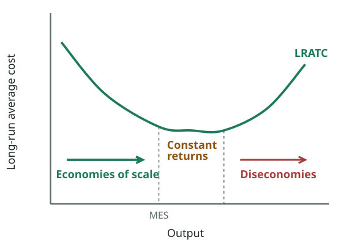
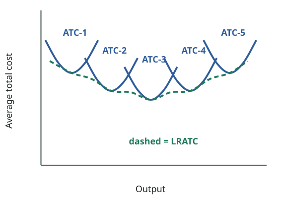

# FPEC 101 · Module 7 — Short-Run & Long-Run Costs, Economies of Scale
## মডিউল ৭ — স্বল্প ও দীর্ঘমেয়াদি ব্যয়, বৃহদায়তন উৎপাদনের সুবিধা

_Lecture 7 · 19 slides · Midterm questions: Q12, Q13, Q14_

> Printable study note generated from the website. Each slide: slide text → Bangla translation → tutor explanation → example → exam tip.

---

## Big picture — what is this lecture about? · বড় ছবি — এই লেকচারে কী শিখব?

_With unlimited plant sizes, LRATC is a smooth curve that "envelops" all the short-run ATCs. It falls (economies of scale), may stay flat (constant returns), then rises (diseconomies). MES = the smallest output at which LRATC reaches its minimum._  
_অসীম সংখ্যক কারখানার আকারে LRATC একটি মসৃণ রেখা যা সব স্বল্পমেয়াদি ATC-কে "ঘিরে" রাখে। এটা কমে (বৃহদায়তনের সুবিধা), সমতল থাকতে পারে (স্থির প্রতিদান), তারপর বাড়ে (অসুবিধা)। MES = সবচেয়ে কম যে উৎপাদনে LRATC সর্বনিম্নে পৌঁছায়।_

### English

**Concept:** Lecture 6 looked at a firm with a **fixed plant**. Lecture 7 finishes the short-run cost story with a full numeric table, then asks the big long-run question: **what happens to cost per unit when the whole firm grows bigger?** Usually costs per unit fall at first (**economies of scale**), then may rise when the firm becomes too big (**diseconomies of scale**). Finally it looks at **how firms grow** and the **legal forms** a business can take as it grows.

### What you will learn (5 jobs)
1. How **MC relates to AVC and ATC**, and how cost curves mirror product curves (slides 4–6).
2. A complete **cost table** (TFC, TVC, TC, AFC, AVC, ATC, MC) and what **shifts cost curves** (slides 7–10). Completes **Q12**.
3. The **long-run ATC curve** (LRATC): built from short-run plant sizes; the "envelope" (slides 11–13).
4. **Economies and diseconomies of scale**, constant returns, **minimum efficient scale** (slides 14–16). Midterm **Q13**.
5. **Growth of firms** (internal, external: takeover, merger, conglomerate) and **legal forms** (sole trader, partnership, joint stock companies, corporations) (slides 17–18). Midterm **Q14**.

### The 3-minute version
- **MC below an average pulls it down; MC above pulls it up**, so MC cuts AVC and ATC at their minimums. MC has no link with AFC.
- **Cost table:** TC = TFC + TVC; AFC = TFC/Q; AVC = TVC/Q; ATC = TC/Q; MC = ΔTC/ΔQ.
- **Shifts:** dearer fixed input → AFC, ATC up; dearer variable input → AVC, ATC, MC up.
- **LRATC** = the lowest-cost points of all possible plant sizes; it **envelops** the short-run ATCs.
- **Economies of scale** (LRATC falls): technical, financial, marketing, purchasing, managerial, risk-bearing. **Diseconomies** (LRATC rises): management problems, labour alienation, rising input prices, lack of personal contact.
- **Growth:** internal (organic) or external (takeover/acquisition, merger/amalgamation, conglomerate). **Legal forms:** sole trader → partnership → private/public joint stock company → corporation.

### বাংলা

**ধারণা:** লেকচার ৬ দেখেছে **স্থির কারখানার** একটি ফার্ম। লেকচার ৭ একটি পূর্ণ সংখ্যাভিত্তিক ছক দিয়ে স্বল্পমেয়াদি ব্যয়ের গল্প শেষ করে, তারপর বড় দীর্ঘমেয়াদি প্রশ্নটি করে: **পুরো ফার্ম বড় হলে এককপ্রতি ব্যয়ের কী হয়?** সাধারণত প্রথমে এককপ্রতি ব্যয় কমে (**বৃহদায়তনের সুবিধা**), তারপর ফার্ম খুব বড় হলে বাড়তে পারে (**বৃহদায়তনের অসুবিধা**)। শেষে দেখে **ফার্ম কীভাবে বড় হয়** এবং বড় হতে হতে ব্যবসা কোন কোন **আইনি রূপ** নেয়।

### তুমি কী শিখবে (৫টি কাজ)
1. **MC-র সাথে AVC ও ATC-র সম্পর্ক**, আর ব্যয় রেখা কীভাবে উৎপাদন রেখার আয়না (স্লাইড ৪–৬)।
2. একটি পূর্ণ **ব্যয়ের ছক** (TFC, TVC, TC, AFC, AVC, ATC, MC) এবং **ব্যয় রেখা কী কারণে সরে** (স্লাইড ৭–১০)। **Q12** পূর্ণ করে।
3. **দীর্ঘমেয়াদি ATC রেখা** (LRATC): স্বল্পমেয়াদি কারখানার আকার থেকে তৈরি; "আবরণ" (স্লাইড ১১–১৩)।
4. **বৃহদায়তনের সুবিধা ও অসুবিধা**, স্থির প্রতিদান, **ন্যূনতম দক্ষ আকার** (স্লাইড ১৪–১৬)। মিডটার্ম **Q13**।
5. **ফার্মের প্রবৃদ্ধি** (অভ্যন্তরীণ, বাহ্যিক: অধিগ্রহণ, একীভবন, কংগ্লোমারেট) ও **আইনি রূপ** (একমালিকানা, অংশীদারি, যৌথ মূলধনী কোম্পানি, কর্পোরেশন) (স্লাইড ১৭–১৮)। মিডটার্ম **Q14**।

### ৩ মিনিটের সারকথা
- **MC কোনো গড়ের নিচে থাকলে তাকে নামায়; ওপরে থাকলে ওঠায়**, তাই MC, AVC ও ATC-কে সর্বনিম্নে কাটে। AFC-র সাথে MC-র কোনো সম্পর্ক নেই।
- **ব্যয়ের ছক:** TC = TFC + TVC; AFC = TFC/Q; AVC = TVC/Q; ATC = TC/Q; MC = ΔTC/ΔQ।
- **সরণ:** স্থির উপকরণ দামি হলে → AFC, ATC ওপরে; পরিবর্তনশীল উপকরণ দামি হলে → AVC, ATC, MC ওপরে।
- **LRATC** = সব সম্ভাব্য কারখানার আকারের সবচেয়ে কম ব্যয়ের বিন্দু; এটা স্বল্পমেয়াদি ATC-গুলোকে **ঘিরে রাখে**।
- **বৃহদায়তনের সুবিধা** (LRATC কমে): কারিগরি, আর্থিক, বিপণন, ক্রয়, ব্যবস্থাপনাগত, ঝুঁকি বহন। **অসুবিধা** (LRATC বাড়ে): ব্যবস্থাপনার সমস্যা, শ্রমিকের বিচ্ছিন্নতা, উপকরণের দাম বৃদ্ধি, ব্যক্তিগত যোগাযোগের অভাব।
- **প্রবৃদ্ধি:** অভ্যন্তরীণ (নিজস্ব) বা বাহ্যিক (অধিগ্রহণ, একীভবন, কংগ্লোমারেট)। **আইনি রূপ:** একমালিকানা → অংশীদারি → প্রাইভেট/পাবলিক যৌথ মূলধনী কোম্পানি → কর্পোরেশন।

---

## Key words · মূল শব্দ

| Term | Meaning | বাংলা অর্থ | Example |
|---|---|---|---|
| Long-run ATC (LRATC) | Lowest cost per unit for each output when all inputs can change | দীর্ঘমেয়াদি গড় মোট ব্যয় — সব উপকরণ বদলানো গেলে প্রতিটি উৎপাদনে সর্বনিম্ন এককপ্রতি ব্যয় | Choosing a 1-floor or 5-floor factory. |
| Envelope curve | LRATC touches (envelops) all the short-run ATC curves | আবরণ রেখা — LRATC সব স্বল্পমেয়াদি ATC-কে ছুঁয়ে ঘিরে রাখে | A blanket draped over many bowls. |
| Economies of scale | Falling LRATC as the firm grows | বৃহদায়তনের সুবিধা — ফার্ম বড় হলে দীর্ঘমেয়াদি গড় ব্যয় কমে | A big garment factory makes shirts cheaper. |
| Diseconomies of scale | Rising LRATC when the firm becomes too big | বৃহদায়তনের অসুবিধা — ফার্ম খুব বড় হলে গড় ব্যয় বাড়ে | Too many managers, slow decisions. |
| Constant returns to scale | Range where LRATC does not change | স্থির প্রতিদান — যে অংশে LRATC বদলায় না | The flat bottom of the LRATC. |
| Minimum efficient scale (MES) | Lowest output at which LRATC is minimised | ন্যূনতম দক্ষ আকার — সবচেয়ে কম যে উৎপাদনে LRATC সর্বনিম্ন | A cement plant must be large to be efficient. |
| Internal growth | Growing by expanding the firm itself | অভ্যন্তরীণ প্রবৃদ্ধি — নিজে সম্প্রসারণ করে বড় হওয়া | Opening new branches. |
| Takeover / acquisition | One firm buys control of another | অধিগ্রহণ — এক ফার্ম অন্যটির নিয়ন্ত্রণ কিনে নেয় | A big bank buying a small bank. |
| Merger / amalgamation | Two firms agree to join into one | একীভবন — দুটি ফার্ম মিলে একটি হয় | Two telecoms joining (e.g. Robi and Airtel in Bangladesh). |
| Conglomerate (lateral) | Joining firms in unrelated industries | কংগ্লোমারেট (পার্শ্বিক) — সম্পর্কহীন শিল্পের ফার্ম একত্র | A group owning food, cement and media companies. |
| Sole trader | Business owned by one person, unlimited liability | একমালিকানা ব্যবসা — এক ব্যক্তির মালিকানা, অসীম দায় | A local grocery shop. |
| Partnership | Business owned by 2+ partners who share profit | অংশীদারি ব্যবসা — ২+ অংশীদার, মুনাফা ভাগ করে | A law firm, a family trading business. |
| Joint stock company | Company owned by shareholders, limited liability; private or public | যৌথ মূলধনী কোম্পানি — শেয়ারহোল্ডারদের মালিকানা, সীমিত দায়; প্রাইভেট বা পাবলিক | Square Pharmaceuticals PLC. |
| Limited liability | Owners can lose only what they invested | সীমিত দায় — মালিক শুধু বিনিয়োগকৃত অর্থই হারাতে পারে | Shareholders' homes are safe if the company fails. |

---

## Slides 1–3 · Title and outline
### শিরোনাম ও রূপরেখা

> **Slide 1**
> PRINCIPLES OF ECONOMICSSalimah Musharrif
> FPEC 101 – LECTURE 7 Unit 2
>
> **Slide 2**
> PRINCIPLES OF ECONOMICSProduction Costs and Market Structures
> FPEC 101 – LECTURE 7 Unit 2
>
> **Slide 3**
> Lecture OutlineEconomic, Short and Long Run costs
> Short Run and Long run Costs
> Legal Forms of Business
> Growth of Firms
>

**বাংলা অনুবাদ:**

> **স্লাইড ১:** প্রিন্সিপলস অব ইকোনমিক্স — সালিমাহ মুশাররিফ। FPEC 101 – লেকচার ৭, ইউনিট ২।
> **স্লাইড ২:** প্রিন্সিপলস অব ইকোনমিক্স — উৎপাদন ব্যয় ও বাজার কাঠামো। FPEC 101 – লেকচার ৭, ইউনিট ২।
> **স্লাইড ৩ — লেকচারের রূপরেখা:** অর্থনৈতিক, স্বল্প ও দীর্ঘমেয়াদি ব্যয় · স্বল্প ও দীর্ঘমেয়াদি ব্যয় · ব্যবসার আইনি রূপ · ফার্মের প্রবৃদ্ধি

**Tutor explains:** Three topics: the rest of **short-run and long-run costs**, the **legal forms of business**, and the **growth of firms**. Syllabus reading: McConnell & Brue pp. 387–396, 68–69 and 586–587.

**টিউটরের ব্যাখ্যা:** তিনটি বিষয়: **স্বল্প ও দীর্ঘমেয়াদি ব্যয়ের** বাকি অংশ, **ব্যবসার আইনি রূপ**, আর **ফার্মের প্রবৃদ্ধি**। সিলেবাসের পড়া: ম্যাককনেল ও ব্রু পৃ. ৩৮৭–৩৯৬, ৬৮–৬৯ ও ৫৮৬–৫৮৭।

---

## Slide 4 · MC cuts ATC and AVC at their minimum
### MC, ATC ও AVC-কে সর্বনিম্নে কাটে

_The slide table plotted (McConnell & Brue p. 388): MC falls to $60 then rises; it cuts AVC at its minimum ($74 at Q = 5) and ATC at its minimum ($91.43 at Q = 7). AFC keeps falling. (MC is plotted between quantities.)_  
_স্লাইডের ছক আঁকা (ম্যাককনেল ও ব্রু পৃ. ৩৮৮): MC নেমে $৬০, তারপর বাড়ে; AVC-কে সর্বনিম্নে কাটে (Q = ৫-এ $৭৪) আর ATC-কে সর্বনিম্নে (Q = ৭-এ $৯১.৪৩)। AFC কমতেই থাকে। (MC দুই পরিমাণের মাঝখানে আঁকা।)_

> Short Run Costs- Average Costs
> [Graph, McConnell & Brue p. 388: AFC, AVC, ATC and MC plotted against quantity 1–10]
> MC cuts ATC and AVC at minimum.
> When MC is below ATC, ATC falls
> When MC is above ATC, ATC rises.
> Similarly, when MC is below AVC, AVC falls.
> When MC is above AVC, AVC rises.
>

**বাংলা অনুবাদ:**

> স্বল্পমেয়াদি ব্যয় — গড় ব্যয়
> [গ্রাফ, ম্যাককনেল ও ব্রু পৃ. ৩৮৮: পরিমাণ ১–১০-এর বিপরীতে AFC, AVC, ATC ও MC]
> MC, ATC ও AVC-কে সর্বনিম্নে কাটে।
> MC যখন ATC-র নিচে, ATC কমে।
> MC যখন ATC-র ওপরে, ATC বাড়ে।
> একইভাবে, MC যখন AVC-র নিচে, AVC কমে।
> MC যখন AVC-র ওপরে, AVC বাড়ে।

**Tutor explains:** This graph is drawn from the slide's cost table (slides 7–9). Look at the red MC curve:
Up to Q = 5, MC is **below** AVC → AVC keeps **falling**.At Q = 5, MC **crosses** AVC → AVC is at its **minimum** ($74).After that MC is **above** AVC → AVC **rises**.The same happens with ATC, a little later: minimum at Q = 7 ($91.43).
Remember the **exam-marks analogy** from Lecture 6: a new mark below your average pulls the average down; above it pulls it up.

**টিউটরের ব্যাখ্যা:** এই গ্রাফ স্লাইডের ব্যয়ের ছক (স্লাইড ৭–৯) থেকে আঁকা। লাল MC রেখা দেখো:
Q = ৫ পর্যন্ত MC, AVC-র **নিচে** → AVC **কমতেই** থাকে।Q = ৫-এ MC, AVC-কে **কাটে** → AVC **সর্বনিম্ন** ($৭৪)।এর পর MC, AVC-র **ওপরে** → AVC **বাড়ে**।ATC-র ক্ষেত্রেও একই, একটু পরে: সর্বনিম্ন Q = ৭-এ ($৯১.৪৩)।
লেকচার ৬-এর **পরীক্ষার নম্বরের উদাহরণ** মনে করো: গড়ের নিচে নতুন নম্বর গড়কে নামায়; ওপরে হলে ওঠায়।

---

## Slide 5 · Relation of MC to AVC and ATC (the full rule)
### AVC ও ATC-র সাথে MC-র সম্পর্ক (পূর্ণ নিয়ম)

> Short Run Costs- Relation of MC to AVC and ATC
> MC intersects cuts the AVC and the ATC curves at their minimum points.
> When MC is added to total cost is less than the current average total cost, ATC will fall and vice versa.
> As long as MC lies below ATC, ATC will fall, and whenever MC lies above ATC, ATC will rise.
> Where MC equals ATC, ATC is constant and thus is the minimum point on the ATC curve.
> MC cuts ATC at ATC curve’s minimum point
> With the same logic MC curve cuts AVC at AVCs minimum’.
> No such relationship exists between the MC curve and the average-fixed-cost curve, because the two are not related; marginal cost includes only those costs that change with output.
>

**বাংলা অনুবাদ:**

> স্বল্পমেয়াদি ব্যয় — AVC ও ATC-র সাথে MC-র সম্পর্ক
> MC, AVC ও ATC রেখাকে তাদের সর্বনিম্ন বিন্দুতে ছেদ করে।
> মোট ব্যয়ে যোগ হওয়া MC বর্তমান গড় মোট ব্যয়ের চেয়ে কম হলে ATC কমবে, আর উল্টোটাও সত্য।
> যতক্ষণ MC, ATC-র নিচে থাকে, ATC কমবে; আর যখনই MC, ATC-র ওপরে থাকে, ATC বাড়বে।
> যেখানে MC = ATC, সেখানে ATC স্থির, অর্থাৎ ATC রেখার সর্বনিম্ন বিন্দু।
> MC, ATC রেখাকে তার সর্বনিম্ন বিন্দুতে কাটে।
> একই যুক্তিতে MC রেখা AVC-কে তার সর্বনিম্নে কাটে।
> MC রেখা ও গড় স্থির ব্যয় রেখার মধ্যে এমন কোনো সম্পর্ক নেই, কারণ দুটি সম্পর্কিত নয়; প্রান্তিক ব্যয়ে শুধু সেই ব্যয়গুলো থাকে যা উৎপাদনের সাথে বদলায়।

**Tutor explains:** The full rule, in four lines:
**MC < ATC → ATC falls.****MC > ATC → ATC rises.****MC = ATC → ATC is at its minimum** (it has stopped falling and not yet started rising). So **MC cuts ATC at ATC's minimum point**.Exactly the same for **AVC**.
**One exception:** MC has **no relationship with AFC**. Why? MC contains only costs that **change with output** (variable costs); fixed costs never enter MC.

**টিউটরের ব্যাখ্যা:** চার লাইনে পূর্ণ নিয়ম:
**MC < ATC → ATC কমে।****MC > ATC → ATC বাড়ে।****MC = ATC → ATC সর্বনিম্ন** (কমা থেমেছে, বাড়া এখনো শুরু হয়নি)। তাই **MC, ATC-কে তার সর্বনিম্ন বিন্দুতে কাটে**।**AVC**-র ক্ষেত্রেও হুবহু একই।
**একটি ব্যতিক্রম:** **AFC-র সাথে MC-র কোনো সম্পর্ক নেই**। কেন? MC-তে শুধু **উৎপাদনের সাথে বদলানো** ব্যয় থাকে (পরিবর্তনশীল ব্যয়); স্থির ব্যয় কখনো MC-তে ঢোকে না।

**Exam tip:** A favourite short question: "Why does MC cut ATC at its minimum?" Answer with rules 1–3 and the marks analogy.

**পরীক্ষার টিপস:** প্রিয় ছোট প্রশ্ন: "MC কেন ATC-কে তার সর্বনিম্নে কাটে?" নিয়ম ১–৩ আর নম্বরের উদাহরণ দিয়ে উত্তর দাও।

---

## Slide 6 · Productivity curves and cost curves are mirror images
### উৎপাদনশীলতা রেখা ও ব্যয় রেখা আয়নার প্রতিচ্ছবি

> Relation between productivity and cost curves
> MC and AVC are mirror images of the MP and AP curves.
> Assuming labor as only variable input and constant wage rate. when MP is rising, MC is falling, and when MP is falling, MC is rising.
> Under the same assumptions, when AP is rising, AVC is falling, and when AP is falling, AVC is rising
>

**বাংলা অনুবাদ:**

> উৎপাদনশীলতা ও ব্যয় রেখার সম্পর্ক
> MC ও AVC হলো MP ও AP রেখার আয়নার প্রতিচ্ছবি।
> শ্রমকে একমাত্র পরিবর্তনশীল উপকরণ এবং মজুরির হার স্থির ধরে নিলে: MP বাড়লে MC কমে, আর MP কমলে MC বাড়ে।
> একই অনুমানে AP বাড়লে AVC কমে, আর AP কমলে AVC বাড়ে।

**Tutor explains:** Two mirror pairs (assume labour is the only variable input and the wage is constant):
Product curveIts mirror cost curve
MP rising → at its peak → fallingMC falling → at its lowest → rising
AP rising → at its peak → fallingAVC falling → at its lowest → rising
Why? If each worker costs the same wage, **more output per worker means less cost per unit**, and less output per worker means more cost per unit. This is how the law of diminishing returns (a **production** law) explains the U-shapes of the **cost** curves.

**টিউটরের ব্যাখ্যা:** দুটি আয়না-জোড়া (ধরো শ্রমই একমাত্র পরিবর্তনশীল উপকরণ আর মজুরি স্থির):
উৎপাদন রেখাতার আয়নার ব্যয় রেখা
MP বাড়ে → চূড়ায় → কমেMC কমে → সর্বনিম্নে → বাড়ে
AP বাড়ে → চূড়ায় → কমেAVC কমে → সর্বনিম্নে → বাড়ে
কেন? প্রত্যেক শ্রমিকের মজুরি একই হলে **শ্রমিকপ্রতি বেশি উৎপাদন মানে এককপ্রতি কম ব্যয়**, আর কম উৎপাদন মানে বেশি ব্যয়। এভাবেই ক্রমহ্রাসমান প্রতিদানের নিয়ম (একটি **উৎপাদনের** নিয়ম) **ব্যয়** রেখার U আকৃতি ব্যাখ্যা করে।

**Exam tip:** In Q12, one sentence links the two halves of your answer: **"MC and AVC are mirror images of MP and AP."**

**পরীক্ষার টিপস:** Q12-এ এক বাক্যেই উত্তরের দুই অর্ধেক জোড়া লাগে: **"MC and AVC are mirror images of MP and AP."**

---

## Slides 7–9 · The complete cost table
### সম্পূর্ণ ব্যয়ের ছক

> **Slide 7**
> Cost table (Q 0–10): TFC = 100 at every output; TVC: 0, 90, 170, 240, 300, 370, 450, 540, 650, 780, 930
> TC = TFC + TVC: 100, 190, 270, 340, 400, 470, 550, 640, 750, 880, 1030
>
> **Slide 8**
> AFC = TFC / Q: 100, 50, 33.33, 25, 20, 16.67, 14.29, 12.50, 11.11, 10
> AVC = TVC / Q: 90, 85, 80, 75, 74, 75, 77.14, 81.25, 86.67, 93
> ATC = TC / Q: 190, 135, 113.33, 100, 94, 91.67, 91.43, 93.75, 97.78, 103
>
> **Slide 9**
> MC: 90, 80, 70, 60, 70, 80, 90, 110, 130, 150
> MC = ΔTC / ΔQ (written on the slide as "MC = TC / Q")
> MC is graphed at average Q (e.g. at 2.5 for the change from Q 2 to 3)
>

**বাংলা অনুবাদ:**

> **স্লাইড ৭:** ব্যয়ের ছক (Q ০–১০): প্রতিটি উৎপাদনে TFC = ১০০; TVC: ০, ৯০, ১৭০, ২৪০, ৩০০, ৩৭০, ৪৫০, ৫৪০, ৬৫০, ৭৮০, ৯৩০। TC = TFC + TVC: ১০০, ১৯০, ২৭০, ৩৪০, ৪০০, ৪৭০, ৫৫০, ৬৪০, ৭৫০, ৮৮০, ১০৩০।
> **স্লাইড ৮:** AFC = TFC / Q: ১০০, ৫০, ৩৩.৩৩, ২৫, ২০, ১৬.৬৭, ১৪.২৯, ১২.৫০, ১১.১১, ১০। AVC = TVC / Q: ৯০, ৮৫, ৮০, ৭৫, ৭৪, ৭৫, ৭৭.১৪, ৮১.২৫, ৮৬.৬৭, ৯৩। ATC = TC / Q: ১৯০, ১৩৫, ১১৩.৩৩, ১০০, ৯৪, ৯১.৬৭, ৯১.৪৩, ৯৩.৭৫, ৯৭.৭৮, ১০৩।
> **স্লাইড ৯:** MC: ৯০, ৮০, ৭০, ৬০, ৭০, ৮০, ৯০, ১১০, ১৩০, ১৫০। MC = ΔTC / ΔQ (স্লাইডে লেখা "MC = TC / Q")। MC আঁকা হয় গড় Q-তে (যেমন Q ২ থেকে ৩-এর পরিবর্তনের জন্য ২.৫-এ)।

**Tutor explains:** The full table (McConnell & Brue):
QTFCTVCTCAFCAVCATCMC
01000100————
1100901901009019090
2100170270508513580
310024034033.3380113.3370
41003004002575100**60**
510037047020**74**9470
610045055016.677591.6780
710054064014.2977.14**91.43**90
810065075012.5081.2593.75110
910078088011.1186.6797.78130
1010093010301093103150
**Worked checks:** - TC at Q = 3: 100 + 240 = **340**. ATC = 340 ÷ 3 = **113.33** = AFC 33.33 + AVC 80. ✔ - MC of the 4th unit: 400 − 340 = **60** (the lowest MC). - MC of the 8th unit: 750 − 640 = **110**.
**Why "MC is graphed at average Q":** MC is the change **between** two outputs, so it belongs halfway: the MC of going from 2 to 3 units (70) is plotted at Q = 2.5.
(The slide writes "MC = TC / Q"; the correct formula is **MC = ΔTC / ΔQ**. TC / Q is ATC.)

**টিউটরের ব্যাখ্যা:** পূর্ণ ছক (ম্যাককনেল ও ব্রু): ওপরের ইংরেজি অংশের ছকটা দেখো, সংখ্যা একই।
**হাতে-কলমে যাচাই:** - Q = ৩-এ TC: ১০০ + ২৪০ = **৩৪০**। ATC = ৩৪০ ÷ ৩ = **১১৩.৩৩** = AFC ৩৩.৩৩ + AVC ৮০। ✔ - ৪র্থ এককের MC: ৪০০ − ৩৪০ = **৬০** (সবচেয়ে কম MC)। - ৮ম এককের MC: ৭৫০ − ৬৪০ = **১১০**।
**"MC গড় Q-তে আঁকা হয়" কেন:** MC হলো দুটি উৎপাদনের **মাঝের** পরিবর্তন, তাই অর্ধেক পথে বসে: ২ থেকে ৩ এককে যাওয়ার MC (৭০) আঁকা হয় Q = ২.৫-এ।
**ছক থেকে ধারা:** AFC সবসময় কমে (১০০ → ১০); MC নেমে ৬০ (Q = ৪), তারপর বাড়ে; AVC সর্বনিম্ন ৭৪ (Q = ৫); ATC সর্বনিম্ন ৯১.৪৩ (Q = ৭)।
(স্লাইডে লেখা "MC = TC / Q"; সঠিক সূত্র **MC = ΔTC / ΔQ**। TC / Q হলো ATC।)

**Exam tip:** The exam may give you TFC and TVC only and ask you to fill the other columns. Practise: TC, then AFC, AVC, ATC, then MC from the change in TC.

**পরীক্ষার টিপস:** পরীক্ষায় শুধু TFC ও TVC দিয়ে বাকি কলাম পূরণ করতে বলতে পারে। অনুশীলন করো: আগে TC, তারপর AFC, AVC, ATC, তারপর TC-র পরিবর্তন থেকে MC।

---

## Slide 10 · Shifts of cost curves
### ব্যয় রেখার সরণ

> Chapter 6.4
> Shifts of Cost Curves
> Change in Factor Prices
> If price of fixed input increases
> AFC and ATC shift up
> AVC and MC unchanged
> If price of variable input increases
> AVC, ATC, and MC shift up
> AFC unchanged
> If change in technology, curve shifts depends on whether technology affects FC, VC, or both
>

**বাংলা অনুবাদ:**

> ব্যয় রেখার সরণ
> **উপাদানের দামের পরিবর্তন**
> স্থির উপকরণের দাম বাড়লে
> • AFC ও ATC ওপরে সরে
> • AVC ও MC অপরিবর্তিত
> পরিবর্তনশীল উপকরণের দাম বাড়লে
> • AVC, ATC ও MC ওপরে সরে
> • AFC অপরিবর্তিত
> প্রযুক্তির পরিবর্তনে কোন রেখা সরবে তা নির্ভর করে প্রযুক্তি FC, VC নাকি দুটোকেই প্রভাবিত করে তার ওপর।

**Tutor explains:** Cost curves are drawn for **given input prices and technology**. If those change, the curves **shift**:
ChangeShifts upUnchanged
Price of a **fixed** input ↑ (rent, insurance)AFC, ATCAVC, MC
Price of a **variable** input ↑ (wages, raw materials, fuel)AVC, ATC, MCAFC
Better technologyCurves shift **down**; which ones depends on whether it lowers FC, VC or both
Why? ATC = AFC + AVC, so ATC moves with either. MC moves only with variable costs (slide 5).

**টিউটরের ব্যাখ্যা:** ব্যয় রেখা আঁকা হয় **নির্দিষ্ট উপকরণের দাম ও প্রযুক্তিতে**। সেগুলো বদলালে রেখা **সরে**:
পরিবর্তনওপরে সরেঅপরিবর্তিত
**স্থির** উপকরণের দাম ↑ (ভাড়া, বিমা)AFC, ATCAVC, MC
**পরিবর্তনশীল** উপকরণের দাম ↑ (মজুরি, কাঁচামাল, জ্বালানি)AVC, ATC, MCAFC
উন্নত প্রযুক্তিরেখা **নিচে** সরে; কোনগুলো তা নির্ভর করে FC, VC নাকি দুটোই কমায় তার ওপর
কেন? ATC = AFC + AVC, তাই যেকোনোটার সাথে ATC সরে। MC সরে শুধু পরিবর্তনশীল ব্যয়ের সাথে (স্লাইড ৫)।

**Real-life example:** **Fixed input:** a shop's landlord raises rent from Tk 30,000 to Tk 40,000. AFC and ATC rise; the cost of serving one more customer (MC) does not change. **Variable input:** the garment minimum wage rises. Every extra shirt now costs more labour: AVC, ATC and MC all rise.

**বাস্তব উদাহরণ:** **স্থির উপকরণ:** দোকানের বাড়িওয়ালা ভাড়া ৩০,০০০ থেকে ৪০,০০০ টাকা করলেন। AFC ও ATC বাড়ে; আরেকজন ক্রেতাকে সেবা দেওয়ার খরচ (MC) বদলায় না। **পরিবর্তনশীল উপকরণ:** গার্মেন্টসের ন্যূনতম মজুরি বাড়ল। প্রতিটি বাড়তি শার্টে এখন বেশি শ্রম খরচ: AVC, ATC ও MC সব বাড়ে।

---

## Quick check · দ্রুত যাচাই

1. If MC is below ATC, ATC is…  
   MC যদি ATC-র নিচে থাকে, ATC…

   - A) Rising · বাড়ছে
   - B) Falling · কমছে
   - C) At its maximum · সর্বোচ্চ
   - D) Equal to AFC · AFC-র সমান

   **Answer: B** — An extra unit cheaper than the average pulls the average down.  
   গড়ের চেয়ে সস্তা একটি বাড়তি একক গড়কে নামায়।

2. TC rises from 640 to 750 when Q rises from 7 to 8. MC is…  
   Q ৭ থেকে ৮ হলে TC ৬৪০ থেকে ৭৫০ হলো। MC…

   - A) 93.75 · ৯৩.৭৫
   - B) 110 · ১১০
   - C) 750 · ৭৫০
   - D) 12.5 · ১২.৫

   **Answer: B** — MC = ΔTC ÷ ΔQ = 110 ÷ 1 = 110. (93.75 is ATC at Q = 8.)  
   MC = ΔTC ÷ ΔQ = ১১০ ÷ ১ = ১১০। (৯৩.৭৫ হলো Q = ৮-এ ATC।)

3. Wages rise. Which curve does NOT shift?  
   মজুরি বাড়ল। কোন রেখা সরে না?

   - A) AVC · AVC
   - B) ATC · ATC
   - C) MC · MC
   - D) AFC · AFC

   **Answer: D** — Wages are a variable cost; AFC depends only on fixed costs.  
   মজুরি পরিবর্তনশীল ব্যয়; AFC নির্ভর করে শুধু স্থির ব্যয়ের ওপর।

---

## Slide 11 · Long-run production costs
### দীর্ঘমেয়াদি উৎপাদন ব্যয়

> Chapter 6.4
> Since it is the Long run, we focus on Average Total Cost because all resources, and, therefore, costs are variable.
> For a time, successively larger plants will lower average total cost. However, eventually the building of a still larger plant may cause ATC to rise.
> Initially a business has a small plant size up to a certain level of output. When ATC reaches minimum and begins rising, firm should change plant size. For the next level of output, the firm attains lower costs with a bigger plant size. This continues as the firm expands and eventually reaches a minimum to rise again.
> Tracing these adjustments, we find that the long-run ATC curve for the enterprise is made up of segments of the short-run ATC curves for the various plant sizes that can be constructed.
> Long Run Production Costs
>

**বাংলা অনুবাদ:**

> দীর্ঘমেয়াদি উৎপাদন ব্যয়
> যেহেতু দীর্ঘমেয়াদ, আমরা গড় মোট ব্যয়ে মনোযোগ দিই, কারণ সব সম্পদ, তাই সব ব্যয়, পরিবর্তনশীল।
> কিছু সময় ধরে ক্রমশ বড় কারখানা গড় মোট ব্যয় কমাবে। তবে একসময় আরও বড় কারখানা বানালে ATC বাড়তে পারে।
> শুরুতে একটি ব্যবসার একটি নির্দিষ্ট উৎপাদন পর্যন্ত ছোট কারখানা থাকে। ATC সর্বনিম্নে পৌঁছে বাড়তে শুরু করলে ফার্মের কারখানার আকার বদলানো উচিত। পরের স্তরের উৎপাদনে বড় কারখানায় ফার্ম কম ব্যয় পায়। ফার্ম বড় হতে থাকলে এটা চলতে থাকে এবং একসময় সর্বনিম্নে পৌঁছে আবার বাড়ে।
> এই সমন্বয়গুলো অনুসরণ করলে দেখি, প্রতিষ্ঠানের দীর্ঘমেয়াদি ATC রেখা গঠিত হয় বিভিন্ন সম্ভাব্য কারখানার আকারের স্বল্পমেয়াদি ATC রেখার অংশ দিয়ে।

**Tutor explains:** In the long run there are **no fixed costs**, so we look only at **average total cost**.
The story of a growing firm: 1. It starts with a **small plant**. As output grows, ATC falls, reaches its minimum, then starts to rise (diminishing returns in that small plant). 2. At that point it is cheaper to **build a bigger plant**. With the bigger plant, the next range of output is produced at a **lower** ATC. 3. This repeats as the firm grows… but eventually even the best new plant gives a **higher** ATC than before (the firm is too big).
So the **long-run ATC curve is made of the lowest segments of the short-run ATC curves** of all the plant sizes the firm could build.

**টিউটরের ব্যাখ্যা:** দীর্ঘমেয়াদে **কোনো স্থির ব্যয় নেই**, তাই আমরা শুধু **গড় মোট ব্যয়** দেখি।
একটি বেড়ে ওঠা ফার্মের গল্প: 1. শুরু হয় **ছোট কারখানা** দিয়ে। উৎপাদন বাড়লে ATC কমে, সর্বনিম্নে পৌঁছায়, তারপর বাড়তে শুরু করে (ছোট কারখানায় ক্রমহ্রাসমান প্রতিদান)। 2. তখন **বড় কারখানা বানানো** সস্তা। বড় কারখানায় পরের অংশের উৎপাদন **কম** ATC-তে হয়। 3. ফার্ম বড় হতে থাকলে এটা চলতে থাকে… কিন্তু একসময় সেরা নতুন কারখানাও আগের চেয়ে **বেশি** ATC দেয় (ফার্ম খুব বড়)।
তাই **দীর্ঘমেয়াদি ATC রেখা গঠিত হয় ফার্মের সম্ভাব্য সব কারখানার আকারের স্বল্পমেয়াদি ATC রেখার সর্বনিম্ন অংশগুলো দিয়ে**।

**Real-life example:** A biryani shop in Old Dhaka with one pot (small plant). When orders rise, one pot is overworked and costs per plate rise, so the owner moves to a shop with 4 pots and lower cost per plate. Later he opens a central kitchen with 20 pots, cheaper still. If he grows to 50 branches, coordination problems may raise costs again.

**বাস্তব উদাহরণ:** পুরান ঢাকার এক হাঁড়ির বিরিয়ানির দোকান (ছোট কারখানা)। অর্ডার বাড়লে এক হাঁড়িতে চাপ বাড়ে, প্লেটপ্রতি খরচ বাড়ে, তাই মালিক ৪ হাঁড়ির দোকানে যান, প্লেটপ্রতি খরচ কমে। পরে ২০ হাঁড়ির কেন্দ্রীয় রান্নাঘর, আরও সস্তা। ৫০টি শাখা হলে সমন্বয়ের সমস্যায় খরচ আবার বাড়তে পারে।

---

## Slide 12 · LRATC from five plant sizes
### পাঁচটি কারখানার আকার থেকে LRATC

_Five possible plant sizes, each with its own short-run ATC. For every output the firm picks the plant with the lowest cost; joining those lowest segments gives the long-run ATC curve._  
_পাঁচটি সম্ভাব্য কারখানার আকার, প্রত্যেকটির নিজস্ব স্বল্পমেয়াদি ATC। প্রতিটি উৎপাদনে ফার্ম সবচেয়ে কম ব্যয়ের কারখানা বেছে নেয়; সেই সর্বনিম্ন অংশগুলো জুড়লে দীর্ঘমেয়াদি ATC রেখা পাওয়া যায়।_

> Long-Run Average-Total-Cost Curve
> [Diagram: five short-run curves ATC-1 to ATC-5 side by side; the lowest parts of them are highlighted]
> Choose the best plant for every output level
> These choices determine the LRATC curve
>

**বাংলা অনুবাদ:**

> দীর্ঘমেয়াদি গড় মোট ব্যয় রেখা
> [চিত্র: পাশাপাশি পাঁচটি স্বল্পমেয়াদি রেখা ATC-1 থেকে ATC-5; তাদের সর্বনিম্ন অংশগুলো চিহ্নিত]
> প্রতিটি উৎপাদন স্তরের জন্য সেরা কারখানা বেছে নাও
> এই পছন্দগুলোই LRATC রেখা ঠিক করে

**Tutor explains:** If only **five plant sizes** are possible, each has its own short-run ATC (ATC-1 … ATC-5).
**Rule: for every output level, choose the plant with the lowest ATC.** Where two curves cross, switch to the next plant. The result is a **scalloped (wavy) LRATC**, made of the lowest pieces of the five curves.
Notice the shape: ATC-1 to ATC-3 get **lower** (bigger plants are cheaper per unit), ATC-4 and ATC-5 get **higher** again (too big).

**টিউটরের ব্যাখ্যা:** শুধু **পাঁচটি কারখানার আকার** সম্ভব হলে প্রত্যেকটির নিজস্ব স্বল্পমেয়াদি ATC (ATC-1 … ATC-5)।
**নিয়ম: প্রতিটি উৎপাদন স্তরে সবচেয়ে কম ATC-র কারখানা বেছে নাও।** যেখানে দুটি রেখা ছেদ করে, পরের কারখানায় যাও। ফল একটি **ঢেউখেলানো LRATC**, পাঁচ রেখার সর্বনিম্ন টুকরো দিয়ে গড়া।
আকৃতি খেয়াল করো: ATC-1 থেকে ATC-3 **নিচে নামে** (বড় কারখানা এককপ্রতি সস্তা), ATC-4 ও ATC-5 আবার **ওপরে ওঠে** (খুব বড়)।

---

## Slide 13 · The LRATC as an envelope curve
### আবরণ রেখা হিসেবে LRATC

_With unlimited plant sizes, LRATC is a smooth curve that "envelops" all the short-run ATCs. It falls (economies of scale), may stay flat (constant returns), then rises (diseconomies). MES = the smallest output at which LRATC reaches its minimum._  
_অসীম সংখ্যক কারখানার আকারে LRATC একটি মসৃণ রেখা যা সব স্বল্পমেয়াদি ATC-কে "ঘিরে" রাখে। এটা কমে (বৃহদায়তনের সুবিধা), সমতল থাকতে পারে (স্থির প্রতিদান), তারপর বাড়ে (অসুবিধা)। MES = সবচেয়ে কম যে উৎপাদনে LRATC সর্বনিম্নে পৌঁছায়।_

> The Long-Run Average-Total-Cost Curve
> The number of possible plant sizes is virtually unlimited
> [Diagram: many small short-run ATC curves; a smooth U-shaped LRATC touches each of them]
> The LRATC curve just envelops the short-run cost curves
> The long-run ATC curve is made up of all the points of tangency of the unlimited number of short-run ATC curves
>

**বাংলা অনুবাদ:**

> দীর্ঘমেয়াদি গড় মোট ব্যয় রেখা
> সম্ভাব্য কারখানার আকারের সংখ্যা কার্যত অসীম
> [চিত্র: অনেকগুলো ছোট স্বল্পমেয়াদি ATC রেখা; একটি মসৃণ U আকৃতির LRATC প্রত্যেকটিকে ছুঁয়ে যায়]
> LRATC রেখা স্বল্পমেয়াদি ব্যয় রেখাগুলোকে ঠিক ঘিরে রাখে
> দীর্ঘমেয়াদি ATC রেখা গঠিত হয় অসীম সংখ্যক স্বল্পমেয়াদি ATC রেখার সব স্পর্শবিন্দু দিয়ে

**Tutor explains:** In reality a firm can build a plant of **almost any size**, so there are **unlimited** short-run ATC curves. Then the wavy line becomes a **smooth U-shaped LRATC** that **just touches** (is tangent to) each short-run ATC.
That is why it is called an **envelope curve**: like an envelope wrapped around many letters, it wraps around all the short-run curves from below.
The U-shape of the LRATC is explained by **economies of scale** (falling part) and **diseconomies of scale** (rising part), the next three slides.

**টিউটরের ব্যাখ্যা:** বাস্তবে একটি ফার্ম **প্রায় যেকোনো আকারের** কারখানা বানাতে পারে, তাই স্বল্পমেয়াদি ATC রেখা **অসীম**। তখন ঢেউখেলানো রেখা হয়ে যায় একটি **মসৃণ U আকৃতির LRATC**, যা প্রতিটি স্বল্পমেয়াদি ATC-কে **ঠিক ছুঁয়ে যায়** (স্পর্শক)।
তাই একে বলে **আবরণ রেখা (envelope curve)**: অনেক চিঠির ওপর খামের মতো, এটা সব স্বল্পমেয়াদি রেখাকে নিচ থেকে ঘিরে রাখে।
LRATC-র U আকৃতি ব্যাখ্যা করে **বৃহদায়তনের সুবিধা** (নামার অংশ) ও **বৃহদায়তনের অসুবিধা** (ওঠার অংশ), পরের তিনটি স্লাইড।

**Exam tip:** In Q13, draw this envelope and write: **"The LRATC is made up of all the points of tangency of the short-run ATC curves."**

**পরীক্ষার টিপস:** Q13-এ এই আবরণ রেখা আঁকো আর লেখো: **"The LRATC is made up of all the points of tangency of the short-run ATC curves."**

---

## Slide 14 · Economies, diseconomies, constant returns and MES
### সুবিধা, অসুবিধা, স্থির প্রতিদান ও MES

> Long-Run Costs
> Economies of large scale refer to the advantages a firm accrues from producing on a large scale which results in a fall in the long run average total cost or per unit cost.
> Diseconomies of scale conversely refer to the rise in average costs as production is increased beyond the optimum scale.
> Constant returns to scale is the point when economies of scale end and the output at which diseconomies of scale begin. However, there may be a range of constant returns to scale over which long-run average cost does not change
> Minimum efficient scale (MES), which is the lowest level of output at which a firm can minimize long-run average costs.
> The best or optimum size for a firm would be where it can reduce the average cost to their lowest point in the long run. At this point it can benefit from economies of scale and use the profits to improve their factory and their products or to lower prices to attract consumers away from competing firms.
> .
>

**বাংলা অনুবাদ:**

> দীর্ঘমেয়াদি ব্যয়
> **বৃহদায়তনের সুবিধা (economies of large scale)** বলতে বড় পরিসরে উৎপাদন করে ফার্ম যে সুবিধা পায় তা বোঝায়, যার ফলে দীর্ঘমেয়াদি গড় মোট ব্যয় বা এককপ্রতি ব্যয় কমে।
> **বৃহদায়তনের অসুবিধা (diseconomies of scale)** উল্টোভাবে বোঝায় সর্বোত্তম আকারের বাইরে উৎপাদন বাড়ালে গড় ব্যয়ের বৃদ্ধি।
> **স্থির প্রতিদান (constant returns to scale)** হলো যেখানে বৃহদায়তনের সুবিধা শেষ হয় এবং যে উৎপাদনে অসুবিধা শুরু হয়। তবে স্থির প্রতিদানের একটা পরিসর থাকতে পারে, যেখানে দীর্ঘমেয়াদি গড় ব্যয় বদলায় না।
> **ন্যূনতম দক্ষ আকার (MES)** হলো সবচেয়ে কম উৎপাদন স্তর যেখানে একটি ফার্ম দীর্ঘমেয়াদি গড় ব্যয় সর্বনিম্ন করতে পারে।
> একটি ফার্মের সেরা বা সর্বোত্তম আকার হবে যেখানে সে দীর্ঘমেয়াদে গড় ব্যয় সর্বনিম্নে নামাতে পারে। এই বিন্দুতে সে বৃহদায়তনের সুবিধা পায় এবং মুনাফা দিয়ে কারখানা ও পণ্য উন্নত করতে বা দাম কমিয়ে প্রতিযোগীদের থেকে ক্রেতা টানতে পারে।

**Tutor explains:** Four key terms for Q13:
**Economies of scale:** the advantages of producing on a **large scale**, which make **LRATC fall**. (The downward part of the U.)**Diseconomies of scale:** the **rise** in average cost when production grows **beyond the optimum scale**. (The upward part.)**Constant returns to scale:** where economies end and diseconomies have not yet begun; there may be a **range** where LRATC stays the same (the flat bottom).**Minimum efficient scale (MES):** the **lowest output** at which LRATC reaches its minimum.
**Optimum size:** where LRATC is lowest. There the firm enjoys all the economies of scale and can use profits to improve its factory and products, or **cut prices** to win customers from rivals.

**টিউটরের ব্যাখ্যা:** Q13-এর চারটি মূল শব্দ:
**বৃহদায়তনের সুবিধা:** **বড় পরিসরে** উৎপাদনের সুবিধা, যা **LRATC কমায়**। (U-এর নামার অংশ।)**বৃহদায়তনের অসুবিধা:** উৎপাদন **সর্বোত্তম আকারের বাইরে** গেলে গড় ব্যয়ের **বৃদ্ধি**। (ওঠার অংশ।)**স্থির প্রতিদান:** যেখানে সুবিধা শেষ, অসুবিধা এখনো শুরু হয়নি; একটা **পরিসর** থাকতে পারে যেখানে LRATC একই থাকে (সমতল তলা)।**ন্যূনতম দক্ষ আকার (MES):** **সবচেয়ে কম উৎপাদন** যেখানে LRATC সর্বনিম্নে পৌঁছায়।
**সর্বোত্তম আকার:** যেখানে LRATC সবচেয়ে কম। সেখানে ফার্ম সব বৃহদায়তনের সুবিধা পায় এবং মুনাফা দিয়ে কারখানা ও পণ্য উন্নত করতে, বা **দাম কমিয়ে** প্রতিদ্বন্দ্বীদের থেকে ক্রেতা টানতে পারে।

**Real-life example:** **MES in Bangladesh:** a cement plant or a steel mill must be **huge** before it reaches its lowest cost per tonne, so only a few big firms (e.g. large cement groups) survive. A tailoring shop reaches its MES with just a few machines, so thousands of small tailors survive.

**বাস্তব উদাহরণ:** **বাংলাদেশে MES:** সিমেন্ট কারখানা বা স্টিল মিলকে টনপ্রতি সর্বনিম্ন খরচে পৌঁছাতে **বিশাল** হতে হয়, তাই অল্প কয়েকটি বড় ফার্ম (যেমন বড় সিমেন্ট গ্রুপ) টিকে থাকে। দর্জির দোকান মাত্র কয়েকটি মেশিনেই MES-এ পৌঁছায়, তাই হাজারো ছোট দর্জি টিকে থাকে।

---

## Slide 15 · Types of economies of scale
### বৃহদায়তনের সুবিধার প্রকার

> Long-Run Costs
> Economies of scale .
> • Technical economies :
> • Financial economies
> • Marketing economies
> • Purchasing economies
> • Managerial economies
> • Risk bearing economies
> .
>

**বাংলা অনুবাদ:**

> দীর্ঘমেয়াদি ব্যয়
> **বৃহদায়তনের সুবিধা:**
> • কারিগরি সুবিধা
> • আর্থিক সুবিধা
> • বিপণন সুবিধা
> • ক্রয় সুবিধা
> • ব্যবস্থাপনাগত সুবিধা
> • ঝুঁকি বহনের সুবিধা

**Tutor explains:** The slide lists six **internal economies of scale** (benefits inside the firm as it grows). Here is what each means:
**Technical economies:** big firms can use **large, specialised machines** and mass-production lines that would be too expensive for a small firm; also **specialisation of labour** (each worker does one task well).**Financial economies:** big firms can **borrow more cheaply** and easily (banks trust them), and can raise money by selling shares.**Marketing economies:** advertising and distribution costs are spread over **many more units**: one TV advert sells a million packets.**Purchasing economies:** buying raw materials **in bulk** gets **discounts**.**Managerial economies:** a big firm can hire **specialist managers** (finance, HR, marketing) instead of one owner doing everything.**Risk-bearing economies:** a big firm can **diversify**: many products and many markets, so a loss in one is covered by others.

**টিউটরের ব্যাখ্যা:** স্লাইডে ছয়টি **অভ্যন্তরীণ বৃহদায়তনের সুবিধা** (ফার্ম বড় হলে ভেতরে যে সুবিধা) আছে। প্রতিটির মানে:
**কারিগরি সুবিধা:** বড় ফার্ম **বড়, বিশেষায়িত যন্ত্র** ও ব্যাপক উৎপাদনের লাইন ব্যবহার করতে পারে, যা ছোট ফার্মের জন্য খুব দামি; সাথে **শ্রমের বিশেষায়ন** (প্রত্যেক শ্রমিক একটি কাজ ভালোভাবে করে)।**আর্থিক সুবিধা:** বড় ফার্ম **সস্তায় ও সহজে ঋণ** পায় (ব্যাংক বিশ্বাস করে), শেয়ার বেচে টাকা তুলতে পারে।**বিপণন সুবিধা:** বিজ্ঞাপন ও বিতরণের খরচ **অনেক বেশি এককে** ভাগ হয়: একটি টিভি বিজ্ঞাপন দশ লাখ প্যাকেট বেচে।**ক্রয় সুবিধা:** **পাইকারি** কাঁচামাল কিনলে **ছাড়** মেলে।**ব্যবস্থাপনাগত সুবিধা:** বড় ফার্ম **বিশেষজ্ঞ ব্যবস্থাপক** (অর্থ, মানবসম্পদ, বিপণন) নিতে পারে, এক মালিকের সব কাজ করার দরকার পড়ে না।**ঝুঁকি বহনের সুবিধা:** বড় ফার্ম **বৈচিত্র্য** আনতে পারে: অনেক পণ্য, অনেক বাজার, তাই একটায় লোকসান অন্যগুলো পুষিয়ে দেয়।

**Real-life example:** **PRAN-RFL** shows almost all of them: huge automated factories (technical), bulk buying of sugar and plastic (purchasing), nationwide TV ads and distribution trucks (marketing), easy bank finance (financial), specialist managers (managerial), and hundreds of products from juice to furniture (risk-bearing).

**বাস্তব উদাহরণ:** **প্রাণ-আরএফএল** প্রায় সবগুলো দেখায়: বিশাল স্বয়ংক্রিয় কারখানা (কারিগরি), চিনি ও প্লাস্টিক পাইকারি কেনা (ক্রয়), দেশজুড়ে টিভি বিজ্ঞাপন ও বিতরণ ট্রাক (বিপণন), সহজ ব্যাংক অর্থায়ন (আর্থিক), বিশেষজ্ঞ ব্যবস্থাপক (ব্যবস্থাপনাগত), আর জুস থেকে আসবাব পর্যন্ত শত শত পণ্য (ঝুঁকি বহন)।

**Tutor's note (not on the slide):** The explanations of each economy are standard textbook meanings added because the slide only lists the names. **External** economies (benefits from the whole industry growing, e.g. trained workers and suppliers clustering in Gazipur's garment belt) are a useful extra point.

**টিউটরের নোট:** প্রতিটি সুবিধার ব্যাখ্যা পাঠ্যবইয়ের প্রচলিত অর্থ থেকে যোগ করা, কারণ স্লাইডে শুধু নাম। **বাহ্যিক** সুবিধা (পুরো শিল্প বড় হলে আসা সুবিধা, যেমন গাজীপুরের গার্মেন্টস এলাকায় প্রশিক্ষিত শ্রমিক ও সরবরাহকারীর ভিড়) বাড়তি পয়েন্ট হিসেবে কাজে লাগে।

**Exam tip:** In Q13, write all six economies with one line each. Memory trick: **"The Fat Man Puts Money Responsibly"** (Technical, Financial, Marketing, Purchasing, Managerial, Risk).

**পরীক্ষার টিপস:** Q13-এ ছয়টি সুবিধাই এক লাইন করে লেখো। মনে রাখার কৌশল: **"The Fat Man Puts Money Responsibly"** (Technical, Financial, Marketing, Purchasing, Managerial, Risk)।

---

## Slide 16 · Diseconomies of scale
### বৃহদায়তনের অসুবিধা

> Long-Run Costs
> Diseconomies of scale .
> • Management problems
> • Labor alienation
> • Price of inputs
> • Lack of personal contact
> .
>

**বাংলা অনুবাদ:**

> দীর্ঘমেয়াদি ব্যয়
> **বৃহদায়তনের অসুবিধা:**
> • ব্যবস্থাপনার সমস্যা
> • শ্রমিকের বিচ্ছিন্নতা
> • উপকরণের দাম
> • ব্যক্তিগত যোগাযোগের অভাব

**Tutor explains:** Why might a firm's cost per unit **rise** when it becomes too big?
**Management problems:** too many layers of managers; information moves slowly; decisions take too long; **coordination** becomes hard and expensive.**Labour alienation:** in a huge factory, workers feel like small, unimportant parts of a machine, so motivation falls, absenteeism and strikes rise, productivity falls.**Price of inputs:** a huge firm buys so much of a scarce input (special labour, land, raw materials) that it **pushes up its price**.**Lack of personal contact:** the owner no longer knows customers and workers personally; communication becomes formal and slow; customer service suffers.

**টিউটরের ব্যাখ্যা:** ফার্ম খুব বড় হলে এককপ্রতি ব্যয় কেন **বাড়তে** পারে?
**ব্যবস্থাপনার সমস্যা:** ব্যবস্থাপকের অনেক স্তর; তথ্য ধীরে চলে; সিদ্ধান্তে অনেক সময়; **সমন্বয়** কঠিন ও ব্যয়বহুল।**শ্রমিকের বিচ্ছিন্নতা:** বিশাল কারখানায় শ্রমিকেরা নিজেকে যন্ত্রের ছোট, গুরুত্বহীন অংশ মনে করে, তাই প্রেরণা কমে, অনুপস্থিতি ও ধর্মঘট বাড়ে, উৎপাদনশীলতা কমে।**উপকরণের দাম:** বিশাল ফার্ম দুষ্প্রাপ্য উপকরণ (বিশেষ শ্রম, জমি, কাঁচামাল) এত বেশি কেনে যে তার **দাম বেড়ে যায়**।**ব্যক্তিগত যোগাযোগের অভাব:** মালিক আর ক্রেতা-শ্রমিকদের ব্যক্তিগতভাবে চেনেন না; যোগাযোগ আনুষ্ঠানিক ও ধীর হয়; গ্রাহকসেবা খারাপ হয়।

**Real-life example:** A state-owned jute mill with thousands of workers and many layers of officials: slow decisions, poor worker morale, and high costs per tonne. A small, owner-run jute goods workshop can be far more efficient per unit.

**বাস্তব উদাহরণ:** হাজারো শ্রমিক আর অনেক স্তরের কর্মকর্তাসহ একটি রাষ্ট্রায়ত্ত পাটকল: ধীর সিদ্ধান্ত, শ্রমিকের মনোবল কম, টনপ্রতি খরচ বেশি। মালিক-চালিত ছোট একটি পাটপণ্যের কারখানা এককপ্রতি অনেক বেশি দক্ষ হতে পারে।

**Exam tip:** Q13 is complete with: definition of long-run costs → LRATC envelope diagram → economies (6 types) → constant returns/MES → diseconomies (4 types).

**পরীক্ষার টিপস:** Q13 পূর্ণ হয় এভাবে: দীর্ঘমেয়াদি ব্যয়ের সংজ্ঞা → LRATC আবরণ চিত্র → সুবিধা (৬ প্রকার) → স্থির প্রতিদান/MES → অসুবিধা (৪ প্রকার)।

---

## Quick check · দ্রুত যাচাই

1. The LRATC curve is…  
   LRATC রেখা হলো…

   - A) The highest short-run ATC · সর্বোচ্চ স্বল্পমেয়াদি ATC
   - B) The envelope of all short-run ATC curves · সব স্বল্পমেয়াদি ATC-র আবরণ
   - C) The MC curve · MC রেখা
   - D) Always falling · সবসময় নিম্নমুখী

   **Answer: B** — It is made up of the points of tangency of all possible short-run ATCs.  
   এটা সব সম্ভাব্য স্বল্পমেয়াদি ATC-র স্পর্শবিন্দু দিয়ে গঠিত।

2. A big supermarket chain gets 15% discounts by buying rice in bulk. This is a…  
   একটি বড় সুপারশপ চেইন পাইকারি চাল কিনে ১৫% ছাড় পায়। এটা…

   - A) Technical economy · কারিগরি সুবিধা
   - B) Purchasing economy · ক্রয় সুবিধা
   - C) Diseconomy · অসুবিধা
   - D) Risk-bearing economy · ঝুঁকি বহনের সুবিধা

   **Answer: B** — Bulk-buying discounts are purchasing economies of scale.  
   পাইকারি কেনার ছাড় হলো ক্রয়ের বৃহদায়তন সুবিধা।

3. Workers in a huge factory feel unimportant and productivity falls. This is…  
   বিশাল কারখানায় শ্রমিকেরা নিজেদের গুরুত্বহীন মনে করে, উৎপাদনশীলতা কমে। এটা…

   - A) Labour alienation (a diseconomy) · শ্রমিকের বিচ্ছিন্নতা (অসুবিধা)
   - B) Managerial economy · ব্যবস্থাপনাগত সুবিধা
   - C) Constant returns · স্থির প্রতিদান
   - D) MES · MES

   **Answer: A** — Labour alienation is one of the diseconomies of scale on slide 16.  
   শ্রমিকের বিচ্ছিন্নতা স্লাইড ১৬-এর বৃহদায়তন অসুবিধাগুলোর একটি।

---

## Slide 17 · Growth of firms
### ফার্মের প্রবৃদ্ধি

> Growth of Firms
> Reasons
> Growth
> • Internal
> • External
> • Take over/ acquisition
> • Merger / Amalgamation
> • Conglomerate/ Lateral
>

**বাংলা অনুবাদ:**

> ফার্মের প্রবৃদ্ধি
> কারণসমূহ
> প্রবৃদ্ধি
> • অভ্যন্তরীণ
> • বাহ্যিক
>     ◦ অধিগ্রহণ / ক্রয় (Take over / acquisition)
>     ◦ একীভবন / সংযুক্তি (Merger / amalgamation)
>     ◦ কংগ্লোমারেট / পার্শ্বিক (Conglomerate / lateral)

**Tutor explains:** The slide is a list of headings, so here is the full explanation (this is the "how do businesses grow" half of **Q14**).
A. Reasons why firms want to grow
To enjoy **economies of scale** (lower cost per unit).To earn **more profit** and a bigger **market share**.To gain **market power** (fewer rivals, more control over price).To **reduce risk** by diversifying into new products and markets.To secure **supplies** of raw materials or **outlets** for selling (vertical integration).**Managers' and owners' ambitions**: prestige, status, higher salaries.
B. Internal (organic) growth
The firm grows **from inside** by reinvesting its profits: more machines, new branches, new products, more workers. It is **slower but safer**, and the firm keeps its own culture.
C. External growth (integration)
The firm grows by **joining with other firms**: - **Takeover / acquisition:** one firm **buys** a controlling share of another, often without the target's agreement (a "hostile" takeover). - **Merger / amalgamation:** two firms **agree** to combine into one new firm. - **Types of integration:** **horizontal** (same industry, same stage: two banks); **vertical** (different stages of the same chain: a garment maker buying a textile mill = backward; buying shops = forward); **conglomerate / lateral** (unrelated industries: a food company buying a cement company), mainly to **spread risk**.
External growth is **fast**, but it can bring culture clashes and the diseconomies of scale on slide 16, and it may need approval from competition authorities (Lecture 12).

**টিউটরের ব্যাখ্যা:** স্লাইডে শুধু শিরোনামের তালিকা, তাই পূর্ণ ব্যাখ্যা এখানে (এটা **Q14**-এর "ব্যবসা কীভাবে বড় হয়" অর্ধেক)।
ক. ফার্ম কেন বড় হতে চায়
**বৃহদায়তনের সুবিধা** পেতে (এককপ্রতি কম খরচ)।**বেশি মুনাফা** ও বড় **বাজার-অংশ** পেতে।**বাজারক্ষমতা** পেতে (কম প্রতিদ্বন্দ্বী, দামের ওপর বেশি নিয়ন্ত্রণ)।নতুন পণ্য ও বাজারে গিয়ে **ঝুঁকি কমাতে**।কাঁচামালের **সরবরাহ** বা বিক্রির **পথ** নিশ্চিত করতে (উল্লম্ব সংযুক্তি)।**ব্যবস্থাপক ও মালিকের উচ্চাকাঙ্ক্ষা**: মর্যাদা, সম্মান, বেশি বেতন।
খ. অভ্যন্তরীণ (নিজস্ব) প্রবৃদ্ধি
ফার্ম মুনাফা পুনঃবিনিয়োগ করে **ভেতর থেকে** বড় হয়: বেশি যন্ত্র, নতুন শাখা, নতুন পণ্য, বেশি কর্মী। **ধীর কিন্তু নিরাপদ**, ফার্মের নিজস্ব সংস্কৃতি বজায় থাকে।
গ. বাহ্যিক প্রবৃদ্ধি (সংযুক্তি)
ফার্ম **অন্য ফার্মের সাথে মিলে** বড় হয়: - **অধিগ্রহণ (takeover / acquisition):** এক ফার্ম অন্যটির নিয়ন্ত্রণমূলক শেয়ার **কিনে নেয়**, প্রায়ই লক্ষ্য-ফার্মের সম্মতি ছাড়া ("শত্রুতাপূর্ণ" অধিগ্রহণ)। - **একীভবন (merger / amalgamation):** দুটি ফার্ম **সম্মত হয়ে** একটি নতুন ফার্মে মিলে যায়। - **সংযুক্তির ধরন:** **আনুভূমিক** (একই শিল্প, একই ধাপ: দুটি ব্যাংক); **উল্লম্ব** (একই শৃঙ্খলের ভিন্ন ধাপ: গার্মেন্টস কারখানা টেক্সটাইল মিল কিনলে = পশ্চাৎমুখী; দোকান কিনলে = সম্মুখমুখী); **কংগ্লোমারেট / পার্শ্বিক** (সম্পর্কহীন শিল্প: খাদ্য কোম্পানি সিমেন্ট কোম্পানি কিনল), মূলত **ঝুঁকি ছড়াতে**।
বাহ্যিক প্রবৃদ্ধি **দ্রুত**, কিন্তু সংস্কৃতির সংঘাত আর স্লাইড ১৬-এর অসুবিধা আনতে পারে, এবং প্রতিযোগিতা কর্তৃপক্ষের অনুমোদন লাগতে পারে (লেকচার ১২)।

**Real-life example:** **Internal:** Aarong opening new outlets across Bangladesh. **Merger (horizontal):** Robi and Airtel Bangladesh merged in 2016. **Vertical:** many garment groups built their own spinning and dyeing mills (backward integration). **Conglomerate:** Bangladeshi groups like Bashundhara or Meghna own businesses in food, cement, paper, media and more.

**বাস্তব উদাহরণ:** **অভ্যন্তরীণ:** আড়ং সারা দেশে নতুন আউটলেট খুলছে। **একীভবন (আনুভূমিক):** ২০১৬ সালে রবি ও এয়ারটেল বাংলাদেশ একীভূত হয়েছে। **উল্লম্ব:** অনেক গার্মেন্টস গ্রুপ নিজেদের স্পিনিং ও ডাইং মিল বানিয়েছে (পশ্চাৎমুখী সংযুক্তি)। **কংগ্লোমারেট:** বসুন্ধরা বা মেঘনার মতো বাংলাদেশি গ্রুপ খাদ্য, সিমেন্ট, কাগজ, গণমাধ্যমসহ নানা ব্যবসার মালিক।

**Tutor's note (not on the slide):** Everything here except the headings is the tutor's explanation from the textbook pages in your syllabus (McConnell & Brue pp. 586–587); the slide lists only the headings.

**টিউটরের নোট:** শিরোনাম ছাড়া এখানকার সব কিছু টিউটরের ব্যাখ্যা, সিলেবাসের পাঠ্যবই পৃষ্ঠা (ম্যাককনেল ও ব্রু পৃ. ৫৮৬–৫৮৭) থেকে; স্লাইডে শুধু শিরোনাম।

---

## Slide 18 · Legal forms of business
### ব্যবসার আইনি রূপ

> Legal Forms of Business
> Sole Trader
> Partnership
> Joint stock companies- Public, private
> Corporations
>

**বাংলা অনুবাদ:**

> ব্যবসার আইনি রূপ
> • একমালিকানা ব্যবসা (Sole trader)
> • অংশীদারি ব্যবসা (Partnership)
> • যৌথ মূলধনী কোম্পানি — পাবলিক, প্রাইভেট
> • কর্পোরেশন

**Tutor explains:** As a business grows, it usually changes its **legal form** to raise more capital and reduce the owners' risk. This is the second half of **Q14**.
Sole traderPartnershipPrivate joint stock company (Ltd)Public joint stock company (PLC) / corporation
Owners1 person2 to about 20 partnersShareholders (small number; shares not sold to the public)Shareholders (shares sold to the public on the stock exchange)
Liability**Unlimited**Usually **unlimited****Limited****Limited**
Separate legal entity?NoNo (usually)YesYes
Raising capitalOwner's savings, small loansPartners' moneyShares to friends/family, bank loansShares to the public, bonds: very large sums
ControlFull, quick decisionsSharedDirectorsBoard of directors; ownership separate from management
ContinuityEnds with ownerEnds if a partner leaves/diesContinuesContinues
ExampleLocal grocery, tea stallLaw or accounting firmFamily-owned garment factorySquare Pharmaceuticals PLC, Grameenphone
**How legal forms change as a business grows:** a person starts as a **sole trader** → needs more money and skills, so takes **partners** → wants **limited liability** and continuity, so forms a **private limited company** → needs very large capital, so **goes public** (IPO) as a **public limited company / corporation**.
**Corporation:** the US term for a company that is a **separate legal "person"**: it can own property, sue and be sued, and lives on after its founders.

**টিউটরের ব্যাখ্যা:** ব্যবসা বড় হতে হতে সাধারণত বেশি মূলধন তুলতে ও মালিকদের ঝুঁকি কমাতে **আইনি রূপ** বদলায়। এটা **Q14**-এর দ্বিতীয় অর্ধেক।
একমালিকানাঅংশীদারিপ্রাইভেট যৌথ মূলধনী কোম্পানি (লিমিটেড)পাবলিক যৌথ মূলধনী কোম্পানি (পিএলসি) / কর্পোরেশন
মালিক১ জন২ থেকে প্রায় ২০ জন অংশীদারশেয়ারহোল্ডার (অল্প সংখ্যক; জনসাধারণের কাছে শেয়ার বিক্রি হয় না)শেয়ারহোল্ডার (স্টক এক্সচেঞ্জে জনসাধারণের কাছে শেয়ার বিক্রি)
দায়**অসীম**সাধারণত **অসীম****সীমিত****সীমিত**
পৃথক আইনি সত্তা?নানা (সাধারণত)হ্যাঁহ্যাঁ
মূলধন সংগ্রহমালিকের সঞ্চয়, ছোট ঋণঅংশীদারদের টাকাবন্ধু/পরিবারের কাছে শেয়ার, ব্যাংক ঋণজনসাধারণের কাছে শেয়ার, বন্ড: বিপুল অর্থ
নিয়ন্ত্রণপূর্ণ, দ্রুত সিদ্ধান্তভাগাভাগিপরিচালকগণপরিচালনা পর্ষদ; মালিকানা ও ব্যবস্থাপনা আলাদা
ধারাবাহিকতামালিকের সাথে শেষকোনো অংশীদার গেলে/মারা গেলে শেষচলতে থাকেচলতে থাকে
উদাহরণপাড়ার মুদি দোকান, চায়ের দোকানআইন বা হিসাব ফার্মপারিবারিক মালিকানার গার্মেন্টস কারখানাস্কয়ার ফার্মাসিউটিক্যালস পিএলসি, গ্রামীণফোন
**ব্যবসা বড় হতে হতে আইনি রূপ কীভাবে বদলায়:** একজন **একমালিকানা** দিয়ে শুরু করেন → বেশি টাকা ও দক্ষতা লাগে, তাই **অংশীদার** নেন → **সীমিত দায়** ও ধারাবাহিকতা চান, তাই **প্রাইভেট লিমিটেড কোম্পানি** গঠন করেন → বিপুল মূলধন লাগে, তাই **পাবলিক** হয়ে (আইপিও) **পাবলিক লিমিটেড কোম্পানি / কর্পোরেশন** হন।
**কর্পোরেশন:** যুক্তরাষ্ট্রের শব্দ, এমন কোম্পানি যা একটি **পৃথক আইনি "ব্যক্তি"**: সম্পত্তির মালিক হতে পারে, মামলা করতে ও মামলা খেতে পারে, প্রতিষ্ঠাতার পরেও টিকে থাকে।

**Real-life example:** **Unlimited liability in real life:** if a sole trader's shop fails owing Tk 10 lakh, creditors can take the owner's personal savings and even house. If a limited company fails, shareholders lose only the money they put into shares.

**বাস্তব উদাহরণ:** **বাস্তবে অসীম দায়:** একমালিকানা দোকান ১০ লাখ টাকা দেনা রেখে ব্যর্থ হলে পাওনাদাররা মালিকের ব্যক্তিগত সঞ্চয়, এমনকি বাড়িও নিতে পারে। লিমিটেড কোম্পানি ব্যর্থ হলে শেয়ারহোল্ডাররা শুধু শেয়ারে দেওয়া টাকাই হারান।

**Tutor's note (not on the slide):** The slide lists only the four names. The table and the growth path are from your syllabus reading (McConnell & Brue pp. 68–69); in Islamic finance, partnership forms such as **musharakah** and **mudarabah** follow similar profit-sharing ideas.

**টিউটরের নোট:** স্লাইডে শুধু চারটি নাম। ছক ও প্রবৃদ্ধির পথ সিলেবাসের পড়া (ম্যাককনেল ও ব্রু পৃ. ৬৮–৬৯) থেকে; ইসলামী অর্থায়নে **মুশারাকা** ও **মুদারাবা**-র মতো অংশীদারি রূপও একই রকম মুনাফা-ভাগাভাগির ধারণা মেনে চলে।

**Exam tip:** For Q14 write: reasons for growth → internal vs external growth (takeover, merger, horizontal/vertical/conglomerate) → the four legal forms with liability and capital → the path sole trader → partnership → private → public company.

**পরীক্ষার টিপস:** Q14-এ লেখো: প্রবৃদ্ধির কারণ → অভ্যন্তরীণ বনাম বাহ্যিক প্রবৃদ্ধি (অধিগ্রহণ, একীভবন, আনুভূমিক/উল্লম্ব/কংগ্লোমারেট) → দায় ও মূলধনসহ চারটি আইনি রূপ → একমালিকানা → অংশীদারি → প্রাইভেট → পাবলিক কোম্পানির পথ।

---

## Slide 19 · Summary of Lecture 7
### লেকচার ৭-এর সারসংক্ষেপ

> SUMMARY
> Short Run Costs
> • Concept of Total, Average and Marginal Products
> • Concept of Fixed, Variable and Total Cost
> • Average Costs
> Relationship between curves
> Long run Costs
> • Economies and diseconomies of scale
> Legal forms of business
> • Sole Trader
> • Partnership
> • Joint stock companies- Public, private
> • Corporations
> Growth of firms
>

**বাংলা অনুবাদ:**

> সারসংক্ষেপ
> স্বল্পমেয়াদি ব্যয় — মোট, গড় ও প্রান্তিক উৎপাদনের ধারণা · স্থির, পরিবর্তনশীল ও মোট ব্যয়ের ধারণা · গড় ব্যয়
> রেখাগুলোর সম্পর্ক
> দীর্ঘমেয়াদি ব্যয় — বৃহদায়তনের সুবিধা ও অসুবিধা
> ব্যবসার আইনি রূপ — একমালিকানা · অংশীদারি · যৌথ মূলধনী কোম্পানি (পাবলিক, প্রাইভেট) · কর্পোরেশন
> ফার্মের প্রবৃদ্ধি

**Tutor explains:** Lectures 6 and 7 together are all of **production costs**: Q11 (economic costs), Q12 (short run), Q13 (long run, economies of scale), Q14 (growth and legal forms). From Lecture 8 we use these cost curves to see how firms behave in different **market structures**.

**টিউটরের ব্যাখ্যা:** লেকচার ৬ ও ৭ মিলে **উৎপাদন ব্যয়ের** পুরোটা: Q11 (অর্থনৈতিক ব্যয়), Q12 (স্বল্পমেয়াদ), Q13 (দীর্ঘমেয়াদ, বৃহদায়তনের সুবিধা), Q14 (প্রবৃদ্ধি ও আইনি রূপ)। লেকচার ৮ থেকে এই ব্যয় রেখাগুলো দিয়ে দেখব বিভিন্ন **বাজার কাঠামোয়** ফার্ম কেমন আচরণ করে।

---

## Put it together — tables, graphs and numbers · সব একসাথে — ছক, গ্রাফ ও হিসাব

_Five possible plant sizes, each with its own short-run ATC. For every output the firm picks the plant with the lowest cost; joining those lowest segments gives the long-run ATC curve._  
_পাঁচটি সম্ভাব্য কারখানার আকার, প্রত্যেকটির নিজস্ব স্বল্পমেয়াদি ATC। প্রতিটি উৎপাদনে ফার্ম সবচেয়ে কম ব্যয়ের কারখানা বেছে নেয়; সেই সর্বনিম্ন অংশগুলো জুড়লে দীর্ঘমেয়াদি ATC রেখা পাওয়া যায়।_

_With unlimited plant sizes, LRATC is a smooth curve that "envelops" all the short-run ATCs. It falls (economies of scale), may stay flat (constant returns), then rises (diseconomies). MES = the smallest output at which LRATC reaches its minimum._  
_অসীম সংখ্যক কারখানার আকারে LRATC একটি মসৃণ রেখা যা সব স্বল্পমেয়াদি ATC-কে "ঘিরে" রাখে। এটা কমে (বৃহদায়তনের সুবিধা), সমতল থাকতে পারে (স্থির প্রতিদান), তারপর বাড়ে (অসুবিধা)। MES = সবচেয়ে কম যে উৎপাদনে LRATC সর্বনিম্নে পৌঁছায়।_

### English

### 1. Short run vs long run costs
Short runLong run
Fixed costsYesNone (all variable)
Shape of ATC explained byDiminishing returns to the variable factorEconomies and diseconomies of scale
CurveOne plant's ATCLRATC: envelope of all plant sizes

### 2. Economies vs diseconomies of scale (Q13)
Economies (LRATC falls)Diseconomies (LRATC rises)
Technical: big specialised machines, division of labourManagement problems: coordination, slow decisions
Financial: cheaper, easier borrowing; sharesLabour alienation: low morale, strikes
Marketing: ad costs spread over more unitsPrice of inputs: big demand pushes input prices up
Purchasing: bulk discountsLack of personal contact: poor communication
Managerial: specialist managers
Risk-bearing: diversification

### 3. Growth of firms (Q14)
MethodMeaningExample
InternalReinvest profit, expand itselfNew branches
Takeover / acquisitionBuy control of another firmA bank buying a smaller bank
Merger / amalgamationTwo firms agree to combineRobi + Airtel (2016)
HorizontalSame industry, same stageTwo cement makers
VerticalDifferent stages of one supply chainGarment maker + textile mill
Conglomerate / lateralUnrelated industries; spreads riskFood group buying a media company

### বাংলা

### ১. স্বল্পমেয়াদি বনাম দীর্ঘমেয়াদি ব্যয়
স্বল্পমেয়াদদীর্ঘমেয়াদ
স্থির ব্যয়আছেনেই (সব পরিবর্তনশীল)
ATC-র আকৃতির ব্যাখ্যাপরিবর্তনশীল উপাদানের ক্রমহ্রাসমান প্রতিদানবৃহদায়তনের সুবিধা ও অসুবিধা
রেখাএকটি কারখানার ATCLRATC: সব কারখানার আকারের আবরণ

### ২. বৃহদায়তনের সুবিধা বনাম অসুবিধা (Q13)
সুবিধা (LRATC কমে)অসুবিধা (LRATC বাড়ে)
কারিগরি: বড় বিশেষায়িত যন্ত্র, শ্রমবিভাগব্যবস্থাপনার সমস্যা: সমন্বয়, ধীর সিদ্ধান্ত
আর্থিক: সস্তা, সহজ ঋণ; শেয়ারশ্রমিকের বিচ্ছিন্নতা: কম মনোবল, ধর্মঘট
বিপণন: বিজ্ঞাপনের খরচ বেশি এককে ভাগউপকরণের দাম: বেশি চাহিদায় দাম বাড়ে
ক্রয়: পাইকারি ছাড়ব্যক্তিগত যোগাযোগের অভাব: দুর্বল যোগাযোগ
ব্যবস্থাপনাগত: বিশেষজ্ঞ ব্যবস্থাপক
ঝুঁকি বহন: বৈচিত্র্য

### ৩. ফার্মের প্রবৃদ্ধি (Q14)
পদ্ধতিঅর্থউদাহরণ
অভ্যন্তরীণমুনাফা পুনঃবিনিয়োগ, নিজে সম্প্রসারণনতুন শাখা
অধিগ্রহণঅন্য ফার্মের নিয়ন্ত্রণ কেনাবড় ব্যাংক ছোট ব্যাংক কিনল
একীভবনদুটি ফার্ম সম্মত হয়ে মিলে যায়রবি + এয়ারটেল (২০১৬)
আনুভূমিকএকই শিল্প, একই ধাপদুটি সিমেন্ট কোম্পানি
উল্লম্বএকই সরবরাহ শৃঙ্খলের ভিন্ন ধাপগার্মেন্টস + টেক্সটাইল মিল
কংগ্লোমারেট / পার্শ্বিকসম্পর্কহীন শিল্প; ঝুঁকি ছড়ায়খাদ্য গ্রুপ গণমাধ্যম কোম্পানি কিনল

---

## Midterm connection — model answers · মিডটার্ম সংযোগ — মডেল উত্তর

### English

Full cards: Q12 · Q13 · Q14.

### Q12 — additions from Lecture 7
MC cuts AVC and ATC at their minimum points: when MC is below ATC (AVC), ATC (AVC) falls; when above, it rises; MC has no relation to AFC because it includes only variable costs. MC and AVC are mirror images of MP and AP. _(Use the cost table: TFC 100; TVC 0, 90, 170, 240, 300, 370…; ATC minimum 91.43 at Q = 7; AVC minimum 74 at Q = 5; MC = ΔTC/ΔQ.)_ A rise in the price of a fixed input shifts AFC and ATC up; a rise in the price of a variable input shifts AVC, ATC and MC up.

### Q13 — What are the long-run production costs and the concept of economies of scale?
In the long run all resources, and therefore all costs, are variable, so the firm focuses on **average total cost**. As a firm expands, successively larger plants first lower ATC, but eventually a still larger plant raises ATC. The **long-run ATC curve** is made up of the lowest segments of the short-run ATC curves of all possible plant sizes; with unlimited plant sizes it **envelops** the short-run curves (made of all their points of tangency). _(Draw.)_ Its U-shape is explained by **economies of scale** (advantages of large-scale production that lower LRATC): **technical, financial, marketing, purchasing, managerial and risk-bearing** economies; and **diseconomies of scale** (rise in average cost beyond the optimum scale): **management problems, labour alienation, rising input prices, lack of personal contact**. Between them there may be a range of **constant returns to scale**. **Minimum efficient scale** is the lowest output at which LRATC is minimised; the **optimum size** is where LRATC is lowest.

### Q14 — How do businesses grow and how do their legal forms change?
**Reasons for growth:** economies of scale, higher profits and market share, market power, diversification of risk, securing supplies and outlets, managerial ambition. **Methods:** **internal (organic)** growth by reinvesting profits (new plants, branches, products); **external** growth by **takeover/acquisition** (buying control of another firm), **merger/amalgamation** (two firms agree to combine), which may be **horizontal** (same industry and stage), **vertical** (different stages of the same chain) or **conglomerate/lateral** (unrelated industries, to spread risk). **Legal forms:** **sole trader** (one owner, unlimited liability, limited capital) → **partnership** (shared capital and skills, usually unlimited liability) → **joint stock company**: **private** (limited liability, shares not offered to the public) and **public** (shares sold to the public, very large capital) → **corporation** (a separate legal entity with limited liability, ownership separate from management). As a business grows it moves along this path to raise more capital and limit owners' risk.

### বাংলা

পূর্ণ কার্ড: Q12 · Q13 · Q14।

### Q12 — লেকচার ৭ থেকে সংযোজন
MC, AVC ও ATC-কে তাদের সর্বনিম্ন বিন্দুতে কাটে: MC যখন ATC (AVC)-র নিচে, ATC (AVC) কমে; ওপরে হলে বাড়ে; MC-র সাথে AFC-র কোনো সম্পর্ক নেই কারণ MC-তে শুধু পরিবর্তনশীল ব্যয়। MC ও AVC হলো MP ও AP-র আয়নার প্রতিচ্ছবি। _(ব্যয়ের ছক ব্যবহার করো: TFC ১০০; TVC ০, ৯০, ১৭০, ২৪০, ৩০০, ৩৭০…; ATC সর্বনিম্ন ৯১.৪৩, Q = ৭-এ; AVC সর্বনিম্ন ৭৪, Q = ৫-এ; MC = ΔTC/ΔQ।)_ স্থির উপকরণের দাম বাড়লে AFC ও ATC ওপরে সরে; পরিবর্তনশীল উপকরণের দাম বাড়লে AVC, ATC ও MC ওপরে সরে।

### Q13 — দীর্ঘমেয়াদি উৎপাদন ব্যয় ও বৃহদায়তনের সুবিধার ধারণা কী?
দীর্ঘমেয়াদে সব সম্পদ, তাই সব ব্যয়, পরিবর্তনশীল, তাই ফার্ম **গড় মোট ব্যয়ে** মনোযোগ দেয়। ফার্ম বড় হলে ক্রমশ বড় কারখানা প্রথমে ATC কমায়, কিন্তু একসময় আরও বড় কারখানা ATC বাড়ায়। **দীর্ঘমেয়াদি ATC রেখা** সব সম্ভাব্য কারখানার আকারের স্বল্পমেয়াদি ATC-র সর্বনিম্ন অংশগুলো দিয়ে তৈরি; অসীম আকারে এটা স্বল্পমেয়াদি রেখাগুলোকে **ঘিরে রাখে** (সব স্পর্শবিন্দু দিয়ে গঠিত)। _(আঁকো।)_ এর U আকৃতি ব্যাখ্যা করে **বৃহদায়তনের সুবিধা** (বড় পরিসরে উৎপাদনের সুবিধা যা LRATC কমায়): **কারিগরি, আর্থিক, বিপণন, ক্রয়, ব্যবস্থাপনাগত ও ঝুঁকি বহনের** সুবিধা; এবং **বৃহদায়তনের অসুবিধা** (সর্বোত্তম আকারের বাইরে গড় ব্যয় বৃদ্ধি): **ব্যবস্থাপনার সমস্যা, শ্রমিকের বিচ্ছিন্নতা, উপকরণের দাম বৃদ্ধি, ব্যক্তিগত যোগাযোগের অভাব**। মাঝে **স্থির প্রতিদানের** পরিসর থাকতে পারে। **ন্যূনতম দক্ষ আকার** হলো সবচেয়ে কম উৎপাদন যেখানে LRATC সর্বনিম্ন; **সর্বোত্তম আকার** যেখানে LRATC সবচেয়ে কম।

### Q14 — ব্যবসা কীভাবে বড় হয় এবং আইনি রূপ কীভাবে বদলায়?
**প্রবৃদ্ধির কারণ:** বৃহদায়তনের সুবিধা, বেশি মুনাফা ও বাজার-অংশ, বাজারক্ষমতা, ঝুঁকির বৈচিত্র্য, সরবরাহ ও বিক্রির পথ নিশ্চিত করা, ব্যবস্থাপকের উচ্চাকাঙ্ক্ষা। **পদ্ধতি:** মুনাফা পুনঃবিনিয়োগে **অভ্যন্তরীণ (নিজস্ব)** প্রবৃদ্ধি (নতুন কারখানা, শাখা, পণ্য); **বাহ্যিক** প্রবৃদ্ধি **অধিগ্রহণ** (অন্য ফার্মের নিয়ন্ত্রণ কেনা) ও **একীভবন** (দুটি ফার্ম সম্মত হয়ে মিলে যাওয়া) দিয়ে, যা হতে পারে **আনুভূমিক** (একই শিল্প ও ধাপ), **উল্লম্ব** (একই শৃঙ্খলের ভিন্ন ধাপ) বা **কংগ্লোমারেট/পার্শ্বিক** (সম্পর্কহীন শিল্প, ঝুঁকি ছড়াতে)। **আইনি রূপ:** **একমালিকানা** (এক মালিক, অসীম দায়, সীমিত মূলধন) → **অংশীদারি** (ভাগ করা মূলধন ও দক্ষতা, সাধারণত অসীম দায়) → **যৌথ মূলধনী কোম্পানি**: **প্রাইভেট** (সীমিত দায়, জনসাধারণের কাছে শেয়ার নয়) ও **পাবলিক** (জনসাধারণের কাছে শেয়ার, বিপুল মূলধন) → **কর্পোরেশন** (সীমিত দায়সহ পৃথক আইনি সত্তা, মালিকানা ও ব্যবস্থাপনা আলাদা)। ব্যবসা বড় হতে হতে বেশি মূলধন তুলতে ও মালিকের ঝুঁকি সীমিত করতে এই পথে এগোয়।

---

## Module quiz — 5 questions · মডিউল কুইজ — ৫টি প্রশ্ন

1. MC equals ATC at…  
   MC = ATC হয়…

   - A) The maximum of ATC · ATC-র সর্বোচ্চে
   - B) The minimum of ATC · ATC-র সর্বনিম্নে
   - C) Zero output · শূন্য উৎপাদনে
   - D) The minimum of AFC · AFC-র সর্বনিম্নে

   **Answer: B** — When MC = ATC, ATC has stopped falling and not started rising: its minimum point.  
   MC = ATC হলে ATC-র কমা থেমেছে, বাড়া শুরু হয়নি: সর্বনিম্ন বিন্দু।

2. A bank lends to a giant firm at a lower profit rate than to a small shop. This is a…  
   ব্যাংক ছোট দোকানের চেয়ে বিশাল ফার্মকে কম হারে অর্থায়ন করে। এটা…

   - A) Financial economy of scale · আর্থিক বৃহদায়তন সুবিধা
   - B) Technical economy · কারিগরি সুবিধা
   - C) Diseconomy · অসুবিধা
   - D) Labour alienation · শ্রমিকের বিচ্ছিন্নতা

   **Answer: A** — Cheaper and easier finance for large firms is a financial economy of scale.  
   বড় ফার্মের সস্তা ও সহজ অর্থায়ন হলো আর্থিক বৃহদায়তন সুবিধা।

3. Minimum efficient scale (MES) is…  
   ন্যূনতম দক্ষ আকার (MES) হলো…

   - A) The largest output a firm can produce · সর্বোচ্চ উৎপাদন
   - B) The lowest output at which LRATC is minimised · সবচেয়ে কম উৎপাদন যেখানে LRATC সর্বনিম্ন
   - C) Where MC = 0 · যেখানে MC = ০
   - D) The shut-down point · বন্ধের বিন্দু

   **Answer: B** — Slide 14: the lowest level of output at which a firm can minimise long-run average costs.  
   স্লাইড ১৪: সবচেয়ে কম উৎপাদন স্তর যেখানে ফার্ম দীর্ঘমেয়াদি গড় ব্যয় সর্বনিম্ন করতে পারে।

4. A garment exporter buys a spinning mill that supplies its yarn. This is…  
   একটি গার্মেন্টস রপ্তানিকারক তার সুতা সরবরাহকারী স্পিনিং মিল কিনল। এটা…

   - A) Horizontal integration · আনুভূমিক সংযুক্তি
   - B) Vertical (backward) integration · উল্লম্ব (পশ্চাৎমুখী) সংযুক্তি
   - C) Conglomerate integration · কংগ্লোমারেট
   - D) Internal growth · অভ্যন্তরীণ প্রবৃদ্ধি

   **Answer: B** — Joining an earlier stage of the same supply chain is backward vertical integration.  
   একই সরবরাহ শৃঙ্খলের আগের ধাপের সাথে যুক্ত হওয়া হলো পশ্চাৎমুখী উল্লম্ব সংযুক্তি।

5. Which legal form gives owners LIMITED liability?  
   কোন আইনি রূপ মালিকদের সীমিত দায় দেয়?

   - A) Sole trader · একমালিকানা
   - B) Ordinary partnership · সাধারণ অংশীদারি
   - C) Joint stock company · যৌথ মূলধনী কোম্পানি
   - D) None · কোনোটিই না

   **Answer: C** — Shareholders of a company can lose only what they invested; sole traders and ordinary partners have unlimited liability.  
   কোম্পানির শেয়ারহোল্ডার শুধু বিনিয়োগকৃত অর্থ হারাতে পারেন; একমালিক ও সাধারণ অংশীদারের দায় অসীম।

---

## Lecture summary — revise in 3 minutes · লেকচারের সারসংক্ষেপ — ৩ মিনিটে রিভিশন

### English

- **MC below an average pulls it down, above pulls it up** → MC cuts AVC and ATC at their minimums; no link with AFC.
- **MC, AVC** are mirror images of **MP, AP**.
- **Cost table:** TC = TFC + TVC; AFC, AVC, ATC = per unit; MC = ΔTC/ΔQ (plotted at the midpoint). AVC min 74 (Q 5), ATC min 91.43 (Q 7).
- **Shifts:** fixed input price ↑ → AFC, ATC ↑; variable input price ↑ → AVC, ATC, MC ↑.
- **LRATC:** lowest segments of all plant sizes' ATCs; the **envelope** of short-run ATCs.
- **Economies of scale** (technical, financial, marketing, purchasing, managerial, risk-bearing) → LRATC falls. **Diseconomies** (management, alienation, input prices, personal contact) → LRATC rises. Constant returns; **MES**.
- **Growth:** internal; external (takeover, merger; horizontal, vertical, conglomerate). **Legal forms:** sole trader → partnership → private/public company → corporation (limited liability).

**Next:** Lecture 8: the first market structure, **perfect competition**.

### বাংলা

- **MC কোনো গড়ের নিচে থাকলে নামায়, ওপরে থাকলে ওঠায়** → MC, AVC ও ATC-কে সর্বনিম্নে কাটে; AFC-র সাথে সম্পর্ক নেই।
- **MC, AVC** হলো **MP, AP**-র আয়না।
- **ব্যয়ের ছক:** TC = TFC + TVC; AFC, AVC, ATC = এককপ্রতি; MC = ΔTC/ΔQ (মধ্যবিন্দুতে আঁকা)। AVC সর্বনিম্ন ৭৪ (Q ৫), ATC সর্বনিম্ন ৯১.৪৩ (Q ৭)।
- **সরণ:** স্থির উপকরণের দাম ↑ → AFC, ATC ↑; পরিবর্তনশীল উপকরণের দাম ↑ → AVC, ATC, MC ↑।
- **LRATC:** সব কারখানার আকারের ATC-র সর্বনিম্ন অংশ; স্বল্পমেয়াদি ATC-গুলোর **আবরণ**।
- **বৃহদায়তনের সুবিধা** (কারিগরি, আর্থিক, বিপণন, ক্রয়, ব্যবস্থাপনাগত, ঝুঁকি বহন) → LRATC কমে। **অসুবিধা** (ব্যবস্থাপনা, বিচ্ছিন্নতা, উপকরণের দাম, ব্যক্তিগত যোগাযোগ) → LRATC বাড়ে। স্থির প্রতিদান; **MES**।
- **প্রবৃদ্ধি:** অভ্যন্তরীণ; বাহ্যিক (অধিগ্রহণ, একীভবন; আনুভূমিক, উল্লম্ব, কংগ্লোমারেট)। **আইনি রূপ:** একমালিকানা → অংশীদারি → প্রাইভেট/পাবলিক কোম্পানি → কর্পোরেশন (সীমিত দায়)।

**পরবর্তী:** লেকচার ৮: প্রথম বাজার কাঠামো, **পূর্ণ প্রতিযোগিতা**।
