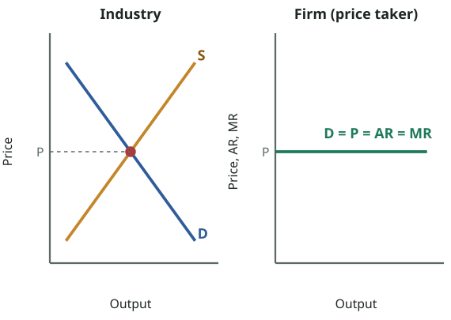
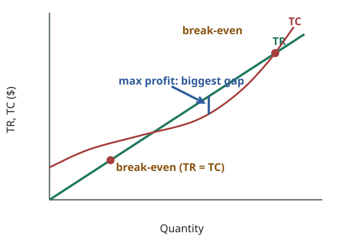
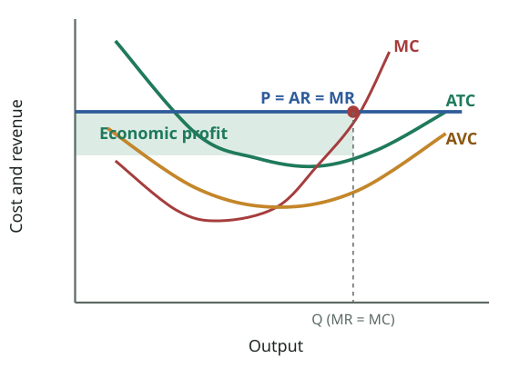
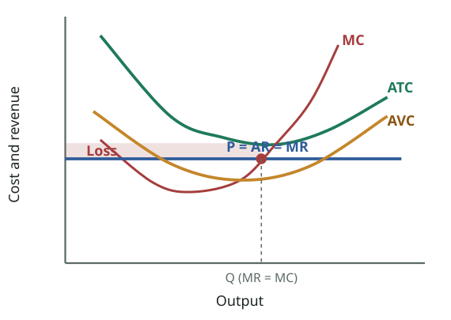
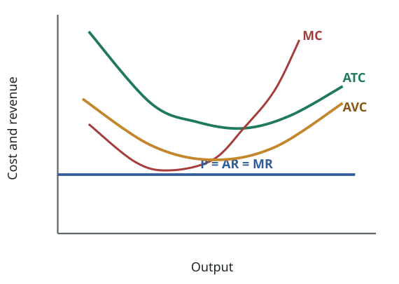
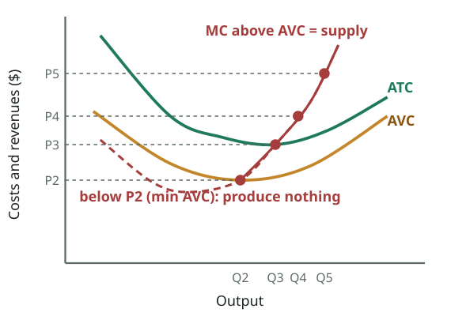
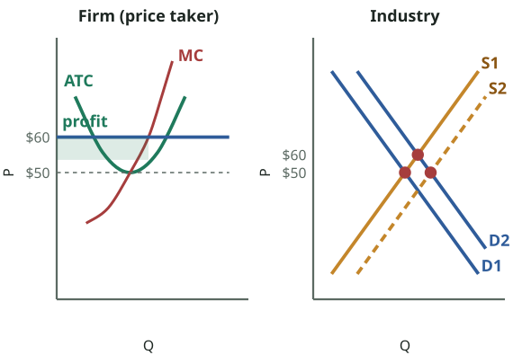
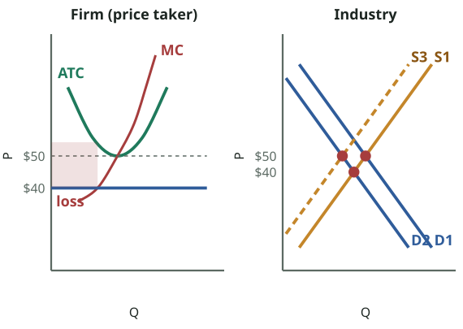
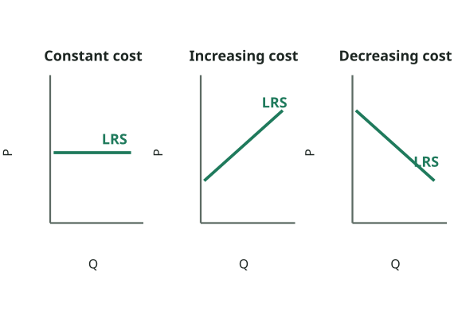

# FPEC 101 · Module 8 — Pure (Perfect) Competition
## মডিউল ৮ — পূর্ণ প্রতিযোগিতা

_Lecture 8 · 30 slides · Midterm questions: Q15_

> Printable study note generated from the website. Each slide: slide text → Bangla translation → tutor explanation → example → exam tip.

---

## Big picture — what is this lecture about? · বড় ছবি — এই লেকচারে কী শিখব?

_Slide 11: the industry's demand and supply set the price P. Each firm must accept P, so the firm's demand curve is a horizontal line: perfectly elastic, with P = AR = MR._  
_স্লাইড ১১: শিল্পের চাহিদা ও যোগান দাম P ঠিক করে। প্রতিটি ফার্মকে P মেনে নিতে হয়, তাই ফার্মের চাহিদা রেখা আনুভূমিক: পূর্ণ স্থিতিস্থাপক, P = AR = MR।_

### English

**Concept:** You now know a firm's **costs** (Lectures 6–7). Its **revenue**, and therefore its price and output decisions, depend on how much **competition** it faces. That is the idea of **market structure**. There are four:

**Perfect (pure) competition → monopolistic competition → oligopoly → pure monopoly**, from the most competitive to the least.

Lecture 8 introduces all four briefly, then studies the first in depth: **perfect competition**, where thousands of small firms sell an identical product and **nobody can influence the price**. It is the benchmark against which every other market is judged.

### What you will learn (5 jobs)
1. What a **market structure** is and the **four types** (slides 5–7).
2. **Perfect competition**: definition and **six features**; why each firm is a **price taker** with a horizontal demand curve (P = AR = MR) (slides 8–11).
3. **Short-run profit maximisation**: the TR–TC approach and the **MR = MC** rule; **profit, loss and shutdown** cases (slides 12–18).
4. Why the **MC curve above AVC is the firm's short-run supply curve** (slides 19–23).
5. **Long run**: free entry and exit push profit to **normal profit**; constant, increasing and decreasing-cost industries (slides 24–29). All of this is midterm **Q15** (the first of four market structures).

### The 3-minute version
- **Features:** many buyers and sellers, identical product, price taker, free entry and exit, perfect knowledge, perfect mobility of resources.
- The firm's demand is **perfectly elastic**: **P = AR = MR**.
- **Profit is maximised where MR = MC** (= P = MC), if P ≥ AVC.
- **Short run:** P > ATC → supernormal profit; AVC < P < ATC → loss but keep producing; P < AVC → **shut down**.
- **Short-run supply** = MC above minimum AVC.
- **Long run:** profits attract **entry** (supply ↑, price ↓); losses cause **exit** (supply ↓, price ↑) → each firm earns only **normal profit** at **P = minimum ATC = MC**.

### বাংলা

**ধারণা:** তুমি এখন ফার্মের **ব্যয়** জানো (লেকচার ৬–৭)। এর **আয়**, তাই দাম ও উৎপাদনের সিদ্ধান্ত, নির্ভর করে সে কতটা **প্রতিযোগিতার** মুখোমুখি তার ওপর। এটাই **বাজার কাঠামোর** ধারণা। চারটি:

**পূর্ণ (বিশুদ্ধ) প্রতিযোগিতা → একচেটিয়া প্রতিযোগিতা → অলিগোপলি → বিশুদ্ধ একচেটিয়া**, সবচেয়ে বেশি থেকে সবচেয়ে কম প্রতিযোগিতা।

লেকচার ৮ চারটির সংক্ষিপ্ত পরিচয় দেয়, তারপর প্রথমটি গভীরভাবে পড়ে: **পূর্ণ প্রতিযোগিতা**, যেখানে হাজারো ছোট ফার্ম একই রকম পণ্য বেচে এবং **কেউ দামকে প্রভাবিত করতে পারে না**। অন্য সব বাজারকে এর সাথেই তুলনা করে বিচার করা হয়।

### তুমি কী শিখবে (৫টি কাজ)
1. **বাজার কাঠামো** কী এবং **চারটি প্রকার** (স্লাইড ৫–৭)।
2. **পূর্ণ প্রতিযোগিতা**: সংজ্ঞা ও **ছয়টি বৈশিষ্ট্য**; কেন প্রতিটি ফার্ম **দাম গ্রহণকারী** এবং তার চাহিদা রেখা আনুভূমিক (P = AR = MR) (স্লাইড ৮–১১)।
3. **স্বল্পমেয়াদে মুনাফা সর্বোচ্চকরণ**: TR–TC পদ্ধতি ও **MR = MC** নিয়ম; **মুনাফা, লোকসান ও বন্ধের** ক্ষেত্র (স্লাইড ১২–১৮)।
4. কেন **AVC-র ওপরের MC রেখাই ফার্মের স্বল্পমেয়াদি যোগান রেখা** (স্লাইড ১৯–২৩)।
5. **দীর্ঘমেয়াদ**: অবাধ প্রবেশ-প্রস্থান মুনাফাকে **স্বাভাবিক মুনাফায়** নামায়; স্থির, ক্রমবর্ধমান ও ক্রমহ্রাসমান ব্যয়ের শিল্প (স্লাইড ২৪–২৯)। পুরোটাই মিডটার্ম **Q15** (চারটি বাজার কাঠামোর প্রথমটি)।

### ৩ মিনিটের সারকথা
- **বৈশিষ্ট্য:** অসংখ্য ক্রেতা-বিক্রেতা, একই রকম পণ্য, দাম গ্রহণকারী, অবাধ প্রবেশ-প্রস্থান, পূর্ণ জ্ঞান, সম্পদের পূর্ণ গতিশীলতা।
- ফার্মের চাহিদা **পূর্ণ স্থিতিস্থাপক**: **P = AR = MR**।
- **মুনাফা সর্বোচ্চ যেখানে MR = MC** (= P = MC), যদি P ≥ AVC।
- **স্বল্পমেয়াদ:** P > ATC → অতিস্বাভাবিক মুনাফা; AVC < P < ATC → লোকসান কিন্তু উৎপাদন চলে; P < AVC → **বন্ধ**।
- **স্বল্পমেয়াদি যোগান** = সর্বনিম্ন AVC-র ওপরের MC।
- **দীর্ঘমেয়াদ:** মুনাফা **প্রবেশ** টানে (যোগান ↑, দাম ↓); লোকসানে **প্রস্থান** (যোগান ↓, দাম ↑) → প্রতিটি ফার্ম শুধু **স্বাভাবিক মুনাফা** পায়, **P = সর্বনিম্ন ATC = MC**-তে।

---

## Key words · মূল শব্দ

| Term | Meaning | বাংলা অর্থ | Example |
|---|---|---|---|
| Market structure | How a market is organised: how much competition, control over price, ease of entry | বাজার কাঠামো — বাজার কীভাবে সংগঠিত: প্রতিযোগিতা, দামের নিয়ন্ত্রণ, প্রবেশের সহজতা | Rice farming vs electricity supply. |
| Perfect (pure) competition | Very many firms, identical product, free entry/exit, price takers | পূর্ণ (বিশুদ্ধ) প্রতিযোগিতা — অসংখ্য ফার্ম, একই পণ্য, অবাধ প্রবেশ-প্রস্থান, দাম গ্রহণকারী | Wheat, rice, vegetables in a big bazaar. |
| Price taker | A firm that must accept the market price | দাম গ্রহণকারী — বাজারদর মেনে নিতে বাধ্য ফার্ম | One potato farmer cannot charge more than the bazaar price. |
| Standardised (homogeneous) product | Every firm's product is identical | প্রমিত (সমজাতীয়) পণ্য — সব ফার্মের পণ্য হুবহু এক | One kg of a rice variety from any farmer. |
| Barriers to entry | Obstacles that stop new firms entering | প্রবেশে বাধা — নতুন ফার্মকে আসতে বাধা দেয় এমন জিনিস | Licences, huge capital, patents. |
| Average revenue (AR) | TR ÷ Q = price | গড় আয় — TR ÷ Q = দাম | Tk 500 ÷ 100 units = Tk 5. |
| Marginal revenue (MR) | Extra revenue from one more unit: ΔTR ÷ ΔQ | প্রান্তিক আয় — আরেকটি এককের বাড়তি আয় | Selling the 6th unit adds Tk 5. |
| Break-even point | TR = TC (or P = ATC): only normal profit | সমতা বিন্দু — TR = TC: শুধু স্বাভাবিক মুনাফা | No economic profit, no loss. |
| Supernormal (economic) profit | Profit above normal profit: P > ATC | অতিস্বাভাবিক (অর্থনৈতিক) মুনাফা — P > ATC | A new trendy product's first months. |
| Shutdown point | Price equal to minimum AVC; below it the firm stops producing | বন্ধের বিন্দু — দাম = সর্বনিম্ন AVC; এর নিচে উৎপাদন বন্ধ | A brick kiln closing in the rainy season. |
| Constant / increasing / decreasing-cost industry | Whether input prices stay the same, rise or fall as the industry expands | স্থির / ক্রমবর্ধমান / ক্রমহ্রাসমান ব্যয়ের শিল্প | Garments in Bangladesh (decreasing: suppliers cluster). |

---

## Slides 1–4 · Title, topic and outline
### শিরোনাম, বিষয় ও রূপরেখা

> **Slide 1**
> PRINCIPLES OF ECONOMICSSalimah Musharrif
> FPEC 101 – LECTURE 8 Unit 2
>
> **Slide 2**
> PRINCIPLES OF ECONOMICSProduction Costs and Market Structures
> FPEC 101 – LECTURE 8 Unit 2
>
> **Slide 3**
> Market Structures- Perfect Competition
>
> **Slide 4**
> Outline
> Market Structures
> Perfect Competition
>

**বাংলা অনুবাদ:**

> **স্লাইড ১–২:** প্রিন্সিপলস অব ইকোনমিক্স — সালিমাহ মুশাররিফ। উৎপাদন ব্যয় ও বাজার কাঠামো। FPEC 101 – লেকচার ৮, ইউনিট ২।
> **স্লাইড ৩:** বাজার কাঠামো — পূর্ণ প্রতিযোগিতা
> **স্লাইড ৪ — রূপরেখা:** বাজার কাঠামো · পূর্ণ প্রতিযোগিতা

**Tutor explains:** Lectures 8–11 are a series on **market structures**, and together they answer midterm **Q15** ("analyse the various market structures with features, short and long run equilibriums, barriers, etc. in detail"). Lecture 8 = perfect competition; 9–10 = monopoly; 10 = monopolistic competition; 11 = oligopoly. Syllabus reading: McConnell & Brue pp. 400–416.

**টিউটরের ব্যাখ্যা:** লেকচার ৮–১১ **বাজার কাঠামো** নিয়ে একটি ধারাবাহিক, যা মিলে মিডটার্ম **Q15**-এর উত্তর ("বিভিন্ন বাজার কাঠামো বৈশিষ্ট্য, স্বল্প ও দীর্ঘমেয়াদি ভারসাম্য, প্রবেশে বাধা ইত্যাদিসহ বিস্তারিত বিশ্লেষণ করো")। লেকচার ৮ = পূর্ণ প্রতিযোগিতা; ৯–১০ = একচেটিয়া; ১০ = একচেটিয়া প্রতিযোগিতা; ১১ = অলিগোপলি। সিলেবাসের পড়া: ম্যাককনেল ও ব্রু পৃ. ৪০০–৪১৬।

---

## Slide 5 · What is a market structure?
### বাজার কাঠামো কী?

> Market Structures
> A market structure describes how the market is organized in terms of how much competition there is, usually on the supply side.
> The amount of competition in a market may be examined by the following:
> The amount of control the firm or a group of firms has over the market supply or output
> The influence a firm or a group of firms has over the market price
> The freedom new suppliers have to enter a market
> Barriers to entry that restrict competition
>

**বাংলা অনুবাদ:**

> বাজার কাঠামো
> বাজার কাঠামো বর্ণনা করে বাজারটি কতটা প্রতিযোগিতার ভিত্তিতে সংগঠিত, সাধারণত যোগানের দিকে।
> বাজারে প্রতিযোগিতার পরিমাণ নিচের বিষয়গুলো দিয়ে পরীক্ষা করা যায়:
> বাজারের যোগান বা উৎপাদনের ওপর ফার্ম বা ফার্মগোষ্ঠীর নিয়ন্ত্রণের পরিমাণ
> বাজারদরের ওপর ফার্ম বা ফার্মগোষ্ঠীর প্রভাব
> নতুন সরবরাহকারীর বাজারে প্রবেশের স্বাধীনতা
> প্রতিযোগিতা সীমিত করে এমন প্রবেশে বাধা

**Tutor explains:** A **market structure** describes how a market is organised in terms of **how much competition** there is among sellers. Four questions tell you which structure a market is:
**Control over supply:** do one or a few firms control most of the output?**Influence over price:** can a firm set its own price, or must it accept the market price?**Freedom of entry:** can new firms start selling easily?**Barriers to entry:** are there obstacles (licences, huge capital, patents) that keep newcomers out?

**টিউটরের ব্যাখ্যা:** **বাজার কাঠামো** বর্ণনা করে বিক্রেতাদের মধ্যে **কতটা প্রতিযোগিতা** আছে সেই হিসেবে বাজার কীভাবে সংগঠিত। চারটি প্রশ্ন বলে দেয় বাজারটি কোন কাঠামোর:
**যোগানের নিয়ন্ত্রণ:** এক বা কয়েকটি ফার্ম কি বেশিরভাগ উৎপাদন নিয়ন্ত্রণ করে?**দামের ওপর প্রভাব:** ফার্ম কি নিজের দাম ঠিক করতে পারে, নাকি বাজারদর মানতে হয়?**প্রবেশের স্বাধীনতা:** নতুন ফার্ম কি সহজে বিক্রি শুরু করতে পারে?**প্রবেশে বাধা:** নতুনদের ঠেকানোর মতো বাধা (লাইসেন্স, বিপুল মূলধন, পেটেন্ট) আছে কি?

**Real-life example:** **Vegetables in Karwan Bazar:** hundreds of sellers, nobody controls price, anyone can start → very competitive. **Electricity distribution in Dhaka:** one licensed company per area, price set by the regulator, entry blocked → monopoly.

**বাস্তব উদাহরণ:** **কারওয়ান বাজারের সবজি:** শত শত বিক্রেতা, কেউ দাম নিয়ন্ত্রণ করে না, যে কেউ শুরু করতে পারে → খুব প্রতিযোগিতামূলক। **ঢাকায় বিদ্যুৎ বিতরণ:** প্রতিটি এলাকায় একটি লাইসেন্সপ্রাপ্ত কোম্পানি, দাম ঠিক করে নিয়ন্ত্রক, প্রবেশ বন্ধ → একচেটিয়া।

---

## Slide 6 · Pure competition and pure monopoly
### বিশুদ্ধ প্রতিযোগিতা ও বিশুদ্ধ একচেটিয়া

> Market Structures
> Pure competition involves a very large number of firms producing a standardized product (that is, a product identical to that of other producers, such as corn or cucumbers). New firms can enter or exit the industry very easily.
> Pure monopoly is a market structure in which one firm is the sole seller of a product or service (for example, a local electric utility). Since the entry of additional firms is blocked, one firm constitutes the entire industry. Because the monopolist produces a unique product, it makes no effort to differentiate its product.
>

**বাংলা অনুবাদ:**

> বাজার কাঠামো
> **বিশুদ্ধ প্রতিযোগিতায়** খুব বেশি সংখ্যক ফার্ম একটি প্রমিত পণ্য (অর্থাৎ অন্য উৎপাদকের পণ্যের হুবহু এক, যেমন ভুট্টা বা শসা) উৎপাদন করে। নতুন ফার্ম খুব সহজে শিল্পে ঢুকতে বা বেরোতে পারে।
> **বিশুদ্ধ একচেটিয়া** এমন বাজার কাঠামো যেখানে একটি ফার্ম কোনো পণ্য বা সেবার একমাত্র বিক্রেতা (যেমন স্থানীয় বিদ্যুৎ কোম্পানি)। অন্য ফার্মের প্রবেশ বন্ধ বলে একটি ফার্মই পুরো শিল্প। একচেটিয়া ফার্ম অনন্য পণ্য উৎপাদন করে বলে পণ্য পৃথকীকরণের কোনো চেষ্টা করে না।

**Tutor explains:** The two **extremes**:
**Pure (perfect) competition:** a **very large number** of firms, a **standardised** product (corn, cucumbers: one farmer's is the same as another's), and **very easy entry and exit**.**Pure monopoly:** **one firm** is the **only seller** (e.g. a local electricity company). Entry by others is **blocked**, so the firm **is** the industry. Its product is **unique** (no close substitutes), so it does not need to differentiate it.

**টিউটরের ব্যাখ্যা:** দুই **প্রান্ত**:
**বিশুদ্ধ (পূর্ণ) প্রতিযোগিতা:** **অসংখ্য** ফার্ম, **প্রমিত** পণ্য (ভুট্টা, শসা: এক কৃষকেরটা আরেকজনেরটার মতোই), আর **খুব সহজ প্রবেশ-প্রস্থান**।**বিশুদ্ধ একচেটিয়া:** **একটি ফার্ম** **একমাত্র বিক্রেতা** (যেমন স্থানীয় বিদ্যুৎ কোম্পানি)। অন্যদের প্রবেশ **বন্ধ**, তাই ফার্মটিই **শিল্প**। এর পণ্য **অনন্য** (কাছাকাছি বিকল্প নেই), তাই পৃথক করার দরকার পড়ে না।

---

## Slide 7 · Monopolistic competition and oligopoly
### একচেটিয়া প্রতিযোগিতা ও অলিগোপলি

> Market Structures
> Monopolistic competition is characterized by a relatively large number of sellers producing differentiated products (clothing, furniture, books). There is widespread nonprice competition, a selling strategy in which one firm tries to distinguish its product or service from all competing products on the basis of attributes like design and workmanship (an approach called product differentiation). Either entry to or exit from monopolistically competitive industries is quite easy.
> Oligopoly involves only a few sellers of a standardized or differentiated product; so each firm is affected by the decisions of its rivals and must take those decisions into account in determining its own price and output.
>

**বাংলা অনুবাদ:**

> বাজার কাঠামো
> **একচেটিয়া প্রতিযোগিতার** বৈশিষ্ট্য তুলনামূলক বেশি সংখ্যক বিক্রেতা, যারা পৃথকীকৃত পণ্য উৎপাদন করে (কাপড়, আসবাব, বই)। ব্যাপক অ-দাম প্রতিযোগিতা থাকে — একটি বিক্রয় কৌশল যেখানে ফার্ম নকশা ও কারিগরির মতো বৈশিষ্ট্যের ভিত্তিতে তার পণ্য বা সেবাকে প্রতিযোগীদের থেকে আলাদা করার চেষ্টা করে (একে পণ্য পৃথকীকরণ বলে)। একচেটিয়া প্রতিযোগিতার শিল্পে প্রবেশ ও প্রস্থান বেশ সহজ।
> **অলিগোপলিতে** থাকে মাত্র কয়েকজন বিক্রেতা, প্রমিত বা পৃথকীকৃত পণ্যের; তাই প্রতিটি ফার্ম প্রতিদ্বন্দ্বীদের সিদ্ধান্তে প্রভাবিত হয় এবং নিজের দাম ও উৎপাদন ঠিক করতে সেই সিদ্ধান্তগুলো বিবেচনা করতে হয়।

**Tutor explains:** The two structures **in between**:
**Monopolistic competition:** **many** sellers of **differentiated** products (clothing, furniture, books). Firms compete by **non-price competition**: design, quality, brand, service (**product differentiation**). Entry and exit are **fairly easy**.**Oligopoly:** **a few** sellers of standardised **or** differentiated products. Because there are so few, each firm's decisions **affect its rivals**, so each must **consider rivals' reactions** when setting price and output (**mutual interdependence**).

**টিউটরের ব্যাখ্যা:** মাঝখানের দুটি কাঠামো:
**একচেটিয়া প্রতিযোগিতা:** **অনেক** বিক্রেতা, **পৃথকীকৃত** পণ্য (কাপড়, আসবাব, বই)। ফার্মগুলো **অ-দাম প্রতিযোগিতা** করে: নকশা, মান, ব্র্যান্ড, সেবা (**পণ্য পৃথকীকরণ**)। প্রবেশ-প্রস্থান **বেশ সহজ**।**অলিগোপলি:** **কয়েকজন** বিক্রেতা, প্রমিত **বা** পৃথকীকৃত পণ্য। খুব কম বলে প্রতিটি ফার্মের সিদ্ধান্ত **প্রতিদ্বন্দ্বীকে প্রভাবিত করে**, তাই দাম ও উৎপাদন ঠিক করতে **প্রতিদ্বন্দ্বীর প্রতিক্রিয়া বিবেচনা** করতে হয় (**পারস্পরিক নির্ভরশীলতা**)।

**Real-life example:** **Monopolistic competition:** restaurants and clothing boutiques in Dhanmondi; each is a little different. **Oligopoly:** mobile operators (Grameenphone, Robi, Banglalink, Teletalk); when one cuts data prices, the others react within days.

**বাস্তব উদাহরণ:** **একচেটিয়া প্রতিযোগিতা:** ধানমন্ডির রেস্তোরাঁ ও কাপড়ের বুটিক; প্রত্যেকটি একটু আলাদা। **অলিগোপলি:** মোবাইল অপারেটর (গ্রামীণফোন, রবি, বাংলালিংক, টেলিটক); একজন ডেটার দাম কমালে বাকিরা কয়েক দিনের মধ্যে সাড়া দেয়।

**Exam tip:** Open Q15 with a one-table overview of all four structures (see "Put it together"), then go into each one in detail.

**পরীক্ষার টিপস:** Q15 শুরু করো চারটি কাঠামোর এক-ছকের সংক্ষিপ্তসার দিয়ে ("সব একসাথে" দেখো), তারপর প্রতিটির বিস্তারিত।

---

## Slide 8 · Perfect competition: definition
### পূর্ণ প্রতিযোগিতা: সংজ্ঞা

> Perfect Competition
> Perfect competition is defined as “a market structure in which the decisions of buyers and sellers have no effect on the market price”. There are a large number of buyers and sellers producing standardized products.
> Under the structure firms are encouraged to make the best possible use of resources and in order to make profit, to give consumers the best value for money.
>

**বাংলা অনুবাদ:**

> পূর্ণ প্রতিযোগিতা
> পূর্ণ প্রতিযোগিতার সংজ্ঞা: "এমন একটি বাজার কাঠামো যেখানে ক্রেতা ও বিক্রেতার সিদ্ধান্ত বাজারদরে কোনো প্রভাব ফেলে না"। এখানে অসংখ্য ক্রেতা ও বিক্রেতা প্রমিত পণ্য উৎপাদন করে।
> এই কাঠামোয় ফার্মগুলো সম্পদের সর্বোত্তম ব্যবহার করতে এবং মুনাফা করতে ভোক্তাকে টাকার সর্বোচ্চ মূল্য দিতে উৎসাহিত হয়।

**Tutor explains:** **Definition:** perfect competition is **"a market structure in which the decisions of buyers and sellers have no effect on the market price"**, with a **large number** of buyers and sellers of **standardised** products.
Why economists like it: competition forces firms to **use resources efficiently** (or be driven out) and to give consumers the **best value for money**.

**টিউটরের ব্যাখ্যা:** **সংজ্ঞা:** পূর্ণ প্রতিযোগিতা হলো **"এমন একটি বাজার কাঠামো যেখানে ক্রেতা ও বিক্রেতার সিদ্ধান্ত বাজারদরে কোনো প্রভাব ফেলে না"**, যেখানে **প্রমিত** পণ্যের **অসংখ্য** ক্রেতা ও বিক্রেতা।
অর্থনীতিবিদরা কেন পছন্দ করেন: প্রতিযোগিতা ফার্মকে **সম্পদের দক্ষ ব্যবহারে** বাধ্য করে (নইলে ছিটকে পড়ে) এবং ভোক্তাকে **টাকার সর্বোচ্চ মূল্য** দেয়।

**Exam tip:** Q15 definition line: write the slide's quoted definition word for word.

**পরীক্ষার টিপস:** Q15-এর সংজ্ঞার লাইন: স্লাইডের উদ্ধৃত সংজ্ঞাটি হুবহু লেখো।

---

## Slide 9 · Features of perfect competition
### পূর্ণ প্রতিযোগিতার বৈশিষ্ট্য

> Perfect Competition - Features
> All firms produce the same standardized product, so no buyer has any preference for any product)
> The firm is a price taker (No buyer or seller can influence the price. They have to accept the price given by the industry and so are price takers)
> There’s free mobility of all resources (there’s no restriction on the movement of factors of production and production can be easy increased)
> There’s free entry and exit of all firms (no barriers to firms joining in to produce a product the other firms are receiving a profit in, or to leave if they face a loss)
> There is perfect knowledge about prices [All buyers know everything about the prices and products on sale while all sellers know everything about the latest production techniques and other competitors)
> There are no barriers to the movement of buyers from one seller to another
> An example of perfect competition, though not perfect, is wheat production. There is perfect knowledge among producers but none of them can affect the price.
>

**বাংলা অনুবাদ:**

> পূর্ণ প্রতিযোগিতা — বৈশিষ্ট্য
> সব ফার্ম একই প্রমিত পণ্য উৎপাদন করে, তাই কোনো ক্রেতার কোনো পণ্যের প্রতি পছন্দ নেই।
> ফার্ম দাম গ্রহণকারী (কোনো ক্রেতা বা বিক্রেতা দামকে প্রভাবিত করতে পারে না। শিল্পের দেওয়া দাম মেনে নিতে হয়, তাই তারা দাম গ্রহণকারী)।
> সব সম্পদের অবাধ গতিশীলতা আছে (উৎপাদনের উপাদানের চলাচলে কোনো বাধা নেই, উৎপাদন সহজে বাড়ানো যায়)।
> সব ফার্মের অবাধ প্রবেশ ও প্রস্থান (অন্য ফার্ম মুনাফা করছে এমন পণ্য উৎপাদনে যোগ দিতে, বা লোকসানে বেরিয়ে যেতে কোনো বাধা নেই)।
> দাম সম্পর্কে পূর্ণ জ্ঞান আছে (সব ক্রেতা বিক্রির পণ্য ও দাম সম্পর্কে সব জানে, আর সব বিক্রেতা সর্বশেষ উৎপাদন কৌশল ও প্রতিযোগীদের সম্পর্কে সব জানে)।
> ক্রেতার এক বিক্রেতা থেকে আরেক বিক্রেতার কাছে যাওয়ায় কোনো বাধা নেই।
> পূর্ণ প্রতিযোগিতার একটি উদাহরণ, যদিও নিখুঁত নয়, হলো গম উৎপাদন। উৎপাদকদের মধ্যে পূর্ণ জ্ঞান আছে কিন্তু কেউ দামকে প্রভাবিত করতে পারে না।

**Tutor explains:** Six features (learn them as a list for Q15):
**Standardised (identical) product:** buyers have no preference for any seller.**Price taker:** no single buyer or seller can influence the price; all accept the industry price.**Free mobility of resources:** factors of production move freely, so output can be increased easily.**Free entry and exit:** no barriers; firms join when others profit and leave when they make losses.**Perfect knowledge:** buyers know all prices and products; sellers know all techniques and rivals.**No barriers to buyers switching** from one seller to another.
**Example:** **wheat** farming (not perfect, but close): producers know the market well, yet none can affect the price.
**Why "price taker"?** Each farmer is a tiny drop in a huge market. If one farmer asks Tk 1 more per kg, buyers go next door; if she asks Tk 1 less, she gives money away for nothing, because she can sell all she has at the market price anyway.

**টিউটরের ব্যাখ্যা:** ছয়টি বৈশিষ্ট্য (Q15-এর জন্য তালিকা হিসেবে শেখো):
**প্রমিত (একই রকম) পণ্য:** কোনো বিক্রেতার প্রতি ক্রেতার পছন্দ নেই।**দাম গ্রহণকারী:** কোনো একক ক্রেতা বা বিক্রেতা দাম প্রভাবিত করতে পারে না; সবাই শিল্পের দাম মানে।**সম্পদের অবাধ গতিশীলতা:** উৎপাদনের উপাদান অবাধে চলে, তাই উৎপাদন সহজে বাড়ানো যায়।**অবাধ প্রবেশ-প্রস্থান:** কোনো বাধা নেই; অন্যরা মুনাফা করলে ফার্ম আসে, লোকসানে চলে যায়।**পূর্ণ জ্ঞান:** ক্রেতা সব দাম ও পণ্য জানে; বিক্রেতা সব কৌশল ও প্রতিদ্বন্দ্বী জানে।**ক্রেতার বিক্রেতা বদলাতে কোনো বাধা নেই।**
**উদাহরণ:** **গম** চাষ (নিখুঁত নয়, তবে কাছাকাছি): উৎপাদকেরা বাজার ভালো জানে, তবু কেউ দাম প্রভাবিত করতে পারে না।
**কেন "দাম গ্রহণকারী"?** প্রত্যেক কৃষক বিশাল বাজারে একটি ছোট্ট ফোঁটা। একজন কেজিতে ১ টাকা বেশি চাইলে ক্রেতা পাশের জনের কাছে যায়; ১ টাকা কম চাইলে শুধু শুধু টাকা ছেড়ে দেয়, কারণ বাজারদরেই সব বিক্রি করতে পারে।

**Real-life example:** **Close to perfect competition in Bangladesh:** paddy farmers selling to the local haat, potato growers in Munshiganj, small vegetable sellers in a big bazaar, and many small poultry farms. Each is tiny, the product is basically the same, and anyone can start.

**বাস্তব উদাহরণ:** **বাংলাদেশে পূর্ণ প্রতিযোগিতার কাছাকাছি:** স্থানীয় হাটে ধান বেচা কৃষক, মুন্সিগঞ্জের আলুচাষি, বড় বাজারের ছোট সবজি বিক্রেতা, আর অসংখ্য ছোট পোলট্রি খামার। প্রত্যেকে ছোট, পণ্য মূলত এক, যে কেউ শুরু করতে পারে।

**Exam tip:** Memory trick for the features: **"SPEED-K"**: Standardised product, Price taker, Entry/Exit free, Every resource mobile, Demand perfectly elastic, Knowledge perfect.

**পরীক্ষার টিপস:** বৈশিষ্ট্য মনে রাখার কৌশল: **"SPEED-K"**: প্রমিত পণ্য, দাম গ্রহণকারী, অবাধ প্রবেশ/প্রস্থান, সব সম্পদ গতিশীল, চাহিদা পূর্ণ স্থিতিস্থাপক, পূর্ণ জ্ঞান।

---

## Slide 10 · The firm's demand is perfectly elastic
### ফার্মের চাহিদা পূর্ণ স্থিতিস্থাপক

_Slide 11: the industry's demand and supply set the price P. Each firm must accept P, so the firm's demand curve is a horizontal line: perfectly elastic, with P = AR = MR._  
_স্লাইড ১১: শিল্পের চাহিদা ও যোগান দাম P ঠিক করে। প্রতিটি ফার্মকে P মেনে নিতে হয়, তাই ফার্মের চাহিদা রেখা আনুভূমিক: পূর্ণ স্থিতিস্থাপক, P = AR = MR।_

> Perfect Competition
> The demand schedule faced by the individual firm in a purely competitive industry is perfectly elastic at the market.
> Market demand graphs as a downward sloping curve. An entire industry (all firms producing a particular product) can affect price by changing industry output. For example, all firms, acting independently but simultaneously, can increase price by reducing output.
> But the individual competitive firm cannot do that
>

**বাংলা অনুবাদ:**

> পূর্ণ প্রতিযোগিতা
> বিশুদ্ধ প্রতিযোগিতামূলক শিল্পে একক ফার্মের চাহিদা সূচি বাজারদরে পূর্ণ স্থিতিস্থাপক।
> বাজার চাহিদার গ্রাফ নিম্নমুখী রেখা। পুরো শিল্প (একটি পণ্য উৎপাদনকারী সব ফার্ম) শিল্পের উৎপাদন বদলে দামকে প্রভাবিত করতে পারে। যেমন, সব ফার্ম স্বাধীনভাবে কিন্তু একসাথে উৎপাদন কমিয়ে দাম বাড়াতে পারে।
> কিন্তু একক প্রতিযোগী ফার্ম তা পারে না।

**Tutor explains:** Two demand curves, one market:
**Market (industry) demand** slopes **down** as usual. If **all** farmers together grow less rice, the price rises.**The individual firm's demand** is **perfectly elastic** (horizontal) at the market price. One small firm can sell **as much as it wants** at that price, but **nothing** above it.
This is Lecture 4's "perfectly elastic demand" (E = ∞) in real life.

**টিউটরের ব্যাখ্যা:** একটি বাজার, দুটি চাহিদা রেখা:
**বাজার (শিল্প) চাহিদা** স্বাভাবিকভাবেই **নিচে নামে**। **সব** কৃষক মিলে কম ধান করলে দাম বাড়ে।**একক ফার্মের চাহিদা** বাজারদরে **পূর্ণ স্থিতিস্থাপক** (আনুভূমিক)। একটি ছোট ফার্ম ওই দামে **যত খুশি** বেচতে পারে, কিন্তু তার ওপরে **কিছুই** না।
এটাই বাস্তবে লেকচার ৪-এর "পূর্ণ স্থিতিস্থাপক চাহিদা" (E = ∞)।

---

## Slide 11 · Revenue table: P = AR = MR
### আয়ের ছক: P = AR = MR

> Perfect Competition
> Price 5 at every quantity; Quantity Demanded 1–5; Total Revenue 5, 10, 15, 20, 25; Average Revenue 5 each; Marginal Revenue –, 5, 5, 5, 5
> [Diagrams: Industry D and S crossing at P; Firm — a horizontal line P = AR = MR; TR — a straight line from the origin]
>

**বাংলা অনুবাদ:**

> পূর্ণ প্রতিযোগিতা
> প্রতিটি পরিমাণে দাম ৫; চাহিদার পরিমাণ ১–৫; মোট আয় ৫, ১০, ১৫, ২০, ২৫; গড় আয় প্রতিটি ৫; প্রান্তিক আয় –, ৫, ৫, ৫, ৫
> [চিত্র: শিল্পের D ও S, P-তে ছেদ; ফার্ম — আনুভূমিক রেখা P = AR = MR; TR — মূলবিন্দু থেকে সরলরেখা]

**Tutor explains:** The table shows **why P = AR = MR** for a perfectly competitive firm:
PQTR = P × QAR = TR ÷ QMR = ΔTR
5155—521055
531555542055552555
The price never changes (price taker), so **each extra unit adds exactly the price** to revenue: **MR = P**.**AR = TR ÷ Q = P** always.So the firm's demand curve = AR curve = MR curve = **one horizontal line at P**.**TR** rises by the same amount (5) each time → a **straight line from the origin**.

**টিউটরের ব্যাখ্যা:** ছকটা দেখায় পূর্ণ প্রতিযোগী ফার্মের জন্য **কেন P = AR = MR**:
PQTR = P × QAR = TR ÷ QMR = ΔTR
৫১৫৫—৫২১০৫৫
৫৩১৫৫৫৫৪২০৫৫৫৫২৫৫৫
দাম কখনো বদলায় না (দাম গ্রহণকারী), তাই **প্রতিটি বাড়তি একক আয়ে ঠিক দামের সমান যোগ করে**: **MR = P**।**AR = TR ÷ Q = P** সবসময়।তাই ফার্মের চাহিদা রেখা = AR রেখা = MR রেখা = **P-তে একটি আনুভূমিক রেখা**।**TR** প্রতিবার একই পরিমাণ (৫) বাড়ে → **মূলবিন্দু থেকে সরলরেখা**।

**Exam tip:** Always label the firm's horizontal line **"D = P = AR = MR"** in Q15 diagrams.

**পরীক্ষার টিপস:** Q15-এর চিত্রে ফার্মের আনুভূমিক রেখার নাম সবসময় **"D = P = AR = MR"** লেখো।

---

## Quick check · দ্রুত যাচাই

1. A perfectly competitive firm's demand curve is…  
   পূর্ণ প্রতিযোগী ফার্মের চাহিদা রেখা…

   - A) Downward sloping · নিম্নমুখী
   - B) Vertical · খাড়া
   - C) Horizontal (perfectly elastic) · আনুভূমিক (পূর্ণ স্থিতিস্থাপক)
   - D) Upward sloping · ঊর্ধ্বমুখী

   **Answer: C** — It can sell any amount at the market price and nothing above it.  
   বাজারদরে যত খুশি বেচতে পারে, তার ওপরে কিছুই না।

2. Which is NOT a feature of perfect competition?  
   কোনটি পূর্ণ প্রতিযোগিতার বৈশিষ্ট্য নয়?

   - A) Identical product · একই রকম পণ্য
   - B) Free entry and exit · অবাধ প্রবেশ-প্রস্থান
   - C) Strong brand loyalty · শক্ত ব্র্যান্ড আনুগত্য
   - D) Perfect knowledge · পূর্ণ জ্ঞান

   **Answer: C** — With identical products buyers have no preference, so there is no brand loyalty.  
   পণ্য একই বলে ক্রেতার কোনো পছন্দ নেই, তাই ব্র্যান্ড আনুগত্য নেই।

---

## Slide 12 · Short-run profit maximisation: two approaches
### স্বল্পমেয়াদে মুনাফা সর্বোচ্চকরণ: দুই পদ্ধতি

> Profit Maximization in the Short Run
> A purely competitive firm can maximize its profit (minimize its loss) only by adjusting output
> Two Approaches:
> total revenue-total cost approach
> marginal revenue-marginal cost approach
>

**বাংলা অনুবাদ:**

> স্বল্পমেয়াদে মুনাফা সর্বোচ্চকরণ
> একটি বিশুদ্ধ প্রতিযোগী ফার্ম শুধু উৎপাদন সমন্বয় করেই মুনাফা সর্বোচ্চ (লোকসান সর্বনিম্ন) করতে পারে।
> দুটি পদ্ধতি:
> • মোট আয়–মোট ব্যয় পদ্ধতি
> • প্রান্তিক আয়–প্রান্তিক ব্যয় পদ্ধতি

**Tutor explains:** A price taker **cannot choose its price**. Its only decision is **how much to produce**. Two ways to find the best output:
**TR–TC approach:** compare total revenue and total cost at each output; pick the output with the **biggest gap** (TR − TC).**MR–MC approach:** keep producing as long as the **next unit adds more to revenue than to cost** (MR > MC); stop where **MR = MC**.
Both give the **same answer**; the MR–MC method is the one economists use most.

**টিউটরের ব্যাখ্যা:** দাম গ্রহণকারী **দাম বেছে নিতে পারে না**। তার একমাত্র সিদ্ধান্ত **কত উৎপাদন করবে**। সেরা উৎপাদন খোঁজার দুই উপায়:
**TR–TC পদ্ধতি:** প্রতিটি উৎপাদনে মোট আয় ও মোট ব্যয় তুলনা করো; **সবচেয়ে বড় ফাঁকের** (TR − TC) উৎপাদন বেছে নাও।**MR–MC পদ্ধতি:** যতক্ষণ **পরের একক ব্যয়ের চেয়ে আয়ে বেশি যোগ করে** (MR > MC), উৎপাদন চালাও; **MR = MC**-তে থামো।
দুটোই **একই উত্তর** দেয়; অর্থনীতিবিদরা বেশি ব্যবহার করেন MR–MC পদ্ধতি।

---

## Slide 13 · The TR–TC approach
### TR–TC পদ্ধতি

_TR–TC approach (slide 13): TR is a straight line (constant price). Profit = TR − TC is greatest where the vertical gap between TR (above) and TC (below) is largest. Where the curves meet, TR = TC: break-even (normal profit)._  
_TR–TC পদ্ধতি (স্লাইড ১৩): TR সরলরেখা (দাম স্থির)। মুনাফা = TR − TC সবচেয়ে বেশি যেখানে TR (ওপরে) আর TC (নিচে)-র খাড়া ফাঁক সবচেয়ে বড়। যেখানে রেখা মেলে সেখানে TR = TC: সমতা বিন্দু (স্বাভাবিক মুনাফা)।_

> TR, TC Approach
> Profit = TR – TC
> BE = TR = TC
> TR = P x Q
> TC = Cost x Q
> Maximum profit where vertical distance between TR and TC curves is greatest
> [Graph "Profit Maximization, Pure Competition": TR straight line and TC curve; break-even point (normal profit) where they first meet; maximum economic profit where TR is furthest above TC; second break-even point]
>

**বাংলা অনুবাদ:**

> TR, TC পদ্ধতি
> মুনাফা = TR − TC
> সমতা বিন্দু (BE): TR = TC
> TR = P × Q
> TC = ব্যয় × Q
> যেখানে TR ও TC রেখার খাড়া দূরত্ব সবচেয়ে বেশি, সেখানে সর্বোচ্চ মুনাফা
> [গ্রাফ "মুনাফা সর্বোচ্চকরণ, বিশুদ্ধ প্রতিযোগিতা": TR সরলরেখা ও TC রেখা; প্রথম যেখানে মেলে সেটা সমতা বিন্দু (স্বাভাবিক মুনাফা); TR যেখানে TC-র সবচেয়ে ওপরে সেখানে সর্বোচ্চ অর্থনৈতিক মুনাফা; দ্বিতীয় সমতা বিন্দু]

**Tutor explains:** **TR = P × Q:** a **straight line** (price is constant).**TC:** starts above zero (fixed costs), rises slowly, then fast (diminishing returns).Where **TR = TC** → **break-even point**: zero economic profit = **normal profit** (remember, normal profit is a cost).Between the two break-even points TR is above TC → **economic profit**.**Maximum profit** where the **vertical distance between TR (above) and TC is greatest**. (At that point the slopes are equal: slope of TR = MR, slope of TC = MC. That is why MR = MC gives the same answer.)

**টিউটরের ব্যাখ্যা:** **TR = P × Q:** একটি **সরলরেখা** (দাম স্থির)।**TC:** শূন্যের ওপরে শুরু (স্থির ব্যয়), প্রথমে ধীরে, পরে দ্রুত ওঠে (ক্রমহ্রাসমান প্রতিদান)।যেখানে **TR = TC** → **সমতা বিন্দু**: শূন্য অর্থনৈতিক মুনাফা = **স্বাভাবিক মুনাফা** (মনে রেখো, স্বাভাবিক মুনাফা একটি ব্যয়)।দুই সমতা বিন্দুর মাঝে TR, TC-র ওপরে → **অর্থনৈতিক মুনাফা**।**সর্বোচ্চ মুনাফা** যেখানে **TR (ওপরে) ও TC-র খাড়া দূরত্ব সবচেয়ে বেশি**। (ওই বিন্দুতে ঢাল সমান: TR-এর ঢাল = MR, TC-র ঢাল = MC। তাই MR = MC একই উত্তর দেয়।)

---

## Slide 14 · The MR = MC rule
### MR = MC নিয়ম

> • Short Run Profit Maximization- MC, MR Approach
> A firm shall continue production rather than shutting down as long as MR>MC
> Profit maximization or loss minimization is where MC = MR or Price = MC since P=AR=MR
> If marginal revenue does not equal or exceed average variable cost, the firm will shut down rather than produce the MR =MC output
> The firm will produce so that it gets greatest amount of total profit, not its per-unit profit.
> In the short run, firms may earn supernormal profit or an abnormal profit, which means average revenue is>average total cost.
> In short, profit is maximized, or loss minimized, at the output at which marginal revenue (or price in pure competition) equals marginal cost, provided that price exceeds average variable cost.
>

**বাংলা অনুবাদ:**

> স্বল্পমেয়াদে মুনাফা সর্বোচ্চকরণ — MC, MR পদ্ধতি
> যতক্ষণ MR > MC, ফার্ম বন্ধ না করে উৎপাদন চালিয়ে যাবে।
> মুনাফা সর্বোচ্চ বা লোকসান সর্বনিম্ন হয় যেখানে MC = MR, অর্থাৎ দাম = MC, কারণ P = AR = MR।
> প্রান্তিক আয় গড় পরিবর্তনশীল ব্যয়ের সমান বা বেশি না হলে ফার্ম MR = MC উৎপাদনে না গিয়ে বন্ধ করবে।
> ফার্ম এমনভাবে উৎপাদন করবে যাতে সবচেয়ে বেশি মোট মুনাফা পায়, এককপ্রতি মুনাফা নয়।
> স্বল্পমেয়াদে ফার্ম অতিস্বাভাবিক (supernormal) বা অস্বাভাবিক মুনাফা করতে পারে, অর্থাৎ গড় আয় > গড় মোট ব্যয়।
> সংক্ষেপে, যে উৎপাদনে প্রান্তিক আয় (বা বিশুদ্ধ প্রতিযোগিতায় দাম) প্রান্তিক ব্যয়ের সমান, সেখানে মুনাফা সর্বোচ্চ বা লোকসান সর্বনিম্ন — শর্ত হলো দাম গড় পরিবর্তনশীল ব্যয়ের বেশি।

**Tutor explains:** **The golden rule of every firm:** produce where **MR = MC**.
**MR > MC:** the next unit brings in more than it costs → produce it (profit ↑).**MR < MC:** the next unit costs more than it brings in → don't (profit ↓).**MR = MC:** profit is **maximised** (or loss **minimised**).
In perfect competition **P = AR = MR**, so the rule becomes **P = MC**.
Three important details from the slide: 1. **Condition:** only if **P ≥ AVC**. If price does not even cover average variable cost, **shut down** (slide 18). 2. The firm maximises **total** profit, not profit **per unit**. 3. In the **short run** a firm can earn **supernormal (economic) profit**: AR > ATC.

**টিউটরের ব্যাখ্যা:** **প্রত্যেক ফার্মের সোনালি নিয়ম:** যেখানে **MR = MC**, সেখানে উৎপাদন করো।
**MR > MC:** পরের একক খরচের চেয়ে বেশি আনে → বানাও (মুনাফা ↑)।**MR < MC:** পরের একক যা আনে তার চেয়ে বেশি খরচ → বানিও না (মুনাফা ↓)।**MR = MC:** মুনাফা **সর্বোচ্চ** (বা লোকসান **সর্বনিম্ন**)।
পূর্ণ প্রতিযোগিতায় **P = AR = MR**, তাই নিয়মটা হয় **P = MC**।
স্লাইডের তিনটি গুরুত্বপূর্ণ খুঁটিনাটি: 1. **শর্ত:** কেবল **P ≥ AVC** হলে। দাম গড় পরিবর্তনশীল ব্যয়ও না মেটালে **বন্ধ করো** (স্লাইড ১৮)। 2. ফার্ম **মোট** মুনাফা সর্বোচ্চ করে, **এককপ্রতি** মুনাফা নয়। 3. **স্বল্পমেয়াদে** ফার্ম **অতিস্বাভাবিক (অর্থনৈতিক) মুনাফা** করতে পারে: AR > ATC।

**Real-life example:** A potato farmer sells at Tk 30/kg (P = MR = 30). Her extra cost for each additional kg (MC) is 18, 22, 27, 30, 36… She should keep producing up to the kg where MC = 30. Producing the next kg would cost 36 but bring only 30.

**বাস্তব উদাহরণ:** একজন আলুচাষি কেজি ৩০ টাকায় বেচেন (P = MR = ৩০)। প্রতিটি বাড়তি কেজির বাড়তি খরচ (MC) ১৮, ২২, ২৭, ৩০, ৩৬… MC = ৩০ যে কেজিতে, সে পর্যন্ত উৎপাদন চালানো উচিত। পরের কেজিতে খরচ ৩৬ কিন্তু আসবে মাত্র ৩০।

**Exam tip:** Write the full rule in Q15: **"Profit is maximised (loss minimised) where MR = MC (P = MC in pure competition), provided price exceeds AVC."**

**পরীক্ষার টিপস:** Q15-এ পূর্ণ নিয়মটি লেখো: **"Profit is maximised (loss minimised) where MR = MC (P = MC in pure competition), provided price exceeds AVC."**

---

## Slide 15 · Loss minimisation: why keep producing at a loss?
### লোকসান কমানো: লোকসানেও কেন উৎপাদন?

> Perfect Competition – Loss Minimization
> These occur when the firm’s costs are not met. The firm continues to run in the short run if its variable costs are being met because perhaps in the long run the fixed costs will be covered. So average avenue is greater than Average variable cost, but average revenue is less than average total cost
> Why do firms under perfect competition continue to produce under a no profit, no loss situation?
> When profits are equalized in the short run a firm under perfect competition will continue to produce because it may not be making a monetary profit or the accountants profit but profit in terms of opportunity cost is much greater, example at if it shuts down it will have to cover both fixed and variable costs but by continuing production it covers its variable cost and at least some part of the fixed cost
>

**বাংলা অনুবাদ:**

> পূর্ণ প্রতিযোগিতা — লোকসান কমানো
> ফার্মের ব্যয় না মিটলে এমন হয়। স্বল্পমেয়াদে পরিবর্তনশীল ব্যয় মিটলে ফার্ম চলতে থাকে, কারণ হয়তো দীর্ঘমেয়াদে স্থির ব্যয়ও মিটবে। তাই গড় আয় > গড় পরিবর্তনশীল ব্যয়, কিন্তু গড় আয় < গড় মোট ব্যয়।
> মুনাফাও না লোকসানও না অবস্থায় পূর্ণ প্রতিযোগিতার ফার্ম কেন উৎপাদন চালিয়ে যায়?
> স্বল্পমেয়াদে মুনাফা সমান হলে পূর্ণ প্রতিযোগিতার ফার্ম উৎপাদন চালিয়ে যায়, কারণ হয়তো আর্থিক বা হিসাবগত মুনাফা নেই কিন্তু সুযোগ ব্যয়ের হিসাবে মুনাফা অনেক বেশি; যেমন বন্ধ করলে স্থির ও পরিবর্তনশীল দুই ব্যয়ই বহন করতে হবে, কিন্তু উৎপাদন চালালে পরিবর্তনশীল ব্যয় ও স্থির ব্যয়ের অন্তত কিছু অংশ মেটে।

**Tutor explains:** Two puzzles, one logic: **compare producing with shutting down.**
**Puzzle 1 — losing money but still producing.** If **AVC < AR < ATC**: - **Shut down:** revenue 0; fixed costs still have to be paid (rent, loan…) → loss = **all** fixed costs. - **Keep producing:** revenue covers all variable costs **plus part of the fixed costs** → loss is **smaller**. So the firm keeps producing in the short run and hopes conditions improve.
**Puzzle 2 — "no profit, no loss" but still producing.** If AR = ATC, the firm earns **zero economic profit**, but that means it is earning **normal profit**: the owner is doing as well as in their best alternative (all opportunity costs are covered). Nothing is gained by leaving.

**টিউটরের ব্যাখ্যা:** দুটি ধাঁধা, একটি যুক্তি: **উৎপাদন চালানো আর বন্ধ করার তুলনা করো।**
**ধাঁধা ১ — লোকসান তবু উৎপাদন।** যদি **AVC < AR < ATC**: - **বন্ধ করলে:** আয় ০; স্থির ব্যয় তবু দিতে হয় (ভাড়া, ঋণ…) → লোকসান = **পুরো** স্থির ব্যয়। - **চালালে:** আয়ে সব পরিবর্তনশীল ব্যয় **আর স্থির ব্যয়ের কিছু অংশ** মেটে → লোকসান **কম**। তাই স্বল্পমেয়াদে ফার্ম উৎপাদন চালায় আর অবস্থা ভালো হওয়ার আশা করে।
**ধাঁধা ২ — "মুনাফাও নেই, লোকসানও নেই" তবু উৎপাদন।** AR = ATC হলে ফার্মের **অর্থনৈতিক মুনাফা শূন্য**, অর্থাৎ সে **স্বাভাবিক মুনাফা** পাচ্ছে: মালিক তার সেরা বিকল্পের সমান ভালো আছেন (সব সুযোগ ব্যয় মিটেছে)। চলে গেলে লাভ নেই।

**Real-life example:** A bus owner on the Dhaka–Mymensingh route in a slow month: ticket income Tk 8,000 a day, fuel and driver (variable) Tk 6,000, loan instalment and permit (fixed) Tk 3,000. Running: loss Tk 1,000. Parking the bus: loss Tk 3,000 (the instalment is still due). Keep running!

**বাস্তব উদাহরণ:** মন্দা মাসে ঢাকা–ময়মনসিংহ রুটের এক বাসমালিক: দৈনিক টিকিট আয় ৮,০০০ টাকা, জ্বালানি ও চালক (পরিবর্তনশীল) ৬,০০০, ঋণের কিস্তি ও পারমিট (স্থির) ৩,০০০। চালালে লোকসান ১,০০০। বাস বসিয়ে রাখলে লোকসান ৩,০০০ (কিস্তি তো দিতেই হবে)। চালিয়ে যাও!

---

## Slide 16 · Short-run profit (P > ATC)
### স্বল্পমেয়াদি মুনাফা (P > ATC)

_Short-run profit (slide 16): the firm produces where MR = MC. Price is above ATC there, so it earns an economic (supernormal) profit = the green rectangle (P − ATC) × Q._  
_স্বল্পমেয়াদি মুনাফা (স্লাইড ১৬): ফার্ম MR = MC-তে উৎপাদন করে। সেখানে দাম ATC-র ওপরে, তাই অর্থনৈতিক (অতিস্বাভাবিক) মুনাফা = সবুজ আয়তক্ষেত্র (P − ATC) × Q।_

> Short Run Profit
> [Diagram: cost and revenue against output; MC, ATC and the horizontal P = AR = MR line; output Q where MC = MR; the shaded rectangle between P and ATC is the economic profit]
> Output where MR = MC
> Profit as ATC is less than P = AR = MR
>

**বাংলা অনুবাদ:**

> স্বল্পমেয়াদি মুনাফা
> [চিত্র: উৎপাদনের বিপরীতে ব্যয় ও আয়; MC, ATC ও আনুভূমিক P = AR = MR রেখা; যেখানে MC = MR সেখানে উৎপাদন Q; P ও ATC-র মাঝের ছায়াযুক্ত আয়তক্ষেত্র অর্থনৈতিক মুনাফা]
> যেখানে MR = MC সেখানে উৎপাদন
> ATC, P = AR = MR-এর চেয়ে কম, তাই মুনাফা

**Tutor explains:** How to read and draw it (4 steps): 1. Find **Q** where **MC cuts MR** (the horizontal price line). 2. Go up from Q to the **ATC** curve: that is the **cost per unit**. 3. The **price line** is the **revenue per unit**. 4. **Profit per unit = P − ATC**; **total profit = (P − ATC) × Q** = the shaded rectangle.
Here **P > ATC** → **supernormal (economic) profit**.

**টিউটরের ব্যাখ্যা:** কীভাবে পড়বে ও আঁকবে (৪ ধাপ): 1. যেখানে **MC, MR-কে** (আনুভূমিক দামের রেখা) কাটে সেখানে **Q**। 2. Q থেকে ওপরে **ATC** রেখা পর্যন্ত যাও: সেটা **এককপ্রতি ব্যয়**। 3. **দামের রেখা** হলো **এককপ্রতি আয়**। 4. **এককপ্রতি মুনাফা = P − ATC**; **মোট মুনাফা = (P − ATC) × Q** = ছায়াযুক্ত আয়তক্ষেত্র।
এখানে **P > ATC** → **অতিস্বাভাবিক (অর্থনৈতিক) মুনাফা**।

---

## Slide 17 · Short-run loss (AVC < P < ATC)
### স্বল্পমেয়াদি লোকসান (AVC < P < ATC)

_Short-run loss (slide 17): at MR = MC, price is below ATC (loss = red area) but above AVC, so the firm keeps producing: it covers all variable cost and part of its fixed cost._  
_স্বল্পমেয়াদি লোকসান (স্লাইড ১৭): MR = MC-তে দাম ATC-র নিচে (লোকসান = লাল অংশ) কিন্তু AVC-র ওপরে, তাই ফার্ম উৎপাদন চালিয়ে যায়: সব পরিবর্তনশীল ব্যয় ও স্থির ব্যয়ের কিছু অংশ মেটে।_

> Short Run Loss
> [Diagram: MC, ATC, AVC and a lower P = AR = MR line; output Q where MC = MR; shaded loss between ATC and P]
> Output where MR = MC
> Loss as ATC is more than P = AR = MR
> AVC is less than AR so no shutdown
>

**বাংলা অনুবাদ:**

> স্বল্পমেয়াদি লোকসান
> [চিত্র: MC, ATC, AVC ও নিচের দিকে P = AR = MR রেখা; যেখানে MC = MR সেখানে উৎপাদন Q; ATC ও P-র মাঝের ছায়াযুক্ত অংশ লোকসান]
> যেখানে MR = MC সেখানে উৎপাদন
> ATC, P = AR = MR-এর চেয়ে বেশি, তাই লোকসান
> AVC, AR-এর চেয়ে কম, তাই বন্ধ নয়

**Tutor explains:** Now the price is lower. At Q (MR = MC): - **ATC > P** → each unit loses (ATC − P); total **loss** = the red rectangle. - But **P > AVC** → revenue covers all variable costs and some fixed costs. - Decision: **keep producing** in the short run (loss minimisation, slide 15).

**টিউটরের ব্যাখ্যা:** এবার দাম কম। Q-তে (MR = MC): - **ATC > P** → প্রতিটি এককে লোকসান (ATC − P); মোট **লোকসান** = লাল আয়তক্ষেত্র। - কিন্তু **P > AVC** → আয়ে সব পরিবর্তনশীল ব্যয় ও কিছু স্থির ব্যয় মেটে। - সিদ্ধান্ত: স্বল্পমেয়াদে **উৎপাদন চালাও** (লোকসান কমানো, স্লাইড ১৫)।

---

## Slide 18 · Short-run shutdown (P < AVC)
### স্বল্পমেয়াদি বন্ধ (P < AVC)

_Shutdown (slide 18): price is below the minimum of AVC, so the firm cannot even cover its variable costs. It loses less by closing (losing only its fixed costs)._  
_বন্ধ (স্লাইড ১৮): দাম AVC-র সর্বনিম্নেরও নিচে, তাই ফার্ম পরিবর্তনশীল ব্যয়ও মেটাতে পারে না। বন্ধ করলে কম হারায় (শুধু স্থির ব্যয়)।_

> Short Run Shutdown
> [Diagram: MC, ATC, AVC with the P = AR = MR line below the AVC curve everywhere]
> Shutdown as AVC is more than AR
>

**বাংলা অনুবাদ:**

> স্বল্পমেয়াদি বন্ধ
> [চিত্র: MC, ATC, AVC; P = AR = MR রেখা সব জায়গায় AVC রেখার নিচে]
> AVC, AR-এর চেয়ে বেশি, তাই বন্ধ

**Tutor explains:** Now the price is **below the lowest point of AVC**. At every output, revenue does not even cover the **variable** costs (wages, materials). Each unit produced makes the loss **bigger**.
**Decision: shut down.** The loss is then limited to the fixed costs.
**The shutdown rule:** **produce if P ≥ minimum AVC; shut down if P < minimum AVC.** The lowest point of AVC is called the **shutdown point**.

**টিউটরের ব্যাখ্যা:** এবার দাম **AVC-র সর্বনিম্ন বিন্দুরও নিচে**। প্রতিটি উৎপাদনে আয় **পরিবর্তনশীল** ব্যয়ও (মজুরি, উপকরণ) মেটায় না। প্রতিটি একক উৎপাদন লোকসান **বাড়ায়**।
**সিদ্ধান্ত: বন্ধ করো।** তখন লোকসান শুধু স্থির ব্যয়ে সীমিত।
**বন্ধের নিয়ম:** **P ≥ সর্বনিম্ন AVC হলে উৎপাদন করো; P < সর্বনিম্ন AVC হলে বন্ধ করো।** AVC-র সর্বনিম্ন বিন্দুকে বলে **বন্ধের বিন্দু (shutdown point)**।

**Real-life example:** Brick kilns around Dhaka stop work in the rainy season: brick prices and demand fall so low that they cannot cover coal and wages (AVC). They still pay land rent (fixed) but lose less by closing.

**বাস্তব উদাহরণ:** বর্ষায় ঢাকার আশপাশের ইটভাটা বন্ধ থাকে: ইটের দাম ও চাহিদা এত কমে যে কয়লা ও মজুরি (AVC) মেটে না। জমির খাজনা (স্থির) তবু দিতে হয়, কিন্তু বন্ধ রাখলে কম হারায়।

**Exam tip:** In Q15 draw the three short-run cases side by side: profit (P > ATC), loss (AVC < P < ATC), shutdown (P < AVC).

**পরীক্ষার টিপস:** Q15-এ তিনটি স্বল্পমেয়াদি ক্ষেত্র পাশাপাশি আঁকো: মুনাফা (P > ATC), লোকসান (AVC < P < ATC), বন্ধ (P < AVC)।

---

## Quick check · দ্রুত যাচাই

1. A competitive firm has P = 40, ATC = 45 and AVC = 35 at its MR = MC output. In the short run it should…  
   একটি প্রতিযোগী ফার্মের MR = MC উৎপাদনে P = ৪০, ATC = ৪৫, AVC = ৩৫। স্বল্পমেয়াদে তার উচিত…

   - A) Shut down · বন্ধ করা
   - B) Keep producing (minimise loss) · উৎপাদন চালানো (লোকসান কমানো)
   - C) Raise its price · দাম বাড়ানো
   - D) Earn supernormal profit · অতিস্বাভাবিক মুনাফা

   **Answer: B** — P  AVC, so producing covers variable costs and part of fixed costs.  
   P  AVC, তাই উৎপাদনে পরিবর্তনশীল ব্যয় ও স্থির ব্যয়ের কিছু মেটে।

2. Profit is maximised where…  
   মুনাফা সর্বোচ্চ যেখানে…

   - A) TR is largest · TR সবচেয়ে বেশি
   - B) ATC is lowest · ATC সবচেয়ে কম
   - C) MR = MC · MR = MC
   - D) AFC = 0 · AFC = ০

   **Answer: C** — Beyond MR = MC each extra unit costs more than it earns.  
   MR = MC-র পরে প্রতিটি বাড়তি একক যা আনে তার চেয়ে বেশি খরচ করে।

---

## Slides 19–23 · Marginal cost and the short-run supply curve
### প্রান্তিক ব্যয় ও স্বল্পমেয়াদি যোগান রেখা

_Slides 19–23: at each price the firm produces where P = MC. So the part of the MC curve ABOVE minimum AVC is the firm's short-run supply curve; below P2 it shuts down._  
_স্লাইড ১৯–২৩: প্রতিটি দামে ফার্ম P = MC-তে উৎপাদন করে। তাই সর্বনিম্ন AVC-র **ওপরের** MC অংশই ফার্মের স্বল্পমেয়াদি যোগান রেখা; P2-এর নিচে বন্ধ।_

> **Slide 19**
> Marginal Cost and Short-Run Supply — at price P3 (MR3) the firm produces Q3 where MR3 = MC
>
> **Slide 20**
> At a lower price (P2, MR2) a lower quantity (Q2) will be supplied
>
> **Slide 21**
> At a higher price (P4, MR4) a higher quantity (Q4) will be supplied
>
> **Slide 22**
> Prices P1 to P5 with MR1–MR5; firm should not produce below P2 (minimum AVC)
>
> **Slide 23**
> Short-run supply curve (above AVC): the MC curve above the AVC curve
> _Speaker note:_ Quantity supplied would be zero at any price below the minimum average variable cost (AVC).
>

**বাংলা অনুবাদ:**

> **স্লাইড ১৯:** প্রান্তিক ব্যয় ও স্বল্পমেয়াদি যোগান — দাম P3-এ (MR3) ফার্ম Q3 উৎপাদন করে, যেখানে MR3 = MC।
> **স্লাইড ২০:** কম দামে (P2, MR2) কম পরিমাণ (Q2) যোগান দেওয়া হবে।
> **স্লাইড ২১:** বেশি দামে (P4, MR4) বেশি পরিমাণ (Q4) যোগান দেওয়া হবে।
> **স্লাইড ২২:** দাম P1 থেকে P5, MR1–MR5; P2 (সর্বনিম্ন AVC)-এর নিচে ফার্মের উৎপাদন করা উচিত নয়।
> **স্লাইড ২৩:** স্বল্পমেয়াদি যোগান রেখা (AVC-র ওপরে): AVC রেখার ওপরের MC রেখা। (স্পিকার নোট: সর্বনিম্ন AVC-র নিচে যেকোনো দামে যোগানের পরিমাণ শূন্য।)

**Tutor explains:** Five slides build one idea step by step:
At each possible price (P2, P3, P4, P5), the firm produces where **P = MC**. So **each price gives one point on the MC curve** (Q2, Q3, Q4, Q5).Higher price → move **up** the MC curve → **more** output. Lower price → **less** output. That is exactly what a **supply curve** shows.But below **P2 = minimum AVC**, the firm shuts down and supplies **zero** (slide 22's "firm should not produce below P2").
**Conclusion:** **the firm's short-run supply curve is the portion of its MC curve that lies above minimum AVC.** Add up all firms' supply curves and you get the **industry supply curve**, which is why the supply curve in Lecture 3 slopes upward: **it is the MC curve**, and MC rises because of diminishing returns.

**টিউটরের ব্যাখ্যা:** পাঁচটি স্লাইড ধাপে ধাপে একটি ধারণা গড়ে:
প্রতিটি সম্ভাব্য দামে (P2, P3, P4, P5) ফার্ম উৎপাদন করে যেখানে **P = MC**। তাই **প্রতিটি দাম MC রেখার একটি বিন্দু দেয়** (Q2, Q3, Q4, Q5)।বেশি দাম → MC রেখা ধরে **ওপরে** → **বেশি** উৎপাদন। কম দাম → **কম** উৎপাদন। **যোগান রেখা** ঠিক এটাই দেখায়।কিন্তু **P2 = সর্বনিম্ন AVC**-র নিচে ফার্ম বন্ধ করে, যোগান **শূন্য** (স্লাইড ২২-এর "P2-এর নিচে উৎপাদন নয়")।
**উপসংহার:** **ফার্মের স্বল্পমেয়াদি যোগান রেখা হলো সর্বনিম্ন AVC-র ওপরের MC রেখার অংশ।** সব ফার্মের যোগান রেখা যোগ করলে **শিল্পের যোগান রেখা** পাওয়া যায় — এজন্যই লেকচার ৩-এর যোগান রেখা ওপরে ওঠে: **এটা আসলে MC রেখা**, আর ক্রমহ্রাসমান প্রতিদানের কারণে MC বাড়ে।

**Exam tip:** One-sentence answer that earns marks: **"Under perfect competition, the firm's short-run supply curve is its MC curve above the minimum point of AVC."**

**পরীক্ষার টিপস:** নম্বর পাওয়ার এক বাক্য: **"Under perfect competition, the firm's short-run supply curve is its MC curve above the minimum point of AVC."**

---

## Slide 24 · Long-run equilibrium: normal profit only
### দীর্ঘমেয়াদি ভারসাম্য: শুধু স্বাভাবিক মুনাফা

> Profit Maximization – Long Run
> Assumptions
> Free Entry and exit of firms.
> Identical costs All firms in industry are similarly affected by any long-run adjustments that occur.
> Constant-cost industry Entry and exit of firms does not affect resource prices or, consequently, the locations of the average-total-cost curves of individual firms.
> In the long run firm only earns normal profit. This means it is a no profit or no loss situation or the firm’s average total costs are met. That is, average revenue is >Average total cost.
> Supernormal profit does not exist in the long run because there are no barriers to the entry and exit of firms. Firms earning a supernormal profit attract other firms in the industry so that the total supply in the market increases and profit decreases.
> Under subnormal or abnormal losses as losses accrue some of the firm’s leave the industry which decreases supply and increases prices so that costs are covered.
>

**বাংলা অনুবাদ:**

> দীর্ঘমেয়াদে মুনাফা সর্বোচ্চকরণ
> **অনুমানসমূহ**
> **অবাধ প্রবেশ ও প্রস্থান।**
> **অভিন্ন ব্যয়:** দীর্ঘমেয়াদি যেকোনো সমন্বয়ে শিল্পের সব ফার্ম একইভাবে প্রভাবিত হয়।
> **স্থির-ব্যয়ের শিল্প:** ফার্মের প্রবেশ-প্রস্থান সম্পদের দাম, ফলে একক ফার্মের গড় মোট ব্যয় রেখার অবস্থান, প্রভাবিত করে না।
> দীর্ঘমেয়াদে ফার্ম শুধু স্বাভাবিক মুনাফা পায়। এর মানে মুনাফাও নেই লোকসানও নেই, অর্থাৎ ফার্মের গড় মোট ব্যয় মেটে (গড় আয় = গড় মোট ব্যয়)।
> দীর্ঘমেয়াদে অতিস্বাভাবিক মুনাফা থাকে না, কারণ ফার্মের প্রবেশ-প্রস্থানে কোনো বাধা নেই। অতিস্বাভাবিক মুনাফা করা ফার্মগুলো শিল্পে অন্য ফার্মকে টানে, ফলে বাজারের মোট যোগান বাড়ে এবং মুনাফা কমে।
> অস্বাভাবিক লোকসানে, লোকসান জমতে থাকলে কিছু ফার্ম শিল্প ছেড়ে চলে যায়, যা যোগান কমায় ও দাম বাড়ায়, ফলে ব্যয় মিটে যায়।

**Tutor explains:** The **long run** adds the key feature: **free entry and exit**. Three assumptions: (1) free entry and exit, (2) **identical costs** for all firms, (3) a **constant-cost industry** (entry/exit does not change input prices).
**Result: in the long run each firm earns only normal profit** (AR = ATC; zero economic profit).
**Supernormal profit cannot last:** it attracts **new firms** → industry supply ↑ → price ↓ → profit disappears.**Losses cannot last:** some firms **leave** → supply ↓ → price ↑ → remaining firms cover their costs.
Long-run equilibrium: **P = MR = MC = minimum ATC.** (The slide writes "AR > ATC" in one line; it means AR = ATC: costs are just covered.)
**Why this is good for society:** at P = minimum ATC, goods are produced at the **lowest possible cost** (**productive efficiency**), and at P = MC, the value buyers place on the last unit equals its cost (**allocative efficiency**). This is why perfect competition is the benchmark.

**টিউটরের ব্যাখ্যা:** **দীর্ঘমেয়াদ** মূল বৈশিষ্ট্যটি যোগ করে: **অবাধ প্রবেশ ও প্রস্থান**। তিনটি অনুমান: (১) অবাধ প্রবেশ-প্রস্থান, (২) সব ফার্মের **অভিন্ন ব্যয়**, (৩) **স্থির-ব্যয়ের শিল্প** (প্রবেশ-প্রস্থানে উপকরণের দাম বদলায় না)।
**ফলাফল: দীর্ঘমেয়াদে প্রতিটি ফার্ম শুধু স্বাভাবিক মুনাফা পায়** (AR = ATC; শূন্য অর্থনৈতিক মুনাফা)।
**অতিস্বাভাবিক মুনাফা টেকে না:** এটা **নতুন ফার্ম** টানে → শিল্পের যোগান ↑ → দাম ↓ → মুনাফা উধাও।**লোকসান টেকে না:** কিছু ফার্ম **চলে যায়** → যোগান ↓ → দাম ↑ → বাকি ফার্মের ব্যয় মেটে।
দীর্ঘমেয়াদি ভারসাম্য: **P = MR = MC = সর্বনিম্ন ATC।** (স্লাইডের এক লাইনে "AR > ATC" লেখা; অর্থ হলো AR = ATC: ব্যয় ঠিক মেটে।)
**সমাজের জন্য কেন ভালো:** P = সর্বনিম্ন ATC-তে পণ্য **সবচেয়ে কম সম্ভাব্য ব্যয়ে** তৈরি হয় (**উৎপাদন দক্ষতা**), আর P = MC-তে শেষ এককের প্রতি ক্রেতার মূল্যায়ন তার ব্যয়ের সমান (**বণ্টন দক্ষতা**)। তাই পূর্ণ প্রতিযোগিতাই মানদণ্ড।

**Real-life example:** When dragon fruit was new, the first farmers made big profits. Seeing this, hundreds of farmers planted dragon fruit. Supply rose, prices fell from about Tk 400 to Tk 150–200 per kg, and profits came down to normal. That is long-run equilibrium through entry.

**বাস্তব উদাহরণ:** ড্রাগন ফল যখন নতুন, প্রথম কৃষকেরা বড় মুনাফা করেছিলেন। দেখে শত শত কৃষক ড্রাগন ফল লাগালেন। যোগান বাড়ল, দাম কেজিপ্রতি প্রায় ৪০০ থেকে ১৫০–২০০ টাকায় নামল, মুনাফা স্বাভাবিকে নেমে এল। এটাই প্রবেশের মাধ্যমে দীর্ঘমেয়াদি ভারসাম্য।

---

## Slides 25–26 · Entry eliminates economic profits
### প্রবেশ অর্থনৈতিক মুনাফা দূর করে

_Entry eliminates profit (slides 25–26): demand rises (D1 → D2), price rises to $60 and firms earn economic profit. New firms enter, supply rises (S1 → S2), and price falls back to $50 = minimum ATC: only normal profit remains._  
_প্রবেশ মুনাফা দূর করে (স্লাইড ২৫–২৬): চাহিদা বাড়ে (D1 → D2), দাম $৬০ হয়, ফার্মগুলো অর্থনৈতিক মুনাফা পায়। নতুন ফার্ম ঢোকে, যোগান বাড়ে (S1 → S2), দাম আবার $৫০ = সর্বনিম্ন ATC: শুধু স্বাভাবিক মুনাফা থাকে।_

> **Slide 25**
> Entry Eliminates Economic Profits — Demand increases
> [Firm (price taker): ATC, MC and MR; price rises from $50 to $60, giving economic profits at output 100. Industry (1,000 firms): demand shifts from D1 to D2 at 100,000 units]
>
> **Slide 26**
> New equilibrium with more firms: new firms enter, S increases, P falls
> [Industry: supply shifts from S1 to S2; price returns to $50 at 110,000 units; Firm: back to $50 = minimum ATC]
>

**বাংলা অনুবাদ:**

> **স্লাইড ২৫ — প্রবেশ অর্থনৈতিক মুনাফা দূর করে: চাহিদা বাড়ে।** [ফার্ম (দাম গ্রহণকারী): ATC, MC ও MR; দাম $৫০ থেকে $৬০ হয়, ১০০ একক উৎপাদনে অর্থনৈতিক মুনাফা। শিল্প (১,০০০ ফার্ম): চাহিদা D1 থেকে D2-এ, ১,০০,০০০ এককে]
> **স্লাইড ২৬ — বেশি ফার্মসহ নতুন ভারসাম্য: নতুন ফার্ম ঢোকে, S বাড়ে, P কমে।** [শিল্প: যোগান S1 থেকে S2; দাম আবার $৫০, ১,১০,০০০ এককে; ফার্ম: আবার $৫০ = সর্বনিম্ন ATC]

**Tutor explains:** Follow the story with **two side-by-side graphs** (the firm on the left, the industry on the right):
Start in long-run equilibrium: P = $50 = minimum ATC; normal profit.**Demand increases** (D1 → D2) → market price rises to **$60**.Each firm now has P > ATC → **economic profit** (shaded).Profit attracts **new firms** → industry **supply increases** (S1 → S2).Price falls back to **$50** → profit disappears; more firms, more output (110,000 units) at the same price.

**টিউটরের ব্যাখ্যা:** **পাশাপাশি দুটি গ্রাফে** গল্পটা অনুসরণ করো (বাঁয়ে ফার্ম, ডানে শিল্প):
দীর্ঘমেয়াদি ভারসাম্যে শুরু: P = $৫০ = সর্বনিম্ন ATC; স্বাভাবিক মুনাফা।**চাহিদা বাড়ে** (D1 → D2) → বাজারদর **$৬০**।প্রতিটি ফার্মের এখন P > ATC → **অর্থনৈতিক মুনাফা** (ছায়াযুক্ত)।মুনাফা **নতুন ফার্ম** টানে → শিল্পের **যোগান বাড়ে** (S1 → S2)।দাম আবার **$৫০** → মুনাফা উধাও; একই দামে বেশি ফার্ম, বেশি উৎপাদন (১,১০,০০০ একক)।

**Tutor's note (not on the slide):** The slide's label "110,000 firms" should read 1,100 firms (1,000 firms × 100 units = 100,000 units; 110,000 units ÷ 100 = 1,100 firms). The economics is unchanged.

**টিউটরের নোট:** স্লাইডের "১,১০,০০০ ফার্ম" লেবেলটি হবে ১,১০০ ফার্ম (১,০০০ ফার্ম × ১০০ একক = ১,০০,০০০ একক; ১,১০,০০০ একক ÷ ১০০ = ১,১০০ ফার্ম)। অর্থনৈতিক যুক্তি একই।

---

## Slides 27–28 · Exit eliminates losses
### প্রস্থান লোকসান দূর করে

_Exit eliminates losses (slides 27–28): demand falls (D1 → D2), price falls to $40 and firms make losses. Some firms leave, supply falls (S1 → S3), and price returns to $50: the remaining firms earn normal profit._  
_প্রস্থান লোকসান দূর করে (স্লাইড ২৭–২৮): চাহিদা কমে (D1 → D2), দাম $৪০, ফার্মের লোকসান। কিছু ফার্ম বেরিয়ে যায়, যোগান কমে (S1 → S3), দাম আবার $৫০: বাকি ফার্মগুলো স্বাভাবিক মুনাফা পায়।_

> **Slide 27**
> Exit Eliminates Losses — If product demand decreases…
> [Industry (1,000 firms): demand falls from D1 to D2; price falls from $50 to $40; Firm: economic loss at $40]
>
> **Slide 28**
> New equilibrium with fewer firms: firms exit, S decreases, P increases
> [Industry: supply shifts from S1 to S3; price returns to $50 at 90,000 units; Firm: back to $50 = minimum ATC]
>

**বাংলা অনুবাদ:**

> **স্লাইড ২৭ — প্রস্থান লোকসান দূর করে: পণ্যের চাহিদা কমলে…** [শিল্প (১,০০০ ফার্ম): চাহিদা D1 থেকে D2-এ; দাম $৫০ থেকে $৪০; ফার্ম: $৪০-এ অর্থনৈতিক লোকসান]
> **স্লাইড ২৮ — কম ফার্মসহ নতুন ভারসাম্য: ফার্ম বেরোয়, S কমে, P বাড়ে।** [শিল্প: যোগান S1 থেকে S3; দাম আবার $৫০, ৯০,০০০ এককে; ফার্ম: আবার $৫০ = সর্বনিম্ন ATC]

**Tutor explains:** The mirror story:
**Demand decreases** (D1 → D2) → price falls to **$40**.Each firm now has P < ATC → **economic loss**.Losses make some firms **leave** the industry → **supply decreases** (S1 → S3).Price rises back to **$50** → the remaining (fewer) firms earn **normal profit** again; total output is lower (90,000 units, i.e. 900 firms).
**The rule for the long run:** whatever happens to demand, **entry and exit** always push price back to **minimum ATC**.

**টিউটরের ব্যাখ্যা:** আয়নার গল্প:
**চাহিদা কমে** (D1 → D2) → দাম নেমে **$৪০**।প্রতিটি ফার্মের এখন P < ATC → **অর্থনৈতিক লোকসান**।লোকসানে কিছু ফার্ম শিল্প **ছেড়ে যায়** → **যোগান কমে** (S1 → S3)।দাম আবার **$৫০** → বাকি (কম) ফার্মগুলো আবার **স্বাভাবিক মুনাফা** পায়; মোট উৎপাদন কম (৯০,০০০ একক, অর্থাৎ ৯০০ ফার্ম)।
**দীর্ঘমেয়াদের নিয়ম:** চাহিদার যা-ই হোক, **প্রবেশ ও প্রস্থান** সবসময় দামকে **সর্বনিম্ন ATC**-তে ফিরিয়ে আনে।

**Exam tip:** Draw the entry and exit diagrams as firm + industry pairs in Q15. Label old and new D and S, the two prices, and the profit/loss rectangle.

**পরীক্ষার টিপস:** Q15-এ প্রবেশ ও প্রস্থানের চিত্র ফার্ম + শিল্প জোড়ায় আঁকো। পুরোনো ও নতুন D ও S, দুই দাম, আর মুনাফা/লোকসানের আয়তক্ষেত্র লেবেল করো।

---

## Slide 29 · Constant, increasing and decreasing-cost industries
### স্থির, ক্রমবর্ধমান ও ক্রমহ্রাসমান ব্যয়ের শিল্প

_Long-run industry supply (slide 29): horizontal in a constant-cost industry, upward-sloping in an increasing-cost industry, downward-sloping in a decreasing-cost industry._  
_দীর্ঘমেয়াদি শিল্প যোগান (স্লাইড ২৯): স্থির-ব্যয়ের শিল্পে আনুভূমিক, ক্রমবর্ধমান-ব্যয়ের শিল্পে ঊর্ধ্বমুখী, ক্রমহ্রাসমান-ব্যয়ের শিল্পে নিম্নমুখী।_

> Long Run- Constant, increasing and decreasing cost
> The long-run supply curve for a constant-cost industry is horizontal because the entry or exit of firms does not affect resource prices or, therefore, unit costs. An increase in demand causes an increase in industry’s output without a change in price and vice versa.
> In an increasing-cost industry the entry of new firms in response to an increase in demand will bid up resource prices and thereby increase unit costs. Thus there is an increased industry output but at higher prices.
> In decreasing cost industry, the firm’s AC curves shift downward, and the market price of the product falls. The lower price and the lower AC of production induce a new long-run equilibrium with more firms, a lower price and more output. Thus, in a decreasing-cost industry, the long-run supply curve is downward-sloping. Also because expansion itself lowers input prices or firms can use scale economies to produce at lower cost.
>

**বাংলা অনুবাদ:**

> দীর্ঘমেয়াদ — স্থির, ক্রমবর্ধমান ও ক্রমহ্রাসমান ব্যয়
> **স্থির-ব্যয়ের শিল্পের** দীর্ঘমেয়াদি যোগান রেখা আনুভূমিক, কারণ ফার্মের প্রবেশ-প্রস্থান সম্পদের দাম, তাই একক ব্যয়, প্রভাবিত করে না। চাহিদা বাড়লে শিল্পের উৎপাদন বাড়ে কিন্তু দাম বদলায় না, আর উল্টোটাও।
> **ক্রমবর্ধমান-ব্যয়ের শিল্পে** চাহিদা বৃদ্ধির সাড়ায় নতুন ফার্মের প্রবেশ সম্পদের দাম বাড়িয়ে একক ব্যয় বাড়ায়। ফলে শিল্পের উৎপাদন বাড়ে কিন্তু বেশি দামে।
> **ক্রমহ্রাসমান-ব্যয়ের শিল্পে** ফার্মের AC রেখা নিচে সরে এবং পণ্যের বাজারদর কমে। কম দাম ও কম উৎপাদন ব্যয় বেশি ফার্ম, কম দাম ও বেশি উৎপাদনসহ নতুন দীর্ঘমেয়াদি ভারসাম্য আনে। তাই ক্রমহ্রাসমান-ব্যয়ের শিল্পে দীর্ঘমেয়াদি যোগান রেখা নিম্নমুখী। এর কারণ সম্প্রসারণ নিজেই উপকরণের দাম কমায় বা ফার্মগুলো বৃহদায়তনের সুবিধা ব্যবহার করে কম ব্যয়ে উৎপাদন করতে পারে।

**Tutor explains:** What does the **long-run industry supply curve** look like? It depends on what happens to **input prices** as the industry grows:
Industry typeAs firms enter, input prices…Long-run supply curveDemand ↑ leads to…
Constant-costStay the sameHorizontalMore output, same price
Increasing-costRise (firms bid for scarce resources)Upward-slopingMore output, higher price
Decreasing-costFall (suppliers expand, scale economies)Downward-slopingMore output, lower price

**টিউটরের ব্যাখ্যা:** **দীর্ঘমেয়াদি শিল্প যোগান রেখা** দেখতে কেমন? শিল্প বড় হলে **উপকরণের দামের** কী হয় তার ওপর নির্ভর করে:
শিল্পের ধরনফার্ম ঢুকলে উপকরণের দাম…দীর্ঘমেয়াদি যোগান রেখাচাহিদা ↑ হলে…
স্থির-ব্যয়একই থাকেআনুভূমিকবেশি উৎপাদন, একই দাম
ক্রমবর্ধমান-ব্যয়বাড়ে (দুষ্প্রাপ্য সম্পদের জন্য প্রতিযোগিতা)ঊর্ধ্বমুখীবেশি উৎপাদন, বেশি দাম
ক্রমহ্রাসমান-ব্যয়কমে (সরবরাহকারী বাড়ে, বৃহদায়তনের সুবিধা)নিম্নমুখীবেশি উৎপাদন, কম দাম

**Real-life example:** **Increasing cost:** more shrimp farms in Khulna push up the rent of suitable ponds and land. **Decreasing cost:** as Bangladesh's garment industry grew, button, zipper, packaging and textile suppliers clustered nearby, lowering costs for every factory.

**বাস্তব উদাহরণ:** **ক্রমবর্ধমান ব্যয়:** খুলনায় বেশি চিংড়ি খামার উপযুক্ত পুকুর ও জমির খাজনা বাড়ায়। **ক্রমহ্রাসমান ব্যয়:** বাংলাদেশের গার্মেন্টস শিল্প বড় হওয়ায় বোতাম, চেইন, প্যাকেজিং ও টেক্সটাইল সরবরাহকারীরা কাছাকাছি গড়ে উঠেছে, সব কারখানার খরচ কমেছে।

---

## Slide 30 · Summary of Lecture 8
### লেকচার ৮-এর সারসংক্ষেপ

> SUMMARY
> Market Structures
> Perfect Competition
> • Definition
> • Features
> • Short Run Profit Maximization
> • TR TC approach
> • MR, MC Approach
> • Long Run Approach
> • Profit
> • Loss
> • Shutdown
>

**বাংলা অনুবাদ:**

> সারসংক্ষেপ
> বাজার কাঠামো
> পূর্ণ প্রতিযোগিতা — সংজ্ঞা · বৈশিষ্ট্য · স্বল্পমেয়াদে মুনাফা সর্বোচ্চকরণ (TR TC পদ্ধতি, MR MC পদ্ধতি) · দীর্ঘমেয়াদি পদ্ধতি (মুনাফা, লোকসান, বন্ধ)

**Tutor explains:** The summary gives the **structure of the perfect-competition part of Q15**: definition → features → short-run profit maximisation (TR–TC, MR–MC) → short-run cases (profit, loss, shutdown) → supply curve → long run (entry/exit → normal profit) → cost industries.

**টিউটরের ব্যাখ্যা:** সারসংক্ষেপটাই **Q15-এর পূর্ণ প্রতিযোগিতা অংশের কাঠামো**: সংজ্ঞা → বৈশিষ্ট্য → স্বল্পমেয়াদে মুনাফা সর্বোচ্চকরণ (TR–TC, MR–MC) → স্বল্পমেয়াদি ক্ষেত্র (মুনাফা, লোকসান, বন্ধ) → যোগান রেখা → দীর্ঘমেয়াদ (প্রবেশ/প্রস্থান → স্বাভাবিক মুনাফা) → ব্যয়ভিত্তিক শিল্প।

---

## Put it together — tables, graphs and numbers · সব একসাথে — ছক, গ্রাফ ও হিসাব

_Short-run profit (slide 16): the firm produces where MR = MC. Price is above ATC there, so it earns an economic (supernormal) profit = the green rectangle (P − ATC) × Q._  
_স্বল্পমেয়াদি মুনাফা (স্লাইড ১৬): ফার্ম MR = MC-তে উৎপাদন করে। সেখানে দাম ATC-র ওপরে, তাই অর্থনৈতিক (অতিস্বাভাবিক) মুনাফা = সবুজ আয়তক্ষেত্র (P − ATC) × Q।_

_Entry eliminates profit (slides 25–26): demand rises (D1 → D2), price rises to $60 and firms earn economic profit. New firms enter, supply rises (S1 → S2), and price falls back to $50 = minimum ATC: only normal profit remains._  
_প্রবেশ মুনাফা দূর করে (স্লাইড ২৫–২৬): চাহিদা বাড়ে (D1 → D2), দাম $৬০ হয়, ফার্মগুলো অর্থনৈতিক মুনাফা পায়। নতুন ফার্ম ঢোকে, যোগান বাড়ে (S1 → S2), দাম আবার $৫০ = সর্বনিম্ন ATC: শুধু স্বাভাবিক মুনাফা থাকে।_

### English

### 1. The four market structures at a glance (start of Q15)
Perfect competitionMonopolistic competitionOligopolyPure monopoly
Number of firmsVery manyManyFewOne
ProductStandardisedDifferentiatedStandardised or differentiatedUnique, no close substitutes
Control over priceNone (price taker)SomeConsiderable (interdependent)Considerable (price maker)
EntryVery easyFairly easySignificant barriersBlocked
Non-price competitionNoneA lotA lotSome (public relations)
ExampleRice, vegetablesRestaurants, boutiquesMobile operators, cementElectricity distribution, WASA

### 2. Perfect competition: short-run cases
Price at MR = MC outputResultDecision
P > ATCSupernormal (economic) profitProduce
P = ATCNormal profit (break-even)Produce
AVC < P < ATCLoss, but covers variable cost + part of fixed costProduce (minimise loss)
P < min AVCLoss larger than fixed costShut down

### 3. Short run vs long run in perfect competition
Short runLong run
ProfitSupernormal profit, normal profit or loss possibleNormal profit only
WhyNumber of firms fixedFree entry (removes profit) and exit (removes loss)
EquilibriumMR = MCP = MR = MC = minimum ATC
Supply curveMC above min AVCHorizontal / up / down (constant, increasing, decreasing cost)

### বাংলা

### ১. এক নজরে চারটি বাজার কাঠামো (Q15-এর শুরু)
পূর্ণ প্রতিযোগিতাএকচেটিয়া প্রতিযোগিতাঅলিগোপলিবিশুদ্ধ একচেটিয়া
ফার্মের সংখ্যাঅসংখ্যঅনেককয়েকটিএকটি
পণ্যপ্রমিতপৃথকীকৃতপ্রমিত বা পৃথকীকৃতঅনন্য, কাছাকাছি বিকল্প নেই
দামের ওপর নিয়ন্ত্রণনেই (দাম গ্রহণকারী)কিছুটাযথেষ্ট (পারস্পরিক নির্ভরশীল)যথেষ্ট (দাম নির্ধারক)
প্রবেশখুব সহজবেশ সহজউল্লেখযোগ্য বাধাবন্ধ
অ-দাম প্রতিযোগিতানেইঅনেকঅনেককিছু (জনসংযোগ)
উদাহরণচাল, সবজিরেস্তোরাঁ, বুটিকমোবাইল অপারেটর, সিমেন্টবিদ্যুৎ বিতরণ, ওয়াসা

### ২. পূর্ণ প্রতিযোগিতা: স্বল্পমেয়াদি ক্ষেত্র
MR = MC উৎপাদনে দামফলসিদ্ধান্ত
P > ATCঅতিস্বাভাবিক (অর্থনৈতিক) মুনাফাউৎপাদন করো
P = ATCস্বাভাবিক মুনাফা (সমতা)উৎপাদন করো
AVC < P < ATCলোকসান, কিন্তু পরিবর্তনশীল ব্যয় + স্থির ব্যয়ের কিছু মেটেউৎপাদন করো (লোকসান কমাও)
P < সর্বনিম্ন AVCলোকসান স্থির ব্যয়ের চেয়েও বেশিবন্ধ করো

### ৩. পূর্ণ প্রতিযোগিতায় স্বল্প বনাম দীর্ঘমেয়াদ
স্বল্পমেয়াদদীর্ঘমেয়াদ
মুনাফাঅতিস্বাভাবিক মুনাফা, স্বাভাবিক মুনাফা বা লোকসান সম্ভবশুধু স্বাভাবিক মুনাফা
কেনফার্মের সংখ্যা স্থিরঅবাধ প্রবেশ (মুনাফা দূর করে) ও প্রস্থান (লোকসান দূর করে)
ভারসাম্যMR = MCP = MR = MC = সর্বনিম্ন ATC
যোগান রেখাসর্বনিম্ন AVC-র ওপরের MCআনুভূমিক / ঊর্ধ্বমুখী / নিম্নমুখী (স্থির, ক্রমবর্ধমান, ক্রমহ্রাসমান ব্যয়)

---

## Midterm connection — model answers · মিডটার্ম সংযোগ — মডেল উত্তর

### English

Full card: Q15. Q15 covers all four structures; this module gives the **perfect competition** part. Modules 9–11 add monopoly, monopolistic competition and oligopoly.

### Q15 (part 1) — Perfect competition
**Market structure** describes how a market is organised in terms of competition: control over supply, influence over price, freedom of entry and barriers to entry. Four structures: pure competition (very many firms, standardised product, easy entry), monopolistic competition (many firms, differentiated products, non-price competition, easy entry), oligopoly (few firms, interdependent) and pure monopoly (one firm, unique product, entry blocked).

**Definition:** perfect competition is a market structure in which the decisions of buyers and sellers have no effect on the market price.
**Features:** large number of buyers and sellers; standardised product; firms are price takers; free mobility of resources; free entry and exit (no barriers); perfect knowledge; buyers can switch freely. _Example: wheat._
**Demand and revenue:** the industry demand curve slopes down, but the firm's demand is perfectly elastic at the market price: **P = AR = MR** (horizontal line); TR is a straight line.
**Short-run equilibrium:** profit is maximised (loss minimised) where **MR = MC (P = MC)**, provided P ≥ AVC. (TR–TC approach: greatest vertical distance between TR and TC.) Cases: P > ATC → **supernormal profit**; AVC < P < ATC → **loss**, but the firm keeps producing because it covers variable costs and part of fixed costs; P < AVC → **shut down**. The firm's **short-run supply curve** is its MC curve above minimum AVC. _(Draw profit, loss and shutdown diagrams.)_
**Long-run equilibrium:** with free entry and exit, supernormal profits attract new firms (supply ↑, price ↓) and losses make firms leave (supply ↓, price ↑), so firms earn only **normal profit**: **P = MR = MC = minimum ATC** (productive and allocative efficiency). _(Draw firm-industry entry and exit diagrams.)_ The long-run industry supply curve is horizontal (constant cost), upward-sloping (increasing cost) or downward-sloping (decreasing cost).
**Barriers to entry:** none.

### বাংলা

পূর্ণ কার্ড: Q15। Q15-এ চারটি কাঠামোই; এই মডিউল দেয় **পূর্ণ প্রতিযোগিতা** অংশ। মডিউল ৯–১১ যোগ করে একচেটিয়া, একচেটিয়া প্রতিযোগিতা ও অলিগোপলি।

### Q15 (অংশ ১) — পূর্ণ প্রতিযোগিতা
**বাজার কাঠামো** বর্ণনা করে প্রতিযোগিতার দিক থেকে বাজার কীভাবে সংগঠিত: যোগানের নিয়ন্ত্রণ, দামের ওপর প্রভাব, প্রবেশের স্বাধীনতা ও প্রবেশে বাধা। চারটি কাঠামো: বিশুদ্ধ প্রতিযোগিতা (অসংখ্য ফার্ম, প্রমিত পণ্য, সহজ প্রবেশ), একচেটিয়া প্রতিযোগিতা (অনেক ফার্ম, পৃথকীকৃত পণ্য, অ-দাম প্রতিযোগিতা, সহজ প্রবেশ), অলিগোপলি (কয়েকটি ফার্ম, পারস্পরিক নির্ভরশীল) ও বিশুদ্ধ একচেটিয়া (একটি ফার্ম, অনন্য পণ্য, প্রবেশ বন্ধ)।

**সংজ্ঞা:** পূর্ণ প্রতিযোগিতা এমন একটি বাজার কাঠামো যেখানে ক্রেতা ও বিক্রেতার সিদ্ধান্ত বাজারদরে কোনো প্রভাব ফেলে না।
**বৈশিষ্ট্য:** অসংখ্য ক্রেতা-বিক্রেতা; প্রমিত পণ্য; ফার্ম দাম গ্রহণকারী; সম্পদের অবাধ গতিশীলতা; অবাধ প্রবেশ-প্রস্থান (কোনো বাধা নেই); পূর্ণ জ্ঞান; ক্রেতা অবাধে বিক্রেতা বদলাতে পারে। _উদাহরণ: গম।_
**চাহিদা ও আয়:** শিল্পের চাহিদা রেখা নিম্নমুখী, কিন্তু ফার্মের চাহিদা বাজারদরে পূর্ণ স্থিতিস্থাপক: **P = AR = MR** (আনুভূমিক রেখা); TR সরলরেখা।
**স্বল্পমেয়াদি ভারসাম্য:** মুনাফা সর্বোচ্চ (লোকসান সর্বনিম্ন) যেখানে **MR = MC (P = MC)**, যদি P ≥ AVC। (TR–TC পদ্ধতি: TR ও TC-র সবচেয়ে বেশি খাড়া দূরত্ব।) ক্ষেত্র: P > ATC → **অতিস্বাভাবিক মুনাফা**; AVC < P < ATC → **লোকসান**, তবু উৎপাদন চলে কারণ পরিবর্তনশীল ব্যয় ও স্থির ব্যয়ের কিছু মেটে; P < AVC → **বন্ধ**। ফার্মের **স্বল্পমেয়াদি যোগান রেখা** সর্বনিম্ন AVC-র ওপরের MC রেখা। _(মুনাফা, লোকসান ও বন্ধের চিত্র আঁকো।)_
**দীর্ঘমেয়াদি ভারসাম্য:** অবাধ প্রবেশ-প্রস্থানে অতিস্বাভাবিক মুনাফা নতুন ফার্ম টানে (যোগান ↑, দাম ↓), লোকসানে ফার্ম চলে যায় (যোগান ↓, দাম ↑), তাই ফার্ম শুধু **স্বাভাবিক মুনাফা** পায়: **P = MR = MC = সর্বনিম্ন ATC** (উৎপাদন ও বণ্টন দক্ষতা)। _(ফার্ম-শিল্পের প্রবেশ ও প্রস্থানের চিত্র আঁকো।)_ দীর্ঘমেয়াদি শিল্প যোগান রেখা আনুভূমিক (স্থির ব্যয়), ঊর্ধ্বমুখী (ক্রমবর্ধমান ব্যয়) বা নিম্নমুখী (ক্রমহ্রাসমান ব্যয়)।
**প্রবেশে বাধা:** নেই।

---

## Module quiz — 5 questions · মডিউল কুইজ — ৫টি প্রশ্ন

1. In perfect competition, MR is…  
   পূর্ণ প্রতিযোগিতায় MR…

   - A) Less than price · দামের চেয়ে কম
   - B) Equal to price · দামের সমান
   - C) Greater than price · দামের চেয়ে বেশি
   - D) Zero · শূন্য

   **Answer: B** — Price is constant, so each extra unit adds exactly P to revenue: P = AR = MR.  
   দাম স্থির, তাই প্রতিটি বাড়তি একক আয়ে ঠিক P যোগ করে: P = AR = MR।

2. A competitive firm should shut down in the short run when…  
   প্রতিযোগী ফার্মের স্বল্পমেয়াদে বন্ধ করা উচিত যখন…

   - A) P < ATC · P < ATC
   - B) P < minimum AVC · P < সর্বনিম্ন AVC
   - C) P = MC · P = MC
   - D) It makes normal profit · স্বাভাবিক মুনাফা করে

   **Answer: B** — Below minimum AVC, revenue does not cover variable costs, so producing adds to the loss.  
   সর্বনিম্ন AVC-র নিচে আয় পরিবর্তনশীল ব্যয়ও মেটায় না, তাই উৎপাদন লোকসান বাড়ায়।

3. The firm's short-run supply curve in perfect competition is…  
   পূর্ণ প্রতিযোগিতায় ফার্মের স্বল্পমেয়াদি যোগান রেখা…

   - A) The ATC curve · ATC রেখা
   - B) The MC curve above minimum AVC · সর্বনিম্ন AVC-র ওপরের MC রেখা
   - C) The demand curve · চাহিদা রেখা
   - D) The AFC curve · AFC রেখা

   **Answer: B** — At each price the firm produces where P = MC, but never below minimum AVC.  
   প্রতিটি দামে ফার্ম P = MC-তে উৎপাদন করে, কিন্তু সর্বনিম্ন AVC-র নিচে কখনো নয়।

4. Why can supernormal profit not last in the long run under perfect competition?  
   পূর্ণ প্রতিযোগিতায় দীর্ঘমেয়াদে অতিস্বাভাবিক মুনাফা কেন টেকে না?

   - A) The government taxes it · সরকার কর বসায়
   - B) Free entry increases supply and lowers price · অবাধ প্রবেশ যোগান বাড়িয়ে দাম কমায়
   - C) Costs always rise · ব্যয় সবসময় বাড়ে
   - D) Demand always falls · চাহিদা সবসময় কমে

   **Answer: B** — Profits attract new firms; supply rises until price = minimum ATC.  
   মুনাফা নতুন ফার্ম টানে; দাম = সর্বনিম্ন ATC হওয়া পর্যন্ত যোগান বাড়ে।

5. In long-run equilibrium a perfectly competitive firm produces where…  
   দীর্ঘমেয়াদি ভারসাম্যে পূর্ণ প্রতিযোগী ফার্ম উৎপাদন করে যেখানে…

   - A) P > ATC · P > ATC
   - B) P = MC = minimum ATC · P = MC = সর্বনিম্ন ATC
   - C) P < AVC · P < AVC
   - D) MR > MC · MR > MC

   **Answer: B** — Entry and exit push price to minimum ATC; with P = MC the firm is productively and allocatively efficient.  
   প্রবেশ-প্রস্থান দামকে সর্বনিম্ন ATC-তে আনে; P = MC-তে ফার্ম উৎপাদন ও বণ্টনে দক্ষ।

---

## Lecture summary — revise in 3 minutes · লেকচারের সারসংক্ষেপ — ৩ মিনিটে রিভিশন

### English

- **Market structure**: competition, control of supply and price, entry and barriers. Four types: perfect competition, monopolistic competition, oligopoly, monopoly.
- **Perfect competition**: decisions of buyers and sellers do not affect price. Features: many firms, standardised product, price taker, free mobility, free entry/exit, perfect knowledge.
- Firm's demand is **perfectly elastic**: **P = AR = MR**.
- **Short run:** produce where **MR = MC** if P ≥ AVC. P > ATC profit; AVC < P < ATC loss but produce; P < AVC shut down. **Supply = MC above min AVC.**
- **Long run:** entry removes profits, exit removes losses → **normal profit, P = MC = min ATC** (efficient). LR supply: horizontal, rising or falling (constant, increasing, decreasing cost).

**Next:** Lecture 9: the opposite extreme, **pure monopoly**.

### বাংলা

- **বাজার কাঠামো**: প্রতিযোগিতা, যোগান ও দামের নিয়ন্ত্রণ, প্রবেশ ও বাধা। চার প্রকার: পূর্ণ প্রতিযোগিতা, একচেটিয়া প্রতিযোগিতা, অলিগোপলি, একচেটিয়া।
- **পূর্ণ প্রতিযোগিতা**: ক্রেতা-বিক্রেতার সিদ্ধান্ত দাম প্রভাবিত করে না। বৈশিষ্ট্য: অসংখ্য ফার্ম, প্রমিত পণ্য, দাম গ্রহণকারী, অবাধ গতিশীলতা, অবাধ প্রবেশ/প্রস্থান, পূর্ণ জ্ঞান।
- ফার্মের চাহিদা **পূর্ণ স্থিতিস্থাপক**: **P = AR = MR**।
- **স্বল্পমেয়াদ:** P ≥ AVC হলে **MR = MC**-তে উৎপাদন। P > ATC মুনাফা; AVC < P < ATC লোকসান কিন্তু উৎপাদন; P < AVC বন্ধ। **যোগান = সর্বনিম্ন AVC-র ওপরের MC।**
- **দীর্ঘমেয়াদ:** প্রবেশ মুনাফা দূর করে, প্রস্থান লোকসান দূর করে → **স্বাভাবিক মুনাফা, P = MC = সর্বনিম্ন ATC** (দক্ষ)। দীর্ঘমেয়াদি যোগান: আনুভূমিক, ঊর্ধ্বমুখী বা নিম্নমুখী (স্থির, ক্রমবর্ধমান, ক্রমহ্রাসমান ব্যয়)।

**পরবর্তী:** লেকচার ৯: উল্টো প্রান্ত, **বিশুদ্ধ একচেটিয়া**।
