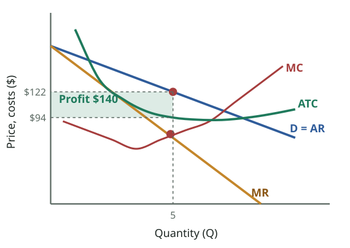
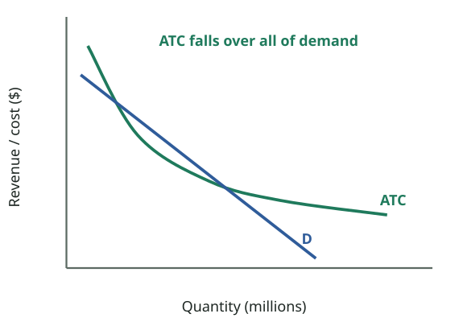

# FPEC 101 · Module 9 — Pure Monopoly
## মডিউল ৯ — বিশুদ্ধ একচেটিয়া কারবার

_Lecture 9 · 31 slides · Midterm questions: Q15, Q16_

> Printable study note generated from the website. Each slide: slide text → Bangla translation → tutor explanation → example → exam tip.

---

## Big picture — what is this lecture about? · বড় ছবি — এই লেকচারে কী শিখব?

_Profit maximisation (slides 18–20): the monopolist produces Q = 5 where MR = MC, then goes UP to the demand curve to set the price, $122. ATC there is $94, so profit = (122 − 94) × 5 = $140._  
_মুনাফা সর্বোচ্চকরণ (স্লাইড ১৮–২০): একচেটিয়া ফার্ম MR = MC যেখানে সেই Q = ৫ উৎপাদন করে, তারপর চাহিদা রেখা পর্যন্ত **ওপরে** গিয়ে দাম ঠিক করে: $১২২। সেখানে ATC $৯৪, তাই মুনাফা = (১২২ − ৯৪) × ৫ = $১৪০।_

### English

**Concept:** Lecture 8 studied thousands of tiny price-taking firms. Lecture 9 jumps to the opposite extreme: **one firm is the whole industry**. A monopolist faces the **whole downward-sloping market demand curve**, so it can choose its price: it is a **price maker**. But it cannot sell more without cutting its price, which makes **marginal revenue smaller than price**. That one fact explains almost everything about monopoly: higher prices, lower output, inefficiency and the need for government policy.

### What you will learn (6 jobs)
1. **Definition and features** of pure monopoly (slides 5–6).
2. **Barriers to entry**: natural (control of supply, economies of scale, capital size, legal, historical) and artificial (restricting supplies, predatory pricing, exclusive dealing, full-line forcing) (slides 7–9).
3. The **monopolist's demand**: MR  0). It has **no supply curve**. It wants the highest **total** profit, not the highest price.
- Compared with competition: **higher price, lower output, P > MC, P > min ATC** → inefficient; transfers income from consumers; may suffer X-inefficiency and rent-seeking, but may also enjoy economies of scale.
- **Policy:** anti-trust laws, regulation (natural monopoly), or ignore it if it is unsustainable.

### বাংলা

**ধারণা:** লেকচার ৮ পড়েছে হাজারো ছোট দাম-গ্রহণকারী ফার্ম। লেকচার ৯ লাফিয়ে উল্টো প্রান্তে যায়: **একটি ফার্মই পুরো শিল্প**। একচেটিয়া ফার্মের সামনে **পুরো নিম্নমুখী বাজার চাহিদা রেখা**, তাই সে দাম বেছে নিতে পারে: সে **দাম নির্ধারক**। কিন্তু দাম না কমিয়ে বেশি বেচতে পারে না, ফলে **প্রান্তিক আয় দামের চেয়ে কম**। এই একটি তথ্যই একচেটিয়ার প্রায় সব কিছু ব্যাখ্যা করে: বেশি দাম, কম উৎপাদন, অদক্ষতা, আর সরকারি নীতির প্রয়োজন।

### তুমি কী শিখবে (৬টি কাজ)
1. বিশুদ্ধ একচেটিয়ার **সংজ্ঞা ও বৈশিষ্ট্য** (স্লাইড ৫–৬)।
2. **প্রবেশে বাধা**: প্রাকৃতিক (যোগানের নিয়ন্ত্রণ, বৃহদায়তনের সুবিধা, মূলধনের আকার, আইনি, ঐতিহাসিক) ও কৃত্রিম (যোগান আটকানো, লুণ্ঠনমূলক দাম, একচেটিয়া লেনদেন, পূর্ণ-লাইন চাপানো) (স্লাইড ৭–৯)।
3. **একচেটিয়ার চাহিদা**: MR  ০)। এর **যোগান রেখা নেই**। চায় সর্বোচ্চ **মোট** মুনাফা, সর্বোচ্চ দাম নয়।
- প্রতিযোগিতার তুলনায়: **বেশি দাম, কম উৎপাদন, P > MC, P > সর্বনিম্ন ATC** → অদক্ষ; ভোক্তার আয় নিজের দিকে টানে; X-অদক্ষতা ও রেন্ট-সিকিং থাকতে পারে, আবার বৃহদায়তনের সুবিধাও পেতে পারে।
- **নীতি:** অ্যান্টি-ট্রাস্ট আইন, নিয়ন্ত্রণ (প্রাকৃতিক একচেটিয়া), বা টিকবে না মনে হলে উপেক্ষা।

---

## Key words · মূল শব্দ

| Term | Meaning | বাংলা অর্থ | Example |
|---|---|---|---|
| Pure monopoly | One firm is the sole seller of a product with no close substitutes | বিশুদ্ধ একচেটিয়া — কাছাকাছি বিকল্পহীন পণ্যের একমাত্র বিক্রেতা | Local electricity or water supplier. |
| Near-monopoly | One firm has most of the sales in a market | প্রায়-একচেটিয়া — একটি ফার্মের হাতে বাজারের বেশিরভাগ বিক্রি | A dominant brand with 80% share. |
| Price maker | A firm that sets price by choosing output | দাম নির্ধারক — উৎপাদন বেছে দাম ঠিক করে | A monopolist restricts output to raise price. |
| Abnormal (excess) profit | Profit above normal profit, protected by barriers | অস্বাভাবিক (বাড়তি) মুনাফা — বাধায় সুরক্ষিত, স্বাভাবিকের চেয়ে বেশি মুনাফা | Monopoly profit of $140. |
| Natural monopoly | One firm can supply the whole market at lower ATC than many firms | প্রাকৃতিক একচেটিয়া — একটি ফার্ম অনেকের চেয়ে কম ATC-তে পুরো বাজারে যোগান দিতে পারে | Water pipes, power grid. |
| Patent / copyright | Legal right to be the only producer for some years | পেটেন্ট / কপিরাইট — কয়েক বছর একমাত্র উৎপাদক হওয়ার আইনি অধিকার | A new medicine. |
| Predatory pricing | Cutting prices below cost to drive rivals out, then raising them | লুণ্ঠনমূলক দাম — প্রতিদ্বন্দ্বী তাড়াতে খরচের নিচে দাম, পরে দাম বাড়ানো | A giant selling at a loss until small shops close. |
| Exclusive dealing | Refusing to supply shops that stock rivals' brands | একচেটিয়া লেনদেন — প্রতিদ্বন্দ্বীর পণ্য রাখলে দোকানে সরবরাহ বন্ধ | "Sell only our cola or nothing." |
| Full-line forcing | Supplying a shop only if it stocks the firm's full range | পূর্ণ-লাইন চাপানো — পুরো পণ্য-সারি রাখলেই সরবরাহ | "Take all 20 products or none." |
| X-inefficiency | Producing at higher than the lowest possible cost | X-অদক্ষতা — সম্ভাব্য সর্বনিম্নের চেয়ে বেশি খরচে উৎপাদন | Overstaffed, relaxed state monopoly. |
| Rent-seeking | Spending to gain or keep a privilege (licence, law) rather than produce | রেন্ট-সিকিং — উৎপাদন নয়, সুবিধা (লাইসেন্স, আইন) পেতে বা রাখতে খরচ | Lobbying for an exclusive licence. |
| Anti-trust law | Law against monopoly abuse and cartels | অ্যান্টি-ট্রাস্ট আইন — একচেটিয়ার অপব্যবহার ও কার্টেলবিরোধী আইন | Bangladesh Competition Act 2012. |

---

## Slides 1–4 · Title, topic and outline
### শিরোনাম, বিষয় ও রূপরেখা

> **Slide 1**
> PRINCIPLES OF ECONOMICSSalimah Musharrif
> FPEC 101 – LECTURE 9 Unit 2
>
> **Slide 2**
> PRINCIPLES OF ECONOMICSProduction Costs and Market Structures
> FPEC 101 – LECTURE 9 Unit 2
>
> **Slide 3**
> Market Structures- Monopoly
>
> **Slide 4**
> Outline
> Monopoly
> Price Discrimination
>

**বাংলা অনুবাদ:**

> **স্লাইড ১–২:** প্রিন্সিপলস অব ইকোনমিক্স — সালিমাহ মুশাররিফ। উৎপাদন ব্যয় ও বাজার কাঠামো। FPEC 101 – লেকচার ৯, ইউনিট ২।
> **স্লাইড ৩:** বাজার কাঠামো — একচেটিয়া
> **স্লাইড ৪ — রূপরেখা:** একচেটিয়া · দাম-বৈষম্য

**Tutor explains:** Lecture 9 is about **pure monopoly**; the outline also lists **price discrimination**, which the slides actually cover in Lecture 10. Syllabus reading: McConnell & Brue pp. 424–436.

**টিউটরের ব্যাখ্যা:** লেকচার ৯ **বিশুদ্ধ একচেটিয়া** নিয়ে; রূপরেখায় **দাম-বৈষম্যও** আছে, যা স্লাইডে আসলে লেকচার ১০-এ। সিলেবাসের পড়া: ম্যাককনেল ও ব্রু পৃ. ৪২৪–৪৩৬।

---

## Slide 5 · What is monopoly?
### একচেটিয়া কী?

> Monopoly
> is a market structure in which one firm is the sole seller of a product or service. Since the entry of additional firms is blocked, one firm constitutes the entire industry. Because the monopolist produces a unique product, it makes no effort to differentiate its product.
> In a pure monopoly the single firm controls the total supply of the whole industry and is able to exert a significant control over the price by changing the quantity supplied. In this way the monopoly is a price maker because it can restrict market supply to force up the market price. This helps a monopoly to maximize its profits. These are often called abnormal or excess profits because they will be higher than if the market is competitive. However, if the monopoly wants to protect its market power and profits it must prevent new firms from entering its markets.
> “Near-monopolies” A single firm has the bulk of sales in a specific market
>

**বাংলা অনুবাদ:**

> একচেটিয়া
> এমন একটি বাজার কাঠামো যেখানে একটি ফার্ম একটি পণ্য বা সেবার একমাত্র বিক্রেতা। অন্য ফার্মের প্রবেশ বন্ধ বলে একটি ফার্মই পুরো শিল্প। একচেটিয়া ফার্ম অনন্য পণ্য উৎপাদন করে বলে পণ্য পৃথক করার চেষ্টা করে না।
> বিশুদ্ধ একচেটিয়ায় একক ফার্ম পুরো শিল্পের মোট যোগান নিয়ন্ত্রণ করে এবং যোগানের পরিমাণ বদলে দামের ওপর উল্লেখযোগ্য নিয়ন্ত্রণ খাটাতে পারে। এভাবে একচেটিয়া ফার্ম দাম নির্ধারক, কারণ বাজারের যোগান সীমিত করে বাজারদর বাড়াতে পারে। এতে একচেটিয়া ফার্ম মুনাফা সর্বোচ্চ করে। এগুলোকে প্রায়ই অস্বাভাবিক বা বাড়তি মুনাফা বলে, কারণ বাজার প্রতিযোগিতামূলক হলে যা হতো তার চেয়ে বেশি। তবে বাজারক্ষমতা ও মুনাফা রক্ষা করতে চাইলে একচেটিয়া ফার্মকে নতুন ফার্মের প্রবেশ ঠেকাতে হবে।
> "প্রায়-একচেটিয়া": একটি নির্দিষ্ট বাজারে একটি ফার্মের হাতে বেশিরভাগ বিক্রি।

**Tutor explains:** **Pure monopoly:** **one firm is the only seller** of a product with **no close substitutes**. Entry is **blocked**, so **the firm = the industry**.
How the monopolist uses its power: - It controls the **total supply** of the industry. - By **restricting** supply it can **force the price up**: it is a **price maker**. - This gives **abnormal (excess) profits**, higher than in a competitive market. - To keep those profits it must **keep new firms out** (barriers to entry).
**Near-monopoly:** in practice, a firm with the **bulk of sales** in a market behaves much like a monopoly even if a few tiny rivals exist.

**টিউটরের ব্যাখ্যা:** **বিশুদ্ধ একচেটিয়া:** **কাছাকাছি বিকল্পহীন** পণ্যের **একমাত্র বিক্রেতা একটি ফার্ম**। প্রবেশ **বন্ধ**, তাই **ফার্ম = শিল্প**।
একচেটিয়া ফার্ম ক্ষমতা কীভাবে ব্যবহার করে: - শিল্পের **মোট যোগান** নিয়ন্ত্রণ করে। - যোগান **সীমিত করে** দাম **বাড়াতে বাধ্য করে**: সে **দাম নির্ধারক**। - এতে **অস্বাভাবিক (বাড়তি) মুনাফা** হয়, প্রতিযোগিতামূলক বাজারের চেয়ে বেশি। - সেই মুনাফা রাখতে **নতুন ফার্মকে বাইরে রাখতে** হয় (প্রবেশে বাধা)।
**প্রায়-একচেটিয়া:** বাস্তবে বাজারের **বেশিরভাগ বিক্রি** যে ফার্মের হাতে, সে কয়েকটি ছোট প্রতিদ্বন্দ্বী থাকলেও প্রায় একচেটিয়ার মতো আচরণ করে।

**Real-life example:** **Bangladesh:** Dhaka WASA (water supply in Dhaka), DESCO/DPDC (electricity distribution in their areas), Bangladesh Railway (rail travel), Titas Gas (piped gas in its area). Each is the only supplier in its area.

**বাস্তব উদাহরণ:** **বাংলাদেশ:** ঢাকা ওয়াসা (ঢাকায় পানি সরবরাহ), ডেসকো/ডিপিডিসি (নিজ এলাকায় বিদ্যুৎ বিতরণ), বাংলাদেশ রেলওয়ে (রেলভ্রমণ), তিতাস গ্যাস (নিজ এলাকায় পাইপলাইন গ্যাস)। প্রত্যেকে নিজ এলাকায় একমাত্র সরবরাহকারী।

---

## Slide 6 · Features of monopoly
### একচেটিয়ার বৈশিষ্ট্য

> Monopoly- Features
> Single seller - absolute
> No close substitutes- don't want to buy, do without it
> Monopolist is a price maker changes product price by changing quantity supplied
> Abnormal profits
> There are barriers to the entry of firms
> Non price competition-Product may be either standardized or differentiated Those with Standardized products engage mainly in public relations advertising, whereas those with differentiated products sometimes advertise their products’ attributes.
>

**বাংলা অনুবাদ:**

> একচেটিয়া — বৈশিষ্ট্য
> একক বিক্রেতা — নিরঙ্কুশ
> কাছাকাছি বিকল্প নেই — কিনতে না চাইলে তা ছাড়াই চলতে হবে
> একচেটিয়া ফার্ম দাম নির্ধারক — যোগানের পরিমাণ বদলে পণ্যের দাম বদলায়
> অস্বাভাবিক মুনাফা
> ফার্মের প্রবেশে বাধা আছে
> অ-দাম প্রতিযোগিতা — পণ্য প্রমিত বা পৃথকীকৃত হতে পারে। প্রমিত পণ্যের একচেটিয়া ফার্ম মূলত জনসংযোগমূলক বিজ্ঞাপন দেয়, আর পৃথকীকৃত পণ্যের ফার্ম কখনো পণ্যের গুণাবলির বিজ্ঞাপন দেয়।

**Tutor explains:** Six features (compare each with perfect competition):
**Single seller** (absolute): vs very many sellers.**No close substitutes**: if you don't want to buy, you must **do without**: vs identical products.**Price maker**: changes the price by changing the quantity supplied: vs price taker.**Abnormal profits**, which can last in the long run: vs only normal profit in the long run.**Barriers to entry**: vs free entry.**Non-price competition**: standardised-product monopolies (electricity) mainly do **public-relations** advertising ("we serve the nation"); differentiated-product monopolies sometimes advertise product features.

**টিউটরের ব্যাখ্যা:** ছয়টি বৈশিষ্ট্য (প্রতিটি পূর্ণ প্রতিযোগিতার সাথে তুলনা করো):
**একক বিক্রেতা** (নিরঙ্কুশ): বনাম অসংখ্য বিক্রেতা।**কাছাকাছি বিকল্প নেই**: কিনতে না চাইলে **তা ছাড়াই** চলতে হবে: বনাম একই রকম পণ্য।**দাম নির্ধারক**: যোগানের পরিমাণ বদলে দাম বদলায়: বনাম দাম গ্রহণকারী।**অস্বাভাবিক মুনাফা**, দীর্ঘমেয়াদেও টিকতে পারে: বনাম দীর্ঘমেয়াদে শুধু স্বাভাবিক মুনাফা।**প্রবেশে বাধা**: বনাম অবাধ প্রবেশ।**অ-দাম প্রতিযোগিতা**: প্রমিত পণ্যের একচেটিয়া (বিদ্যুৎ) মূলত **জনসংযোগমূলক** বিজ্ঞাপন দেয় ("আমরা জাতির সেবায়"); পৃথকীকৃত পণ্যের একচেটিয়া কখনো পণ্যের বৈশিষ্ট্যের বিজ্ঞাপন দেয়।

**Exam tip:** For Q15, write monopoly features in a two-column table next to perfect competition. It shows the contrast clearly.

**পরীক্ষার টিপস:** Q15-এ একচেটিয়ার বৈশিষ্ট্য পূর্ণ প্রতিযোগিতার পাশে দুই কলামের ছকে লেখো। বৈসাদৃশ্য স্পষ্ট হয়।

---

## Slide 7 · Barriers to entry: natural barriers
### প্রবেশে বাধা: প্রাকৃতিক বাধা

> Monopoly- Barriers to entry
> Natural monopoly If one large firm can produce and sell all of a particular product required in the market at a low average cost per product as compared to a number of smaller firms put together, this firm would be a natural monopoly. That is, ATC declines over the entire market demand.
> Artificial monopoly This is an artificial barrier and such monopolies are created by creating their own artificial barriers to competition.
> Natural barriers
> • Control of supply : A firm or small group of firms may own most or all the supply of raw materials or cater to the whole market singly becoming the only supplier
> • Economies of scale Some industries can achieve large economies of scale which small firms cannot compete with
> • Capital size: Some industries example nuclear atomic plants need very expensive equipment which other firms cannot afford and so it forms a natural monopoly
> • Legal considerations: it is illegal due to some government laws for firms to start businesses in the same industry example by the grant of patents or copyrights
> • Historical Reasons A business may become a monopoly because it was the first to enter a market for a product and has an established customer base
>

**বাংলা অনুবাদ:**

> একচেটিয়া — প্রবেশে বাধা
> **প্রাকৃতিক একচেটিয়া:** একটি বড় ফার্ম যদি বাজারে দরকারি পুরো পণ্য, কয়েকটি ছোট ফার্মের তুলনায় এককপ্রতি কম গড় খরচে উৎপাদন ও বিক্রি করতে পারে, সেটি প্রাকৃতিক একচেটিয়া। অর্থাৎ পুরো বাজার চাহিদাজুড়ে ATC কমে।
> **কৃত্রিম একচেটিয়া:** এটা কৃত্রিম বাধা; এ ধরনের একচেটিয়া প্রতিযোগিতার বিরুদ্ধে নিজস্ব কৃত্রিম বাধা তৈরি করে গড়ে ওঠে।
> **প্রাকৃতিক বাধা:**
> • **যোগানের নিয়ন্ত্রণ:** একটি ফার্ম বা ছোট ফার্মগোষ্ঠী কাঁচামালের বেশিরভাগ বা পুরো যোগানের মালিক হতে পারে, বা একাই পুরো বাজারে সরবরাহ করে একমাত্র সরবরাহকারী হতে পারে।
> • **বৃহদায়তনের সুবিধা:** কিছু শিল্পে বড় বৃহদায়তনের সুবিধা পাওয়া যায়, যার সাথে ছোট ফার্ম প্রতিযোগিতা করতে পারে না।
> • **মূলধনের আকার:** কিছু শিল্পে, যেমন পারমাণবিক বিদ্যুৎকেন্দ্রে, খুব ব্যয়বহুল যন্ত্র লাগে যা অন্য ফার্ম কিনতে পারে না, তাই প্রাকৃতিক একচেটিয়া গড়ে ওঠে।
> • **আইনি বিবেচনা:** সরকারি আইনের কারণে একই শিল্পে ব্যবসা শুরু করা অবৈধ, যেমন পেটেন্ট বা কপিরাইট প্রদানের মাধ্যমে।
> • **ঐতিহাসিক কারণ:** কোনো ব্যবসা প্রথম বাজারে এসেছিল এবং প্রতিষ্ঠিত ক্রেতাভিত্তি আছে বলে একচেটিয়া হতে পারে।

**Tutor explains:** Why can't others just enter? Two kinds of monopoly:
**Natural monopoly:** one big firm can supply the **whole market** at a **lower ATC** than several smaller firms, because ATC keeps falling over the entire market demand (slide 8).**Artificial monopoly:** the firm **builds its own barriers** to keep rivals out (slide 9).
**Five natural barriers:** 1. **Control of supply:** owning most or all of a key raw material. 2. **Economies of scale:** a huge firm's low unit cost cannot be matched by small entrants. 3. **Capital size:** the industry needs extremely expensive equipment (a nuclear power plant, a satellite network). 4. **Legal barriers:** **patents** and **copyrights** (and government licences) make it illegal for others to produce. 5. **Historical reasons:** the **first** firm in a market builds a loyal customer base that is hard to break.

**টিউটরের ব্যাখ্যা:** অন্যরা কেন ঢুকতে পারে না? দুই ধরনের একচেটিয়া:
**প্রাকৃতিক একচেটিয়া:** একটি বড় ফার্ম কয়েকটি ছোট ফার্মের চেয়ে **কম ATC-তে পুরো বাজারে** যোগান দিতে পারে, কারণ পুরো বাজার চাহিদাজুড়ে ATC কমতেই থাকে (স্লাইড ৮)।**কৃত্রিম একচেটিয়া:** ফার্ম প্রতিদ্বন্দ্বী ঠেকাতে **নিজেই বাধা তৈরি** করে (স্লাইড ৯)।
**পাঁচটি প্রাকৃতিক বাধা:** 1. **যোগানের নিয়ন্ত্রণ:** গুরুত্বপূর্ণ কাঁচামালের বেশিরভাগ বা পুরোটার মালিকানা। 2. **বৃহদায়তনের সুবিধা:** বিশাল ফার্মের কম এককব্যয়ের সাথে ছোট নবাগত পারে না। 3. **মূলধনের আকার:** শিল্পে অত্যন্ত দামি যন্ত্র লাগে (পারমাণবিক বিদ্যুৎকেন্দ্র, স্যাটেলাইট নেটওয়ার্ক)। 4. **আইনি বাধা:** **পেটেন্ট** ও **কপিরাইট** (আর সরকারি লাইসেন্স) অন্যদের উৎপাদন অবৈধ করে। 5. **ঐতিহাসিক কারণ:** বাজারের **প্রথম** ফার্ম অনুগত ক্রেতাভিত্তি গড়ে, যা ভাঙা কঠিন।

**Real-life example:** **Legal:** a pharmaceutical patent gives one company the sole right to sell a new medicine for about 20 years. **Capital size:** the Rooppur nuclear plant cost billions of dollars: no private rival could build a competing one. **Licence:** only licensed operators may run mobile networks in Bangladesh.

**বাস্তব উদাহরণ:** **আইনি:** ওষুধের পেটেন্ট একটি কোম্পানিকে প্রায় ২০ বছর নতুন ওষুধ বিক্রির একক অধিকার দেয়। **মূলধনের আকার:** রূপপুর পারমাণবিক কেন্দ্রের খরচ শত শত কোটি ডলার: কোনো বেসরকারি প্রতিদ্বন্দ্বী এমন কেন্দ্র বানাতে পারবে না। **লাইসেন্স:** বাংলাদেশে শুধু লাইসেন্সপ্রাপ্ত অপারেটরই মোবাইল নেটওয়ার্ক চালাতে পারে।

**Exam tip:** "Barriers" is named in Q15: list the five natural and four artificial barriers with an example each.

**পরীক্ষার টিপস:** Q15-এ "বাধা" স্পষ্ট চাওয়া: পাঁচটি প্রাকৃতিক ও চারটি কৃত্রিম বাধা, প্রতিটির উদাহরণসহ লেখো।

---

## Slide 8 · Economies of scale in a natural monopoly
### প্রাকৃতিক একচেটিয়ায় বৃহদায়তনের সুবিধা

_Natural monopoly (slide 8): ATC keeps falling over the whole range of market demand, so one big firm can supply the market more cheaply than several small ones._  
_প্রাকৃতিক একচেটিয়া (স্লাইড ৮): পুরো বাজার চাহিদার পরিসরজুড়ে ATC কমতেই থাকে, তাই একটি বড় ফার্ম কয়েকটি ছোট ফার্মের চেয়ে সস্তায় পুরো বাজারে যোগান দিতে পারে।_

> Economies of Scale in natural monopoly
> [Diagram: Revenue/Cost ($0–20) against Quantity (0–200 million); ATC falls continuously and is still falling where it meets the demand curve D]
> ATC declines over entire market demand, if there is a natural monopoly, that gains economies of scale
>

**বাংলা অনুবাদ:**

> প্রাকৃতিক একচেটিয়ায় বৃহদায়তনের সুবিধা
> [চিত্র: পরিমাণের (০–২০০ মিলিয়ন) বিপরীতে আয়/ব্যয় ($০–২০); ATC অবিরাম কমে, চাহিদা রেখা D-র সাথে মেলার জায়গায়ও কমছে]
> প্রাকৃতিক একচেটিয়া হলে পুরো বাজার চাহিদাজুড়ে ATC কমে, যা বৃহদায়তনের সুবিধা পায়

**Tutor explains:** The picture of a **natural monopoly**: the **ATC curve is still falling** at the point where it meets market demand. So the **more** one firm produces, the **cheaper** each unit becomes, all the way up to the whole market's demand.
If two firms split the market, each would produce half as much at a **higher** ATC. So the **cheapest** way to supply this market is **one firm**. That is why water pipes, electricity grids and railway tracks are usually monopolies: laying two sets of pipes down the same street would waste resources.

**টিউটরের ব্যাখ্যা:** **প্রাকৃতিক একচেটিয়ার** ছবি: বাজার চাহিদার সাথে যেখানে মেলে সেখানেও **ATC রেখা কমছে**। তাই একটি ফার্ম যত **বেশি** উৎপাদন করে, প্রতিটি একক তত **সস্তা** হয়, পুরো বাজারের চাহিদা পর্যন্ত।
দুটি ফার্ম বাজার ভাগ করলে প্রত্যেকে অর্ধেক উৎপাদন করত **বেশি** ATC-তে। তাই এই বাজারে যোগানের **সবচেয়ে সস্তা** উপায় **একটি ফার্ম**। এজন্যই পানির পাইপ, বিদ্যুৎ গ্রিড ও রেললাইন সাধারণত একচেটিয়া: একই রাস্তায় দুই সেট পাইপ বসানো সম্পদের অপচয়।

---

## Slide 9 · Artificial barriers to entry
### প্রবেশে কৃত্রিম বাধা

> Monopoly
> Artificial barriers
> Restriction on supplies: large monopoly firms can force suppliers to supply only to them otherwise threatening to no longer buying from them.
> Predatory pricing: this is where a large firm cuts its prices to force competing firms out of the market. It may mean losing money in the short run but once competitors have been driven out the firm may again increase prices resulting in a profit
> Exclusive dealing : businesses that sell products made by a monopolist, rely on the monopolist for supplies. The monopolist may threaten firms that sell its popular products to discontinue supply if products of other firms are sold. Thus it prevents competition and maintains the monopolist’s monopoly position. Refusal to sell to shops that stock other firms’ brand of a similar product is known as exclusive dealing.
> Full line forcing this is similar to exclusive dealing. It means a large multi product firm will only supply a retailer if they sell and stock their full range of products
>

**বাংলা অনুবাদ:**

> একচেটিয়া — কৃত্রিম বাধা
> **যোগানে বিধিনিষেধ:** বড় একচেটিয়া ফার্ম সরবরাহকারীদের শুধু তাদেরকে সরবরাহ করতে বাধ্য করতে পারে, নইলে আর কিনবে না বলে হুমকি দেয়।
> **লুণ্ঠনমূলক দাম (Predatory pricing):** বড় ফার্ম প্রতিযোগী ফার্মকে বাজার থেকে তাড়াতে দাম কমায়। স্বল্পমেয়াদে লোকসান হতে পারে, কিন্তু প্রতিযোগীরা চলে গেলে আবার দাম বাড়িয়ে মুনাফা করে।
> **একচেটিয়া লেনদেন (Exclusive dealing):** যারা একচেটিয়া ফার্মের পণ্য বিক্রি করে, তারা সরবরাহের জন্য তার ওপর নির্ভরশীল। একচেটিয়া ফার্ম হুমকি দিতে পারে যে অন্য ফার্মের পণ্য বিক্রি করলে তার জনপ্রিয় পণ্যের সরবরাহ বন্ধ হবে। এভাবে প্রতিযোগিতা ঠেকায় ও একচেটিয়া অবস্থান ধরে রাখে। অন্য ফার্মের অনুরূপ ব্র্যান্ড রাখা দোকানে বিক্রি না করাকে একচেটিয়া লেনদেন বলে।
> **পূর্ণ-লাইন চাপানো (Full line forcing):** একচেটিয়া লেনদেনের মতোই। বড় বহু-পণ্যের ফার্ম কোনো খুচরা বিক্রেতাকে তখনই সরবরাহ করবে যখন সে তাদের পুরো পণ্য-সারি বিক্রি ও মজুদ করবে।

**Tutor explains:** **Artificial barriers** are tricks a dominant firm uses to block competition:
**Restriction on supplies:** forcing suppliers to sell **only** to it ("sell to my rival and I'll never buy from you again"), so rivals cannot get inputs.**Predatory pricing:** cutting prices **below cost** until rivals go bankrupt, then **raising** prices again.**Exclusive dealing:** refusing to supply shops that **also sell rivals' products**.**Full-line forcing:** supplying a shop only if it stocks the firm's **entire range**, leaving no shelf space for rivals.
These practices are **illegal** under competition laws in many countries (Lecture 12). In Bangladesh the **Competition Act 2012** prohibits abuse of dominant position.

**টিউটরের ব্যাখ্যা:** **কৃত্রিম বাধা** হলো প্রভাবশালী ফার্মের প্রতিযোগিতা আটকানোর কৌশল:
**যোগানে বিধিনিষেধ:** সরবরাহকারীকে **শুধু** তার কাছে বেচতে বাধ্য করা ("প্রতিদ্বন্দ্বীকে বেচলে আর কখনো তোমার কাছে কিনব না"), যাতে প্রতিদ্বন্দ্বী উপকরণ না পায়।**লুণ্ঠনমূলক দাম:** প্রতিদ্বন্দ্বী দেউলিয়া না হওয়া পর্যন্ত **খরচের নিচে** দাম রাখা, তারপর আবার **বাড়ানো**।**একচেটিয়া লেনদেন:** যে দোকান **প্রতিদ্বন্দ্বীর পণ্যও** বেচে, তাকে সরবরাহ না করা।**পূর্ণ-লাইন চাপানো:** দোকান ফার্মের **পুরো পণ্য-সারি** রাখলেই সরবরাহ, যাতে প্রতিদ্বন্দ্বীর জন্য তাকে জায়গা না থাকে।
অনেক দেশে প্রতিযোগিতা আইনে এগুলো **অবৈধ** (লেকচার ১২)। বাংলাদেশে **প্রতিযোগিতা আইন ২০১২** প্রভাবশালী অবস্থানের অপব্যবহার নিষিদ্ধ করে।

**Real-life example:** A big soft-drink company tells a small shop owner in Sylhet: "If you put another brand's bottles in my free fridge, I'll take the fridge back." That is a form of exclusive dealing.

**বাস্তব উদাহরণ:** এক বড় কোমল পানীয় কোম্পানি সিলেটের এক ছোট দোকানিকে বলে: "আমার দেওয়া ফ্রিজে অন্য ব্র্যান্ডের বোতল রাখলে ফ্রিজ ফেরত নিয়ে যাব।" এটা একচেটিয়া লেনদেনের একটি রূপ।

---

## Quick check · দ্রুত যাচাই

1. Which is a NATURAL barrier to entry?  
   কোনটি প্রবেশে প্রাকৃতিক বাধা?

   - A) Predatory pricing · লুণ্ঠনমূলক দাম
   - B) Exclusive dealing · একচেটিয়া লেনদেন
   - C) Economies of scale · বৃহদায়তনের সুবিধা
   - D) Full-line forcing · পূর্ণ-লাইন চাপানো

   **Answer: C** — Economies of scale, control of supply, capital size, legal and historical reasons are natural barriers; the others are artificial.  
   বৃহদায়তনের সুবিধা, যোগানের নিয়ন্ত্রণ, মূলধনের আকার, আইনি ও ঐতিহাসিক কারণ প্রাকৃতিক বাধা; বাকিগুলো কৃত্রিম।

2. A natural monopoly exists when…  
   প্রাকৃতিক একচেটিয়া হয় যখন…

   - A) The government owns the firm · সরকার মালিক
   - B) ATC keeps falling over the whole market demand · পুরো বাজার চাহিদাজুড়ে ATC কমতে থাকে
   - C) The firm uses predatory pricing · ফার্ম লুণ্ঠনমূলক দাম নেয়
   - D) Demand is perfectly elastic · চাহিদা পূর্ণ স্থিতিস্থাপক

   **Answer: B** — One firm can then supply the whole market more cheaply than several firms.  
   তখন একটি ফার্ম কয়েকটির চেয়ে সস্তায় পুরো বাজারে যোগান দিতে পারে।

---

## Slide 10 · Monopoly demand: assumptions and three implications
### একচেটিয়ার চাহিদা: অনুমান ও তিনটি তাৎপর্য

> Monopoly
> In a pure monopoly the firm and the industry are one and the same.
> Monopoly Demand Assumptions
> • Monopoly status secured whether through patents, resource ownership or economies of scale
> • Not regulated by government
> • The firm is a single-price monopolist; it charges the same price for all units of output.
> Downward sloping Demand curve has three implications
> • Marginal Revenue Is Less Than Price
> • The Monopolist Is a Price Maker
> • The Monopolist Sets Prices in the Elastic Region of Demand
>

**বাংলা অনুবাদ:**

> একচেটিয়া
> বিশুদ্ধ একচেটিয়ায় ফার্ম ও শিল্প একই।
> **একচেটিয়া চাহিদার অনুমান:**
> • পেটেন্ট, সম্পদের মালিকানা বা বৃহদায়তনের সুবিধার মাধ্যমে একচেটিয়া অবস্থান নিশ্চিত
> • সরকার নিয়ন্ত্রিত নয়
> • ফার্মটি একক-দামের একচেটিয়া; সব এককের জন্য একই দাম নেয়।
> **নিম্নমুখী চাহিদা রেখার তিনটি তাৎপর্য:**
> • প্রান্তিক আয় দামের চেয়ে কম
> • একচেটিয়া ফার্ম দাম নির্ধারক
> • একচেটিয়া ফার্ম চাহিদার স্থিতিস্থাপক অংশে দাম ঠিক করে

**Tutor explains:** Because **the firm is the industry**, the monopolist's demand curve is the **market demand curve**: it **slopes downward**.
**Assumptions for the analysis:** monopoly status is secure (patents, resource ownership or economies of scale); **not regulated** by government; and it is a **single-price** monopolist (same price for every unit; no price discrimination).
**A downward-sloping demand has three implications** (each explained on the next slides): 1. **MR < P**. 2. The monopolist is a **price maker**. 3. It sets its price in the **elastic** region of demand.

**টিউটরের ব্যাখ্যা:** **ফার্মই শিল্প** বলে একচেটিয়ার চাহিদা রেখা হলো **বাজার চাহিদা রেখা**: এটা **নিচে নামে**।
**বিশ্লেষণের অনুমান:** একচেটিয়া অবস্থান নিশ্চিত (পেটেন্ট, সম্পদের মালিকানা বা বৃহদায়তনের সুবিধা); সরকার **নিয়ন্ত্রিত নয়**; আর এটা **একক-দামের** একচেটিয়া (প্রতিটি এককের দাম একই; দাম-বৈষম্য নেই)।
**নিম্নমুখী চাহিদার তিনটি তাৎপর্য** (পরের স্লাইডগুলোতে প্রতিটি ব্যাখ্যা): 1. **MR < P**। 2. একচেটিয়া ফার্ম **দাম নির্ধারক**। 3. চাহিদার **স্থিতিস্থাপক** অংশে দাম ঠিক করে।

---

## Slide 11 · Implication 1: MR is less than price
### তাৎপর্য ১: MR দামের চেয়ে কম

> Implications- Marginal Revenue Is Less Than Price
> The monopolist’s downward-sloping demand curve means that it can increase sales only by charging a lower price.
> Thus MR < AR or MR < Price for every level of output except the first.
> The lower price applies not only to the extra unit of output sold but also to all prior units of output because these could have been sold at a higher price if it had not produced and sold the extra output.
> Each additional unit of output sold increases total revenue by an amount equal to its own price less the sum of the price cuts that apply to all prior units of output.
>

**বাংলা অনুবাদ:**

> তাৎপর্য — প্রান্তিক আয় দামের চেয়ে কম
> একচেটিয়ার নিম্নমুখী চাহিদা রেখা মানে সে শুধু কম দাম নিয়েই বিক্রি বাড়াতে পারে।
> তাই প্রথম একক ছাড়া প্রতিটি উৎপাদন স্তরে MR < AR বা MR < দাম।
> কম দামটা শুধু বাড়তি এককে নয়, আগের সব এককেও প্রযোজ্য, কারণ বাড়তি উৎপাদন না করলে আগের এককগুলো বেশি দামে বিক্রি হতে পারত।
> প্রতিটি বাড়তি একক বিক্রি মোট আয়কে তার নিজের দাম থেকে আগের সব এককের ওপর দাম-কাটার যোগফল বাদ দিয়ে যা থাকে ততটা বাড়ায়।

**Tutor explains:** To sell **one more unit**, the monopolist must **lower its price**. But (single-price assumption) the lower price applies to **all** units, not just the extra one. So the extra revenue from the extra unit is:
**MR = price of the extra unit − the price cut on all the earlier units.**
That is always **less than the price** (except for the very first unit). So **MR < P = AR**, and the **MR curve lies below the demand curve**.
Compare: in perfect competition the price never falls when you sell more, so MR = P.

**টিউটরের ব্যাখ্যা:** **আরেকটি একক** বেচতে একচেটিয়া ফার্মকে **দাম কমাতে** হয়। কিন্তু (একক-দামের অনুমান) কম দাম **সব** এককে প্রযোজ্য, শুধু বাড়তিটায় নয়। তাই বাড়তি একক থেকে বাড়তি আয়:
**MR = বাড়তি এককের দাম − আগের সব এককের ওপর দাম-কাটা।**
এটা সবসময় **দামের চেয়ে কম** (একদম প্রথম একক ছাড়া)। তাই **MR < P = AR**, আর **MR রেখা চাহিদা রেখার নিচে**।
তুলনা: পূর্ণ প্রতিযোগিতায় বেশি বেচলেও দাম কমে না, তাই MR = P।

---

## Slides 12–13 · Worked example: MR < P ($142 → $132)
### হাতে-কলমে উদাহরণ: MR < P ($১৪২ → $১৩২)

> **Slide 12**
> [Demand curve D, quantity 1–6] When price decreases from $142 to $132, one more unit is sold… Gain = $132. Revenue will increase by $132 with the extra unit sold.
>
> **Slide 13**
> …but revenue loss = $10 × 3 units. Loss = $30
> Marginal revenue = $132 − 30 = $102 < $132 (price)
> MR < P
>

**বাংলা অনুবাদ:**

> **স্লাইড ১২:** [চাহিদা রেখা D, পরিমাণ ১–৬] দাম $১৪২ থেকে $১৩২-এ নামলে আরেকটি একক বিক্রি হয়… লাভ = $১৩২। বাড়তি এককে আয় $১৩২ বাড়বে।
> **স্লাইড ১৩:** …কিন্তু আয়ে ক্ষতি = $১০ × ৩ একক। ক্ষতি = $৩০। প্রান্তিক আয় = $১৩২ − ৩০ = $১০২ < $১৩২ (দাম)। MR < P।

**Tutor explains:** Step by step:
At **$142** the monopolist sells **3** units: TR = 3 × 142 = **$426**.To sell **4** units it must cut the price to **$132**: TR = 4 × 132 = **$528**.**Gain:** the 4th unit brings **$132**.**Loss:** the first 3 units now sell for $10 less each: 3 × $10 = **$30**.**MR = 132 − 30 = $102** (check: 528 − 426 = 102 ✔).
So the 4th unit's price is $132 but it adds only **$102** to revenue: **MR < P**.

**টিউটরের ব্যাখ্যা:** ধাপে ধাপে:
**$১৪২**-এ একচেটিয়া ফার্ম **৩** একক বেচে: TR = ৩ × ১৪২ = **$৪২৬**।**৪** একক বেচতে দাম **$১৩২**-এ নামাতে হয়: TR = ৪ × ১৩২ = **$৫২৮**।**লাভ:** ৪র্থ একক আনে **$১৩২**।**ক্ষতি:** প্রথম ৩ একক এখন প্রতিটি $১০ কমে বিক্রি: ৩ × $১০ = **$৩০**।**MR = ১৩২ − ৩০ = $১০২** (যাচাই: ৫২৮ − ৪২৬ = ১০২ ✔)।
তাই ৪র্থ এককের দাম $১৩২, কিন্তু আয়ে যোগ করে মাত্র **$১০২**: **MR < P**।

**Real-life example:** A cinema with no rival in a district town sells 300 tickets at Tk 400. To fill 50 more seats it must charge Tk 350 to everyone. Extra revenue = 50 × 350 − 300 × 50 = 17,500 − 15,000 = only Tk 2,500, far below the Tk 350 price of each new ticket.

**বাস্তব উদাহরণ:** একটি জেলা শহরের একমাত্র সিনেমা হল ৪০০ টাকায় ৩০০ টিকিট বেচে। আরও ৫০টি আসন ভরাতে সবার জন্য ৩৫০ টাকা নিতে হয়। বাড়তি আয় = ৫০ × ৩৫০ − ৩০০ × ৫০ = ১৭,৫০০ − ১৫,০০০ = মাত্র ২,৫০০ টাকা, যা প্রতিটি নতুন টিকিটের ৩৫০ টাকা দামের অনেক নিচে।

---

## Slide 14 · MR, TR and elasticity (McConnell & Brue Fig. 22.3)
### MR, TR ও স্থিতিস্থাপকতা (ম্যাককনেল ও ব্রু চিত্র ২২.৩)

_McConnell & Brue Fig. 22.3: MR lies below demand. Where MR is positive, TR rises (elastic demand); where MR = 0, TR is at its maximum (unit elastic); where MR is negative, TR falls (inelastic demand). A monopolist always stays in the elastic part._  
_ম্যাককনেল ও ব্রু চিত্র ২২.৩: MR চাহিদার নিচে। যেখানে MR ধনাত্মক, TR বাড়ে (স্থিতিস্থাপক); MR = ০ হলে TR সর্বোচ্চ (একক); MR ঋণাত্মক হলে TR কমে (অস্থিতিস্থাপক)। একচেটিয়া ফার্ম সবসময় স্থিতিস্থাপক অংশে থাকে।_

> MR < P
> [McConnell & Brue Fig. 22.3: demand and MR curves above, TR curve below]
> MR curve lies below AR or Demand
> Implies MR < P at every output quantity except first unit.
> MR is the change in TR
> MR is positive when TR is increasing - Elastic region
> When TR is maximum, MR is 0
> When TR falls, MR is negative - Inelastic region
>

**বাংলা অনুবাদ:**

> MR < P
> [ম্যাককনেল ও ব্রু চিত্র ২২.৩: ওপরে চাহিদা ও MR রেখা, নিচে TR রেখা]
> MR রেখা AR বা চাহিদার নিচে
> অর্থাৎ প্রথম একক ছাড়া প্রতিটি পরিমাণে MR < P।
> MR হলো TR-এর পরিবর্তন
> TR বাড়লে MR ধনাত্মক — স্থিতিস্থাপক অংশ
> TR সর্বোচ্চ হলে MR = ০
> TR কমলে MR ঋণাত্মক — অস্থিতিস্থাপক অংশ

**Tutor explains:** Link this with Lecture 5's **total revenue test**:
**MR > 0 → TR rising →** demand is **elastic** (a price cut raises TR).**MR = 0 → TR at its maximum →** **unit elastic**.**MR < 0 → TR falling →** demand is **inelastic** (a price cut lowers TR).
For a straight-line demand curve, the MR curve starts at the same point but falls **twice as steeply**, hitting zero at **half** the quantity where demand hits zero.

**টিউটরের ব্যাখ্যা:** লেকচার ৫-এর **মোট আয় পরীক্ষার** সাথে মেলাও:
**MR > ০ → TR বাড়ছে →** চাহিদা **স্থিতিস্থাপক** (দাম কমালে TR বাড়ে)।**MR = ০ → TR সর্বোচ্চ →** **একক স্থিতিস্থাপক**।**MR < ০ → TR কমছে →** চাহিদা **অস্থিতিস্থাপক** (দাম কমালে TR কমে)।
সরল চাহিদা রেখায় MR রেখা একই বিন্দু থেকে শুরু হয় কিন্তু **দ্বিগুণ খাড়াভাবে** নামে, আর চাহিদা যেখানে শূন্য হয় তার **অর্ধেক** পরিমাণে MR শূন্য হয়।

---

## Slide 15 · Implication 2: the monopolist is a price maker
### তাৎপর্য ২: একচেটিয়া ফার্ম দাম নির্ধারক

> Implications-The Monopolist Is a Price Maker
> • The Monopolist Is a Price Maker
> • Where one firm controls total output, the monopolist faces a down sloping demand curve in which each output is associated with some unique price.
> • Thus, in deciding on what volume of output to produce, the monopolist is also indirectly determining the price it will charge. Through control of output, it can “make the price
>

**বাংলা অনুবাদ:**

> তাৎপর্য — একচেটিয়া ফার্ম দাম নির্ধারক
> যেখানে একটি ফার্ম মোট উৎপাদন নিয়ন্ত্রণ করে, সেখানে একচেটিয়া ফার্মের সামনে নিম্নমুখী চাহিদা রেখা, যেখানে প্রতিটি উৎপাদন একটি নির্দিষ্ট দামের সাথে যুক্ত।
> তাই কত উৎপাদন করবে ঠিক করার সময় একচেটিয়া ফার্ম পরোক্ষভাবে কত দাম নেবে তাও ঠিক করে। উৎপাদন নিয়ন্ত্রণ করে সে "দাম তৈরি" করতে পারে।

**Tutor explains:** On a downward-sloping demand curve, **each quantity matches exactly one price**. So when the monopolist **chooses how much to produce**, it **automatically chooses the price** too: restrict output → higher price; expand output → lower price.
That is what **price maker** means. (It **cannot** choose both a high price **and** a large quantity: it is still limited by demand.)

**টিউটরের ব্যাখ্যা:** নিম্নমুখী চাহিদা রেখায় **প্রতিটি পরিমাণ ঠিক একটি দামের সাথে মেলে**। তাই একচেটিয়া ফার্ম **কত উৎপাদন করবে বেছে নিলে** **দামও স্বয়ংক্রিয়ভাবে বেছে নেয়**: উৎপাদন কমাও → দাম বেশি; উৎপাদন বাড়াও → দাম কম।
এটাই **দাম নির্ধারক** কথার মানে। (সে বেশি দাম **আর** বেশি পরিমাণ দুটো একসাথে বাছতে **পারে না**: চাহিদার সীমা মানতেই হয়।)

---

## Slide 16 · Implication 3: it sets price in the elastic region
### তাৎপর্য ৩: স্থিতিস্থাপক অংশে দাম ঠিক করে

> Implications-Monopolist Sets Prices in the Elastic Region of Demand
> • The Monopolist Sets Prices in the Elastic Region of Demand
> • When demand is elastic, TR increases if prices are decreased, however whenit is inelastic, TR decreases when prices are decreased
> • When TR increases with decrease in price, and MR is positive, it meansdemand is elastic in this price range.
> • If TR decreases as prices decrease and MR is negative, it indicates that demand is inelastic in the price region.
> • Thus a monopolist will not choose a price-quantity combination where price reductions cause TR to decrease and MR to be negative.
> • The profit-maximizing monopolist will always want to avoid the inelastic segment of the demand curve in favor of some price-quantity combinationin the elastic region.
> • Because, to get into the inelastic region, the monopolist must lower price and increase output. In the inelastic region a lower price means less total revenue and increased output always means increased total cost. Thus less total revenue and higher total cost yield lower profit.
>

**বাংলা অনুবাদ:**

> তাৎপর্য — একচেটিয়া ফার্ম চাহিদার স্থিতিস্থাপক অংশে দাম ঠিক করে
> চাহিদা স্থিতিস্থাপক হলে দাম কমালে TR বাড়ে, অস্থিতিস্থাপক হলে দাম কমালে TR কমে।
> দাম কমায় TR বাড়লে এবং MR ধনাত্মক হলে, এই দামের পরিসরে চাহিদা স্থিতিস্থাপক।
> দাম কমায় TR কমলে এবং MR ঋণাত্মক হলে, এই দামের অংশে চাহিদা অস্থিতিস্থাপক।
> তাই একচেটিয়া ফার্ম এমন দাম-পরিমাণ সমন্বয় বেছে নেবে না যেখানে দাম কমালে TR কমে ও MR ঋণাত্মক হয়।
> মুনাফা-সর্বোচ্চকারী একচেটিয়া ফার্ম সবসময় চাহিদা রেখার অস্থিতিস্থাপক অংশ এড়িয়ে স্থিতিস্থাপক অংশের কোনো দাম-পরিমাণ সমন্বয় বেছে নেবে।
> কারণ অস্থিতিস্থাপক অংশে যেতে দাম কমিয়ে উৎপাদন বাড়াতে হয়। অস্থিতিস্থাপক অংশে কম দাম মানে কম মোট আয়, আর বেশি উৎপাদন মানে সবসময় বেশি মোট ব্যয়। কম মোট আয় আর বেশি মোট ব্যয় মানে কম মুনাফা।

**Tutor explains:** Why does a monopolist **never** produce in the **inelastic** part of demand?
To get into the inelastic part, it would have to **cut price and raise output**. There: - **TR falls** (inelastic demand: price cut → less revenue; MR is negative), and - **TC rises** (more output always costs more).
Less revenue + more cost = **less profit**. So it is always better to stay in the **elastic** region, where MR > 0.
(Also: MR = MC and MC is positive, so MR must be positive at the chosen output, which only happens in the elastic part.)

**টিউটরের ব্যাখ্যা:** একচেটিয়া ফার্ম চাহিদার **অস্থিতিস্থাপক** অংশে **কখনো** উৎপাদন করে না কেন?
অস্থিতিস্থাপক অংশে যেতে **দাম কমিয়ে উৎপাদন বাড়াতে** হতো। সেখানে: - **TR কমে** (অস্থিতিস্থাপক চাহিদা: দাম কমলে আয় কম; MR ঋণাত্মক), আর - **TC বাড়ে** (বেশি উৎপাদনে সবসময় বেশি খরচ)।
কম আয় + বেশি খরচ = **কম মুনাফা**। তাই সবসময় **স্থিতিস্থাপক** অংশে থাকাই ভালো, যেখানে MR > ০।
(আরও: MR = MC আর MC ধনাত্মক, তাই বেছে নেওয়া উৎপাদনে MR ধনাত্মক হতেই হবে, যা কেবল স্থিতিস্থাপক অংশেই হয়।)

---

## Quick check · দ্রুত যাচাই

1. A monopolist cuts its price from $142 to $132 and sales rise from 3 to 4 units. MR of the 4th unit is…  
   একচেটিয়া ফার্ম দাম $১৪২ থেকে $১৩২ করল, বিক্রি ৩ থেকে ৪ একক হলো। ৪র্থ এককের MR…

   - A) $132 · $১৩২
   - B) $102 · $১০২
   - C) $142 · $১৪২
   - D) $30 · $৩০

   **Answer: B** — Gain 132 − loss (10 × 3 = 30) = 102. Or TR: 528 − 426 = 102.  
   লাভ ১৩২ − ক্ষতি (১০ × ৩ = ৩০) = ১০২। অথবা TR: ৫২৮ − ৪২৬ = ১০২।

2. A profit-maximising monopolist always produces where demand is…  
   মুনাফা-সর্বোচ্চকারী একচেটিয়া ফার্ম সবসময় উৎপাদন করে যেখানে চাহিদা…

   - A) Inelastic · অস্থিতিস্থাপক
   - B) Elastic · স্থিতিস্থাপক
   - C) Perfectly inelastic · পূর্ণ অস্থিতিস্থাপক
   - D) Zero · শূন্য

   **Answer: B** — In the inelastic region MR < 0: more output would lower TR and raise TC.  
   অস্থিতিস্থাপক অংশে MR < ০: বেশি উৎপাদনে TR কমে ও TC বাড়ে।

---

## Slide 17 · Using cost data: two methods
### ব্যয়ের তথ্য ব্যবহার: দুই পদ্ধতি

> Cost Data
> TR – TC at each possible level of production choosing the output with the greatest positive difference.
> MC = MR Rule assuming efficient resource allocation under monopoly
>

**বাংলা অনুবাদ:**

> ব্যয়ের তথ্য
> প্রতিটি সম্ভাব্য উৎপাদন স্তরে TR – TC, সবচেয়ে বড় ধনাত্মক পার্থক্যের উৎপাদন বেছে নেওয়া।
> MC = MR নিয়ম, একচেটিয়ার অধীনে দক্ষ সম্পদ বণ্টন ধরে নিয়ে।

**Tutor explains:** Same two methods as for a competitive firm (Lecture 8):
**TR − TC:** calculate profit at every output and pick the largest.**MR = MC:** produce up to where MR = MC.
The **difference** from perfect competition: the monopolist's MR **is not** the price. So after finding the output where MR = MC, it reads the **price from the demand curve** (next slides). The cost curves (ATC, MC) are the same ones from Lecture 7's cost table.

**টিউটরের ব্যাখ্যা:** প্রতিযোগী ফার্মের (লেকচার ৮) মতোই দুই পদ্ধতি:
**TR − TC:** প্রতিটি উৎপাদনে মুনাফা হিসাব করে সবচেয়ে বড়টা বেছে নাও।**MR = MC:** MR = MC পর্যন্ত উৎপাদন করো।
পূর্ণ প্রতিযোগিতা থেকে **পার্থক্য**: একচেটিয়ার MR দাম **নয়**। তাই MR = MC-র উৎপাদন বের করার পর সে **চাহিদা রেখা থেকে দাম** পড়ে (পরের স্লাইড)। ব্যয় রেখা (ATC, MC) লেকচার ৭-এর ব্যয়ের ছকেরই।

---

## Slides 18–20 · Profit maximisation by a monopolist
### একচেটিয়া ফার্মের মুনাফা সর্বোচ্চকরণ

_Profit maximisation (slides 18–20): the monopolist produces Q = 5 where MR = MC, then goes UP to the demand curve to set the price, $122. ATC there is $94, so profit = (122 − 94) × 5 = $140._  
_মুনাফা সর্বোচ্চকরণ (স্লাইড ১৮–২০): একচেটিয়া ফার্ম MR = MC যেখানে সেই Q = ৫ উৎপাদন করে, তারপর চাহিদা রেখা পর্যন্ত **ওপরে** গিয়ে দাম ঠিক করে: $১২২। সেখানে ATC $৯৪, তাই মুনাফা = (১২২ − ৯৪) × ৫ = $১৪০।_

> **Slide 18**
> Profit Maximization by a Monopolist
> [D, MR and MC curves; quantity 0–10, price 0–200; MR = MC marked]
>
> **Slide 19**
> MC; Q = 5; price read from D: $122 = P
>
> **Slide 20**
> D = AR, MR, MC and ATC; $122 = P; $94 = ATC; Profit = (P − ATC) × Q = (122 − 94) × 5 = 140; profit per unit
>

**বাংলা অনুবাদ:**

> **স্লাইড ১৮ — একচেটিয়া ফার্মের মুনাফা সর্বোচ্চকরণ:** [D, MR ও MC রেখা; পরিমাণ ০–১০, দাম ০–২০০; MR = MC চিহ্নিত]
> **স্লাইড ১৯:** MC; Q = ৫; D থেকে দাম পড়া: $১২২ = P
> **স্লাইড ২০:** D = AR, MR, MC ও ATC; $১২২ = P; $৯৪ = ATC; মুনাফা = (P − ATC) × Q = (১২২ − ৯৪) × ৫ = ১৪০; এককপ্রতি মুনাফা

**Tutor explains:** **Three steps to find a monopolist's output, price and profit:**
**Output:** find where **MR = MC** → **Q = 5** units.**Price:** go **straight up** from Q = 5 to the **demand curve** → **P = $122**. (Not to the MR curve! The price is what buyers will pay for 5 units.)**Profit:** at Q = 5, **ATC = $94**. Profit per unit = 122 − 94 = **$28**. Total profit = 28 × 5 = **$140** (the shaded rectangle).
Note: P ($122) > MC (about $70–80) at this output. In perfect competition P = MC; in monopoly **P > MC**. That gap is the source of monopoly inefficiency (slide 24).

**টিউটরের ব্যাখ্যা:** **একচেটিয়ার উৎপাদন, দাম ও মুনাফা বের করার তিন ধাপ:**
**উৎপাদন:** যেখানে **MR = MC** → **Q = ৫** একক।**দাম:** Q = ৫ থেকে **সোজা ওপরে চাহিদা রেখা** পর্যন্ত → **P = $১২২**। (MR রেখা পর্যন্ত নয়! দাম হলো ৫ এককের জন্য ক্রেতারা যা দেবে।)**মুনাফা:** Q = ৫-এ **ATC = $৯৪**। এককপ্রতি মুনাফা = ১২২ − ৯৪ = **$২৮**। মোট মুনাফা = ২৮ × ৫ = **$১৪০** (ছায়াযুক্ত আয়তক্ষেত্র)।
খেয়াল করো: এই উৎপাদনে P ($১২২) > MC (প্রায় $৭০–৮০)। পূর্ণ প্রতিযোগিতায় P = MC; একচেটিয়ায় **P > MC**। এই ফাঁকই একচেটিয়ার অদক্ষতার উৎস (স্লাইড ২৪)।

**Common mistake:** The most common exam mistake: reading the price off the **MR** curve. Always go up to the **demand (AR)** curve for the price.

**সাধারণ ভুল:** পরীক্ষার সবচেয়ে সাধারণ ভুল: **MR** রেখা থেকে দাম পড়া। দামের জন্য সবসময় **চাহিদা (AR)** রেখা পর্যন্ত ওঠো।

**Exam tip:** In Q15 draw this diagram with D, MR, MC, ATC; mark Q at MR = MC, P on D, ATC, and shade the profit. Write the calculation (122 − 94) × 5 = 140 beside it.

**পরীক্ষার টিপস:** Q15-এ D, MR, MC, ATC দিয়ে এই চিত্র আঁকো; MR = MC-তে Q, D-তে P, ATC চিহ্নিত করে মুনাফা ছায়াযুক্ত করো। পাশে হিসাব (১২২ − ৯৪) × ৫ = ১৪০ লেখো।

---

## Slide 21 · Loss minimisation by a monopolist
### একচেটিয়া ফার্মের লোকসান কমানো

_Loss minimisation (slide 21): if demand falls (changing tastes) or costs rise, P can be below ATC at the MR = MC output. The monopolist still produces in the short run if P > AVC; if losses continue in the long run it moves its resources to other industries._  
_লোকসান কমানো (স্লাইড ২১): চাহিদা কমলে (রুচি বদলালে) বা খরচ বাড়লে MR = MC উৎপাদনে P, ATC-র নিচে হতে পারে। P > AVC হলে একচেটিয়া ফার্ম স্বল্পমেয়াদে উৎপাদন চালায়; দীর্ঘমেয়াদে লোকসান চললে সম্পদ অন্য শিল্পে সরায়।_

> Loss-Minimizing of a Monopolist
> [D = AR, MR, MC, ATC and AVC; output Qm where MR = MC; price Pm below ATC (point A) but above AVC (point V); unit loss shaded]
> Changing tastes
> ATC rising
> Transfers resources to better industries if faces continued losses in long run
>

**বাংলা অনুবাদ:**

> একচেটিয়া ফার্মের লোকসান কমানো
> [D = AR, MR, MC, ATC ও AVC; যেখানে MR = MC সেখানে উৎপাদন Qm; দাম Pm, ATC-র (বিন্দু A) নিচে কিন্তু AVC-র (বিন্দু V) ওপরে; এককপ্রতি লোকসান ছায়াযুক্ত]
> রুচির পরিবর্তন
> ATC বৃদ্ধি
> দীর্ঘমেয়াদে লোকসান চলতে থাকলে সম্পদ ভালো শিল্পে সরিয়ে নেয়

**Tutor explains:** A monopoly is **not guaranteed** a profit. If **tastes change** (demand falls) or **costs rise** (ATC up), the price at the MR = MC output can be **below ATC**: a loss.
**Short run:** like a competitive firm, it keeps producing as long as **P > AVC** (it covers variable costs and part of fixed costs). Unit loss = A − Pm.**Long run:** if losses continue, the monopolist **leaves** and **moves its resources to better industries**.

**টিউটরের ব্যাখ্যা:** একচেটিয়ার মুনাফা **নিশ্চিত নয়**। **রুচি বদলালে** (চাহিদা কমলে) বা **খরচ বাড়লে** (ATC ওপরে) MR = MC উৎপাদনে দাম **ATC-র নিচে** হতে পারে: লোকসান।
**স্বল্পমেয়াদ:** প্রতিযোগী ফার্মের মতোই **P > AVC** যতক্ষণ, উৎপাদন চালায় (পরিবর্তনশীল ব্যয় ও স্থির ব্যয়ের কিছু মেটে)। এককপ্রতি লোকসান = A − Pm।**দীর্ঘমেয়াদ:** লোকসান চলতে থাকলে একচেটিয়া ফার্ম **চলে যায়** এবং **সম্পদ ভালো শিল্পে সরিয়ে নেয়**।

**Real-life example:** Bangladesh's postal service was the only letter carrier, but email, WhatsApp and courier firms changed tastes, so demand for letters collapsed and the monopoly became loss-making.

**বাস্তব উদাহরণ:** বাংলাদেশ ডাক বিভাগ ছিল একমাত্র চিঠি বাহক, কিন্তু ইমেইল, হোয়াটসঅ্যাপ ও কুরিয়ার কোম্পানি রুচি বদলে দিয়েছে, তাই চিঠির চাহিদা ধসে পড়ে একচেটিয়াটি লোকসানি হয়েছে।

---

## Slide 22 · There is no monopoly supply curve
### একচেটিয়ার যোগান রেখা নেই

> No Monopoly supply Curve
> In a competitive market, supply curve of a firm is determined at MR = P = MC as the profit-maximizing rule. With price increase or decrease, the competitive firm produces more or less output. Thus, each market price is associated with a specific output, and all such price-output pairs define the supply curve which is the portion of the firm’s MC curve above the average-variable-cost curve.
> The pure monopolist has no supply curve. There is no unique relationship between price and quantity supplied for a monopolist. It equates MR and MC to determine output, but for the monopolist MR < P . Because the monopolist does not equate marginal cost to price, it is possible for different demand conditions to bring about different prices for the same output.
> There is no single, unique price associated with each output level , and so there is no supply curve for the pure monopolist
>

**বাংলা অনুবাদ:**

> একচেটিয়ার যোগান রেখা নেই
> প্রতিযোগিতামূলক বাজারে মুনাফা-সর্বোচ্চকরণের নিয়ম MR = P = MC দিয়ে ফার্মের যোগান রেখা নির্ধারিত হয়। দাম বাড়া-কমায় প্রতিযোগী ফার্ম বেশি বা কম উৎপাদন করে। তাই প্রতিটি বাজারদর একটি নির্দিষ্ট উৎপাদনের সাথে যুক্ত, আর এমন সব দাম-উৎপাদন জোড়া মিলে যোগান রেখা, যা ফার্মের গড় পরিবর্তনশীল ব্যয় রেখার ওপরের MC রেখার অংশ।
> বিশুদ্ধ একচেটিয়ার যোগান রেখা নেই। একচেটিয়ার ক্ষেত্রে দাম ও যোগানের পরিমাণের মধ্যে কোনো অনন্য সম্পর্ক নেই। সে উৎপাদন ঠিক করতে MR ও MC সমান করে, কিন্তু তার জন্য MR < P। একচেটিয়া ফার্ম প্রান্তিক ব্যয়কে দামের সমান করে না বলে ভিন্ন চাহিদা পরিস্থিতিতে একই উৎপাদনের জন্য ভিন্ন দাম হতে পারে।
> প্রতিটি উৎপাদন স্তরের সাথে কোনো একক, অনন্য দাম যুক্ত নয়, তাই বিশুদ্ধ একচেটিয়ার যোগান রেখা নেই।

**Tutor explains:** A **supply curve** says: "at **this** price, the firm will supply **this** quantity", a one-to-one link between price and quantity.
**Competitive firm:** P = MC, so each price gives one quantity on the MC curve → the MC curve (above AVC) **is** the supply curve.**Monopolist:** it sets MR = MC, but **P ≠ MR** (P > MR). The price it charges depends on the **shape and position of the demand curve**. With different demand curves, the **same output** could be sold at **different prices** (or different outputs at the same price).
So there is **no unique price–quantity relationship** → **no monopoly supply curve**.

**টিউটরের ব্যাখ্যা:** **যোগান রেখা** বলে: "**এই** দামে ফার্ম **এই** পরিমাণ যোগান দেবে", দাম ও পরিমাণের এক-এক সম্পর্ক।
**প্রতিযোগী ফার্ম:** P = MC, তাই প্রতিটি দাম MC রেখায় একটি পরিমাণ দেয় → MC রেখা (AVC-র ওপরে) **নিজেই** যোগান রেখা।**একচেটিয়া ফার্ম:** MR = MC করে, কিন্তু **P ≠ MR** (P > MR)। কত দাম নেবে তা নির্ভর করে **চাহিদা রেখার আকৃতি ও অবস্থানের** ওপর। ভিন্ন চাহিদা রেখায় **একই উৎপাদন** **ভিন্ন দামে** (বা একই দামে ভিন্ন উৎপাদন) বিক্রি হতে পারে।
তাই **দাম–পরিমাণের কোনো অনন্য সম্পর্ক নেই** → **একচেটিয়ার যোগান রেখা নেই**।

**Exam tip:** Short-answer favourite: "Why does a monopolist have no supply curve?" Key phrase: **"because P > MR, there is no unique relationship between price and quantity supplied."**

**পরীক্ষার টিপস:** প্রিয় সংক্ষিপ্ত প্রশ্ন: "একচেটিয়ার যোগান রেখা নেই কেন?" মূল কথা: **"because P > MR, there is no unique relationship between price and quantity supplied."**

---

## Slide 23 · Misconceptions about monopoly pricing
### একচেটিয়ার দাম নিয়ে ভুল ধারণা

> Misconceptions Concerning Monopoly Pricing
> Not Highest PriceThe monopolist seeks maximum profit, not highest price and so will not increase prices unless they give increased total profit
> Total, Not Unit, Profit Monopolist accepts a lower-than-maximum per-unit profit because additional sales more than compensate for the lower unit profit. Aim is highest total profit.
>

**বাংলা অনুবাদ:**

> একচেটিয়ার দাম নিয়ে ভুল ধারণা
> **সর্বোচ্চ দাম নয়:** একচেটিয়া ফার্ম সর্বোচ্চ মুনাফা চায়, সর্বোচ্চ দাম নয়, তাই মোট মুনাফা না বাড়লে দাম বাড়াবে না।
> **মোট মুনাফা, এককপ্রতি নয়:** একচেটিয়া ফার্ম সর্বোচ্চের চেয়ে কম এককপ্রতি মুনাফা মেনে নেয়, কারণ বাড়তি বিক্রি কম এককপ্রতি মুনাফা পুষিয়ে বেশি দেয়। লক্ষ্য সর্বোচ্চ মোট মুনাফা।

**Tutor explains:** Two myths:
**"A monopolist charges the highest possible price."** False. At a very high price it would sell almost nothing and earn little. It chooses the price that gives the **highest profit** (from MR = MC), not the highest price.**"A monopolist maximises profit per unit."** False. It aims for the highest **total** profit. It will accept a smaller profit per unit if selling more units raises **total** profit.

**টিউটরের ব্যাখ্যা:** দুটি ভুল ধারণা:
**"একচেটিয়া ফার্ম সম্ভাব্য সর্বোচ্চ দাম নেয়।"** ভুল। খুব বেশি দামে প্রায় কিছুই বিক্রি হবে না, আয়ও কম। সে বেছে নেয় **সর্বোচ্চ মুনাফার** দাম (MR = MC থেকে), সর্বোচ্চ দাম নয়।**"একচেটিয়া ফার্ম এককপ্রতি মুনাফা সর্বোচ্চ করে।"** ভুল। লক্ষ্য সর্বোচ্চ **মোট** মুনাফা। বেশি একক বেচে **মোট** মুনাফা বাড়লে এককপ্রতি কম মুনাফাও মেনে নেয়।

---

## Quick check · দ্রুত যাচাই

1. A monopolist finds MR = MC at Q = 5. Its price is read from…  
   একচেটিয়া ফার্মের MR = MC হয় Q = ৫-এ। দাম পড়া হয়…

   - A) The MR curve · MR রেখা থেকে
   - B) The MC curve · MC রেখা থেকে
   - C) The demand (AR) curve · চাহিদা (AR) রেখা থেকে
   - D) The ATC curve · ATC রেখা থেকে

   **Answer: C** — Go up from Q = 5 to the demand curve: the price buyers will pay for 5 units ($122).  
   Q = ৫ থেকে চাহিদা রেখা পর্যন্ত ওঠো: ৫ এককের জন্য ক্রেতা যা দেবে ($১২২)।

2. Why does a pure monopolist have no supply curve?  
   বিশুদ্ধ একচেটিয়ার যোগান রেখা নেই কেন?

   - A) It has no costs · এর কোনো খরচ নেই
   - B) P > MR, so there is no unique price for each output · P > MR, তাই প্রতিটি উৎপাদনের অনন্য দাম নেই
   - C) It never makes profit · কখনো মুনাফা করে না
   - D) Government sets its price · সরকার দাম ঠিক করে

   **Answer: B** — Its price depends on the demand curve, not on MC alone.  
   এর দাম নির্ভর করে চাহিদা রেখার ওপর, শুধু MC-র ওপর নয়।

---

## Slides 24–25 · Economic effects: price, output and efficiency
### অর্থনৈতিক প্রভাব: দাম, উৎপাদন ও দক্ষতা

_Slides 24–25: a competitive industry would produce Qc at Pc, where P = MC. The monopolist produces only Qm (where MR = MC) and charges the higher Pm. Pm > MC and Pm > minimum ATC: inefficient._  
_স্লাইড ২৪–২৫: প্রতিযোগী শিল্প P = MC-তে Pc দামে Qc উৎপাদন করত। একচেটিয়া ফার্ম শুধু Qm (MR = MC যেখানে) উৎপাদন করে, বেশি দাম Pm নেয়। Pm > MC ও Pm > সর্বনিম্ন ATC: অদক্ষ।_

> **Slide 24**
> Economic effects of Monopoly - inefficiency
> [D = AR and S = MC; competitive price and output Pc, Qc where P = MC = minimum ATC]
> Price and output if the industry were competitive
> Inefficient relative to a purely competitive industry: Pm > MC; Pm > minimum ATC
>
> **Slide 25**
> Inefficiency of Monopoly
> [D, MR and S = MC; monopoly Pm, Qm vs competitive Pc, Qc]
> Monopolist will sell fewer units at a higher price than in pure competition
>

**বাংলা অনুবাদ:**

> **স্লাইড ২৪ — একচেটিয়ার অর্থনৈতিক প্রভাব: অদক্ষতা।** [D = AR ও S = MC; শিল্প প্রতিযোগিতামূলক হলে দাম ও উৎপাদন Pc, Qc, যেখানে P = MC = সর্বনিম্ন ATC]। বিশুদ্ধ প্রতিযোগিতামূলক শিল্পের তুলনায় অদক্ষ: Pm > MC; Pm > সর্বনিম্ন ATC।
> **স্লাইড ২৫ — একচেটিয়ার অদক্ষতা।** [D, MR ও S = MC; একচেটিয়ার Pm, Qm বনাম প্রতিযোগিতার Pc, Qc]। একচেটিয়া ফার্ম বিশুদ্ধ প্রতিযোগিতার চেয়ে কম একক বেশি দামে বিক্রি করবে।

**Tutor explains:** Compare the same industry under two structures (same costs):
**If competitive:** output where **P = MC** (supply = MC curve meets demand) → **Qc** at **Pc**. Also P = minimum ATC in the long run.**If monopolised:** output where **MR = MC** → **Qm**, which is **smaller**; price from the demand curve → **Pm**, which is **higher**.
**Monopoly is inefficient:** - **Pm > MC** → **allocative inefficiency**: consumers value extra units more than they cost to make, but the monopolist does not produce them (society loses). - **Pm > minimum ATC** → **productive inefficiency**: not producing at the lowest possible unit cost.
Summary sentence: **"The monopolist sells fewer units at a higher price than a purely competitive industry."**

**টিউটরের ব্যাখ্যা:** একই শিল্প দুই কাঠামোয় তুলনা করো (খরচ একই):
**প্রতিযোগিতামূলক হলে:** যেখানে **P = MC** (যোগান = MC রেখা চাহিদার সাথে মেলে) → **Pc** দামে **Qc**। দীর্ঘমেয়াদে P = সর্বনিম্ন ATC-ও।**একচেটিয়া হলে:** যেখানে **MR = MC** → **Qm**, যা **কম**; চাহিদা রেখা থেকে দাম → **Pm**, যা **বেশি**।
**একচেটিয়া অদক্ষ:** - **Pm > MC** → **বণ্টন অদক্ষতা**: ক্রেতা বাড়তি এককের যে মূল্য দেয় তা তৈরির খরচের চেয়ে বেশি, কিন্তু একচেটিয়া ফার্ম তা বানায় না (সমাজের ক্ষতি)। - **Pm > সর্বনিম্ন ATC** → **উৎপাদন অদক্ষতা**: সম্ভাব্য সর্বনিম্ন এককব্যয়ে উৎপাদন হচ্ছে না।
সারবাক্য: **"একচেটিয়া ফার্ম বিশুদ্ধ প্রতিযোগিতামূলক শিল্পের চেয়ে কম একক বেশি দামে বেচে।"**

**Exam tip:** This comparison diagram is the heart of the "economic effects of monopoly". Draw it in Q15 and in any question about why government regulates monopoly (Q16).

**পরীক্ষার টিপস:** এই তুলনার চিত্রই "একচেটিয়ার অর্থনৈতিক প্রভাবের" মূল। Q15-এ এবং সরকার কেন একচেটিয়া নিয়ন্ত্রণ করে এমন যেকোনো প্রশ্নে (Q16) আঁকো।

---

## Slide 26 · Economic effects: income transfer and cost complications
### অর্থনৈতিক প্রভাব: আয় স্থানান্তর ও ব্যয়ের জটিলতা

> Economic Effects of monopoly
> Price Output and Efficiency (Previous slides)
> Income TransferUsing its market power, transfers income in the form of revenue from customers to the business owners. This, in effect is like a private tax levied on customers benefitting from barriers to entry for other firms and helps earn substantial profits.
> Cost Complications
> • Economies of scale
> • X Inefficiency
> • Rent seeking expenditures
> • Technological advance
>

**বাংলা অনুবাদ:**

> একচেটিয়ার অর্থনৈতিক প্রভাব
> দাম, উৎপাদন ও দক্ষতা (আগের স্লাইড)
> **আয় স্থানান্তর:** বাজারক্ষমতা ব্যবহার করে একচেটিয়া ফার্ম আয়ের আকারে ক্রেতাদের কাছ থেকে ব্যবসার মালিকদের কাছে আয় স্থানান্তর করে। কার্যত এটা ক্রেতাদের ওপর একটি ব্যক্তিগত করের মতো, যা অন্য ফার্মের প্রবেশে বাধা থেকে সুবিধা পায় এবং বিপুল মুনাফা করতে সাহায্য করে।
> **ব্যয়ের জটিলতা:** • বৃহদায়তনের সুবিধা • X-অদক্ষতা • রেন্ট-সিকিং ব্যয় • প্রযুক্তিগত অগ্রগতি

**Tutor explains:** Four economic effects of monopoly:
**Price, output and efficiency** (slides 24–25): higher price, lower output, inefficient.**Income transfer:** monopoly profits are money moved **from consumers to the owners**. It works like a **"private tax"** on buyers, protected by barriers to entry.**Cost complications:** monopoly costs may be **higher or lower** than in competition because of four things (next three slides): **economies of scale**, **X-inefficiency**, **rent-seeking** and **technological advance**.

**টিউটরের ব্যাখ্যা:** একচেটিয়ার চারটি অর্থনৈতিক প্রভাব:
**দাম, উৎপাদন ও দক্ষতা** (স্লাইড ২৪–২৫): বেশি দাম, কম উৎপাদন, অদক্ষ।**আয় স্থানান্তর:** একচেটিয়া মুনাফা মানে **ক্রেতা থেকে মালিকের কাছে** টাকা সরানো। এটা ক্রেতার ওপর **"ব্যক্তিগত করের"** মতো কাজ করে, প্রবেশে বাধা দিয়ে সুরক্ষিত।**ব্যয়ের জটিলতা:** চারটি কারণে একচেটিয়ার খরচ প্রতিযোগিতার চেয়ে **বেশি বা কম** হতে পারে (পরের তিনটি স্লাইড): **বৃহদায়তনের সুবিধা**, **X-অদক্ষতা**, **রেন্ট-সিকিং** ও **প্রযুক্তিগত অগ্রগতি**।

---

## Slide 27 · Cost complications: economies of scale
### ব্যয়ের জটিলতা: বৃহদায়তনের সুবিধা

> Economic Effects of monopoly
> Cost ComplicationsUnder pure monopoly, given identical costs, the business will charge a higher price, produce a smaller output, and allocate economic resources less efficiently than a purely competitive industry, again taking benefit from barriers to entry. However, costs may not be the same for purely competitive and monopolistic producers, being either greater or lesser, thus higher or lower unit costs.
> This may be because of:
> • Economies of scaleMarket demand may be low so that AC will be lower for one firm, getting economies of scale, rather than multiple firms catering to even smaller output.
> • Simultaneous consumption
> • Network effects
>

**বাংলা অনুবাদ:**

> একচেটিয়ার অর্থনৈতিক প্রভাব — ব্যয়ের জটিলতা
> বিশুদ্ধ একচেটিয়ায়, ব্যয় একই হলে, ব্যবসাটি বিশুদ্ধ প্রতিযোগিতামূলক শিল্পের চেয়ে বেশি দাম নেবে, কম উৎপাদন করবে এবং অর্থনৈতিক সম্পদ কম দক্ষভাবে বণ্টন করবে — আবারও প্রবেশে বাধার সুবিধা নিয়ে। তবে বিশুদ্ধ প্রতিযোগী ও একচেটিয়া উৎপাদকের ব্যয় এক নাও হতে পারে — বেশি বা কম, তাই এককব্যয়ও বেশি বা কম।
> এর কারণ হতে পারে:
> **বৃহদায়তনের সুবিধা:** বাজার চাহিদা কম হতে পারে, ফলে আরও ছোট উৎপাদনের জন্য একাধিক ফার্মের বদলে একটি ফার্মের AC কম হবে, বৃহদায়তনের সুবিধা পেয়ে।
> • যুগপৎ ভোগ
> • নেটওয়ার্ক প্রভাব

**Tutor explains:** The inefficiency result (slides 24–25) assumes the monopoly and the competitive industry have **identical costs**. But costs might differ.
**Economies of scale can make monopoly CHEAPER:** if market demand is small, one big firm may reach a lower AC than many small firms splitting the market (the natural-monopoly case). Two special sources: - **Simultaneous consumption:** one product can serve many users at once at almost no extra cost (e.g. one piece of software, one TV broadcast). - **Network effects:** a product becomes **more valuable the more people use it** (a phone network, Facebook, bKash): users flock to the biggest network, so one firm tends to dominate.

**টিউটরের ব্যাখ্যা:** অদক্ষতার ফল (স্লাইড ২৪–২৫) ধরে নেয় একচেটিয়া ও প্রতিযোগী শিল্পের **ব্যয় একই**। কিন্তু ব্যয় আলাদা হতে পারে।
**বৃহদায়তনের সুবিধা একচেটিয়াকে সস্তা করতে পারে:** বাজার চাহিদা ছোট হলে, বাজার ভাগ করা অনেক ছোট ফার্মের চেয়ে একটি বড় ফার্মের AC কম হতে পারে (প্রাকৃতিক একচেটিয়ার ক্ষেত্র)। দুটি বিশেষ উৎস: - **যুগপৎ ভোগ:** একটি পণ্য প্রায় বিনা বাড়তি খরচে একসাথে অনেককে সেবা দিতে পারে (যেমন একটি সফটওয়্যার, একটি টিভি সম্প্রচার)। - **নেটওয়ার্ক প্রভাব:** পণ্য **যত বেশি মানুষ ব্যবহার করে তত মূল্যবান** হয় (ফোন নেটওয়ার্ক, ফেসবুক, বিকাশ): ব্যবহারকারীরা সবচেয়ে বড় নেটওয়ার্কে ভিড় করে, তাই একটি ফার্ম আধিপত্য পায়।

**Real-life example:** **Network effects in Bangladesh:** bKash became dominant in mobile financial services partly because a payment app is more useful when everyone you pay also uses it.

**বাস্তব উদাহরণ:** **বাংলাদেশে নেটওয়ার্ক প্রভাব:** মোবাইল আর্থিক সেবায় বিকাশের আধিপত্যের একটি কারণ — তুমি যাদের টাকা পাঠাও তারাও একই অ্যাপ ব্যবহার করলে অ্যাপটি বেশি কাজের।

---

## Slide 28 · Cost complications: X-inefficiency and rent-seeking
### ব্যয়ের জটিলতা: X-অদক্ষতা ও রেন্ট-সিকিং

> Economic Effects of monopoly
> Cost Complications
> • X Inefficiency
> • X-inefficiency occurs when a firm produces output, whatever its level, at higher than the lowest possible cost of producing. This may be because managers may have goals, such as expanding power, an easier work life, etc or incur diseconomies of scale that conflict with cost minimization.
> • Rent seeking expendituresActivity designed to transfer income or wealth to a particular firm or resource supplier at someone else’s, or even society’s, expense. Monopolist may easily obtain an economic profit even in the long run and so would try to retain monopoly position even if through legislation or an exclusive license. Such rent-seeking expenditures do not add to firm’s output, but do increase its costs.
>

**বাংলা অনুবাদ:**

> একচেটিয়ার অর্থনৈতিক প্রভাব — ব্যয়ের জটিলতা
> **X-অদক্ষতা:** যখন একটি ফার্ম যেকোনো স্তরের উৎপাদন সম্ভাব্য সর্বনিম্ন ব্যয়ের চেয়ে বেশি ব্যয়ে করে। এর কারণ হতে পারে ব্যবস্থাপকদের এমন লক্ষ্য — যেমন ক্ষমতা বাড়ানো, আরামের কর্মজীবন ইত্যাদি — বা বৃহদায়তনের অসুবিধা, যা ব্যয় সর্বনিম্নকরণের সাথে সাংঘর্ষিক।
> **রেন্ট-সিকিং ব্যয়:** এমন কার্যক্রম যা অন্য কারো, বা এমনকি সমাজের, খরচে একটি নির্দিষ্ট ফার্ম বা সম্পদ সরবরাহকারীর কাছে আয় বা সম্পদ স্থানান্তরের জন্য। একচেটিয়া ফার্ম দীর্ঘমেয়াদেও সহজে অর্থনৈতিক মুনাফা পেতে পারে, তাই আইন বা একচেটিয়া লাইসেন্সের মাধ্যমে হলেও একচেটিয়া অবস্থান ধরে রাখতে চেষ্টা করবে। এ ধরনের রেন্ট-সিকিং ব্যয় ফার্মের উৎপাদন বাড়ায় না, কিন্তু ব্যয় বাড়ায়।

**Tutor explains:** Two reasons monopoly costs may be **HIGHER**:
**X-inefficiency:** producing **at a higher cost than the lowest possible**, whatever the output. With no competitors pushing it, management can relax: overstaffing, waste, managers chasing power or an easy life. (Competitive firms that waste money go bankrupt; a protected monopoly survives.)
**Rent-seeking expenditure:** spending money to **get or keep a privilege** that transfers income to the firm at society's expense: lobbying for laws, exclusive licences, protection from imports. Because a monopoly can earn economic profit even in the long run, it is worth spending a lot to protect that position. This spending **raises costs** but **adds nothing to output**.

**টিউটরের ব্যাখ্যা:** একচেটিয়ার খরচ **বেশি** হওয়ার দুটি কারণ:
**X-অদক্ষতা:** উৎপাদন যা-ই হোক, **সম্ভাব্য সর্বনিম্নের চেয়ে বেশি খরচে** উৎপাদন। প্রতিযোগীর চাপ না থাকায় ব্যবস্থাপনা ঢিলেঢালা হতে পারে: বাড়তি কর্মী, অপচয়, ব্যবস্থাপকের ক্ষমতা বা আরামের পেছনে ছোটা। (অপচয় করা প্রতিযোগী ফার্ম দেউলিয়া হয়; সুরক্ষিত একচেটিয়া টিকে থাকে।)
**রেন্ট-সিকিং ব্যয়:** সমাজের খরচে ফার্মের কাছে আয় সরায় এমন **সুবিধা পেতে বা ধরে রাখতে** টাকা খরচ: আইনের জন্য লবিং, একচেটিয়া লাইসেন্স, আমদানি থেকে সুরক্ষা। একচেটিয়া দীর্ঘমেয়াদেও অর্থনৈতিক মুনাফা পেতে পারে বলে অবস্থান রক্ষায় অনেক খরচও লাভজনক। এই খরচ **ব্যয় বাড়ায়** কিন্তু **উৎপাদনে কিছু যোগ করে না**।

**Real-life example:** **X-inefficiency:** many loss-making state-owned enterprises (jute mills, some utilities) have historically been overstaffed with high costs per unit. **Rent-seeking:** a business group spending heavily on lobbying to win an exclusive import licence for a commodity.

**বাস্তব উদাহরণ:** **X-অদক্ষতা:** অনেক লোকসানি রাষ্ট্রায়ত্ত প্রতিষ্ঠানে (পাটকল, কিছু সেবাখাত) ঐতিহাসিকভাবে বাড়তি কর্মী ও এককপ্রতি উচ্চ খরচ ছিল। **রেন্ট-সিকিং:** কোনো পণ্যের একচেটিয়া আমদানি লাইসেন্স পেতে একটি ব্যবসায়ী গোষ্ঠীর লবিংয়ে বিপুল খরচ।

---

## Slide 29 · Cost complications: technological advance; conclusion
### ব্যয়ের জটিলতা: প্রযুক্তিগত অগ্রগতি; উপসংহার

> Economic Effects of monopoly
> Cost Complications
> • Technological advanceSince there isn’t enough pressure to control prices, hence costs, technological advances would be less likely under a monopolist rather than in competitive firms.
> To conclude, monopolies are most likely to be less cost effective and technologically advanced , or inefficient as compared to competitive markets.
>

**বাংলা অনুবাদ:**

> একচেটিয়ার অর্থনৈতিক প্রভাব — ব্যয়ের জটিলতা
> **প্রযুক্তিগত অগ্রগতি:** দাম, তাই খরচ, নিয়ন্ত্রণের যথেষ্ট চাপ নেই বলে প্রতিযোগী ফার্মের চেয়ে একচেটিয়ার অধীনে প্রযুক্তিগত অগ্রগতির সম্ভাবনা কম।
> উপসংহারে, প্রতিযোগিতামূলক বাজারের তুলনায় একচেটিয়া সম্ভবত কম ব্যয়-সাশ্রয়ী ও প্রযুক্তিতে কম অগ্রসর, বা অদক্ষ।

**Tutor explains:** **Technological advance:** a monopolist faces **little pressure** to cut costs or innovate, because customers cannot go elsewhere. Competitive firms must innovate or die. So **technological progress is less likely** under monopoly.
(Some economists argue the opposite: big monopoly profits can **fund research**. But your slides take the view that monopoly is generally less innovative.)
**Conclusion of the slides:** monopolies are most likely **less cost-effective and less technologically advanced**, i.e. **inefficient**, compared with competitive markets.

**টিউটরের ব্যাখ্যা:** **প্রযুক্তিগত অগ্রগতি:** একচেটিয়া ফার্মের খরচ কমানো বা উদ্ভাবনের **চাপ কম**, কারণ ক্রেতা অন্যত্র যেতে পারে না। প্রতিযোগী ফার্মকে উদ্ভাবন করতেই হয়, নইলে টেকে না। তাই একচেটিয়ায় **প্রযুক্তিগত অগ্রগতির সম্ভাবনা কম**।
(কিছু অর্থনীতিবিদ উল্টো যুক্তি দেন: বড় একচেটিয়া মুনাফা **গবেষণায় অর্থ** জোগাতে পারে। কিন্তু তোমার স্লাইডের মত, একচেটিয়া সাধারণত কম উদ্ভাবনী।)
**স্লাইডের উপসংহার:** প্রতিযোগিতামূলক বাজারের তুলনায় একচেটিয়া সম্ভবত **কম ব্যয়-সাশ্রয়ী ও প্রযুক্তিতে কম অগ্রসর**, অর্থাৎ **অদক্ষ**।

---

## Slide 30 · Monopoly control and policy options
### একচেটিয়া নিয়ন্ত্রণ ও নীতির বিকল্প

> Monopoly Control & Policy Options
> Monopoly control
> • Alternative to product e.g. Email and Postal service
> • Patents eventually expire
> • Threat of future competition
> Policy Options
> • Anti trust lawsIf found guilty of monopoly abuse, the firm can either be expressly prohibited from engaging in certain business activities or be broken into two or more competing firms.
> • Regulated MonopolyIf its a natural monopoly, society can allow it to continue to expand. If no competition emerges from new products, government may to regulate prices and operations
> • Unsustainable Monopoly If the monopoly appears to be unsustainable over a long period of time, say, because of emerging new technology, society can simply choose to ignore it
>

**বাংলা অনুবাদ:**

> একচেটিয়া নিয়ন্ত্রণ ও নীতির বিকল্প
> **একচেটিয়া নিয়ন্ত্রণ (স্বাভাবিকভাবে):**
> • পণ্যের বিকল্প, যেমন ইমেইল ও ডাকসেবা
> • পেটেন্টের মেয়াদ একসময় শেষ হয়
> • ভবিষ্যৎ প্রতিযোগিতার হুমকি
> **নীতির বিকল্প:**
> • **অ্যান্টি-ট্রাস্ট আইন:** একচেটিয়ার অপব্যবহারে দোষী হলে ফার্মকে নির্দিষ্ট কিছু ব্যবসায়িক কার্যক্রম থেকে স্পষ্টভাবে নিষিদ্ধ করা যায়, বা দুই বা ততোধিক প্রতিযোগী ফার্মে ভাগ করা যায়।
> • **নিয়ন্ত্রিত একচেটিয়া:** প্রাকৃতিক একচেটিয়া হলে সমাজ একে বাড়তে দিতে পারে। নতুন পণ্য থেকে প্রতিযোগিতা না এলে সরকার দাম ও কার্যক্রম নিয়ন্ত্রণ করতে পারে।
> • **অস্থায়ী একচেটিয়া:** নতুন প্রযুক্তির কারণে একচেটিয়া দীর্ঘদিন টিকবে না মনে হলে সমাজ একে উপেক্ষা করতে পারে।

**Tutor explains:** **Monopoly power often weakens by itself:** - **Substitutes appear** (email replaced letters). - **Patents expire** (then generic producers enter). - **The threat of future competition** keeps monopolists from charging too much.
**Three policy options for government** (this leads into Lecture 12 and **Q16**): 1. **Anti-trust laws:** if a firm abuses its monopoly, it can be **banned from certain practices** or **broken up** into competing firms. 2. **Regulated monopoly:** for a **natural monopoly**, let it keep its cost advantage but **regulate its prices and operations** (e.g. electricity tariffs set by a regulator). 3. **Ignore it:** if the monopoly is **unsustainable** (new technology will soon bring competition), do nothing.

**টিউটরের ব্যাখ্যা:** **একচেটিয়া ক্ষমতা প্রায়ই নিজে থেকেই দুর্বল হয়:** - **বিকল্প আসে** (ইমেইল চিঠির জায়গা নিয়েছে)। - **পেটেন্টের মেয়াদ শেষ হয়** (তখন জেনেরিক উৎপাদকেরা আসে)। - **ভবিষ্যৎ প্রতিযোগিতার হুমকি** একচেটিয়াকে খুব বেশি দাম নিতে দেয় না।
**সরকারের তিনটি নীতির বিকল্প** (এটা লেকচার ১২ ও **Q16**-এ নিয়ে যায়): 1. **অ্যান্টি-ট্রাস্ট আইন:** কোনো ফার্ম একচেটিয়ার অপব্যবহার করলে তাকে **নির্দিষ্ট কার্যক্রমে নিষিদ্ধ** করা যায় বা প্রতিযোগী ফার্মে **ভেঙে দেওয়া** যায়। 2. **নিয়ন্ত্রিত একচেটিয়া:** **প্রাকৃতিক একচেটিয়ার** ক্ষেত্রে খরচের সুবিধা রাখতে দাও কিন্তু **দাম ও কার্যক্রম নিয়ন্ত্রণ করো** (যেমন নিয়ন্ত্রকের ঠিক করা বিদ্যুতের দাম)। 3. **উপেক্ষা:** একচেটিয়া **টিকবে না** মনে হলে (নতুন প্রযুক্তি শিগগিরই প্রতিযোগিতা আনবে), কিছু না করা।

**Real-life example:** **Regulated monopoly in Bangladesh:** the Bangladesh Energy Regulatory Commission (BERC) sets electricity and gas tariffs, so distribution monopolies cannot charge whatever they like. **Anti-trust:** the Bangladesh Competition Commission investigates cartels and abuse of dominance.

**বাস্তব উদাহরণ:** **বাংলাদেশে নিয়ন্ত্রিত একচেটিয়া:** বাংলাদেশ এনার্জি রেগুলেটরি কমিশন (বিইআরসি) বিদ্যুৎ ও গ্যাসের দাম ঠিক করে, তাই বিতরণ একচেটিয়ারা ইচ্ছামতো দাম নিতে পারে না। **অ্যান্টি-ট্রাস্ট:** বাংলাদেশ প্রতিযোগিতা কমিশন কার্টেল ও আধিপত্যের অপব্যবহার তদন্ত করে।

**Exam tip:** These three options are the start of **Q16** (anti-trust, competition policy, regulation and deregulation). Lecture 12 gives the details.

**পরীক্ষার টিপস:** এই তিনটি বিকল্প **Q16**-এর শুরু (অ্যান্টি-ট্রাস্ট, প্রতিযোগিতা নীতি, নিয়ন্ত্রণ ও বিনিয়ন্ত্রণ)। বিস্তারিত লেকচার ১২-এ।

---

## Slide 31 · Summary of Lecture 9
### লেকচার ৯-এর সারসংক্ষেপ

> SUMMARY
> Monopoly
> • Definition
> • Features
> • Barriers
> • Implications
> • Cost Data
> • Diagrams
> • No Monopoly supply curve
> • Economic effects
> • Monopoly Control and policy options
>

**বাংলা অনুবাদ:**

> সারসংক্ষেপ
> একচেটিয়া — সংজ্ঞা · বৈশিষ্ট্য · বাধা · তাৎপর্য · ব্যয়ের তথ্য · চিত্র · একচেটিয়ার যোগান রেখা নেই · অর্থনৈতিক প্রভাব · একচেটিয়া নিয়ন্ত্রণ ও নীতির বিকল্প

**Tutor explains:** Your answer plan for the **monopoly part of Q15**: definition → features → barriers (natural, artificial) → demand implications (MR < P, price maker, elastic region) → profit maximisation diagram (with numbers) → loss case → no supply curve → economic effects (price/output, income transfer, cost complications) → control and policy options.

**টিউটরের ব্যাখ্যা:** **Q15-এর একচেটিয়া অংশের** উত্তর পরিকল্পনা: সংজ্ঞা → বৈশিষ্ট্য → বাধা (প্রাকৃতিক, কৃত্রিম) → চাহিদার তাৎপর্য (MR < P, দাম নির্ধারক, স্থিতিস্থাপক অংশ) → মুনাফা সর্বোচ্চকরণের চিত্র (সংখ্যাসহ) → লোকসানের ক্ষেত্র → যোগান রেখা নেই → অর্থনৈতিক প্রভাব (দাম/উৎপাদন, আয় স্থানান্তর, ব্যয়ের জটিলতা) → নিয়ন্ত্রণ ও নীতির বিকল্প।

---

## Put it together — tables, graphs and numbers · সব একসাথে — ছক, গ্রাফ ও হিসাব

_Slides 24–25: a competitive industry would produce Qc at Pc, where P = MC. The monopolist produces only Qm (where MR = MC) and charges the higher Pm. Pm > MC and Pm > minimum ATC: inefficient._  
_স্লাইড ২৪–২৫: প্রতিযোগী শিল্প P = MC-তে Pc দামে Qc উৎপাদন করত। একচেটিয়া ফার্ম শুধু Qm (MR = MC যেখানে) উৎপাদন করে, বেশি দাম Pm নেয়। Pm > MC ও Pm > সর্বনিম্ন ATC: অদক্ষ।_

_McConnell & Brue Fig. 22.3: MR lies below demand. Where MR is positive, TR rises (elastic demand); where MR = 0, TR is at its maximum (unit elastic); where MR is negative, TR falls (inelastic demand). A monopolist always stays in the elastic part._  
_ম্যাককনেল ও ব্রু চিত্র ২২.৩: MR চাহিদার নিচে। যেখানে MR ধনাত্মক, TR বাড়ে (স্থিতিস্থাপক); MR = ০ হলে TR সর্বোচ্চ (একক); MR ঋণাত্মক হলে TR কমে (অস্থিতিস্থাপক)। একচেটিয়া ফার্ম সবসময় স্থিতিস্থাপক অংশে থাকে।_

### English

### 1. Perfect competition vs pure monopoly
Perfect competitionPure monopoly
SellersVery manyOne
ProductStandardisedUnique, no close substitutes
PriceTakerMaker
Firm's demandHorizontal: P = AR = MRDownward-sloping market demand: MR < P
Output ruleMR = MC (= P)MR = MC, price from demand curve
EntryFreeBlocked
Long-run profitNormal onlyAbnormal profit can persist
Supply curveMC above min AVCNone
EfficiencyP = MC = min ATC (efficient)P > MC, P > min ATC (inefficient)

### 2. Barriers to entry
NaturalArtificial
Control of supply of raw materialsRestriction on supplies
Economies of scalePredatory pricing
Capital sizeExclusive dealing
Legal: patents, copyrights, licencesFull-line forcing
Historical: first mover with loyal customers

### 3. The monopolist's numbers (slide 20)
StepResult
Output where MR = MCQ = 5
Price from demand curveP = $122
ATC at Q = 5$94
Profit per unit$28
Total profit(122 − 94) × 5 = $140

### বাংলা

### ১. পূর্ণ প্রতিযোগিতা বনাম বিশুদ্ধ একচেটিয়া
পূর্ণ প্রতিযোগিতাবিশুদ্ধ একচেটিয়া
বিক্রেতাঅসংখ্যএকজন
পণ্যপ্রমিতঅনন্য, কাছাকাছি বিকল্প নেই
দামগ্রহণকারীনির্ধারক
ফার্মের চাহিদাআনুভূমিক: P = AR = MRনিম্নমুখী বাজার চাহিদা: MR < P
উৎপাদনের নিয়মMR = MC (= P)MR = MC, দাম চাহিদা রেখা থেকে
প্রবেশঅবাধবন্ধ
দীর্ঘমেয়াদি মুনাফাশুধু স্বাভাবিকঅস্বাভাবিক মুনাফা টিকতে পারে
যোগান রেখাসর্বনিম্ন AVC-র ওপরের MCনেই
দক্ষতাP = MC = সর্বনিম্ন ATC (দক্ষ)P > MC, P > সর্বনিম্ন ATC (অদক্ষ)

### ২. প্রবেশে বাধা
প্রাকৃতিককৃত্রিম
কাঁচামালের যোগানের নিয়ন্ত্রণযোগানে বিধিনিষেধ
বৃহদায়তনের সুবিধালুণ্ঠনমূলক দাম
মূলধনের আকারএকচেটিয়া লেনদেন
আইনি: পেটেন্ট, কপিরাইট, লাইসেন্সপূর্ণ-লাইন চাপানো
ঐতিহাসিক: অনুগত ক্রেতাসহ প্রথম আগত

### ৩. একচেটিয়ার সংখ্যা (স্লাইড ২০)
ধাপফল
MR = MC যেখানে সেই উৎপাদনQ = ৫
চাহিদা রেখা থেকে দামP = $১২২
Q = ৫-এ ATC$৯৪
এককপ্রতি মুনাফা$২৮
মোট মুনাফা(১২২ − ৯৪) × ৫ = $১৪০

---

## Midterm connection — model answers · মিডটার্ম সংযোগ — মডেল উত্তর

### English

Full cards: Q15 · Q16.

### Q15 (part 2) — Pure monopoly
**Definition:** a market structure in which one firm is the sole seller of a product or service with no close substitutes; entry is blocked, so the firm is the industry. It controls total supply and is a **price maker**, restricting supply to raise price and earn **abnormal profits**.
**Features:** single seller; no close substitutes; price maker; abnormal profits; barriers to entry; non-price competition (public-relations advertising).
**Barriers to entry:** natural (control of raw material supply, economies of scale → natural monopoly where ATC falls over the whole market demand, capital size, legal: patents/copyrights/licences, historical) and artificial (restriction on supplies, predatory pricing, exclusive dealing, full-line forcing).
**Demand and revenue:** the monopolist faces the downward-sloping market demand, so **MR  0).
**Short-run equilibrium:** produce where **MR = MC**; price is read from the **demand curve**. _Example: Q = 5, P = $122, ATC = $94, profit = (122 − 94) × 5 = $140._ A monopolist can also make a **loss** if demand falls or costs rise; it produces if P > AVC and leaves in the long run if losses continue. **Long run:** barriers allow **abnormal profit to persist**. There is **no monopoly supply curve** because P > MR. The monopolist seeks maximum total profit, not the highest price or per-unit profit. _(Draw D, MR, MC, ATC with profit area.)_
**Economic effects:** compared with competition, **higher price and lower output; P > MC and P > min ATC** (allocatively and productively inefficient); **income transfer** from consumers to owners; cost complications: economies of scale (may lower cost), **X-inefficiency**, **rent-seeking** (raise cost), less **technological advance**.

### Q16 (preview) — policy options toward monopoly
Monopoly power is limited by substitutes, expiring patents and the threat of competition. Policy options: **anti-trust laws** (prohibit abusive practices or break the firm up), **regulated monopoly** (allow a natural monopoly but regulate prices and operations), or **ignore an unsustainable monopoly**. Full answer in Module 12.

### বাংলা

পূর্ণ কার্ড: Q15 · Q16।

### Q15 (অংশ ২) — বিশুদ্ধ একচেটিয়া
**সংজ্ঞা:** এমন বাজার কাঠামো যেখানে কাছাকাছি বিকল্পহীন পণ্য বা সেবার একমাত্র বিক্রেতা একটি ফার্ম; প্রবেশ বন্ধ, তাই ফার্মই শিল্প। মোট যোগান নিয়ন্ত্রণ করে, **দাম নির্ধারক** — যোগান সীমিত করে দাম বাড়ায় ও **অস্বাভাবিক মুনাফা** করে।
**বৈশিষ্ট্য:** একক বিক্রেতা; কাছাকাছি বিকল্প নেই; দাম নির্ধারক; অস্বাভাবিক মুনাফা; প্রবেশে বাধা; অ-দাম প্রতিযোগিতা (জনসংযোগমূলক বিজ্ঞাপন)।
**প্রবেশে বাধা:** প্রাকৃতিক (কাঁচামালের যোগানের নিয়ন্ত্রণ, বৃহদায়তনের সুবিধা → পুরো বাজার চাহিদাজুড়ে ATC কমলে প্রাকৃতিক একচেটিয়া, মূলধনের আকার, আইনি: পেটেন্ট/কপিরাইট/লাইসেন্স, ঐতিহাসিক) ও কৃত্রিম (যোগানে বিধিনিষেধ, লুণ্ঠনমূলক দাম, একচেটিয়া লেনদেন, পূর্ণ-লাইন চাপানো)।
**চাহিদা ও আয়:** একচেটিয়ার সামনে নিম্নমুখী বাজার চাহিদা, তাই **MR  ০)।
**স্বল্পমেয়াদি ভারসাম্য:** **MR = MC**-তে উৎপাদন; দাম পড়া হয় **চাহিদা রেখা** থেকে। _উদাহরণ: Q = ৫, P = $১২২, ATC = $৯৪, মুনাফা = (১২২ − ৯৪) × ৫ = $১৪০।_ চাহিদা কমলে বা খরচ বাড়লে একচেটিয়ারও **লোকসান** হতে পারে; P > AVC হলে উৎপাদন চলে, দীর্ঘমেয়াদে লোকসান চললে চলে যায়। **দীর্ঘমেয়াদ:** বাধার কারণে **অস্বাভাবিক মুনাফা টিকে থাকে**। P > MR বলে **একচেটিয়ার যোগান রেখা নেই**। একচেটিয়া ফার্ম সর্বোচ্চ মোট মুনাফা চায়, সর্বোচ্চ দাম বা এককপ্রতি মুনাফা নয়। _(মুনাফার অংশসহ D, MR, MC, ATC আঁকো।)_
**অর্থনৈতিক প্রভাব:** প্রতিযোগিতার তুলনায় **বেশি দাম ও কম উৎপাদন; P > MC ও P > সর্বনিম্ন ATC** (বণ্টন ও উৎপাদনে অদক্ষ); ক্রেতা থেকে মালিকের কাছে **আয় স্থানান্তর**; ব্যয়ের জটিলতা: বৃহদায়তনের সুবিধা (খরচ কমাতে পারে), **X-অদক্ষতা**, **রেন্ট-সিকিং** (খরচ বাড়ায়), কম **প্রযুক্তিগত অগ্রগতি**।

### Q16 (পূর্বাভাস) — একচেটিয়ার প্রতি নীতির বিকল্প
বিকল্প পণ্য, পেটেন্টের মেয়াদ শেষ ও প্রতিযোগিতার হুমকি একচেটিয়া ক্ষমতা সীমিত করে। নীতির বিকল্প: **অ্যান্টি-ট্রাস্ট আইন** (অপব্যবহার নিষিদ্ধ বা ফার্ম ভাঙা), **নিয়ন্ত্রিত একচেটিয়া** (প্রাকৃতিক একচেটিয়া রাখো কিন্তু দাম ও কার্যক্রম নিয়ন্ত্রণ করো), বা **অস্থায়ী একচেটিয়া উপেক্ষা**। পূর্ণ উত্তর মডিউল ১২-এ।

---

## Module quiz — 5 questions · মডিউল কুইজ — ৫টি প্রশ্ন

1. For a monopolist, marginal revenue is…  
   একচেটিয়া ফার্মের জন্য প্রান্তিক আয়…

   - A) Equal to price · দামের সমান
   - B) Greater than price · দামের চেয়ে বেশি
   - C) Less than price (after the first unit) · দামের চেয়ে কম (প্রথম এককের পর)
   - D) Always zero · সবসময় শূন্য

   **Answer: C** — To sell one more unit it must cut the price on all units, so MR < P.  
   আরেকটি একক বেচতে সব এককের দাম কমাতে হয়, তাই MR < P।

2. Selling only to shops that do not stock rival brands is called…  
   প্রতিদ্বন্দ্বীর ব্র্যান্ড না রাখা দোকানেই শুধু বিক্রি করাকে বলে…

   - A) Predatory pricing · লুণ্ঠনমূলক দাম
   - B) Exclusive dealing · একচেটিয়া লেনদেন
   - C) Natural monopoly · প্রাকৃতিক একচেটিয়া
   - D) Network effect · নেটওয়ার্ক প্রভাব

   **Answer: B** — Refusing to sell to shops that stock other firms' brands is exclusive dealing, an artificial barrier.  
   অন্য ফার্মের ব্র্যান্ড রাখা দোকানে বিক্রি না করা হলো একচেটিয়া লেনদেন, একটি কৃত্রিম বাধা।

3. At Q = 5 a monopolist charges $122 and ATC is $94. Profit is…  
   Q = ৫-এ একচেটিয়া ফার্ম $১২২ নেয়, ATC $৯৪। মুনাফা…

   - A) $28 · $২৮
   - B) $140 · $১৪০
   - C) $610 · $৬১০
   - D) $470 · $৪৭০

   **Answer: B** — Profit = (P − ATC) × Q = 28 × 5 = $140.  
   মুনাফা = (P − ATC) × Q = ২৮ × ৫ = $১৪০।

4. Compared with perfect competition (same costs), a monopoly produces…  
   পূর্ণ প্রতিযোগিতার তুলনায় (একই খরচে) একচেটিয়া উৎপাদন করে…

   - A) More at a lower price · বেশি, কম দামে
   - B) Less at a higher price · কম, বেশি দামে
   - C) The same output · একই উৎপাদন
   - D) More at a higher price · বেশি, বেশি দামে

   **Answer: B** — Qm  Pc, with P > MC: allocative inefficiency.  
   Qm  Pc, P > MC: বণ্টন অদক্ষতা।

5. X-inefficiency means…  
   X-অদক্ষতা মানে…

   - A) Producing at higher than the lowest possible cost · সম্ভাব্য সর্বনিম্নের চেয়ে বেশি খরচে উৎপাদন
   - B) Charging different prices · ভিন্ন দাম নেওয়া
   - C) Spending on lobbying · লবিংয়ে খরচ
   - D) Producing in the inelastic region · অস্থিতিস্থাপক অংশে উৎপাদন

   **Answer: A** — Slide 28: output produced at higher than the lowest possible cost, often because managers face no competitive pressure.  
   স্লাইড ২৮: সম্ভাব্য সর্বনিম্নের চেয়ে বেশি খরচে উৎপাদন, প্রায়ই ব্যবস্থাপকের ওপর প্রতিযোগিতার চাপ না থাকায়।

---

## Lecture summary — revise in 3 minutes · লেকচারের সারসংক্ষেপ — ৩ মিনিটে রিভিশন

### English

- **Pure monopoly:** one seller, no close substitutes, price maker, abnormal profits, barriers to entry.
- **Barriers:** natural (supply control, economies of scale, capital size, legal, historical) and artificial (supply restriction, predatory pricing, exclusive dealing, full-line forcing). **Natural monopoly:** ATC falls over the whole market demand.
- **Demand implications:** MR  MC, P > min ATC; income transfer; economies of scale vs X-inefficiency and rent-seeking; slower technology.
- **Control:** substitutes, expiring patents, threat of competition. **Policy:** anti-trust, regulation, or ignore.

**Next:** Lecture 10: more on monopoly (**price discrimination**, regulation) and **monopolistic competition**.

### বাংলা

- **বিশুদ্ধ একচেটিয়া:** একজন বিক্রেতা, কাছাকাছি বিকল্প নেই, দাম নির্ধারক, অস্বাভাবিক মুনাফা, প্রবেশে বাধা।
- **বাধা:** প্রাকৃতিক (যোগানের নিয়ন্ত্রণ, বৃহদায়তনের সুবিধা, মূলধনের আকার, আইনি, ঐতিহাসিক) ও কৃত্রিম (যোগানে বিধিনিষেধ, লুণ্ঠনমূলক দাম, একচেটিয়া লেনদেন, পূর্ণ-লাইন চাপানো)। **প্রাকৃতিক একচেটিয়া:** পুরো বাজার চাহিদাজুড়ে ATC কমে।
- **চাহিদার তাৎপর্য:** MR  MC, P > সর্বনিম্ন ATC; আয় স্থানান্তর; বৃহদায়তনের সুবিধা বনাম X-অদক্ষতা ও রেন্ট-সিকিং; ধীর প্রযুক্তি।
- **নিয়ন্ত্রণ:** বিকল্প, পেটেন্টের মেয়াদ শেষ, প্রতিযোগিতার হুমকি। **নীতি:** অ্যান্টি-ট্রাস্ট, নিয়ন্ত্রণ, বা উপেক্ষা।

**পরবর্তী:** লেকচার ১০: একচেটিয়ার আরও (**দাম-বৈষম্য**, নিয়ন্ত্রণ) ও **একচেটিয়া প্রতিযোগিতা**।
