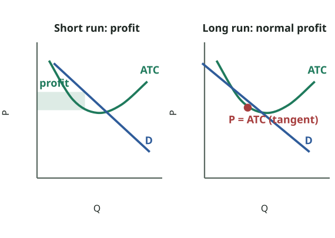
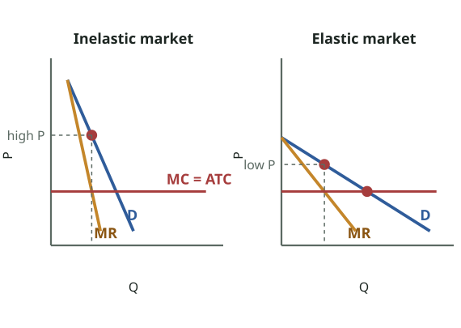

# FPEC 101 · Module 10 — Monopoly (cont.) & Monopolistic Competition
## মডিউল ১০ — একচেটিয়া (চলমান) ও একচেটিয়া প্রতিযোগিতা

_Lecture 10 · 24 slides · Midterm questions: Q15_

> Printable study note generated from the website. Each slide: slide text → Bangla translation → tutor explanation → example → exam tip.

---

## Big picture — what is this lecture about? · বড় ছবি — এই লেকচারে কী শিখব?

_Monopolistic competition (slides 19–22): short-run economic profit attracts new firms; each firm's demand shifts left until it just touches ATC: P = ATC, normal profit in the long run. (Losses work in reverse: firms leave, demand shifts right.)_  
_একচেটিয়া প্রতিযোগিতা (স্লাইড ১৯–২২): স্বল্পমেয়াদি অর্থনৈতিক মুনাফা নতুন ফার্ম টানে; প্রতিটি ফার্মের চাহিদা বাঁয়ে সরে ATC-কে শুধু ছোঁয়া পর্যন্ত: দীর্ঘমেয়াদে P = ATC, স্বাভাবিক মুনাফা। (লোকসানে উল্টো: ফার্ম চলে যায়, চাহিদা ডানে সরে।)_

### English

**Concept:** Lecture 10 finishes monopoly and introduces the third market structure.

1. **Price discrimination:** a monopolist charges **different prices to different buyers** for the same product, a higher price where demand is **inelastic** and a lower price where it is **elastic**, to earn more profit.
2. **Public vs private monopoly**, and a full comparison of **perfect competition vs monopoly**.
3. **Monopolistic competition:** many sellers, **differentiated** products, heavy advertising, easy entry. "Competitive" because there are many firms and free entry; "monopolistic" because each firm's product is a little unique, giving it **some** control over price. Short run: profit or loss. Long run: **normal profit**.

**Exam tip:** this lecture gives the **monopolistic competition** part of **Q15** and finishes the monopoly part (price discrimination, comparison table).

### বাংলা

**ধারণা:** লেকচার ১০ একচেটিয়া শেষ করে তৃতীয় বাজার কাঠামো শুরু করে।

1. **দাম-বৈষম্য:** একচেটিয়া ফার্ম একই পণ্যে **বিভিন্ন ক্রেতাকে ভিন্ন দাম** নেয় — যেখানে চাহিদা **অস্থিতিস্থাপক** সেখানে বেশি, যেখানে **স্থিতিস্থাপক** সেখানে কম — বেশি মুনাফার জন্য।
2. **সরকারি বনাম বেসরকারি একচেটিয়া**, আর **পূর্ণ প্রতিযোগিতা বনাম একচেটিয়ার** পূর্ণ তুলনা।
3. **একচেটিয়া প্রতিযোগিতা:** অনেক বিক্রেতা, **পৃথকীকৃত** পণ্য, প্রচুর বিজ্ঞাপন, সহজ প্রবেশ। অনেক ফার্ম ও অবাধ প্রবেশ বলে "প্রতিযোগিতা"; প্রত্যেকের পণ্য একটু অনন্য বলে দামের ওপর **কিছুটা** নিয়ন্ত্রণ, তাই "একচেটিয়া"। স্বল্পমেয়াদে মুনাফা বা লোকসান; দীর্ঘমেয়াদে **স্বাভাবিক মুনাফা**।

**পরীক্ষার টিপস:** এই লেকচার **Q15**-এর **একচেটিয়া প্রতিযোগিতা** অংশ দেয় এবং একচেটিয়া অংশ শেষ করে (দাম-বৈষম্য, তুলনার ছক)।

---

## Key words · মূল শব্দ

| Term | Meaning | বাংলা অর্থ | Example |
|---|---|---|---|
| Price discrimination | Charging different prices for the same product to different buyers | দাম-বৈষম্য — একই পণ্যে ভিন্ন ক্রেতাকে ভিন্ন দাম | Student vs adult bus fare. |
| Market segregation | Separating buyers into groups with different elasticities | বাজার পৃথকীকরণ — ভিন্ন স্থিতিস্থাপকতার গোষ্ঠীতে ক্রেতা ভাগ | Peak and off-peak travellers. |
| Monopolistic competition | Many sellers, differentiated products, easy entry | একচেটিয়া প্রতিযোগিতা — অনেক বিক্রেতা, পৃথকীকৃত পণ্য, সহজ প্রবেশ | Restaurants, salons, boutiques. |
| Product differentiation | Making a product different by attributes, service, location, brand | পণ্য পৃথকীকরণ — গুণ, সেবা, অবস্থান, ব্র্যান্ড দিয়ে পণ্য আলাদা করা | A café's special recipe and décor. |
| Non-price competition | Competing by quality, design, advertising rather than price | অ-দাম প্রতিযোগিতা — দাম নয়, মান, নকশা, বিজ্ঞাপন দিয়ে প্রতিযোগিতা | Free delivery, loyalty cards. |
| Consumer sovereignty | Consumers decide what is produced | ভোক্তার সার্বভৌমত্ব — ভোক্তাই ঠিক করে কী উৎপাদন হবে | "The customer is king." |

---

## Slides 1–4 · Title and outline
### শিরোনাম ও রূপরেখা

> **Slide 1**
> PRINCIPLES OF ECONOMICSSalimah Musharrif
> FPEC 101 – LECTURE 10 Unit 2
>
> **Slide 2**
> PRINCIPLES OF ECONOMICSProduction Costs and Market Structures
> FPEC 101 – LECTURE 10 Unit 2
>
> **Slide 3**
> Market Structures- Monopoly. Monopolistic Competition
>
> **Slide 4**
> Outline
> Monopoly
> • Price Discrimination
> Monopolistic Competition
>

**বাংলা অনুবাদ:**

> **স্লাইড ১–৩:** প্রিন্সিপলস অব ইকোনমিক্স — সালিমাহ মুশাররিফ। FPEC 101 – লেকচার ১০, ইউনিট ২। বাজার কাঠামো — একচেটিয়া, একচেটিয়া প্রতিযোগিতা।
> **স্লাইড ৪ — রূপরেখা:** একচেটিয়া (দাম-বৈষম্য) · একচেটিয়া প্রতিযোগিতা

**Tutor explains:** Two parts: the end of **monopoly** (price discrimination, public vs private, comparison with perfect competition) and **monopolistic competition**. Reading: McConnell & Brue pp. 436–438, 445–448.

**টিউটরের ব্যাখ্যা:** দুটি অংশ: **একচেটিয়ার** শেষ (দাম-বৈষম্য, সরকারি বনাম বেসরকারি, পূর্ণ প্রতিযোগিতার সাথে তুলনা) আর **একচেটিয়া প্রতিযোগিতা**। পড়া: ম্যাককনেল ও ব্রু পৃ. ৪৩৬–৪৩৮, ৪৪৫–৪৪৮।

---

## Slide 5 · Price discrimination: meaning and three forms
### দাম-বৈষম্য: অর্থ ও তিনটি রূপ

> Price Discrimination
> Under certain conditions the monopolist can increase its profit by charging different prices to different buyers based on the elasticity of demand.
> • Charging each customer in a single market the maximum price she or he is willing to pay
> • Charging each customer one price for the first set of units purchased and a lower price for subsequent units purchased.
> • Charging some customers one price and other customers another price.
>

**বাংলা অনুবাদ:**

> দাম-বৈষম্য
> কিছু শর্তে একচেটিয়া ফার্ম চাহিদার স্থিতিস্থাপকতার ভিত্তিতে ভিন্ন ক্রেতার কাছে ভিন্ন দাম নিয়ে মুনাফা বাড়াতে পারে।
> • একটি বাজারে প্রত্যেক ক্রেতার কাছ থেকে সে সর্বোচ্চ যা দিতে রাজি সেই দাম নেওয়া।
> • প্রত্যেক ক্রেতার কাছে প্রথম কয়েক এককের জন্য এক দাম, পরের এককগুলোর জন্য কম দাম।
> • কিছু ক্রেতার কাছে এক দাম, অন্যদের কাছে আরেক দাম।

**Tutor explains:** **Price discrimination** = selling the **same product** at **different prices** to different buyers, not because costs differ but because **elasticity of demand differs**. Three forms:
**Each customer pays the maximum they are willing to pay** (perfect / first-degree), e.g. bargaining in a bazaar.**Different prices for different quantities** (second-degree): first units dear, later units cheaper, e.g. bulk discounts, "buy 2 get 1 free".**Different prices for different groups** (third-degree): e.g. student fares, children's tickets, foreigner vs local entry fees.

**টিউটরের ব্যাখ্যা:** **দাম-বৈষম্য** = **একই পণ্য** বিভিন্ন ক্রেতার কাছে **ভিন্ন দামে** বিক্রি — খরচ আলাদা বলে নয়, **চাহিদার স্থিতিস্থাপকতা আলাদা** বলে। তিনটি রূপ:
**প্রত্যেক ক্রেতা সর্বোচ্চ যা দিতে রাজি তা-ই দেয়** (পূর্ণ / প্রথম মাত্রা), যেমন বাজারে দরদাম।**ভিন্ন পরিমাণে ভিন্ন দাম** (দ্বিতীয় মাত্রা): প্রথম এককগুলো দামি, পরেরগুলো সস্তা, যেমন পাইকারি ছাড়, "২টা কিনলে ১টা ফ্রি"।**ভিন্ন গোষ্ঠীর জন্য ভিন্ন দাম** (তৃতীয় মাত্রা): যেমন ছাত্র ভাড়া, শিশুর টিকিট, বিদেশি বনাম দেশি প্রবেশমূল্য।

**Real-life example:** Entry to Lalbagh Fort: Bangladeshi visitors pay much less than foreign tourists. Electricity tariffs: households pay less per unit for the first slab than for higher slabs.

**বাস্তব উদাহরণ:** লালবাগ কেল্লায় প্রবেশ: বাংলাদেশি দর্শনার্থী বিদেশি পর্যটকের চেয়ে অনেক কম দেন। বিদ্যুৎ বিল: প্রথম ধাপের ইউনিটে কম, ওপরের ধাপে বেশি দাম।

---

## Slide 6 · Conditions for price discrimination
### দাম-বৈষম্যের শর্ত

> Price Discrimination
> Necessary Conditions.…
> • Monopoly Power
> • Market Segregation
> • No Resale
>

**বাংলা অনুবাদ:**

> দাম-বৈষম্য
> প্রয়োজনীয় শর্ত:
> • একচেটিয়া ক্ষমতা
> • বাজার পৃথকীকরণ
> • পুনর্বিক্রয় নেই

**Tutor explains:** Three conditions must all hold:
**Monopoly power:** the seller must be able to set prices (a price taker cannot).**Market segregation:** it must be able to **separate buyers** into groups with **different elasticities** (by age, time, place, ID card).**No resale:** buyers in the cheap market must not be able to **resell** to buyers in the dear market (otherwise everyone buys cheap). Services (haircuts, travel, medical care) are easy to discriminate because they cannot be resold.

**টিউটরের ব্যাখ্যা:** তিনটি শর্তই থাকতে হবে:
**একচেটিয়া ক্ষমতা:** বিক্রেতাকে দাম ঠিক করতে পারতে হবে (দাম গ্রহণকারী পারে না)।**বাজার পৃথকীকরণ:** **ভিন্ন স্থিতিস্থাপকতার** গোষ্ঠীতে **ক্রেতা আলাদা** করতে পারতে হবে (বয়স, সময়, স্থান, পরিচয়পত্র দিয়ে)।**পুনর্বিক্রয় নেই:** সস্তা বাজারের ক্রেতা যেন দামি বাজারের ক্রেতার কাছে **আবার বেচতে** না পারে (নইলে সবাই সস্তায় কিনবে)। সেবায় (চুল কাটা, ভ্রমণ, চিকিৎসা) বৈষম্য সহজ, কারণ আবার বেচা যায় না।

**Exam tip:** Write the three conditions as a numbered list; they are a classic 3-mark short question.

**পরীক্ষার টিপস:** তিনটি শর্ত নম্বর দিয়ে লেখো; এটা ক্লাসিক ৩ নম্বরের সংক্ষিপ্ত প্রশ্ন।

---

## Slide 7 · Price and output under price discrimination
### দাম-বৈষম্যে দাম ও উৎপাদন

_Price discrimination (slide 7): with MC = ATC constant, the firm sets MR = MC in each market. It charges a HIGHER price where demand is inelastic and a LOWER price where demand is elastic; total profit is larger than with one price._  
_দাম-বৈষম্য (স্লাইড ৭): MC = ATC স্থির ধরে ফার্ম প্রতিটি বাজারে MR = MC করে। অস্থিতিস্থাপক চাহিদার বাজারে **বেশি** দাম, স্থিতিস্থাপক বাজারে **কম** দাম নেয়; এক দামের চেয়ে মোট মুনাফা বেশি।_

> Price Discrimination
> It then produces and sells the MR =MC output in each market segment.
> Assuming ATC constant and MC=ATC at all output levels.
> The firm charges a higher price in the inelastic market
> A lower price in the more elastic market.
> Total profit is larger than it would be with no discrimination and single price
> McConnell & Brue pg. 438
> The price-discriminating monopolist maximizes total profit by dividing the market into two segments, inelastic and elastic
>

**বাংলা অনুবাদ:**

> দাম-বৈষম্য
> এরপর ফার্ম প্রতিটি বাজার-অংশে MR = MC উৎপাদন করে বিক্রি করে।
> ধরা হয় ATC স্থির এবং সব উৎপাদনে MC = ATC।
> ফার্ম অস্থিতিস্থাপক বাজারে বেশি দাম নেয়
> আর বেশি স্থিতিস্থাপক বাজারে কম দাম।
> বৈষম্য না করে এক দামে যা হতো তার চেয়ে মোট মুনাফা বেশি।
> ম্যাককনেল ও ব্রু পৃ. ৪৩৮
> দাম-বৈষম্যকারী একচেটিয়া ফার্ম বাজারকে অস্থিতিস্থাপক ও স্থিতিস্থাপক দুই অংশে ভাগ করে মোট মুনাফা সর্বোচ্চ করে।

**Tutor explains:** The firm splits the market in two and applies **MR = MC in each part** (with constant MC = ATC): - **Inelastic market** (buyers who need it): **higher price**. - **Elastic market** (price-sensitive buyers): **lower price**.
Total profit is **larger** than with a single price. Lecture 5's "yield management" (airlines, peak/off-peak trains) is exactly this.

**টিউটরের ব্যাখ্যা:** ফার্ম বাজারকে দুই ভাগ করে **প্রতিটি অংশে MR = MC** প্রয়োগ করে (MC = ATC স্থির ধরে): - **অস্থিতিস্থাপক বাজার** (যাদের লাগবেই): **বেশি দাম**। - **স্থিতিস্থাপক বাজার** (দাম-সংবেদনশীল ক্রেতা): **কম দাম**।
এক দামের চেয়ে মোট মুনাফা **বেশি**। লেকচার ৫-এর "ইল্ড ম্যানেজমেন্ট" (এয়ারলাইন, ব্যস্ত/অব্যস্ত সময়ের ট্রেন) ঠিক এটাই।

---

## Slide 8 · Public vs private monopoly
### সরকারি বনাম বেসরকারি একচেটিয়া

> Public vs Private Monopoly
> Finance: Public — Government | Private — by selling shares, savings
> Motive: welfare services, not profit | produce whatever is demanded
> Prices: affordable | higher, as profit is the motive
> Administration: board formed by government ministry | board formed by private investors
> Investment: greater | lesser
> Efficiency: less efficient | greater efficiency
> Payment: by paying taxes | paying for product bought
> Functioning: cannot run smoothly for long-run plans because of inflation etc. | runs smoothly
> Burden: on taxpayer | on private investors
> Shut down: supported by government in case of losses | may be shut down or nationalised
>

**বাংলা অনুবাদ:**

> সরকারি বনাম বেসরকারি একচেটিয়া
> অর্থায়ন: সরকারি — সরকার | বেসরকারি — শেয়ার বিক্রি, সঞ্চয়
> উদ্দেশ্য: কল্যাণমূলক সেবা, মুনাফা নয় | যা চাওয়া হয় তা উৎপাদন
> দাম: সাশ্রয়ী | বেশি, কারণ মুনাফাই উদ্দেশ্য
> প্রশাসন: মন্ত্রণালয়ের গঠিত বোর্ড | বেসরকারি বিনিয়োগকারীদের গঠিত বোর্ড
> বিনিয়োগ: বেশি | কম
> দক্ষতা: কম দক্ষ | বেশি দক্ষ
> পরিশোধ: কর দিয়ে | কেনা পণ্যের দাম দিয়ে
> পরিচালনা: মূল্যস্ফীতি ইত্যাদির কারণে দীর্ঘমেয়াদি পরিকল্পনায় মসৃণ চলে না | মসৃণ চলে
> বোঝা: করদাতার ওপর | বেসরকারি বিনিয়োগকারীর ওপর
> বন্ধ: লোকসানে সরকার সমর্থন দেয় | বন্ধ বা জাতীয়করণ হতে পারে

**Tutor explains:** A monopoly can be owned by the **state** (public) or by **private investors**. The key contrast: a **public monopoly** aims at **welfare** and **affordable prices**, financed and backed by taxpayers, but tends to be **less efficient**; a **private monopoly** aims at **profit**, charges **higher prices**, but is usually **more efficient** and bears its own losses.

**টিউটরের ব্যাখ্যা:** একচেটিয়ার মালিক হতে পারে **রাষ্ট্র** (সরকারি) বা **বেসরকারি বিনিয়োগকারী**। মূল বৈসাদৃশ্য: **সরকারি একচেটিয়ার** লক্ষ্য **কল্যাণ** ও **সাশ্রয়ী দাম**, করদাতার অর্থে চলে ও সমর্থিত, কিন্তু **কম দক্ষ** হয়; **বেসরকারি একচেটিয়ার** লক্ষ্য **মুনাফা**, **বেশি দাম** নেয়, কিন্তু সাধারণত **বেশি দক্ষ** এবং নিজের লোকসান নিজে বহন করে।

**Real-life example:** **Public:** Bangladesh Railway, Dhaka WASA (low fares, losses covered by the budget). **Private (near-monopoly):** a privately owned toll road or port operator under a concession.

**বাস্তব উদাহরণ:** **সরকারি:** বাংলাদেশ রেলওয়ে, ঢাকা ওয়াসা (কম ভাড়া, লোকসান বাজেট থেকে মেটে)। **বেসরকারি (প্রায়-একচেটিয়া):** কনসেশনে বেসরকারি মালিকানার টোল রোড বা বন্দর পরিচালক।

---

## Slides 9–12 · Perfect competition vs monopoly: eight comparisons
### পূর্ণ প্রতিযোগিতা বনাম একচেটিয়া: আটটি তুলনা

> **Slide 9**
> Perfect Competition vs Monopoly
> Efficiency :
> Under perfect competition the firm is forced to produce as efficiently as possible due to high competitiveness and the same price per unit. If costs are high and prices cannot be raised, the high-cost producer will receive a lower profit per unit and inefficient firms will have to leave the industry
> In monopoly if economies of scale are achieved, it is most beneficial for the monopolist because he can charge as high a price as possible
> Prices :
> Under perfect competition prices are kept low to attract customers.
> A monopolist can charge a low price to earn a profit since they produce on a large scale and this price may be lower than that under perfect competition. Alternatively they may charge a much higher price especially if the firm is inefficient to cover its costs.
>
> **Slide 10**
> Perfect Competition vs Monopoly
> Retained profit
> In perfect competition there’s no profit left over for investments and research
> In monopoly if economies of scale are achieved, it is most beneficial for the monopolist because he can charge as high a price as possible
> Supplier
> In perfect competition the consumer can switch to an alternative supplier if not satisfied
> A monopolist is a single supplier offering no such choice to the consumer.
>
> **Slide 11**
> Perfect Competition vs Monopoly
> Production
> Under perfect competition, those firms that produce products requiring huge investments and capital equipment need at least the entire home market to cater to, to operate at full capacity. If there is more than one firm it has to operate below capacity with higher costs so that there are poor prospects in export markets.
> In monopoly since the whole market is guaranteed prices are more competitive and huge outputs can be produced owing to benefits of economies of scale.
> Response
> Under perfect competition producers respond in an expected manner so that if demand increases and price increases they increase production. When all competitors increase production, supply exceeds demand and price falls so that in the next production period there will probably be a shortage.
> Monopolists on the other hand react to changes more effectively as they are single suppliers and can therefore estimate the market trend more accurately.
>
> **Slide 12**
> Perfect Competition vs Monopoly
> Price
> Under perfect competition the same price is charged by all competitors based on most efficient production, that is, where price=average cost=marginal cost.
> A monopolist charges a higher price much greater than average cost or Marginal cost by restricting output.
> Consumer sovereignty
> Under perfect competition the consumer is the king and whatever he demands is supplied. There is also a variety of suppliers and producers to choose from.
> Under monopoly consumers sovereignty is less as there’s only one supplier and the producer is in a stronger position.
>

**বাংলা অনুবাদ:**

> **স্লাইড ৯ — দক্ষতা:** পূর্ণ প্রতিযোগিতায় তীব্র প্রতিযোগিতা ও একই এককদামের কারণে ফার্ম যতটা সম্ভব দক্ষভাবে উৎপাদনে বাধ্য; খরচ বেশি কিন্তু দাম বাড়ানো না গেলে উচ্চ-ব্যয়ের উৎপাদক কম মুনাফা পায় ও অদক্ষ ফার্ম বেরিয়ে যায়। একচেটিয়ায় বৃহদায়তনের সুবিধা পেলে তা একচেটিয়া ফার্মের জন্যই সবচেয়ে লাভজনক, কারণ সে যত খুশি দাম নিতে পারে। **দাম:** পূর্ণ প্রতিযোগিতায় ক্রেতা টানতে দাম কম রাখা হয়। একচেটিয়া বড় পরিসরে উৎপাদন করে কম দামেও মুনাফা করতে পারে, যা পূর্ণ প্রতিযোগিতার চেয়েও কম হতে পারে; আবার অদক্ষ হলে খরচ মেটাতে অনেক বেশি দামও নিতে পারে।
> **স্লাইড ১০ — সংরক্ষিত মুনাফা:** পূর্ণ প্রতিযোগিতায় বিনিয়োগ ও গবেষণার জন্য মুনাফা বাঁচে না; একচেটিয়ায় বাঁচে। **সরবরাহকারী:** পূর্ণ প্রতিযোগিতায় অসন্তুষ্ট ক্রেতা অন্য সরবরাহকারীর কাছে যেতে পারে; একচেটিয়া একমাত্র সরবরাহকারী, ক্রেতার বিকল্প নেই।
> **স্লাইড ১১ — উৎপাদন:** বিপুল বিনিয়োগ ও মূলধনী যন্ত্রের শিল্পে পূর্ণ সক্ষমতায় চলতে পুরো দেশীয় বাজার লাগে; একাধিক ফার্ম থাকলে সক্ষমতার নিচে চলতে হয়, খরচ বাড়ে। একচেটিয়ায় পুরো বাজার নিশ্চিত, তাই বৃহদায়তনের সুবিধায় বিপুল উৎপাদন ও প্রতিযোগিতামূলক দাম সম্ভব। **সাড়া:** পূর্ণ প্রতিযোগিতায় চাহিদা ও দাম বাড়লে সবাই উৎপাদন বাড়ায়, ফলে যোগান চাহিদা ছাড়িয়ে দাম পড়ে যায়, পরের মৌসুমে উৎপাদন কমায় — ওঠানামা চলে। একচেটিয়া একমাত্র সরবরাহকারী বলে বাজারের ধারা ভালো অনুমান করে বেশি কার্যকরভাবে সাড়া দেয়।
> **স্লাইড ১২ — দাম:** পূর্ণ প্রতিযোগিতায় সবচেয়ে দক্ষ উৎপাদনের ভিত্তিতে সবাই একই দাম নেয়, যেখানে দাম = গড় ব্যয় = প্রান্তিক ব্যয়। একচেটিয়া উৎপাদন সীমিত করে গড় বা প্রান্তিক ব্যয়ের চেয়ে অনেক বেশি দাম নেয়। **ভোক্তার সার্বভৌমত্ব:** পূর্ণ প্রতিযোগিতায় ভোক্তাই রাজা, যা চায় তা সরবরাহ হয়, বেছে নেওয়ার অনেক বিক্রেতা। একচেটিয়ায় একজনই সরবরাহকারী বলে ভোক্তার সার্বভৌমত্ব কম, উৎপাদক শক্তিশালী অবস্থানে।

**Tutor explains:** The four slides compare the two extremes under eight headings:
HeadingPerfect competitionMonopoly
EfficiencyForced to be efficient; inefficient firms leaveBenefits from economies of scale, but no pressure to be efficient
PricesKept low to attract buyersCould be lower (scale) or much higher (inefficiency, restricting output)
Retained profitNone left for investment and researchProfits available for investment
Supplier choiceConsumer can switchNo choice
ProductionBig-capital industries run below capacity if splitWhole market → large output, economies of scale
Response to changeOver-reaction, boom-bust cyclesBetter able to estimate market trends
Price vs costP = AC = MCP > AC and MC (restricts output)
Consumer sovereigntyConsumer is kingProducer is in the stronger position
Notice the slides give monopoly some **advantages** too (research funds, scale, stable planning). A balanced exam answer mentions both sides.

**টিউটরের ব্যাখ্যা:** চারটি স্লাইড আটটি শিরোনামে দুই প্রান্তের তুলনা করে:
শিরোনামপূর্ণ প্রতিযোগিতাএকচেটিয়া
দক্ষতাদক্ষ হতে বাধ্য; অদক্ষরা বেরিয়ে যায়বৃহদায়তনের সুবিধা পায়, কিন্তু দক্ষ হওয়ার চাপ নেই
দামক্রেতা টানতে কম রাখা হয়কম হতে পারে (আকার) বা অনেক বেশি (অদক্ষতা, উৎপাদন সীমিত)
সংরক্ষিত মুনাফাবিনিয়োগ ও গবেষণার জন্য বাঁচে নাবিনিয়োগের জন্য মুনাফা থাকে
সরবরাহকারী বাছাইভোক্তা বদলাতে পারেকোনো বিকল্প নেই
উৎপাদনবড় মূলধনের শিল্প ভাগ হলে সক্ষমতার নিচে চলেপুরো বাজার → বিপুল উৎপাদন, বৃহদায়তনের সুবিধা
পরিবর্তনে সাড়াঅতিপ্রতিক্রিয়া, তেজি-মন্দার চক্রবাজারের ধারা ভালো অনুমান করতে পারে
দাম বনাম ব্যয়P = AC = MCP > AC ও MC (উৎপাদন সীমিত)
ভোক্তার সার্বভৌমত্বভোক্তাই রাজাউৎপাদক শক্তিশালী অবস্থানে
খেয়াল করো, স্লাইড একচেটিয়ার কিছু **সুবিধাও** দেখায় (গবেষণার অর্থ, আকার, স্থিতিশীল পরিকল্পনা)। ভারসাম্যপূর্ণ উত্তরে দুই দিকই লেখো।

**Exam tip:** This table is ready-made for a "compare perfect competition and monopoly" question. Learn the eight headings.

**পরীক্ষার টিপস:** "পূর্ণ প্রতিযোগিতা ও একচেটিয়ার তুলনা" প্রশ্নে এই ছক সরাসরি কাজে লাগে। আটটি শিরোনাম শেখো।

---

## Quick check · দ্রুত যাচাই

1. Which is NOT a condition for price discrimination?  
   কোনটি দাম-বৈষম্যের শর্ত নয়?

   - A) Monopoly power · একচেটিয়া ক্ষমতা
   - B) Market segregation · বাজার পৃথকীকরণ
   - C) Easy resale between buyers · ক্রেতাদের মধ্যে সহজ পুনর্বিক্রয়
   - D) Different elasticities · ভিন্ন স্থিতিস্থাপকতা

   **Answer: C** — If buyers could resell, the cheap group would resell to the dear group and discrimination would fail.  
   ক্রেতারা আবার বেচতে পারলে সস্তা গোষ্ঠী দামি গোষ্ঠীর কাছে বেচবে, বৈষম্য ব্যর্থ হবে।

2. A price-discriminating monopolist charges the higher price in the market where demand is…  
   দাম-বৈষম্যকারী একচেটিয়া বেশি দাম নেয় যে বাজারে চাহিদা…

   - A) More elastic · বেশি স্থিতিস্থাপক
   - B) Inelastic · অস্থিতিস্থাপক
   - C) Perfectly elastic · পূর্ণ স্থিতিস্থাপক
   - D) Zero · শূন্য

   **Answer: B** — Buyers with inelastic demand keep buying even at a high price.  
   অস্থিতিস্থাপক চাহিদার ক্রেতা বেশি দামেও কিনতে থাকে।

---

## Slides 13–14 · Monopolistic competition: definition
### একচেটিয়া প্রতিযোগিতা: সংজ্ঞা

> **Slide 13**
> Monopolistic Competition
>
> **Slide 14**
> Monopolistic Competition
> A market structure characterized by
> A relatively large number of sellers
> differentiated products (often promoted by heavy advertising)
> easy entry to, and exit from, the industry.
> The first and third characteristics provide the “competitive” aspect of monopolistic competition; the second characteristic provides the “monopolistic” aspect.
>

**বাংলা অনুবাদ:**

> **স্লাইড ১৩:** একচেটিয়া প্রতিযোগিতা
> **স্লাইড ১৪:** এমন একটি বাজার কাঠামো যার বৈশিষ্ট্য — তুলনামূলক বেশি সংখ্যক বিক্রেতা; পৃথকীকৃত পণ্য (প্রায়ই প্রচুর বিজ্ঞাপনে প্রচারিত); শিল্পে সহজ প্রবেশ ও প্রস্থান। প্রথম ও তৃতীয় বৈশিষ্ট্য একচেটিয়া প্রতিযোগিতার "প্রতিযোগিতামূলক" দিক; দ্বিতীয়টি "একচেটিয়া" দিক।

**Tutor explains:** **Monopolistic competition** = (1) a **relatively large number of sellers**, (2) **differentiated products** (often heavily advertised), (3) **easy entry and exit**.
The name explains itself: features **1 and 3** make it **competitive**; feature **2** (each product is slightly unique) gives each firm a little **monopoly** power.

**টিউটরের ব্যাখ্যা:** **একচেটিয়া প্রতিযোগিতা** = (১) **তুলনামূলক বেশি সংখ্যক বিক্রেতা**, (২) **পৃথকীকৃত পণ্য** (প্রায়ই প্রচুর বিজ্ঞাপিত), (৩) **সহজ প্রবেশ ও প্রস্থান**।
নামটাই ব্যাখ্যা: বৈশিষ্ট্য **১ ও ৩** একে **প্রতিযোগিতামূলক** করে; বৈশিষ্ট্য **২** (প্রতিটি পণ্য একটু অনন্য) প্রত্যেক ফার্মকে একটু **একচেটিয়া** ক্ষমতা দেয়।

**Real-life example:** Fast-food shops on Satmasjid Road, beauty salons, tailors, bakeries, clothing brands like Yellow, Ecstasy, Sailor: many sellers, each a bit different, and a new one opens every month.

**বাস্তব উদাহরণ:** সাতমসজিদ রোডের ফাস্টফুড দোকান, বিউটি পার্লার, দর্জি, বেকারি, ইয়েলো, এক্সট্যাসি, সেইলরের মতো পোশাক ব্র্যান্ড: অনেক বিক্রেতা, প্রত্যেকে একটু আলাদা, প্রতি মাসে নতুন একটা খোলে।

---

## Slides 15–16 · Features of monopolistic competition
### একচেটিয়া প্রতিযোগিতার বৈশিষ্ট্য

> **Slide 15**
> Monopolistic Competition - Features
> A relatively large number of sellers
> • Small Market Shares
> • No Collusion
> • Independent Action
> Differentiated products (often promoted by heavy advertising)
> • Product Attributes
> • Service
> • Location
> • Brand Names and Packaging
> • Some Control Over Price
> Easy entry to, and exit from, the industry.
>
> **Slide 16**
> Monopolistic Competition- Features
> Heavy AdvertisingMonopolistic competitors advertise their products, often heavily to achieve successful product differentiation
> Goal of differentiation and advertising, referred to as nonprice competition is to increase product appeal and price less of a factor for consumer purchase. Successful measures will increase demand shifting it to the right and making it relatively less elastic.
>

**বাংলা অনুবাদ:**

> **স্লাইড ১৫:** তুলনামূলক বেশি সংখ্যক বিক্রেতা — ছোট বাজার-অংশ · যোগসাজশ নেই · স্বাধীন সিদ্ধান্ত। পৃথকীকৃত পণ্য (প্রায়ই প্রচুর বিজ্ঞাপনে প্রচারিত) — পণ্যের গুণাবলি · সেবা · অবস্থান · ব্র্যান্ড নাম ও প্যাকেজিং · দামের ওপর কিছু নিয়ন্ত্রণ। শিল্পে সহজ প্রবেশ ও প্রস্থান।
> **স্লাইড ১৬ — প্রচুর বিজ্ঞাপন:** সফল পণ্য পৃথকীকরণের জন্য একচেটিয়া প্রতিযোগীরা প্রায়ই প্রচুর বিজ্ঞাপন দেয়। পৃথকীকরণ ও বিজ্ঞাপনের লক্ষ্য — অ-দাম প্রতিযোগিতা — পণ্যের আকর্ষণ বাড়ানো এবং ক্রেতার কাছে দামকে কম গুরুত্বপূর্ণ করা। সফল হলে চাহিদা বাড়ে, ডানে সরে এবং তুলনামূলক কম স্থিতিস্থাপক হয়।

**Tutor explains:** **1. Many sellers:** each has a **small market share**, so there is **no collusion** and each firm acts **independently**.
**2. Differentiated products**, by: **attributes** (quality, design), **service** (friendly staff, delivery), **location** (the shop near you), **brand names and packaging**. This gives **some control over price**.
**3. Easy entry and exit.**
**4. Heavy advertising (non-price competition):** the aim is to make the product more appealing so that **price matters less**: demand **shifts right** and becomes **less elastic**.

**টিউটরের ব্যাখ্যা:** **১. অনেক বিক্রেতা:** প্রত্যেকের **ছোট বাজার-অংশ**, তাই **যোগসাজশ নেই**, প্রত্যেকে **স্বাধীনভাবে** চলে।
**২. পৃথকীকৃত পণ্য**, যেভাবে: **গুণাবলি** (মান, নকশা), **সেবা** (আন্তরিক কর্মী, ডেলিভারি), **অবস্থান** (তোমার কাছের দোকান), **ব্র্যান্ড নাম ও প্যাকেজিং**। এতে **দামের ওপর কিছু নিয়ন্ত্রণ** আসে।
**৩. সহজ প্রবেশ ও প্রস্থান।**
**৪. প্রচুর বিজ্ঞাপন (অ-দাম প্রতিযোগিতা):** লক্ষ্য পণ্যকে আকর্ষণীয় করা যাতে **দাম কম গুরুত্বপূর্ণ** হয়: চাহিদা **ডানে সরে** এবং **কম স্থিতিস্থাপক** হয়।

---

## Slide 17 · Demand: highly elastic; short run vs long run
### চাহিদা: খুব স্থিতিস্থাপক; স্বল্প বনাম দীর্ঘমেয়াদ

> Price and Output Determination
> Highly elastic Demand curve- Distinguishing feature from Perfect competition and monopolyThe monopolistic competitor’s demand is more elastic than the demand faced by a pure monopolist because the monopolistically competitive seller has many competitors producing closely substitutable goods. The pure monopolist has no rivals at all. Demand is not perfectly elastic like that of the pure competitor because of fewer rivals and that products are differentiated, so they are not perfect substitutes.
> The price elasticity of demand faced by the monopolistically competitive firm depends on the number of rivals and the degree of product differentiation. The larger the number of rivals and the weaker the product differentiation, the greater the price elasticity of each seller’s demand, that is, the closer monopolistic competition will be to pure competition
> Short run, profits and losses
> Long run profit or loss – normal profit
>

**বাংলা অনুবাদ:**

> দাম ও উৎপাদন নির্ধারণ
> **খুব স্থিতিস্থাপক চাহিদা রেখা** — পূর্ণ প্রতিযোগিতা ও একচেটিয়া থেকে পার্থক্য। একচেটিয়া প্রতিযোগীর চাহিদা বিশুদ্ধ একচেটিয়ার চেয়ে বেশি স্থিতিস্থাপক, কারণ তার অনেক প্রতিযোগী আছে যারা কাছাকাছি বিকল্প দেয়; কিন্তু পূর্ণ প্রতিযোগিতার মতো পূর্ণ স্থিতিস্থাপক নয়, কারণ পণ্য পৃথকীকৃত।
> চাহিদার স্থিতিস্থাপকতা নির্ভর করে প্রতিদ্বন্দ্বীর সংখ্যা ও পৃথকীকরণের মাত্রার ওপর। প্রতিদ্বন্দ্বী যত বেশি ও পৃথকীকরণ যত দুর্বল, স্থিতিস্থাপকতা তত বেশি।
> স্বল্পমেয়াদে মুনাফা ও লোকসান
> দীর্ঘমেয়াদে মুনাফা বা লোকসান — স্বাভাবিক মুনাফা

**Tutor explains:** The firm's demand curve slopes down but is **highly elastic**: - **More elastic than a monopolist's**, because there are many close substitutes. - **Not perfectly elastic** like perfect competition, because products are differentiated.
Elasticity depends on the **number of rivals** and the **degree of differentiation**: more rivals and weaker differentiation → more elastic.
Output rule: **MR = MC** (like any firm). **Short run:** profit or loss. **Long run:** normal profit (next slides).

**টিউটরের ব্যাখ্যা:** ফার্মের চাহিদা রেখা নিচে নামে কিন্তু **খুব স্থিতিস্থাপক**: - **একচেটিয়ার চেয়ে বেশি স্থিতিস্থাপক**, কারণ অনেক কাছাকাছি বিকল্প আছে। - পূর্ণ প্রতিযোগিতার মতো **পূর্ণ স্থিতিস্থাপক নয়**, কারণ পণ্য পৃথকীকৃত।
স্থিতিস্থাপকতা নির্ভর করে **প্রতিদ্বন্দ্বীর সংখ্যা** ও **পৃথকীকরণের মাত্রার** ওপর: বেশি প্রতিদ্বন্দ্বী ও দুর্বল পৃথকীকরণ → বেশি স্থিতিস্থাপক।
উৎপাদনের নিয়ম: **MR = MC** (যেকোনো ফার্মের মতো)। **স্বল্পমেয়াদ:** মুনাফা বা লোকসান। **দীর্ঘমেয়াদ:** স্বাভাবিক মুনাফা (পরের স্লাইড)।

---

## Slides 18–22 · From short-run profit/loss to long-run normal profit
### স্বল্পমেয়াদি মুনাফা/লোকসান থেকে দীর্ঘমেয়াদি স্বাভাবিক মুনাফা

_Monopolistic competition (slides 19–22): short-run economic profit attracts new firms; each firm's demand shifts left until it just touches ATC: P = ATC, normal profit in the long run. (Losses work in reverse: firms leave, demand shifts right.)_  
_একচেটিয়া প্রতিযোগিতা (স্লাইড ১৯–২২): স্বল্পমেয়াদি অর্থনৈতিক মুনাফা নতুন ফার্ম টানে; প্রতিটি ফার্মের চাহিদা বাঁয়ে সরে ATC-কে শুধু ছোঁয়া পর্যন্ত: দীর্ঘমেয়াদে P = ATC, স্বাভাবিক মুনাফা। (লোকসানে উল্টো: ফার্ম চলে যায়, চাহিদা ডানে সরে।)_

> **Slide 18**
> Profits: in the short term, if profit, other firms are attracted and enter; demand for each business falls (shifts left); each firm has a smaller share of total demand and faces more close substitutes; economic profit is reduced until it disappears.
> Loss: with short-term losses, firms leave; the survivors face fewer substitutes and a bigger share of demand; their demand curves shift right; losses disappear and give way to normal profits in the long run.
>
> **Slide 19**
> [Diagram: elastic demand curve above ATC: economic profit → competitors enter]
>
> **Slide 20**
> [Diagram: demand curve shifts left; economic profits decrease; in the long run, profits are zero]
>
> **Slide 21**
> [Diagram: demand below ATC: loss → competitors leave]
>
> **Slide 22**
> [Diagram: some firms exit; D shifts right; losses get smaller; in the long run, profits are zero]
>

**বাংলা অনুবাদ:**

> **স্লাইড ১৮ — মুনাফা:** স্বল্পমেয়াদে মুনাফা হলে অন্য ফার্ম আকৃষ্ট হয়ে ঢোকে; প্রতিটি ব্যবসার চাহিদা কমে (বাঁয়ে সরে); প্রত্যেকের মোট চাহিদার অংশ ছোট হয়, কাছাকাছি বিকল্প বাড়ে; অর্থনৈতিক মুনাফা কমতে কমতে শেষ হয়। **লোকসান:** স্বল্পমেয়াদে লোকসান হলে ফার্ম চলে যায়; টিকে থাকা ফার্মের বিকল্প কমে, চাহিদার অংশ বাড়ে, চাহিদা রেখা ডানে সরে; দীর্ঘমেয়াদে লোকসান দূর হয়ে স্বাভাবিক মুনাফা আসে।
> **স্লাইড ১৯–২২:** [চিত্র: ATC-র ওপরে স্থিতিস্থাপক চাহিদা → অর্থনৈতিক মুনাফা → প্রতিযোগী ঢোকে → চাহিদা বাঁয়ে সরে, দীর্ঘমেয়াদে মুনাফা শূন্য। ATC-র নিচে চাহিদা → লোকসান → প্রতিযোগী চলে যায় → চাহিদা ডানে সরে, লোকসান কমে, দীর্ঘমেয়াদে মুনাফা শূন্য]

**Tutor explains:** The same entry/exit logic as perfect competition, but now it works by **shifting each firm's demand curve**:
**Short-run profit** (P > ATC) → new firms enter with similar products → each firm loses customers → its **demand shifts left** → profit shrinks until demand just **touches (is tangent to) ATC**: **P = ATC, normal profit**.**Short-run loss** (P < ATC) → some firms leave → survivors gain customers → **demand shifts right** → losses disappear → **normal profit**.
**Long-run equilibrium:** P = ATC (normal profit), but **P > MC** and P is **above minimum ATC**: firms have **excess capacity** (they could produce more at lower cost). That is the "cost" of product variety.

**টিউটরের ব্যাখ্যা:** পূর্ণ প্রতিযোগিতার মতো একই প্রবেশ/প্রস্থানের যুক্তি, তবে এবার কাজ করে **প্রতিটি ফার্মের চাহিদা রেখা সরিয়ে**:
**স্বল্পমেয়াদি মুনাফা** (P > ATC) → অনুরূপ পণ্য নিয়ে নতুন ফার্ম ঢোকে → প্রতিটি ফার্ম ক্রেতা হারায় → **চাহিদা বাঁয়ে সরে** → মুনাফা কমে, যতক্ষণ না চাহিদা ATC-কে **শুধু ছোঁয় (স্পর্শক হয়)**: **P = ATC, স্বাভাবিক মুনাফা**।**স্বল্পমেয়াদি লোকসান** (P < ATC) → কিছু ফার্ম চলে যায় → টিকে থাকারা ক্রেতা পায় → **চাহিদা ডানে সরে** → লোকসান দূর হয় → **স্বাভাবিক মুনাফা**।
**দীর্ঘমেয়াদি ভারসাম্য:** P = ATC (স্বাভাবিক মুনাফা), কিন্তু **P > MC** আর P **সর্বনিম্ন ATC-র ওপরে**: ফার্মের **অতিরিক্ত সক্ষমতা** থাকে (কম খরচে বেশি উৎপাদন করতে পারত)। এটা পণ্য-বৈচিত্র্যের "মূল্য"।

**Real-life example:** A new style of "tehari" shop becomes popular in Mohammadpur and makes big profits. Within a year, five similar shops open nearby; each one's customers fall, and soon they all earn just normal profit.

**বাস্তব উদাহরণ:** মোহাম্মদপুরে নতুন ধরনের "তেহারি" দোকান জনপ্রিয় হয়ে বড় মুনাফা করল। এক বছরে কাছাকাছি পাঁচটি একই রকম দোকান খুলল; প্রত্যেকের ক্রেতা কমল, শিগগিরই সবাই শুধু স্বাভাবিক মুনাফা পায়।

**Exam tip:** In Q15 draw the two-panel diagram: short-run profit, then long-run tangency (D touches ATC).

**পরীক্ষার টিপস:** Q15-এ দুই-প্যানেলের চিত্র আঁকো: স্বল্পমেয়াদি মুনাফা, তারপর দীর্ঘমেয়াদি স্পর্শবিন্দু (D, ATC-কে ছোঁয়)।

---

## Slide 23 · Exceptions to normal profit in the long run
### দীর্ঘমেয়াদে স্বাভাবিক মুনাফার ব্যতিক্রম

> Exceptions to normal profit in long run
> Product differentiation that other firms cannot duplicate even over time
> Product differentiation requires large finance becoming a barrier to entry compared to if products were standardized. This suggests some monopoly power, with small economic profits to continue even in long run.
>

**বাংলা অনুবাদ:**

> দীর্ঘমেয়াদে স্বাভাবিক মুনাফার ব্যতিক্রম
> • এমন পণ্য পৃথকীকরণ যা অন্য ফার্ম সময় পেলেও নকল করতে পারে না।
> • পণ্য পৃথকীকরণে বড় অর্থ লাগলে তা প্রবেশে বাধা হয়ে যায়, প্রমিত পণ্যের তুলনায়। এতে কিছু একচেটিয়া ক্ষমতা বোঝায়, ফলে দীর্ঘমেয়াদেও ছোট অর্থনৈতিক মুনাফা থাকতে পারে।

**Tutor explains:** Two cases where a firm can keep a **small economic profit** even in the long run: 1. Its differentiation **cannot be copied** (a secret recipe, a famous brand, the best location). 2. Differentiating is **expensive** (advertising, design), which acts as a **barrier to entry**, giving the firm a little monopoly power.

**টিউটরের ব্যাখ্যা:** দুটি ক্ষেত্রে ফার্ম দীর্ঘমেয়াদেও **ছোট অর্থনৈতিক মুনাফা** রাখতে পারে: 1. এর পৃথকীকরণ **নকল করা যায় না** (গোপন রেসিপি, বিখ্যাত ব্র্যান্ড, সেরা অবস্থান)। 2. পৃথকীকরণ **ব্যয়বহুল** (বিজ্ঞাপন, নকশা), যা **প্রবেশে বাধা** হয়ে ফার্মকে একটু একচেটিয়া ক্ষমতা দেয়।

**Real-life example:** Old Dhaka's famous biryani houses (e.g. a decades-old brand name) keep long queues and good profits: newcomers cannot copy the reputation.

**বাস্তব উদাহরণ:** পুরান ঢাকার বিখ্যাত বিরিয়ানির দোকান (যেমন কয়েক দশকের পুরোনো ব্র্যান্ড) লম্বা লাইন ও ভালো মুনাফা ধরে রাখে: নবাগতরা সুনাম নকল করতে পারে না।

---

## Slide 24 · Summary of Lecture 10
### লেকচার ১০-এর সারসংক্ষেপ

> SUMMARY
> Monopoly
> • Price Discrimination
> • Conditions
> • Output Determination
> • Public vs Private Monopoly
> Perfect Competition vs Monopoly
> Monopolistic Competition
> • Definition
> • Features
> • Price-Output Determination
> • Exceptions to normal profit in long run
>

**বাংলা অনুবাদ:**

> সারসংক্ষেপ
> একচেটিয়া — দাম-বৈষম্য (শর্ত, উৎপাদন নির্ধারণ), সরকারি বনাম বেসরকারি একচেটিয়া
> পূর্ণ প্রতিযোগিতা বনাম একচেটিয়া
> একচেটিয়া প্রতিযোগিতা — সংজ্ঞা, বৈশিষ্ট্য, দাম-উৎপাদন নির্ধারণ, দীর্ঘমেয়াদে স্বাভাবিক মুনাফার ব্যতিক্রম

**Tutor explains:** Revision checklist: price discrimination (3 forms, 3 conditions, higher price in the inelastic market); public vs private monopoly; 8-point comparison of perfect competition and monopoly; monopolistic competition (definition, features, elastic demand, short-run profit/loss, long-run normal profit, exceptions).

**টিউটরের ব্যাখ্যা:** রিভিশন চেকলিস্ট: দাম-বৈষম্য (৩ রূপ, ৩ শর্ত, অস্থিতিস্থাপক বাজারে বেশি দাম); সরকারি বনাম বেসরকারি একচেটিয়া; পূর্ণ প্রতিযোগিতা ও একচেটিয়ার ৮-দফা তুলনা; একচেটিয়া প্রতিযোগিতা (সংজ্ঞা, বৈশিষ্ট্য, স্থিতিস্থাপক চাহিদা, স্বল্পমেয়াদি মুনাফা/লোকসান, দীর্ঘমেয়াদি স্বাভাবিক মুনাফা, ব্যতিক্রম)।

---

## Put it together — tables, graphs and numbers · সব একসাথে — ছক, গ্রাফ ও হিসাব

_Price discrimination (slide 7): with MC = ATC constant, the firm sets MR = MC in each market. It charges a HIGHER price where demand is inelastic and a LOWER price where demand is elastic; total profit is larger than with one price._  
_দাম-বৈষম্য (স্লাইড ৭): MC = ATC স্থির ধরে ফার্ম প্রতিটি বাজারে MR = MC করে। অস্থিতিস্থাপক চাহিদার বাজারে **বেশি** দাম, স্থিতিস্থাপক বাজারে **কম** দাম নেয়; এক দামের চেয়ে মোট মুনাফা বেশি।_

### English

### Monopolistic competition vs the other two structures
Perfect competitionMonopolistic competitionMonopoly
SellersVery manyRelatively manyOne
ProductIdenticalDifferentiatedUnique
Demand facing firmPerfectly elasticHighly elastic, downwardMarket demand, less elastic
EntryFreeEasyBlocked
AdvertisingNoneHeavyPublic relations
Long-run profitNormalNormal (with exceptions)Abnormal
Long-run efficiencyP = MC = min ATCP = ATC but > MC and > min ATC (excess capacity)P > MC, P > min ATC

### বাংলা

### একচেটিয়া প্রতিযোগিতা বনাম অন্য দুটি কাঠামো
পূর্ণ প্রতিযোগিতাএকচেটিয়া প্রতিযোগিতাএকচেটিয়া
বিক্রেতাঅসংখ্যতুলনামূলক অনেকএকজন
পণ্যএকই রকমপৃথকীকৃতঅনন্য
ফার্মের চাহিদাপূর্ণ স্থিতিস্থাপকখুব স্থিতিস্থাপক, নিম্নমুখীবাজার চাহিদা, কম স্থিতিস্থাপক
প্রবেশঅবাধসহজবন্ধ
বিজ্ঞাপননেইপ্রচুরজনসংযোগ
দীর্ঘমেয়াদি মুনাফাস্বাভাবিকস্বাভাবিক (ব্যতিক্রমসহ)অস্বাভাবিক
দীর্ঘমেয়াদি দক্ষতাP = MC = সর্বনিম্ন ATCP = ATC কিন্তু > MC ও > সর্বনিম্ন ATC (অতিরিক্ত সক্ষমতা)P > MC, P > সর্বনিম্ন ATC

---

## Midterm connection — model answers · মিডটার্ম সংযোগ — মডেল উত্তর

### English

Full card: Q15.

### Q15 (part 3) — Monopolistic competition (+ monopoly additions)
**Monopolistic competition** is a market structure with a relatively large number of sellers, differentiated products (often heavily advertised) and easy entry and exit. **Features:** small market shares, no collusion, independent action; differentiation by attributes, service, location, brand and packaging, giving some control over price; heavy advertising (non-price competition) to shift demand right and make it less elastic. **Demand:** downward-sloping and highly elastic (more elastic than monopoly, not perfectly elastic); elasticity rises with the number of rivals and weaker differentiation. **Short run:** produce where MR = MC; economic profit or loss. **Long run:** profits attract entry, each firm's demand shifts left until P = ATC (tangency): **normal profit**; losses cause exit, demand shifts right until normal profit. At long-run equilibrium P > MC and P > min ATC (excess capacity). **Exceptions:** differentiation that cannot be copied, or costly differentiation that acts as a barrier, may allow small long-run profits. **Barriers:** low.

**Monopoly additions:** **price discrimination** — charging different prices to different buyers (each buyer's maximum; quantity-based; group-based), requiring monopoly power, market segregation and no resale; the firm sets MR = MC in each market and charges more in the inelastic market, raising total profit. **Public vs private monopoly** (welfare and affordable prices vs profit and efficiency). **Perfect competition vs monopoly:** efficiency, prices, retained profit, supplier choice, production scale, response to change, P = AC = MC vs P > AC, consumer sovereignty.

### বাংলা

পূর্ণ কার্ড: Q15।

### Q15 (অংশ ৩) — একচেটিয়া প্রতিযোগিতা (+ একচেটিয়ার সংযোজন)
**একচেটিয়া প্রতিযোগিতা** এমন বাজার কাঠামো যেখানে তুলনামূলক বেশি বিক্রেতা, পৃথকীকৃত পণ্য (প্রায়ই প্রচুর বিজ্ঞাপিত) ও সহজ প্রবেশ-প্রস্থান। **বৈশিষ্ট্য:** ছোট বাজার-অংশ, যোগসাজশ নেই, স্বাধীন সিদ্ধান্ত; গুণ, সেবা, অবস্থান, ব্র্যান্ড ও প্যাকেজিং দিয়ে পৃথকীকরণ, যা দামের ওপর কিছু নিয়ন্ত্রণ দেয়; চাহিদা ডানে সরাতে ও কম স্থিতিস্থাপক করতে প্রচুর বিজ্ঞাপন (অ-দাম প্রতিযোগিতা)। **চাহিদা:** নিম্নমুখী ও খুব স্থিতিস্থাপক (একচেটিয়ার চেয়ে বেশি, পূর্ণ নয়); প্রতিদ্বন্দ্বী বেশি ও পৃথকীকরণ দুর্বল হলে আরও স্থিতিস্থাপক। **স্বল্পমেয়াদ:** MR = MC-তে উৎপাদন; অর্থনৈতিক মুনাফা বা লোকসান। **দীর্ঘমেয়াদ:** মুনাফা প্রবেশ টানে, প্রতিটি ফার্মের চাহিদা বাঁয়ে সরে P = ATC (স্পর্শ) পর্যন্ত: **স্বাভাবিক মুনাফা**; লোকসানে প্রস্থান, চাহিদা ডানে সরে স্বাভাবিক মুনাফা পর্যন্ত। দীর্ঘমেয়াদি ভারসাম্যে P > MC ও P > সর্বনিম্ন ATC (অতিরিক্ত সক্ষমতা)। **ব্যতিক্রম:** নকল-অযোগ্য পৃথকীকরণ, বা বাধা হয়ে দাঁড়ানো ব্যয়বহুল পৃথকীকরণে দীর্ঘমেয়াদেও ছোট মুনাফা থাকতে পারে। **বাধা:** কম।

**একচেটিয়ার সংযোজন:** **দাম-বৈষম্য** — বিভিন্ন ক্রেতাকে ভিন্ন দাম (প্রত্যেকের সর্বোচ্চ; পরিমাণভিত্তিক; গোষ্ঠীভিত্তিক); শর্ত: একচেটিয়া ক্ষমতা, বাজার পৃথকীকরণ, পুনর্বিক্রয় নেই; প্রতিটি বাজারে MR = MC, অস্থিতিস্থাপক বাজারে বেশি দাম, মোট মুনাফা বাড়ে। **সরকারি বনাম বেসরকারি একচেটিয়া** (কল্যাণ ও সাশ্রয়ী দাম বনাম মুনাফা ও দক্ষতা)। **পূর্ণ প্রতিযোগিতা বনাম একচেটিয়া:** দক্ষতা, দাম, সংরক্ষিত মুনাফা, সরবরাহকারী বাছাই, উৎপাদনের আকার, পরিবর্তনে সাড়া, P = AC = MC বনাম P > AC, ভোক্তার সার্বভৌমত্ব।

---

## Module quiz — 5 questions · মডিউল কুইজ — ৫টি প্রশ্ন

1. Student discounts on bus tickets are an example of…  
   বাসের টিকিটে ছাত্র ছাড় কিসের উদাহরণ?

   - A) Perfect competition · পূর্ণ প্রতিযোগিতা
   - B) Price discrimination · দাম-বৈষম্য
   - C) Predatory pricing · লুণ্ঠনমূলক দাম
   - D) Collusion · যোগসাজশ

   **Answer: B** — Different prices for the same service to groups with different elasticities.  
   ভিন্ন স্থিতিস্থাপকতার গোষ্ঠীকে একই সেবায় ভিন্ন দাম।

2. Which feature makes monopolistic competition "monopolistic"?  
   কোন বৈশিষ্ট্য একচেটিয়া প্রতিযোগিতাকে "একচেটিয়া" করে?

   - A) Many sellers · অনেক বিক্রেতা
   - B) Easy entry · সহজ প্রবেশ
   - C) Differentiated products · পৃথকীকৃত পণ্য
   - D) No advertising · বিজ্ঞাপন নেই

   **Answer: C** — Each slightly unique product gives the firm some control over its price.  
   প্রতিটি একটু অনন্য পণ্য ফার্মকে দামের ওপর কিছু নিয়ন্ত্রণ দেয়।

3. In long-run equilibrium, a monopolistically competitive firm earns…  
   দীর্ঘমেয়াদি ভারসাম্যে একচেটিয়া প্রতিযোগী ফার্ম পায়…

   - A) Large economic profit · বড় অর্থনৈতিক মুনাফা
   - B) Normal profit (P = ATC) · স্বাভাবিক মুনাফা (P = ATC)
   - C) Continuous losses · অবিরাম লোকসান
   - D) Zero revenue · শূন্য আয়

   **Answer: B** — Entry shifts each firm's demand left until it is tangent to ATC.  
   প্রবেশে প্রতিটি ফার্মের চাহিদা বাঁয়ে সরে ATC-র স্পর্শক হওয়া পর্যন্ত।

4. A public monopoly differs from a private one mainly in that it…  
   সরকারি একচেটিয়া বেসরকারি থেকে মূলত আলাদা কারণ এটি…

   - A) Aims at welfare and affordable prices · কল্যাণ ও সাশ্রয়ী দাম লক্ষ্য করে
   - B) Always makes profit · সবসময় মুনাফা করে
   - C) Has no costs · কোনো খরচ নেই
   - D) Sells shares to the public · জনসাধারণের কাছে শেয়ার বেচে

   **Answer: A** — Slide 8: public monopolies provide welfare services, not profit, financed by government.  
   স্লাইড ৮: সরকারি একচেটিয়া মুনাফা নয়, কল্যাণমূলক সেবা দেয়, সরকারি অর্থায়নে।

5. The demand curve of a monopolistically competitive firm is more elastic when…  
   একচেটিয়া প্রতিযোগী ফার্মের চাহিদা বেশি স্থিতিস্থাপক হয় যখন…

   - A) There are fewer rivals · প্রতিদ্বন্দ্বী কম
   - B) Differentiation is strong · পৃথকীকরণ শক্ত
   - C) There are more rivals and weaker differentiation · প্রতিদ্বন্দ্বী বেশি ও পৃথকীকরণ দুর্বল
   - D) Advertising is heavy · বিজ্ঞাপন বেশি

   **Answer: C** — More close substitutes make buyers more price-sensitive.  
   বেশি কাছাকাছি বিকল্প ক্রেতাকে দামের প্রতি বেশি সংবেদনশীল করে।

---

## Lecture summary — revise in 3 minutes · লেকচারের সারসংক্ষেপ — ৩ মিনিটে রিভিশন

### English

- **Price discrimination:** different prices to different buyers; needs monopoly power, market segregation, no resale; higher price in the inelastic market; more total profit.
- **Public vs private monopoly:** welfare, affordable, taxpayer-backed, less efficient vs profit, higher prices, more efficient.
- **PC vs monopoly:** efficiency, price, retained profit, choice, scale, response, P = AC = MC vs P > AC, consumer sovereignty.
- **Monopolistic competition:** many sellers, differentiated products, heavy advertising, easy entry; highly elastic demand; short-run profit/loss; long-run **normal profit** (P = ATC) with excess capacity; exceptions when differentiation can't be copied.

**Next:** Lecture 11: **oligopoly**, a market of a few big firms.

### বাংলা

- **দাম-বৈষম্য:** ভিন্ন ক্রেতাকে ভিন্ন দাম; শর্ত একচেটিয়া ক্ষমতা, বাজার পৃথকীকরণ, পুনর্বিক্রয় নেই; অস্থিতিস্থাপক বাজারে বেশি দাম; মোট মুনাফা বেশি।
- **সরকারি বনাম বেসরকারি একচেটিয়া:** কল্যাণ, সাশ্রয়ী, করদাতা-সমর্থিত, কম দক্ষ বনাম মুনাফা, বেশি দাম, বেশি দক্ষ।
- **পূর্ণ প্রতিযোগিতা বনাম একচেটিয়া:** দক্ষতা, দাম, সংরক্ষিত মুনাফা, বাছাই, আকার, সাড়া, P = AC = MC বনাম P > AC, ভোক্তার সার্বভৌমত্ব।
- **একচেটিয়া প্রতিযোগিতা:** অনেক বিক্রেতা, পৃথকীকৃত পণ্য, প্রচুর বিজ্ঞাপন, সহজ প্রবেশ; খুব স্থিতিস্থাপক চাহিদা; স্বল্পমেয়াদে মুনাফা/লোকসান; দীর্ঘমেয়াদে **স্বাভাবিক মুনাফা** (P = ATC), অতিরিক্ত সক্ষমতাসহ; নকল-অযোগ্য পৃথকীকরণে ব্যতিক্রম।

**পরবর্তী:** লেকচার ১১: **অলিগোপলি**, কয়েকটি বড় ফার্মের বাজার।
