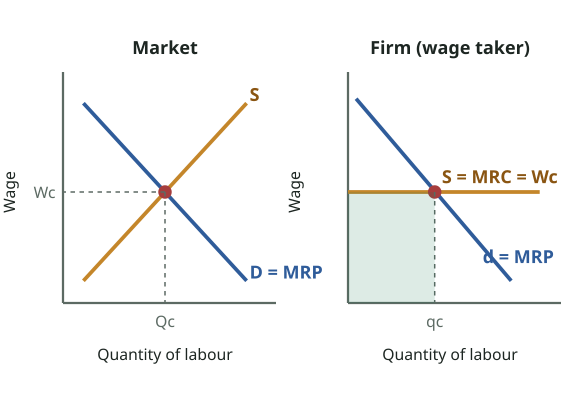
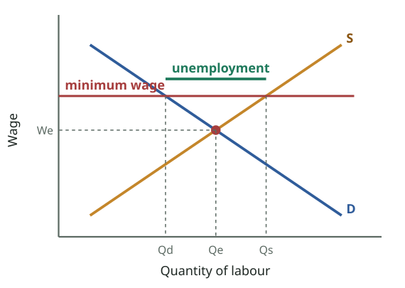

# FPEC 101 · Module 13 — Wage Determination
## মডিউল ১৩ — মজুরি নির্ধারণ

_Lecture 13 · 27 slides · Midterm questions: Q17, Q18_

> Printable study note generated from the website. Each slide: slide text → Bangla translation → tutor explanation → example → exam tip.

---

## Big picture — what is this lecture about? · বড় ছবি — এই লেকচারে কী শিখব?

_Purely competitive labour market (slides 18–19): market demand (MRP) and supply set the wage Wc. Each firm takes Wc as given (MRC = Wc, a horizontal line) and hires up to MRP = MRC; the shaded area is its total wage cost._  
_বিশুদ্ধ প্রতিযোগিতামূলক শ্রমবাজার (স্লাইড ১৮–১৯): বাজারের চাহিদা (MRP) ও যোগান মজুরি Wc ঠিক করে। প্রতিটি ফার্ম Wc মেনে নেয় (MRC = Wc, আনুভূমিক) এবং MRP = MRC পর্যন্ত নিয়োগ করে; ছায়াযুক্ত অংশ মোট মজুরি ব্যয়।_

### English

**Concept:** Wages are simply the **price of labour**, so they are set by **demand and supply** (Lecture 3) in the labour market. The demand for labour is a **derived demand** (Lecture 1): firms want workers because people want what workers produce. A firm hires workers until the **extra revenue a worker brings (MRP) = the extra cost of hiring (MRC)**.

This lecture covers: **nominal vs real wages**, **labour productivity**, the **purely competitive labour market**, **wage differentials**, the **minimum wage**, and **pay for performance**: midterm **Q17** and **Q18**.

### বাংলা

**ধারণা:** মজুরি হলো **শ্রমের দাম**, তাই শ্রমবাজারে **চাহিদা ও যোগান** (লেকচার ৩) দিয়ে ঠিক হয়। শ্রমের চাহিদা **উদ্ভূত চাহিদা** (লেকচার ১): মানুষ শ্রমিকের তৈরি জিনিস চায় বলে ফার্ম শ্রমিক চায়। ফার্ম শ্রমিক নেয় যতক্ষণ না **একজন শ্রমিকের আনা বাড়তি আয় (MRP) = নিয়োগের বাড়তি খরচ (MRC)**।

এই লেকচারে: **নামিক বনাম প্রকৃত মজুরি**, **শ্রম উৎপাদনশীলতা**, **বিশুদ্ধ প্রতিযোগিতামূলক শ্রমবাজার**, **মজুরির পার্থক্য**, **ন্যূনতম মজুরি** ও **কর্মদক্ষতাভিত্তিক বেতন**: মিডটার্ম **Q17** ও **Q18**।

---

## Key words · মূল শব্দ

| Term | Meaning | বাংলা অর্থ | Example |
|---|---|---|---|
| Wage rate | Price paid per unit of labour (e.g. per hour) | মজুরির হার — শ্রমের এককপ্রতি দাম (যেমন ঘণ্টাপ্রতি) | Tk 100 per hour. |
| Labour earnings | Wage rate × hours worked | শ্রম আয় — মজুরির হার × কাজের ঘণ্টা | 100 × 200 hours = Tk 20,000. |
| Nominal (money) wage | Amount of money received | নামিক (টাকার) মজুরি — প্রাপ্ত টাকার পরিমাণ | Tk 20,000 a month. |
| Real wage | Goods and services the nominal wage can buy (adjusted for inflation) | প্রকৃত মজুরি — নামিক মজুরিতে কেনা যায় এমন পণ্য-সেবা (মূল্যস্ফীতি সমন্বিত) | Wage +5%, prices +10% → real wage falls. |
| Labour productivity | Output per worker or per hour | শ্রম উৎপাদনশীলতা — শ্রমিক বা ঘণ্টাপ্রতি উৎপাদন | 10 shirts per hour. |
| MRP (marginal revenue product) | Extra revenue from one more worker = MP × MR | প্রান্তিক আয় উৎপাদন — আরেকজন শ্রমিকের বাড়তি আয় = MP × MR | 5 shirts × Tk 200 = Tk 1,000. |
| MRC (marginal resource cost) | Extra cost of hiring one more worker (= wage in a competitive market) | প্রান্তিক সম্পদ ব্যয় — আরেকজন শ্রমিক নেওয়ার বাড়তি খরচ (প্রতিযোগিতায় = মজুরি) | Tk 800 a day. |
| Wage differential | Difference in wages between jobs or workers | মজুরির পার্থক্য — কাজ বা শ্রমিকের মধ্যে মজুরির ব্যবধান | Doctor vs rickshaw puller. |
| Minimum wage | Legal wage floor | ন্যূনতম মজুরি — আইনগত মজুরির সর্বনিম্ন সীমা | Garment minimum wage Tk 12,500 (2023). |
| Pay for performance | Pay linked to output or results | কর্মদক্ষতাভিত্তিক বেতন — উৎপাদন বা ফলাফলের সাথে যুক্ত বেতন | Piece rates, commissions, bonuses. |

---

## Slides 1–4 · Title and outline
### শিরোনাম ও রূপরেখা

> **Slide 1**
> PRINCIPLES OF ECONOMICSSalimah Musharrif
> FPEC 101 – LECTURE 13 Unit 2
>
> **Slide 2**
> PRINCIPLES OF ECONOMICSProduction Costs and Market Structures
> FPEC 101 – LECTURE 13 Unit 2
>
> **Slide 3**
> Wage determination
>
> **Slide 4**
> Outline
> Key concepts
> Labor Productivity
> Wage Differentials
> Minimum Wage Rate
> Pay for Performance
>

**বাংলা অনুবাদ:**

> **স্লাইড ১–৪:** প্রিন্সিপলস অব ইকোনমিক্স — সালিমাহ মুশাররিফ। FPEC 101 – লেকচার ১৩, ইউনিট ২। মজুরি নির্ধারণ। রূপরেখা: শ্রম উৎপাদনশীলতা · মজুরির পার্থক্য · ন্যূনতম মজুরির হার · কর্মদক্ষতাভিত্তিক বেতন।

**Tutor explains:** Topic: **wage determination**. Reading: McConnell & Brue pp. 505–510, 516–523.

**টিউটরের ব্যাখ্যা:** বিষয়: **মজুরি নির্ধারণ**। পড়া: ম্যাককনেল ও ব্রু পৃ. ৫০৫–৫১০, ৫১৬–৫২৩।

---

## Slide 5 · Wages: nominal vs real; derived demand
### মজুরি: নামিক বনাম প্রকৃত; উদ্ভূত চাহিদা

> Wage Determination
> Wages are the price that employers pay for labor
> Monetary and non monetary
> Hourly wage rate is the price paid per unit of labor services, in an hour of work.
> Labor earnings is the wage rate multiplied by the number of hours worked
> Nominal wage or money wage is the amount of money received per hour, day, or year.
> Real wage is the quantity of goods and services a worker can obtain with nominal wages; real wages reveal the “purchasing power” of nominal wages, adjusted for inflation or price rise
> Derived demand – depends on Productivity of labor and Price of the good it helps to produce
> In the long run, if productivity is increased substantially causing demand for labor to increase more rapidly than increase in the supply of labor S, it results in increased real wages.
>

**বাংলা অনুবাদ:**

> মজুরি নির্ধারণ
> মজুরি হলো শ্রমের জন্য নিয়োগকর্তার দেওয়া দাম
> আর্থিক ও অ-আর্থিক
> ঘণ্টাপ্রতি মজুরির হার হলো এক ঘণ্টা কাজে শ্রম-সেবার এককপ্রতি দাম।
> শ্রম আয় হলো মজুরির হার × কাজের ঘণ্টা।
> **নামিক বা টাকার মজুরি** হলো ঘণ্টা, দিন বা বছরে প্রাপ্ত টাকার পরিমাণ।
> **প্রকৃত মজুরি** হলো নামিক মজুরিতে একজন শ্রমিক যত পণ্য ও সেবা পেতে পারে; প্রকৃত মজুরি নামিক মজুরির "ক্রয়ক্ষমতা" দেখায়, মূল্যস্ফীতি বা দাম বৃদ্ধির সাথে সমন্বিত।
> **উদ্ভূত চাহিদা** — শ্রমের উৎপাদনশীলতা এবং যে পণ্য উৎপাদনে সাহায্য করে তার দামের ওপর নির্ভর করে।
> দীর্ঘমেয়াদে উৎপাদনশীলতা অনেক বাড়লে শ্রমের চাহিদা শ্রমের যোগানের চেয়ে দ্রুত বাড়ে, ফলে প্রকৃত মজুরি বাড়ে।

**Tutor explains:** **Wage** = the price of labour; it can be **monetary** (salary) or **non-monetary** (housing, meals, insurance).**Labour earnings** = wage rate × hours worked.**Nominal wage** = the money amount. **Real wage** = what that money can **buy**, its **purchasing power** after adjusting for inflation. Rough rule: **% change in real wage ≈ % change in nominal wage − inflation rate.**Demand for labour is **derived**: it depends on workers' **productivity** and the **price of the product** they make.**Long run:** when productivity grows faster than labour supply, demand for labour rises faster than supply, so **real wages rise**.

**টিউটরের ব্যাখ্যা:** **মজুরি** = শ্রমের দাম; **আর্থিক** (বেতন) বা **অ-আর্থিক** (বাসস্থান, খাবার, বিমা) হতে পারে।**শ্রম আয়** = মজুরির হার × কাজের ঘণ্টা।**নামিক মজুরি** = টাকার অঙ্ক। **প্রকৃত মজুরি** = সেই টাকায় যা **কেনা যায়**, মূল্যস্ফীতি সমন্বয়ের পর এর **ক্রয়ক্ষমতা**। মোটামুটি নিয়ম: **প্রকৃত মজুরির % পরিবর্তন ≈ নামিক মজুরির % পরিবর্তন − মূল্যস্ফীতির হার।**শ্রমের চাহিদা **উদ্ভূত**: শ্রমিকের **উৎপাদনশীলতা** ও তাদের তৈরি **পণ্যের দামের** ওপর নির্ভর করে।**দীর্ঘমেয়াদ:** উৎপাদনশীলতা শ্রমের যোগানের চেয়ে দ্রুত বাড়লে শ্রমের চাহিদা যোগানের চেয়ে দ্রুত বাড়ে, তাই **প্রকৃত মজুরি বাড়ে**।

**Real-life example:** A garment worker's wage rises from Tk 12,500 to Tk 13,125 (+5%) while prices rise 9%. Her **nominal** wage rose but her **real** wage fell by about 4%: she can buy less rice, oil and rent than before.

**বাস্তব উদাহরণ:** একজন গার্মেন্টস শ্রমিকের মজুরি ১২,৫০০ থেকে ১৩,১২৫ টাকা (+৫%) হলো, আর দাম বাড়ল ৯%। তার **নামিক** মজুরি বেড়েছে কিন্তু **প্রকৃত** মজুরি প্রায় ৪% কমেছে: আগের চেয়ে কম চাল, তেল, ভাড়া কিনতে পারেন।

**Exam tip:** Q17 opens with nominal vs real wage: give both definitions and a one-line inflation example.

**পরীক্ষার টিপস:** Q17 শুরু হয় নামিক বনাম প্রকৃত মজুরি দিয়ে: দুটি সংজ্ঞা আর এক লাইনের মূল্যস্ফীতির উদাহরণ দাও।

---

## Slide 6 · Labour productivity and what raises it
### শ্রম উৎপাদনশীলতা ও যা তা বাড়ায়

> Labor productivity
> Higher the productivity of labor, higher the demand for it.
> If the total supply of labor is fixed, then the stronger the demand for labor, the higher is the average level of real wages
> Factors affecting Labor Productivity
> • Capital availability
> • Access to abundant natural resources
> • Advanced technology More capital, and more advanced capital. Better work methods
> • Labor quality The health, vigor, education, and training
> • Other factors (a) the efficiency and flexibility of management(b) a business, social, and political environment that emphasizes production and productivity(c) the vast size of the domestic market, which enables firms to engage in mass production (d) the increased specialization of production enabled by free-trade agreements with other nations.
>

**বাংলা অনুবাদ:**

> শ্রম উৎপাদনশীলতা
> শ্রমের উৎপাদনশীলতা যত বেশি, চাহিদা তত বেশি।
> শ্রমের মোট যোগান স্থির হলে শ্রমের চাহিদা যত শক্তিশালী, প্রকৃত মজুরির গড় স্তর তত বেশি।
> **শ্রম উৎপাদনশীলতাকে প্রভাবিতকারী উপাদান:** মূলধনের প্রাপ্যতা · প্রচুর প্রাকৃতিক সম্পদের সুযোগ · উন্নত প্রযুক্তি (বেশি ও উন্নত মূলধন, ভালো কাজের পদ্ধতি) · শ্রমের মান (স্বাস্থ্য, প্রাণশক্তি, শিক্ষা ও প্রশিক্ষণ) · অন্যান্য: (ক) ব্যবস্থাপনার দক্ষতা ও নমনীয়তা (খ) উৎপাদন ও উৎপাদনশীলতাকে গুরুত্ব দেয় এমন ব্যবসায়িক, সামাজিক ও রাজনৈতিক পরিবেশ (গ) বিশাল দেশীয় বাজার, যাতে ফার্ম বৃহদায়তনের সুবিধা নিতে পারে।

**Tutor explains:** **Higher productivity → higher demand for labour → higher real wages** (if labour supply is fixed). This is why wages are much higher in countries with high productivity.
What raises productivity? 1. **Capital:** more machines and tools per worker. 2. **Natural resources:** abundant land, energy, minerals. 3. **Technology:** better machines and better work methods. 4. **Labour quality:** health, energy, **education and training**. 5. **Other:** efficient management; a business, social and political environment that values productivity; a **large domestic market** allowing economies of scale.

**টিউটরের ব্যাখ্যা:** **বেশি উৎপাদনশীলতা → শ্রমের বেশি চাহিদা → বেশি প্রকৃত মজুরি** (শ্রমের যোগান স্থির হলে)। এজন্যই উচ্চ উৎপাদনশীলতার দেশে মজুরি অনেক বেশি।
উৎপাদনশীলতা কী বাড়ায়? 1. **মূলধন:** শ্রমিকপ্রতি বেশি যন্ত্র ও সরঞ্জাম। 2. **প্রাকৃতিক সম্পদ:** প্রচুর জমি, জ্বালানি, খনিজ। 3. **প্রযুক্তি:** উন্নত যন্ত্র ও কাজের ভালো পদ্ধতি। 4. **শ্রমের মান:** স্বাস্থ্য, প্রাণশক্তি, **শিক্ষা ও প্রশিক্ষণ**। 5. **অন্যান্য:** দক্ষ ব্যবস্থাপনা; উৎপাদনশীলতাকে মূল্য দেয় এমন ব্যবসায়িক, সামাজিক ও রাজনৈতিক পরিবেশ; বৃহদায়তনের সুবিধার জন্য **বড় দেশীয় বাজার**।

**Real-life example:** A worker using a modern automatic cutting machine in a Bangladeshi garment factory cuts many more pieces per hour than one with scissors, so the factory can afford to pay her more.

**বাস্তব উদাহরণ:** বাংলাদেশি গার্মেন্টসে আধুনিক স্বয়ংক্রিয় কাটিং মেশিন ব্যবহারকারী শ্রমিক কাঁচি হাতে শ্রমিকের চেয়ে ঘণ্টায় অনেক বেশি টুকরো কাটেন, তাই কারখানা তাকে বেশি দিতে পারে।

---

## Slides 7–10 · Purely competitive labour market; demand for labour = MRP
### বিশুদ্ধ প্রতিযোগিতামূলক শ্রমবাজার; শ্রমের চাহিদা = MRP

> **Slide 7**
> Purely competitive labor market
> Numerous firms compete with one another in hiring a specific type of labor.
> Each of many qualified workers with identical skills supplies that type of labor.
> Individual firms and individual workers are “wage takers,” since neither can exert any control over the market wage rate.
> Depends on
> • Market Demand for Labor
> • Market Supply of Labor
>
> **Slide 8**
> Purely competitive labor market
> Market Demand for Labor
> Labor Demand curves are called the MRP, the marginal revenue product curves
> Downward sloping, higher the wage rate, lower the demand for labor
> In the theory of competitive labor markets, the demand curve for labor comes from the estimated marginal revenue product of labor (MRPL)
> It is defined as the extra revenue generated by a firm when it employs an additional unit of labor
> MRPL = Marginal product of labor x marginal revenue
> Marginal Revenue Product for Labor = Change in total revenue
> Unit change in factor quantity
>
> **Slide 9**
> Units of
> a factor
> Total
> product
> Marginal
> product,
> MP
> ]
> ]
> ]
> 0
> 1
> 2
> 3
> 4
> 5
> 6
> 7
> 0
> 7
> 13
> 18
> 22
> 25
> 27
> 28
> 7
> 6
> 5
> 4
> 3
> 2
> 1
> ]
> ]
> ]
> ]
> The Demand for Labour
> Product
> price
> $2
> 2
> 2
> 2
> 2
> 2
> 2
> 2
> Total
> revenue
> $ 0
> 14
> 26
> 36
> 44
> 50
> 54
> 56
> Marginal
> revenue
> product, MRP
> ]
> $ 14
> ]
> 12
> 12
> 10
> 8
> 6
> 4
> 2
> ]
> ]
> ]
> ]
> MRPL = Marginal product of labor x marginal revenue
> Marginal Revenue Product for Labor = Change in total revenue
> Unit change in factor quantity
>
> **Slide 10**
> Purely competitive labor market
> Market Demand for Labor
>

**বাংলা অনুবাদ:**

> **স্লাইড ৭:** অসংখ্য ফার্ম একটি নির্দিষ্ট ধরনের শ্রম নিয়োগে একে অপরের সাথে প্রতিযোগিতা করে। একই দক্ষতার অনেক যোগ্য শ্রমিক প্রত্যেকে ওই শ্রম সরবরাহ করে। একক ফার্ম ও একক শ্রমিক "মজুরি গ্রহণকারী", কারণ কেউ বাজার মজুরি নিয়ন্ত্রণ করতে পারে না। • শ্রমের বাজার চাহিদা • শ্রমের বাজার যোগান
> **স্লাইড ৮–১০ — শ্রমের বাজার চাহিদা:** শ্রমের চাহিদা রেখাকে MRP বা প্রান্তিক আয় উৎপাদন রেখা বলে। নিম্নমুখী: মজুরি যত বেশি, শ্রমের চাহিদা তত কম। প্রতিযোগিতামূলক শ্রমবাজারের তত্ত্বে শ্রমের চাহিদা রেখা আসে শ্রমের আনুমানিক প্রান্তিক আয় উৎপাদন (MRPL) থেকে — ফার্ম আরেকজন শ্রমিক নিয়োগ করলে যে বাড়তি আয় হয়। MRPL = শ্রমের প্রান্তিক উৎপাদন × প্রান্তিক আয়। MRPL = মোট আয়ের পরিবর্তন ÷ উপাদানের পরিমাণের একক পরিবর্তন। [স্লাইড ৯–১০: MRP রেখার চিত্র]

**Tutor explains:** **Purely competitive labour market:** many firms hiring the same type of labour, many identical workers, and both are **wage takers** (nobody can change the market wage).
**Demand for labour = the MRP curve.** - **MRP (marginal revenue product of labour)** = the **extra revenue** from hiring **one more worker** = **MP × MR** (= MP × P for a competitive firm). - It slopes **downward** because of **diminishing marginal product** (Lecture 6): each extra worker adds less output, so less revenue.
**Example:** the 5th worker makes 10 extra shirts that sell for Tk 100 each → MRP = 10 × 100 = **Tk 1,000**. The 6th makes only 8 → MRP = Tk 800.

**টিউটরের ব্যাখ্যা:** **বিশুদ্ধ প্রতিযোগিতামূলক শ্রমবাজার:** একই ধরনের শ্রম নিয়োগকারী অনেক ফার্ম, অনেক একই রকম শ্রমিক, আর দুই পক্ষই **মজুরি গ্রহণকারী** (কেউ বাজার মজুরি বদলাতে পারে না)।
**শ্রমের চাহিদা = MRP রেখা।** - **MRP (শ্রমের প্রান্তিক আয় উৎপাদন)** = **আরেকজন শ্রমিক** নিলে **বাড়তি আয়** = **MP × MR** (প্রতিযোগী ফার্মে = MP × P)। - **ক্রমহ্রাসমান প্রান্তিক উৎপাদনের** (লেকচার ৬) কারণে **নিম্নমুখী**: প্রতিটি বাড়তি শ্রমিক কম উৎপাদন, তাই কম আয় যোগ করে।
**উদাহরণ:** ৫ম শ্রমিক ১০টি বাড়তি শার্ট বানায়, প্রতিটি ১০০ টাকা → MRP = ১০ × ১০০ = **১,০০০ টাকা**। ৬ষ্ঠজন মাত্র ৮টি → MRP = ৮০০ টাকা।

---

## Slides 11–12 · What changes the demand for labour
### শ্রমের চাহিদা কী বদলায়

> **Slide 11**
> Purely competitive labor market
> Market Demand for Labor
> The changing patterns of demand of Labor
> A change in the demand for a product
> Mass production
> Division of labor to achieve economies of scale
> Worker productivity
> Changes in the price and productivity of capital
> Wages in other employment costs such as insurance, taxes etc
>
> **Slide 12**
> Purely competitive labor market
> Market Demand for Labor
>

**বাংলা অনুবাদ:**

> **স্লাইড ১১–১২ — শ্রমের চাহিদার পরিবর্তনের ধারা:** পণ্যের চাহিদার পরিবর্তন · ব্যাপক উৎপাদন · বৃহদায়তনের সুবিধার জন্য শ্রমবিভাগ · শ্রমিকের উৎপাদনশীলতা · মূলধনের দাম ও উৎপাদনশীলতার পরিবর্তন · অন্যান্য নিয়োগ খরচ যেমন বিমা, কর ইত্যাদি। [স্লাইড ১২: শ্রমের চাহিদা রেখার সরণের চিত্র]

**Tutor explains:** The labour demand (MRP) curve **shifts** when: - **Demand for the product changes** (derived demand): more demand for shirts → more demand for tailors. - **Mass production and division of labour** change how many workers are needed. - **Worker productivity** rises → MRP rises → demand shifts right. - **Price and productivity of capital** change (machines can replace or help workers). - **Other employment costs** (insurance, payroll taxes) rise → firms hire fewer workers.

**টিউটরের ব্যাখ্যা:** শ্রমের চাহিদা (MRP) রেখা **সরে** যখন: - **পণ্যের চাহিদা বদলায়** (উদ্ভূত চাহিদা): শার্টের চাহিদা বাড়লে দর্জির চাহিদা বাড়ে। - **ব্যাপক উৎপাদন ও শ্রমবিভাগ** কতজন শ্রমিক লাগবে তা বদলায়। - **শ্রমিকের উৎপাদনশীলতা** বাড়ে → MRP বাড়ে → চাহিদা ডানে সরে। - **মূলধনের দাম ও উৎপাদনশীলতা** বদলায় (যন্ত্র শ্রমিকের জায়গা নিতে বা সাহায্য করতে পারে)। - **অন্যান্য নিয়োগ খরচ** (বিমা, বেতন-কর) বাড়লে ফার্ম কম শ্রমিক নেয়।

---

## Slides 13–16 · Supply of labour and what changes it
### শ্রমের যোগান ও যা তা বদলায়

> **Slide 13**
> Purely competitive labor market
> Market Supply of Labor
> Upward sloping, higher the wage rate, higher the supply of labor
> Higher wage rates are paid to attract workers away from alternative job opportunities available to them.
> Also to induce people who are not currently in the labor force to seek employment
>
> **Slide 14**
> Purely competitive labor market
> Market Supply of Labor
>
> **Slide 15**
> Purely competitive labor market
> Market Supply of Labor
> The changing patterns of supply of labor
> Population
> Net migration
> It is less if the job requires special training, skills
> The nature of the job
> Work environment
> Timings of work
> Education and training
> The number of people going into a certain profession
> The barriers to the entry in an occupation
> Wages in substitute occupation
> non wage factors or fringe benefits are also known as net advantages
>
> **Slide 16**
> Purely competitive labor market
> Market Supply of Labor
>

**বাংলা অনুবাদ:**

> **স্লাইড ১৩–১৪ — শ্রমের বাজার যোগান:** ঊর্ধ্বমুখী: মজুরি যত বেশি, শ্রমের যোগান তত বেশি। অন্য বিকল্প চাকরি থেকে শ্রমিক টানতে বেশি মজুরি দিতে হয়। যারা এখন শ্রমশক্তিতে নেই তাদের চাকরি খুঁজতে উৎসাহিত করতেও। [চিত্র]
> **স্লাইড ১৫–১৬ — শ্রমের যোগানের পরিবর্তনের ধারা:** নিট অভিবাসন · কাজে বিশেষ প্রশিক্ষণ বা দক্ষতা লাগলে যোগান কম · কাজের ধরন · কাজের পরিবেশ · কাজের সময় · শিক্ষা ও প্রশিক্ষণ · একটি পেশায় যাওয়া মানুষের সংখ্যা · পেশায় প্রবেশে বাধা · বিকল্প পেশার মজুরি · অ-মজুরি উপাদান বা বাড়তি সুবিধা, যাকে নিট সুবিধাও বলে। [চিত্র]

**Tutor explains:** **Labour supply slopes upward:** a higher wage attracts workers **from other jobs** and draws in people **not currently working** (students, homemakers).
**Labour supply shifts** with: **net migration**; **skill/training needs** (fewer can do skilled jobs); **nature of the job, work environment, working hours**; **education and training**; the **number of people entering** a profession; **barriers to entry** (licences, exams); **wages in substitute jobs**; and **non-wage benefits ("net advantages")** such as housing, pension, prestige.

**টিউটরের ব্যাখ্যা:** **শ্রমের যোগান ঊর্ধ্বমুখী:** বেশি মজুরি **অন্য চাকরি** থেকে শ্রমিক টানে আর **এখন কাজ না করা** মানুষকেও আনে (ছাত্র, গৃহিণী)।
**শ্রমের যোগান সরে:** **নিট অভিবাসন**; **দক্ষতা/প্রশিক্ষণের প্রয়োজন** (দক্ষ কাজে কম মানুষ পারে); **কাজের ধরন, পরিবেশ, সময়**; **শিক্ষা ও প্রশিক্ষণ**; পেশায় **আসা মানুষের সংখ্যা**; **প্রবেশে বাধা** (লাইসেন্স, পরীক্ষা); **বিকল্প চাকরির মজুরি**; আর **অ-মজুরি সুবিধা ("নিট সুবিধা")** যেমন বাসস্থান, পেনশন, সম্মান।

**Real-life example:** Large-scale migration of Bangladeshi workers to the Gulf reduces labour supply in some rural areas, pushing up local farm wages.

**বাস্তব উদাহরণ:** বাংলাদেশি শ্রমিকদের ব্যাপক হারে উপসাগরীয় দেশে যাওয়া কিছু গ্রামাঞ্চলে শ্রমের যোগান কমায়, স্থানীয় কৃষি মজুরি বাড়ায়।

---

## Slides 17–19 · Wage determination: market and firm (MRP = MRC)
### মজুরি নির্ধারণ: বাজার ও ফার্ম (MRP = MRC)

_Purely competitive labour market (slides 18–19): market demand (MRP) and supply set the wage Wc. Each firm takes Wc as given (MRC = Wc, a horizontal line) and hires up to MRP = MRC; the shaded area is its total wage cost._  
_বিশুদ্ধ প্রতিযোগিতামূলক শ্রমবাজার (স্লাইড ১৮–১৯): বাজারের চাহিদা (MRP) ও যোগান মজুরি Wc ঠিক করে। প্রতিটি ফার্ম Wc মেনে নেয় (MRC = Wc, আনুভূমিক) এবং MRP = MRC পর্যন্ত নিয়োগ করে; ছায়াযুক্ত অংশ মোট মজুরি ব্যয়।_

_A minimum wage above the equilibrium wage is a price floor in the labour market: firms hire fewer workers (Qd) while more people want jobs (Qs). Whether jobs are really lost depends on labour demand and supply conditions (slide 25)._  
_ভারসাম্য মজুরির ওপরে ন্যূনতম মজুরি শ্রমবাজারে সর্বনিম্ন দামসীমা: ফার্ম কম শ্রমিক নেয় (Qd), অথচ বেশি মানুষ কাজ চায় (Qs)। আসলেই চাকরি কমে কি না তা শ্রমের চাহিদা-যোগানের অবস্থার ওপর নির্ভর করে (স্লাইড ২৫)।_

> **Slide 17**
> Purely competitive labor market
> Equilibrium
> Profit maximizing level of employment
> Firm considers
> • The Marginal revenue product for Labor
> • Marginal resource Cost or cost of employment
> Firm should employ labor up to the point where theMarginal Revenue Product of Labor = Marginal Cost of labor
> The cost of hiring an additional worker equals to the extra sales revenue from selling their output
>
> **Slide 18**
> Purely competitive labor market
> Equilibrium
> Each of the many firms employs such a small fraction of the total available supply of this type of labor that none of them can influence the wage rate. The supply of this labor is perfectly elastic to the individual firm, as shown by horizontal line
> When the price of a resource is imposed on the individual competitive firm, the marginal cost of that resource (MRC) is constant and is equal to the resource price. Here, MRC is constant and is equal to the wage rate. Each additional worker hired adds precisely his or her own wage rate to the firm’s total resource cost. So the firm in a purely competitive labor market maximizes its profit by hiring workers to the point at which its wage rate equals MRP or MRC = MRP
>
> **Slide 19**
> Purely competitive labor market
> Equilibrium for market and firm (profit maximizing level)
> The equilibrium wage rate Wc and the number of workers Qc in (b )are determined by labor S and D. (a) Because this market wage rate is given to the individual firm hiring in this market, its labor supply curves MRC is perfectly elastic.
> Its labor demand curve, d, is its MRP curve
> Firm maximizes its profit by hiring workers up to MRP = MRC.
> Area 0abc represents both the firm’stotal revenue and its total cost.
> The green area is its total wage cost
> The brown area is its nonlabor costs, including a normal profit— that is, the firm’s payments to the suppliers of land, capital, and entrepreneurship.
> Normal profit earned by firm
> Mc Connell & Brue
> Total wage cost
> TR-Wage cost
>

**বাংলা অনুবাদ:**

> **স্লাইড ১৭ — মুনাফা সর্বোচ্চকারী নিয়োগ স্তর:** ফার্ম বিবেচনা করে শ্রমের প্রান্তিক আয় উৎপাদন ও প্রান্তিক সম্পদ ব্যয় বা নিয়োগ খরচ। ফার্ম শ্রম নেবে যতক্ষণ না শ্রমের প্রান্তিক আয় উৎপাদন = শ্রমের প্রান্তিক ব্যয়। আরেকজন শ্রমিক নেওয়ার খরচ তার উৎপাদন বিক্রির বাড়তি আয়ের সমান।
> **স্লাইড ১৮:** অনেক ফার্মের প্রত্যেকে এই শ্রমের মোট যোগানের এত ছোট অংশ নেয় যে কেউ মজুরি প্রভাবিত করতে পারে না। একক ফার্মের কাছে এই শ্রমের যোগান পূর্ণ স্থিতিস্থাপক। সম্পদের দাম ফার্মের ওপর আরোপিত হলে সেই সম্পদের প্রান্তিক ব্যয় (MRC) স্থির এবং সম্পদের দামের সমান — এখানে MRC = মজুরির হার।
> **স্লাইড ১৯ — বাজার ও ফার্মের ভারসাম্য:** বাজারে (খ) শ্রমের S ও D মিলে ভারসাম্য মজুরি Wc ও শ্রমিক সংখ্যা Qc ঠিক হয়। (ক) এই মজুরি ফার্মের কাছে প্রদত্ত, তাই তার শ্রম যোগান রেখা S = MRC পূর্ণ স্থিতিস্থাপক। ফার্মের শ্রম চাহিদা রেখা d হলো তার MRP রেখা। ফার্ম MRP = MRC পর্যন্ত শ্রমিক নিয়ে মুনাফা সর্বোচ্চ করে। ক্ষেত্র ০abc ফার্মের মোট আয় ও মোট ব্যয় দুটোই; সবুজ অংশ মোট মজুরি ব্যয়; বাদামি অংশ অ-শ্রম ব্যয়, স্বাভাবিক মুনাফাসহ। ফার্ম স্বাভাবিক মুনাফা পায়।

**Tutor explains:** **Two graphs side by side (like Lecture 8):** - **Market:** labour demand (D = sum of firms' MRP) and labour supply (S) meet at the **equilibrium wage Wc** and employment Qc. - **Firm:** the firm is a **wage taker**, so it can hire as many workers as it wants at Wc: its labour supply is **perfectly elastic** (horizontal), and **MRC = Wc**.
**Hiring rule: hire up to where MRP = MRC** (extra revenue from the last worker = its extra cost). Like MR = MC, but for inputs. Total wage bill = Wc × qc; the rest of revenue pays other inputs and normal profit.

**টিউটরের ব্যাখ্যা:** **পাশাপাশি দুটি গ্রাফ (লেকচার ৮-এর মতো):** - **বাজার:** শ্রমের চাহিদা (D = ফার্মগুলোর MRP-র যোগফল) ও যোগান (S) মেলে **ভারসাম্য মজুরি Wc** ও নিয়োগ Qc-তে। - **ফার্ম:** ফার্ম **মজুরি গ্রহণকারী**, তাই Wc-তে যত খুশি শ্রমিক নিতে পারে: তার শ্রম যোগান **পূর্ণ স্থিতিস্থাপক** (আনুভূমিক), আর **MRC = Wc**।
**নিয়োগের নিয়ম: MRP = MRC পর্যন্ত নিয়োগ করো** (শেষ শ্রমিকের বাড়তি আয় = তার বাড়তি খরচ)। MR = MC-র মতোই, তবে উপকরণের জন্য। মোট মজুরি = Wc × qc; আয়ের বাকিটা অন্য উপকরণ ও স্বাভাবিক মুনাফায় যায়।

**Exam tip:** Q17 asks for "wage determination in a purely competitive labour market": draw the market + firm diagram and write MRP = MRC.

**পরীক্ষার টিপস:** Q17 চায় "বিশুদ্ধ প্রতিযোগিতামূলক শ্রমবাজারে মজুরি নির্ধারণ": বাজার + ফার্মের চিত্র এঁকে MRP = MRC লেখো।

---

## Slides 20–22 · Elasticity of labour demand and supply
### শ্রমের চাহিদা ও যোগানের স্থিতিস্থাপকতা

> **Slide 20**
> Purely competitive labor market
> Elasticity of Market Demand for Labor
> Responsiveness of labor demand due to a change in the wage rate
> Depends on
> • Labor cost as percentage of total costs
> • Ease and cost of factor substitution
> • Price elasticity of demand for final output
>
> **Slide 21**
> Purely competitive labor market
> Elasticity of Market Supply for Labor
> Responsiveness of labor supply due to a change in the wage rate
> Depends on
> • Availability of Good Substitutes to specific labor
> • Specific skills and educational requirements
> • Time period
> • Short run, inelastic as it takes time for people to respond to changes in relative wages.
>
> **Slide 22**
> Purely competitive labor market
> For skilled labor, demand and supply is relatively inelastic; therefore, there is a higher wage lesser supply of labor available.
> For unskilled workers, the demand and supply for labor is elastic because there are fewer skills required and more labor supply of the available
>

**বাংলা অনুবাদ:**

> **স্লাইড ২০ — শ্রমের বাজার চাহিদার স্থিতিস্থাপকতা:** মজুরির পরিবর্তনে শ্রমের চাহিদার সাড়া — • মোট ব্যয়ে শ্রম ব্যয়ের শতাংশ • উপাদান প্রতিস্থাপনের সহজতা ও খরচ • চূড়ান্ত পণ্যের চাহিদার দাম স্থিতিস্থাপকতা
> **স্লাইড ২১ — শ্রমের বাজার যোগানের স্থিতিস্থাপকতা:** মজুরির পরিবর্তনে শ্রমের যোগানের সাড়া — • নির্দিষ্ট শ্রমের ভালো বিকল্পের প্রাপ্যতা • নির্দিষ্ট দক্ষতা ও শিক্ষাগত যোগ্যতা • সময়কাল (স্বল্পমেয়াদে অস্থিতিস্থাপক, কারণ আপেক্ষিক মজুরির পরিবর্তনে মানুষের সাড়া দিতে সময় লাগে)
> **স্লাইড ২২:** দক্ষ শ্রমের চাহিদা ও যোগান তুলনামূলক অস্থিতিস্থাপক; তাই মজুরি বেশি, যোগান কম। অদক্ষ শ্রমিকের চাহিদা ও যোগান স্থিতিস্থাপক, কারণ কম দক্ষতা লাগে এবং যোগান বেশি।

**Tutor explains:** **Labour demand is more elastic when:** labour is a **large share** of total cost; machines can **easily replace** workers; demand for the final product is **elastic**.
**Labour supply is more elastic when:** there are **good substitutes** (many people can do the job); **few special skills** are needed; the **time period is long**.
**Result:** **skilled labour** (doctors, engineers) has **inelastic** demand and supply → **high wages, few workers**. **Unskilled labour** has **elastic** demand and supply → lower wages.

**টিউটরের ব্যাখ্যা:** **শ্রমের চাহিদা বেশি স্থিতিস্থাপক যখন:** মোট ব্যয়ে শ্রম **বড় অংশ**; যন্ত্র শ্রমিকের জায়গা **সহজে নিতে** পারে; চূড়ান্ত পণ্যের চাহিদা **স্থিতিস্থাপক**।
**শ্রমের যোগান বেশি স্থিতিস্থাপক যখন:** **ভালো বিকল্প** আছে (অনেকে কাজটা পারে); **বিশেষ দক্ষতা কম** লাগে; **সময় দীর্ঘ**।
**ফল:** **দক্ষ শ্রমের** (ডাক্তার, প্রকৌশলী) চাহিদা ও যোগান **অস্থিতিস্থাপক** → **বেশি মজুরি, কম শ্রমিক**। **অদক্ষ শ্রমের** চাহিদা ও যোগান **স্থিতিস্থাপক** → কম মজুরি।

---

## Quick check · দ্রুত যাচাই

1. A worker's MP is 6 units and each unit sells for Tk 50 (competitive market). MRP is…  
   একজন শ্রমিকের MP ৬ একক, প্রতিটি ৫০ টাকায় বিক্রি (প্রতিযোগিতামূলক বাজার)। MRP…

   - A) Tk 56 · ৫৬ টাকা
   - B) Tk 300 · ৩০০ টাকা
   - C) Tk 50 · ৫০ টাকা
   - D) Tk 6 · ৬ টাকা

   **Answer: B** — MRP = MP × MR = 6 × 50 = 300.  
   MRP = MP × MR = ৬ × ৫০ = ৩০০।

2. A profit-maximising firm hires workers until…  
   মুনাফা-সর্বোচ্চকারী ফার্ম শ্রমিক নেয় যতক্ষণ না…

   - A) MRP = MRC · MRP = MRC
   - B) Wage = 0 · মজুরি = ০
   - C) MP is maximum · MP সর্বোচ্চ
   - D) TR is maximum · TR সর্বোচ্চ

   **Answer: A** — Hire while the extra revenue from a worker is at least the extra cost.  
   শ্রমিকের বাড়তি আয় অন্তত বাড়তি খরচের সমান থাকা পর্যন্ত নিয়োগ।

3. Wages rise 6% and prices rise 10%. The real wage…  
   মজুরি ৬% ও দাম ১০% বাড়ল। প্রকৃত মজুরি…

   - A) Rises 16% · ১৬% বাড়ে
   - B) Falls about 4% · প্রায় ৪% কমে
   - C) Rises 4% · ৪% বাড়ে
   - D) Is unchanged · অপরিবর্তিত

   **Answer: B** — Real wage change ≈ 6% − 10% = −4%.  
   প্রকৃত মজুরির পরিবর্তন ≈ ৬% − ১০% = −৪%।

---

## Slides 23–24 · Why wages differ (wage differentials)
### মজুরি কেন আলাদা (মজুরির পার্থক্য)

> **Slide 23**
> Wage Differentials
> Differences in wages between different occupations
> Position in an occupation
> Qualifications and experience
> Education
> Racial or gender discrimination
> Skills
> Nature of the job …risky or timings
> Whether it’s in the private sector or public sector
> Employer discrimination
> Trade Unions
>
> **Slide 24**
> Wage Differentials
> Differences in wages between different occupations
> Immobility
> Satisfaction
> Efficiency and hard work
> Profession you are involved in, example lawyers and doctors get high pay
> The reputation of the institute one has studied from
> Currency differences
> Non monetary fringe benefits
> The mobility of workers… if this is low, to increase mobility benefits such as housing Etc. may be given to encourage workers to change their profession.
>

**বাংলা অনুবাদ:**

> **স্লাইড ২৩ — মজুরির পার্থক্য:** বিভিন্ন পেশার মধ্যে মজুরির পার্থক্য · পেশায় পদমর্যাদা · যোগ্যতা ও অভিজ্ঞতা · জাতিগত বা লিঙ্গ বৈষম্য · কাজের ধরন … ঝুঁকিপূর্ণ বা সময় · বেসরকারি না সরকারি খাত · নিয়োগকর্তার বৈষম্য
> **স্লাইড ২৪:** দক্ষতা ও কঠোর পরিশ্রম · পেশা, যেমন আইনজীবী ও ডাক্তার বেশি পান · যে প্রতিষ্ঠানে পড়েছ তার সুনাম · মুদ্রার পার্থক্য · অ-আর্থিক বাড়তি সুবিধা · শ্রমিকের গতিশীলতা … কম হলে পেশা বদলে উৎসাহিত করতে বাসস্থান ইত্যাদি সুবিধা দেওয়া হতে পারে।

**Tutor explains:** Wages differ because jobs and workers differ. Group the slides' reasons into four baskets (useful for **Q18**):
**Worker differences:** qualifications, experience, efficiency and hard work, reputation of the institution studied at (human capital).**Job differences:** occupation (doctors, lawyers earn more), position/rank, **risky or unpleasant jobs and odd hours** (compensating differences), non-monetary fringe benefits.**Market imperfections:** low **mobility** of workers (so employers offer housing etc.), private vs public sector, currency differences between countries.**Discrimination:** racial, gender or employer discrimination (Lecture 14).

**টিউটরের ব্যাখ্যা:** কাজ ও শ্রমিক আলাদা বলে মজুরি আলাদা। স্লাইডের কারণগুলো চারটি ঝুড়িতে ভাগ করো (**Q18**-এর জন্য কাজের):
**শ্রমিকের পার্থক্য:** যোগ্যতা, অভিজ্ঞতা, দক্ষতা ও পরিশ্রম, পড়াশোনার প্রতিষ্ঠানের সুনাম (মানব মূলধন)।**কাজের পার্থক্য:** পেশা (ডাক্তার, আইনজীবী বেশি পান), পদমর্যাদা, **ঝুঁকিপূর্ণ বা অপ্রীতিকর কাজ ও অস্বাভাবিক সময়** (ক্ষতিপূরণমূলক পার্থক্য), অ-আর্থিক বাড়তি সুবিধা।**বাজারের অপূর্ণতা:** শ্রমিকের কম **গতিশীলতা** (তাই নিয়োগকর্তা বাসস্থান ইত্যাদি দেয়), বেসরকারি বনাম সরকারি খাত, দেশভেদে মুদ্রার পার্থক্য।**বৈষম্য:** জাতিগত, লিঙ্গ বা নিয়োগকর্তার বৈষম্য (লেকচার ১৪)।

**Real-life example:** A BUET engineer earns far more than a construction helper (skills, training, scarce supply). A sailor on a merchant ship earns more than an office clerk with similar education (risk, time away from family).

**বাস্তব উদাহরণ:** বুয়েটের একজন প্রকৌশলী নির্মাণ সহকারীর চেয়ে অনেক বেশি পান (দক্ষতা, প্রশিক্ষণ, কম যোগান)। মার্চেন্ট জাহাজের নাবিক একই শিক্ষার অফিস কেরানির চেয়ে বেশি পান (ঝুঁকি, পরিবার থেকে দূরে থাকা)।

---

## Slide 25 · The minimum wage
### ন্যূনতম মজুরি

_A minimum wage above the equilibrium wage is a price floor in the labour market: firms hire fewer workers (Qd) while more people want jobs (Qs). Whether jobs are really lost depends on labour demand and supply conditions (slide 25)._  
_ভারসাম্য মজুরির ওপরে ন্যূনতম মজুরি শ্রমবাজারে সর্বনিম্ন দামসীমা: ফার্ম কম শ্রমিক নেয় (Qd), অথচ বেশি মানুষ কাজ চায় (Qs)। আসলেই চাকরি কমে কি না তা শ্রমের চাহিদা-যোগানের অবস্থার ওপর নির্ভর করে (স্লাইড ২৫)।_

> Minimum Wage Rate
> A “wage floor” that will help less skilled workers earn enough income to escape poverty.
> Impact
> • - Rising costs of production
> • -May lead to decrease in workers hired
> • -Poorly targeted to reduce poverty
> • +Job losses may not occur in markets with short labor supply and great labor demand
> • +May increase labor supply
> • +Increases labor productivity
> Conclusion
> • More workers are helped by the minimum wage than are hurt
> • Gives society some assurance that employers are not “taking undue advantage” of vulnerable, low-skilled worker
>

**বাংলা অনুবাদ:**

> ন্যূনতম মজুরির হার
> একটি "মজুরির সর্বনিম্ন সীমা", যা কম দক্ষ শ্রমিকদের দারিদ্র্য থেকে বেরোনোর মতো আয় করতে সাহায্য করবে।
> − উৎপাদন খরচ বাড়ে
> − নিয়োগ কমতে পারে
> − দারিদ্র্য কমাতে দুর্বলভাবে লক্ষ্যভিত্তিক
> + যেখানে শ্রমের যোগান কম ও চাহিদা বেশি, সেখানে চাকরি নাও কমতে পারে
> + শ্রমের যোগান বাড়াতে পারে
> + শ্রম উৎপাদনশীলতা বাড়ায়
> ন্যূনতম মজুরিতে যত শ্রমিক ক্ষতিগ্রস্ত হয়, তার চেয়ে বেশি উপকৃত হয়।
> সমাজকে কিছুটা নিশ্চয়তা দেয় যে নিয়োগকর্তারা দুর্বল, কম দক্ষ শ্রমিকদের "অন্যায় সুবিধা" নিচ্ছে না।

**Tutor explains:** A **minimum wage** is a **wage floor** (Lecture 3's price floor applied to labour) to help low-skilled workers escape poverty.
**Arguments against (−):** raises firms' **costs**; may **reduce hiring** (unemployment: Qs > Qd on the graph); **poorly targeted** (many minimum-wage earners are not from poor households).
**Arguments for (+):** where labour supply is short and demand strong, **jobs may not be lost**; higher pay can **attract more workers**; better-paid workers are more motivated, so **productivity rises**; **more workers are helped than hurt**; it reassures society that employers do **not take undue advantage** of vulnerable workers.

**টিউটরের ব্যাখ্যা:** **ন্যূনতম মজুরি** হলো কম দক্ষ শ্রমিককে দারিদ্র্য থেকে বের করতে **মজুরির সর্বনিম্ন সীমা** (লেকচার ৩-এর সর্বনিম্ন দাম শ্রমে প্রয়োগ)।
**বিপক্ষে যুক্তি (−):** ফার্মের **খরচ** বাড়ায়; **নিয়োগ কমাতে** পারে (বেকারত্ব: গ্রাফে Qs > Qd); **দুর্বল লক্ষ্যভিত্তিক** (অনেক ন্যূনতম-মজুরির শ্রমিক গরিব পরিবারের নয়)।
**পক্ষে যুক্তি (+):** যেখানে শ্রমের যোগান কম ও চাহিদা বেশি, সেখানে **চাকরি না-ও কমতে** পারে; বেশি বেতন **বেশি শ্রমিক টানে**; ভালো বেতনের শ্রমিক বেশি উদ্যমী, তাই **উৎপাদনশীলতা বাড়ে**; **ক্ষতিগ্রস্তের চেয়ে উপকৃত বেশি**; সমাজকে নিশ্চয়তা দেয় যে নিয়োগকর্তা দুর্বল শ্রমিকের **অন্যায় সুবিধা নিচ্ছে না**।

**Real-life example:** Bangladesh raised the garment-sector minimum wage to Tk 12,500 in 2023. Workers argued it was still too low for Dhaka living costs; factory owners warned of higher costs and possible job cuts: the exact debate on this slide.

**বাস্তব উদাহরণ:** বাংলাদেশ ২০২৩ সালে গার্মেন্টস খাতের ন্যূনতম মজুরি ১২,৫০০ টাকা করেছে। শ্রমিকেরা বলেছেন ঢাকার জীবনযাত্রার খরচের তুলনায় এখনো কম; মালিকেরা বেশি খরচ ও ছাঁটাইয়ের আশঙ্কা জানিয়েছেন: এই স্লাইডের বিতর্ক হুবহু।

**Exam tip:** Q17 ends with "impact of a minimum wage": draw the floor diagram, then list 3 negatives and 3 positives and give a balanced conclusion.

**পরীক্ষার টিপস:** Q17 শেষ হয় "ন্যূনতম মজুরির প্রভাব" দিয়ে: সর্বনিম্ন সীমার চিত্র আঁকো, তারপর ৩টি নেতিবাচক ও ৩টি ইতিবাচক লিখে ভারসাম্যপূর্ণ উপসংহার দাও।

---

## Slide 26 · Pay for performance
### কর্মদক্ষতাভিত্তিক বেতন

> Pay for performance
> • Piece Rates- compensation paid according to the number of units of output a worker produce
> • Commissions -Employees who sell products or services
> • Royalties -certain percentage of sales revenues from their works
> • Bonuses- payments in addition to one’s annual salary
> • Stock options- buy shares of their employer’s stock at a fixed, lower price when the stock price rises
> • Profit Sharing- allocate a percentage of a firm’s profit to its employees.
> • Efficiency Wages- above-equilibrium wage
>

**বাংলা অনুবাদ:**

> কর্মদক্ষতাভিত্তিক বেতন
> • **পিস রেট** — শ্রমিক যত একক উৎপাদন করে সেই অনুযায়ী পারিশ্রমিক
> • **কমিশন** — পণ্য বা সেবা বিক্রি করা কর্মীদের জন্য
> • **রয়্যালটি** — তাদের কাজের বিক্রয় আয়ের নির্দিষ্ট শতাংশ
> • **বোনাস** — বার্ষিক বেতনের অতিরিক্ত পরিশোধ
> • **স্টক অপশন** — শেয়ারের দাম বাড়লে নিয়োগকর্তার শেয়ার নির্দিষ্ট, কম দামে কেনার সুযোগ
> • **মুনাফা ভাগ** — ফার্মের মুনাফার একটি শতাংশ কর্মীদের দেওয়া
> • **দক্ষতা মজুরি** — ভারসাম্যের চেয়ে বেশি মজুরি

**Tutor explains:** Pay schemes that **link pay to results**, to motivate effort (part of **Q18**):
**Piece rates:** paid per unit produced (garment piece-rate workers).**Commissions:** a % of sales (salespeople, real-estate agents).**Royalties:** a % of sales revenue from one's creative work (authors, musicians).**Bonuses:** extra payments on top of salary (Eid bonus, performance bonus).**Stock options:** the right to buy company shares at a fixed low price; valuable if the share price rises.**Profit sharing:** employees get a % of the firm's profit (similar to **mudarabah**-style profit sharing in Islamic finance).**Efficiency wages:** paying **above** the market wage to attract better workers, reduce turnover and increase effort.

**টিউটরের ব্যাখ্যা:** **বেতনকে ফলাফলের সাথে যুক্ত** করে পরিশ্রমে উৎসাহ দেওয়ার পদ্ধতি (**Q18**-এর অংশ):
**পিস রেট:** উৎপাদিত এককপ্রতি পারিশ্রমিক (গার্মেন্টসের পিস-রেট শ্রমিক)।**কমিশন:** বিক্রির একটি % (বিক্রয়কর্মী, রিয়েল এস্টেট এজেন্ট)।**রয়্যালটি:** নিজের সৃজনশীল কাজের বিক্রয় আয়ের % (লেখক, সংগীতশিল্পী)।**বোনাস:** বেতনের ওপরে বাড়তি পরিশোধ (ঈদ বোনাস, পারফরম্যান্স বোনাস)।**স্টক অপশন:** নির্দিষ্ট কম দামে কোম্পানির শেয়ার কেনার অধিকার; শেয়ারের দাম বাড়লে মূল্যবান।**মুনাফা ভাগ:** কর্মীরা ফার্মের মুনাফার একটি % পায় (ইসলামী অর্থায়নের **মুদারাবা**-ধরনের মুনাফা ভাগের মতো)।**দক্ষতা মজুরি:** ভালো শ্রমিক টানতে, চাকরি ছাড়া কমাতে ও পরিশ্রম বাড়াতে বাজার মজুরির **বেশি** দেওয়া।

**Exam tip:** Q18 = wage differentials (slides 23–24) + these seven pay-for-performance methods with an example each.

**পরীক্ষার টিপস:** Q18 = মজুরির পার্থক্য (স্লাইড ২৩–২৪) + এই সাতটি কর্মদক্ষতাভিত্তিক বেতনের পদ্ধতি, প্রতিটির উদাহরণসহ।

---

## Slide 27 · Summary of Lecture 13
### লেকচার ১৩-এর সারসংক্ষেপ

> SUMMARY
> Nominal vs real wage
> Role of Productivity
> Purely competitive labor market
> • Demand
> • Supply
> • Profit maximizing equilibrium
> Wage Differentials
> Minimum Wage Rate
> Pay for Performance
>

**বাংলা অনুবাদ:**

> সারসংক্ষেপ
> নামিক বনাম প্রকৃত মজুরি · উৎপাদনশীলতার ভূমিকা · বিশুদ্ধ প্রতিযোগিতামূলক শ্রমবাজার (চাহিদা, যোগান, মুনাফা সর্বোচ্চকারী ভারসাম্য) · মজুরির পার্থক্য · ন্যূনতম মজুরির হার · কর্মদক্ষতাভিত্তিক বেতন

**Tutor explains:** Q17 = nominal vs real wage + productivity + competitive labour market (MRP demand, upward supply, MRP = MRC, market and firm diagram) + minimum wage. Q18 = wage differentials + pay for performance.

**টিউটরের ব্যাখ্যা:** Q17 = নামিক বনাম প্রকৃত মজুরি + উৎপাদনশীলতা + প্রতিযোগিতামূলক শ্রমবাজার (MRP চাহিদা, ঊর্ধ্বমুখী যোগান, MRP = MRC, বাজার ও ফার্মের চিত্র) + ন্যূনতম মজুরি। Q18 = মজুরির পার্থক্য + কর্মদক্ষতাভিত্তিক বেতন।

---

## Put it together — tables, graphs and numbers · সব একসাথে — ছক, গ্রাফ ও হিসাব

### English

ConceptProduct market (Lectures 3, 8)Labour market (Lecture 13)
PricePrice of the goodWage
DemandConsumers' demandFirms' MRP (derived demand)
SupplyFirms' MCWorkers' supply of labour
Firm's ruleMR = MCMRP = MRC
Price floorFarm price support → surplusMinimum wage → possible unemployment

### বাংলা

ধারণাপণ্যবাজার (লেকচার ৩, ৮)শ্রমবাজার (লেকচার ১৩)
দামপণ্যের দামমজুরি
চাহিদাভোক্তার চাহিদাফার্মের MRP (উদ্ভূত চাহিদা)
যোগানফার্মের MCশ্রমিকের শ্রম যোগান
ফার্মের নিয়মMR = MCMRP = MRC
সর্বনিম্ন দামকৃষিপণ্যের সমর্থিত দাম → উদ্বৃত্তন্যূনতম মজুরি → সম্ভাব্য বেকারত্ব

---

## Midterm connection — model answers · মিডটার্ম সংযোগ — মডেল উত্তর

### English

Full cards: Q17 · Q18.

### Q17 — Real and nominal wage, labour productivity, wage determination in a purely competitive labour market; impact of a minimum wage
**Wages** are the price paid for labour (monetary and non-monetary); earnings = wage rate × hours. The **nominal wage** is the money received; the **real wage** is the goods and services it can buy (its purchasing power, adjusted for inflation). Demand for labour is **derived** from labour productivity and the product's price. **Productivity** (raised by capital, natural resources, technology, labour quality and good management/environment/large markets) raises the demand for labour and real wages.
**Purely competitive labour market:** many firms hire identical workers; all are wage takers. **Demand = MRP** (MRP = MP × MR), downward-sloping due to diminishing returns; shifted by product demand, productivity, price of capital and other employment costs. **Supply** slopes upward (higher wages attract workers); shifted by migration, skills, job conditions, education, entry barriers, wages elsewhere, net advantages. The market wage Wc is set where S = D; each firm faces a perfectly elastic labour supply (MRC = Wc) and hires up to **MRP = MRC**. _(Draw market + firm.)_
**Minimum wage:** a wage floor to lift low-skilled workers out of poverty. Costs: higher production costs, possible fewer jobs (unemployment if above equilibrium), poorly targeted. Benefits: job losses may not occur where labour is scarce, increases labour supply and productivity, helps more workers than it hurts, prevents exploitation. _(Draw the floor.)_

### Q18 — Why do wages differ? Methods of pay for performance
**Wage differentials:** occupation (doctors, lawyers), position, qualifications and experience, efficiency and hard work, reputation of the institute, nature of the job (risk, hours), private vs public sector, discrimination (racial, gender, employer), currency differences, non-monetary fringe benefits, low worker mobility. Skilled labour has inelastic demand and supply → higher wages. **Pay for performance:** piece rates, commissions, royalties, bonuses, stock options, profit sharing, efficiency wages (above-equilibrium pay to raise effort and reduce turnover).

### বাংলা

পূর্ণ কার্ড: Q17 · Q18।

### Q17 — প্রকৃত ও নামিক মজুরি, শ্রম উৎপাদনশীলতা, বিশুদ্ধ প্রতিযোগিতামূলক শ্রমবাজারে মজুরি নির্ধারণ; ন্যূনতম মজুরির প্রভাব
**মজুরি** হলো শ্রমের দাম (আর্থিক ও অ-আর্থিক); আয় = মজুরির হার × ঘণ্টা। **নামিক মজুরি** হলো প্রাপ্ত টাকা; **প্রকৃত মজুরি** হলো তা দিয়ে কেনা যায় এমন পণ্য-সেবা (ক্রয়ক্ষমতা, মূল্যস্ফীতি সমন্বিত)। শ্রমের চাহিদা শ্রম উৎপাদনশীলতা ও পণ্যের দাম থেকে **উদ্ভূত**। **উৎপাদনশীলতা** (মূলধন, প্রাকৃতিক সম্পদ, প্রযুক্তি, শ্রমের মান এবং ভালো ব্যবস্থাপনা/পরিবেশ/বড় বাজারে বাড়ে) শ্রমের চাহিদা ও প্রকৃত মজুরি বাড়ায়।
**বিশুদ্ধ প্রতিযোগিতামূলক শ্রমবাজার:** অনেক ফার্ম একই রকম শ্রমিক নেয়; সবাই মজুরি গ্রহণকারী। **চাহিদা = MRP** (MRP = MP × MR), ক্রমহ্রাসমান প্রতিদানে নিম্নমুখী; পণ্যের চাহিদা, উৎপাদনশীলতা, মূলধনের দাম ও অন্যান্য নিয়োগ খরচে সরে। **যোগান** ঊর্ধ্বমুখী (বেশি মজুরি শ্রমিক টানে); অভিবাসন, দক্ষতা, কাজের অবস্থা, শিক্ষা, প্রবেশে বাধা, অন্যত্র মজুরি, নিট সুবিধায় সরে। S = D-তে বাজার মজুরি Wc ঠিক হয়; প্রতিটি ফার্মের শ্রম যোগান পূর্ণ স্থিতিস্থাপক (MRC = Wc), সে **MRP = MRC** পর্যন্ত নিয়োগ করে। _(বাজার + ফার্ম আঁকো।)_
**ন্যূনতম মজুরি:** কম দক্ষ শ্রমিককে দারিদ্র্য থেকে তুলতে মজুরির সর্বনিম্ন সীমা। খরচ: উৎপাদন খরচ বৃদ্ধি, কম চাকরি সম্ভব (ভারসাম্যের ওপরে হলে বেকারত্ব), দুর্বল লক্ষ্য। সুবিধা: শ্রম দুষ্প্রাপ্য হলে চাকরি না-ও কমতে পারে, শ্রমের যোগান ও উৎপাদনশীলতা বাড়ায়, ক্ষতির চেয়ে উপকার বেশি, শোষণ ঠেকায়। _(সর্বনিম্ন সীমা আঁকো।)_

### Q18 — মজুরি কেন আলাদা? কর্মদক্ষতাভিত্তিক বেতনের পদ্ধতি
**মজুরির পার্থক্য:** পেশা (ডাক্তার, আইনজীবী), পদমর্যাদা, যোগ্যতা ও অভিজ্ঞতা, দক্ষতা ও পরিশ্রম, প্রতিষ্ঠানের সুনাম, কাজের ধরন (ঝুঁকি, সময়), বেসরকারি বনাম সরকারি খাত, বৈষম্য (জাতিগত, লিঙ্গ, নিয়োগকর্তা), মুদ্রার পার্থক্য, অ-আর্থিক সুবিধা, শ্রমিকের কম গতিশীলতা। দক্ষ শ্রমের চাহিদা ও যোগান অস্থিতিস্থাপক → বেশি মজুরি। **কর্মদক্ষতাভিত্তিক বেতন:** পিস রেট, কমিশন, রয়্যালটি, বোনাস, স্টক অপশন, মুনাফা ভাগ, দক্ষতা মজুরি (পরিশ্রম বাড়াতে ও চাকরি ছাড়া কমাতে ভারসাম্যের বেশি বেতন)।

---

## Module quiz — 5 questions · মডিউল কুইজ — ৫টি প্রশ্ন

1. The real wage measures…  
   প্রকৃত মজুরি মাপে…

   - A) The money received · প্রাপ্ত টাকা
   - B) The purchasing power of the money wage · টাকার মজুরির ক্রয়ক্ষমতা
   - C) Hours worked · কাজের ঘণ্টা
   - D) The minimum wage · ন্যূনতম মজুরি

   **Answer: B** — Real wage = goods and services the nominal wage can buy, adjusted for inflation.  
   প্রকৃত মজুরি = নামিক মজুরিতে কেনা যায় এমন পণ্য-সেবা, মূল্যস্ফীতি সমন্বিত।

2. In a purely competitive labour market, the firm's labour supply curve is…  
   বিশুদ্ধ প্রতিযোগিতামূলক শ্রমবাজারে ফার্মের শ্রম যোগান রেখা…

   - A) Upward sloping · ঊর্ধ্বমুখী
   - B) Perfectly elastic at the market wage · বাজার মজুরিতে পূর্ণ স্থিতিস্থাপক
   - C) Vertical · খাড়া
   - D) Downward sloping · নিম্নমুখী

   **Answer: B** — The firm is a wage taker, so MRC = wage, a horizontal line.  
   ফার্ম মজুরি গ্রহণকারী, তাই MRC = মজুরি, আনুভূমিক রেখা।

3. Which is an argument FOR a minimum wage?  
   কোনটি ন্যূনতম মজুরির পক্ষে যুক্তি?

   - A) It raises production costs · উৎপাদন খরচ বাড়ায়
   - B) It may increase labour productivity · শ্রম উৎপাদনশীলতা বাড়াতে পারে
   - C) It is poorly targeted · দুর্বল লক্ষ্যভিত্তিক
   - D) It may reduce hiring · নিয়োগ কমাতে পারে

   **Answer: B** — Better-paid workers may work harder and stay longer, raising productivity.  
   ভালো বেতনের শ্রমিক বেশি খাটতে ও বেশিদিন থাকতে পারে, উৎপাদনশীলতা বাড়ে।

4. A salesperson paid 5% of every sale receives a…  
   প্রতিটি বিক্রির ৫% পাওয়া বিক্রয়কর্মী পান…

   - A) Royalty · রয়্যালটি
   - B) Commission · কমিশন
   - C) Piece rate · পিস রেট
   - D) Stock option · স্টক অপশন

   **Answer: B** — Commissions are paid to employees who sell products or services.  
   পণ্য বা সেবা বিক্রয়কারী কর্মীদের কমিশন দেওয়া হয়।

5. Paying above the market wage to raise effort and reduce turnover is called…  
   পরিশ্রম বাড়াতে ও চাকরি ছাড়া কমাতে বাজারের বেশি মজুরি দেওয়াকে বলে…

   - A) Efficiency wages · দক্ষতা মজুরি
   - B) Minimum wage · ন্যূনতম মজুরি
   - C) Nominal wage · নামিক মজুরি
   - D) Profit sharing · মুনাফা ভাগ

   **Answer: A** — Slide 26: efficiency wages are above-equilibrium wages.  
   স্লাইড ২৬: দক্ষতা মজুরি হলো ভারসাম্যের চেয়ে বেশি মজুরি।

---

## Lecture summary — revise in 3 minutes · লেকচারের সারসংক্ষেপ — ৩ মিনিটে রিভিশন

### English

- **Nominal wage** = money; **real wage** = purchasing power (≈ nominal % − inflation %).
- **Productivity** ↑ (capital, resources, technology, labour quality, management) → labour demand ↑ → real wages ↑.
- **Competitive labour market:** demand = **MRP = MP × MR** (downward), supply upward; market sets Wc; firm is a wage taker (MRC = Wc) and hires to **MRP = MRC**.
- Elasticity: skilled labour inelastic → high wages.
- **Wage differentials:** skills, experience, occupation, risk, sector, discrimination, mobility, benefits.
- **Minimum wage:** wage floor; costs and possible job loss vs productivity, fairness, more helped than hurt.
- **Pay for performance:** piece rates, commissions, royalties, bonuses, stock options, profit sharing, efficiency wages.

**Next:** Lecture 14: **income inequality, poverty and discrimination**.

### বাংলা

- **নামিক মজুরি** = টাকা; **প্রকৃত মজুরি** = ক্রয়ক্ষমতা (≈ নামিক % − মূল্যস্ফীতি %)।
- **উৎপাদনশীলতা** ↑ (মূলধন, সম্পদ, প্রযুক্তি, শ্রমের মান, ব্যবস্থাপনা) → শ্রমের চাহিদা ↑ → প্রকৃত মজুরি ↑।
- **প্রতিযোগিতামূলক শ্রমবাজার:** চাহিদা = **MRP = MP × MR** (নিম্নমুখী), যোগান ঊর্ধ্বমুখী; বাজার Wc ঠিক করে; ফার্ম মজুরি গ্রহণকারী (MRC = Wc), **MRP = MRC** পর্যন্ত নিয়োগ।
- স্থিতিস্থাপকতা: দক্ষ শ্রম অস্থিতিস্থাপক → বেশি মজুরি।
- **মজুরির পার্থক্য:** দক্ষতা, অভিজ্ঞতা, পেশা, ঝুঁকি, খাত, বৈষম্য, গতিশীলতা, সুবিধা।
- **ন্যূনতম মজুরি:** মজুরির সর্বনিম্ন সীমা; খরচ ও সম্ভাব্য চাকরি হারানো বনাম উৎপাদনশীলতা, ন্যায্যতা, ক্ষতির চেয়ে উপকার বেশি।
- **কর্মদক্ষতাভিত্তিক বেতন:** পিস রেট, কমিশন, রয়্যালটি, বোনাস, স্টক অপশন, মুনাফা ভাগ, দক্ষতা মজুরি।

**পরবর্তী:** লেকচার ১৪: **আয় বৈষম্য, দারিদ্র্য ও বৈষম্যমূলক আচরণ**।
