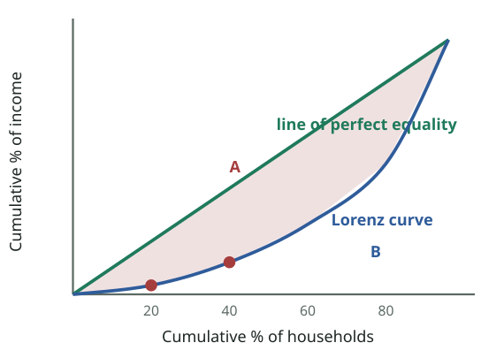
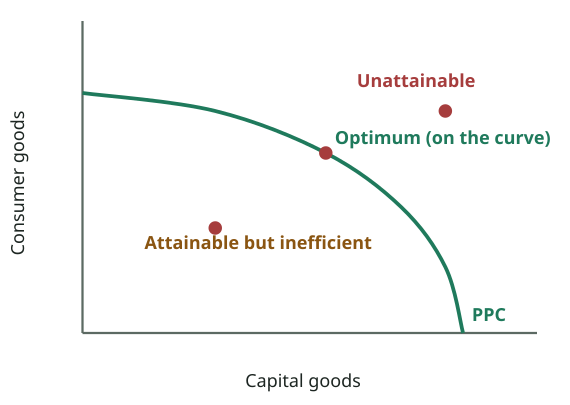

# FPEC 101 · Module 14 — Income Inequality, Poverty & Discrimination
## মডিউল ১৪ — আয় বৈষম্য, দারিদ্র্য ও বৈষম্যমূলক আচরণ

_Lecture 14 · 19 slides · Midterm questions: Q19_

> Printable study note generated from the website. Each slide: slide text → Bangla translation → tutor explanation → example → exam tip.

---

## Big picture — what is this lecture about? · বড় ছবি — এই লেকচারে কী শিখব?

_Lorenz curve (slides 6–9): bottom 20% of households get 3.4% of income, bottom 40% get 12.1%, and so on. The further the curve sags below the diagonal, the more unequal the income. Gini = A ÷ (A + B): 0 = complete equality, 1 = complete inequality._  
_লরেঞ্জ রেখা (স্লাইড ৬–৯): নিচের ২০% পরিবার আয়ের ৩.৪% পায়, নিচের ৪০% পায় ১২.১%, ইত্যাদি। রেখা কর্ণ থেকে যত নিচে ঝোলে, আয় তত অসম। গিনি = A ÷ (A + B): ০ = পূর্ণ সমতা, ১ = পূর্ণ অসমতা।_

### English

**Concept:** Markets reward people according to what they own and what they can produce, so incomes are **unequal**. Lecture 14 asks: **how unequal** (measured by the **Lorenz curve** and **Gini ratio**), **why** (causes), **what is happening over time** (trends), and two related problems: **poverty** and **discrimination**. This is midterm **Q19**.

Islamic economics, your degree subject, puts special weight on fair distribution (zakat, sadaqah, prohibition of riba), so this lecture connects closely with your other courses.

### বাংলা

**ধারণা:** বাজার মানুষকে পুরস্কৃত করে তার মালিকানা ও উৎপাদনক্ষমতা অনুযায়ী, তাই আয় **অসম**। লেকচার ১৪ জিজ্ঞেস করে: **কতটা অসম** (**লরেঞ্জ রেখা** ও **গিনি অনুপাত** দিয়ে মাপা), **কেন** (কারণ), **সময়ের সাথে কী হচ্ছে** (ধারা), আর দুটি সম্পর্কিত সমস্যা: **দারিদ্র্য** ও **বৈষম্যমূলক আচরণ**। এটা মিডটার্ম **Q19**।

তোমার ডিগ্রির বিষয় ইসলামী অর্থনীতি ন্যায্য বণ্টনে (যাকাত, সদকা, রিবা নিষেধ) বিশেষ গুরুত্ব দেয়, তাই এই লেকচার তোমার অন্য কোর্সের সাথে ঘনিষ্ঠভাবে যুক্ত।

---

## Key words · মূল শব্দ

| Term | Meaning | বাংলা অর্থ | Example |
|---|---|---|---|
| Income inequality | Unequal distribution of income among people | আয় বৈষম্য — মানুষের মধ্যে আয়ের অসম বণ্টন | Top 10% earn far more than bottom 10%. |
| Quintile | One-fifth (20%) of households ranked by income | কুইন্টাইল — আয় অনুযায়ী সাজানো পরিবারের এক-পঞ্চমাংশ (২০%) | The poorest 20%. |
| Lorenz curve | Curve of cumulative % of households vs cumulative % of income | লরেঞ্জ রেখা — পরিবারের ক্রমযোজিত % বনাম আয়ের ক্রমযোজিত % | Sags below the diagonal when unequal. |
| Gini ratio | Area between diagonal and Lorenz curve ÷ total area below diagonal (0 to 1) | গিনি অনুপাত — কর্ণ ও লরেঞ্জ রেখার মাঝের ক্ষেত্র ÷ কর্ণের নিচের মোট ক্ষেত্র (০ থেকে ১) | Bangladesh ≈ 0.50 (income, 2022). |
| Income mobility | Movement of households between income groups over time | আয়ের গতিশীলতা — সময়ের সাথে পরিবারের আয়-গোষ্ঠী বদল | A student today, a high earner later. |
| Transfer payments | Government payments not for current work | হস্তান্তর পরিশোধ — বর্তমান কাজের বিনিময়ে নয় এমন সরকারি পরিশোধ | Old-age allowance. |
| Poverty | Not having the means to meet basic needs | দারিদ্র্য — মৌলিক চাহিদা মেটানোর উপায় না থাকা | Cannot afford food, shelter, clothing. |
| Poverty rate | % of the population living in poverty | দারিদ্র্যের হার — দারিদ্র্যে থাকা জনসংখ্যার % | Bangladesh ≈ 18.7% (2022). |
| Discrimination | Different outcomes for similar people because of race, sex or other non-economic traits | বৈষম্যমূলক আচরণ — জাতি, লিঙ্গ বা অ-অর্থনৈতিক বৈশিষ্ট্যের কারণে একই রকম মানুষের ভিন্ন ফল | Women paid less for the same job. |

---

## Slides 1–4 · Title and outline
### শিরোনাম ও রূপরেখা

> **Slide 1**
> PRINCIPLES OF ECONOMICSSalimah Musharrif
> FPEC 101 – LECTURE 14 Unit 2
>
> **Slide 2**
> PRINCIPLES OF ECONOMICSProduction Costs and Market Structures
> FPEC 101 – LECTURE 14 Unit 2
>
> **Slide 3**
> Income inequality, poverty and discrimination
>
> **Slide 4**
> Outline
> Facts about Income Inequality
> Causes of Income Inequality
> Trends of Income Inequality
> Poverty
> Discrimination
>

**বাংলা অনুবাদ:**

> **স্লাইড ১–৪:** প্রিন্সিপলস অব ইকোনমিক্স — সালিমাহ মুশাররিফ। FPEC 101 – লেকচার ১৪, ইউনিট ২। আয় বৈষম্য, দারিদ্র্য ও বৈষম্যমূলক আচরণ। রূপরেখা: আয় বৈষম্যের তথ্য · আয় বৈষম্যের কারণ · আয় বৈষম্যের ধারা · বৈষম্যমূলক আচরণ।

**Tutor explains:** Reading: McConnell & Brue pp. 615–621, 623–629, 659–661, 665–666.

**টিউটরের ব্যাখ্যা:** পড়া: ম্যাককনেল ও ব্রু পৃ. ৬১৫–৬২১, ৬২৩–৬২৯, ৬৫৯–৬৬১, ৬৬৫–৬৬৬।

---

## Slide 5 · Measuring income distribution
### আয় বণ্টন পরিমাপ

> Income Inequality
> Income distribution is more important a study to find out about income inequalities
> Distribution by Income - measure income inequality by looking at the percentages of households in a series of income categories
> Distribution by Quintiles (Fifths) - measure income inequality by dividing the total number of individuals, households, or families into five numerically equal groups, or quintiles, and examine the percentage of total personal (before-tax) income received by each quintileExample, lowest 20%, second 20%, third, fourth and highest 20%Lowest income household to the household with the highest income
>

**বাংলা অনুবাদ:**

> আয় বৈষম্য
> আয় বৈষম্য বুঝতে আয় বণ্টনের পড়াশোনা বেশি গুরুত্বপূর্ণ।
> **আয় অনুযায়ী বণ্টন** — বিভিন্ন আয়-শ্রেণিতে পরিবারের শতাংশ দেখে আয় বৈষম্য মাপা।
> **কুইন্টাইল (পঞ্চমাংশ) অনুযায়ী বণ্টন** — মোট ব্যক্তি, পরিবার বা সংসারকে সংখ্যায় সমান পাঁচটি গোষ্ঠীতে ভাগ করে প্রতিটি গোষ্ঠী মোট ব্যক্তিগত আয়ের কত শতাংশ পায় তা দেখে আয় বৈষম্য মাপা।

**Tutor explains:** Two ways to describe how income is shared:
**By income category:** what % of households earn, say, under Tk 10,000, Tk 10–20,000, and so on.**By quintiles:** line up all households from poorest to richest, cut them into **five equal groups (20% each)**, and see what **share of total income** each fifth gets. If incomes were equal, each fifth would get 20%. In reality the poorest fifth gets much less and the richest fifth much more.

**টিউটরের ব্যাখ্যা:** আয় কীভাবে ভাগ হয় তা বর্ণনার দুই উপায়:
**আয়-শ্রেণি অনুযায়ী:** কত % পরিবার ধরো ১০,০০০ টাকার নিচে, ১০–২০,০০০ ইত্যাদি আয় করে।**কুইন্টাইল অনুযায়ী:** সব পরিবারকে সবচেয়ে গরিব থেকে ধনী পর্যন্ত সাজাও, **পাঁচটি সমান গোষ্ঠীতে (প্রতিটি ২০%)** ভাগ করো, আর দেখো প্রতিটি পঞ্চমাংশ **মোট আয়ের কত অংশ** পায়। আয় সমান হলে প্রত্যেক পঞ্চমাংশ ২০% পেত। বাস্তবে সবচেয়ে গরিব পঞ্চমাংশ অনেক কম, ধনী পঞ্চমাংশ অনেক বেশি পায়।

---

## Slides 6–9 · The Lorenz curve and the Gini ratio
### লরেঞ্জ রেখা ও গিনি অনুপাত

_Lorenz curve (slides 6–9): bottom 20% of households get 3.4% of income, bottom 40% get 12.1%, and so on. The further the curve sags below the diagonal, the more unequal the income. Gini = A ÷ (A + B): 0 = complete equality, 1 = complete inequality._  
_লরেঞ্জ রেখা (স্লাইড ৬–৯): নিচের ২০% পরিবার আয়ের ৩.৪% পায়, নিচের ৪০% পায় ১২.১%, ইত্যাদি। রেখা কর্ণ থেকে যত নিচে ঝোলে, আয় তত অসম। গিনি = A ÷ (A + B): ০ = পূর্ণ সমতা, ১ = পূর্ণ অসমতা।_

> **Slide 6**
> • The quintile distribution of personal income is presented through a Lorenz curve
> • Plot the cumulative percentage of households on the horizontal axis and the percentage of income they obtain on the vertical axis.
> • Diagonal line 0e represents a perfectly equal distribution of income because each point along that line indicates that a particular percentage of households receive the same percentage of income. In other words, points representing 20 percent of all households receiving 20 percent of total income, 40 percent receiving 40 percent, 60 percent receiving 60 percent, and so on, all lie on the diagonal line.
> • Lorenz curve shows actual distribution of income
> • The area between the diagonal (the line of perfect equality of income distribution) and the Lorenz Curve shows inequality in the distribution of total income.
> • Inequality is measured numerically by the Gini ratio—area A (shown in brown) divided by area A + B (the brown +green area).
> The Lorenz Curve & Gini Ratio
>
> **Slide 7**
> The Lorenz Curve & Gini Ratio
> Mc Connell & Brue
> We plot the quintile data
> Get Lorenz curve
> a-Bottom 20 % of householdsreceived 3.4 % of the income
> b-bottom 40 % received 12.1 % ( 3.4 +8.7) so on
> Brown area- degree of income inequality
> If perfect equality, in income distribution,Lorenz curve and the diagonal would coincide and the brown area would disappear.
>
> **Slide 8**
> The Lorenz Curve & Gini Ratio
> Mc Connell & Brue
> At the opposite extreme is complete inequality, where all households but one have zero income. Lorenz curve would coincide with the horizontal axis from 0 to point f (at 0 % of income) and then move immediately up from f to point e along the vertical axis (indicating that a single household has 100 % of the total income)
> Area below the diagonal line (triangle 0ef ) would indicate this extreme degree of inequality.
> Farther Lorenz curve sags away from the diagonal, the greater the degree of income inequality.
>
> **Slide 9**
> The Lorenz Curve & Gini Ratio
> Mc Connell & Brue
> The income inequality described by the Lorenz curve can be transformed into a Gini ratio
> Gini ratio =Area between Lorenz curve and diagonal
> Total area below the diagonal = A (brown area)
> A + B (brown + green area)
> Lower Gini ratios denote less inequality
> Higher ratios indicate more inequality.
> Gini coefficient for complete income equality is 0
> Gini coefficient for complete inequality is 1
>

**বাংলা অনুবাদ:**

> **স্লাইড ৬:** ব্যক্তিগত আয়ের কুইন্টাইল বণ্টন লরেঞ্জ রেখা দিয়ে দেখানো হয়। আনুভূমিক অক্ষে পরিবারের ক্রমযোজিত শতাংশ, খাড়া অক্ষে তারা আয়ের যে শতাংশ পায়। কর্ণ রেখা 0e পূর্ণ সমান আয় বণ্টন দেখায়, কারণ এর প্রতিটি বিন্দুতে নির্দিষ্ট শতাংশ পরিবার একই শতাংশ আয় পায়। লরেঞ্জ রেখা আয়ের প্রকৃত বণ্টন দেখায়। কর্ণ (পূর্ণ সমতার রেখা) ও লরেঞ্জ রেখার মাঝের ক্ষেত্র মোট আয় বণ্টনের বৈষম্য দেখায়। গিনি অনুপাত দিয়ে বৈষম্য সংখ্যায় মাপা হয় — ক্ষেত্র A (বাদামি) ÷ A + B (বাদামি + সবুজ)।
> **স্লাইড ৭:** কুইন্টাইলের তথ্য আঁকলে লরেঞ্জ রেখা পাই। a — নিচের ২০% পরিবার আয়ের ৩.৪% পেয়েছে; b — নিচের ৪০% পেয়েছে ১২.১% (৩.৪ + ৮.৭), এভাবে। বাদামি অংশ — আয় বৈষম্যের মাত্রা। আয় বণ্টন পুরো সমান হলে লরেঞ্জ রেখা ও কর্ণ মিলে যেত, বাদামি অংশ থাকত না।
> **স্লাইড ৮:** উল্টো প্রান্তে পূর্ণ অসমতা — একটি ছাড়া সব পরিবারের আয় শূন্য। তখন লরেঞ্জ রেখা ০ থেকে f পর্যন্ত (আয়ের ০%) আনুভূমিক অক্ষের সাথে মিলে, তারপর f থেকে সোজা e পর্যন্ত ওঠে। কর্ণের নিচের ক্ষেত্র (ত্রিভুজ 0ef) এই চরম বৈষম্য দেখায়। লরেঞ্জ রেখা কর্ণ থেকে যত নিচে ঝোলে, আয় বৈষম্য তত বেশি।
> **স্লাইড ৯:** লরেঞ্জ রেখার বৈষম্যকে গিনি অনুপাতে রূপান্তর করা যায়। গিনি অনুপাত = লরেঞ্জ রেখা ও কর্ণের মাঝের ক্ষেত্র ÷ কর্ণের নিচের মোট ক্ষেত্র = A ÷ (A + B)। কম গিনি মানে কম বৈষম্য, বেশি গিনি মানে বেশি বৈষম্য। পূর্ণ সমতায় গিনি ০; পূর্ণ অসমতায় ১।

**Tutor explains:** **How to draw a Lorenz curve:** - Horizontal axis: **cumulative % of households** (poorest first). Vertical axis: **cumulative % of income**. - The **45° diagonal** = **perfect equality** (20% of households get 20% of income, 40% get 40%…). - Plot the real data: bottom 20% get **3.4%**; bottom 40% get **3.4 + 8.7 = 12.1%**; and so on. Join the points: the **Lorenz curve**. - **Complete inequality:** one household gets everything; the curve runs along the bottom axis and then straight up. - **The further the curve sags below the diagonal, the greater the inequality.**
**Gini ratio = A ÷ (A + B)**, where A = area between the diagonal and the Lorenz curve, B = area below the Lorenz curve. **0 = perfect equality, 1 = complete inequality.**

**টিউটরের ব্যাখ্যা:** **লরেঞ্জ রেখা আঁকার নিয়ম:** - আনুভূমিক অক্ষ: **পরিবারের ক্রমযোজিত %** (গরিব আগে)। খাড়া অক্ষ: **আয়ের ক্রমযোজিত %**। - **৪৫° কর্ণ** = **পূর্ণ সমতা** (২০% পরিবার ২০% আয়, ৪০% পায় ৪০%…)। - বাস্তব তথ্য বসাও: নিচের ২০% পায় **৩.৪%**; নিচের ৪০% পায় **৩.৪ + ৮.৭ = ১২.১%**; এভাবে। বিন্দু জোড়া দিলে **লরেঞ্জ রেখা**। - **পূর্ণ অসমতা:** একটি পরিবার সব পায়; রেখা নিচের অক্ষ ধরে চলে তারপর সোজা ওঠে। - **রেখা কর্ণ থেকে যত নিচে ঝোলে, বৈষম্য তত বেশি।**
**গিনি অনুপাত = A ÷ (A + B)**, যেখানে A = কর্ণ ও লরেঞ্জ রেখার মাঝের ক্ষেত্র, B = লরেঞ্জ রেখার নিচের ক্ষেত্র। **০ = পূর্ণ সমতা, ১ = পূর্ণ অসমতা।**

**Real-life example:** Bangladesh's income Gini was about **0.50** in 2022 (BBS household survey), up from about 0.46 in 2010: income inequality has been rising. Scandinavian countries are around 0.25–0.30.

**বাস্তব উদাহরণ:** বিবিএস খানা জরিপে ২০২২ সালে বাংলাদেশের আয়ের গিনি প্রায় **০.৫০**, ২০১০ সালে প্রায় ০.৪৬ থেকে বেড়েছে: আয় বৈষম্য বাড়ছে। স্ক্যান্ডিনেভিয়ার দেশগুলোতে প্রায় ০.২৫–০.৩০।

**Exam tip:** In Q19 draw the Lorenz curve with the diagonal, shade area A, write Gini = A/(A + B) and the 0–1 range.

**পরীক্ষার টিপস:** Q19-এ কর্ণসহ লরেঞ্জ রেখা আঁকো, A অংশ ছায়াযুক্ত করো, লেখো গিনি = A/(A + B) এবং ০–১ পরিসর।

---

## Slides 10–11 · Income mobility and government redistribution
### আয়ের গতিশীলতা ও সরকারি পুনর্বণ্টন

> **Slide 10**
> Income mobility
> Income mobility or “churning around” in the distribution of income over time means movement of individuals or households from one income quintile to another over the period of their lives
> Short time periods , say a year, may mean reflection of an unequal income distribution although with time, perhaps, it may get more or completely equal.
> “ Low income’’ and “high income” are not permanent conditions. People move into different income quintiles with age, experience etc.
> The longer the time period considered, the more equal the distribution of income becomes.
>
> **Slide 11**
> Effect of Government Redistribution
> Government redistributes income from higher- to lower-income households through taxes and transfers.
> Personal income pre tax covers wages, salaries, dividends, interest income, cash transfer payments such as Social Security, unemployment compensation benefits, and welfare assistance to needy families.
> It excludes the effects of personal income and payroll (Social Security) taxes that are levied directly on income receivers, noncash transfers ,which provide specific goods or services rather than cash such as medical benefits, housing subsidies, subsidized school lunches, and food stamps etc. These are like income because they enable recipients to in effect “purchase” goods and services.
> After redistribution, more equal income distribution
>

**বাংলা অনুবাদ:**

> **স্লাইড ১০ — আয়ের গতিশীলতা:** সময়ের সাথে আয় বণ্টনে "ঘোরাফেরা" বা গতিশীলতা মানে জীবনকালে ব্যক্তি বা পরিবারের এক আয়-কুইন্টাইল থেকে অন্যটিতে যাওয়া। স্বল্প সময়, ধরো এক বছর, অসম আয় বণ্টন দেখাতে পারে, যদিও সময়ের সাথে হয়তো কম অসম বা পুরো সমান হতে পারে। "নিম্ন আয়" ও "উচ্চ আয়" স্থায়ী অবস্থা নয়। বয়স, অভিজ্ঞতা ইত্যাদির সাথে মানুষ ভিন্ন কুইন্টাইলে যায়। সময়কাল যত দীর্ঘ, আয় বণ্টন তত সমান।
> **স্লাইড ১১ — সরকারি পুনর্বণ্টনের প্রভাব:** সরকার কর ও হস্তান্তরের মাধ্যমে বেশি আয়ের পরিবার থেকে কম আয়ের পরিবারে আয় পুনর্বণ্টন করে। করপূর্ব ব্যক্তিগত আয়ে আছে মজুরি, বেতন, লভ্যাংশ, সুদ আয়, সামাজিক নিরাপত্তা, বেকার ভাতা ও অভাবী পরিবারের কল্যাণ সহায়তার মতো নগদ হস্তান্তর। এতে আয়ের ওপর সরাসরি আরোপিত ব্যক্তিগত আয়কর ও বেতন-কর এবং চিকিৎসা সুবিধার মতো অ-নগদ হস্তান্তরের প্রভাব ধরা হয় না। পুনর্বণ্টনের পর আয় বণ্টন বেশি সমান।

**Tutor explains:** **Income mobility:** low and high income are **not permanent**. A young graduate starts in a low quintile and moves up with experience; a retired person may move down. Over a **longer period**, the distribution looks **more equal** than one year's snapshot suggests.
**Government redistribution:** through **taxes** (progressive income tax takes more from the rich) and **transfers** (cash such as pensions, unemployment benefits, welfare; non-cash such as medical care, food aid). Official "pre-tax" income data leave out taxes and non-cash transfers; **after redistribution, income is more equally distributed** (the Lorenz curve moves closer to the diagonal).

**টিউটরের ব্যাখ্যা:** **আয়ের গতিশীলতা:** নিম্ন ও উচ্চ আয় **স্থায়ী নয়**। এক তরুণ স্নাতক নিচের কুইন্টাইলে শুরু করে অভিজ্ঞতার সাথে ওপরে ওঠে; অবসরপ্রাপ্ত কেউ নিচে নামতে পারে। **দীর্ঘ সময়ে** বণ্টন এক বছরের ছবির চেয়ে **বেশি সমান** দেখায়।
**সরকারি পুনর্বণ্টন:** **কর** (প্রগতিশীল আয়কর ধনীদের কাছ থেকে বেশি নেয়) ও **হস্তান্তরের** (নগদ: পেনশন, বেকার ভাতা, কল্যাণ; অ-নগদ: চিকিৎসা, খাদ্য সহায়তা) মাধ্যমে। সরকারি "করপূর্ব" আয়ের তথ্যে কর ও অ-নগদ হস্তান্তর বাদ থাকে; **পুনর্বণ্টনের পর আয় বেশি সমানভাবে বণ্টিত** (লরেঞ্জ রেখা কর্ণের কাছে আসে)।

**Real-life example:** Bangladesh's social safety net: old-age allowance, widow allowance, VGD/VGF food cards, stipends and free textbooks redistribute income to poorer households. **Zakat** plays the same role in Islamic economics.

**বাস্তব উদাহরণ:** বাংলাদেশের সামাজিক নিরাপত্তা বেষ্টনী: বয়স্ক ভাতা, বিধবা ভাতা, ভিজিডি/ভিজিএফ খাদ্য কার্ড, উপবৃত্তি ও বিনামূল্যে বই গরিব পরিবারে আয় পুনর্বণ্টন করে। ইসলামী অর্থনীতিতে **যাকাত** একই ভূমিকা রাখে।

---

## Slide 12 · Causes of income inequality
### আয় বৈষম্যের কারণ

> Causes of Income Inequality
> • Ability
> • Education and Training
> • Discrimination
> • Preferences and Risks
> • Unequal Distribution of Wealth
> • Market Power
> • Luck, Connections, and Misfortune
>

**বাংলা অনুবাদ:**

> আয় বৈষম্যের কারণ
> • সামর্থ্য
> • শিক্ষা ও প্রশিক্ষণ
> • বৈষম্যমূলক আচরণ
> • পছন্দ ও ঝুঁকি
> • সম্পদের অসম বণ্টন
> • বাজারক্ষমতা
> • ভাগ্য, যোগাযোগ ও দুর্ভাগ্য

**Tutor explains:** Seven causes (the "causes" part of **Q19**):
**Ability:** differences in intelligence, talent, physical skills.**Education and training:** more human capital → higher productivity and pay.**Discrimination:** some groups are paid less or kept out of good jobs.**Preferences and risks:** some choose high-risk, high-pay jobs or long hours; others prefer leisure or safe jobs.**Unequal distribution of wealth:** property earns rent, interest and profit; inherited wealth passes inequality on.**Market power:** monopolies, professional associations and unions can raise their members' incomes.**Luck, connections and misfortune:** being in the right place, knowing the right people, or suffering illness, accidents, floods.

**টিউটরের ব্যাখ্যা:** সাতটি কারণ (**Q19**-এর "কারণ" অংশ):
**সামর্থ্য:** বুদ্ধি, প্রতিভা, শারীরিক দক্ষতার পার্থক্য।**শিক্ষা ও প্রশিক্ষণ:** বেশি মানব মূলধন → বেশি উৎপাদনশীলতা ও বেতন।**বৈষম্যমূলক আচরণ:** কিছু গোষ্ঠী কম বেতন পায় বা ভালো চাকরি থেকে বাদ পড়ে।**পছন্দ ও ঝুঁকি:** কেউ ঝুঁকিপূর্ণ, বেশি বেতনের কাজ বা দীর্ঘ সময় বেছে নেয়; অন্যরা অবসর বা নিরাপদ চাকরি পছন্দ করে।**সম্পদের অসম বণ্টন:** সম্পত্তি খাজনা, সুদ ও মুনাফা আনে; উত্তরাধিকারসূত্রে সম্পদ বৈষম্যকে পরের প্রজন্মে নেয়।**বাজারক্ষমতা:** একচেটিয়া, পেশাজীবী সংগঠন ও ইউনিয়ন সদস্যদের আয় বাড়াতে পারে।**ভাগ্য, যোগাযোগ ও দুর্ভাগ্য:** সঠিক সময়ে সঠিক জায়গায় থাকা, সঠিক মানুষকে চেনা, বা অসুস্থতা, দুর্ঘটনা, বন্যার শিকার হওয়া।

**Exam tip:** Memory trick: **"A Educated Doctor Prefers Wealthy Markets, Luckily"**: Ability, Education, Discrimination, Preferences, Wealth, Market power, Luck.

**পরীক্ষার টিপস:** মনে রাখার কৌশল: **"A Educated Doctor Prefers Wealthy Markets, Luckily"**: সামর্থ্য, শিক্ষা, বৈষম্য, পছন্দ, সম্পদ, বাজারক্ষমতা, ভাগ্য।

---

## Slide 13 · Trends in income inequality
### আয় বৈষম্যের ধারা

> Trends of Income Inequality
> In absolute dollar amounts, the entire distribution of income increased
> The relative distribution of income, though, may become less equal, more equal, or remain unchanged. It has become more uneven.
> Absolute income of both the rich and the poor are experiencing rise, however, while incomes have risen in all quintiles, income growth has been fastest in the top quintile
> Causes
> • Greater Demand for Highly Skilled Workers
> • Demographic Changes
> • International Trade, Immigration, and Decline in Unionism
>

**বাংলা অনুবাদ:**

> আয় বৈষম্যের ধারা
> পরম টাকার অঙ্কে পুরো আয় বণ্টন বেড়েছে।
> তবে আপেক্ষিক বণ্টন কম সমান, বেশি সমান বা অপরিবর্তিত হতে পারে। এটা বেশি অসম হয়েছে।
> ধনী-গরিব দুয়েরই পরম আয় বাড়ছে; তবে সব কুইন্টাইলে আয় বাড়লেও সবচেয়ে দ্রুত বেড়েছে ওপরের কুইন্টাইলে।
> • উচ্চ দক্ষ শ্রমিকের বেশি চাহিদা
> • জনসংখ্যাগত পরিবর্তন
> • আন্তর্জাতিক বাণিজ্য, অভিবাসন ও ইউনিয়নের পতন

**Tutor explains:** **Absolute vs relative:** everyone's income has risen in money terms, but the **top group's income has grown fastest**, so the **relative** distribution has become **more unequal**.
Why inequality has grown: - **Greater demand for highly skilled workers** (technology rewards skills). - **Demographic changes** (e.g. more two-earner high-income households, more single-parent households). - **International trade, immigration and decline of unions** (cheap imports and immigrant labour hold down low-skilled wages; weaker unions bargain less).

**টিউটরের ব্যাখ্যা:** **পরম বনাম আপেক্ষিক:** টাকার অঙ্কে সবার আয় বেড়েছে, কিন্তু **ওপরের গোষ্ঠীর আয় সবচেয়ে দ্রুত বেড়েছে**, তাই **আপেক্ষিক** বণ্টন **বেশি অসম** হয়েছে।
বৈষম্য কেন বেড়েছে: - **উচ্চ দক্ষ শ্রমিকের বেশি চাহিদা** (প্রযুক্তি দক্ষতাকে পুরস্কৃত করে)। - **জনসংখ্যাগত পরিবর্তন** (যেমন দুই উপার্জনকারীর উচ্চ আয়ের পরিবার বেশি, একক অভিভাবকের পরিবার বেশি)। - **আন্তর্জাতিক বাণিজ্য, অভিবাসন ও ইউনিয়নের পতন** (সস্তা আমদানি ও অভিবাসী শ্রম কম দক্ষ মজুরি চেপে রাখে; দুর্বল ইউনিয়ন কম দর কষাকষি করে)।

---

## Slide 14 · Poverty
### দারিদ্র্য

> Poverty
> Poverty is a condition in which a person or a family does not have the means to satisfy basic needs for food, clothing, shelter, and transportation. The means include currently earned income, transfer payments, past savings, and property owned. The basic needs have many determinants, including family size and the health and age of its members
> poverty rate—the percentage of the population living in poverty
> Incidence of poverty more prevalent in some groups than others
> Mostly world over poverty on the rise
> Measurement issues- income or consumption?
> Income Maintenance System ( Entitlement programs)- social insurance , public assistance, or “welfare.”
> Welfare Goals:
> • Effective in getting individuals and families out of poverty.
> • Provide adequate incentives for able-bodied, nonretired people to work.
> • Its cost should be “reasonable.”
> Reforms – time based, conditions changed etc
>

**বাংলা অনুবাদ:**

> দারিদ্র্য হলো এমন অবস্থা যেখানে একজন ব্যক্তি বা পরিবারের খাদ্য, বস্ত্র, বাসস্থান ও যাতায়াতের মৌলিক চাহিদা মেটানোর উপায় নেই। উপায়ের মধ্যে আছে বর্তমান আয়, হস্তান্তর পরিশোধ, অতীতের সঞ্চয় ও সম্পত্তির মালিকানা।
> দারিদ্র্যের হার — দারিদ্র্যে থাকা জনসংখ্যার শতাংশ
> কিছু গোষ্ঠীতে দারিদ্র্য অন্যদের চেয়ে বেশি
> বিশ্বজুড়ে মূলত দারিদ্র্য বাড়ছে
> পরিমাপের সমস্যা — আয় না ভোগ?
> আয় রক্ষণাবেক্ষণ ব্যবস্থা (অধিকারভিত্তিক কর্মসূচি) — সামাজিক বিমা, সরকারি সহায়তা বা "কল্যাণ"।
> কল্যাণের লক্ষ্য: • ব্যক্তি ও পরিবারকে দারিদ্র্য থেকে বের করতে কার্যকর • কর্মক্ষম, অবসরহীন মানুষকে কাজের যথেষ্ট প্রণোদনা • খরচ "যুক্তিসঙ্গত"
> সংস্কার — সময়ভিত্তিক, শর্ত পরিবর্তন ইত্যাদি

**Tutor explains:** **Poverty** = not having the **means** (income, transfers, savings, property) to meet **basic needs**: food, clothing, shelter, transport. - **Poverty rate** = % of the population in poverty; it is **higher in some groups** (e.g. rural, female-headed, disabled, elderly households). - **Measurement issue:** should poverty be measured by **income** or by **consumption**? (Bangladesh's BBS uses consumption-based poverty lines.) - **Income maintenance system:** **social insurance** (pensions, unemployment benefits, funded by contributions) and **public assistance/welfare** (for the needy). - **Three goals of a good welfare system:** (1) lift people out of poverty, (2) keep **incentives to work**, (3) **reasonable cost**. These goals conflict, so systems are reformed (time limits, work conditions).

**টিউটরের ব্যাখ্যা:** **দারিদ্র্য** = **মৌলিক চাহিদা** (খাদ্য, বস্ত্র, বাসস্থান, যাতায়াত) মেটানোর **উপায়** (আয়, হস্তান্তর, সঞ্চয়, সম্পত্তি) না থাকা। - **দারিদ্র্যের হার** = দারিদ্র্যে থাকা জনসংখ্যার %; **কিছু গোষ্ঠীতে বেশি** (যেমন গ্রামীণ, নারীপ্রধান, প্রতিবন্ধী, বয়স্ক পরিবার)। - **পরিমাপের সমস্যা:** দারিদ্র্য **আয়** দিয়ে মাপব না **ভোগ** দিয়ে? (বাংলাদেশের বিবিএস ভোগভিত্তিক দারিদ্র্যরেখা ব্যবহার করে।) - **আয় রক্ষণাবেক্ষণ ব্যবস্থা:** **সামাজিক বিমা** (চাঁদায় চলা পেনশন, বেকার ভাতা) ও **সরকারি সহায়তা/কল্যাণ** (অভাবীদের জন্য)। - **ভালো কল্যাণ ব্যবস্থার তিন লক্ষ্য:** (১) মানুষকে দারিদ্র্য থেকে বের করা, (২) **কাজের প্রণোদনা** রাখা, (৩) **যুক্তিসঙ্গত খরচ**। লক্ষ্যগুলো সাংঘর্ষিক, তাই ব্যবস্থা সংস্কার হয় (সময়সীমা, কাজের শর্ত)।

**Real-life example:** Bangladesh's poverty rate fell from about 40% (2005) to about 18.7% (2022, BBS), yet poverty remains higher in rural areas and in districts like Kurigram.

**বাস্তব উদাহরণ:** বাংলাদেশের দারিদ্র্যের হার প্রায় ৪০% (২০০৫) থেকে কমে প্রায় ১৮.৭% (২০২২, বিবিএস), তবু গ্রামাঞ্চলে ও কুড়িগ্রামের মতো জেলায় দারিদ্র্য বেশি।

---

## Quick check · দ্রুত যাচাই

1. A Gini ratio of 0 means…  
   গিনি অনুপাত ০ মানে…

   - A) Complete inequality · পূর্ণ অসমতা
   - B) Perfect equality · পূর্ণ সমতা
   - C) Everyone is poor · সবাই গরিব
   - D) No data · তথ্য নেই

   **Answer: B** — The Lorenz curve lies on the diagonal, so area A = 0.  
   লরেঞ্জ রেখা কর্ণের ওপর, তাই A = ০।

2. The further the Lorenz curve sags from the diagonal…  
   লরেঞ্জ রেখা কর্ণ থেকে যত নিচে ঝোলে…

   - A) The more equal incomes are · আয় তত সমান
   - B) The greater the inequality · বৈষম্য তত বেশি
   - C) The lower the poverty rate · দারিদ্র্য তত কম
   - D) The higher wages are · মজুরি তত বেশি

   **Answer: B** — Slide 8: farther sag = greater income inequality.  
   স্লাইড ৮: বেশি ঝোলা = বেশি আয় বৈষম্য।

---

## Slides 15–17 · Discrimination: types, costs and policies
### বৈষম্যমূলক আচরণ: ধরন, ক্ষতি ও নীতি

_Points ON the PPC = optimum (full use of resources). Points INSIDE = attainable but wasteful (unemployment). Points OUTSIDE = unattainable with today's resources._  
_PPC-র **ওপরে** বিন্দু = সর্বোত্তম (সব সম্পদ কাজে লাগছে)। **ভেতরে** বিন্দু = সম্ভব কিন্তু অপচয় (বেকারত্ব)। **বাইরে** বিন্দু = আজকের সম্পদে অসম্ভব।_

> **Slide 15**
> Discrimination
> When people with similar economic characteristics experience different economic outcomes because of their race, sex, or other noneconomic characteristics
> Types
> • Wage – less pay
> • Occupation- prohibited from entering the more desirable, higher paying occupation
> • Employment-inferior treatment in hiring, promotions, assignments, temporary layoffs, and permanent discharges, workplace harassment
> • Human capital discrimination occurs when women or members of minorities do not have the same access to productivity-enhancing investments in education and training as white males
>
> **Slide 16**
> Discrimination
> Costs
> Discriminator gets good job at cost of others
> Reduces economy’s output and income acting as an artificial barrier to free competition, decreasing economic efficiency and reducing production as qualified groups of people are prevented from entering high-productivity (and thus high-wage) jobs
> Decreases efficiency of economy moving point to further inside the PPC curve
>
> **Slide 17**
> Discrimination
> Anti discrimination policies
> To promote a strong, growing economy so that more workers are needed and more efficient recruitment would take place, eliminating discrimination
> Improve the education and training opportunities of women and minorities
> Direct intervention - outlawed certain practices in hiring, promotion, and compensation
> Views
> + provide more training and education to close this gap
> + drastic measures needed as discrimination has been long embedded
> + endorse preferential treatment
> - reverse discrimination
>

**বাংলা অনুবাদ:**

> **স্লাইড ১৫ — বৈষম্যমূলক আচরণ:** যখন একই অর্থনৈতিক বৈশিষ্ট্যের মানুষ জাতি, লিঙ্গ বা অন্য অ-অর্থনৈতিক বৈশিষ্ট্যের কারণে ভিন্ন অর্থনৈতিক ফল পায়। • **মজুরি** — কম বেতন • **পেশা** — বেশি আকাঙ্ক্ষিত, বেশি বেতনের পেশায় ঢুকতে নিষেধ • **নিয়োগ** — নিয়োগ, পদোন্নতি, দায়িত্ব, সাময়িক ছাঁটাই ও স্থায়ী বরখাস্তে নিম্নমানের আচরণ, কর্মক্ষেত্রে হয়রানি • **মানব মূলধন বৈষম্য** — যখন নারী বা সংখ্যালঘুরা উৎপাদনশীলতা বাড়ানো শিক্ষা ও প্রশিক্ষণে শ্বেতাঙ্গ পুরুষদের মতো সুযোগ পায় না।
> **স্লাইড ১৬:** বৈষম্যকারী অন্যদের খরচে ভালো চাকরি পায়। এটি অর্থনীতির উৎপাদন ও আয় কমায়, অবাধ প্রতিযোগিতায় কৃত্রিম বাধা হয়ে অর্থনৈতিক দক্ষতা কমায়, কারণ যোগ্য গোষ্ঠী উচ্চ-উৎপাদনশীল (ও বেশি বেতনের) কাজে ঢুকতে পারে না। অর্থনীতির দক্ষতা কমিয়ে PPC-র আরও ভেতরের বিন্দুতে নিয়ে যায়।
> **স্লাইড ১৭ — বৈষম্যবিরোধী নীতি:** শক্তিশালী, বর্ধনশীল অর্থনীতি গড়া, যাতে বেশি শ্রমিক লাগে ও দক্ষ নিয়োগে বৈষম্য দূর হয়। নারী ও সংখ্যালঘুদের শিক্ষা ও প্রশিক্ষণের সুযোগ বাড়ানো। সরাসরি হস্তক্ষেপ — নিয়োগ, পদোন্নতি ও বেতনে কিছু আচরণ নিষিদ্ধ করা। + ব্যবধান কমাতে বেশি প্রশিক্ষণ ও শিক্ষা + দীর্ঘদিনের বৈষম্য দূর করতে কঠোর ব্যবস্থা দরকার + অগ্রাধিকারমূলক আচরণ সমর্থন − উল্টো বৈষম্য।

**Tutor explains:** **Discrimination** = people with **similar economic characteristics** (skills, education, experience) getting **different outcomes** because of race, sex, religion or other non-economic traits. **Four types:** 1. **Wage discrimination:** less pay for the same work. 2. **Occupational discrimination:** kept out of better, higher-paying occupations. 3. **Employment discrimination:** worse treatment in hiring, promotion, layoffs, harassment. 4. **Human-capital discrimination:** less access to education and training.
**Costs:** the discriminator gains, others lose; and **society loses output**: qualified people are kept out of their most productive jobs, so the economy operates **inside its PPC** (Lecture 1).
**Policies:** a strong growing economy (more demand for workers); better **education and training** for disadvantaged groups; **direct intervention** (laws banning discriminatory hiring, promotion and pay). **Views:** supporters say long-embedded discrimination needs strong action and preferential treatment; critics warn of **reverse discrimination**.

**টিউটরের ব্যাখ্যা:** **বৈষম্যমূলক আচরণ** = **একই অর্থনৈতিক বৈশিষ্ট্যের** (দক্ষতা, শিক্ষা, অভিজ্ঞতা) মানুষ জাতি, লিঙ্গ, ধর্ম বা অ-অর্থনৈতিক বৈশিষ্ট্যের কারণে **ভিন্ন ফল** পাওয়া। **চার ধরন:** 1. **মজুরি বৈষম্য:** একই কাজে কম বেতন। 2. **পেশাগত বৈষম্য:** ভালো, বেশি বেতনের পেশা থেকে বাদ। 3. **নিয়োগ বৈষম্য:** নিয়োগ, পদোন্নতি, ছাঁটাইয়ে খারাপ আচরণ, হয়রানি। 4. **মানব মূলধন বৈষম্য:** শিক্ষা ও প্রশিক্ষণে কম সুযোগ।
**ক্ষতি:** বৈষম্যকারী লাভবান, অন্যরা ক্ষতিগ্রস্ত; আর **সমাজের উৎপাদন কমে**: যোগ্য মানুষ সবচেয়ে উৎপাদনশীল কাজ থেকে বাদ পড়ে, তাই অর্থনীতি **PPC-র ভেতরে** থাকে (লেকচার ১)।
**নীতি:** শক্তিশালী বর্ধনশীল অর্থনীতি (শ্রমিকের বেশি চাহিদা); সুবিধাবঞ্চিতদের জন্য ভালো **শিক্ষা ও প্রশিক্ষণ**; **সরাসরি হস্তক্ষেপ** (বৈষম্যমূলক নিয়োগ, পদোন্নতি ও বেতন নিষিদ্ধের আইন)। **দৃষ্টিভঙ্গি:** সমর্থকেরা বলেন দীর্ঘদিনের বৈষম্যে কঠোর পদক্ষেপ ও অগ্রাধিকার দরকার; সমালোচকেরা **উল্টো বৈষম্যের** আশঙ্কা করেন।

**Real-life example:** In Bangladesh, women's labour-force participation is much lower than men's and women are concentrated in lower-paid jobs. Girls' stipend programmes and quotas aim to reduce human-capital and occupational discrimination.

**বাস্তব উদাহরণ:** বাংলাদেশে নারীর শ্রমশক্তিতে অংশগ্রহণ পুরুষের চেয়ে অনেক কম, আর নারীরা কম বেতনের কাজে বেশি। মেয়েদের উপবৃত্তি ও কোটা মানব মূলধন ও পেশাগত বৈষম্য কমাতে চায়।

---

## Slides 18–19 · Summary of Lecture 14
### লেকচার ১৪-এর সারসংক্ষেপ

> **Slide 18**
> SUMMARY
> Facts about Income Inequality
> • Income distribution by income category
> • Income distribution by quintiles
> • The Lorenz Curve & Gini Ratio
> • Income mobility
> • Effect of Government Redistribution
> Causes of Income Inequality
> • Ability
> • Education and Training
> • Discrimination
> • Preferences and Risks
> • Unequal Distribution of Wealth
> • Market Power
> • Luck, Connections, and Misfortune
> Trends of Income Inequality
>
> **Slide 19**
> SUMMARY
> Poverty
> • Incidence
> • Trends
> • Measurement issues
> • Income Maintenance System
> Discrimination
> • Types
> • Costs
> • Prevention policies
> • Views
>

**বাংলা অনুবাদ:**

> **স্লাইড ১৮–১৯ — সারসংক্ষেপ:** আয় বৈষম্যের তথ্য (আয়-শ্রেণি ও কুইন্টাইল অনুযায়ী বণ্টন, লরেঞ্জ রেখা ও গিনি অনুপাত, আয়ের গতিশীলতা, সরকারি পুনর্বণ্টনের প্রভাব) · আয় বৈষম্যের কারণ (সামর্থ্য, শিক্ষা ও প্রশিক্ষণ, বৈষম্য, পছন্দ ও ঝুঁকি, সম্পদের অসম বণ্টন, বাজারক্ষমতা, ভাগ্য-যোগাযোগ-দুর্ভাগ্য) · আয় বৈষম্যের ধারা · দারিদ্র্য (প্রকোপ, ধারা, পরিমাপের সমস্যা, আয় রক্ষণাবেক্ষণ ব্যবস্থা) · বৈষম্যমূলক আচরণ (ধরন, ক্ষতি, প্রতিরোধ নীতি, দৃষ্টিভঙ্গি)।

**Tutor explains:** The two summary slides are the outline of **Q19**: inequality facts and measurement → causes → trends → poverty → discrimination (types, costs, policies, views).

**টিউটরের ব্যাখ্যা:** দুটি সারসংক্ষেপ স্লাইডই **Q19**-এর রূপরেখা: বৈষম্যের তথ্য ও পরিমাপ → কারণ → ধারা → দারিদ্র্য → বৈষম্যমূলক আচরণ (ধরন, ক্ষতি, নীতি, দৃষ্টিভঙ্গি)।

---

## Put it together — tables, graphs and numbers · সব একসাথে — ছক, গ্রাফ ও হিসাব

### English

TopicKey points
Measuring inequalityIncome categories, quintiles, Lorenz curve, Gini = A/(A+B) (0 equal → 1 unequal)
Softening factorsIncome mobility over time; redistribution by taxes and transfers
CausesAbility, education, discrimination, preferences and risks, wealth, market power, luck
TrendsAll incomes up, top fastest: skills demand, demographics, trade/immigration/unions
PovertyLack of means for basic needs; poverty rate; income vs consumption; social insurance and welfare; goals: reduce poverty, keep incentives, reasonable cost
DiscriminationWage, occupational, employment, human-capital; reduces output (inside PPC); policies and reverse-discrimination debate

### বাংলা

বিষয়মূল কথা
বৈষম্য পরিমাপআয়-শ্রেণি, কুইন্টাইল, লরেঞ্জ রেখা, গিনি = A/(A+B) (০ সমান → ১ অসম)
কমিয়ে আনার উপাদানসময়ের সাথে আয়ের গতিশীলতা; কর ও হস্তান্তরে পুনর্বণ্টন
কারণসামর্থ্য, শিক্ষা, বৈষম্য, পছন্দ ও ঝুঁকি, সম্পদ, বাজারক্ষমতা, ভাগ্য
ধারাসবার আয় বেড়েছে, ওপরেরটা দ্রুত: দক্ষতার চাহিদা, জনসংখ্যা, বাণিজ্য/অভিবাসন/ইউনিয়ন
দারিদ্র্যমৌলিক চাহিদার উপায় নেই; দারিদ্র্যের হার; আয় বনাম ভোগ; সামাজিক বিমা ও কল্যাণ; লক্ষ্য: দারিদ্র্য কমানো, প্রণোদনা রাখা, যুক্তিসঙ্গত খরচ
বৈষম্যমূলক আচরণমজুরি, পেশাগত, নিয়োগ, মানব মূলধন; উৎপাদন কমায় (PPC-র ভেতরে); নীতি ও উল্টো বৈষম্যের বিতর্ক

---

## Midterm connection — model answers · মিডটার্ম সংযোগ — মডেল উত্তর

### English

Full card: Q19.

### Q19 — Analyse the concepts of income inequality, poverty and discrimination in detail
**Income inequality** is measured by the distribution of income by income category or by **quintiles** (five equal groups of households). The **Lorenz curve** plots the cumulative % of households against the cumulative % of income; the diagonal is perfect equality (e.g. the bottom 20% get only 3.4% and the bottom 40% get 12.1%). The further the curve sags, the greater the inequality. The **Gini ratio** = area between the diagonal and the Lorenz curve ÷ total area below the diagonal = A/(A + B); 0 = complete equality, 1 = complete inequality. _(Draw.)_ Inequality looks smaller over longer periods because of **income mobility**, and **government redistribution** through taxes and transfers makes the distribution more equal.
**Causes:** ability; education and training; discrimination; preferences and risks; unequal distribution of wealth; market power; luck, connections and misfortune. **Trends:** all incomes have risen, but the top quintile fastest, due to greater demand for skilled workers, demographic changes, trade, immigration and the decline of unions.
**Poverty:** a condition in which a person or family lacks the means (income, transfers, savings, property) to satisfy basic needs for food, clothing, shelter and transport; measured by the **poverty rate**; more prevalent in some groups; measurement by income or consumption. Addressed by the **income maintenance system** (social insurance and public assistance/welfare), whose goals are to lift people out of poverty, preserve work incentives and keep costs reasonable.
**Discrimination:** different outcomes for people with similar economic characteristics because of race, sex or other non-economic traits: **wage, occupational, employment** and **human-capital** discrimination. It benefits the discriminator but reduces the economy's output and efficiency (economy inside the PPC). **Policies:** promote a strong economy, improve education and training of disadvantaged groups, and directly outlaw discriminatory practices; views differ (preferential treatment vs reverse discrimination).

### বাংলা

পূর্ণ কার্ড: Q19।

### Q19 — আয় বৈষম্য, দারিদ্র্য ও বৈষম্যমূলক আচরণের ধারণা বিস্তারিত বিশ্লেষণ করো
**আয় বৈষম্য** মাপা হয় আয়-শ্রেণি বা **কুইন্টাইল** (পরিবারের পাঁচটি সমান গোষ্ঠী) অনুযায়ী আয় বণ্টন দিয়ে। **লরেঞ্জ রেখা** পরিবারের ক্রমযোজিত % বনাম আয়ের ক্রমযোজিত % দেখায়; কর্ণ পূর্ণ সমতা (যেমন নিচের ২০% পায় মাত্র ৩.৪%, নিচের ৪০% পায় ১২.১%)। রেখা যত ঝোলে, বৈষম্য তত বেশি। **গিনি অনুপাত** = কর্ণ ও লরেঞ্জ রেখার মাঝের ক্ষেত্র ÷ কর্ণের নিচের মোট ক্ষেত্র = A/(A + B); ০ = পূর্ণ সমতা, ১ = পূর্ণ অসমতা। _(আঁকো।)_ **আয়ের গতিশীলতার** কারণে দীর্ঘ সময়ে বৈষম্য কম দেখায়, আর কর ও হস্তান্তরের মাধ্যমে **সরকারি পুনর্বণ্টন** বণ্টনকে বেশি সমান করে।
**কারণ:** সামর্থ্য; শিক্ষা ও প্রশিক্ষণ; বৈষম্য; পছন্দ ও ঝুঁকি; সম্পদের অসম বণ্টন; বাজারক্ষমতা; ভাগ্য, যোগাযোগ ও দুর্ভাগ্য। **ধারা:** সবার আয় বেড়েছে, কিন্তু ওপরের কুইন্টাইলের সবচেয়ে দ্রুত — দক্ষ শ্রমিকের বেশি চাহিদা, জনসংখ্যাগত পরিবর্তন, বাণিজ্য, অভিবাসন ও ইউনিয়নের পতনের কারণে।
**দারিদ্র্য:** এমন অবস্থা যেখানে ব্যক্তি বা পরিবারের খাদ্য, বস্ত্র, বাসস্থান ও যাতায়াতের মৌলিক চাহিদা মেটানোর উপায় (আয়, হস্তান্তর, সঞ্চয়, সম্পত্তি) নেই; **দারিদ্র্যের হার** দিয়ে মাপা; কিছু গোষ্ঠীতে বেশি; আয় বা ভোগ দিয়ে পরিমাপ। **আয় রক্ষণাবেক্ষণ ব্যবস্থা** (সামাজিক বিমা ও সরকারি সহায়তা/কল্যাণ) দিয়ে মোকাবিলা, যার লক্ষ্য দারিদ্র্য থেকে বের করা, কাজের প্রণোদনা রাখা ও খরচ যুক্তিসঙ্গত রাখা।
**বৈষম্যমূলক আচরণ:** একই অর্থনৈতিক বৈশিষ্ট্যের মানুষের জাতি, লিঙ্গ বা অ-অর্থনৈতিক বৈশিষ্ট্যের কারণে ভিন্ন ফল: **মজুরি, পেশাগত, নিয়োগ** ও **মানব মূলধন** বৈষম্য। বৈষম্যকারী লাভবান হয়, কিন্তু অর্থনীতির উৎপাদন ও দক্ষতা কমে (অর্থনীতি PPC-র ভেতরে)। **নীতি:** শক্তিশালী অর্থনীতি, সুবিধাবঞ্চিতদের শিক্ষা ও প্রশিক্ষণ উন্নয়ন, বৈষম্যমূলক আচরণ সরাসরি নিষিদ্ধ; মতভেদ আছে (অগ্রাধিকারমূলক আচরণ বনাম উল্টো বৈষম্য)।

---

## Module quiz — 5 questions · মডিউল কুইজ — ৫টি প্রশ্ন

1. The bottom 20% of households receive 3.4% of income and the next 20% receive 8.7%. The bottom 40% receive…  
   নিচের ২০% পরিবার আয়ের ৩.৪% পায়, পরের ২০% পায় ৮.৭%। নিচের ৪০% পায়…

   - A) 8.7% · ৮.৭%
   - B) 12.1% · ১২.১%
   - C) 40% · ৪০%
   - D) 5.3% · ৫.৩%

   **Answer: B** — Cumulative: 3.4 + 8.7 = 12.1%.  
   ক্রমযোজিত: ৩.৪ + ৮.৭ = ১২.১%।

2. Gini ratio = …  
   গিনি অনুপাত = …

   - A) B ÷ A · B ÷ A
   - B) A ÷ (A + B) · A ÷ (A + B)
   - C) A + B · A + B
   - D) 1 − poverty rate · ১ − দারিদ্র্যের হার

   **Answer: B** — Area between the diagonal and the Lorenz curve ÷ total area below the diagonal.  
   কর্ণ ও লরেঞ্জ রেখার মাঝের ক্ষেত্র ÷ কর্ণের নিচের মোট ক্ষেত্র।

3. Which is NOT a cause of income inequality listed on the slides?  
   কোনটি স্লাইডে তালিকাভুক্ত আয় বৈষম্যের কারণ নয়?

   - A) Ability · সামর্থ্য
   - B) Market power · বাজারক্ষমতা
   - C) Perfect competition · পূর্ণ প্রতিযোগিতা
   - D) Luck · ভাগ্য

   **Answer: C** — The seven causes: ability, education, discrimination, preferences/risks, wealth, market power, luck.  
   সাতটি কারণ: সামর্থ্য, শিক্ষা, বৈষম্য, পছন্দ/ঝুঁকি, সম্পদ, বাজারক্ষমতা, ভাগ্য।

4. Women having less access to education and training is called…  
   নারীদের শিক্ষা ও প্রশিক্ষণে কম সুযোগকে বলে…

   - A) Wage discrimination · মজুরি বৈষম্য
   - B) Human-capital discrimination · মানব মূলধন বৈষম্য
   - C) Occupational segregation only · শুধু পেশাগত পৃথকীকরণ
   - D) Income mobility · আয়ের গতিশীলতা

   **Answer: B** — Slide 15: unequal access to productivity-enhancing education and training.  
   স্লাইড ১৫: উৎপাদনশীলতা বাড়ানো শিক্ষা ও প্রশিক্ষণে অসম সুযোগ।

5. Discrimination affects the whole economy by…  
   বৈষম্যমূলক আচরণ পুরো অর্থনীতিকে প্রভাবিত করে…

   - A) Shifting the PPC outward · PPC বাইরে সরিয়ে
   - B) Moving the economy inside its PPC · অর্থনীতিকে PPC-র ভেতরে নিয়ে
   - C) Raising efficiency · দক্ষতা বাড়িয়ে
   - D) Lowering all prices · সব দাম কমিয়ে

   **Answer: B** — Qualified people are kept out of productive jobs, so output is below its potential.  
   যোগ্য মানুষ উৎপাদনশীল কাজ থেকে বাদ পড়ে, তাই উৎপাদন সম্ভাবনার নিচে থাকে।

---

## Lecture summary — revise in 3 minutes · লেকচারের সারসংক্ষেপ — ৩ মিনিটে রিভিশন

### English

- **Inequality** measured by income categories, **quintiles**, the **Lorenz curve** (sag = inequality) and **Gini = A/(A+B)** (0 equal, 1 unequal).
- **Income mobility** and **redistribution** (taxes, transfers) reduce measured inequality.
- **Causes:** ability, education, discrimination, preferences/risks, wealth, market power, luck. **Trend:** top incomes growing fastest.
- **Poverty:** lack of means for basic needs; poverty rate; income vs consumption; social insurance and welfare with three goals.
- **Discrimination:** wage, occupational, employment, human-capital; lowers output (inside PPC); policies vs reverse discrimination.

**Next:** Lecture 15 (last for the midterm): **market failure** and what government does about it.

### বাংলা

- **বৈষম্য** মাপা হয় আয়-শ্রেণি, **কুইন্টাইল**, **লরেঞ্জ রেখা** (ঝোলা = বৈষম্য) ও **গিনি = A/(A+B)** (০ সমান, ১ অসম) দিয়ে।
- **আয়ের গতিশীলতা** ও **পুনর্বণ্টন** (কর, হস্তান্তর) পরিমাপিত বৈষম্য কমায়।
- **কারণ:** সামর্থ্য, শিক্ষা, বৈষম্য, পছন্দ/ঝুঁকি, সম্পদ, বাজারক্ষমতা, ভাগ্য। **ধারা:** ওপরের আয় সবচেয়ে দ্রুত বাড়ছে।
- **দারিদ্র্য:** মৌলিক চাহিদার উপায় নেই; দারিদ্র্যের হার; আয় বনাম ভোগ; তিন লক্ষ্যসহ সামাজিক বিমা ও কল্যাণ।
- **বৈষম্যমূলক আচরণ:** মজুরি, পেশাগত, নিয়োগ, মানব মূলধন; উৎপাদন কমায় (PPC-র ভেতরে); নীতি বনাম উল্টো বৈষম্য।

**পরবর্তী:** লেকচার ১৫ (মিডটার্মের শেষ): **বাজার ব্যর্থতা** ও সরকার কী করে।
